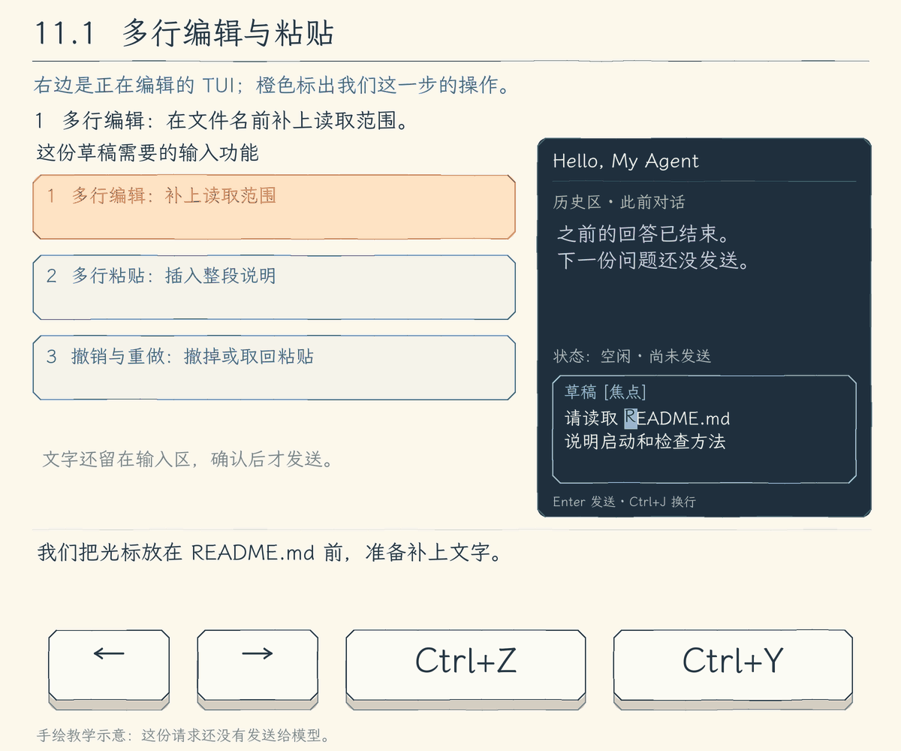
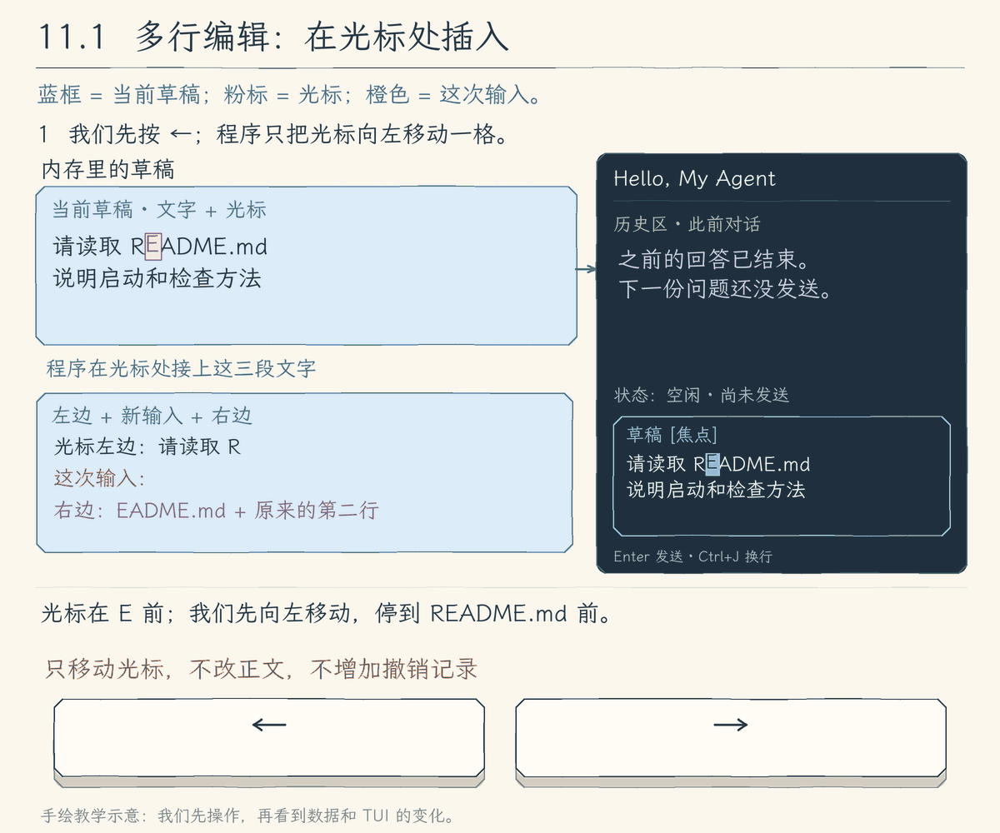
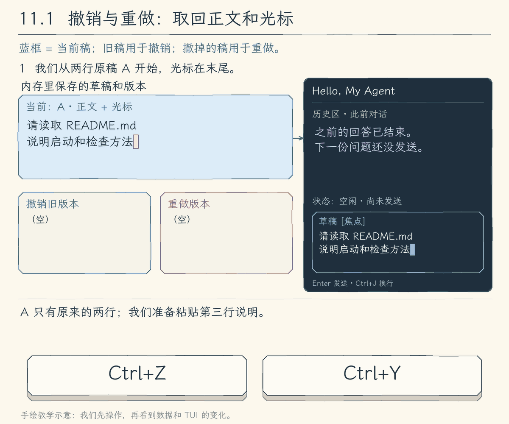

# 11.1 让多行输入成为可编辑的草稿

[第 11 章首页](../README.md) · [上一章：10.4 取消以后，继续留在对话里](../../chapter-10-terminal-ui/04-cancel-and-restore/README.md) · [下一节：11.2 取回旧问题，补全当前文字](../02-recall-and-complete/README.md)

## 问题：从单行编辑扩展到多行粘贴、撤销和重做

第十章的单行输入已经能左右移动、改字和发送问题。现在要把读取要求和检查要求分成两行，补一句说明，再撤掉一次多余的粘贴：

```text
请读取 README.md
说明启动和检查方法
```



单行编辑已经不够用：这份请求需要保留换行，在多行之间移动光标，整段粘贴文字，也能撤销或重做一次修改。我们希望先把草稿整理好，再发送给模型。

## 解决方案：保存多行草稿和修改记录

我们把输入框换成一个保存在内存里的多行草稿，正文和光标位置一起保存。三项操作分别这样处理：

- **多行编辑**：在光标处插入或删除文字，用 `Ctrl+J` 或 `Alt+Enter` 插入换行。
- **多行粘贴**：一次插入整段文字，保留其中的换行；粘贴结束后仍留在草稿里，普通 `Enter` 才请求发送。
- **撤销与重做**：改字前留下正文和光标的旧版本；撤销取回旧版本，并保留刚撤掉的版本供重做。

## 工作原理

下面的动画是教学示意，展示草稿怎样变化。

### 在光标处插入，后面的文字仍保留



程序先取出光标左边和右边的文字，把新输入放在中间，再接回原来的后半段。因此，在 `README.md` 前插入“项目中的 ”，文件名和第二行要求都会保留；光标移到新文字之后，方便继续写。

移动和删除按用户看到的完整字符进行。emoji 或带组合音标的 `é` 作为一整组处理，退格不会只删掉半组。

### 撤销取回旧稿，重做取回刚撤掉的稿



这幅图单独从开头的两行原稿 A 开始，一次粘贴带换行的“先不要修改文件。”得到 B。一次粘贴产生一次文字修改，所以程序先保存粘贴前的正文和光标。按 `Ctrl+Z` 取回这份旧稿，同时留下刚撤掉的版本；`Ctrl+Y` 再把它取回来。

只移动光标没有改字，不另存撤销步骤。撤销后重新输入，程序沿新的修改继续，之前那条重做记录就清掉。这里回退的是尚未发送的草稿，不是工具已经修改的文件。

### 粘贴先成为正文，发送是另一个动作

整段粘贴通过专门的输入事件交给程序，其中的换行也属于正文；程序一次插入整段，不逐行发送。手动写下一行可按 `Ctrl+J` 或 `Alt+Enter`，普通 `Enter` 才请求提交。

提交时，父组件先确认当前可以开始任务，再取正文并创建空草稿。本节任务中暂停草稿输入；11.3 再让等待期间也能编辑下一份。

## 本节改动文件

| 状态 | 文件 | 本节变化 |
| --- | --- | --- |
| NEW | [src/ui/tui/editor.tsx](src/ui/tui/editor.tsx) | 保存草稿、完整字符编辑、撤销和粘贴 |
| CHANGED | [src/ui/tui/app.tsx](src/ui/tui/app.tsx) | 用 `Draft` 替换单行字符串，接回原有提交入口 |

## 动手构建

从 10.4 的完整 `src/` 继续，目标目录为 `chapter-11-terminal-workbench/01-editable-draft/`。第十章练习是独立实验，没有改动这份基线。本节只新增草稿编辑器，并替换界面中使用输入框的部分。

### 新增草稿编辑器

创建 `src/ui/tui/editor.tsx`。`Draft` 用 `text`、`cursor` 保存正文和位置，用 `past`、`future` 留下可撤销与可重做的版本。插入、删除和清空都经过 `changeDraft()`，移动只更新光标。

实现提示：`cursor` 是 JavaScript 的 UTF-16 下标，用于 `slice()`；`Intl.Segmenter` 把文字分成完整字素，供移动和删除。撤销最多保留 100 步，正文最多 32,000 个 UTF-16 单元；超限先报错，原草稿不替换。

`usePaste()` 整段插入并统一换行，`useInput()` 区分编辑和发送。整段粘贴依赖终端支持 bracketed paste；中文输入法由系统和终端处理，程序接收确认后的字符。终端能区分 `Shift+Enter` 时也可换行；`Ctrl+J` 以 LF 字符进入普通插入分支。

完整新增文件如下：

<details>
<summary>完整新增文件：editor.tsx</summary>

<!-- source: src/ui/tui/editor.tsx -->
```tsx
/**
 * 11.1 多行草稿、粘贴与撤销 | [NEW] ui/tui/editor.tsx
 *
 * 学习目标：把一次输入改成可反复编辑的多行草稿，发送前先保留文字与光标。
 * 输入：父组件保存的 Draft、焦点、终端可用宽高。
 * 输出：新的草稿或一次提交回调；编辑中的文字尚未进入模型历史。
 * 状态：文字修改保留最近 100 个撤销快照；超限只显示错误，不替换原草稿。
 *
 * 本文件局部流程（全局主流程见 agent/agent-loop.ts）：
 *   草稿 + 键盘 -> 当前组件有焦点？-- 否 -> 不消费编辑输入
 *                                 +-- 是 -> 编辑键？-- 是 -> 计算新草稿
 *   修改文字 -> 超过上限？-- 是 -> 显示错误，保留原草稿
 *                          +-- 否 -> 保存撤销快照 -> onChange -> 重新绘制
 *   粘贴 -> 统一换行 -> 整段插入草稿；普通 Enter -> onSubmit -> app 判断能否发送
 *
 * 光标下标用于切字符串，字素用于移动和删除；这几种计数不能互换。
 * 运行观察：粘贴两行只增加一份草稿，撤销可一起移除；普通 Enter 才提交，多行文字不会逐行发送。
 */
import { Box, Text, useInput, usePaste, type Key } from "ink";
import { useState } from "react";
import wrapAnsi from "wrap-ansi";
import stringWidth from "string-width";
import { screenText } from "./state.js";

// [NEW 11.1] 本文件以下实现均为本节新增；草稿是待提交文字，不是已经发送给模型的历史。
type Snapshot = { text: string; cursor: number };
export type Draft = Snapshot & { past: Snapshot[]; future: Snapshot[] };
const segmenter = new Intl.Segmenter("zh", { granularity: "grapheme" });
export const MAX_DRAFT = 32_000;
/**
 * 把文字拆成用户眼中的一个个完整字符，供光标移动和删除使用。
 *
 * - 输入：草稿中的一段字符串，可能含中文、组合字符或多个码点组成的 emoji。
 * - 输出：按字素分组的字符串数组；空文本返回空数组。
 * - 关键原因：JavaScript 下标按 UTF-16 单元计数，直接减一可能拆开 emoji；字素长度才能给出完整移动步长。
 * - 职责边界：这里分字符，不计算这些字符在终端占几列。
 */
export function graphemes(text: string): string[] {
  return [...segmenter.segment(text)].map((part) => part.segment);
}
/**
 * 建立一份可以继续编辑的草稿，并把光标放在末尾。
 *
 * - 输入：初始文本，省略时使用空字符串；调用方负责选择已经允许进入草稿的内容。
 * - 输出：文字、UTF-16 光标下标，以及相互独立的空撤销和重做数组。
 * - 关键原因：发送后创建新草稿，上一条问题的编辑步骤不会混入下一条。
 * - 职责边界：不提交模型历史，也不在这里检查长度；后续文字修改统一经过 changeDraft。
 */
export function newDraft(text = ""): Draft {
  return { text, cursor: text.length, past: [], future: [] };
}
/**
 * 把一次文字修改记录成一个可撤销的步骤。
 *
 * - 输入：原草稿、新文本和新光标位置；未指定光标时放到新文本末尾。
 * - 输出：新 Draft；文字未变时只移动光标，不增加撤销记录。
 * - 关键步骤：先检查 32000 个 UTF-16 单元的长度上限，再把旧文字和光标存入 past；只保留最近 100 步并清空 future。
 * - 失败方式：超过长度上限先抛错，原草稿仍可继续编辑；本函数不修改传入对象，也不发送内容。
 */
export function changeDraft(draft: Draft, text: string, cursor = text.length): Draft {
  if (text.length > MAX_DRAFT) throw new Error(`草稿最多 ${MAX_DRAFT} 个 UTF-16 单元，本次输入未加入。`);
  if (text === draft.text) return { ...draft, cursor };
  return { text, cursor, past: [...draft.past, { text: draft.text, cursor: draft.cursor }].slice(-100), future: [] };
}
/**
 * 把键入或粘贴的文字插入当前光标位置。
 *
 * - 输入：原草稿与一整段输入；光标位置由编辑器维护。
 * - 输出：经过 changeDraft 保存的新草稿，光标移到本次插入内容之后。
 * - 关键原因：先把 CRLF 和 CR 统一成换行，再一次插入；多行粘贴因此只形成一个撤销步骤。
 * - 失败方式：超出草稿上限由 changeDraft 抛错；换行只成为草稿内容，不代表按下发送键。
 */
export function insertText(draft: Draft, input: string): Draft {
  const text = input.replace(/\r\n?/g, "\n");
  return changeDraft(draft, draft.text.slice(0, draft.cursor) + text + draft.text.slice(draft.cursor), draft.cursor + text.length);
}
/**
 * 把光标移到上一行或下一行中相近的字符位置。
 *
 * - 输入：当前草稿与方向，按键调用方传 -1 或 1；这里只跨文字中的换行。
 * - 输出：目标行内的 UTF-16 下标；目标行不存在时返回原光标。
 * - 关键步骤：数出当前行光标前有几个字素，再取目标行相同数量的字素，最后换回字符串下标。
 * - 边界：目标行较短时停在末尾；本节按字素数量对齐，中文占列宽度的差异留到 11.5 处理。
 */
export function moveVertical(draft: Draft, direction: number): number {
  const before = draft.text.slice(0, draft.cursor);
  const row = before.split("\n").length - 1;
  const lines = draft.text.split("\n");
  const target = row + direction;
  if (target < 0 || target >= lines.length) return draft.cursor;
  const column = graphemes(before.split("\n").at(-1) ?? "").length;
  return lines.slice(0, target).reduce((size, line) => size + line.length + 1, 0)
    + graphemes(lines[target]).slice(0, column).join("").length;
}
/**
 * 把一个编辑按键转换成下一份草稿。
 *
 * - 输入：当前 Draft、Ink 给出的文字和按键信息；发送键已由组件单独处理。
 * - 输出：修改后的草稿；没有对应操作时返回原草稿。
 * - 关键步骤：先处理撤销、重做和清空，再按完整字素移动或删除；改变文字的操作统一经过 changeDraft。
 * - 状态：撤销在 past 与 future 之间搬运快照，光标移动不另存快照；到首尾时不越界。
 * - 职责边界：本函数不读输入历史，不做补全，也不启动 Agent；文字过长的错误交给组件显示。
 */
export function editKey(draft: Draft, input: string, key: Partial<Key>): Draft {
  if (key.ctrl && (input === "z" || input === "y")) {
    const undo = input === "z", source = undo ? draft.past : draft.future;
    const target = source.at(-1); if (!target) return draft;
    const now = { text: draft.text, cursor: draft.cursor };
    return { ...target, past: undo ? draft.past.slice(0, -1) : [...draft.past, now].slice(-100),
      future: undo ? [...draft.future, now].slice(-100) : draft.future.slice(0, -1) };
  }
  if (key.ctrl && input === "u") return changeDraft(draft, "");
  const before = graphemes(draft.text.slice(0, draft.cursor)).at(-1)?.length ?? 0;
  const after = graphemes(draft.text.slice(draft.cursor))[0]?.length ?? 0;
  if (key.leftArrow) return { ...draft, cursor: draft.cursor - before };
  if (key.rightArrow) return { ...draft, cursor: draft.cursor + after };
  if (key.upArrow || key.downArrow) return { ...draft, cursor: moveVertical(draft, key.upArrow ? -1 : 1) };
  if (key.home || (key.ctrl && input === "a")) return { ...draft, cursor: draft.cursor === 0 ? 0 : draft.text.lastIndexOf("\n", draft.cursor - 1) + 1 };
  if (key.end || (key.ctrl && input === "e")) { const end = draft.text.indexOf("\n", draft.cursor); return { ...draft, cursor: end < 0 ? draft.text.length : end }; }
  if (key.backspace) return changeDraft(draft, draft.text.slice(0, draft.cursor - before) + draft.text.slice(draft.cursor), draft.cursor - before);
  if (key.delete) return changeDraft(draft, draft.text.slice(0, draft.cursor) + draft.text.slice(draft.cursor + after), draft.cursor);
  if (key.return && (key.meta || key.shift)) return insertText(draft, "\n");
  if (key.ctrl || key.meta || key.escape || key.tab || key.return) return draft;
  return input ? insertText(draft, input) : draft;
}
type DisplayLine = { text: string; cursor?: number };
/**
 * 显示一行草稿，在光标处反色显示整个字符，而不把后面的文字挤开。
 *
 * - 输入：纯文字显示行、行内光标下标，以及草稿区是否有焦点。
 * - 输出：一行 Ink 文字；失焦时只显示正文，不显示光标。
 * - 原理：只改变当前位置字符的显示样式，不插入字符，也不修改 Draft。
 * - 边界：NO_COLOR 用同样列宽的方块代替反色；行尾的占位仅用于显示，不进入草稿。
 */
// [NEW 11.1] 块状光标是显示样式，不是草稿里的字符。
function DraftLine({ line, active }: { line: DisplayLine; active: boolean }) {
  if (!active || line.cursor === undefined) return <Text>{line.text}</Text>;
  const at = line.cursor, char = graphemes(line.text.slice(at))[0] ?? " ";
  return <Text>{line.text.slice(0, at)}<Text inverse={!process.env.NO_COLOR}>
    {process.env.NO_COLOR ? "█".repeat(Math.max(1, stringWidth(char))) : char}
  </Text>{line.text.slice(at + char.length)}</Text>;
}
/**
 * 按终端宽度折行，并截取包含光标的草稿片段。
 *
 * - 输入：当前草稿、可用列数与显示行数；列数至少按 2 计算。
 * - 输出：每行纯文字和该行的光标位置，不修改原草稿。
 * - 原理：先折行，再用正文偏移定位光标；样式由 DraftLine 添加，不能参与列宽计算。
 * - 边界：行尾或空草稿需要一个显示占位；它不写入正文。视口随光标移动，只保留附近行。
 */
// [NEW 11.1] 先排正文，再标记位置；中间的光标不会多占一列。
export function draftLines(draft: Draft, width: number, height: number): DisplayLine[] {
  const columns = Math.max(2, width);
  const before = screenText(draft.text.slice(0, draft.cursor));
  const after = screenText(draft.text.slice(draft.cursor));
  const shown = before + (!after || after.startsWith("\n") ? " " : "") + after;
  const options = { hard: true, trim: false, wordWrap: false };
  let offset = 0;
  const lines = wrapAnsi(shown, columns, options).split("\n").map((text) => {
    const line = { text, offset };
    offset += text.length + (shown[offset + text.length] === "\n" ? 1 : 0);
    return line;
  });
  const cursorRow = lines.reduce((found, line, index) => line.offset <= before.length ? index : found, 0);
  return lines.map((line, index) => ({ text: line.text, cursor: index === cursorRow ? before.length - line.offset : undefined }))
    .slice(Math.max(0, cursorRow - height + 1), Math.max(height, cursorRow + 1));
}
/**
 * 接管当前草稿区的输入，让编辑与提交走各自的回调。
 *
 * - 输入：父组件持有的 Draft、更新与提交函数、焦点及显示尺寸。
 * - 输出：草稿画面或编辑错误；普通 Enter 调用 onSubmit，是否能发送仍由父组件判断。
 * - 输入处理：仅在 active 时收键盘和粘贴；粘贴通过专门事件整段加入，不把正文里的换行当成提交。
 * - 失败方式：文字超限或补全失败显示本地提示，保留原草稿；没有任何模型或工具执行入口。
 */
export function DraftEditor({ value, onChange, onSubmit, active, width, height = 4 }: {
  value: Draft; onChange: (value: Draft) => void; onSubmit: (text: string) => void;
  active: boolean; width: number; height?: number;
}) {
  const [error, setError] = useState("");
  const update = (action: () => Draft) => { try { onChange(action()); setError(""); } catch (error) { setError((error as Error).message); } };
  useInput((input, key) => {
    if (key.return && !key.meta && !key.shift) { onSubmit(value.text); return; }
    update(() => editKey(value, input, key));
  }, { isActive: active });
  // 粘贴独立交付，正文里的换行不能触发 onSubmit。
  usePaste((text) => update(() => insertText(value, text)), { isActive: active });
  return <Box flexDirection="column">
    {error ? <Text>{screenText(error)}</Text> : draftLines(value, width, height).map((line, index) => <DraftLine key={index} line={line} active={active} />)}
  </Box>;
}
```

</details>

### 把草稿接回界面

在 `src/ui/tui/app.tsx` 中，先替换文件开头的教学说明与导入：

<details>
<summary>app.tsx 文件说明与导入</summary>

<!-- source: src/ui/tui/app.tsx -->
```tsx
/**
 * 11.1 多行草稿、粘贴与撤销 | [CHANGED] ui/tui/app.tsx
 *
 * 学习目标：把多行草稿接入已有会话，只有普通 Enter 才提交本轮问题。
 * 输入：模型、键盘、终端尺寸与同一 Agent 事件流；界面只在用户提交后启动任务。
 * 输出：留存消息、多行草稿与当前执行状态。
 * 状态：Session 保存模型历史、只读授权；React state 保存草稿和画面。
 * 失败：本轮异常保留已经收到的结果；清理完成前不能发送下一轮，已执行的工具操作不回滚。
 *
 * 本文件局部流程（全局主流程见 agent/agent-loop.ts）：
 *   startTui -> 创建 Session、注册退出监听 -> 挂载 TuiApp
 *   空闲 -> 显示 DraftEditor；运行中 -> 显示本轮进度
 *   普通 Enter -> 可以提交？-- 否 -> 保留现有状态
 *                          +-- 是 -> 空白？-- 是 -> 等待输入
 *                                         +-- 否 -> 本地命令？-- 是 -> 本地处理后返回或退出
 *                                                            +-- 否 -> 新建本轮信号 -> 消费事件
 *   ask -> waitForApproval -> 审批面板独占输入 -> y / n / 合法 s -> 原审批 Promise
 *   本轮结束 / 失败 -> 等事件流清理 -> 留下结果、解除忙碌 -> 等待下一次提交
 *   Ctrl+C -> 有本轮任务？-- 是 -> abort -> 等清理；否 -> quit
 *   quit -> closing=true -> 取消并等待本轮任务 -> 卸载 Ink、移除监听
 *
 * 草稿不是模型消息历史；重新绘制不会重复执行任务，发送回调才把完整问题交给执行链。
 * 模型判断、工具执行、权限范围与历史提交仍由原有执行链负责。
 * 运行观察：粘贴多行后先继续编辑，再按 Enter 发送；撤销只改变尚未发送的草稿。
 */
import { useState } from "react";
import { Box, Static, Text, render, useInput, useWindowSize } from "ink";
import wrapAnsi from "wrap-ansi";
import { emptyRunView, updateRunView, runTranscript, screenText, type RunView } from "./state.js";
import { approvalPages, waitForApproval, type PendingApproval } from "./approval.js";
import TextInput from "ink-text-input";
// [NEW 11.1] 草稿编辑与发送分开，由组件交回完整文字。
import { DraftEditor, newDraft } from "./editor.js";
import type { Message, Model } from "../../models/client.js";
import { streamAgentRun } from "../../agent/run-stream.js";
import { explainError } from "../../errors.js";
```

</details>

替换 `TuiApp()` 及其紧邻的教学注释。父组件保存 `Draft`，把修改回调与提交回调分别交给 `DraftEditor`；原有模型事件、审批、取消和退出处理保留：

<details>
<summary>完整替换片段：TuiApp()</summary>

<!-- source: src/ui/tui/app.tsx -->
```tsx
/**
 * 把草稿、执行事件和当前交互区域连接起来。
 *
 * - 输入：已创建的模型、整次会话的 Session，以及取消和退出函数。
 * - 输出：界面 JSX；按状态选择草稿、执行进度和审批面板，渲染本身不启动任务。
 * - 提交步骤：先检查本轮占用和空白，再处理本地命令；普通问题才创建控制器并开始消费事件。
 * - 事件处理：局部 current 顺序积累每条事件，React 合并绘制也不丢正文；finally 等清理后才解除占用。
 * - 职责边界：本组件不执行工具或提交模型历史，取消也不会撤销已经发生的文件操作。
 */
// [KEEP 来自 10.4] 单独接收 interrupt，让组件触发“取消本轮”而不是直接退出。
function TuiApp({ model, session, quit, interrupt }: { model: Model; session: Session; quit: (code: number) => void; interrupt: () => void }) {
  // 这些值描述画面；setter 通知 React 重新绘制，不能把模型任务写进组件渲染过程。
  // [CHANGED 11.1] 保存文字、光标和撤销记录，不再只保存一个字符串。
  const [draft, setDraft] = useState(newDraft());
  const [entries, setEntries] = useState<Entry[]>([]);
  const [busy, setBusy] = useState(false);
  const [approval, setApproval] = useState<PendingApproval>();
  const [view, setView] = useState<RunView>({ ...emptyRunView(), status: "就绪" });
  const { columns, rows } = useWindowSize();
  // 函数式更新接在上一次 entries 后追加，连续事件不依赖某次绘制时捕获的旧数组。
  const append = (label: Entry["label"], text: string) => setEntries((old) => [...old, { label, text: screenText(text) }]);

  // [KEEP 来自 10.4] 先提示正在取消，保持 busy；任务真正结束后才由 finally 恢复输入。
  // [CHANGED 11.1] 取消时创建空 Draft，继续沿用先等清理再恢复输入的规则。
  useInput((input, key) => {
    if (key.ctrl && input === "c") {
      if (session.done) { setDraft(newDraft()); setView((current) => ({ ...current, status: "正在取消，等待清理…" })); }
      interrupt();
    }
    if (key.ctrl && input === "d") quit(0);
  });

  const submit = (value: string) => {
    // session.done 立即成为并发保护；不必等 React 把输入框换成忙碌画面后才阻止再次发送。
    if (session.done || session.closing) return;
    const prompt = value.trim();
    if (!prompt) return;
    // [CHANGED 11.1] 已接受提交后才重建草稿，清空这条问题的编辑记录。
    setDraft(newDraft());
    // 本地命令只改本地会话；它们不作为 user 消息送给模型。
    if (prompt === "/exit") { quit(0); return; }
    if (prompt === "/reset") { session.history.length = 0; append("本地", "对话历史已清空；会话授权保留。"); return; }
    if (prompt === "/permissions reset") { session.grants.clear(); append("本地", "本次会话的只读授权已撤销。"); return; }
    if (prompt === "/permissions") { append("本地", session.grants.size ? [...session.grants].join("\n") : "当前没有会话授权。"); return; }
    append("你", prompt);
    setBusy(true);
    setView(emptyRunView());
    // 一轮只对应一个控制器；history 与 grants 比这一轮活得更久，不能一起重新创建。
    const controller = new AbortController();
    session.controller = controller;
    session.done = (async () => {
      let current = emptyRunView();
      try {
        for await (const { event } of streamAgentRun(model, session.history, prompt, controller.signal, (request, signal) => waitForApproval(request, signal, (pending) => {
          if (!session.closing) setApproval(pending);
        }), session.grants)) {
          // [KEEP 来自 10.2] 本地变量保留每条事件；React 可以合并绘制，但不能丢掉已收到的数据。
          current = updateRunView(current, event);
          if (!session.closing) setView(current);
        }
      } catch (error) {
        current = { ...current, status: controller.signal.aborted ? "已取消本轮" : `运行失败：${screenText(explainError(error))}` };
      } finally {
        // for await 完成或抛错前会等待生成器的 finally；此时才解除本轮占用。
        session.controller = undefined;
        session.done = undefined;
        if (!session.closing) {
          append("Agent", runTranscript(current));
          setView(current);
          setApproval(undefined);
          setBusy(false);
        }
      }
    })();
  };

  // [KEEP 来自 10.4] 运行时显示进度，取消清理结束后再恢复草稿输入。
  // [CHANGED 11.1] 聊天输入换成多行编辑器；审批仍使用独立的明确选择输入。
  return <Box flexDirection="column">
    <Static items={entries}>{(entry, index) => <Box key={index} flexDirection="column" marginBottom={1}>
      <Text color={entry.label === "你" ? "cyan" : entry.label === "Agent" ? "magenta" : "yellow"} bold>{entry.label}</Text>
      <Text>{entry.text}</Text>
    </Box>}</Static>
    {approval ? <ApprovalPanel key={`${approval.key}:${columns}:${rows}`} pending={approval} columns={columns} rows={rows} />
      : <Box borderStyle="round" paddingX={1} flexDirection="column">
      <Text bold>Hello, My Agent</Text>
      <Text color={busy ? "yellow" : "green"}>状态：{view.status}{view.usage ? ` · ${view.usage}` : ""}</Text>
      {busy && <Box flexDirection="column">
        <Text color="magenta">Agent（当前文字末尾）</Text>
        <Text>{wrapAnsi(view.answers.at(-1)?.text || "等待模型…", Math.max(10, columns - 4), { hard: true, trim: false }).split("\n").slice(-Math.max(2, Math.min(8, rows - 12))).join("\n")}</Text>
        <Text dimColor>本轮工具：{view.tools.length} 次（显示最近 3 次）</Text>
        {view.tools.slice(-3).map((tool) => <Text key={tool.sequence}>#{tool.sequence} {tool.name} · {tool.status}</Text>)}
      </Box>}
      {busy ? <Text dimColor>正在处理本轮任务…</Text> : <Box><Text color="cyan">你 &gt; </Text>
        <DraftEditor value={draft} onChange={setDraft} onSubmit={submit} active={!busy} width={columns - 8} />
      </Box>}
      <Text dimColor>Enter 发送 · Ctrl+J / Alt+Enter 换行 · Ctrl+Z 撤销 · Ctrl+Y 重做 · /exit 退出</Text>
    </Box>}
  </Box>;
}
```

</details>

本文件其他函数沿用 10.4。

显示光标由 `DraftLine` 反色突出当前位置的完整字符，末尾用显示占位；它不插入草稿正文，也不把后文挤开。非空 `NO_COLOR` 下用同宽方块显示；`screenText()` 只处理显示副本。

## 运行验证

### 构建并启动

完成本节文件后，在仓库根目录构建，继续使用第十章配置好的模型：

```bash
npm run lesson:11.1
```

再单独启动：

```bash
hello-my-agent
```

### 按动画操作一份草稿

1. 一次粘贴开头的两行请求，先不发送。两行应完整出现，Agent 仍就绪。
2. 把光标移到 `README.md` 前，一次粘贴“项目中的 ”。文件名和第二行要求应保留；撤销后，原文与插入位置一起回来。
3. 移到草稿末尾，一次粘贴一个换行和“先不要修改文件。”。`Ctrl+Z` 撤掉整次粘贴，`Ctrl+Y` 整次恢复；单独按 `Ctrl+J` 也应能插入换行。
4. 写入 `中文🙂é`，从末尾退格，`é` 和 emoji 应分别整体删除。左右移动时，光标不挤开后文。

`Home`、`End` 到当前逻辑行首尾；上下键跨正文中的真实换行。`Ctrl+U` 清空草稿，再撤销应能恢复。

### 检查发送确实发生在最后

恢复成读取请求，按普通 `Enter`，这时才调用模型。任务中草稿暂停输入，结束后可以继续；本节尚未实现运行中编辑。

`Ctrl+C` 取消当前任务，等待清理后继续。空闲时发送 `/exit` 或按 `Ctrl+D` 退出。

## 本节完成后的 Agent

现在，请求可以先作为多行草稿整理，插入、粘贴与撤销都修改这份草稿，最后明确发送。下一节把已经写过的问题和项目文件名利用起来，减少重复输入。
