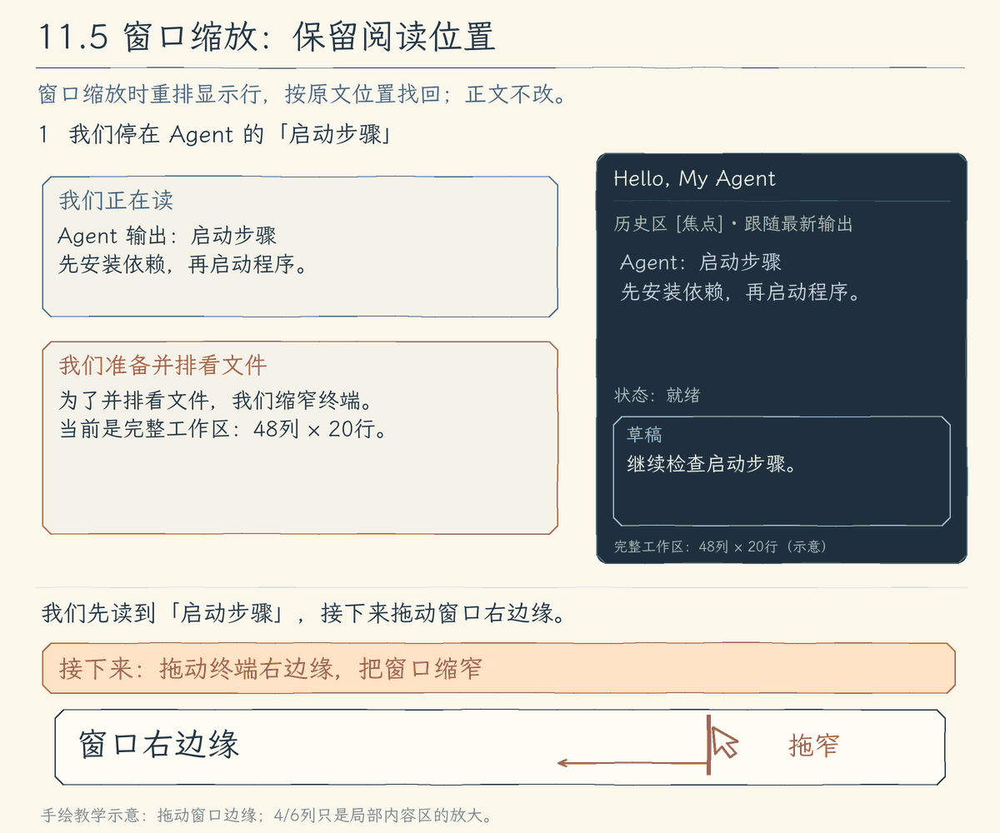
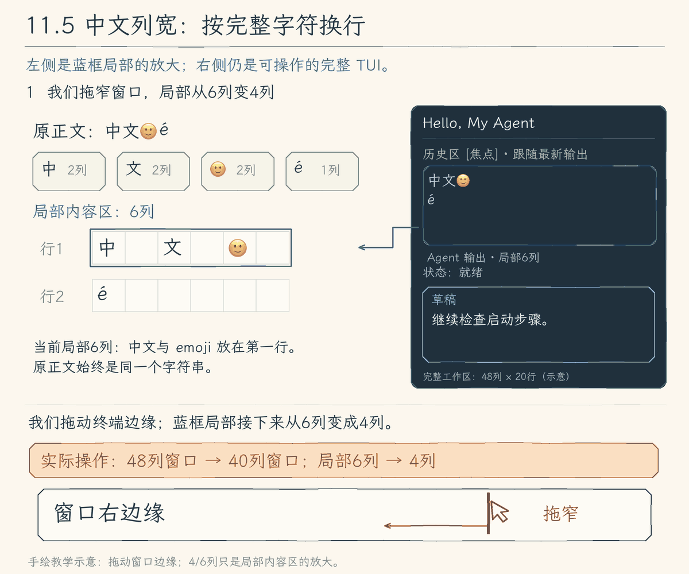
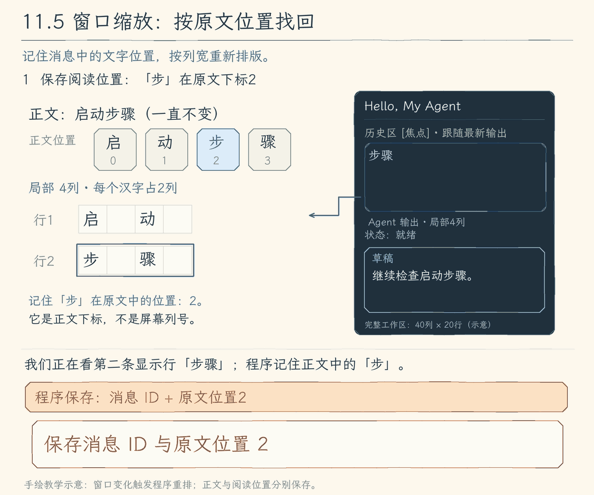

# 11.5 按终端列宽排版，保留阅读位置

[第 11 章首页](../README.md) · [上一节：11.4 把长草稿交给外部编辑器](../04-external-editor/README.md) · [下一步：练习与答案](../EXERCISES.md)

## 问题：中文与 emoji 要完整显示，resize 后要保留阅读位置

上一节已经能用外部编辑器整理长草稿，回到 TUI 后继续编辑。草稿里有中文和 emoji，结果区正停在“启动步骤”这一段。为了并排看文件，我们把终端缩窄，随后又放大。



窗口缩放（resize）会让一行文字拆成几行，再放大又会合起来。正文没改，我们希望中文和 emoji 仍完整显示，光标仍对齐，也能接着读刚才那一段。关闭颜色时，角色、焦点和运行状态仍要看得出来。

## 解决方案：按终端列宽换行，用消息中的文字位置定位

程序按完整字符实际占用的终端列数换行，草稿光标也按列宽对齐。浏览位置保存为消息 ID 和消息中的文字位置；窗口缩放后重新排成显示行，再找包含原来文字位置的行。

排版时先给草稿与提示留出高度，剩余空间用于结果区；窗口太小就暂时隐藏工作区，保留内容，放大后继续。无颜色显示仍保留角色名、状态文字和焦点提示，让操作不依赖颜色。

## 工作原理

下面两幅动画在完整 TUI 中框出一块局部内容区，再把它放大成字符格。局部省略角色前缀，4 列或 6 列用于看清排版过程；实际工作区至少需要 40 列、16 行。蓝框标记局部显示行或阅读位置。

### 中文与 emoji：按完整字符的列宽换行



我们拖动窗口边缘，局部可用宽度从 6 列变成 4 列。`Intl.Segmenter` 先分出完整字素，`stringWidth` 再计算占列：`中`、`文` 和 `🙂` 通常各占两格，`é` 占一格。第一行“中文”已经用了 4 列，下一组 emoji 还要 2 列，放不下；程序先收下第一行，把整个 emoji 放到下一行，再接上 `é`，不会拆开它们。

这里得到的是两条显示行，原文仍是 `中文🙂é`，没有插入新的换行符。窗口再变宽，只需重新安排画面，草稿与撤销记录都不必改。

程序保存草稿正文和正文中的光标位置。排版时，程序记下每一条显示行在原文中的起点，再按保存的光标位置找到所在行；这行光标前的文字占多少列，光标就显示在下一列。例如草稿是 `中🙂a`，光标在 `a` 前：

| 局部草稿宽度 | 光标所在行与列 |
| --- | --- |
| 6 列 | 三个字符在同一行，`中` 和 `🙂` 各占两列，光标在第 1 行第 5 列。 |
| 4 列 | `中🙂` 占满第一行，`a` 移到第二行，光标在第 2 行第 1 列。 |

正文和光标的正文位置都没变，只重新计算了显示行列。光标反色显示整个 `a`，不会插入一个额外字符挤动正文。

### resize：按消息中的文字位置找回显示行



图中正文是“启动步骤”，局部 4 列时原来停在“步骤”这行。程序记住“步”的 UTF-16 下标 `2`，连同消息 ID 保存。我们放大窗口，局部变成 6 列，“步”移到“启动步”这一行；若仍只找第二行，就会从“骤”开始。重新排版后的两行起点是 `0` 和 `3`，正文位置 `2` 落在第一行的范围内，所以程序找回第一行，“步”仍可见，不要求它成为画面的第一个字。终端占列用于排版，UTF-16 下标用于定位。

排版还要留出操作空间：先给草稿与提示留位置，剩余高度才显示结果。小到无法操作时暂时隐藏工作区，保留内容，放大后继续。

## 本节改动文件

| 状态 | 文件 | 本节变化 |
| --- | --- | --- |
| NEW | [src/ui/tui/layout.ts](src/ui/tui/layout.ts) | 按完整字素和列宽换行，保留显示文字起点 |
| CHANGED | [src/ui/tui/editor.tsx](src/ui/tui/editor.tsx) | 按列宽对齐逻辑行光标，显示光标附近草稿 |
| CHANGED | [src/ui/tui/transcript.tsx](src/ui/tui/transcript.tsx) | 用消息 ID 与 offset 找回缩放后的阅读位置 |
| CHANGED | [src/ui/tui/app.tsx](src/ui/tui/app.tsx) | 分配行高，小窗口保留状态，无颜色仍显示角色与状态 |

## 动手构建

从 11.4 的完整 `src/` 继续，目标目录为 `chapter-11-terminal-workbench/05-terminal-layout/`。新增共同排版函数，让草稿和结果区都取得行文字与正文位置，再接入终端尺寸。

### 把文字排成带位置的显示行

创建 `src/ui/tui/layout.ts`。`Intl.Segmenter` 分出可见字素，`string-width` 计算每组占多少终端列；`wrapLines()` 依次放入每行，返回行文字与 `offset`。`offset` 是显示字符串的 UTF-16 下标，供程序找正文位置，不是终端列数。

完整字素负责不拆字符，列宽负责是否放得下，下标负责字符串定位。这三种计数各有用途，不能用 `text.slice(0, columns)` 代替排版。

正文中真实的 `\n` 立即另起一行，空行和末尾换行也保留。单个字素即使宽于可用宽度，仍整体显示。`fitLine()` 取第一条显示行用于单行提示，`useColor` 统一读取 `NO_COLOR`。

<details>
<summary>完整新增文件：layout.ts</summary>

<!-- source: src/ui/tui/layout.ts -->
```ts
/**
 * 11.5 按终端列宽排版 | [NEW] ui/tui/layout.ts
 *
 * 学习目标：把字符串下标与终端列宽分开计算，完整显示中文和 emoji。
 * 输入：已准备好显示的文字与可用列数；调用方先清理控制字符。
 * 输出：带正文偏移的显示行，或第一行可容纳的文字；不修改原字符串。
 *
 * 本文件局部流程（全局主流程见 agent/agent-loop.ts）：
 *   文字 -> 按字素遍历 -> 换行字符？-- 是 -> 收下当前行，开始新行
 *                                   +-- 否 -> 加上字素会超宽且当前行非空？
 *                                              是 -> 先收下当前行，再放入字素
 *                                              否 -> 放入当前行
 *   遍历结束 -> 收下末行 -> 返回每行文字与原文偏移
 *
 * UTF-16 偏移用来找回正文位置，stringWidth 用来计算终端占列，字素保证不把组合字符拆开。
 * 颜色开关读取 NO_COLOR；它只改变装饰，状态仍有文字说明。
 * 运行观察：中文和 emoji 在窄屏下整字换行；改变宽度后可用 offset 找到原先浏览的内容。
 */
import stringWidth from "string-width";
// [NEW 11.5] 本文件以下实现均为本节新增；草稿与历史共用相同的显示计数。
const segmenter = new Intl.Segmenter("zh", { granularity: "grapheme" });
export const useColor = !process.env.NO_COLOR;
export type WrappedLine = { offset: number; text: string };
/**
 * 在完整字符之间换行，并记住每一行来自正文的哪个位置。
 *
 * - 输入：显示文字与终端列宽；至少使用 2 列，控制字符清理由调用方负责。
 * - 输出：WrappedLine 数组，offset 是原字符串中的 UTF-16 下标；空文本也保留一行。
 * - 关键步骤：按字素取得完整字符，用 stringWidth 累计占列；遇到显式换行立即结束当前行，超宽则先换行再追加。
 * - 边界：保留空行和末尾换行；单个字素即使超过可用宽度也整体保留，不把它拆开。
 * - 职责边界：只给出排版结果，不限制消息存储量，也不做凭据隐藏。
 */
export function wrapLines(text: string, width: number): WrappedLine[] {
  const columns = Math.max(2, width);
  const lines: WrappedLine[] = [];
  let offset = 0, cells = 0, line = "";
  for (const part of segmenter.segment(text)) {
    if (part.segment === "\n") {
      lines.push({ offset, text: line }); offset = part.index + 1; line = ""; cells = 0; continue;
    }
    const size = stringWidth(part.segment);
    if (cells + size > columns && line) {
      lines.push({ offset, text: line }); offset = part.index; line = ""; cells = 0;
    }
    line += part.segment; cells += size;
  }
  lines.push({ offset, text: line });
  return lines;
}
/**
 * 取出一行能够显示的文字，供提示与标题使用。
 *
 * - 输入：显示文字和可用终端列数。
 * - 输出：wrapLines 得到的第一行，不添加省略号；空输入返回空字符串。
 * - 关键原因：沿用相同字素和列宽规则，提示不会用 UTF-16 截取把 emoji 切成半个。
 * - 职责边界：只截取显示副本，原提示或正文仍保存在调用方。
 */
export function fitLine(text: string, width: number): string {
  return wrapLines(text, width)[0].text;
}
```

</details>

### 让草稿光标跟着列宽对齐

在 `src/ui/tui/editor.tsx` 中，替换文件开头的教学说明与导入：

<details>
<summary>editor.tsx 文件说明与导入</summary>

<!-- source: src/ui/tui/editor.tsx -->
```tsx
/**
 * 11.5 按终端列宽排版 | [CHANGED] ui/tui/editor.tsx
 *
 * 学习目标：用终端列宽计算光标与换行，让中文和 emoji 在窄屏下仍有完整边界。
 * 输入：父组件保存的 Draft、焦点、终端可用宽高和当前会话的问题列表。
 * 输出：新的草稿或一次提交回调；编辑中的文字尚未进入模型历史。
 * 状态：文字修改保留最近 100 个撤销快照；超限只显示错误，不替换原草稿。
 *
 * 本文件局部流程（全局主流程见 agent/agent-loop.ts）：
 *   草稿 + 键盘 -> 当前组件有焦点？-- 否 -> 不消费编辑输入
 *                                 +-- 是 -> 历史 / 搜索 / Tab？-- 是 -> 找回或补入草稿
 *   修改文字 -> 超过上限？-- 是 -> 显示错误，保留原草稿
 *                          +-- 否 -> 保存撤销快照 -> onChange -> 重新绘制
 *   粘贴 -> 统一换行 -> 整段插入草稿；普通 Enter -> onSubmit -> app 判断能否发送
 *   异步补全返回 -> 原草稿仍是当前草稿且未取消？-- 否 -> 丢弃结果
 *                                                       +-- 是 -> 更新文字和光标
 *
 * 光标下标用于切字符串，字素用于移动和删除，显示列宽用于对齐和换行；这几种计数不能互换。
 * 运行观察：粘贴两行只增加一份草稿，撤销可一起移除；找回旧问题或补全路径后仍要再按 Enter 发送。
 */
// [CHANGED 11.5] 用固定高度容器与共同的列宽排版函数绘制草稿。
import { Box, Text, useInput, usePaste, type Key } from "ink";
import { useEffect, useRef, useState } from "react";
import { completeInput, searchPrompts } from "./input-assist.js";
// [NEW 11.5] 草稿与历史共用相同的字素折行规则。
import { wrapLines, fitLine } from "./layout.js";
import stringWidth from "string-width";
import { screenText } from "./state.js";
```

</details>

替换 `moveVertical()` 及其教学注释。上下键仍跨正文真实换行形成的逻辑行，不在自动折行之间逐行移动；本节把对齐方式改为终端列宽。

例如正文是 `中文` 与 `abcd` 两行，光标在“中”后。向下时应停在 `ab` 后，因为“中”和 `ab` 都占两列。程序先量出光标前占列，再在目标行逐组累计，最后换回 UTF-16 光标下标。目标行短就停在末尾，放不下的宽字符不越过：

<details>
<summary>完整替换片段：moveVertical()</summary>

<!-- source: src/ui/tui/editor.tsx -->
```tsx
/**
 * 把光标移到上一行或下一行中相近的终端列。
 *
 * - 输入：当前草稿与方向，按键调用方传 -1 或 1；这里只跨文字中的换行，不跨自动折出的显示行。
 * - 输出：目标行内的 UTF-16 下标；目标行不存在时返回原光标。
 * - 关键步骤：先计算当前行光标前的终端列宽，再逐个字素累计目标行宽度，停在不超过原列的位置。
 * - 边界：目标行较短时停在末尾；宽字符放不进剩余列时停在字符前，不拆开字符。
 */
// [CHANGED 11.5] 上下移动按显示列宽对齐，替换原来的字素数量对齐。
export function moveVertical(draft: Draft, direction: number): number {
  const before = draft.text.slice(0, draft.cursor);
  const row = before.split("\n").length - 1;
  const lines = draft.text.split("\n");
  const target = row + direction;
  if (target < 0 || target >= lines.length) return draft.cursor;
  const column = stringWidth(before.split("\n").at(-1) ?? "");
  let cells = 0, length = 0;
  for (const part of graphemes(lines[target])) {
    const size = stringWidth(part); if (cells + size > column) break;
    cells += size; length += part.length;
  }
  return lines.slice(0, target).reduce((size, line) => size + line.length + 1, 0) + length;
}
```

</details>

替换 `draftLines()` 及其教学注释。用 `offset` 找光标所在行，返回纯行文字与可选光标位置，只显示包含光标的一段。完整草稿仍留在 `Draft` 中：

<details>
<summary>完整替换片段：draftLines()</summary>

<!-- source: src/ui/tui/editor.tsx -->
```tsx
/**
 * 按终端宽度折行，并截取包含光标的草稿片段。
 *
 * - 输入：当前草稿、可用列数与显示行数；列数至少按 2 计算。
 * - 输出：每行纯文字和该行的光标位置，不修改原草稿。
 * - 原理：先折行，再用正文偏移定位光标；样式由 DraftLine 添加，不能参与列宽计算。
 * - 边界：行尾或空草稿需要一个显示占位；它不写入正文。视口随光标移动，只保留附近行。
 */
// [CHANGED 11.5] 复用 wrapLines 的正文偏移定位光标，宽字符按完整字素折行。
export function draftLines(draft: Draft, width: number, height: number): DisplayLine[] {
  const columns = Math.max(2, width);
  const before = screenText(draft.text.slice(0, draft.cursor));
  const after = screenText(draft.text.slice(draft.cursor));
  const shown = before + (!after || after.startsWith("\n") ? " " : "") + after;
  const lines = wrapLines(shown, columns);
  const cursorRow = lines.reduce((found, line, index) => line.offset <= before.length ? index : found, 0);
  return lines.map((line, index) => ({ text: line.text, cursor: index === cursorRow ? before.length - line.offset : undefined }))
    .slice(Math.max(0, cursorRow - height + 1), Math.max(height, cursorRow + 1));
}
```

</details>

替换 `DraftEditor()` 及其教学注释。编辑、历史与补全分支沿用，把显示行交给已有 `DraftLine`；字符反色与末尾占位只在画面上，不加入正文。提示单独占一行，本文件其他实现不改：

<details>
<summary>完整替换片段：DraftEditor()</summary>

<!-- source: src/ui/tui/editor.tsx -->
```tsx
/**
 * 接管当前草稿区的输入，让编辑与提交走各自的回调。
 *
 * - 输入：父组件持有的 Draft、更新与提交函数、焦点及显示尺寸，还有仅存在本次会话中的问题历史。
 * - 输出：草稿画面、搜索结果与补全提示；普通 Enter 调用 onSubmit，是否能发送仍由父组件判断。
 * - 输入处理：仅在 active 时收键盘和粘贴；粘贴通过专门事件整段加入，不把正文里的换行当成提交。
 * - 找回与补全：历史搜索选中后只填草稿；异步补全保存发起时的草稿引用，草稿变化、失焦或卸载后旧结果不能覆盖新文字。
 * - 失败方式：文字超限或补全失败显示本地提示，保留原草稿；没有任何模型或工具执行入口。
 * - 布局：错误提示占一行，剩余高度留给草稿；超出宽高的显示内容留在数据里。
 */
export function DraftEditor({ value, onChange, onSubmit, active, width, height = 4, prompts = [] }: {
  value: Draft; onChange: (value: Draft) => void; onSubmit: (text: string) => void;
  active: boolean; width: number; height?: number; prompts?: string[];
}) {
  const [error, setError] = useState("");
  const [search, setSearch] = useState<{ query: string; index: number }>();
  const recall = useRef<{ index: number; saved: Draft } | undefined>(undefined);
  const completion = useRef<AbortController | undefined>(undefined);
  const latest = useRef(value); latest.current = value;
  useEffect(() => () => completion.current?.abort(), [value.text, value.cursor, active]);
  const update = (action: () => Draft) => { try { onChange(action()); setError(""); } catch (error) { setError((error as Error).message); } };
  const candidates = search ? searchPrompts(prompts, search.query) : [];
  useInput((input, key) => {
    if (key.ctrl && input === "r") { setSearch((old) => old ? { ...old, index: (old.index + 1) % Math.max(1, candidates.length) } : { query: "", index: 0 }); return; }
    if (search) {
      if (key.escape) { setSearch(undefined); return; }
      if (key.return) { const chosen = candidates[search.index]; if (chosen) update(() => changeDraft(value, chosen)); setSearch(undefined); return; }
      if (key.backspace || key.delete) setSearch({ query: graphemes(search.query).slice(0, -1).join(""), index: 0 });
      else if (!key.ctrl && !key.meta && !key.upArrow && !key.downArrow) setSearch({ query: search.query + input, index: 0 });
      return;
    }
    if (key.ctrl && (input === "p" || input === "n")) {
      const state = recall.current ?? { index: prompts.length, saved: value };
      state.index = Math.max(0, Math.min(prompts.length, state.index + (input === "p" ? -1 : 1)));
      recall.current = state;
      update(() => state.index === prompts.length ? state.saved : changeDraft(value, prompts[state.index] ?? "")); return;
    }
    recall.current = undefined;
    if (key.tab) {
      completion.current?.abort(); const controller = new AbortController(); completion.current = controller;
      const source = value;
      void completeInput(source.text, source.cursor, controller.signal).then((result) => {
        if (!controller.signal.aborted && latest.current === source) {
          update(() => changeDraft(source, result.text, result.cursor)); setError(result.hint);
        }
      }).catch((error) => { if (!controller.signal.aborted) setError((error as Error).message); }); return;
    }
    if (key.return && !key.meta && !key.shift) { onSubmit(value.text); return; }
    update(() => editKey(value, input, key));
  }, { isActive: active });
  usePaste((text) => {
    if (search) setSearch({ query: search.query + text.replace(/[\r\n]/g, " "), index: 0 });
    else update(() => insertText(value, text));
  }, { isActive: active });
  // [CHANGED 11.5] 为提示预留一行，并限制本组件的总显示高度。
  const contentHeight = Math.max(1, height - (error ? 1 : 0));
  const lines: DisplayLine[] = search
    ? wrapLines(`搜索历史：${screenText(search.query)}\n${screenText(candidates[search.index] ?? "没有匹配")}`, width).slice(0, contentHeight)
    : draftLines(value, width, contentHeight);
  return <Box flexDirection="column" height={height} overflow="hidden">
    {lines.map((line, index) => <DraftLine key={index} line={line} active={active} />)}
    {error && <Text wrap="truncate">{fitLine(screenText(error), width)}</Text>}
  </Box>;
}
```

</details>

### 缩放以后按文字位置定位

11.3 保存消息 `id` 和消息内显示行号，本节把行号换成 `offset`。排版时每行已经留下起点，定位时就在同一消息里，找起点不超过原位置的最后一行；这就是包含原位置的行。

实际位置来自经过 `screenText()` 清理的显示正文，包含角色前缀与展开详情。它不指向工具文件的字节位置；动画省略前缀只是为了看清换行。

在 `src/ui/tui/transcript.tsx` 中，替换文件开头的教学说明与导入：

<details>
<summary>transcript.tsx 文件说明与导入</summary>

<!-- source: src/ui/tui/transcript.tsx -->
```tsx
/**
 * 11.5 按终端列宽排版 | [CHANGED] ui/tui/transcript.tsx
 *
 * 学习目标：窗口宽度变化后，仍能找到正在浏览的正文位置。
 * 输入：带稳定 ID 的显示消息、焦点、可用宽高；工具详情来自 RunView。
 * 输出：当前历史视口；滚动与折叠只改变浏览状态，不改变模型历史。
 * 状态：没有锚点时跟随末尾，手动浏览后保存消息 ID 与正文偏移；End 清除锚点并回到最新。
 *
 * 本文件局部流程（全局主流程见 agent/agent-loop.ts）：
 *   消息 -> 展开集合决定是否显示详情 -> 折行 -> 有锚点？-- 否 -> 取末尾视口
 *                                                        +-- 是 -> 找到保存位置
 *   历史区有焦点？-- 否 -> 只显示最新数据
 *                  +-- 是 -> 滚动 / 选消息 / 展开 -> 更新浏览状态
 *   Ctrl+Y -> 有选中消息？-- 否 -> 返回
 *                         +-- 是 -> 复制正文和详情 -> 成功 / 失败提示
 *
 * 本轮进行中与结束后的条目使用同一组 ID，所以重绘和任务完成不会改变消息身份。
 * 折行行号会随列宽变化；保存正文偏移后，可以在新行列表里重新找到包含它的行。
 * 运行观察：向上浏览后新输出不会把视口拉回底部；按 End 才恢复跟随。
 */
import { useEffect, useRef, useState } from "react";
import { Box, Text, useInput, usePaste } from "ink";
// [CHANGED 11.5] 使用统一折行函数，取得每行对应的正文偏移。
import { wrapLines, useColor } from "./layout.js";
import { copyText } from "./system-actions.js";
import { screenText, type RunView } from "./state.js";
```

</details>

替换 `ViewLine` 类型及其教学注释，用 `offset` 代替 `row`：

<details>
<summary>ViewLine 类型</summary>

<!-- source: src/ui/tui/transcript.tsx -->
```tsx
// [CHANGED 11.5] 用正文偏移替代折行行号，避免窗口变宽或变窄后锚点漂移。
export type ViewLine = { id: string; offset: number; text: string };
```

</details>

替换 `Anchor` 类型及其教学注释，用同一种位置保存阅读起点：

<details>
<summary>Anchor 类型</summary>

<!-- source: src/ui/tui/transcript.tsx -->
```tsx
export type Anchor = { id: string; offset: number } | undefined;
```

</details>

替换 `transcriptLines()` 及其教学注释。仍组合角色、正文与展开详情，再把排版结果带上消息 ID：

<details>
<summary>完整替换片段：transcriptLines()</summary>

<!-- source: src/ui/tui/transcript.tsx -->
```tsx
/**
 * 按当前展开状态，把消息排成可滚动的显示行。
 *
 * - 输入：显示消息、可用宽度和已展开的消息 ID 集合。
 * - 输出：每行带消息 ID、正文偏移和显示文字，供视口重新定位。
 * - 关键步骤：先选择摘要或完整详情，清理控制字符，再按共同的字素与列宽规则折行。
 * - 职责边界：折叠只影响本次排版，Entry 的详情仍保留，复制时仍能取得它。
 */
// [CHANGED 11.5] 折行结果直接带上正文偏移，不再额外生成行号。
export function transcriptLines(entries: Entry[], width: number, expanded: Set<string>): ViewLine[] {
  return entries.flatMap((entry) => {
    const body = `${entry.label} > ${entry.text}${entry.details !== undefined ? expanded.has(entry.id) ? `\n${entry.details}` : " [结果已折叠]" : ""}`;
    return wrapLines(screenText(body), width).map((line) => ({ id: entry.id, ...line }));
  });
}
```

</details>

替换 `visibleStart()` 及其教学注释，按刚才的包含关系找回首行：

<details>
<summary>完整替换片段：visibleStart()</summary>

<!-- source: src/ui/tui/transcript.tsx -->
```tsx
/**
 * 把保存的正文位置换算成当前行列表中的视口起点。
 *
 * - 输入：重新排版后的行列表、视口高度和可选锚点。
 * - 输出：视口首行下标；没有锚点时取末尾，有锚点但消息已不存在时回到第 0 行。
 * - 关键原因：终端缩放会改变折行数量；在同一消息里找最后一个不超过锚点偏移的行，就能重新定位正文。
 * - 职责边界：只计算显示位置，不修改锚点，也不会触发新的执行事件。
 */
// [CHANGED 11.5] 重新排版后，按同一消息的正文偏移寻找当前行。
export function visibleStart(lines: ViewLine[], height: number, anchor: Anchor): number {
  if (!anchor) return Math.max(0, lines.length - height);
  const found = lines.reduce((found, line, index) => line.id === anchor.id && line.offset <= anchor.offset ? index : found, -1);
  return Math.max(0, found);
}
```

</details>

替换 `Transcript()` 及其教学注释。滚动留下新文字位置，消息选择与展开从该消息的开头看；其他浏览和复制动作沿用：

<details>
<summary>完整替换片段：Transcript()</summary>

<!-- source: src/ui/tui/transcript.tsx -->
```tsx
/**
 * 在固定视口中浏览消息，让滚动和新输出互不抢位置。
 *
 * - 输入：显示消息、历史区是否有焦点，以及可用宽高。
 * - 输出：当前视口、选中标记和操作提示；不向 Agent 发出问题。
 * - 浏览步骤：方向键或翻页键保存视口锚点，j / k 选择消息，Enter 切换详情；End 清除锚点恢复跟随。
 * - 复制步骤：Ctrl+Y 复制选中条目的文字与详情；重复复制先取消旧任务，组件卸载也取消尚未结束的复制。
 * - 失败方式：复制错误只更新提示，不改变消息；粘贴在历史区只提示返回草稿，不修改草稿或触发审批。
 * - 职责边界：焦点由父组件分配；没有焦点时继续显示数据，但不消费历史操作按键。
 */
export function Transcript({ entries, active, width, height }: { entries: Entry[]; active: boolean; width: number; height: number }) {
  const [anchor, setAnchor] = useState<Anchor>();
  const [selected, setSelected] = useState<string>();
  const [expanded, setExpanded] = useState(new Set<string>());
  const [notice, setNotice] = useState("");
  const copying = useRef<AbortController | undefined>(undefined);
  useEffect(() => () => copying.current?.abort(), []);
  const lines = transcriptLines(entries, width - 2, expanded);
  const start = visibleStart(lines, height, anchor);
  const chosen = selected ?? entries.at(-1)?.id;
  useInput((input, key) => {
    if (key.pageUp || key.pageDown || key.upArrow || key.downArrow) {
      const distance = key.pageUp || key.pageDown ? Math.max(1, height - 1) : 1;
      const next = Math.max(0, Math.min(Math.max(0, lines.length - height), start + (key.pageUp || key.upArrow ? -distance : distance)));
      setAnchor(lines[next]); setSelected(lines[next]?.id); return;
    }
    if (key.end) { setAnchor(undefined); setSelected(undefined); return; }
    if (key.home) { setAnchor(lines[0]); setSelected(lines[0]?.id); return; }
    // [CHANGED 11.5] 选择消息和展开详情都把锚点放回该消息的正文起点。
    if (input === "j" || input === "k") {
      const index = entries.findIndex((entry) => entry.id === chosen);
      const target = entries[Math.max(0, Math.min(entries.length - 1, index + (input === "j" ? 1 : -1)))];
      if (target) { setSelected(target.id); setAnchor({ id: target.id, offset: 0 }); } return;
    }
    // [CHANGED 11.5] 展开会重新折行；正文起点始终是 offset=0。
    if (key.return && chosen) {
      setExpanded((old) => { const next = new Set(old); if (next.has(chosen)) next.delete(chosen); else next.add(chosen); return next; });
      setAnchor({ id: chosen, offset: 0 }); return;
    }
    if (key.ctrl && input === "y") {
      const entry = entries.find((entry) => entry.id === chosen); if (!entry) return;
      copying.current?.abort(); const controller = new AbortController(); copying.current = controller;
      void copyText(`${entry.text}${entry.details !== undefined ? `\n${entry.details}` : ""}`, controller.signal)
        .then(() => { if (!controller.signal.aborted) setNotice("已复制选中内容。"); })
        .catch((error) => { if (!controller.signal.aborted) setNotice((error as Error).message); });
    }
  }, { isActive: active });
  usePaste(() => setNotice("当前焦点在历史区；Ctrl+O 返回草稿后再粘贴。"), { isActive: active });
  // [CHANGED 11.5] 标题过长时只截取显示内容，避免额外折行挤占视口。
  return <Box flexDirection="column">
    <Text wrap="truncate">{active ? "历史区 [焦点]" : "历史区"} · {anchor ? "停留浏览；End 回到最新" : "跟随最新输出"}</Text>
    <Box flexDirection="column" height={height} overflow="hidden">
      {lines.slice(start, start + height).map((line, index) => <Text key={index} wrap="truncate" color={useColor ? entries.find((entry) => entry.id === line.id)?.label === "你" ? "cyan" : entries.find((entry) => entry.id === line.id)?.label === "Agent" ? "magenta" : undefined : undefined}>{line.id === chosen ? "> " : "  "}{line.text}</Text>)}
    </Box>
    <Text wrap="truncate">{!active ? "Ctrl+O 进入历史区后，↑↓/PgUp/PgDn 才用于滚动" : notice || "↑↓/PgUp/PgDn 滚动 · j/k 选消息 · Enter 展开 · Ctrl+Y 复制"}</Text>
  </Box>;
}
```

</details>

### 分配高度，小窗口保留状态

在 `src/ui/tui/app.tsx` 中，替换文件开头的教学说明与导入：

<details>
<summary>app.tsx 文件说明与导入</summary>

<!-- source: src/ui/tui/app.tsx -->
```tsx
/**
 * 11.5 按终端列宽排版 | [CHANGED] ui/tui/app.tsx
 *
 * 学习目标：按终端尺寸分配显示区域，窗口过小时暂停普通操作并保留所有数据。
 * 输入：模型、键盘、终端尺寸与同一 Agent 事件流；界面只在用户提交后启动任务。
 * 输出：可浏览的历史区、草稿区和审批面板。
 * 状态：Session 保存模型历史、只读授权与已发送问题；React state 保存草稿和画面。
 * 失败：本轮异常保留已经收到的结果；清理完成前不能发送下一轮，已执行的工具操作不回滚。
 *
 * 本文件局部流程（全局主流程见 agent/agent-loop.ts）：
 *   startTui -> 创建 Session、注册退出监听 -> 挂载 TuiApp
 *   终端至少 40 列、16 行？-- 否 -> 显示放大提示，只保留取消 / 退出
 *                           +-- 是 -> 显示完整工作区
 *   Ctrl+O -> 切换草稿 / 历史焦点；审批中不切换
 *   任务运行中 -> 继续编辑草稿；按 Enter -> 提示保留草稿，等待本轮结束
 *   找回 / 搜索 / 补全 -> 更新草稿，尚未发送
 *   Ctrl+G -> 空闲且没有审批？-- 否 -> 提示稍后编辑
 *                             +-- 是 -> suspendTerminal -> 外部编辑器
 *   外部编辑成功？-- 否 -> 保留原草稿，显示原因
 *                   +-- 是 -> changeDraft -> 恢复界面，仍待发送
 *   普通 Enter -> 可以提交？-- 否 -> 保留现有状态
 *                          +-- 是 -> 空白？-- 是 -> 等待输入
 *                                         +-- 否 -> 本地命令？-- 是 -> 本地处理后返回或退出
 *                                                            +-- 否 -> 新建本轮信号 -> 消费事件
 *   普通问题提交时 -> 保存最近 100 条用户问题；模型历史仍由 Agent 核心提交
 *   ask -> waitForApproval -> 审批面板独占输入 -> y / n / 合法 s -> 原审批 Promise
 *   本轮结束 / 失败 -> 等事件流清理 -> 留下结果、解除忙碌 -> 等待下一次提交
 *   Ctrl+C -> 有本轮任务？-- 是 -> abort -> 等清理；否 -> quit
 *   quit -> closing=true -> 取消并等待模型任务与外部编辑 -> 卸载 Ink、移除监听
 *
 * 草稿、问题历史、显示条目和模型消息各有用途；浏览或编辑不会自动改变模型上下文。
 * 外部编辑占用终端期间不能同时发送；编辑器返回的文字先成为一次可撤销修改。
 * 运行观察：缩小窗口后显示放大提示，重新放大可继续；NO_COLOR 下依然能从文字区分状态。
 */
import { useState } from "react";
import { Box, Text, render, useInput, usePaste, useWindowSize, useApp } from "ink";
// [NEW 11.5] 颜色开关统一读取 NO_COLOR，文字状态始终保留。
import { useColor } from "./layout.js";
import { emptyRunView, updateRunView, screenText, type RunView } from "./state.js";
import { approvalPages, waitForApproval, type PendingApproval } from "./approval.js";
import TextInput from "ink-text-input";
import { DraftEditor, newDraft, changeDraft } from "./editor.js";
import { Transcript, runEntries, type Entry } from "./transcript.js";
import { editExternally } from "./system-actions.js";
import type { Message, Model } from "../../models/client.js";
import { streamAgentRun } from "../../agent/run-stream.js";
import { explainError } from "../../errors.js";
```

</details>

替换 `ApprovalPanel()` 及其教学注释，提示与角色都用文字说明，审批条件沿用：

窗口足够大时，任意页都能输入 `n` 拒绝；窗口过小则暂停审批输入，放大后继续，也可以用 `Ctrl+C` 取消本轮任务或 `Ctrl+D` 退出。

<details>
<summary>完整替换片段：ApprovalPanel()</summary>

<!-- source: src/ui/tui/app.tsx -->
```tsx
/**
 * 让用户逐页查看完整请求，再明确提交这一次审批决定。
 *
 * - 输入：当前 PendingApproval 与终端尺寸；request 和 respond 属于同一次核心审批等待。
 * - 输出：当前页、提示和一个审批输入框；next / prev 只翻页，y / n / s 还要按 Enter 才提交。
 * - 状态：page、answer、hint 属于这次面板；请求 key 或窗口尺寸改变时由父组件重新挂载并清空。
 * - 批准条件：窗口至少 40 列、16 行且已经到最后一页；窗口足够大时任意页都可输入 n 拒绝。
 * - 小窗口：工作区暂停输入；放大后继续审批，或用 Ctrl+C 取消本轮任务、Ctrl+D 退出。
 * - 粘贴处理：审批输入不接收粘贴，复制来的正文不能变成审批按键。
 * - 关键原因：不能在只显示了部分修改时批准全部内容；尺寸变化后需按新分页重新查看。
 * - 职责边界：本函数只检查显示条件，s 是否属于可记住的只读范围仍由 pending.respond 检查。
 */
// [KEEP 来自 10.3] 审批面板继续只处理本次请求。
function ApprovalPanel({ pending, columns, rows }: { pending: PendingApproval; columns: number; rows: number }) {
  const pages = approvalPages(pending.request, columns, rows);
  const [page, setPage] = useState(0);
  const [answer, setAnswer] = useState("");
  const [hint, setHint] = useState("");
  const tooSmall = columns < 40 || rows < 16;
  usePaste(() => setHint("审批不接受粘贴，请手动输入 y、n 或 s 后回车。"));
  // 翻页只更新画面；窗口足够大时任意页可拒绝，批准还要到最后一页。
  const submit = (value: string) => {
    const choice = value.trim().toLowerCase();
    setAnswer("");
    if (choice === "next" && page < pages.length - 1) { setPage(page + 1); setHint(""); return; }
    if (choice === "prev" && page > 0) { setPage(page - 1); setHint(""); return; }
    if (choice !== "n" && (tooSmall || page !== pages.length - 1)) { setHint("请先逐页查看完整内容，或输入 n 拒绝。"); return; }
    if (!pending.respond(choice)) setHint("请输入 y、n，或当前请求允许的 s，再按 Enter。");
  };
  // [CHANGED 11.5] 审批的颜色和光标装饰尊重 NO_COLOR，判断规则不靠颜色表达。
  return <Box borderStyle="round" borderColor={useColor ? "yellow" : undefined} paddingX={1} flexDirection="column">
    <Text bold={useColor} color={useColor ? "yellow" : undefined}>等待批准 · 第 {page + 1}/{pages.length} 页</Text>
    {tooSmall ? <Text>窗口过小，请放大至至少 40 列、16 行后继续审批；Ctrl+C 取消本轮任务，Ctrl+D 退出。</Text> : <Text>{pages[page]}</Text>}
    <Text dimColor={useColor}>next 下一页 · prev 上一页 · n 拒绝</Text>
    <Text>{!tooSmall && page === pages.length - 1 ? `y 批准本次${pending.request.allowSession && !pending.request.preview ? " · s 本次会话允许" : ""}；输入后按 Enter` : "查看到最后一页后才能批准"}</Text>
    {hint && <Text color={useColor ? "yellow" : undefined}>{hint}</Text>}
    <Box><Text color={useColor ? "yellow" : undefined}>审批 &gt; </Text><TextInput focus={!tooSmall} showCursor={useColor} value={answer}
      onChange={(value) => setAnswer(screenText(value).replace(/[\r\n\t]/g, " "))} onSubmit={submit} /></Box>
  </Box>;
}
```

</details>

替换 `TuiApp()` 及其教学注释。Ink 的 `useWindowSize()` 提供尺寸，变化后触发重绘；给草稿、状态与提示预留 12 行，其余作为结果高度。草稿默认显示 4 行，有提示时再给提示留一行。

少于 40 列或 16 行时，只提示放大并保留取消与退出。工作区隐藏而不卸载，关闭普通输入，所以草稿与浏览位置仍在。待审批请求也保留；尺寸改变后审批重新分页，页码和未提交答案重置，用户按新页面重新查看。

非空 `NO_COLOR` 关闭配色，角色、状态和焦点仍由文字说明。无颜色下的草稿光标使用同宽 `█`，不改正文；终端重绘所需的控制序列仍保留。

<details>
<summary>完整替换片段：TuiApp()</summary>

<!-- source: src/ui/tui/app.tsx -->
```tsx
/**
 * 把草稿、执行事件和当前交互区域连接起来。
 *
 * - 输入：已创建的模型、整次会话的 Session，以及取消和退出函数。
 * - 输出：界面 JSX；按状态选择草稿区、历史区和审批面板，渲染本身不启动任务。
 * - 提交步骤：先检查本轮占用和空白，再处理本地命令；普通问题才创建控制器并开始消费事件。
 * - 事件处理：局部 current 顺序积累每条事件，React 合并绘制也不丢正文；finally 等清理后才解除占用。
 * - 历史区分：prompts 只记最近 100 条已发送问题，供编辑器找回；history 才是模型实际使用的消息。
 * - 焦点：草稿与历史只有一处消费普通按键；审批出现时暂停两处输入，正在编辑的草稿仍保留。
 * - 外部编辑：仅空闲时让出终端，完成后先更新草稿；失败显示原因，不自动发送或清空原文。
 * - 尺寸：小于 40 列或 16 行时保留组件状态并停用普通输入，放大后再恢复完整界面。
 * - 职责边界：本组件不执行工具或提交模型历史，取消也不会撤销已经发生的文件操作。
 */
// [KEEP 来自 10.4] 单独接收 interrupt，让组件触发“取消本轮”而不是直接退出。
function TuiApp({ model, session, quit, interrupt }: { model: Model; session: Session; quit: (code: number) => void; interrupt: () => void }) {
  // 这些值描述画面；setter 通知 React 重新绘制，不能把模型任务写进组件渲染过程。
  const [draft, setDraft] = useState(newDraft());
  const [entries, setEntries] = useState<Entry[]>([]);
  const [busy, setBusy] = useState(false);
  const [focus, setFocus] = useState<"draft" | "history">("draft");
  const [notice, setNotice] = useState("");
  const [editing, setEditing] = useState(false);
  const { suspendTerminal } = useApp();
  const [approval, setApproval] = useState<PendingApproval>();
  const [view, setView] = useState<RunView>({ ...emptyRunView(), status: "就绪" });
  const { columns, rows } = useWindowSize();
  // [NEW 11.5] 先判断窗口是否容得下工作区，再决定普通输入是否激活。
  const tooSmall = columns < 40 || rows < 16;
  // 函数式更新接在上一次 entries 后追加，连续事件不依赖某次绘制时捕获的旧数组。
  const append = (label: Entry["label"], text: string) => {
    const entry = { id: `local:${session.nextId++}`, label, text: screenText(text) };
    setEntries((old) => [...old, entry]);
  };

  // [KEEP 来自 11.4] 暂时把整个终端交给编辑器，结束后只替换草稿。
  const openEditor = () => {
    if (session.done || session.external || session.closing || approval) { setNotice("请在当前任务结束后编辑草稿。"); return; }
    const controller = new AbortController();
    setEditing(true);
    session.external = { controller, done: (async () => {
      try {
        let text = draft.text;
        await suspendTerminal(async () => { text = await editExternally(draft.text, controller.signal); });
        if (!session.closing) { setDraft(changeDraft(draft, text)); setNotice("已取回编辑内容，按 Enter 才会发送。"); }
      } catch (error) { if (!session.closing) setNotice(screenText((error as Error).message)); }
      finally { session.external = undefined; if (!session.closing) setEditing(false); }
    })() };
  };
  // [KEEP 来自 10.4] 先提示正在取消，保持 busy；任务真正结束后才由 finally 恢复输入。
  // [CHANGED 11.5] 小窗口保留取消与退出，暂停焦点切换和外部编辑入口。
  useInput((input, key) => {
    if (key.ctrl && input === "c") {
      if (session.done) { setView((current) => ({ ...current, status: "正在取消，等待清理…" })); }
      interrupt();
    }
    if (key.ctrl && input === "d") quit(0);
    if (!tooSmall && key.ctrl && input === "g" && focus === "draft") openEditor();
    if (!tooSmall && key.ctrl && input === "o" && !approval) setFocus((old) => old === "draft" ? "history" : "draft");
  });

  const submit = (value: string) => {
    // session.done 立即成为并发保护；不必等 React 把输入框换成忙碌画面后才阻止再次发送。
    if (session.closing || session.external) return;
    if (session.done) { setNotice("本轮仍在运行，草稿已保留；完成后再按 Enter 发送。"); return; }
    setNotice("");
    const prompt = value.trim();
    if (!prompt) return;
    setDraft(newDraft());
    // 本地命令只改本地会话；它们不作为 user 消息送给模型。
    if (prompt === "/exit") { quit(0); return; }
    if (prompt === "/reset") { session.history.length = 0; append("本地", "对话历史已清空；会话授权保留。"); return; }
    if (prompt === "/permissions reset") { session.grants.clear(); append("本地", "本次会话的只读授权已撤销。"); return; }
    if (prompt === "/permissions") { append("本地", session.grants.size ? [...session.grants].join("\n") : "当前没有会话授权。"); return; }
    session.prompts = [...session.prompts, prompt].slice(-100);
    append("你", prompt);
    const run = ++session.run;
    setBusy(true);
    setView(emptyRunView());
    // 一轮只对应一个控制器；history 与 grants 比这一轮活得更久，不能一起重新创建。
    const controller = new AbortController();
    session.controller = controller;
    session.done = (async () => {
      let current = emptyRunView();
      try {
        for await (const { event } of streamAgentRun(model, session.history, prompt, controller.signal, (request, signal) => waitForApproval(request, signal, (pending) => {
          if (!session.closing) setApproval(pending);
        }), session.grants)) {
          // [KEEP 来自 10.2] 本地变量保留每条事件；React 可以合并绘制，但不能丢掉已收到的数据。
          current = updateRunView(current, event);
          if (!session.closing) setView(current);
        }
      } catch (error) {
        current = { ...current, status: controller.signal.aborted ? "已取消本轮" : `运行失败：${screenText(explainError(error))}` };
      } finally {
        // for await 完成或抛错前会等待生成器的 finally；此时才解除本轮占用。
        session.controller = undefined;
        session.done = undefined;
        if (!session.closing) {
          setEntries((old) => [...old, ...runEntries(current, run)]);
          setView(current);
          setApproval(undefined);
          setBusy(false);
        }
      }
    })();
  };

  // [KEEP 来自 11.3] 当前轮与留存消息一起交给历史区，草稿输入由焦点决定。
  const display = busy ? [...entries, ...runEntries(view, session.run)] : entries;
  // [CHANGED 11.5] 尺寸不足时隐藏工作区并停用输入；放大后沿用原草稿与浏览状态。
  return <Box flexDirection="column">
    <Text bold={useColor} wrap="truncate">Hello, My Agent · Ctrl+O 切换草稿 / 历史</Text>
    {tooSmall && <Text wrap="truncate">请放大到 40 列、16 行；Ctrl+C 取消任务 · Ctrl+D 退出。</Text>}
    <Box display={tooSmall ? "none" : "flex"} flexDirection="column">
    {approval && <ApprovalPanel key={`${approval.key}:${columns}:${rows}`} pending={approval} columns={columns} rows={rows} />}
    <Box display={approval ? "none" : "flex"} flexDirection="column">
      <Transcript entries={display} active={focus === "history" && !approval && !editing && !tooSmall} width={columns} height={Math.max(2, rows - 12)} />
      <Text wrap="truncate">状态：{view.status}</Text>
      <Box borderStyle="round" flexDirection="column" paddingX={1}>
        <Text wrap="truncate" color={useColor ? "cyan" : undefined}>草稿 {focus === "draft" ? "[焦点]" : ""}{busy ? " · 可编辑，完成本轮后再发送" : ""}</Text>
        <DraftEditor value={draft} onChange={setDraft} onSubmit={submit} active={focus === "draft" && !approval && !editing && !tooSmall} prompts={session.prompts} width={columns - 4} />
      </Box>
      <Text wrap="truncate">{notice || "Enter 发送 · Ctrl+J 换行 · Ctrl+G 外部编辑 · Ctrl+C 取消 / 退出"}</Text>
    </Box>
    </Box>
  </Box>;
}
```

</details>

本文件其他类型、函数、外部编辑与退出路径沿用 11.4。

## 运行验证

### 构建并启动

完成代码后，在仓库根目录构建：

```bash
npm run lesson:11.5
```

再启动：

```bash
hello-my-agent
```

### 缩放后仍能找到文字

粘贴下面的草稿，先不发送：

```text
请读取 README.md，说明项目怎样启动。
中文、🙂 和 é 应完整显示，窗口变窄时自动换行。
保留这段文字，检查布局以后再发送。
```

逐步缩窄、放大终端。草稿应重新折行，显示光标附近内容；退格与左右移动不拆字符，光标不挤开后文。上下键跨真实换行，不按自动折行逐行走。

缩到少于 40 列或 16 行，应出现放大提示、暂停普通编辑。放大后，三行正文仍在，没有增加排版产生的 `\n`。

发送请求，结果超过一屏后按 `Ctrl+O`，向上浏览并记住某段文字，再缩窄、放大。那段文字应仍在可见范围；它不一定仍在首行开头。改变高度会改变结果区可见行数，不再执行工具。

### 无颜色时仍能阅读和操作

正常退出后，以无颜色方式启动：

```bash
NO_COLOR=1 hello-my-agent
```

“你”“Agent”、状态和 `[焦点]` 仍可见，按键含义不变。草稿光标用同宽方块显示，移走后原字符重新出现。无颜色仍需要控制光标与刷新画面。

需要纯文本时，用已有文本消费者。下面向模型发送一次问题并保存回答：

```bash
hello-my-agent --output text --prompt "只回复一句：文本输出正常。" > /tmp/hello-my-agent-ch11-text.txt
```

单独查看：

```bash
cat /tmp/hello-my-agent-ch11-text.txt
```

文件不应有 TUI 边框或重绘。最后正常进入、退出一次界面，在 shell 输入普通命令，观察回显与光标恢复。

### 完成本章固定检查

使用完整配套仓库且已完成 11.5 时，在仓库根目录运行：

```bash
npm run check:11
```

固定数据与伪终端检查覆盖编辑、补全、浏览、Unicode 排版、缩放、审批、复制、外编和退出恢复。模型、剪贴板与编辑器使用本地替身，不调用真实服务，也不改系统剪贴板；终端检查需要 POSIX 环境的 `python3`，只用标准库。真实终端与字体由上述操作观察。

## 本节完成后的 Agent

现在窗口变化只重新安排显示：完整字符按列宽换行，浏览按文字位置找回，草稿仍是原来的正文。完成[章末练习](../EXERCISES.md)后，第十二章再处理运行中的新要求如何进入当前任务或下一轮。
