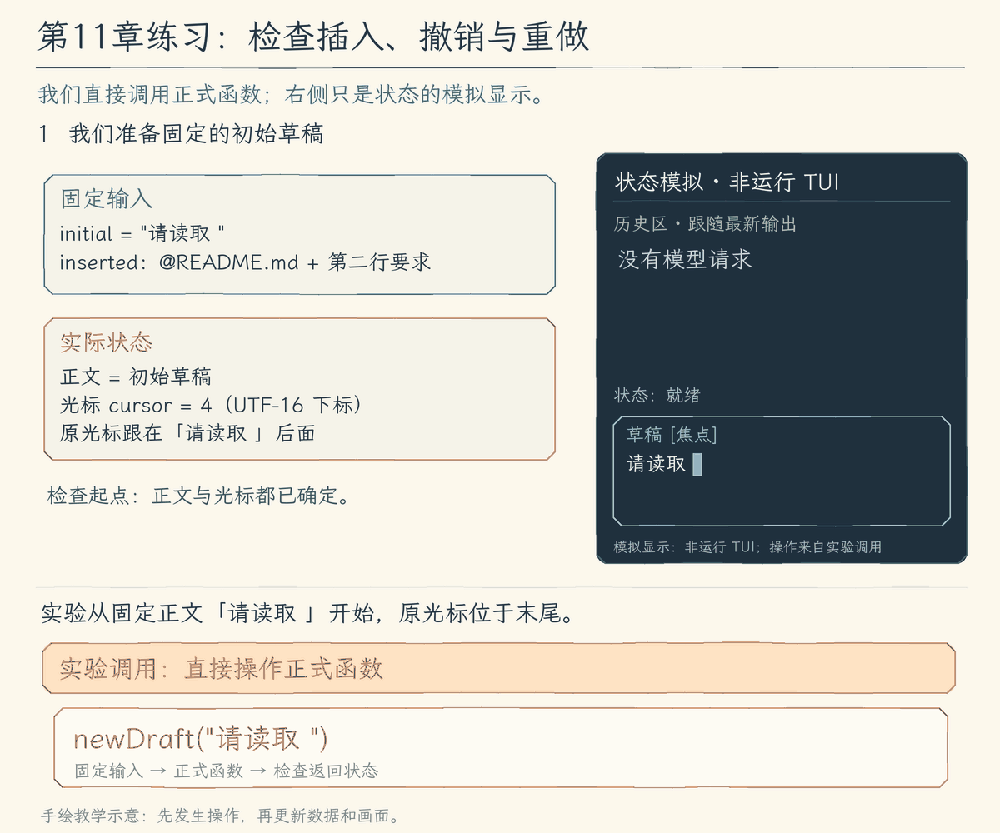

# 第 11 章练习：把一次使用过程写成状态实验

[第 11 章首页](README.md) · [先完成 11.5](05-terminal-layout/README.md) · [完整答案](#完整答案)

## 问题：怎样重复检查一次编辑和浏览过程

一次粘贴再撤销，应该取回原文和光标；向上停留后收到新结果，应该继续看到旧内容。终端操作可以观察这些行为，但模型每次输出可能不同。给正式函数固定输入，再检查每一步，就能反复验证同一个过程。



我们希望每次重跑，都能核对同一组操作后的文字、光标和阅读位置，而不用等模型再次生成一份输出。图中的操作卡直接调用正式的 `insertText()` 和 `editKey()`；右侧是返回状态的模拟显示，没有启动 TUI，也没有向界面发送真实按键。

## 先操作，再比较实际结果

本实验从 `请读取 ` 开始，一次插入 `@README.md` 和第二行要求。插入后检查完整正文与光标；撤销后检查是否回到原稿；重做后再检查整段是否回来。

教学片段只展示前几个动作，省略导入和其余检查，完整答案在后面：

```js
const initial = newDraft("请读取 ");
let draft = insertText(initial, "@README.md\n把启动和检查步骤分开说明。");
assert.equal(draft.text, "请读取 @README.md\n把启动和检查步骤分开说明。");
draft = editKey(draft, "z", { ctrl: true });
assert.equal(draft.text, initial.text);
assert.equal(draft.cursor, initial.cursor);
```

检查放在动作之后，才能发现中途丢过的文字或光标。只比较最终字符串，撤销时出错、重做后碰巧恢复，也可能漏掉。

浏览也要经过真实过程：先把消息排成显示行，留下一个阅读位置；追加回答后再排一次，检查仍能找到原内容；清除位置后，检查回到末尾。不能直接造出正确的窗口，跳过要验证的查找方法。

## 练习要求

新增 `chapter-11-terminal-workbench/exercises/workbench-state.mjs`，只写独立实验，正式源码不改。

| 依次操作 | 预期结果 | 提示 |
| --- | --- | --- |
| 整段插入路径与第二行，撤销、重做 | 原文和原光标一起回来，随后整段恢复 | 调用 `insertText()`、`editKey()`，每步比较 |
| 从 `中文🙂é` 末尾退格两次 | 先剩 `中文🙂`，再剩 `中文` | `é` 的音标和字母是一组 |
| 用重复问题搜索 `README`，补全 `/per` | 最近匹配在前、重复只一份；补出 `/permissions` | 使用正式搜索与补全函数 |
| 折叠、展开工具结果 | 显示行增加，保存的正文不变 | 改展开集合，再调用排版函数 |
| 留下阅读位置，再追加回答 | 仍找到原位置；取消停留才显示末尾 | 从实际显示行取位置，再重新排版 |
| 用 4 列排 `中文🙂é` | 得到 `中文`、`🙂é` 两行 | 使用 `wrapLines()`，不按字符串长度裁剪 |

实验导入已经构建的 11.5 函数，不需要 API Key、真实剪贴板或外部编辑器。

## 完整答案

创建 `exercises/`，将以下完整代码保存为 `chapter-11-terminal-workbench/exercises/workbench-state.mjs`。它调用正式函数并检查中间结果。

<details>
<summary>完整新增实验：workbench-state.mjs</summary>

<!-- solution: exercises/workbench-state.mjs -->
```js
/**
 * 第 11 章练习：检查草稿与浏览状态 | [NEW 练习]
 *
 * 学习目标：用连续操作验证输入编辑与结果浏览，没有模型请求和系统剪贴板副作用。
 * 输入：固定草稿、已提交问题列表和工具结果；全部由本实验在内存中创建。
 * 输出：草稿、撤销、搜索、补全、折叠、浏览位置与显示宽度的断言结果。
 *
 * 练习验证流程（产品全局主流程见 11.5 的 agent/agent-loop.ts）：
 *   新草稿 -> 插入两行 -> 撤销与重做 -> 按可见字符删除
 *   已提交问题 -> 搜索 -> 最近匹配；命令前缀 -> 补入草稿
 *   工具结果 -> 折叠 / 展开 -> 选择一条显示行 -> 追加回答 -> 检查停留位置
 *   中文与 emoji -> 按列宽排版 -> 每项符合预期？-- 否 -> 断言失败
 *                                             +-- 是 -> 打印练习通过
 *
 * 本实验不启动 React 组件；真实按键通道、粘贴标记和终端恢复由交互检查覆盖。
 */
import assert from "node:assert/strict";
import { newDraft, insertText, editKey } from "../../dist/ui/tui/editor.js";
import { searchPrompts, completeInput } from "../../dist/ui/tui/input-assist.js";
import { transcriptLines, visibleStart } from "../../dist/ui/tui/transcript.js";
import { wrapLines } from "../../dist/ui/tui/layout.js";

// [NEW 练习] 本文件以下实现均为独立实验，不改变正式草稿和模型历史。
/**
 * 让固定输入经过正式变换函数，分别检查文字编辑与阅读位置。
 *
 * 各断言跟在对应操作之后，避免只检查最后状态而漏掉撤销、折叠等中间行为。
 * 工具项是本地显示样本，不伪装成真实工具执行；它只验证本章新增的排版与浏览。
 */
async function main() {
  const initial = newDraft("请读取 ");
  const inserted = "@README.md\n把启动和检查步骤分开说明。";
  let draft = insertText(initial, inserted);
  assert.equal(draft.text, initial.text + inserted);
  assert.equal(draft.cursor, draft.text.length);

  draft = editKey(draft, "z", { ctrl: true });
  assert.equal(draft.text, initial.text);
  assert.equal(draft.cursor, initial.cursor);
  draft = editKey(draft, "y", { ctrl: true });
  assert.equal(draft.text, initial.text + inserted);

  let unicode = newDraft("中文🙂e\u0301");
  unicode = editKey(unicode, "", { backspace: true });
  assert.equal(unicode.text, "中文🙂");
  unicode = editKey(unicode, "", { backspace: true });
  assert.equal(unicode.text, "中文");

  const first = "读取 README.md，说明启动方法。";
  const latest = "读取 README.md，说明检查命令。";
  assert.deepEqual(searchPrompts([first, "说明 package.json 的用途。", latest, latest], "readme"), [latest, first]);
  const completion = await completeInput("/per", 4);
  assert.equal(completion.text, "/permissions");
  assert.equal(completion.cursor, completion.text.length);

  const result = Array.from({ length: 12 }, (_, index) => `第 ${index + 1} 行：固定工具结果`).join("\n");
  const entries = [
    { id: "question", label: "你", text: first },
    { id: "read", label: "工具", text: "read_file：完成", details: result },
    { id: "answer", label: "Agent", text: "已经读完，下面整理步骤。" },
  ];
  const folded = transcriptLines(entries, 24, new Set());
  const expanded = transcriptLines(entries, 24, new Set(["read"]));
  assert.ok(expanded.length > folded.length);
  assert.equal(entries[1].details, result);

  const height = 4;
  const anchor = expanded.find((line) => line.id === "read");
  assert.ok(anchor);
  const oldStart = visibleStart(expanded, height, anchor);
  const moreEntries = [...entries, {
    id: "later", label: "Agent",
    text: Array.from({ length: 8 }, (_, index) => `新回答第 ${index + 1} 行`).join("\n"),
  }];
  const moreLines = transcriptLines(moreEntries, 24, new Set(["read"]));
  const stayed = visibleStart(moreLines, height, anchor);
  assert.equal(moreLines[stayed].id, expanded[oldStart].id);
  assert.equal(moreLines[stayed].text, expanded[oldStart].text);
  assert.equal(visibleStart(moreLines, height, undefined), moreLines.length - height);

  assert.deepEqual(wrapLines("中文🙂e\u0301", 4).map((line) => line.text), ["中文", "🙂e\u0301"]);
  console.log("练习通过：编辑、撤销、输入辅助、结果浏览与中文排版符合预期。");
}

await main();
```

</details>

## 运行验证

完成 11.5 与练习文件后，在仓库根目录构建：

```bash
npm run lesson:11.5
```

再单独运行实验：

```bash
node chapter-11-terminal-workbench/exercises/workbench-state.mjs
```

应显示：

```text
练习通过：编辑、撤销、输入辅助、结果浏览与中文排版符合预期。
```

使用完整配套仓库且已创建练习文件时，也可以运行：

```bash
npm run exercise:11
```

## 从结果回到本章的方法

这些检查把动画里的动作变成了固定数据操作：插入后留下旧稿，撤销时取回；显示只取保存内容的一段，追加以后仍能找到原位置；换行按占格进行，不拆字符，也不改正文。

实验没有启动界面，焦点、粘贴输入和终端交接继续由各节手动验证与本章伪终端检查观察。练习只新增独立文件，第十二章仍从 11.5 的正式实现继续。
