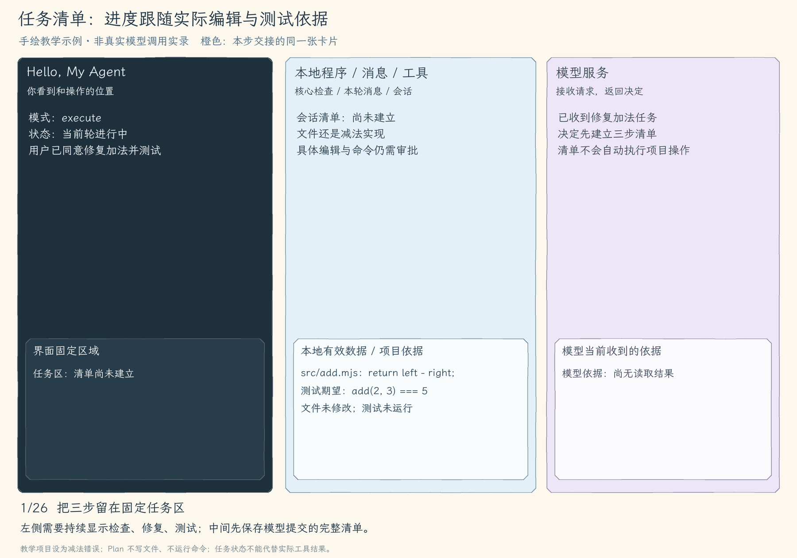
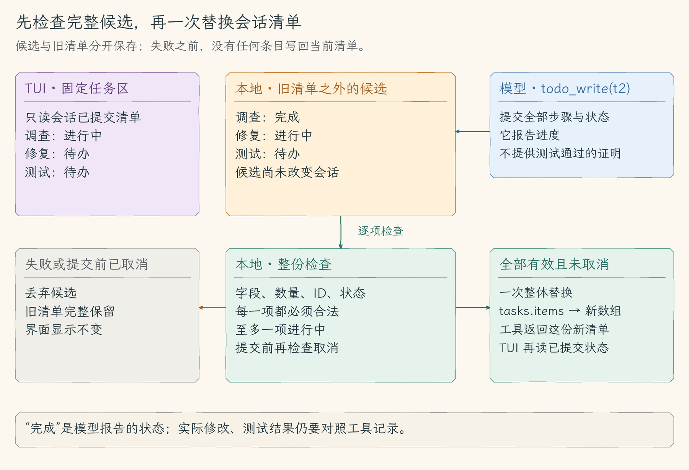
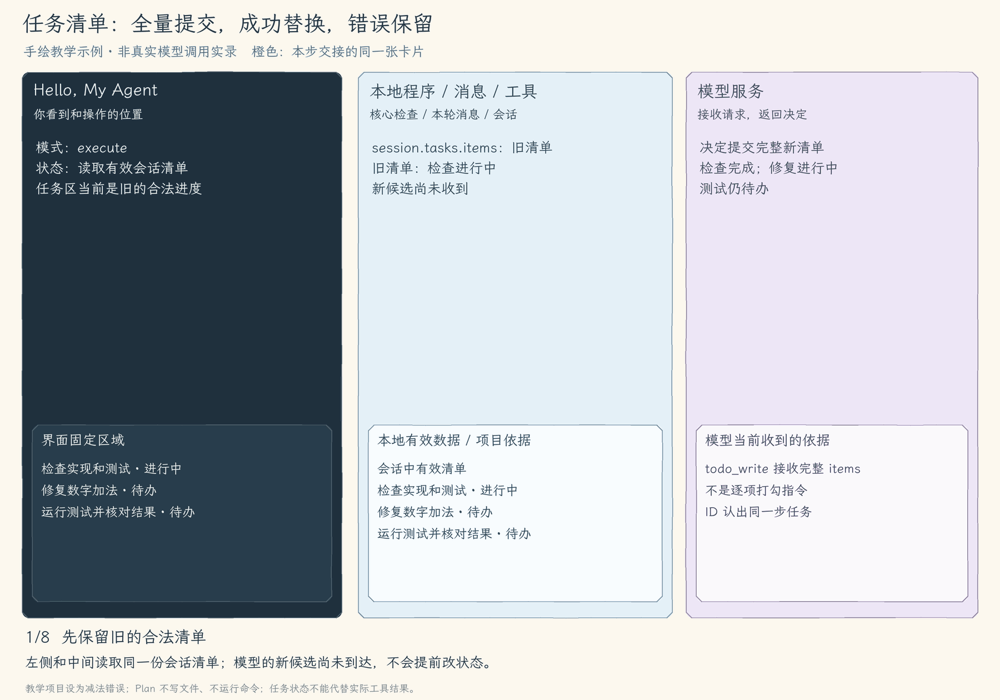

# 12.2 任务清单

[第 12 章首页](../README.md) · [上一节：12.1 计划与执行模式](../01-plan-mode/README.md) · [下一节：12.3 澄清问题](../03-clarify-questions/README.md)

## 问题：计划说明要做什么，进度还需要持续更新

我们已经看过加法修复方案，决定实施。过程很短：检查实现与测试，修改返回表达式，运行测试。但模型每做一步都可能输出一段说明，新的内容不断进入历史。“检查已经结束”与“正在修复”分散在不同位置，想确认当前进展仍要翻找。

如果把三步留在同一处，并分别标明待办、进行中和完成，读者就能直接判断下一步是什么。本节要做的任务清单，就是这份会随工作更新的进度表示。我们将先定义它要表达的数据，再建立提交规则，让界面始终显示一份完整的有效清单。

<style>
.motion-player { position: relative; margin: 18px 0; padding: 0; border: 0; }
.motion-player summary { display: block; cursor: pointer; list-style: none; }
.motion-player img { display: block; width: 100%; height: auto; margin: 0; }
.motion-player .motion-gif { position: absolute; top: 0; left: 0; pointer-events: none; }
.motion-player[open] .motion-cover { visibility: hidden; }
.motion-player .motion-toggle { display: inline-block; margin-top: 12px; padding: 8px 18px; border-radius: 6px; background: #294c63; color: white; font-size: 16px; }
.motion-player .motion-stop, .motion-player[open] .motion-start { display: none; }
.motion-player[open] .motion-stop { display: inline; }
</style>

<details class="motion-player">
<summary>

<span class="motion-toggle"><span class="motion-start">▶ 开始播放动图</span><span class="motion-stop">■ 收起动图</span></span>
</summary>

</details>

图中三行步骤留在任务区，随着模型提交的新状态更新。测试标为进行中表示模型正在处理这一步；实际测试返回结果以后，本例才提交完成状态。判断是否修好仍要同时看文件与工具结果。[静态图](assets/task-purpose-f77c02a9cc.jpg)

## 解决方案：用一份结构化数据表示当前进度

模型通过 `todo_write` 提交一个完整的 `items` 数组。每项有 ID、文字和状态。程序检查整份候选，全部有效后一次替换会话清单，TUI 再从会话读取它。模型的普通回答里即使有编号列表，也不会自动变成这里的任务清单。

三个状态分别是 `pending`、`in_progress`、`completed`，表示待处理、正在处理、模型报告已完成。清单负责报告进度，实际工作仍由读取、编辑和命令工具完成。它不会自己启动下一步，也不会因为测试项被勾选就证明测试通过。

清单属于当前会话，Plan 中可以先列出方案步骤，切到 execute 后继续报告这些步骤的进展。写清单只改变本地内存，所以 Plan 也允许它。退出后的保存还没有实现，第十三章再加入持久化。

## 工作原理

### 先看清单需要保存什么

以下是加法任务刚开始调查时的一份教学数据：

```json
{
  "items": [
    { "id": "inspect", "text": "检查加法实现和测试", "status": "in_progress" },
    { "id": "fix", "text": "修复数字加法", "status": "pending" },
    { "id": "test", "text": "运行测试并核对结果", "status": "pending" }
  ]
}
```

`text` 供人理解要做什么，`status` 供程序和界面区分当前进度。`id` 用来辨认步骤：模型可以把 `fix` 的文字改成“把返回表达式改为相加”，仍用同一个 ID 表示修复步骤。这样文字变化和步骤身份是两件事。

ID 稳定是模型更新时应遵守的约定。当前实现只检查一份候选中的 ID 是否重复，没有与旧清单比较，所以不能保证模型下次一定沿用 `fix`。ID 也不是数组位置，不能因为某步排到了第二行就认为它的身份变了。

调查结束后，模型再提交全部三项，将 `inspect` 设为完成，`fix` 设为进行中，`test` 保持待办。这次更新表达的是下面的整体变化：

| 步骤 | 调查时 | 开始修改时 |
| --- | --- | --- |
| 检查实现与测试 | 进行中 | 完成 |
| 修复数字加法 | 待办 | 进行中 |
| 运行测试 | 待办 | 待办 |

我们没有发送“把第二项勾上”的增量指令，而是发送新时刻的整份清单。完整提交让模型明确说明“现在有哪些步骤、各是什么状态”，也让本地可以先检查它们之间的关系，再决定是否接受。新清单整体替换旧清单，不会按旧 ID 合并；模型可以在后续提交中删减或重排步骤。

### 为什么先检查候选，最后才替换

考虑一个错误更新：模型把修复和测试都写成 `in_progress`。本节要求最多一项进行中，这份候选不合格。如果程序读到第一项就更新，直到测试项才发现冲突，界面可能已经留下半份新清单。报错了，也不能说明原状态没有被改变。

因此，我们先在旧清单之外构造候选数组。检查每项字段时不改会话；数量、ID 和状态都通过后，才把会话里的清单一次指向这个新数组。某项失败就舍弃候选，让旧清单完整保留。这里的“一次提交”是本地内存中的整体替换，不是文件事务。

候选的规则包括：

| 检查对象 | 规则与目的 |
| --- | --- |
| 整份清单 | 最多 8 项，约束一次进度报告的规模；空数组表示明确清空 |
| 单项字段 | 只接收 `id`、`text`、`status`，不能缺失或增加字段 |
| ID 与文字 | 去掉首尾空白后非空；ID 在本次候选中不能重复 |
| 状态 | 只能取三种约定值；最多一项进行中，使“当前步骤”保持明确 |

ID 原文上限为 80 个 UTF-16 单元，文字原文为 200 个；检查上限后再保存去空白的内容。这是字符串 `.length` 的计数，汉字通常占一个单元，emoji 可能占两个。`TaskItem` 类型帮助本地代码使用这些字段，但外部 JSON 仍需运行时检查；标成这个类型不会自动验证模型给出的值。

全部校验通过后，工具还在提交前检查取消信号。只有当前任务仍可继续，才执行那次替换。无效候选或提交前取消，都不能留下半份更新。



橙色候选在提交前与会话旧清单分开。只有右下方的提交会改变有效清单；左下方舍弃候选时，TUI 仍读取原来的完整状态。

<details class="motion-player">
<summary>

<span class="motion-toggle"><span class="motion-start">▶ 开始播放动图</span><span class="motion-stop">■ 收起动图</span></span>
</summary>

</details>

第一次候选整体有效，检查结束和修复开始一起提交。第二次候选含两个进行中项，被拒绝后上一份清单仍完整保留；错误结果交回模型供它修正。[静态图](assets/task-method-434c08fa2c.jpg)

### 同一份状态怎样让模型和界面都看见

会话保存清单，工具负责改变它，TUI 负责显示它。保存成功后，`todo_write` 返回新清单正文，核心按该工具调用 ID 写入消息，下一次模型请求就能知道更新已被接受。界面在工具完成事件后重新绘制，任务区域读取的则是会话中已经提交的 `tasks.items`。

返回结果也带有一份供过程说明使用的条目副本，但固定任务区并不维护第二份可独立修改的清单。这使它不会显示尚未通过校验的候选，也不用从普通回答里猜测“检查好了”是哪一种状态。

固定任务区只显示摘要与清单开头的若干项：终端有 16—19 行时仅显示摘要，20 行时至多显示前 2 项，21 行及以上时至多显示前 3 项。它按清单顺序截取，不优先显示进行中项；屏幕上暂时没出现某一步，不代表它被删除。完整的 0—8 项仍保存在 `tasks.items` 和 `todo_write` 返回正文中。要查看完整提交，按 Ctrl+O 切到历史，选中相应的 `todo_write` 工具条目，再按 Enter 展开。

### 改变条件，能推出怎样的结果

如果模型把新候选中的两个 ID 都写成 `fix`，会发生什么？重复检查在提交之前失败，所以工具返回错误，原三步清单不变。若模型提交合法空数组，候选没有条目也没有冲突，整份替换后任务区清空。两个结果都由同一条规则推出：整份候选有效才提交。

如果清单把三项全标完成，但命令工具的测试结果失败，程序是否会把测试项自动退回待办？当前实现不会。清单接收的是模型的进度报告，没有用测试退出码验证其含义，也没有自动推导新状态。我们必须对照工具结果判断，并让模型或用户继续处理这个矛盾。

任务正常结束、请求次数用尽、取消或报错后，最后一次有效清单都继续保留。它反映最后保存的报告，不会自动全部勾上，也不会因为任务停止就还原旧版本。清单让进展可见；下一节遇到无法从代码确定的规则时，需要真正向用户取得继续所需的信息。

## 本节改动文件

本节增加清单数据与更新工具，再把会话中的同一份状态接到执行核心和显示入口。

| 状态 | 文件 | 本节变化 |
| --- | --- | --- |
| CHANGED | [src/agent/run-options.ts](src/agent/run-options.ts) | 声明清单项与会话持有的 TaskState |
| NEW | [src/tools/todo-write.ts](src/tools/todo-write.ts) | 校验完整 items 后整体替换清单 |
| CHANGED | [src/tools/types.ts](src/tools/types.ts) | 给结果元数据增加结构化清单 |
| CHANGED | [src/tools/registry.ts](src/tools/registry.ts) | 注册 todo_write，并把状态容器交给工具 |
| CHANGED | [src/permissions/policy.ts](src/permissions/policy.ts) | 允许清单工具更新内存，文件权限继续沿用 |
| CHANGED | [src/models/client.ts](src/models/client.ts) | Plan 也提供清单工具，提示模型报告真实进展 |
| CHANGED | [src/agent/agent-loop.ts](src/agent/agent-loop.ts) | 同一轮共用同一个清单状态容器 |
| CHANGED | [src/ui/teaching-trace.ts](src/ui/teaching-trace.ts) | 根据清单元数据说明更新结果 |
| CHANGED | [src/cli.ts](src/cli.ts) | 单次入口准备清单状态 |
| CHANGED | [src/ui/terminal.ts](src/ui/terminal.ts) | 文本会话跨轮沿用清单 |
| CHANGED | [src/ui/tui/app.tsx](src/ui/tui/app.tsx) | 会话保留清单，按状态显示进展 |

## 动手构建

从 12.1 的完整 `src/` 继续，目标目录为 `chapter-12-task-control/02-task-list/`。先定义状态和工具，把清单接到注册表与结果元数据，再让核心、文本会话和 TUI 持有同一个容器。

下面先说明每处修改怎样承担正文中的职责，再给出准确替换范围与完整代码。实现可折叠对照，未列出的函数和文件继续沿用。

### 声明清单项与会话持有的 TaskState

清单项描述一步，`TaskState` 则是会话与工具共用的容器。分别声明两者，才能让状态更新留在会话中，而不是每次工具调用都新建一份不可见的清单。

完整替换 `src/agent/run-options.ts`。本文件较短，下面给出完整替换文件，保留沿用部分。

<details>
<summary>完整替换文件：run-options.ts</summary>

<!-- source: src/agent/run-options.ts -->
```ts
/**
 * 12.2 任务清单 | [CHANGED] agent/run-options.ts
 *
 * 学习目标：把本节的运行控制数据交给核心，界面不需要代替核心作决策。
 * 输入：本地入口选定的模式、会话清单。
 * 输出：RunOptions 描述这一轮允许使用的控制入口；这里只定义类型，不执行任务。
 * 状态：模式由启动入口取快照；清单属于会话，本文件不保存模型消息。
 * 本文件数据关系（全局主流程见 agent/agent-loop.ts）：
 *   本地界面 -> 本轮选项 -> 核心 / 工具 / 模型请求
 * 缺少可选入口时采用默认模式或不提供对应交互；类型声明不能代替运行时校验。
 * 运行观察：不同界面传入同样的选项，核心仍使用同一条模型与工具循环。
 */
// [KEEP 来自 12.1] 模式由本地运行入口选择，默认继续执行。
/**
 * 本地入口可选的两种运行模式。
 * plan 只调查和制定计划；execute 仍需遵守每次工具的权限与审批。
 */
export type ExecutionMode = "plan" | "execute";

// [CHANGED 12.2] 容器由会话持有，切换模式和开始新一轮不会丢失任务清单。
// [CHANGED 12.2] 类型新增本节使用的控制数据；各字段用途见紧邻说明。
/**
 * 清单中的一个步骤和模型报告的进度。
 * ID 用来辨认条目，状态不是测试证明；数量和字段限制由 todo_write 运行时检查。
 */
export type TaskItem = {
  id: string;
  text: string;
  status: "pending" | "in_progress" | "completed";
};
// [CHANGED 12.2] 类型新增本节使用的控制数据；各字段用途见紧邻说明。
/**
 * 会话持有的可替换清单容器。
 * 工具先校验完整新数组再替换 items，失败时旧数组继续使用。
 */
export type TaskState = { items: TaskItem[] };

// [CHANGED 12.2] 类型新增本节使用的控制数据；各字段用途见紧邻说明。
/**
 * 把这一轮使用的模式、会话状态和可用控制入口放在一起。
 * 可选入口由本地调用方提供，模型不能在普通文字中创建它们。
 */
export type RunOptions = {
  // [KEEP 来自 12.1] 本轮模式由本地入口取快照。
  mode?: ExecutionMode;
  // [CHANGED 12.2] 清单容器跨模型请求和工具调用共用。
  tasks?: TaskState;
};
```

</details>

### 校验完整 items 后整体替换清单

把构造候选与提交分开。阅读实现时重点核对：解析和逐项检查期间没有改 `tasks.items`，只有全部通过且未取消之后才进行整体替换。

创建 `src/tools/todo-write.ts`。这是本节的新模块，完整实现如下。

<details>
<summary>创建文件：todo-write.ts</summary>

<!-- source: src/tools/todo-write.ts -->
```ts
/**
 * 12.2 任务清单 | [NEW] tools/todo-write.ts
 *
 * 学习目标：一次接收完整新清单，全部检查通过后才替换会话中的旧清单。
 * 输入：模型的 JSON 参数、共用 TaskState 和本轮取消信号。
 * 输出：新清单正文给模型，独立拷贝的条目给界面。
 * 状态：最多 8 项、ID 不重复、最多一项进行中；解析失败或提交前已取消时旧清单不变。
 * 本文件局部流程（全局主流程见 agent/agent-loop.ts）：
 *   参数 -> JSON 对象、条目、ID、状态全部有效？-- 否 -> ToolError，旧清单不变
 *                                                     +-- 是 -> 再查取消 -> 一次替换清单 -> 结果
 * 清单只存在当前会话内存；completed 是模型报告的进度，不能证明代码或测试已通过。
 * 运行观察：错误更新保留上一份清单，合法空数组可以清空清单。
 */
// [NEW 12.2] 校验完整新清单后再替换会话状态，不产生文件写入。
import { ToolError } from "../errors.js";
import type { TaskItem, TaskState } from "../agent/run-options.js";
import type { ToolExecutionResult } from "./types.js";

// [NEW 12.2] 本文件以下类型、函数和界面均为本节新增。

export const todoWriteDefinition = {
  name: "todo_write",
  description: "创建或更新本次会话的任务清单。items 是完整的新清单，最多 8 项，同时最多一项执行中；仅更新内存，不表示任务已真正完成。",
  inputSchema: {
    type: "object" as const,
    properties: {
      items: {
        type: "array" as const,
        maxItems: 8,
        items: {
          type: "object" as const,
          properties: {
            id: { type: "string" as const, minLength: 1, maxLength: 80 },
            text: { type: "string" as const, minLength: 1, maxLength: 200 },
            status: { type: "string" as const, enum: ["pending", "in_progress", "completed"] },
          },
          required: ["id", "text", "status"],
          additionalProperties: false,
        },
      },
    },
    required: ["items"],
    additionalProperties: false,
  },
};

/**
 * 把模型给出的完整新清单检查成可提交的条目。
 * 先解析 JSON，再检查字段、最多 8 项、去空白后的 ID 不重复和最多一项进行中。
 * 返回一份新数组；任何一项有问题就抛出 ToolError，此时尚未修改旧清单。
 */
function parseTasks(argumentsJson: string): TaskItem[] {
  let value: unknown;
  try { value = JSON.parse(argumentsJson); }
  catch { throw new ToolError("todo_write 参数不是有效的 JSON。"); }
  if (!value || typeof value !== "object" || Array.isArray(value)) {
    throw new ToolError("todo_write 参数必须是只包含 items 的对象。");
  }
  const input = value as Record<string, unknown>;
  if (Object.keys(input).length !== 1 || !Array.isArray(input.items) || input.items.length > 8) {
    throw new ToolError("todo_write items 必须是最多 8 项的数组，且不能包含其他参数。");
  }
  const ids = new Set<string>();
  let inProgress = 0;
  // [NEW 12.2] 每一项先转成新条目；某一项失败就停止，尚未改旧清单。
  return input.items.map((value: unknown) => {
    if (!value || typeof value !== "object" || Array.isArray(value)) {
      throw new ToolError("todo_write 的每一项必须包含 id、text 和 status。");
    }
    const item = value as Record<string, unknown>;
    if (Object.keys(item).length !== 3 || !("id" in item) || !("text" in item) || !("status" in item)) {
      throw new ToolError("todo_write 的每一项必须且只能包含 id、text 和 status。");
    }
    if (typeof item.id !== "string" || !item.id.trim() || item.id.length > 80
      || typeof item.text !== "string" || !item.text.trim() || item.text.length > 200) {
      throw new ToolError("任务 id 必须为 1–80 字符、text 必须为 1–200 字符的非空文字。");
    }
    const id = item.id.trim();
    if (ids.has(id)) throw new ToolError(`任务 id 不能重复：${id}`);
    ids.add(id);
    if (item.status !== "pending" && item.status !== "in_progress" && item.status !== "completed") {
      throw new ToolError("任务 status 只能是 pending、in_progress 或 completed。");
    }
    if (item.status === "in_progress" && ++inProgress > 1) {
      throw new ToolError("同一时刻最多只能有一项任务处于 in_progress。");
    }
    return { id, text: item.text.trim(), status: item.status };
  });
}

/**
 * 把通过完整校验的清单一次写入会话内存。
 * 输入是模型参数、会话共用的清单和取消信号；提交前再次检查取消。
 * 返回给模型的清单正文和给界面的独立拷贝；失败保留旧清单。
 * 模型标为完成只表达进度，不能代替命令结果或测试检查。
 */
export async function todoWriteTool(
  argumentsJson: string, tasks: TaskState, signal: AbortSignal,
): Promise<ToolExecutionResult> {
  signal.throwIfAborted();
  const items = parseTasks(argumentsJson);
  signal.throwIfAborted();
  // [NEW 12.2] 校验和取消检查都通过后，只有这里一次替换完整清单。
  tasks.items = items;
  return {
    content: JSON.stringify({ items }, null, 2),
    metadata: { kind: "todo_write", items: structuredClone(items) },
  };
}
```

</details>

### 给结果元数据增加结构化清单

结果正文供模型读取，结构化元数据供过程显示使用。两种输出来自同一次成功更新；元数据里的副本不成为固定任务区的第二份可写状态。

完整替换 `src/tools/types.ts`。本文件较短，下面给出完整替换文件，保留沿用部分。

<details>
<summary>完整替换文件：types.ts</summary>

<!-- source: src/tools/types.ts -->
```ts
/**
 * 12.2 任务清单 | [CHANGED] tools/types.ts
 *
 * 学习目标：把多步任务的进度保存为会话清单；本文件负责区分给模型的工具正文和给界面的结果数据。
 * 输入：工具给出的预览与执行函数，或已运行完成的结果正文与元数据。
 * 输出：PreparedToolCall 用于审批；ToolExecutionResult.content 给模型，metadata 给界面。
 * 状态：这里只有类型声明，不会执行操作，也没有运行时状态提交。
 *
 * 本文件局部流程（数据关系；全局主流程见 agent/agent-loop.ts）：
 *   [KEEP] 准备结果 -> preview / execute；执行结果 -> content / metadata。
 * isError=true 也可以有完整 content：测试非零退出时，报告不能随错误标记一起丢掉。
 * 这里定义数据形状，不执行命令或修改文件。观察：终端能直接显示退出码和两条输出。
 */

// [CHANGED 12.2] 引入 run-options 的本节类型或实现。
import type { TaskItem } from "../agent/run-options.js";

// [KEEP 来自 07.1] 命令输出和退出状态同时交给模型与界面。
// [CHANGED 12.2] 类型新增本节使用的控制数据；各字段用途见紧邻说明。
export type ToolResultMetadata =
  // [CHANGED 12.2] 清单条目作为界面数据返回，正文仍交给模型。
  | { kind: "todo_write"; items: TaskItem[] }
  | { kind: "run_command"; exitCode: number | null; signal: string | null; stdout: string; stderr: string; stopReason?: "timeout" | "output_limit" }
  | { kind: "read_file"; lineCount: 0 }
  | {
      kind: "read_file";
      lineCount: number;
      startLine: number;
      endLine: number;
      hasMore: boolean;
    }
  | { kind: "glob"; count: number; truncated: boolean; paths: string[] }
  | {
      kind: "grep";
      count: number;
      truncated: boolean;
      locations: Array<{ path: string; line: number; column: number }>;
    }
  // [KEEP 来自 06.1] 写入结果只暴露路径和字节数，完整内容由审批 diff 展示。
  | { kind: "write_file"; path: string; bytes: number }
  // [KEEP 来自 06.3] backupPath 是工具已经创建的真实恢复位置；模型和界面不从 content 解析它。
  | { kind: "edit_file"; path: string; bytes: number; backupPath: string };

export type ToolExecutionResult = {
  // [KEEP 来自 07.1] 命令可以正常返回结果，但测试本身失败。
  isError?: boolean;
  content: string;
  metadata: ToolResultMetadata;
};

/**
 * 把操作预览和批准后要调用的函数放在一起。
 *
 * preview 给人看；execute 闭包记住本次文件修改或命令，以及执行前需复查的数据。
 * 主循环等待审批后继续使用这个结果：拒绝就跳过，批准就为当前请求执行一次。
 * preview 只用来展示，不拿它写文件或当作待执行的 shell 命令。
 */
// [KEEP 来自 06.1] 准备结果把参数检查和预览，与真正写入或启动命令分开。
export type PreparedToolCall = {
  preview: string;
  execute(signal: AbortSignal): Promise<ToolExecutionResult>;
};
```

</details>

### 注册 todo_write，并把状态容器交给工具

注册工具不只列出名称和 Schema，还要在执行时把会话容器传给它。否则工具即使校验成功，也无法更新界面实际读取的那份清单。

完整替换 `src/tools/registry.ts`。本文件较短，下面给出完整替换文件，保留沿用部分。

<details>
<summary>完整替换文件：registry.ts</summary>

<!-- source: src/tools/registry.ts -->
```ts
/**
 * 12.2 任务清单 | [CHANGED] tools/registry.ts
 *
 * 学习目标：把多步任务的进度保存为会话清单；本文件负责根据工具名称找到实现，区分直接执行与准备后执行，并传入会话清单。
 * 输入：模型给出的工具名称、JSON 参数与取消信号。
 * 输出：读取、清单和问答工具返回结果；写入和命令先返回 preview/execute，批准后才返回实际结果。
 * 状态：分发失败向外抛错；执行入口调用过的工具可能已有副作用，注册表不负责回滚。
 *
 * 本文件局部流程（全局主流程见 agent/agent-loop.ts）：
 *   prepareTool -> 写入或命令？-- 是 -> 对应准备函数 -> 返回预览，或抛错
 *                             +-- 否 -> 返回 null
 *   executeTool -> 直接执行工具？-- 是 -> 对应执行函数 -> 返回结果，或抛错
 *                           +-- 否 -> 拒绝直接写入、命令或未知工具
 *   executePreparedTool -> 保存的 execute -> 结果或错误
 *
 * 注册表只寻找实现，不产生批准；permissions/policy.ts 决定是否需要询问用户。
 * 命令和写入不能从旧的直接执行入口绕过审批，准备阶段也没有这些副作用。
 * 观察：run_command 先出现操作预览，批准后才出现命令结果。
 */

// [KEEP 来自 07.1] 命令和文件修改复用同一条准备、审批通道。
import { prepareRunCommand, runCommandDefinition } from "./run-command.js";
import { ToolError } from "../errors.js";
import { globDefinition, globTool } from "./glob.js";
import { grepDefinition, grepTool } from "./grep.js";
import { readFileDefinition, readFileTool } from "./read-file.js";
import { prepareWriteFile, writeFileDefinition } from "./write-file.js";
import { editFileDefinition, prepareEditFile } from "./edit-file.js";
import type { PreparedToolCall, ToolExecutionResult } from "./types.js";
// [CHANGED 12.2] 引入 run-options 的本节类型或实现。
import type { RunOptions } from "../agent/run-options.js";
// [CHANGED 12.2] 引入 todo-write 的本节类型或实现。
import { todoWriteDefinition, todoWriteTool } from "./todo-write.js";

export type ToolCall = {
  id: string;
  name: string;
  arguments: string;
};

// [KEEP 来自 06.1] write_file 进入模型可见的工具列表，但只能走准备与审批通道。
// [KEEP 来自 06.2] edit_file 与 write_file 共用准备、审批和执行入口。
// [CHANGED 12.2] 保存本节所需选项或工具定义，不从聊天文字产生控制权限。
export const toolDefinitions = [
  // [KEEP 来自 07.1] 命令工具也要先批准，不能直接执行。
  readFileDefinition, globDefinition, grepDefinition, writeFileDefinition, editFileDefinition, runCommandDefinition,
  todoWriteDefinition,
];

/**
 * 找到需要审批的工具，先准备它的操作预览。
 *
 * write_file、edit_file 和 run_command 返回 PreparedToolCall，只读工具返回 null。
 * 主循环在权限判断之后、用户决定之前调用这里，所以准备不能写文件或启动命令。
 * 准备失败抛出 ToolError，由主循环转成工具错误交回模型。
 */
// [KEEP 来自 06.1] Agent Loop 在 ask 之后、审批之前调用这个准备入口。
export async function prepareTool(
  call: ToolCall,
  signal: AbortSignal,
): Promise<PreparedToolCall | null> {
  signal.throwIfAborted();
  if (call.name === writeFileDefinition.name) return prepareWriteFile(call.arguments, undefined, signal);
  // [KEEP 来自 06.2] 精确替换也必须在审批前解析当前文件并生成 diff。
  if (call.name === editFileDefinition.name) return prepareEditFile(call.arguments, undefined, signal);
  // [KEEP 来自 07.1] 准备阶段只固定命令和目录，不启动子进程。
  if (call.name === runCommandDefinition.name) return prepareRunCommand(call.arguments, undefined, signal);
  return null;
}

/**
 * 把无需预览审批的工具分发到对应实现。
 * todo_write 接收本轮共用的清单。
 * 读取和搜索工具接收参数与取消信号；返回正文和界面数据。
 * 写入、命令或未知工具抛出 ToolError，不能从这里绕过准备与审批；调用 ID 由核心管理。
 */
// [CHANGED 12.2] 工具分发新增本节实现或运行选项。
export async function executeTool(
  call: ToolCall,
  signal: AbortSignal,
  // [CHANGED 12.2] 新增本轮控制选项，便于传入清单和后续问答入口。
  options: RunOptions = {},
): Promise<ToolExecutionResult> {
  signal.throwIfAborted();
  // [CHANGED 12.2] 分发给清单工具，传入同一份 TaskState。
  if (call.name === todoWriteDefinition.name) return todoWriteTool(call.arguments, options.tasks ?? { items: [] }, signal);
  if (call.name === readFileDefinition.name) return readFileTool(call.arguments, undefined, signal);
  if (call.name === globDefinition.name) return globTool(call.arguments, undefined, signal);
  if (call.name === grepDefinition.name) return grepTool(call.arguments, undefined, signal);
  // [KEEP 来自 07.1] 拒绝绕过审批的直接执行。
  if (call.name === writeFileDefinition.name || call.name === editFileDefinition.name || call.name === runCommandDefinition.name) {
    throw new ToolError(`${call.name} 必须先生成预览并获得本次批准。`);
  }
  throw new ToolError(`未知工具：${call.name}`);
}

/**
 * 执行主循环已经批准的那一次操作。
 *
 * 只调用 prepared 中保存的 execute，并向它传递本轮取消信号。
 * 不重新解析模型请求，所以文件修改或命令仍来自准备时保存的输入。
 * 批准检查由调用方完成，文件或进程的具体执行与失败处理仍在对应工具里。
 */
// [KEEP 来自 06.1] 写入和命令的副作用都从这个已准备的入口执行。
export function executePreparedTool(
  prepared: PreparedToolCall,
  signal: AbortSignal,
): Promise<ToolExecutionResult> {
  signal.throwIfAborted();
  return prepared.execute(signal);
}
```

</details>

### 允许清单工具更新内存，文件权限继续沿用

清单更新只改变内存，所以可以直接允许；文件与命令仍用原来的规则。这里按工具职责判断，不把“Plan 可更新清单”扩展为“Plan 可写文件”。

在 `src/permissions/policy.ts` 中，先替换文件开头的教学说明与全部导入，再在原定义位置完整替换 `decideToolPermission()`。

<details>
<summary>policy.ts 的完整替换范围</summary>

**文件说明与全部导入：**

<!-- source: src/permissions/policy.ts -->
```ts
/**
 * 12.2 任务清单 | [CHANGED] permissions/policy.ts
 *
 * 学习目标：把多步任务的进度保存为会话清单；本文件负责在每个工具执行前判断模式、路径和本次批准。
 * 输入：模型给出的工具名、JSON 参数和当前进程的只读授权集合。
 * 输出：allow、ask 或 deny；这里只判断权限，不执行请求或保存批准。
 * 状态：权限判断只返回决定；拒绝不执行工具，批准记录仍由 Agent Loop 在取得用户决定后保存。
 *
 * 本文件局部流程（全局主流程见 agent/agent-loop.ts）：
 *   已登记工具 + 参数对象？-- 否 -> deny
 *                         +-- 是 -> run_command？-- 是 -> ask，remember=false
 *                                                 +-- 否 -> 检查文件工具范围
 *   文件请求 -> 越界、.env 或禁止的元数据写入/搜索？-- 是 -> deny
 *                                                    +-- 否 -> 需要读取元数据？
 *              已有只读授权 -> allow / 尚无授权 -> ask
 *              普通写入 -> ask，remember=false / 普通只读 -> allow
 *
 * 命令不靠 cwd 推断副作用，也不会套用文件工具的 .env 检查冒充 shell 沙箱。
 * 它的完整参数和真实目录在准备阶段校验，之后展示给用户，只批准这一次操作。
 * 只读范围可以记住，命令和文件写入不可以；聊天里的“已经批准”不产生权限。
 * 观察：run_command 只有本次允许或拒绝，没有会话批准。
 */

import { realpath } from "node:fs/promises";
import { isAbsolute, relative, resolve, sep, win32 } from "node:path";
import { toolDefinitions, type ToolCall } from "../tools/registry.js";
import { findProjectRoot } from "../tools/workspace.js";
import type { ExecutionMode } from "../agent/run-options.js";
```

**替换 decideToolPermission：**

<!-- source: src/permissions/policy.ts -->
```ts
/**
 * 由本地策略判断这次工具能否执行。
 * 先检查登记工具和 JSON 对象，再检查本轮模式；Plan 的写入、编辑和命令直接 deny。
 * 清单工具允许进入自身校验与执行，不需要文件审批；它们不能授予其他权限。
 * 执行模式的命令每次 ask；文件请求先检查硬拒绝，再查询只读会话授权，最后决定 allow 或 ask。
 * 返回 ask 时附本地生成的 scope 和 remember；只有可记住的只读范围才可进入授权集合。
 * 这里只返回决定，准备和执行仍要检查参数与路径，拒绝不会运行工具。
 */
// [CHANGED 12.2] 在现有策略中加入本节工具或模式判断。
export async function decideToolPermission(
  call: ToolCall,
  // [KEEP 来自 05.3] 策略会查询已批准记录，但每次仍先执行 deny 检查。
  sessionGrants: ReadonlySet<string> = new Set(),
  projectRoot = findProjectRoot(),
  // [KEEP 来自 12.1] 增加本轮模式参数，默认继续沿用执行模式。
  mode: ExecutionMode = "execute",
): Promise<PermissionDecision> {
  if (!toolDefinitions.some((tool) => tool.name === call.name)) {
    return { action: "deny", reason: `工具未登记：${call.name}` };
  }
  const input = parseArguments(call.arguments);
  if (!input) return { action: "deny", reason: "工具参数不是有效的 JSON 对象" };

  // [KEEP 来自 12.1] Plan 的硬拒绝早于预览和审批，会话授权也不能跳过。
  if (mode === "plan" && ["write_file", "edit_file", "run_command"].includes(call.name)) {
    return { action: "deny", reason: "Plan 模式只允许调查和制定计划，不能修改文件或执行命令" };
  }
  // [CHANGED 12.2] 放行内存清单工具，内容是否合法仍由工具完整校验。
  if (call.name === "todo_write") return { action: "allow", reason: "任务清单只更新本地会话内存" };
  // [KEEP 来自 07.1] 命令能做什么不能由 cwd 推断；每一次都交给用户确认。
  if (call.name === "run_command") {
    return { action: "ask", reason: "命令可能修改文件或访问网络，请核对命令和执行目录",
      resource: "本次命令与工作目录", scope: "run_command:once", remember: false };
  }
  const path = getRequestedPath(call, input);
  if (!path) return { action: "deny", reason: "工具缺少用于判断访问范围的路径参数" };
  const normalized = path.replaceAll("\\", "/");
  if (leavesProject(normalized)) return { action: "deny", reason: "请求不能离开当前项目" };
  if (containsEnvironmentFile(normalized)) return { action: "deny", reason: "环境配置文件属于硬保护范围" };
  const protectedDirectory = findApprovalDirectory(normalized);
  // [KEEP 来自 06.2] 创建与编辑共用同样的禁止写入范围。
  const changesFile = call.name === "write_file" || call.name === "edit_file";
  if (changesFile && protectedDirectory) {
    return { action: "deny", reason: `${protectedDirectory} 属于不可写入的项目元数据目录` };
  }
  if (call.name !== "read_file" && !changesFile && protectedDirectory) {
    return {
      action: "deny",
      reason: `搜索工具不访问 ${protectedDirectory}；如需读取，请用 read_file 请求具体文件`,
    };
  }

  if (call.name === "read_file") {
    const actualPath = await resolvePermissionPath(normalized, projectRoot);
    if (actualPath === null) return { action: "deny", reason: "文件的真实路径位于当前项目外" };
    if (containsEnvironmentFile(actualPath)) {
      return { action: "deny", reason: "环境配置文件属于硬保护范围" };
    }
    const directory = findApprovalDirectory(actualPath);
    if (directory) {
      const scope = `read_file:${directory}/**`;
      if (sessionGrants.has(scope)) {
        return { action: "allow", reason: `本次会话已经允许 ${scope}` };
      }
      return {
        action: "ask",
        reason: `读取 ${directory} 项目元数据需要用户确认`,
        resource: actualPath === normalized ? normalized : `${normalized} -> ${actualPath}`,
        scope,
        remember: true,
      };
    }
  }

  // [KEEP 来自 06.2] 创建和编辑都必须批准当前 diff，不能靠旧的目录授权直接写入。
  if (changesFile) {
    return {
      action: "ask",
      reason: "修改文件会改变工作区，必须先审查本次差异",
      resource: normalized,
      scope: `${call.name}:${normalized}`,
      remember: false,
    };
  }

  return { action: "allow", reason: "项目内普通只读工具" };
}
```

</details>

### Plan 也提供清单工具，提示模型报告真实进展

模型需要知道该用工具提交进度，也需要在 Plan 中看到它。提示要求如实报告，仍不能把完成状态当作测试证据。

在 `src/models/client.ts` 中，先替换文件开头的教学说明与全部导入，再在原定义位置完整替换 `requestResult()`。

<details>
<summary>client.ts 的完整替换范围</summary>

**文件说明与全部导入：**

<!-- source: src/models/client.ts -->
```ts
/**
 * 12.2 任务清单 | [CHANGED] models/client.ts
 *
 * 学习目标：把多步任务的进度保存为会话清单；本文件负责按本轮模式组装请求，收齐并检查模型结果。
 * 输入：完整消息历史、工具定义、取消信号和文字回调；两种协议都使用 SDK 接收流。
 * 输出：文字片段供界面显示；完整结果包含文本、工具请求、用量和统一的 finishReason。
 * 状态：失败不返回半份可执行结果，也不在这里修改历史；已经发出的文字片段可能已被界面显示。
 *
 * 本文件局部流程（全局主流程见 agent/agent-loop.ts）：
 *   [KEEP] 请求流 -> 文字片段 -> onText
 *                  +-> 完整消息 -> 归一化结束原因
 *   OpenAI 工具参数 -> SDK 累积的完整字符串 ------------------+
 *   Anthropic 参数 -> 按内容块 index 保存原始 JSON 片段         |
 *                  -> message_stop 与片段顺序有效？-- 否 -> 抛错
 *                                                 +-- 是 ----+
 *   完整结果 -> 正常文本或工具结束？-- 否 -> 返回结束原因，不返回工具
 *                                  +-- 是 -> 检查支持的工具类型与参数
 *   每个调用 ID 非空且批内唯一、参数为完整 JSON 对象？-- 否 -> 整批抛错
 *                                                     +-- 是 -> 返回 ModelResult
 *   请求、解析、超时或取消失败 -> 抛错，不返回半份结果
 *
 * [KEEP] 表示沿用前节。SDK 的流中途对象可能来自部分 JSON 解析，不能证明参数已经完整。
 * Anthropic 的执行参数来自本地累积的原始字符串；内容块结束后仍要通过 JSON.parse。
 * 这些检查只确认协议和 JSON 对象形状；字段值、路径与审批仍由已有工具和权限代码负责。
 * 每次 generate 设置独立的 60 秒期限，不自动重试；失败不改历史，也不在这里启动工具。
 *
 * [KEEP 来自 12.1] 每次请求使用本轮模式；Plan 隐藏写入、编辑和命令工具，提示只调查和计划。
 * 筛选工具帮助模型选择；permissions/policy.ts 的硬拒绝才保证禁止请求不会执行。
 * [CHANGED 12.2] 提示模型使用 todo_write 报告进度；这不会把报告变成测试证明。
 * 运行观察：一批调用中只要有一份参数损坏，整批都不会进入权限与执行阶段。
 */

import OpenAI from "openai";
import Anthropic from "@anthropic-ai/sdk";
import type { ChatCompletionMessageParam } from "openai/resources/chat/completions/completions";
import type { ContentBlockParam, MessageParam } from "@anthropic-ai/sdk/resources/messages/messages";
import { systemPrompt, type Config } from "../config/load-config.js";
import { UserFacingError } from "../errors.js";
import { toolDefinitions, type ToolCall } from "../tools/registry.js";
import type { ExecutionMode } from "../agent/run-options.js";
```

**替换 requestResult：**

<!-- source: src/models/client.ts -->
```ts
/**
 * 接收模型文字和工具参数，等完整消息检查通过后返回统一结果。
 *
 * - 输入：SDK 客户端、模型 ID、本地消息数组、请求取消信号和可选文字回调。
 * - 输出：文字片段通过 onText 提前显示；返回值另有完整文本、工具调用、用量和结束原因。
 * - 关键步骤：OpenAI 使用 SDK 完整累积的参数；Anthropic 另外按内容块 index 累积原始 JSON 字符串。
 * - 参数检查：只在正常结束原因下检查整批工具的 ID 与 JSON 对象；字段值仍留给本地工具检查。
 * - 失败方式：SDK 失败、Anthropic 流未完整结束、片段顺序无效或参数损坏时抛错，不返回可执行的半份调用。
 * - 职责边界：length、refusal 等结束原因交给 Agent Loop 报告；这里不批准工具，也不提交历史。
 */
// [KEEP 来自 08.2] 片段用于显示，完整响应才进入统一结果。
// [CHANGED 12.2] 请求组装接入本节模式和工具提示。
async function requestResult(
  client: OpenAI | Anthropic, model: string, messages: Message[], signal: AbortSignal,
  onText?: (text: string) => void,
  // [KEEP 来自 12.1] 本轮模式沿接口传到两种模型协议。
  mode: ExecutionMode = "execute",
): Promise<ModelResult> {
  // [KEEP 来自 12.1] 工具列表帮助模型选择；真正的禁止仍由本地权限策略执行。
  // [KEEP 来自 12.1] Plan 的可见工具列表帮助模型选择，本地策略仍会拒绝禁止请求。
  const definitions = mode === "plan"
    // [CHANGED 12.2] Plan 中仍可更新内存清单。
    ? toolDefinitions.filter((tool) => ["read_file", "glob", "grep", "todo_write"].includes(tool.name))
    : toolDefinitions;
  // [CHANGED 12.2] 本节提示模型用完整清单报告进度，实际完成仍看工具结果。
  const prompt = systemPrompt + " 对包含多个步骤的任务，使用 todo_write 保存和更新完整任务清单；同一时刻最多一项执行中。只有依据实际工具结果完成的事项才可标为 completed。" + (mode === "plan"
    ? " 当前为 Plan 模式：只调查项目并给出可执行的计划，不修改文件、不执行命令。用户要求执行时，请说明需要切换到执行模式。"
    : " 当前为执行模式：按用户任务实施修改，仍需遵守每次工具的本地权限与审批规则。");
  if (client instanceof OpenAI) {
    // [KEEP 来自 08.1] SDK 解析 SSE 并累积完整响应，content.delta 用来及时显示新文字。
    const stream = client.chat.completions.stream({
      model,
      messages: [{ role: "system", content: prompt }, ...toOpenAIMessages(messages)],
      tools: definitions.map((tool) => ({
        type: "function" as const,
        function: {
          name: tool.name, description: tool.description,
          // [KEEP 来自 08.1] 第 07 章练习的 timeout_ms 保持可选；本地仍会完整校验工具参数。
          parameters: tool.inputSchema, strict: false,
        },
      })),
      stream_options: { include_usage: true },
    }, { signal });
    stream.on("content.delta", ({ delta }) => onText?.(delta));
    const response = await stream.finalChatCompletion();
    const choice = response.choices?.[0];
    if (!choice) throw new UserFacingError("接口没有返回可用结果，请检查模型是否支持工具调用。");
    // [KEEP 来自 08.2] 结束原因正常才接收工具；拒绝和截断只交给核心说明。
    const reason = choice.message.refusal ? "refusal" : finishReason(choice.finish_reason);
    if (choice.message.tool_calls?.some((call) => call.type !== "function")) {
      throw new UserFacingError("接口返回了本章尚不支持的工具类型，本批工具未执行。");
    }
    const calls = reason === "tool_calls" || reason === "stop"
      ? (choice.message.tool_calls ?? []).filter((call) => call.type === "function")
        .map((call) => normalizeToolCall(call.id, call.function.name, call.function.arguments))
      : [];
    return {
      text: choice.message.content ?? "", toolCalls: validateToolCalls(calls), finishReason: reason,
      inputTokens: tokenCount(response.usage?.prompt_tokens),
      outputTokens: tokenCount(response.usage?.completion_tokens),
      truncated: reason === "length",
    };
  }

  // [KEEP 来自 08.2] Anthropic 的文字和工具参数分开接收；SDK 负责 SSE 与完整消息聚合。
  const stream = client.messages.stream({
    model, system: prompt, messages: toAnthropicMessages(messages),
    tools: definitions.map((tool) => ({
      name: tool.name, description: tool.description, input_schema: tool.inputSchema,
    })),
    max_tokens: 2048,
  }, { signal });
  const argumentsByIndex = new Map<number, { json: string; initial: unknown; closed: boolean }>();
  let messageStopped = false;
  let invalidSequence = false;
  stream.on("text", (text) => onText?.(text));
  stream.on("streamEvent", (event) => {
    if (event.type === "message_stop") messageStopped = true;
    if (event.type === "content_block_start" && event.content_block.type === "tool_use") {
      if (argumentsByIndex.has(event.index)) invalidSequence = true;
      argumentsByIndex.set(event.index, { json: "", initial: event.content_block.input, closed: false });
    }
    if (event.type === "content_block_delta" && event.delta.type === "input_json_delta") {
      const part = argumentsByIndex.get(event.index);
      if (!part || part.closed) invalidSequence = true;
      else part.json += event.delta.partial_json;
    }
    if (event.type === "content_block_stop") {
      const part = argumentsByIndex.get(event.index);
      if (part) part.closed = true;
    }
  });
  const response = await stream.finalMessage();
  if (!messageStopped || invalidSequence) {
    throw new UserFacingError("模型流没有完整结束或工具片段顺序无效，本批工具未执行。");
  }
  const reason = finishReason(response.stop_reason);
  const calls: ToolCall[] = [];
  if (reason === "tool_calls" || reason === "stop") {
    for (const [index, block] of response.content.entries()) {
      if (block.type === "text") continue;
      if (block.type !== "tool_use") throw new UserFacingError("接口返回了本章不支持的内容类型，本批工具未执行。");
      const part = argumentsByIndex.get(index);
      if (!part?.closed) throw new UserFacingError("工具参数还没有结束，本批工具未执行。");
      // SDK 的部分 JSON 快照方便界面展示，但执行必须检查完整的原始参数字符串。
      calls.push(normalizeToolCall(block.id, block.name, part.json || JSON.stringify(part.initial)));
    }
  }
  return {
    text: response.content.filter((block) => block.type === "text").map((block) => block.text).join(""),
    toolCalls: validateToolCalls(calls), finishReason: reason,
    inputTokens: tokenCount(response.usage?.input_tokens),
    outputTokens: tokenCount(response.usage?.output_tokens),
    truncated: reason === "length",
  };
}
```

</details>

### 同一轮共用同一个清单状态容器

核心将本次任务接到会话已有容器，调用 `todo_write` 时交出同一对象。这样多次模型请求累积报告的是同一份会话进度。

在 `src/agent/agent-loop.ts` 中，先替换文件开头的教学说明与全部导入，再在原定义位置完整替换 `agentLoop()`。

<details>
<summary>agent-loop.ts 的完整替换范围</summary>

**文件说明与全部导入：**

<!-- source: src/agent/agent-loop.ts -->
```ts
/**
 * 12.2 任务清单 | [CHANGED] agent/agent-loop.ts
 *
 * 学习目标：把多步任务的进度保存为会话清单，并看清这些控制能力接在模型与工具循环的哪里。
 * 输入：问题、已有模型历史、取消信号、观察者、审批入口，以及本轮模式和本地控制选项。
 * 输出：完成时返回回答并提交本轮历史；中断时补齐工具状态、保存中断说明后抛错。
 * 状态：进入前已取消就不新增历史；清单由会话持有，已经发生的工具操作不会随取消撤销。
 *
 * 全局主流程（从这里进入各模块）：
 *   CLI -> 帮助 / 版本 / 诊断？-- 是 -> 显示后结束
 *                            +-- 否 -> 检查输出方式和模式 -- 无效 -> 错误结束
 *                                                         +-- 有效 -> 配置、模型、消费者
 *   [KEEP 来自 10.4] auto：交互连续输入 -> TUI；单次问题或管道 -> text
 *   输入界面 -> 草稿 / 历史浏览 / 外部编辑 -> 等用户提交
 *   [KEEP 来自 12.1] 空闲 /mode plan|execute -> 保存会话模式；新一轮取启动快照
 *   [KEEP 来自 11.5] TUI Enter -> 正在运行？-- 是 -> 保留草稿、等待结束
 *                                             +-- 否 -> 本地命令或新一轮问题
 *   普通问题 -> streamAgentRun -> runAgent -> run_start -> 事件消费者
 *                                       +-> agentLoop -> 进入前已取消？-- 是 -> 抛错结束
 *                                                                   +-- 否 -> 建立本轮消息
 *   [KEEP 来自 12.1] 固定本轮模式 -> A
 *   [CHANGED 12.2] 本轮共用会话清单（未提供时创建本轮容器）
 *   A: [KEEP] 请求模型
 *      [KEEP 来自 12.1] models/client 按模式提示、筛选工具；本地策略仍负责真正禁止
 *      文字片段 -> 事件消费者；完整结果 -> 结束原因和工具数量一致？-- 否 -> X
 *                                                                        +-- 是 -> B
 *   B: 有工具请求？-- 否 -> 回答非空且未取消？-- 否 -> X
 *                  |                         +-- 是 -> 保存 assistant 回答
 *                  |  -> 提交历史、返回回答
 *                  +-- 是 -> 已到第 8 次？-- 是 -> X（不执行这批工具）
 *                                       +-- 否 -> 保存 assistant 调用 -> C
 *   C: [KEEP 来自 12.1] 权限策略 -> Plan 的写入 / 编辑 / 命令？-- 是 -> 拒绝结果 -> D
 *                                                             +-- 否 -> 原有 deny / ask / allow
 *      deny -> 拒绝结果 -> D；ask -> 准备预览 -- 失败 -> 错误结果 -> D
 *                                        +-- 成功 -> 等本次审批 -- 拒绝 -> 拒绝结果 -> D
 *                                                             +-- 批准 -> 执行 -> D
 *      allow -> 注册表找到工具 -> 执行 -> D
 *        [CHANGED 12.2] todo_write -> 全部条目校验成功？-- 否 -> ToolError、旧清单不变
 *                                                     +-- 是 -> 一次替换内存清单 -> D
 *   D: 保存工具正文与错误标记 -> 发过程事件 -> 本批还有调用？-- 是 -> C
 *                                                                +-- 否 -> A
 *      [KEEP] 一批调用全部有结果后才回到下一次模型请求
 *      清单的 completed 是模型报告的进度；测试是否通过仍要看实际命令结果
 *   X: 错误 / 取消 / 次数耗尽 -> 补齐缺少的工具结果 -> 保存历史与本地说明 -> 抛错
 *   runAgent -> run_finish completed / cancelled / error -> 同一事件流
 *   事件流 -> text：正文 stdout、过程 stderr；jsonl：逐条 JSON、等写入回调
 *          +-> TUI：RunView -> 完整显示条目 -> 历史视口
 *   [KEEP] 审批：交互 text 或 TUI 等明确决定；jsonl / 非交互环境拒绝待确认请求
 *   [KEEP] Ctrl+C：忙碌取消当前轮并等清理；空闲退出；退出先封住提交再等任务清理
 *   [KEEP] 事件队列超限 / 提前停止消费 -> 取消同一轮、等待模型与工具清理
 *
 * 图中带当前编号的是本节增量；KEEP 表示已经建立的能力。
 * 普通事件最多暂存 128 条，结束事件另有位置；这是事件条数限制，不是总字节内存上限。
 * 工具结果仍给模型，界面只处理显示副本；模式选择和聊天文字都不能产生批准。
 * 运行观察：清单更新后界面显示进度，错误更新不会覆盖旧清单。
 */

import { ToolError, UserFacingError } from "../errors.js";
import type { Message, Model, Reply } from "../models/client.js";
import { decideToolPermission, type ApprovalHandler } from "../permissions/policy.js";
import { executePreparedTool, executeTool, prepareTool } from "../tools/registry.js";
import type { PreparedToolCall } from "../tools/types.js";
import { emitAgentEvent, type AgentObserver } from "./events.js";
import type { RunOptions } from "./run-options.js";
```

**替换 agentLoop：**

<!-- source: src/agent/agent-loop.ts -->
```ts
/**
 * 让模型读到问题和真实工具结果，继续决策直到本轮完成或中断。
 * 进入前先检查取消；本轮模式在入口固定，模型提示与权限策略都使用它。
 * 清单容器在这轮工具之间共用；工具完整校验后更新内存，核心不从回答文字推断进度。
 * 每个工具先过权限，写入与命令先准备再审批；拒绝和 ToolError 也回给原调用。
 * 成功提交完整本轮消息并返回回答；开始后中断则补齐工具结果、保存说明，再抛出原因。
 * 本函数不会撤销已执行的操作，也不会把聊天、问答或模型承诺当成批准。
 */
// [KEEP 来自 08.3] 本轮中断后保存完整工具状态，下一轮使用新的取消信号继续。
// [CHANGED 12.2] 核心接入本节控制选项；相互分开的新分支在下方另作标记。
export async function agentLoop(
  model: Model,
  history: Message[],
  input: string,
  signal: AbortSignal,
  observer?: AgentObserver,
  requestApproval?: ApprovalHandler,
  // [KEEP 来自 05.3] Set 由终端持有，Agent Loop 在用户输入 s 后写入批准记录。
  sessionGrants: Set<string> = new Set(),
  // [KEEP 来自 12.1] 增加本轮控制选项；调用方把模式快照传到核心。
  options: RunOptions = {},
): Promise<Reply> {
  signal.throwIfAborted();
  // [KEEP 来自 12.1] 本轮模式在循环前固定，后面的请求和策略共用它。
  const mode = options.mode ?? "execute";
  // [CHANGED 12.2] 未提供会话容器时，本轮仍能使用同一份任务清单。
  // [CHANGED 12.2] 所有清单工具共用同一份容器，未传入时在本轮创建。
  const toolOptions: RunOptions = { ...options, tasks: options.tasks ?? { items: [] } };
  const turn: Message[] = [{ role: "user", content: input }];
  let inputTokens: number | null = 0;
  let outputTokens: number | null = 0;
  let truncated = false;
  let toolSequence = 0;
  let pendingToolResults = 0;

  // [KEEP 来自 08.3] 中断时区分“已开始但没结果”和“尚未开始”的调用。
  let executingCallId: string | undefined;
  try {
    for (let modelCall = 1; modelCall <= MAX_MODEL_CALLS; modelCall += 1) {
      // 每次请求都由核心主动检查取消，不能依赖具体 Model 实现自行处理 signal。
      signal.throwIfAborted();
      emitAgentEvent(observer, {
        type: "model_start",
        call: modelCall,
        contextMessages: history.length + turn.length,
        trigger: modelCall === 1
          ? { kind: "user", content: input }
          : { kind: "tool_results", count: pendingToolResults },
      });
      pendingToolResults = 0;
      // [KEEP 来自 08.1] 增量成为观察事件，不提前执行工具，也不把半句回答写入历史。
      // [KEEP 来自 12.1] 模型请求也接收本轮模式；工具隐藏只是辅助。
      const result = await model.generate([...history, ...turn], signal, (text) => {
        if (!signal.aborted) emitAgentEvent(observer, { type: "text_delta", call: modelCall, text });

      }, { mode });
      inputTokens = addUsage(inputTokens, result.inputTokens);
      outputTokens = addUsage(outputTokens, result.outputTokens);
      truncated ||= result.truncated;
      emitAgentEvent(observer, {
        type: "model_finish",
        call: modelCall,
        // [KEEP 来自 08.2] 长度上限和拒绝不会伪装成成功回答。
        finishReason: result.finishReason,
        outcome: !["stop", "tool_calls"].includes(result.finishReason) ? "incomplete"
          : result.toolCalls.length > 0 ? "tools" : result.text.trim() ? "final" : "empty",
        toolRequests: result.toolCalls.length,
        text: result.text,
      });

      // [KEEP 来自 08.2] 正常结束与工具数量必须一致，完整响应才允许进入权限判断。
      if (result.finishReason === "length") throw new UserFacingError("回答达到输出上限，本次响应未完成；其中的工具请求不会执行。");
      if (result.finishReason === "refusal") throw new UserFacingError("模型拒绝了本次请求，本次响应中的工具请求不会执行。");
      if (result.finishReason !== (result.toolCalls.length ? "tool_calls" : "stop")) {
        throw new UserFacingError("模型结束原因与内容不一致，或当前接口返回了不支持的结束原因。");
      }
      if (result.toolCalls.length === 0) {
        if (!result.text.trim()) throw new UserFacingError("模型没有返回可用的最终回答。");
        signal.throwIfAborted();
        turn.push({ role: "assistant", content: result.text });
        history.push(...turn);
        return { text: result.text, inputTokens, outputTokens, truncated };
      }

      // 最后一次模型机会仍要求工具时，结果已不可能再反馈给模型，因此不执行无用操作。
      if (modelCall === MAX_MODEL_CALLS) break;

      turn.push({ role: "assistant", content: result.text, toolCalls: result.toolCalls });
      for (const call of result.toolCalls) {
        signal.throwIfAborted();
        toolSequence += 1;
        // [KEEP 来自 12.1] 每次请求仍经过本地模式检查，不能靠模型工具列表保证禁止。
        const permission = await decideToolPermission(call, sessionGrants, undefined, mode);
        emitAgentEvent(observer, {
          type: "permission_check",
          sequence: toolSequence,
          call,
          decision: permission,
        });
        let rejection: string | null = null;
        let prepared: PreparedToolCall | null = null;
        // [KEEP 来自 08.3] 权限检查期间也可能收到取消。
        signal.throwIfAborted();
        if (permission.action === "deny") rejection = `权限拒绝：${permission.reason}`;
        if (permission.action === "ask") {
          try {
            // [KEEP 来自 06.1] prepareTool 只检查并准备预览，不写文件，也不启动命令。
            prepared = await prepareTool(call, signal);
          } catch (error) {
            if (!(error instanceof ToolError)) throw error;
            turn.push({
              role: "tool",
              toolCallId: call.id,
              content: `工具准备失败：${error.message}`,
              isError: true,
            });
            pendingToolResults += 1;
            emitAgentEvent(observer, {
              type: "tool_prepare",
              sequence: toolSequence,
              call,
              outcome: "error",
              error: error.message,
            });
            continue;
          }
          if (prepared) {
            emitAgentEvent(observer, {
              type: "tool_prepare",
              sequence: toolSequence,
              call,
              outcome: "success",
              previewChars: prepared.preview.length,
            });
          }
          emitAgentEvent(observer, {
            type: "approval_start",
            sequence: toolSequence,
            call,
            scope: permission.scope,
            allowSession: permission.remember,
            hasPreview: prepared !== null,
          });
          const response = requestApproval
            ? await requestApproval({
                call,
                reason: permission.reason,
                resource: permission.resource,
                scope: permission.scope,
                allowSession: permission.remember,
                ...(prepared ? { preview: prepared.preview } : {}),
              }, signal)
            : { decision: "deny" as const, reason: "当前运行方式无法请求用户批准" };
          // [KEEP 来自 08.3] 用户取消不保存刚刚返回的会话授权。
          signal.throwIfAborted();
          emitAgentEvent(observer, {
            type: "approval_finish",
            sequence: toolSequence,
            call,
            response,
          });
          // [KEEP 来自 06.1] 写入和命令批准都不能保存；只有可复用的读取范围进入 Set。
          if (response.decision === "allow_session") {
            if (permission.remember) sessionGrants.add(permission.scope);
            // [KEEP 来自 07.1] 写入与命令都只能批准当前操作。
            else rejection = "当前批准只适用于这一次操作预览";
          }
          if (response.decision === "deny") rejection = `用户未批准工具执行：${response.reason}`;
        }
        if (rejection) {
          turn.push({ role: "tool", toolCallId: call.id, content: rejection, isError: true });
          pendingToolResults += 1;
          continue;
        }
        // [KEEP 来自 08.3] 审批后的取消必须在真实工具启动之前生效。
        signal.throwIfAborted();
        executingCallId = call.id;
        emitAgentEvent(observer, { type: "tool_start", sequence: toolSequence, call });
        try {
          // [KEEP 来自 04.1] 同一个取消信号继续穿过注册表，文件遍历和读取才能响应取消。
          // [KEEP 来自 06.1] 已准备的 execute 保存了用户刚刚审查的文件修改或命令。
          // [CHANGED 12.2] 直接工具收到本轮共用选项，清单更新使用同一个容器。
          const result = prepared
            ? await executePreparedTool(prepared, signal)
            : await executeTool(call, signal, toolOptions);
          // [KEEP 来自 07.1] 非零退出码表示本次命令失败，保留输出供模型决定下一步。
          turn.push({ role: "tool", toolCallId: call.id, content: result.content, isError: result.isError ?? false });
          // [KEEP 来自 08.3] 已经返回的工具结果保留；取消不会撤销真实副作用。
          executingCallId = undefined;
          pendingToolResults += 1;
          emitAgentEvent(observer, {
            type: "tool_finish",
            sequence: toolSequence,
            call,
            outcome: "success",
            result,
          });
        } catch (error) {
          // [KEEP 来自 03.3] 预期内的工具错误回到循环；编程错误、系统异常仍交给外层处理。
          if (!(error instanceof ToolError)) throw error;
          turn.push({
            role: "tool",
            toolCallId: call.id,
            content: `工具执行失败：${error.message}`,
            isError: true,
          });
          // [KEEP 来自 08.3] 已经返回的工具结果保留；取消不会撤销真实副作用。
          executingCallId = undefined;
          pendingToolResults += 1;
          emitAgentEvent(observer, {
            type: "tool_finish",
            sequence: toolSequence,
            call,
            outcome: "error",
            error: error.message,
          });
        }
      }
    }

    throw new UserFacingError(`Agent 连续请求模型 ${MAX_MODEL_CALLS} 次仍未得到最终回答，已停止本轮。`);
  } catch (error) {
    // [KEEP 来自 08.3] 保存完整调用及其状态；未收齐的模型输出从未进入 turn。
    // 每个批次单独配对：后续模型请求即使复用同一个 ID，也不能借用前一批的完成记录。
    const lastBatch = turn.map((message) => message.role === "assistant" && Boolean(message.toolCalls?.length)).lastIndexOf(true);
    const completed = new Set(turn.slice(lastBatch + 1).filter((message) => message.role === "tool").map((message) => message.toolCallId));
    for (const message of lastBatch < 0 ? [] : [turn[lastBatch]]) {
      if (message.role !== "assistant") continue;
      for (const call of message.toolCalls ?? []) {
        if (completed.has(call.id)) continue;
        turn.push({ role: "tool", toolCallId: call.id, isError: true,
          content: call.id === executingCallId
            ? "操作已开始，但本轮中断前没有取得完整结果。可能已发生部分修改，请先核实当前文件或进程状态，不要直接重试。"
            : "本轮在该工具启动前中断，这个调用未执行。" });
        completed.add(call.id);
      }
    }
    // 这条状态由本地程序生成，明确标注来源，不把它冒充模型完成的回答。
    // [KEEP 来自 09.2] 按取消原因写入本地状态；队列或输出故障是错误，普通取消才记为取消。
    const cancelled = signal.aborted && !(signal.reason instanceof UserFacingError);
    turn.push({ role: "assistant", content: cancelled
      ? "[本地状态] 本轮已取消。已执行的操作不会自动撤销；继续前先核实工具结果。"
      : "[本地状态] 本轮因错误中断。已执行的操作不会自动撤销；继续前先核实工具结果。" });
    history.push(...turn);
    throw error;
  }
}
```

</details>

### 根据清单元数据说明更新结果

过程记录展示工具已经保存的清单。它根据元数据说明结果，不解析普通回答，也不抢先显示尚未校验的候选。

在 `src/ui/teaching-trace.ts` 中，先替换文件开头的教学说明与全部导入，再在原定义位置完整替换 `describeToolResult()`。

<details>
<summary>teaching-trace.ts 的完整替换范围</summary>

**文件说明与全部导入：**

<!-- source: src/ui/teaching-trace.ts -->
```ts
/**
 * 12.2 任务清单 | [CHANGED] ui/teaching-trace.ts
 *
 * 学习目标：把多步任务的进度保存为会话清单；本文件负责从结构化事件整理过程说明，保留模型正文的用途。
 * 输入：runAgent 与 Agent Loop 的结构化事件；输出：供终端打印的纯文本行数组。
 * 状态：本文件只生成显示字符串，不改变原事件、历史或审批决定。
 *
 * 本文件局部流程（全局主流程见 agent/agent-loop.ts）：
 *   [KEEP] 事件 -> run_start / run_finish？-- 是 -> 空数组，结果由调用方处理
 *                                             +-- 否 -> text_delta？-- 是 -> 空数组，正文由 renderer 追加
 *                                                                   +-- 否 -> 按事件类型选择字段
 *   字段 -> 控制字符清理、常见凭据特征隐藏与长度限制 -> 返回文本行
 *
 * run_finish 只提供整轮结果，不需要再打印一次最终正文；model_finish 仍解释单次决策的结果。
 * 工具状态来自元数据，命令退出码非零是失败，stderr 有字不能单独证明失败。
 * stdout/stderr 摘要各保留前 240 个清理后字符，超出再加省略号，不改变交给模型的工具正文。
 * 常见凭据检测不等于完整脱敏；原始事件仍可能包含敏感内容，不能直接作为公开日志。
 * 运行观察：连续文字由 renderer 显示，准备、审批和工具结果仍各有简短步骤说明。
 */

import type { AgentEvent } from "../agent/events.js";
import { toolDefinitions, type ToolCall } from "../tools/registry.js";
import type { ToolResultMetadata } from "../tools/types.js";
```

**替换 describeToolResult：**

<!-- source: src/ui/teaching-trace.ts -->
```ts
/**
 * 把工具自己的元数据变成终端摘要，不从模型回答反推执行情况。
 *
 * 文件工具提供路径、位置和数量；命令还提供退出码、信号、停止原因及两条输出。
 * 返回值只给终端显示，输出会清理、限长并隐藏常见凭据特征；不改工具 content。
 * 命令是否失败由结果的 isError 交给外层决定，这里不会因为 stderr 有文字就改判结果。
 */
// [CHANGED 12.2] 界面摘要识别本节新增工具结果。
function describeToolResult(metadata: ToolResultMetadata): string {
  // [CHANGED 12.2] 内存任务没有文件行数。
  // [CHANGED 12.2] 显示清单报告的数量，不把 completed 解释为测试通过。
  if (metadata.kind === "todo_write") return `任务清单：${metadata.items.length} 项，${metadata.items.filter((item) => item.status === "completed").length} 项已完成`;
  // [KEEP 来自 06.3] 只在工具成功事件中显示经过结构化元数据传来的备份路径；
  // 内容过期检测或备份失败走错误分支，不伪装成成功结果。
  // [KEEP 来自 07.1] 用退出码判断命令状态，stdout/stderr 分开显示。
  if (metadata.kind === "run_command") {
    return `退出码 ${metadata.exitCode ?? "无"}${metadata.signal ? `；信号 ${metadata.signal}` : ""}`
      + `${metadata.stopReason ? `；${metadata.stopReason === "timeout" ? "运行超时" : "输出超过上限"}` : ""}`
      + `\n  stdout：${metadata.stdout ? toTraceText(metadata.stdout, 240) : "（空）"}`
      + `\n  stderr：${metadata.stderr ? toTraceText(metadata.stderr, 240) : "（空）"}`;
  }
  if (metadata.kind === "edit_file") {
    return `已精确修改 ${toTraceText(metadata.path)}（${metadata.bytes} 字节）；备份：${toTraceText(metadata.backupPath, 120)}`;
  }
  if (metadata.kind === "write_file") {
    return `已创建 ${toTraceText(metadata.path)}（${metadata.bytes} 字节）`;
  }
  if (metadata.kind === "glob") {
    const examples = metadata.paths.slice(0, 2).map((path) => toTraceText(path)).join("，");
    return `${metadata.count} 个路径${metadata.truncated ? "（已截断）" : ""}`
      + `${examples ? `；示例：${examples}` : ""}`;
  }
  if (metadata.kind === "grep") {
    const examples = metadata.locations.slice(0, 2)
      .map(({ path, line, column }) => `${toTraceText(path)}:${line}:${column}`)
      .join("，");
    return `${metadata.count} 个匹配位置${metadata.truncated ? "（已截断）" : ""}`
      + `${examples ? `；示例：${examples}` : ""}`;
  }

  if (metadata.lineCount === 0 || !("startLine" in metadata)) return "0 行文件内容";
  return `${metadata.lineCount} 行源码（第 ${metadata.startLine}—${metadata.endLine} 行）`;
}
```

</details>

### 单次入口准备清单状态

单次任务也需准备一个状态容器。任务中多次工具调用使用它，但进程退出后的保存尚未建立。

在 `src/cli.ts` 中，先替换文件开头的教学说明与全部导入，再在原定义位置完整替换 `program-expression()`。

<details>
<summary>cli.ts 的完整替换范围</summary>

**文件说明与全部导入：**

<!-- source: src/cli.ts -->
```ts
#!/usr/bin/env node
/**
 * 12.2 任务清单 | [CHANGED] cli.ts
 *
 * 学习目标：把多步任务的进度保存为会话清单；本文件负责检查启动选项，把模式和输入交给选定的界面。
 * 输入：命令行模型选项、--prompt 与 --output；输出格式默认是 auto。
 * 输出：装配模型后选择一个消费者；入口错误由 stderr 说明并设置 exitCode=1。
 * 状态：入口不保存历史或授权；参数不符合运行方式时不启动任务，运行失败不回滚工具操作。
 *
 * 本文件局部流程（全局主流程见 agent/agent-loop.ts）：
 *   --help / --version -> 显示文字 -> 结束；--doctor -> 显示环境 -> 结束
 *   [KEEP] 输出格式受支持？-- 否 -> 抛出 UserFacingError
 *                            +-- 是 -> 继续检查运行方式
 *   [KEEP] auto？-- 是 -> 无 --prompt 且 stdin/stdout 为 TTY、TERM 非 dumb？
 *                     是 -> tui；否 -> text
 *                +-- 否 -> 保留显式选择
 *   tui？-- 是 -> stdin/stdout 为 TTY、TERM 非 dumb，且没有 --prompt？
 *                否 -> 抛错；是 -> 读取配置、创建模型 -> 动态载入 app -> startTui
 *        +-- 否 -> jsonl 但缺少 --prompt？-- 是 -> 抛错
 *                                          +-- 否 -> 读取配置、创建模型
 *   非 TUI 分支 -> 无 --prompt？-- 是 -> startTerminal
 *                              +-- 否 -> 内容为空？-- 是 -> 抛错
 *                                                  +-- 否 -> jsonl / text 单次消费者
 *   运行抛错 -> explainError -> stderr、exit 1；单次用户取消由消费者设 exit 130
 *
 * auto 在没有 --prompt、stdin/stdout 都是 TTY 且 TERM 不是 dumb 时选择 tui，其余选择 text。
 * TUI 只接受连续输入，单次任务继续用 text 或 jsonl；JSONL 必须同时给 --prompt。
 * 动态 import 只在 tui 分支载入 React / Ink，脚本模式不需要初始化终端界面。
 * --help、--version 和 --doctor 不读取模型配置；界面选择不改变模型、工具或权限协议。
 *
 * [KEEP 来自 12.1] --mode plan|execute 在创建模型前校验，再传给每种消费者。
 * [CHANGED 12.2] 非 TUI 入口为当前会话准备共用清单；TUI 在 startTui 内创建自己的清单。
 * 运行观察：直接在交互终端启动会进入 TUI；单次提问、管道和 dumb 终端仍走 text。
 */

import { readFileSync } from "node:fs";
import { Command } from "commander";
import { readConfig, type Options } from "./config/load-config.js";
import { createModel } from "./models/client.js";
import type { ExecutionMode, RunOptions } from "./agent/run-options.js";
// [KEEP 来自 09.3] 机器输出也调用相同的 Agent 事件流。
import { runJsonlPrompt } from "./ui/jsonl.js";
import { runSinglePrompt, startTerminal } from "./ui/terminal.js";
import { UserFacingError, explainError } from "./errors.js";
```

**替换 program-expression：**

<!-- source: src/cli.ts -->
```ts
// [CHANGED 12.2] 启动动作增加会话清单容器，供后续各轮工具更新。
program
  // [KEEP 第 01 章] 帮助、版本无需配置模型，也不会发送请求。
  .name("hello-my-agent")
  .description("你好，我的 Agent：从 0 到 npm 发布")
  .version(packageJson.version, "-v, --version", "显示版本号")
  .helpOption("-h, --help", "显示帮助")
  // [KEEP 来自第 01 章练习] --doctor 在读取模型配置前结束，因此没有 API Key 也能使用。
  .option("--doctor", "显示当前运行环境")
  // [KEEP 来自 02.1] 允许本次启动覆盖模型和基础地址，不在参数中传密钥。
  .option("--model <id>", "本次使用的模型 ID")
  .option("--base-url <url>", "本次使用的接口基础地址")
  // [KEEP 来自 02.2] 单次提问；02.4 增加连续输入后仍保留此用法。
  .option("--prompt <text>", "提问一次后退出")
  // [KEEP 来自 02.5] 本次启动选择接口协议。
  .option("--provider <type>", "接口协议：openai 或 anthropic")
  // [KEEP 来自 10.4] 默认值改为 auto；显式 text、tui、jsonl 仍由用户选择。
  .option("--output <format>", "输出格式：auto、tui、text 或 jsonl", "auto")
  // [KEEP 来自 12.1] 增加启动模式选项，默认 execute。
  .option("--mode <mode>", "模式：plan（只读计划）或 execute（执行）", "execute")
  // [KEEP 来自 09.3] 默认动作先检查输出约定，再装配模型并选择对应消费者。
  .action(async () => {
    const options = program.opts<CliOptions>();
    if (options.doctor) {
      printDoctor();
      return;
    }
    // [KEEP 来自 12.1] 创建模型前检查模式，非法值不会启动任务。
    if (!["plan", "execute"].includes(options.mode ?? "execute")) throw new UserFacingError("--mode 只能是 plan 或 execute。");
    const mode: ExecutionMode = options.mode === "plan" ? "plan" : "execute";
    // [KEEP 来自 12.1] 把启动模式传到 text、JSONL 和连续会话入口。
    // [CHANGED 12.2] 非 TUI 入口创建共用清单；TUI 在自己的会话内创建。
    const runOptions: RunOptions = { mode, tasks: { items: [] } };
    // [KEEP 来自 10.4] 校验允许 auto，下一步再把它解析成具体消费者。
    if (!["auto", "tui", "text", "jsonl"].includes(options.output ?? "auto")) throw new UserFacingError("--output 只能是 auto、tui、text 或 jsonl。");
    // [KEEP 来自 10.4] 只在真实终端的连续会话中自动选择 TUI；--prompt 和管道默认仍用文本。
    if (options.output === "auto") options.output = options.prompt === undefined
      && process.stdin.isTTY && process.stdout.isTTY && process.env.TERM !== "dumb" ? "tui" : "text";
    // [KEEP 来自 10.1] 只有真实终端才能把按键交给 Ink；单次问题继续使用已有输出模式。
    if (options.output === "tui" && (!process.stdin.isTTY || !process.stdout.isTTY || process.env.TERM === "dumb")) {
      throw new UserFacingError("TUI 需要交互终端，请使用 --output text 或 --output jsonl --prompt 提问。");
    }
    if (options.output === "tui" && options.prompt !== undefined) throw new UserFacingError("TUI 使用连续输入；单次提问请使用 --output text 或 jsonl。");
    if (options.output === "jsonl" && options.prompt === undefined) throw new UserFacingError("JSONL 模式需要 --prompt 提供一次任务。");
    const config = readConfig(options);
    const model = createModel(config);
    if (options.prompt === undefined) {
      // [KEEP 来自 10.1] 选择 TUI 时才载入 React / Ink，不让脚本模式初始化界面。
      if (options.output === "tui") {
        const { startTui } = await import("./ui/tui/app.js");
        // [KEEP 来自 12.1] 把启动模式交给 TUI 会话。
        await startTui(model, mode);
        return;
      }
      await startTerminal(model, runOptions);
      return;
    }
    if (!options.prompt.trim()) throw new UserFacingError("提问内容不能为空。");
    // [KEEP 来自 09.3] 两种显示方式共用核心。
    if (options.output === "jsonl") await runJsonlPrompt(model, options.prompt, runOptions);
    else await runSinglePrompt(model, options.prompt, runOptions);
  });
```

</details>

### 文本会话跨轮沿用清单

文本会话把容器放在会话层并跨任务复用。切模式不清掉清单，下一次更新仍能继续报告同一组步骤。

在 `src/ui/terminal.ts` 中，先替换文件开头的教学说明与全部导入，再在原定义位置完整替换 `startTerminal()`。

<details>
<summary>terminal.ts 的完整替换范围</summary>

**文件说明与全部导入：**

<!-- source: src/ui/terminal.ts -->
```ts
/**
 * 12.2 任务清单 | [CHANGED] ui/terminal.ts
 *
 * 学习目标：把多步任务的进度保存为会话清单；本文件负责串行读取文本问题与审批，并显示同一轮事件。
 * 输入：用户输入、本地命令、AgentRecord 记录流，以及 Ctrl+C / SIGINT。
 * 输出：stdout 显示模型正文；stderr 显示过程、审批、输入提示、本地状态与用量。
 * 状态：文本消费者沿用 09.3 的输出位置；失败或取消等待清理，不撤销已经发生的工具操作。
 *
 * 本文件局部流程（全局主流程见 agent/agent-loop.ts）：
 *   事件流 -> showRun -> renderer -> 模型文字？-- 是 -> stdout
 *                                            +-- 否 -> [KEEP] 步骤说明写 stderr
 *   completed -> Reply -> 正文已显示？-- 否 -> stdout 补正文
 *                                    +-- 是 -> 不重复正文
 *                         -> [KEEP] 用量与截断提示写 stderr
 *   审批 -> [KEEP] stderr 显示请求与预览 -> 可交互？-- 是 -> 共用输入读取决定
 *                                                             +-- 否 -> deny
 *   聊天 -> 本地命令 / 中断说明 -> [KEEP] stderr；退出时仍等待本轮与输入清理
 *
 * text 模式仍带终端标签，机器逐行解析使用另一个消费者 ui/jsonl.ts。
 * 两种输出模式使用相同的执行事件；本文件保持文本界面的交互审批，JSONL 不经过这里。
 * 颜色仍按 stdout.isTTY 决定；stdout 重定向时正文不含 ANSI 标签颜色。
 *
 * [KEEP 来自 12.1] /mode 是空闲本地命令；提交普通问题时把模式快照传入本轮。
 * [CHANGED 12.2] 清单在连续会话内复用，不因开始下一轮或切换模式重建。
 * 运行观察：重定向 stdout 能保存模型文字，步骤、用量和本地提示留在 stderr。
 */

import { createInterface } from "node:readline";
// [KEEP 来自 08.3] 输入等待可以独立取消，不关闭整个终端。
import { createLineReader } from "./input.js";
// [KEEP 来自 09.1] 整轮通知由 runAgent 包装，Agent Loop 的决策逻辑沿用。
// [KEEP 来自 09.2] 终端通过异步迭代接收同一轮的结构化事件。
import { streamAgentRun, type AgentRecord } from "../agent/run-stream.js";
import type { AgentEvent } from "../agent/events.js";
import { explainError, UserFacingError } from "../errors.js";
import type { Message, Model, Reply } from "../models/client.js";
import type { ApprovalHandler } from "../permissions/policy.js";
import { formatTeachingTrace } from "./teaching-trace.js";
import type { RunOptions } from "../agent/run-options.js";
```

**替换 startTerminal：**

<!-- source: src/ui/terminal.ts -->
```ts
// [KEEP 来自 02.4] history 的生命周期等于本次会话，agentLoop 负责每轮的提交规则。
/**
 * 持续读取聊天输入，在本轮结束清理后再接收下一次任务。
 *
 * - 输入：已创建的 Model；聊天、本地命令和 Ctrl+C 来自同一个终端。
 * - 输出：每轮显示回答或中断原因；/exit、EOF 或空闲时 Ctrl+C 结束会话。
 * - 关键步骤：每次普通问题创建 controller 和 renderer，history 与 sessionGrants 在整个会话内复用。
 * - 本轮执行：消费 streamAgentRun，由 showRun 逐条显示并从 completed 事件取得 Reply。
 * - 取消处理：Ctrl+C 取消 active、清空排队行与未提交草稿；等任务清理后才清空 active。
 * - 状态处理：核心保存本轮历史，/reset 只清空历史，不撤销授权或工具副作用。
 * - 职责边界：本地命令不进入模型，失败也不自动重试已经执行的工具。
 * - 输出位置：输入提示、readline 回显、本地命令和中断说明写入 stderr，模型文字仍由 renderer 写 stdout。
 */
// [KEEP 来自 08.3] controller 属于当前回合，终端与历史属于整个会话。
// [KEEP 来自 09.3] 输入提示与本地交互输出使用 stderr。
// [CHANGED 12.2] 文本会话接入本节控制入口，保持串行输入。
export async function startTerminal(model: Model, options: RunOptions = {}): Promise<void> {
  const history: Message[] = [];
  let mode = options.mode ?? "execute";
  // [CHANGED 12.2] 持续会话复用清单，下一轮与模式切换不重建。
  const tasks = options.tasks ?? { items: [] };
  const terminal = Boolean(process.stdin.isTTY && process.stdout.isTTY);
  const input = createInterface({ input: process.stdin, output: process.stderr, terminal });
  const lines = createLineReader(input);
  const requestApproval = createApprovalHandler(lines, terminal);
  const sessionGrants = new Set<string>();
  let active: AbortController | undefined;
  let exiting = false;
  const stop = () => {
    if (active) {
      active.abort();
      lines.clear();
      // [KEEP 来自 08.3] 丢弃未按回车的审批草稿，避免 y 残留成下一轮的 ynext。
      if (terminal) {
        input.write(null, { ctrl: true, name: "u" });
        input.write(null, { ctrl: true, name: "k" });
        process.stderr.write("\n");
      }
      return;
    }
    exiting = true;
    input.close();
    process.exitCode = 130;
  };
  input.on("SIGINT", stop);
  process.on("SIGINT", stop);
  console.error(`当前模式：${mode}；/mode plan|execute 切换模式。`);
  console.error("输入消息开始对话；运行中 Ctrl+C 取消本轮，空闲时 Ctrl+C 退出。/permissions 查看权限，/reset 清空历史，/exit 退出。");
  try {
    while (!exiting) {
      if (terminal) process.stderr.write(`${colorLabel("你", 36)} > `);
      const { value, done } = await lines.read();
      if (done) break;
      const text = value.trim();
      if (!text) continue;
      if (text === "/exit") break;
      if (handlePermissionCommand(text, sessionGrants)) continue;
      if (text === "/reset") {
        history.length = 0;
        console.error("已清空当前对话，下次提问将开始新的上下文。");
        continue;
      }
      // [KEEP 来自 12.1] 空闲本地切换模式，不把命令发送给模型。
      if (text === "/mode" || text.startsWith("/mode ")) {
        const requested = text.slice(6).trim();
        if (requested === "plan" || requested === "execute") mode = requested;
        console.error(`当前模式：${mode}${requested && requested !== "plan" && requested !== "execute" ? "；用法：/mode plan|execute" : ""}`);
        continue;
      }
      active = new AbortController();
      const renderer = createTurnRenderer();
      try {
        // [KEEP 来自 09.2] 同一份事件流驱动本轮显示。
        const reply = await showRun(streamAgentRun(model, history, text, active.signal,
          // [CHANGED 12.2] 每轮固定模式，并把共用清单传到核心。
          requestApproval, sessionGrants, { ...options, mode, tasks }), renderer);
        renderer.reply(reply);
        process.exitCode = 0;
      } catch (error) {
        renderer.finish();
        if (active.signal.aborted) {
          console.error("已取消本轮，可以继续输入。已执行的操作不会自动撤销。");
          process.exitCode = 0;
        } else {
          console.error(`错误：${explainError(error)} 已保留本轮状态，可以继续输入；程序不会自动重试。`);
          process.exitCode = 1;
        }
      } finally {
        // 必须先等请求或工具完成清理，再允许下一轮使用新信号。
        active = undefined;
      }
    }
  } finally {
    active?.abort();
    lines.dispose();
    input.off("SIGINT", stop);
    input.close();
    process.off("SIGINT", stop);
  }
}
```

</details>

### 会话保留清单，按状态显示进展

TUI 同样在会话层持有清单，工具完成后读取最新状态绘制任务区。状态变化与普通回答分开显示，用户才无需翻找历史里的进度描述。

在 `src/ui/tui/app.tsx` 中，先替换文件开头的教学说明与全部导入，再在原定义位置完整替换 `Session`、`TuiApp()`、`startTui()`。

<details>
<summary>app.tsx 的完整替换范围</summary>

**文件说明与全部导入：**

<!-- source: src/ui/tui/app.tsx -->
```ts
/**
 * 12.2 任务清单 | [CHANGED] ui/tui/app.tsx
 *
 * 学习目标：把多步任务的进度保存为会话清单，让界面操作和本轮执行有清楚的先后关系。
 * 输入：模型、键盘、终端尺寸与执行事件；普通任务只在用户提交后启动。
 * 输出：草稿、历史、模式、运行状态和审批面板，以及清单进度。
 * 状态：Session 持有会话数据和当前任务；React state 保存草稿、焦点与显示内容。
 * 失败：保留已收到的结果，等事件流清理后解除忙碌；取消不会撤销工具操作。
 *
 * 本文件局部流程（界面操作；全局主流程见 agent/agent-loop.ts）：
 *   startTui -> 创建 Session -> 注册监听 -> 挂载 TuiApp
 *   窗口至少 40 列、16 行？-- 否 -> 留存数据、暂停普通操作；是 -> 完整工作区
 *   草稿编辑 / 找回 / 补全 / 外部编辑 -> 更新草稿，尚未发送
 *   [KEEP 来自 12.1] 空闲 /mode -> 保存模式；开始任务 -> 固定本轮模式快照
 *   普通 Enter -> 忙碌？-- 是 -> 保留草稿、等待结束；否 -> 本地命令或开始任务
 *   [CHANGED 12.2] 任务清单工具结果 -> 会话内清单 -> 摘要和至多三项进度
 *   [KEEP] Ctrl+O -> 草稿 / 历史，审批期间不切换
 *   [KEEP] 审批 -> waitForApproval -> 面板独占输入 -> 明确决定交回原调用
 *   [KEEP] Ctrl+C -> 有任务？-- 是 -> 取消、等清理；否 -> quit
 *   [KEEP] quit -> closing=true -> 取消并等待任务与外部编辑 -> 卸载、移除监听
 *
 * 显示条目、已发送问题和模型消息各有用途；编辑草稿不会自动改变模型上下文。
 * 清单进度是模型通过工具报告的状态；实际测试是否成功要看命令的结果。
 * 运行观察：收到 todo_write 后显示完成、进行中和待办数量。
 */
import { useState } from "react";
import { Box, Text, render, useInput, usePaste, useWindowSize, useApp } from "ink";
// [KEEP 来自 11.5] 颜色开关统一读取 NO_COLOR，文字状态始终保留。
import { useColor } from "./layout.js";
import { emptyRunView, updateRunView, screenText, type RunView } from "./state.js";
import { approvalPages, waitForApproval, type PendingApproval } from "./approval.js";
import TextInput from "ink-text-input";
import { DraftEditor, newDraft, changeDraft } from "./editor.js";
import { Transcript, runEntries, type Entry } from "./transcript.js";
import { editExternally } from "./system-actions.js";
import type { Message, Model } from "../../models/client.js";
import { streamAgentRun } from "../../agent/run-stream.js";
import { explainError } from "../../errors.js";
// [CHANGED 12.2] 引入 run-options 的本节类型或实现。
import type { ExecutionMode, TaskState } from "../../agent/run-options.js";
```

**替换 Session：**

<!-- source: src/ui/tui/app.tsx -->
```ts
// [KEEP 来自 10.1] Session 属于一次 startTui 调用，不随组件重新绘制而重建。
// [CHANGED 12.2] 类型新增本节使用的控制数据；各字段用途见紧邻说明。
/**
 * 当前 TUI 会话的控制与长期状态。
 * 模式供新一轮取快照；历史和只读授权在各轮之间复用。
 * 清单由会话持有，不因切换模式或取消一轮而重建。
 * controller 与 done 只描述当前轮，closing 阻止退出期间启动新任务。
 */
type Session = {
  // [KEEP 来自 12.1] 会话模式供下一轮启动取快照。
  mode: ExecutionMode;
  // [CHANGED 12.2] 会话清单独立于单轮控制器。
  tasks: TaskState;
  history: Message[];
  prompts: string[];
  run: number;
  nextId: number;
  grants: Set<string>;
  controller?: AbortController;
  done?: Promise<void>;
  closing: boolean;
  external?: { controller: AbortController; done: Promise<void> };
};
```

**替换 TuiApp：**

<!-- source: src/ui/tui/app.tsx -->
```ts
/**
 * 把草稿、会话控制和执行事件连成可操作的终端工作区。
 * 普通任务只由提交 handler 启动；组件重绘不创建模型请求。
 * 焦点决定普通按键由哪一区处理，审批占用时暂停工作区输入。
 * 忙碌时继续编辑草稿，完成清理后才允许提交。
 * 局部 current 顺序累积事件；finally 等事件流清理后才解除占用。
 * 显示条目与模型历史分别保存；本组件不直接执行工具、提交历史或撤销副作用。
 */
// [KEEP 来自 10.4] 单独接收 interrupt，让组件触发“取消本轮”而不是直接退出。
// [CHANGED 12.2] 界面接入本节操作；具体状态和按键变化在对应分支标明。
function TuiApp({ model, session, quit, interrupt }: { model: Model; session: Session; quit: (code: number) => void; interrupt: () => void }) {
  // 这些值描述画面；setter 通知 React 重新绘制，不能把模型任务写进组件渲染过程。
  const [draft, setDraft] = useState(newDraft());
  const [entries, setEntries] = useState<Entry[]>([]);
  const [busy, setBusy] = useState(false);
  const [focus, setFocus] = useState<"draft" | "history">("draft");
  const [notice, setNotice] = useState("");
  const [editing, setEditing] = useState(false);
  const { suspendTerminal } = useApp();
  const [approval, setApproval] = useState<PendingApproval>();
  const [view, setView] = useState<RunView>({ ...emptyRunView(), status: "就绪" });
  const { columns, rows } = useWindowSize();
  // [KEEP 来自 11.5] 先判断窗口是否容得下工作区，再决定普通输入是否激活。
  const tooSmall = columns < 40 || rows < 16;
  // 函数式更新接在上一次 entries 后追加，连续事件不依赖某次绘制时捕获的旧数组。
  /**
   * 把本地提示或已提交问题加入显示记录。
   * 分配稳定显示 ID，并以函数式更新追加到旧条目后；这里不提交模型历史。
   */
  const append = (label: Entry["label"], text: string) => {
    const entry = { id: `local:${session.nextId++}`, label, text: screenText(text) };
    setEntries((old) => [...old, entry]);
  };

  // [KEEP 来自 11.4] 暂时把整个终端交给编辑器，结束后只替换草稿。
  /**
   * 在空闲时把终端交给外部编辑器，再取回仍未发送的草稿。
   * 任务、审批或退出正在占用时只提示等待。
   * 编辑成功形成一次草稿修改；失败保留原文，结束后解除外部占用。
   */
  const openEditor = () => {
    if (session.done || session.external || session.closing || approval) { setNotice("请在当前任务结束后编辑草稿。"); return; }
    const controller = new AbortController();
    setEditing(true);
    session.external = { controller, done: (async () => {
      try {
        let text = draft.text;
        await suspendTerminal(async () => { text = await editExternally(draft.text, controller.signal); });
        if (!session.closing) { setDraft(changeDraft(draft, text)); setNotice("已取回编辑内容，按 Enter 才会发送。"); }
      } catch (error) { if (!session.closing) setNotice(screenText((error as Error).message)); }
      finally { session.external = undefined; if (!session.closing) setEditing(false); }
    })() };
  };
  // [KEEP 来自 10.4] 先提示正在取消，保持 busy；任务真正结束后才由 finally 恢复输入。
  // [KEEP 来自 11.5] 小窗口保留取消与退出，暂停焦点切换和外部编辑入口。
  useInput((input, key) => {
    if (key.ctrl && input === "c") {
      if (session.done) { setView((current) => ({ ...current, status: "正在取消，等待清理…" })); }
      interrupt();
    }
    if (key.ctrl && input === "d") quit(0);
    if (!tooSmall && key.ctrl && input === "g" && focus === "draft") openEditor();
    if (!tooSmall && key.ctrl && input === "o" && !approval) setFocus((old) => old === "draft" ? "history" : "draft");
  });

  /**
   * 处理普通草稿 Enter，决定本地命令、新任务或继续等待。
   * 忙碌时保留草稿，空白不提交；空闲本地命令只改会话状态。
   * 新任务记录已发送问题，并使用启动时的模式快照；失败提示不会自动重发。
   */
  const submit = (value: string) => {
    // session.done 立即成为并发保护；不必等 React 把输入框换成忙碌画面后才阻止再次发送。
    if (session.closing || session.external) return;
    if (session.done) { setNotice("本轮仍在运行，草稿已保留；完成后再按 Enter 发送。"); return; }
    setNotice("");
    const prompt = value.trim();
    if (!prompt) return;
    setDraft(newDraft());
    // 本地命令只改本地会话；它们不作为 user 消息送给模型。
    if (prompt === "/exit") { quit(0); return; }
    if (prompt === "/reset") { session.history.length = 0; append("本地", "对话历史已清空；会话授权保留。"); return; }
    if (prompt === "/permissions reset") { session.grants.clear(); append("本地", "本次会话的只读授权已撤销。"); return; }
    if (prompt === "/permissions") { append("本地", session.grants.size ? [...session.grants].join("\n") : "当前没有会话授权。"); return; }
    // [KEEP 来自 12.1] 空闲模式命令只修改会话选择，不修改已启动的一轮。
    if (prompt === "/mode" || prompt.startsWith("/mode ")) {
      const mode = prompt.slice(6).trim();
      if (mode === "plan" || mode === "execute") session.mode = mode;
      append("本地", `当前模式：${session.mode}${mode && mode !== "plan" && mode !== "execute" ? "；用法：/mode plan|execute" : ""}`);
      return;
    }
    session.prompts = [...session.prompts, prompt].slice(-100);
    append("你", prompt);
    const run = ++session.run;
    setBusy(true);
    setView(emptyRunView());
    // 一轮只对应一个控制器；history 与 grants 比这一轮活得更久，不能一起重新创建。
    const controller = new AbortController();

    // [KEEP 来自 12.1] 一轮取启动模式快照，后续重绘不改变它。
    const options = { mode: session.mode, tasks: session.tasks };
    session.controller = controller;
    session.done = (async () => {
      let current = emptyRunView();
      try {
        for await (const { event } of streamAgentRun(model, session.history, prompt, controller.signal, (request, signal) => waitForApproval(request, signal, (pending) => {
          if (!session.closing) setApproval(pending);
        }), session.grants, options)) {
          // [KEEP 来自 10.2] 本地变量保留每条事件；React 可以合并绘制，但不能丢掉已收到的数据。
          current = updateRunView(current, event);
          if (!session.closing) setView(current);
        }
      } catch (error) {
        current = { ...current, status: controller.signal.aborted ? "已取消本轮" : `运行失败：${screenText(explainError(error))}` };
      } finally {
        // for await 完成或抛错前会等待生成器的 finally；此时才解除本轮占用。
        session.controller = undefined;
        session.done = undefined;
        if (!session.closing) {
          setEntries((old) => [...old, ...runEntries(current, run)]);
          setView(current);
          setApproval(undefined);
          setBusy(false);
        }
      }
    })();
  };

  // [KEEP 来自 11.3] 当前轮与留存消息一起交给历史区，草稿输入由焦点决定。

  // [CHANGED 12.2] 按窗口显示摘要和至多三项，不丢弃真实清单。
  const taskLines = session.tasks.items.length === 0 ? 0 : 1 + (rows >= 20 ? Math.min(3, session.tasks.items.length, rows - 18) : 0);
  const display = busy ? [...entries, ...runEntries(view, session.run)] : entries;
  // [KEEP 来自 11.5] 尺寸不足时隐藏工作区并停用输入；放大后沿用原草稿与浏览状态。
  // [CHANGED 12.2] 下方清单区域从会话读取进度，显示报告不等于测试通过。
  return <Box flexDirection="column">
    <Text bold={useColor} wrap="truncate">Hello, My Agent · Ctrl+O 切换草稿 / 历史</Text>
    {tooSmall && <Text wrap="truncate">请放大到 40 列、16 行；Ctrl+C 取消任务 · Ctrl+D 退出。</Text>}
    <Box display={tooSmall ? "none" : "flex"} flexDirection="column">
    {approval && <ApprovalPanel key={`${approval.key}:${columns}:${rows}`} pending={approval} columns={columns} rows={rows} />}
    <Box display={approval ? "none" : "flex"} flexDirection="column">
      {taskLines > 0 && <Box flexDirection="column">
        <Text wrap="truncate">任务：{session.tasks.items.filter((item) => item.status === "completed").length}/{session.tasks.items.length} 已完成 · {session.tasks.items.filter((item) => item.status === "in_progress").length} 进行中 · {session.tasks.items.filter((item) => item.status === "pending").length} 待办</Text>
        {session.tasks.items.slice(0, taskLines - 1).map((item) => <Text key={item.id} wrap="truncate">{item.status === "completed" ? "[完成]" : item.status === "in_progress" ? "[进行]" : "[待办]"} {screenText(item.text).replace(/\n/g, " ")}</Text>)}
      </Box>}
      <Transcript entries={display} active={focus === "history" && !approval && !editing && !tooSmall} width={columns} height={Math.max(2, rows - 12 - taskLines)} />
      <Text wrap="truncate">模式：{session.mode} · 状态：{view.status}</Text>
      <Box borderStyle="round" flexDirection="column" paddingX={1}>
        <Text wrap="truncate" color={useColor ? "cyan" : undefined}>草稿 {focus === "draft" ? "[焦点]" : ""}{busy ? " · 可编辑，完成本轮后再发送" : ""}</Text>
        <DraftEditor value={draft} onChange={setDraft} onSubmit={submit} active={focus === "draft" && !approval && !editing && !tooSmall} prompts={session.prompts} width={columns - 4} />
      </Box>
      <Text wrap="truncate">{notice || "Enter 发送 · Ctrl+J 换行 · Ctrl+G 外部编辑 · Ctrl+C 取消 / 退出"}</Text>
    </Box>
    </Box>
  </Box>;
}
```

**替换 startTui：**

<!-- source: src/ui/tui/app.tsx -->
```ts
/**
 * 创建整次 TUI 会话，并在退出前等占用全部清理。
 * 输入是模型和启动模式；会话对象只创建一次，重绘或单轮取消不重建历史和授权。
 * 会话还保存清单；它们不会随开始下一轮而重置。
 * Ctrl+C 忙碌时取消本轮，空闲时退出；外部编辑占用期间交给编辑器。
 * 退出先设置 closing 阻止新提交，再取消并等待任务和外部编辑，最后卸载并移除监听。
 */
// [CHANGED 12.2] 会话初始化新增本节状态，退出仍等待任务清理。
export async function startTui(model: Model, initialMode: ExecutionMode = "execute"): Promise<void> {
  // 组件可以多次重新绘制，这个对象只随本次 startTui 创建与销毁。
  const session: Session = { mode: initialMode, tasks: { items: [] }, history: [], prompts: [], run: 0, nextId: 0, grants: new Set(), closing: false };
  let instance: ReturnType<typeof render> | undefined;
  /**
   * 开始退出，封住新提交后等待当前任务与外部编辑结束。
   * 取消对应控制器，清理完成才设置退出码并卸载界面；重复退出直接返回。
   */
  const quit = (code: number) => {
    if (session.closing) return;
    // 先封住新的提交和状态更新，再等待当前任务；否则退出期间仍可能继续绘制。
    session.closing = true;
    session.controller?.abort();
    session.external?.controller.abort();
    void Promise.all([session.done, session.external?.done]).then(() => { process.exitCode = code; instance?.unmount(); });
  };
  // [KEEP 来自 10.4] 有任务时只取消它；下一个问题会建立新的控制器。
  /**
   * 让 Ctrl+C 根据当前占用选择取消本轮或退出。
   * 外部编辑占用时留给编辑器；有任务控制器时只取消它，空闲时以 130 退出。
   */
  const interrupt = () => { if (session.external) return; if (session.controller) session.controller.abort(); else quit(130); };
  /**
   * 将 SIGTERM 交给同一退出清理入口，保留退出码 143。
   */
  const terminate = () => quit(143);
  /**
   * 将 SIGHUP 交给同一退出清理入口，保留退出码 129。
   */
  const hangup = () => quit(129);
  /**
   * 输入结束时正常退出，仍等待现有占用清理。
   */
  const endInput = () => quit(0);
  process.on("SIGINT", interrupt);
  process.on("SIGTERM", terminate);
  process.on("SIGHUP", hangup);
  process.stdin.on("end", endInput);
  try {
    // [KEEP 来自 10.4] 界面按键和进程 SIGINT 使用同一个 interrupt 选择取消或退出。
    instance = render(<TuiApp model={model} session={session} quit={quit} interrupt={interrupt} />, { exitOnCtrlC: false, patchConsole: false, alternateScreen: true });
    await instance.waitUntilExit();
  } finally {
    session.closing = true;
    session.controller?.abort();
    session.external?.controller.abort();
    await Promise.all([session.done, session.external?.done]);
    instance?.unmount();
    // 无论正常退出还是挂载失败，只移除本次添加的监听，避免下次进入界面收到重复通知。
    process.off("SIGINT", interrupt);
    process.off("SIGTERM", terminate);
    process.off("SIGHUP", hangup);
    process.stdin.off("end", endInput);
  }
}
```

</details>

## 运行验证

### 先让三步成为清单数据

完成构建后，在仓库根目录注册本节：

```bash
npm run lesson:12.2
```

启动 Plan：

```bash
hello-my-agent --mode plan
```

发送“读取 chapter-12-task-control/demo-project/src/add.mjs 和 chapter-12-task-control/demo-project/test/add.test.mjs，用 todo_write 列出检查、必要时修复、测试三步，再根据实际文件给出计划”。

首先核对固定任务区是否出现清单，普通回答中的三行文字并不足以让它出现。若固定区因终端高度只显示摘要或前两项，按 Ctrl+O 切到历史，选中 `todo_write` 条目并按 Enter 展开，核对完整三项。再观察读取之后检查项怎样更新；Plan 可以报告调查已完成，后面的修改和实际测试仍由后续执行处理。若模型未调用工具，可明确要求使用 `todo_write`，界面不会自行把自然语言列表解析成状态。

### 把报告与实际结果放在一起比较

任务结束后切到 `/mode execute`，发送“按实际情况核对并修复 chapter-12-task-control/demo-project/src/add.mjs；运行 node --test test/add.test.mjs，cwd 为 chapter-12-task-control/demo-project，并用 todo_write 报告进展”。

对照清单变化与实际工具结果。如果当前文件已修好，不应为了出现修复状态重复制造错误；模型可以报告核对现状后进入测试。测试项标进行中时还没有通过结论，标完成后也要看命令退出结果支持什么。模型选择的文字和更新时间可能不同，状态仍来自完整工具提交。

手动观察能检查固定位置和有效更新，不能保证恰好遇到无效候选。章末练习会直接提交重复 ID 与两项进行中，并比较失败后的旧清单，从而检查“拒绝没有留下半份状态”。

## 本节完成后的 Agent

模型进度现在有了明确表示：步骤身份、可读文字和三个状态，保存在会话中的一份清单里。整份候选先检查再提交，界面不会接收失败更新的前半部分。我们也能区分这份报告与实际验证证据。下一节遇到缺少规则的情况，清单可以显示当前步骤，却仍要先从用户取得答案。
