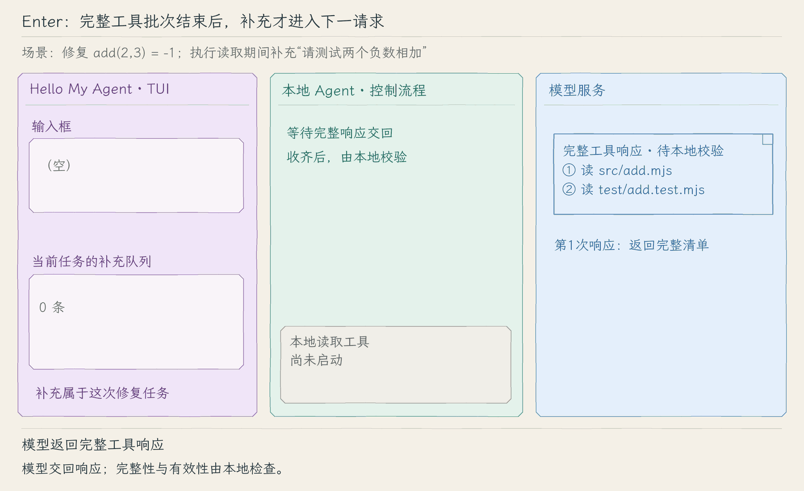
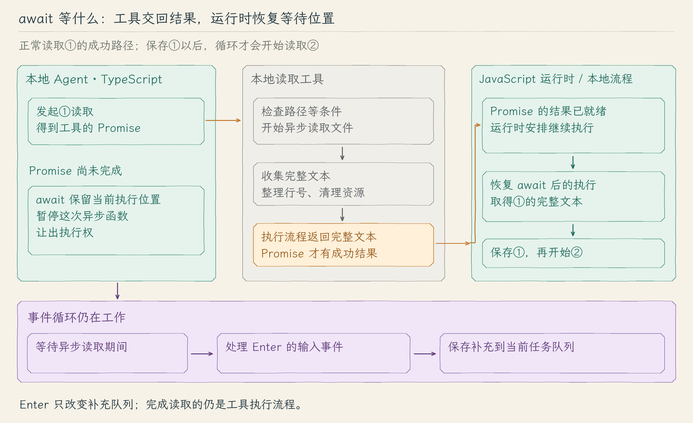
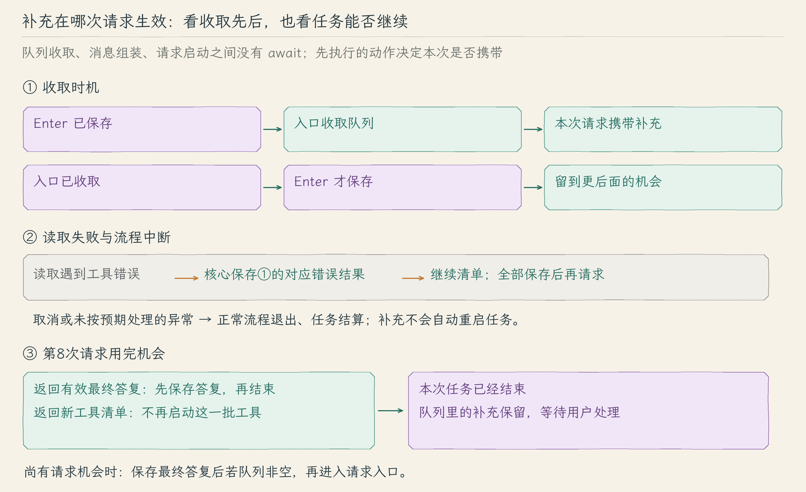
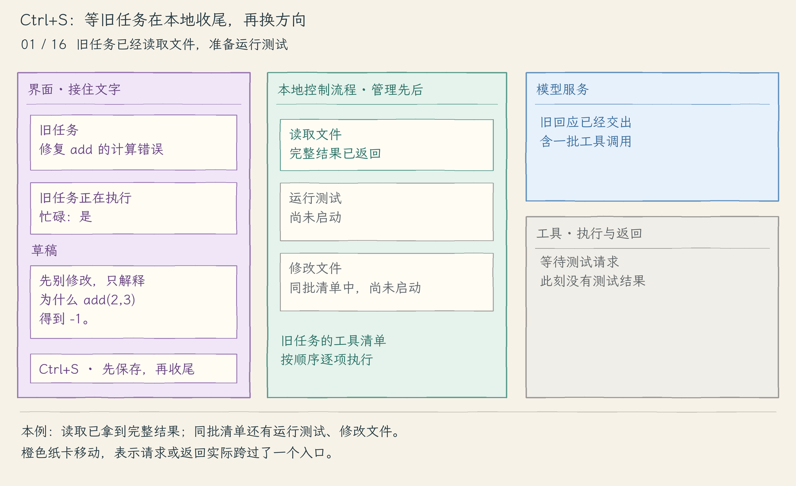
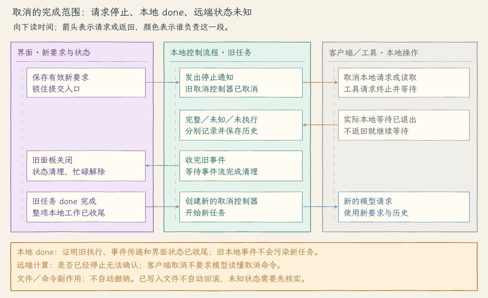

# 12.4 运行中补充要求：等工具结果，或停下后换方向

[第 12 章首页](../README.md) · [上一节：12.3 澄清问题](../03-clarify-questions/README.md) · [下一节：12.5 队列编辑与撤回](../05-manage-queue/README.md)

## 问题：任务已经开始，新要求还能加进去吗

上一节解决了由模型提出问题、等待答案的过程。本节换成用户主动输入：模型没有提问，我们也会想到新的要求。我们要学会从按键追到文字进入哪次请求，并解释两种等待为什么允许不同的后续动作。

例如，我们提交了“`add(2, 3)` 得到 `-1`，请修复”。Agent 开始调查，准备读取 `add.mjs` 和测试文件。看到这里，我们又想到：“请测试两个负数相加。”这句话并没有推翻修复任务，只是补上了一个测试条件。我们希望 Agent 接着读文件，随后把负数测试也安排进去。

另一种情况是，我们改变了主意：“先别修改，只解释为什么会得到 `-1`。”这次已经不适合沿着旧要求继续了。如果 Agent 正准备修改文件，我们希望它停下来，再按新要求工作。

第十一章已经让我们能在任务运行时编辑草稿。不过，**输入框里有文字，只说明我们写了草稿；模型下一次收到什么，还要由程序安排。** 本节要让这两种操作各有一条清楚的执行过程：补充原任务时，文字在哪里等、什么时候发送；改变方向时，旧任务怎样退出、新任务什么时候开始。

## 解决方案：Enter 补充，Ctrl+S 停下后换方向

任务运行时，在普通草稿输入区按 Enter，程序先把这段文字保存到当前任务的补充队列。旧任务继续执行。等程序走到下一次模型请求的入口，再把补充从队列取出来，连同已有消息一起发送。

这份队列由整次 TUI 会话持有，界面重新绘制时不会重建。它目前保存在内存中，退出或崩溃后不保证找回；第十三章才会加入持久保存。

如果要换方向，就在草稿里写好新要求，再按 Ctrl+S。程序先保存这份新要求，通知旧任务取消，等旧任务完成本地收尾，再启动新任务。

这里的“一项任务”与“一次模型请求”要分开。一项“修复加法”的任务，通常需要多次请求：先请模型安排调查，再带着读取结果请它决定修改，之后还可能带着测试结果请它总结。Enter 补充的是这项任务后面的请求；Ctrl+S 则结束这项任务，用新要求开始另一项任务。

本节说的 Agent runtime，就是我们用 TypeScript 写出的本地执行流程。模型通过回应提出下一步做什么；本地程序掌握什么时候发起请求、启动工具和完成收尾。这节要调整的，正是这些步骤的先后。

## 工作原理

### 先走完一次 Enter 补充

我们沿着加法任务看一次完整过程。下面假设模型第一次完整回应后，提出了两个工具调用：先读 `add.mjs`，再读测试文件。

Agent 开始读取 `add.mjs`。这时，我们输入“请测试两个负数相加”并按 Enter。界面先检查文字是否有效，把它复制到本地队列，并记下它属于当前的修复任务。保存成功后，输入框清空，界面显示这条补充正在排队。

此时，模型还没有收到负数测试要求。第一次模型请求已经发出，不能再把新文字塞回那次请求里；本地队列给这段文字提供了一个保存位置，让它等到后面的请求。

旧任务继续读取。`add.mjs` 的结果回来后，Agent 先保存结果，再开始读取测试文件。本节按模型列出的顺序逐项执行工具，所以第二次读取开始，并不表示这一批调查已经结束。

等测试文件的结果也回来并保存，这一批工具才处理完。Agent 现在有了两份文件内容，可以继续请求模型判断怎样修复。准备这次请求时，它先收取属于当前任务的补充，把“请测试两个负数相加”加入消息。

这次发送给模型的内容可以按下面的顺序理解：

| 消息来自哪里 | 这次请求携带的内容 |
| --- | --- |
| 原始要求 | `add(2, 3)` 得到 `-1`，请修复 |
| 模型第一次的回应 | 读取 `add.mjs` 和测试文件的两个调用 |
| 第一个工具结果 | `add.mjs` 中的代码 |
| 第二个工具结果 | 已有测试的内容 |
| 刚收取的补充 | 请测试两个负数相加 |

模型这时才有机会同时考虑“怎样修复”和“怎样验证负数”。例如，它读到加法函数误用了减法，便可以提出改用加法运算，并加入 `add(-2, -3)` 应得到 `-5` 的测试。后面的修改仍要经过本书已有的权限与审批流程，测试是否通过也要看实际运行结果。

整个过程里，Enter 做了两件事：保存文字，让界面显示已排队。把文字放进模型请求，是 Agent 后续准备请求时做的事。因此，界面要分别显示“已排队”和“已加入第几次请求”，这样我们才能看出补充走到了哪里。后一个提示只确认本地请求内容已准备好；如果传输失败或请求被取消，它不能证明远端收到了补充，也不表示测试已经完成。

<style>
.motion-player { position: relative; margin: 18px 0; padding: 0; border: 0; }
.motion-player summary { display: block; cursor: pointer; list-style: none; }
.motion-player img { display: block; width: 100%; height: auto; margin: 0; }
.motion-player .motion-gif { position: absolute; top: 0; left: 0; pointer-events: none; }
.motion-player[open] .motion-cover { visibility: hidden; }
.motion-player .motion-toggle { display: inline-block; margin-top: 12px; padding: 8px 18px; border-radius: 6px; background: #294c63; color: white; font-size: 16px; }
.motion-player .motion-stop, .motion-player[open] .motion-start { display: none; }
.motion-player[open] .motion-stop { display: inline; }
</style>

<details class="motion-player">
<summary>

<span class="motion-toggle"><span class="motion-start">▶ 开始播放动图</span><span class="motion-stop">■ 收起动图</span></span>
</summary>

</details>

模型返回工具响应后，由本地收齐并校验，再按清单开始读取。后续 Enter 保存的是补充队列；两份结果都保存后，补充才进入下一请求。[查看完整静态分镜](assets/enter-full-storyboard-815a52563a.jpg)

### 为什么要等完整回应和整批工具结果

前面的例子从“模型已经提出两个读取调用”开始。实际运行时，Agent 还要先等模型这一次回应完整返回。屏幕上逐渐出现的文字，只是正在接收的片段；工具名称、参数和结束方式可能还没有收全。程序不能看到一半调用就开始执行，否则可能拿着不完整的参数读错文件。这些片段也只用于显示，不会被写成一条完整的模型消息。

收到完整回应并确认可以使用后，Agent 才接受这一批工具调用。每个调用都有自己的编号，返回的结果也要对应这个编号。这样，下一次模型请求里，“读取 `add.mjs`”旁边才能接上它自己的文件内容，而不会误接成测试文件的结果。

如果只拿到第一个结果就发起下一次请求，第二个读取调用还没有交代。模型既没有完整的调查材料，消息里也留下了一个没有结果的调用。因此，本节让 Agent 先处理完这批清单，再进入下一次请求。

“处理完”不要求每个工具都成功。假如测试文件路径写错，读取工具可以返回对应的错误结果；假如某项修改被拒绝，也会留下对应的拒绝结果。模型拿到这些结果，才能决定换一个路径、调整方案或向我们说明问题。取消与意外异常则会结束这条正常流程，经过收尾后退出，不会为了凑齐一批成功结果而继续执行。

### `await` 怎样让程序停在该等的位置

现在回到第一次读取。Agent 调用读取工具时，磁盘内容通常还没有准备好。工具先交回一个 Promise，用来代表这次调用将来会交付的结果。Agent 拿到它时，拿到的是一个可以等待的对象，文件内容要等后面的读取工作完成才能得到。

这份 Promise 什么时候完成，取决于执行工具的那段异步流程。本节的读取器要检查路径、接收文件内容、收集需要的行、完成本地资源清理，再整理出带行号的文本。它最终返回结果时，对应的 Promise 就成功，并带上这份结果；如果执行流程以异常退出，Promise 就失败，并带上原因。

因此，Promise 不是自己去观察“文件大概读完了”。是工具的执行流程决定何时返回，运行时再通过 Promise 把成功或失败交给等待者。工具承诺的完成范围也很重要：如果一个工具只在启动操作后就返回，等待它只能知道“操作已启动”。本节的读取工具返回的是整理好的读取结果，所以 Agent 可以在等待之后保存这份文本。

Agent 在这个 Promise 上使用 `await`，就是把自己后面的步骤留到结果出来之后。等第一次读取成功，它才能取得文本、保存结果、启动第二次读取；等第二次读取也完成，才能继续准备下一次请求。如果等待的 Promise 失败，Agent 会在这个等待位置收到异常，转入相应的错误处理。

这不是在循环里反复问“好了没有”。程序执行到 `await` 时，JavaScript 的执行机制记下当前异步函数暂停的位置和继续执行所需的状态，并交回控制权。Promise 完成后，后续执行才被安排回来。我们用 TypeScript 写出这些步骤，程序运行在 Node.js 中；负责等待与调度的是执行时的机制，TypeScript 的类型检查不负责让工具完成。

还要把“等一项”和“等一批”分开。`await` 只等待交给它的那份 Promise，不认识模型提出的工具清单。本节之所以能等完整批次，是因为 Agent 的循环安排了先后关系：等待第一项、保存第一项，再处理第二项；清单全部处理完，才离开这段循环。



### 程序在等待，为什么输入框还能接收文字

暂停的是正在等待结果的异步函数。它交回控制权后，Node.js 可以处理文件读取、网络响应和键盘输入等其他事件。因此，Agent 等待读取结果时，界面仍有机会运行 Enter 的处理函数，把负数测试要求保存到队列。

这两段工作各有自己的后续步骤。Enter 的处理函数保存完文字，就可以返回；正在等待读取的 Agent 还要等工具的 Promise 完成。一次按键不会让这个 Promise 提前完成，也不会替工具交出文件内容。

异步等待也不保证任何情况下界面都流畅。如果某段代码连续执行很久、一直不交回控制权，键盘事件仍可能来不及处理。这里能够在等待期间继续输入，是因为文件和网络操作采用了异步接口，等待中的 Agent 没有占着执行机会空转。

### `await` 没有带上补充，为什么下一次请求里会有它

工具结果回来，只能让 Agent 继续往下走。负数测试要求能够进入下一次请求，还依赖于另一段明确的安排：**Agent 每次准备模型请求，都先收取当前任务的补充队列，再组装要发送的消息。**

在前面的例子中，两次读取已经各有结果，Agent 才来到下一次请求的入口。此时队列里保存着负数测试要求，程序把它取出来，作为用户消息接在这一批工具结果后面，然后发起请求。`await` 保证前面的结果已经取得；收取队列保证新要求加入消息。两者各做一件事，连起来才得到我们想要的顺序。

如果我们先后补充两句话，它们会按保存顺序加入请求。收取之后，这些文字从等待队列移到了任务消息里，所以从队列中消失不表示它们丢了。

队列中的文字还带着所属任务。修复加法任务的入口，只收取修复任务的补充；以后启动的新任务，不会自动拿走旧任务留下的文字。这样，“请测试负数”就不会悄悄变成另一项任务的要求。

从收取队列、组装消息到开始请求，这一段没有异步等待，程序会连续执行，键盘事件不能在中间插进来改掉半份请求。因此，决定补充能否赶上某次请求的，是 Enter 处理与收取队列的实际先后。若 Enter 的处理函数先运行、保存了文字，随后 Agent 才收取队列，它就能赶上；若程序先走过了这个入口，这条新补充就留到更后面的机会。不能仅凭我们在屏幕上看到的时间认定它已经加入；要看界面报告它加入了哪一次请求。

### 模型已经给了最终回答，队列里的补充怎么办

有时我们按 Enter 时，模型已经在生成最后的总结，没有再提出工具。比如它正在回答“已修复加法，测试通过”，而我们刚补充了负数测试要求。

Agent 收到完整、有效的最终回答后，会先保存这份回答，再检查当前任务是否还有补充。如果有，而且本任务还能继续请求模型，就再走一次请求入口，把补充带上。模型可以在已有修复结果之后继续处理负数测试。

本书给每项任务设置了最多 8 次模型请求的限制。第 8 次如果返回有效最终回答，Agent 会保存回答并结束，没有第 9 次请求可供补充进入；尚未收取的文字会保留在队列里。如果第 8 次又提出新的工具调用，Agent 也不会执行这批新调用，因为后面已经没有请求次数来处理它们的结果，而会以次数用尽结束任务。

同样，任务因取消或错误退出后，也不会自动重启来消耗剩余补充。保存文字和保证模型一定处理它，是两件不同的事。界面保留未处理的条目，下一节我们再为这些条目加入编辑与撤回操作。



### Ctrl+S 怎样把“先修复”换成“先解释”

Enter 让旧任务继续。如果我们现在希望“先别修改，只解释为什么 `add(2, 3)` 得到 `-1`”，就需要停下旧方向。

我们把这句话写进草稿，按 Ctrl+S。程序先检查并保存新要求，然后进入清理状态，暂时锁住提交入口。这样，等待旧任务退出时，连续按键不会再启动另一项任务，也不会把后续文字塞回正在结束的旧任务。

接着，程序通过旧任务的取消控制器发出停止通知。这个控制器是本地程序传递取消的一种机制：模型客户端、工具和等待审批或回答的流程，都可以接收到它的取消信号。它不会直接删除历史，也不会让正在运行的函数凭空消失。

收到信号后，旧任务要沿自己的执行路径退出。等待模型时，客户端会取消本地请求或读取；等待工具时，工具按自己的取消规则结束；Agent 也会在继续下一步之前检查取消，避免再启动尚未开始的工具。随后，它保存已经得到的结果，为没有完整结果的调用写下中断情况，并结束这一项任务。

不过，Agent 内部退出，还不是界面可以马上开新任务的时刻。旧任务产生的事件可能正在传到界面，审批或问答面板也可能仍显示着旧内容。程序还要把这些事件消费完，等待事件流完成清理，再关闭旧面板、更新任务状态、解除忙碌。

界面为这一整段工作保存了另一份 Promise：`done`。它代表旧任务在本地的执行、事件传递和界面状态清理都走完。Ctrl+S 等待的就是这份 Promise，所以等待完成后，旧任务不会再继续向当前界面追加事件或留下旧面板。这里等到的是状态已经清理，并不要求再等屏幕下一帧画完。

如果底层操作还没有返回，旧任务的 `done` 就仍未完成，Ctrl+S 会继续等待，不能先开新任务。本节还没有所有工具共用的统一结束期限，第二十七章会继续扩展工具生命周期与超时。

这时，程序才清空已提交的草稿，为新任务创建一个新的取消控制器，把保存的“先别修改，只解释”作为新要求启动。旧控制器已经处于取消状态，不能拿来继续一项新任务。

前面的两种等待现在可以对应起来：Enter 补充时，Agent 等模型和工具交付结果，随后准备当前任务的下一次请求；Ctrl+S 换方向时，界面等整项旧任务退出并完成本地收尾，随后启动新任务。等待对象不同，决定了各自什么时候可以继续。

<details class="motion-player">
<summary>

<span class="motion-toggle"><span class="motion-start">▶ 开始播放动图</span><span class="motion-stop">■ 收起动图</span></span>
</summary>

</details>

[查看完整静态分镜](assets/interrupt-and-send-5ec2d92650.jpg)

### 停下来之后，已经做过的事怎样记录

如果取消发生在读取文件时，我们通常只关心读取有没有得到结果。如果取消发生在写文件或执行命令时，还要关心操作是否已经改变了外部状态。

例如，Agent 已经把减法改成加法，然后开始运行测试。我们这时按 Ctrl+S，表达的是“后面先别继续修改”。之前写入的内容可能已经在磁盘上生效，取消信号不会自动把它改回去。

旧任务收尾时，必须区分下面三种情况：

| 取消时的实际情况 | 留给后续任务的记录 |
| --- | --- |
| 工具已经交回完整结果 | 保留它的真实结果。例如修改已成功，或测试已失败 |
| 操作已经开始，但没有取得完整结果 | 记录操作已开始、结果未知，可能已经产生部分副作用，继续前需要核实 |
| 同批清单里的调用尚未启动 | 记录这个调用未执行 |

假如“修改文件成功”的结果已经回来，不能因为随后收到取消就把它改写成“修改未执行”。反过来，如果命令已启动却没有完整结果，也不能凭任务状态变成“已取消”，就认定命令什么都没做。已经接受的工具调用仍要各自留下对应记录，后续模型才能读出哪些事确实完成、哪些事仍不确定。

本节运行命令的工具收到取消后，会请求终止进程，并等待直接子进程的关闭事件，再让本地执行流程结束。这能让新任务等到该工具的本地收尾完成，但不能证明命令启动的所有外部进程、远程请求或其他副作用都已消失。

因此，新任务会接着使用已保存的会话历史，并读到旧任务的结果与本地中断说明。遇到未知副作用时，它需要先核实文件或进程的当前状态，再决定下一步。旧任务还没收取的补充仍留在原任务的队列里，不会自动混入这个“先解释”的新任务。

这里也不需要让远端模型先理解一句“你已经被取消了”，才能停下本地流程。取消由客户端和 Agent 的控制流程执行；远端服务是否已经停止计算，仅凭本地请求被取消无法确认。我们可以确认的是：旧任务的本地流程已经退出，结果与中断情况已经记录，新任务有了自己的执行入口。

`done` 完成也只说明这段本地工作已收尾。它没有承诺恢复磁盘文件，没有自动撤销命令副作用。本章先把“何时能开始下一项任务”安排清楚，文件如何建立检查点与回滚，会在后面的章节单独实现。



### 哪些输入仍要留在草稿里

上面的过程都从普通草稿输入区开始。如果审批面板正在等批准，Enter 要交给当前审批；如果模型正在通过 `ask_user` 提问，Enter 要交给当前问题。程序不会把这些回答同时当成任务补充，也不会用 Ctrl+S 绕过正在显示的面板。要取消当前任务，仍可以使用已有的 Ctrl+C。

本地命令也有自己的入口。任务运行时，`/mode`、`/reset` 等命令不会作为普通要求排队，也不能用 Ctrl+S 作为替代任务发送。程序保留草稿并提示等待，避免模型收到只应由本地界面处理的命令。

普通补充也可能保存失败，例如文字为空、长度超限，或者等待队列已经达到 20 项。程序只有在文字确实保存成功后才清空草稿。Ctrl+S 同样先检查新要求；如果无效，就保留草稿，也不取消正在执行的任务。

这样，输入框清空有了一个可以信任的含义：这份有效文字已经被程序接住。之后我们再通过排队提示、加入请求的提示和任务结果，判断它是否进一步得到处理。

现在，我们已经能从一次按键追到模型下一次收到的内容。Enter 先保存补充，模型完整回应和本批工具结果依次取得，Agent 再在请求入口收取文字；Ctrl+S 先保存新要求，通知取消并等待旧任务的本地收尾，然后创建新任务。

接下来把这两条过程接进已有 Agent：界面负责接住文字与展示状态，Agent 负责安排请求和工具的先后，工具负责交付自己的结果与结束情况。各自完成自己承诺的工作，等待才有明确的意义。

## 本节改动文件

界面接住文字，队列保存归属，核心安排收取，事件报告本地进度。下面这些修改把正文中的等待与交接接到同一份运行状态。

| 状态 | 文件 | 本节变化 |
| --- | --- | --- |
| CHANGED | [src/agent/run-options.ts](src/agent/run-options.ts) | 让当前任务能够查询并收取自己的补充 |
| CHANGED | [src/agent/events.ts](src/agent/events.ts) | 报告补充已经加入哪一次模型请求 |
| NEW | [src/ui/tui/input-queue.ts](src/ui/tui/input-queue.ts) | 保存补充、检查输入、按所属任务收取文字 |
| CHANGED | [src/agent/agent-loop.ts](src/agent/agent-loop.ts) | 在模型请求入口收取补充，并保留工具结果与中断记录 |
| CHANGED | [src/ui/tui/state.ts](src/ui/tui/state.ts) | 把排队、收取和任务状态转换成界面提示 |
| CHANGED | [src/ui/teaching-trace.ts](src/ui/teaching-trace.ts) | 把补充进入请求的过程加入教学观察记录 |
| CHANGED | [src/ui/tui/app.tsx](src/ui/tui/app.tsx) | 接入 Enter 与 Ctrl+S，等待旧任务完成本地收尾后启动新任务 |

## 动手构建

从 12.3 的完整 `src/` 继续，目标目录为 `chapter-12-task-control/04-live-input/`。跟写时先记住两项要验证的关系：补充必须在本批结果之后加入请求，替代任务必须在旧任务的本地收尾之后启动。队列、核心与界面分别承担其中一段，不能用一个“正在等待”的提示代替实际连接。

下面先说明每处修改怎样承担正文中的职责，再给出准确替换范围与完整代码。实现可折叠对照，未列出的函数和文件继续沿用。

### 声明核心收取补充与检查剩余项的接口

核心只需要知道有没有本任务的补充，以及怎样一次收取它们；无需认识 TUI 队列面板。接口把“将文字交给任务”的能力交给核心，具体归属仍由入口固定。

完整替换 `src/agent/run-options.ts`。本文件较短，下面给出完整替换文件，保留沿用部分。

<details>
<summary>完整替换文件：run-options.ts</summary>

<!-- source: src/agent/run-options.ts -->
```ts
/**
 * 12.4 运行中补充与打断 | [CHANGED] agent/run-options.ts
 *
 * 学习目标：把本节的运行控制数据交给核心，界面不需要代替核心作决策。
 * 输入：本地入口选定的模式、会话清单、问答 handler 与本轮队列回调。
 * 输出：RunOptions 描述这一轮允许使用的控制入口；这里只定义类型，不执行任务。
 * 状态：模式由启动入口取快照；清单属于会话，补充的收取回调只绑定当前轮。
 * 本文件数据关系（全局主流程见 agent/agent-loop.ts）：
 *   本地界面 -> 本轮选项 -> 核心 / 工具 / 模型请求
 * 缺少可选入口时采用默认模式或不提供对应交互；类型声明不能代替运行时校验。
 * 运行观察：不同界面传入同样的选项，核心仍使用同一条模型与工具循环。
 */
// [KEEP 来自 12.1] 模式由本地运行入口选择，默认继续执行。
/**
 * 本地入口可选的两种运行模式。
 * plan 只调查和制定计划；execute 仍需遵守每次工具的权限与审批。
 */
export type ExecutionMode = "plan" | "execute";

// [KEEP 来自 12.2] 容器由会话持有，切换模式和开始新一轮不会丢失任务清单。
/**
 * 清单中的一个步骤和模型报告的进度。
 * ID 用来辨认条目，状态不是测试证明；数量和字段限制由 todo_write 运行时检查。
 */
export type TaskItem = {
  id: string;
  text: string;
  status: "pending" | "in_progress" | "completed";
};
/**
 * 会话持有的可替换清单容器。
 * 工具先校验完整新数组再替换 items，失败时旧数组继续使用。
 */
export type TaskState = { items: TaskItem[] };

// [KEEP 来自 12.3] 答案只交回正在等待的工具调用；null 表示用户未回答。
/**
 * 这次澄清要显示的问题与选项。
 * 选项可为空，用户仍可自由回答；内容约束由 ask_user 检查。
 */
export type UserQuestion = { question: string; choices: string[] };
/**
 * 界面提供的专用问答等待入口。
 * 返回有效答案或表示未回答的 null；取消和显示失败可拒绝 Promise。
 */
export type QuestionHandler = (request: UserQuestion, signal: AbortSignal) => Promise<string | null>;

// [CHANGED 12.4] ID 用于界面确认哪条补充已被核心收取。
// [CHANGED 12.4] 类型新增本节使用的控制数据；各字段用途见紧邻说明。
/**
 * 核心实际收取的一条补充。
 * ID 供界面确认哪条已加入上下文；所属轮由界面回调闭包固定。
 */
export type QueuedInput = { id: number; text: string };

// [CHANGED 12.4] 类型新增本节使用的控制数据；各字段用途见紧邻说明。
/**
 * 把这一轮使用的模式、会话状态和可用控制入口放在一起。
 * 省略可选项时使用默认模式或缺省交互；回调仅负责本轮，不能把旧轮补充带进新轮。
 */
export type RunOptions = {
  // [KEEP 来自 12.1] 本轮模式由本地入口取快照。
  mode?: ExecutionMode;
  // [KEEP 来自 12.2] 清单容器跨模型请求和工具调用共用。
  tasks?: TaskState;
  // [KEEP 来自 12.3] 问答是被工具等待的控制入口，观察事件不能替代它。
  askUser?: QuestionHandler;
  // [CHANGED 12.4] 由核心请求前主动收取，保持当前轮 FIFO 顺序。
  takePendingInputs?: () => QueuedInput[];
  // [CHANGED 12.4] 最终回答后只检查是否待处理，不提前移出队列。
  hasPendingInputs?: () => boolean;
};
```

</details>

### 用 input_applied 报告补充已加入请求上下文

事件发生在文字已加入本地请求消息之后。它报告的是本地准备进度，不能用来宣称远端已接收或已完成补充任务。

完整替换 `src/agent/events.ts`。本文件较短，下面给出完整替换文件，保留沿用部分。

<details>
<summary>完整替换文件：events.ts</summary>

<!-- source: src/agent/events.ts -->
```ts
/**
 * 12.4 运行中补充与打断 | [CHANGED] agent/events.ts
 *
 * 学习目标：在任务运行中补充要求，或打断后发送新要求；本文件负责传递已经发生的模型、权限和工具事件。
 * 输入：runAgent 的开始/结束通知，或 Agent Loop 已发生的过程事件。
 * 输出：可选观察者同步收到一份深拷贝；没有观察者或通知失败时直接返回。
 * 状态：复制事件不修改历史；观察者直接抛错被捕获，但耗时和显式取消不由这里隔离。
 *
 * 本文件局部流程（全局主流程见 agent/agent-loop.ts）：
 *   [KEEP] run_start / run_finish 与已有过程事件 -> 有观察者？-- 否 -> 返回
 *                                                                +-- 是 -> structuredClone
 *   复制成功？-- 否 -> 捕获异常 -> 返回
 *             +-- 是 -> 调用观察者 -> 成功 / 抛错 -> 返回
 *
 * run_finish 的 completed 带 Reply，cancelled/error 带说明；model_finish 仍只描述一次模型调用。
 * 观察者只接收事件，审批 handler 才是核心等待的控制入口，事件本身不能授予权限。
 * 深拷贝只保护原对象，不隐藏参数或正文里的敏感信息，也不会把同步回调变成独立线程。
 *
 * [CHANGED 12.4] input_applied 表示核心已收取并加入本次请求上下文，不保证远端收到或需求完成。
 * 该事件没有工具 sequence，必须先于通用工具分支处理。
 * 运行观察：一个 run_start 到一个 run_finish 之间，可以包含多次 model_start/model_finish。
 */

// [KEEP 来自 08.2] 事件展示统一结束原因。
import type { ModelFinishReason, Reply } from "../models/client.js";
import type { ToolCall } from "../tools/registry.js";
import type { ToolExecutionResult } from "../tools/types.js";
import type { ApprovalResponse, PermissionDecision } from "../permissions/policy.js";

// [KEEP 来自 08.1] 原有观察通道增加文字片段，TUI 与文本界面可消费同一种事件。
// [KEEP 来自 09.1] 整轮任务开始与结束也使用事件通知。
// [CHANGED 12.4] 类型新增本节使用的控制数据；各字段用途见紧邻说明。
export type AgentEvent =
  | { type: "run_start" }
  | { type: "run_finish"; outcome: "completed"; reply: Reply }
  | { type: "run_finish"; outcome: "cancelled" | "error"; message: string }
  | { type: "text_delta"; call: number; text: string }
  // [CHANGED 12.4] 核心收取确认带补充 ID、文字和请求次数，不使用工具 sequence。
  | { type: "input_applied"; id: number; text: string; call: number }
  | {
      type: "model_start";
      call: number;
      contextMessages: number;
      trigger: { kind: "user"; content: string } | { kind: "tool_results"; count: number };
    }
  | {
      type: "model_finish";
      call: number;
      // [KEEP 来自 08.2] 停止生成不一定代表回答完成。
      outcome: "tools" | "final" | "empty" | "incomplete";
      finishReason: ModelFinishReason;
      toolRequests: number;
      text: string;
    }
  | { type: "permission_check"; sequence: number; call: ToolCall; decision: PermissionDecision }
  // [KEEP 来自 06.1] 成功事件只额外保存 previewChars，不复制完整预览；原始 call 仍可能包含完整参数。
  // 消费者仍需选择展示字段；不能因为某项只给出字符数，就认为整个事件已经脱敏。
  | {
      type: "tool_prepare";
      sequence: number;
      call: ToolCall;
      outcome: "success";
      previewChars: number;
    }
  | {
      type: "tool_prepare";
      sequence: number;
      call: ToolCall;
      outcome: "error";
      error: string;
    }
  // [KEEP 来自 06.1] 观察者只知道是否有预览；完整文件 diff 或命令预览由审批适配器展示。
  | {
      type: "approval_start";
      sequence: number;
      call: ToolCall;
      scope: string;
      allowSession: boolean;
      hasPreview: boolean;
    }
  | { type: "approval_finish"; sequence: number; call: ToolCall; response: ApprovalResponse }
  | { type: "tool_start"; sequence: number; call: ToolCall }
  | {
      type: "tool_finish";
      sequence: number;
      call: ToolCall;
      outcome: "success";
      result: ToolExecutionResult;
    }
  | {
      type: "tool_finish";
      sequence: number;
      call: ToolCall;
      outcome: "error";
      error: string;
    };

export type AgentObserver = (event: AgentEvent) => void;

/**
 * 把已经产生的事件副本交给观察者，捕获观察者直接抛出的异常。
 *
 * - 输入：可选观察者，以及 runAgent 或 Agent Loop 刚刚产生的结构化事件。
 * - 输出：观察者存在时同步收到一份深拷贝；不存在时直接返回。
 * - 关键原因：structuredClone 防止观察者通过事件对象修改原工具请求或结果。
 * - 失败方式：拷贝失败或观察者直接抛错时在这里结束通知，不把该异常继续抛给核心。
 * - 职责边界：拷贝不隐藏敏感信息，也不隔离耗时；观察者显式触发取消信号仍会影响本轮执行。
 */
export function emitAgentEvent(observer: AgentObserver | undefined, event: AgentEvent): void {
  try {
    if (observer) observer(structuredClone(event));
  } catch {
    // 这里只捕获通知过程抛出的异常；观察者触发的取消信号仍由执行链正常处理。
  }
}
```

</details>

### 保存稳定 ID、文字和所属 run，按 run 收取

队列在会话中保存有效文字、稳定 ID 与所属 run。按 run 收取时同时返回本任务的条目并移出它们，其他任务的剩余项继续保留。

创建 `src/ui/tui/input-queue.ts`。这是本节的新模块，完整实现如下。

<details>
<summary>创建文件：input-queue.ts</summary>

<!-- source: src/ui/tui/input-queue.ts -->
```ts
/**
 * 12.4 运行中补充与打断 | [NEW] ui/tui/input-queue.ts
 *
 * 学习目标：把运行中的补充按入队顺序保存，供当前轮在请求模型前取出。
 * 输入：补充文字、所属 run、会话队列。
 * 输出：入队条目带 ID；收取返回当前轮文字，其他轮的条目仍留在队列。
 * 状态：最多 20 项，每项原文最多 32000 个 UTF-16 单元；校验失败不提交修改。
 * 本文件局部流程（全局主流程见 agent/agent-loop.ts）：
 *   enqueue -> 文字有效且未满？-- 否 -> 抛错；是 -> 分配递增 ID、追加末尾
 *   take(run) -> 按原顺序选当前轮 -> 从队列移出 -> 返回 ID、文字；其他轮保留
 * 收取与模型请求由核心控制；入队不等于生效，旧轮剩余项不会自动进入新轮。
 * 运行观察：连续补充按原顺序收取，已移出的条目不再出现在待发送队列。
 */
// [NEW 12.4] 本文件以下类型声明均为本节新增。
// [NEW 12.4] 队列由会话持有；run 限定补充只能交给所属轮。
// [NEW 12.4] ID 在会话内递增，run 记录补充所属任务，文字只在未收取时保存在这里。
export type QueueEntry = { id: number; text: string; run: number };
export type InputQueue = { items: QueueEntry[]; nextId: number };
export const MAX_QUEUE_ITEMS = 20;
export const MAX_QUEUE_TEXT = 32_000;

/**
 * 为这次会话创建空的补充队列。
 * 条目按入队顺序保存，ID 从 1 开始递增；新一轮不重新创建这份队列。
 */
export function newInputQueue(): InputQueue { return { items: [], nextId: 1 }; }
/**
 * 检查一份补充或队列编辑稿，返回去掉首尾空白后的文字。
 * 空白和原文超过 32000 个 UTF-16 单元时抛错；长度检查使用原文，队列尚未改变。
 */
export function validateQueuedText(text: string): string {
  const value = text.trim();
  if (!value) throw new Error("补充内容不能为空。");
  if (text.length > MAX_QUEUE_TEXT) throw new Error(`补充内容最多 ${MAX_QUEUE_TEXT} 个 UTF-16 单元。`);
  return value;
}
/**
 * 把有效补充追加到所属轮的队列末尾。
 * 先检查文字和最多 20 项的容量，再分配递增 ID；run 由当前任务入口提供。
 * 返回新条目，入队只表示等待核心收取；失败不占用 ID，也不清调用方草稿。
 */
export function enqueueInput(queue: InputQueue, text: string, run: number): QueueEntry {
  const value = validateQueuedText(text);
  if (queue.items.length >= MAX_QUEUE_ITEMS) throw new Error(`最多保留 ${MAX_QUEUE_ITEMS} 条待发送补充，请先处理队列。`);
  const entry = { id: queue.nextId++, text: value, run };
  queue.items.push(entry);
  return entry;
}
/**
 * 检查指定轮是否仍有未收取的补充。
 * 只返回布尔值，不移出条目；用于最终回答之后决定是否还有一次继续决策的机会。
 */
export function hasPendingInputs(queue: InputQueue, run: number): boolean {
  return queue.items.some((entry) => entry.run === run);
}
/**
 * 一次取走当前轮的全部补充，保持它们原来的入队顺序。
 * 输入是会话队列和绑定的 run；先选出这一轮，再保留其他轮的条目。
 * 返回 ID 与文字；空数组表示本轮没有补充。核心把它们加入请求上下文后才发收取事件。
 * 旧轮条目仍保留，调用方不能换成新轮编号去自动收取。
 */
export function takePendingInputs(queue: InputQueue, run: number): { id: number; text: string }[] {
  // [NEW 12.4] 过滤保留原数组顺序，当前轮按 FIFO 收取，其他轮仍留存。
  const selected = queue.items.filter((entry) => entry.run === run);
  queue.items = queue.items.filter((entry) => entry.run !== run);
  return selected.map(({ id, text }) => ({ id, text }));
}
```

</details>

### 请求前收取补充，最终回答边界仍检查剩余项

把收取放到唯一的模型请求入口，避免不同分支遗漏。最终回答后再判断是否仍有补充与预算；取消记录则继续按真实执行情况保留结果，不能把已完成工具改成未执行。

在 `src/agent/agent-loop.ts` 中，先替换文件开头的教学说明与全部导入，再在原定义位置完整替换 `agentLoop()`。

<details>
<summary>agent-loop.ts 的完整替换范围</summary>

**文件说明与全部导入：**

<!-- source: src/agent/agent-loop.ts -->
```ts
/**
 * 12.4 运行中补充与打断 | [CHANGED] agent/agent-loop.ts
 *
 * 学习目标：在任务运行中补充要求，或打断后发送新要求，并看清这些控制能力接在模型与工具循环的哪里。
 * 输入：问题、已有模型历史、取消信号、观察者、审批入口，以及本轮模式和本地控制选项。
 * 输出：完成时返回回答并提交本轮历史；中断时补齐工具状态、保存中断说明后抛错。
 * 状态：进入前已取消就不新增历史；清单由会话持有，已经发生的工具操作不会随取消撤销。
 *
 * 全局主流程（从这里进入各模块）：
 *   CLI -> 帮助 / 版本 / 诊断？-- 是 -> 显示后结束
 *                            +-- 否 -> 检查输出方式和模式 -- 无效 -> 错误结束
 *                                                         +-- 有效 -> 配置、模型、消费者
 *   [KEEP 来自 10.4] auto：交互连续输入 -> TUI；单次问题或管道 -> text
 *   输入界面 -> 草稿 / 历史浏览 / 外部编辑 -> 等用户提交
 *   [KEEP 来自 12.1] 空闲 /mode plan|execute -> 保存会话模式；新一轮取启动快照
 *   [CHANGED 12.4] TUI Enter -> 正在运行？-- 是 -> 校验补充 -> 记入当前轮 FIFO 队列
 *                                           +-- 否 -> 本地命令或新一轮问题
 *   [CHANGED 12.4] Ctrl+S -> 先保存新要求、锁住提交 -> abort 旧轮 -> 等旧 done
 *                   -> 已退出？-- 是 -> 结束；否 -> 新控制器、新一轮（旧队列留存）
 *   普通问题 -> streamAgentRun -> runAgent -> run_start -> 事件消费者
 *                                       +-> agentLoop -> 进入前已取消？-- 是 -> 抛错结束
 *                                                                   +-- 否 -> 建立本轮消息
 *   [KEEP 来自 12.1] 固定本轮模式 -> A
 *   [KEEP 来自 12.2] 本轮共用会话清单（未提供时创建本轮容器）
 *   A: [CHANGED 12.4] 取出当前轮全部补充，保持入队顺序 -> 加入本轮 user 消息
 *       -> input_applied 确认核心收取并加入上下文 -> 再查取消 -> 请求模型
 *      [KEEP 来自 12.1] models/client 按模式提示、筛选工具；本地策略仍负责真正禁止
 *      文字片段 -> 事件消费者；完整结果 -> 结束原因和工具数量一致？-- 否 -> X
 *                                                                        +-- 是 -> B
 *   B: 有工具请求？-- 否 -> 回答非空且未取消？-- 否 -> X
 *                  |                         +-- 是 -> 保存 assistant 回答
 *                  |  [CHANGED 12.4] 仍有补充且未到第 8 次？-- 是 -> A（继续决策）
 *                  |                                              +-- 否 -> 提交历史、返回回答
 *                  |  次数已用完时不取走剩余补充，界面队列仍保留
 *                  +-- 是 -> 已到第 8 次？-- 是 -> X（不执行这批工具）
 *                                       +-- 否 -> 保存 assistant 调用 -> C
 *   C: [KEEP 来自 12.1] 权限策略 -> Plan 的写入 / 编辑 / 命令？-- 是 -> 拒绝结果 -> D
 *                                                             +-- 否 -> 原有 deny / ask / allow
 *      deny -> 拒绝结果 -> D；ask -> 准备预览 -- 失败 -> 错误结果 -> D
 *                                        +-- 成功 -> 等本次审批 -- 拒绝 -> 拒绝结果 -> D
 *                                                             +-- 批准 -> 执行 -> D
 *      allow -> 注册表找到工具 -> 执行 -> D
 *        [KEEP 来自 12.2] todo_write -> 全部条目校验成功？-- 否 -> ToolError、旧清单不变
 *                                                     +-- 是 -> 一次替换内存清单 -> D
 *        [KEEP 来自 12.3] ask_user -> 校验问题 -> 专用 handler 等回答
 *                            -> 回答有效且未取消？-- 是 -> 原调用的 tool result -> D
 *                                                +-- 否 -> ToolError 或取消 -> D / X
 *                            TUI 面板独占输入；旧请求结束后旧回调失效
 *   D: 保存工具正文与错误标记 -> 发过程事件 -> 本批还有调用？-- 是 -> C
 *                                                                +-- 否 -> A
 *      [KEEP] 一批调用全部有结果后才回到下一次模型请求
 *      清单的 completed 是模型报告的进度；测试是否通过仍要看实际命令结果
 *   X: 错误 / 取消 / 次数耗尽 -> 补齐缺少的工具结果 -> 保存历史与本地说明 -> 抛错
 *   runAgent -> run_finish completed / cancelled / error -> 同一事件流
 *   事件流 -> text：正文 stdout、过程 stderr；jsonl：逐条 JSON、等写入回调
 *          +-> TUI：RunView -> 完整显示条目 -> 历史视口
 *   [KEEP] 审批：交互 text 或 TUI 等明确决定；jsonl / 非交互环境拒绝待确认请求
 *   [KEEP] Ctrl+C：忙碌取消当前轮并等清理；空闲退出；退出先封住提交再等任务清理
 *   [KEEP] 事件队列超限 / 提前停止消费 -> 取消同一轮、等待模型与工具清理
 *
 * 图中带当前编号的是本节增量；KEEP 表示已经建立的能力。
 * 普通事件最多暂存 128 条，结束事件另有位置；这是事件条数限制，不是总字节内存上限。
 * 工具结果仍给模型，界面只处理显示副本；模式选择、澄清答案和聊天文字都不能产生批准。
 * 运行观察：补充先显示排队，下一次请求前才确认核心收取；打断会等旧轮清理。
 */

import { ToolError, UserFacingError } from "../errors.js";
import type { Message, Model, Reply } from "../models/client.js";
import { decideToolPermission, type ApprovalHandler } from "../permissions/policy.js";
import { executePreparedTool, executeTool, prepareTool } from "../tools/registry.js";
import type { PreparedToolCall } from "../tools/types.js";
import { emitAgentEvent, type AgentObserver } from "./events.js";
import type { RunOptions } from "./run-options.js";
```

**替换 agentLoop：**

<!-- source: src/agent/agent-loop.ts -->
```ts
/**
 * 让模型读到问题和真实工具结果，继续决策直到本轮完成或中断。
 * 进入前先检查取消；本轮模式在入口固定，模型提示与权限策略都使用它。
 * 清单容器在这轮工具之间共用；工具完整校验后更新内存，核心不从回答文字推断进度。
 * 每次模型请求前取出当前轮 FIFO 补充，加入本轮消息；上一批工具先全部产生结果。
 * 最终回答后还有补充且未用尽 8 次请求时继续；用尽次数不收取剩余补充。
 * 每个工具先过权限，写入与命令先准备再审批；拒绝和 ToolError 也回给原调用。
 * ask_user 通过注册表等待专用 handler，答案仍是该次工具结果。
 * 成功提交完整本轮消息并返回回答；开始后中断则补齐工具结果、保存说明，再抛出原因。
 * 本函数不会撤销已执行的操作，也不会把聊天、问答或模型承诺当成批准。
 */
// [KEEP 来自 08.3] 本轮中断后保存完整工具状态，下一轮使用新的取消信号继续。
// [CHANGED 12.4] 核心接入本节控制选项；相互分开的新分支在下方另作标记。
export async function agentLoop(
  model: Model,
  history: Message[],
  input: string,
  signal: AbortSignal,
  observer?: AgentObserver,
  requestApproval?: ApprovalHandler,
  // [KEEP 来自 05.3] Set 由终端持有，Agent Loop 在用户输入 s 后写入批准记录。
  sessionGrants: Set<string> = new Set(),
  // [KEEP 来自 12.1] 增加本轮控制选项；调用方把模式快照传到核心。
  options: RunOptions = {},
): Promise<Reply> {
  signal.throwIfAborted();
  // [KEEP 来自 12.1] 本轮模式在循环前固定，后面的请求和策略共用它。
  const mode = options.mode ?? "execute";
  // [KEEP 来自 12.2] 未提供会话容器时，本轮仍能使用同一份任务清单。
  // [KEEP 来自 12.2] 所有清单工具共用同一份容器，未传入时在本轮创建。
  const toolOptions: RunOptions = { ...options, tasks: options.tasks ?? { items: [] } };
  const turn: Message[] = [{ role: "user", content: input }];
  let inputTokens: number | null = 0;
  let outputTokens: number | null = 0;
  let truncated = false;
  let toolSequence = 0;
  let pendingToolResults = 0;

  // [KEEP 来自 08.3] 中断时区分“已开始但没结果”和“尚未开始”的调用。
  let executingCallId: string | undefined;
  try {
    for (let modelCall = 1; modelCall <= MAX_MODEL_CALLS; modelCall += 1) {
      // 每次请求都由核心主动检查取消，不能依赖具体 Model 实现自行处理 signal。
      signal.throwIfAborted();

      // [CHANGED 12.4] 每次请求前收取当前轮 FIFO 补充；上一批调用已有完整工具结果。
      for (const queued of options.takePendingInputs?.() ?? []) {
        turn.push({ role: "user", content: queued.text });
        // [CHANGED 12.4] 此事件只确认核心已收取并加入本次上下文，不保证远端收到。
        emitAgentEvent(observer, { type: "input_applied", ...queued, call: modelCall });
      }
      signal.throwIfAborted();
      emitAgentEvent(observer, {
        type: "model_start",
        call: modelCall,
        contextMessages: history.length + turn.length,
        trigger: modelCall === 1
          ? { kind: "user", content: input }
          : { kind: "tool_results", count: pendingToolResults },
      });
      pendingToolResults = 0;
      // [KEEP 来自 08.1] 增量成为观察事件，不提前执行工具，也不把半句回答写入历史。
      // [KEEP 来自 12.1] 模型请求也接收本轮模式；工具隐藏只是辅助。
      const result = await model.generate([...history, ...turn], signal, (text) => {
        if (!signal.aborted) emitAgentEvent(observer, { type: "text_delta", call: modelCall, text });

      }, { mode });
      inputTokens = addUsage(inputTokens, result.inputTokens);
      outputTokens = addUsage(outputTokens, result.outputTokens);
      truncated ||= result.truncated;
      emitAgentEvent(observer, {
        type: "model_finish",
        call: modelCall,
        // [KEEP 来自 08.2] 长度上限和拒绝不会伪装成成功回答。
        finishReason: result.finishReason,
        outcome: !["stop", "tool_calls"].includes(result.finishReason) ? "incomplete"
          : result.toolCalls.length > 0 ? "tools" : result.text.trim() ? "final" : "empty",
        toolRequests: result.toolCalls.length,
        text: result.text,
      });

      // [KEEP 来自 08.2] 正常结束与工具数量必须一致，完整响应才允许进入权限判断。
      if (result.finishReason === "length") throw new UserFacingError("回答达到输出上限，本次响应未完成；其中的工具请求不会执行。");
      if (result.finishReason === "refusal") throw new UserFacingError("模型拒绝了本次请求，本次响应中的工具请求不会执行。");
      if (result.finishReason !== (result.toolCalls.length ? "tool_calls" : "stop")) {
        throw new UserFacingError("模型结束原因与内容不一致，或当前接口返回了不支持的结束原因。");
      }
      if (result.toolCalls.length === 0) {
        if (!result.text.trim()) throw new UserFacingError("模型没有返回可用的最终回答。");
        signal.throwIfAborted();
        turn.push({ role: "assistant", content: result.text });

        // [CHANGED 12.4] 最终回答后仍有补充且有请求预算就继续；第 8 次后的剩余条目保留。
        if (modelCall < MAX_MODEL_CALLS && options.takePendingInputs && options.hasPendingInputs?.()) continue;
        history.push(...turn);
        return { text: result.text, inputTokens, outputTokens, truncated };
      }

      // 最后一次模型机会仍要求工具时，结果已不可能再反馈给模型，因此不执行无用操作。
      if (modelCall === MAX_MODEL_CALLS) break;

      turn.push({ role: "assistant", content: result.text, toolCalls: result.toolCalls });
      for (const call of result.toolCalls) {
        signal.throwIfAborted();
        toolSequence += 1;
        // [KEEP 来自 12.1] 每次请求仍经过本地模式检查，不能靠模型工具列表保证禁止。
        const permission = await decideToolPermission(call, sessionGrants, undefined, mode);
        emitAgentEvent(observer, {
          type: "permission_check",
          sequence: toolSequence,
          call,
          decision: permission,
        });
        let rejection: string | null = null;
        let prepared: PreparedToolCall | null = null;
        // [KEEP 来自 08.3] 权限检查期间也可能收到取消。
        signal.throwIfAborted();
        if (permission.action === "deny") rejection = `权限拒绝：${permission.reason}`;
        if (permission.action === "ask") {
          try {
            // [KEEP 来自 06.1] prepareTool 只检查并准备预览，不写文件，也不启动命令。
            prepared = await prepareTool(call, signal);
          } catch (error) {
            if (!(error instanceof ToolError)) throw error;
            turn.push({
              role: "tool",
              toolCallId: call.id,
              content: `工具准备失败：${error.message}`,
              isError: true,
            });
            pendingToolResults += 1;
            emitAgentEvent(observer, {
              type: "tool_prepare",
              sequence: toolSequence,
              call,
              outcome: "error",
              error: error.message,
            });
            continue;
          }
          if (prepared) {
            emitAgentEvent(observer, {
              type: "tool_prepare",
              sequence: toolSequence,
              call,
              outcome: "success",
              previewChars: prepared.preview.length,
            });
          }
          emitAgentEvent(observer, {
            type: "approval_start",
            sequence: toolSequence,
            call,
            scope: permission.scope,
            allowSession: permission.remember,
            hasPreview: prepared !== null,
          });
          const response = requestApproval
            ? await requestApproval({
                call,
                reason: permission.reason,
                resource: permission.resource,
                scope: permission.scope,
                allowSession: permission.remember,
                ...(prepared ? { preview: prepared.preview } : {}),
              }, signal)
            : { decision: "deny" as const, reason: "当前运行方式无法请求用户批准" };
          // [KEEP 来自 08.3] 用户取消不保存刚刚返回的会话授权。
          signal.throwIfAborted();
          emitAgentEvent(observer, {
            type: "approval_finish",
            sequence: toolSequence,
            call,
            response,
          });
          // [KEEP 来自 06.1] 写入和命令批准都不能保存；只有可复用的读取范围进入 Set。
          if (response.decision === "allow_session") {
            if (permission.remember) sessionGrants.add(permission.scope);
            // [KEEP 来自 07.1] 写入与命令都只能批准当前操作。
            else rejection = "当前批准只适用于这一次操作预览";
          }
          if (response.decision === "deny") rejection = `用户未批准工具执行：${response.reason}`;
        }
        if (rejection) {
          turn.push({ role: "tool", toolCallId: call.id, content: rejection, isError: true });
          pendingToolResults += 1;
          continue;
        }
        // [KEEP 来自 08.3] 审批后的取消必须在真实工具启动之前生效。
        signal.throwIfAborted();
        executingCallId = call.id;
        emitAgentEvent(observer, { type: "tool_start", sequence: toolSequence, call });
        try {
          // [KEEP 来自 04.1] 同一个取消信号继续穿过注册表，文件遍历和读取才能响应取消。
          // [KEEP 来自 06.1] 已准备的 execute 保存了用户刚刚审查的文件修改或命令。
          // [KEEP 来自 12.2] 直接工具收到本轮共用选项，清单更新使用同一个容器。
          const result = prepared
            ? await executePreparedTool(prepared, signal)
            : await executeTool(call, signal, toolOptions);
          // [KEEP 来自 07.1] 非零退出码表示本次命令失败，保留输出供模型决定下一步。
          turn.push({ role: "tool", toolCallId: call.id, content: result.content, isError: result.isError ?? false });
          // [KEEP 来自 08.3] 已经返回的工具结果保留；取消不会撤销真实副作用。
          executingCallId = undefined;
          pendingToolResults += 1;
          emitAgentEvent(observer, {
            type: "tool_finish",
            sequence: toolSequence,
            call,
            outcome: "success",
            result,
          });
        } catch (error) {
          // [KEEP 来自 03.3] 预期内的工具错误回到循环；编程错误、系统异常仍交给外层处理。
          if (!(error instanceof ToolError)) throw error;
          turn.push({
            role: "tool",
            toolCallId: call.id,
            content: `工具执行失败：${error.message}`,
            isError: true,
          });
          // [KEEP 来自 08.3] 已经返回的工具结果保留；取消不会撤销真实副作用。
          executingCallId = undefined;
          pendingToolResults += 1;
          emitAgentEvent(observer, {
            type: "tool_finish",
            sequence: toolSequence,
            call,
            outcome: "error",
            error: error.message,
          });
        }
      }
    }

    throw new UserFacingError(`Agent 连续请求模型 ${MAX_MODEL_CALLS} 次仍未得到最终回答，已停止本轮。`);
  } catch (error) {
    // [KEEP 来自 08.3] 保存完整调用及其状态；未收齐的模型输出从未进入 turn。
    // 每个批次单独配对：后续模型请求即使复用同一个 ID，也不能借用前一批的完成记录。
    const lastBatch = turn.map((message) => message.role === "assistant" && Boolean(message.toolCalls?.length)).lastIndexOf(true);
    const completed = new Set(turn.slice(lastBatch + 1).filter((message) => message.role === "tool").map((message) => message.toolCallId));
    for (const message of lastBatch < 0 ? [] : [turn[lastBatch]]) {
      if (message.role !== "assistant") continue;
      for (const call of message.toolCalls ?? []) {
        if (completed.has(call.id)) continue;
        turn.push({ role: "tool", toolCallId: call.id, isError: true,
          content: call.id === executingCallId
            ? "操作已开始，但本轮中断前没有取得完整结果。可能已发生部分修改，请先核实当前文件或进程状态，不要直接重试。"
            : "本轮在该工具启动前中断，这个调用未执行。" });
        completed.add(call.id);
      }
    }
    // 这条状态由本地程序生成，明确标注来源，不把它冒充模型完成的回答。
    // [KEEP 来自 09.2] 按取消原因写入本地状态；队列或输出故障是错误，普通取消才记为取消。
    const cancelled = signal.aborted && !(signal.reason instanceof UserFacingError);
    turn.push({ role: "assistant", content: cancelled
      ? "[本地状态] 本轮已取消。已执行的操作不会自动撤销；继续前先核实工具结果。"
      : "[本地状态] 本轮因错误中断。已执行的操作不会自动撤销；继续前先核实工具结果。" });
    history.push(...turn);
    throw error;
  }
}
```

</details>

### 显示补充已加入哪次请求上下文

排队和已加入请求是两个时刻，状态提示要分别表示。读取事件改变画面，不能反过来靠画面内容推断或安排核心收取。

完整替换 `src/ui/tui/state.ts`。本文件较短，下面给出完整替换文件，保留沿用部分。

<details>
<summary>完整替换文件：state.ts</summary>

<!-- source: src/ui/tui/state.ts -->
```ts
/**
 * 12.4 运行中补充与打断 | [CHANGED] ui/tui/state.ts
 *
 * 学习目标：在任务运行中补充要求，或打断后发送新要求；本文件负责把已收到的事件累积成界面状态。
 * 输入：上一份 RunView 与下一条 AgentEvent；事件按 streamAgentRun 的顺序送达。
 * 输出：新的显示状态，或本轮结束后留在终端的文字记录；本文件没有终端写入和执行副作用。
 * 状态：更新时返回新对象，不修改传入状态或模型历史；失败与取消只改变显示中的结束状态。
 *
 * 本文件局部流程（全局主流程见 agent/agent-loop.ts）：
 *   事件 -> run_start？-- 是 -> 空白本轮状态
 *                      +-- 否 -> 模型事件？-- 是 -> 按 call 更新文字与阶段
 *                                         +-- 否 -> run_finish？-- 是 -> 写结束状态与用量
 *                                                              |       非 completed 时标记未结束工具为已中断
 *                                                              +-- 否 -> 按 sequence 新建或替换工具行
 *   工具完成 -> 保存完整结果的显示副本 -> 历史区折叠或展开；本轮结束 -> 留存记录
 *
 * 模型的 call 和工具的 sequence 各有用途；都不能替代事件外壳中的送达序号。
 * answers 保存本轮已经收到的文字，画面只显示末尾是 app.tsx 的选择，不在这里丢弃文字。
 * 工具完成前 detail 保存过程摘要，完成后保存完整结果的显示副本，供历史区按需展开。
 * 显示副本经过控制字符处理；模型历史仍由核心保存，不能用 RunView 替代。
 *
 * [CHANGED 12.4] input_applied 表示核心已收取并加入本次请求上下文，不保证远端收到或需求完成。
 * 该事件没有工具 sequence，必须先于通用工具分支处理。
 * 运行观察：工具批准、执行、完成各有状态；取消后尚未结束的工具不再显示为执行中。
 */
import type { AgentEvent } from "../../agent/events.js";
import { formatTeachingTrace } from "../teaching-trace.js";

// [KEEP 来自 10.2] RunView 继续保存显示数据，不替代模型历史。
export type RunView = {
  status: string;
  answers: { call: number; text: string }[];
  tools: { sequence: number; name: string; status: string; detail: string }[];
  usage: string;
};

/**
 * 为新一轮任务建立独立的显示状态。
 *
 * - 输入：无参数；调用方在开始任务或收到 run_start 时使用。
 * - 输出：状态为“执行中”，文字、工具和用量均为空的全新对象。
 * - 关键原因：每轮模型调用号和工具步骤号会重新计数，旧数组不能带进下一轮。
 */
export function emptyRunView(): RunView {
  return { status: "执行中", answers: [], tools: [], usage: "" };
}

/**
 * 把终端控制字符显示成可见文字，同时保留正文的换行。
 *
 * - 输入：模型、工具或用户提供的显示文本；这些内容不能直接取得终端控制能力。
 * - 输出：被处理的控制字符写成可见的反斜杠 u 加四位十六进制，制表符显示为四个空格。
 * - 关键原因：直接删除字符会让预览看不出原文含有什么；可见转义保留了这项信息。
 * - 职责边界：只生成显示副本，不改模型历史、待写入正文或审批请求，也不做凭据脱敏。
 */
export function screenText(value: string): string {
  return value.replace(/[\x00-\x08\x0b-\x1f\x7f-\x9f\u202a-\u202e\u2066-\u2069]/g, (character) => `\\u${character.charCodeAt(0).toString(16).padStart(4, "0")}`).replace(/\t/g, "    ");
}

/**
 * 根据一条已发生的事件，返回下一份画面数据。
 *
 * - 输入：上一份 RunView 和有序送达的事件；model_start 必须先于该次文字增量。
 * - 输出：保留旧内容并更新相关字段的新对象，调用方再把它交给 React 显示。
 * - 文字处理：按模型 call 追加片段；没有收到片段时，用 model_finish 的完整文字补齐。
 * - 工具处理：按工具 sequence 更新状态；完成前显示摘要，tool_finish 后保存完整结果的显示副本，不从正文猜测成功或失败。
 * - 结束处理：只有 completed 记录用量；错误或取消把尚未结束的工具标为“已中断”。
 * - 职责边界：这里只处理显示副本，不发起网络请求、不执行工具，也不替用户作出审批决定。
 */
// [CHANGED 12.4] 显示状态识别本节新增事件，不从正文猜执行情况。
export function updateRunView(view: RunView, event: AgentEvent): RunView {
  if (event.type === "run_start") return emptyRunView();
  // [CHANGED 12.4] 用户补充没有工具 sequence。
  // [CHANGED 12.4] 补充确认先独立处理，它没有工具 sequence。
  if (event.type === "input_applied") return { ...view, status: `补充 #${event.id} 已加入第 ${event.call} 次请求的上下文` };
  if (event.type === "model_start") return { ...view, status: `模型第 ${event.call} 次决策`, answers: [...view.answers, { call: event.call, text: "" }] };
  if (event.type === "text_delta") return { ...view, answers: view.answers.map((answer) => answer.call === event.call ? { ...answer, text: answer.text + screenText(event.text) } : answer) };
  // 有的 Model 实现不发送文字回调；只在尚无片段时补完整文字，避免重复一遍回答。
  if (event.type === "model_finish") return { ...view,
    status: event.outcome === "tools" ? `收到 ${event.toolRequests} 个工具请求` : "模型已返回，等待本轮结束",
    answers: view.answers.map((answer) => answer.call === event.call && !answer.text ? { ...answer, text: screenText(event.text) } : answer),
  };
  // run_finish 才结束整轮；异常结束后保留已完成的结果，只收束仍在等待或执行的状态。
  if (event.type === "run_finish") return { ...view,
    tools: event.outcome === "completed" ? view.tools : view.tools.map((tool) =>
      ["完成", "失败", "准备失败", "已拒绝"].includes(tool.status) ? tool : { ...tool, status: "已中断" }),
    status: event.outcome === "completed" ? "已完成" : event.outcome === "cancelled" ? "已取消本轮" : `运行失败：${screenText(event.message)}`,
    usage: event.outcome === "completed" ? `输入 ${event.reply.inputTokens ?? "未知"} / 输出 ${event.reply.outputTokens ?? "未知"} token` : "",
  };
  // 前面的分支已经处理整轮与模型事件；剩下的事件都有工具 sequence，可更新同一行。
  const old = view.tools.find((tool) => tool.sequence === event.sequence);
  const status = event.type === "permission_check" ? ({ allow: "允许", ask: "等待确认", deny: "已拒绝" }[event.decision.action])
    : event.type === "tool_prepare" ? event.outcome === "success" ? "预览已准备" : "准备失败"
    : event.type === "approval_start" ? "等待批准"
    : event.type === "approval_finish" ? event.response.decision === "deny" ? "已拒绝" : "已批准"
    : event.type === "tool_start" ? "执行中"
    : event.outcome === "error" || event.result.isError ? "失败" : "完成";
  // [KEEP 来自 11.3] 完成时保留完整工具正文的显示副本，折叠由历史区决定，不能在这里截成摘要。
  const tool = { sequence: event.sequence, name: screenText(event.call.name), status,
    detail: event.type === "tool_finish" ? screenText(event.outcome === "success" ? event.result.content : event.error) : old?.detail ?? formatTeachingTrace(event).join("\n") };
  return { ...view, status: `${tool.name}：${status}`, tools: old
    ? view.tools.map((item) => item.sequence === event.sequence ? tool : item)
    : [...view.tools, tool] };
}

/**
 * 把本轮显示数据整理成一条可留在终端滚动记录中的消息。
 *
 * - 输入：事件消费结束后的 RunView，包括各次模型文字、每个工具的当前详情和结束状态。
 * - 输出：用空行分隔的文字；没有正文的模型调用会跳过，结束状态始终保留。
 * - 关键原因：运行中的区域只显示少量末尾内容，结束后仍需保留本轮已收到的文字供回看。
 * - 职责边界：生成的文字不写入模型历史，也不是完整事件日志；当前界面通过 transcript.tsx 把同一份状态拆成可选择的消息。
 */
export function runTranscript(view: RunView): string {
  return [...view.answers.filter((answer) => answer.text).map((answer) => answer.text),
    ...view.tools.map((tool) => `工具 #${tool.sequence} ${tool.name}：${tool.status}\n${tool.detail}`),
    `状态：${view.status}${view.usage ? ` · ${view.usage}` : ""}`].join("\n\n");
}
```

</details>

### 在过程记录中说明补充的生效位置

过程记录说明文字加入第几次本地请求，便于对照工具结果后的消息顺序。它消费事件，不重新发送用户要求。

在 `src/ui/teaching-trace.ts` 中，先替换文件开头的教学说明与全部导入，再在原定义位置完整替换 `formatTeachingTrace()`。

<details>
<summary>teaching-trace.ts 的完整替换范围</summary>

**文件说明与全部导入：**

<!-- source: src/ui/teaching-trace.ts -->
```ts
/**
 * 12.4 运行中补充与打断 | [CHANGED] ui/teaching-trace.ts
 *
 * 学习目标：在任务运行中补充要求，或打断后发送新要求；本文件负责从结构化事件整理过程说明，保留模型正文的用途。
 * 输入：runAgent 与 Agent Loop 的结构化事件；输出：供终端打印的纯文本行数组。
 * 状态：本文件只生成显示字符串，不改变原事件、历史或审批决定。
 *
 * 本文件局部流程（全局主流程见 agent/agent-loop.ts）：
 *   [KEEP] 事件 -> run_start / run_finish？-- 是 -> 空数组，结果由调用方处理
 *                                             +-- 否 -> text_delta？-- 是 -> 空数组，正文由 renderer 追加
 *                                                                   +-- 否 -> 按事件类型选择字段
 *   字段 -> 控制字符清理、常见凭据特征隐藏与长度限制 -> 返回文本行
 *
 * run_finish 只提供整轮结果，不需要再打印一次最终正文；model_finish 仍解释单次决策的结果。
 * 工具状态来自元数据，命令退出码非零是失败，stderr 有字不能单独证明失败。
 * stdout/stderr 摘要各保留前 240 个清理后字符，超出再加省略号，不改变交给模型的工具正文。
 * 常见凭据检测不等于完整脱敏；原始事件仍可能包含敏感内容，不能直接作为公开日志。
 *
 * [CHANGED 12.4] input_applied 表示核心已收取并加入本次请求上下文，不保证远端收到或需求完成。
 * 该事件没有工具 sequence，必须先于通用工具分支处理。
 * 运行观察：连续文字由 renderer 显示，准备、审批和工具结果仍各有简短步骤说明。
 */

import type { AgentEvent } from "../agent/events.js";
import { toolDefinitions, type ToolCall } from "../tools/registry.js";
import type { ToolResultMetadata } from "../tools/types.js";
```

**替换 formatTeachingTrace：**

<!-- source: src/ui/teaching-trace.ts -->
```ts
/**
 * 把一个结构化事件整理成终端能逐行显示的简短说明。
 *
 * - 输入：来自 runAgent 或 Agent Loop 的 AgentEvent。
 * - 输出：模型、权限和工具步骤返回纯文本行；run_start、run_finish 和 text_delta 返回空数组。
 * - 关键原因：整轮结果由调用方处理，文字片段由 renderer 追加，重复排版会把同一回答打印两次。
 * - 显示规则：工具状态来自元数据，参数与摘要经过字段筛选、控制字符处理和长度限制。
 * - 职责边界：常见凭据特征的隐藏不等于完整脱敏；这里只整理显示副本，不改变审批、执行或历史。
 */
// [CHANGED 12.4] 过程说明识别本节新增事件。
export function formatTeachingTrace(event: AgentEvent): string[] {
  // [KEEP 来自 09.1] 整轮事件供界面判断任务状态，不重复打印最终正文。
  if (event.type === "run_start" || event.type === "run_finish") return [];
  // [KEEP 来自 08.1] 连续文字由终端追加，不能每段都包装成一行日志。
  if (event.type === "text_delta") return [];
  // [CHANGED 12.4] 在通用工具分支前处理补充确认。
  // [CHANGED 12.4] 在工具分支前显示核心收取确认，不声称远端收到。
  if (event.type === "input_applied") return [`补充 #${event.id} 已加入第 ${event.call} 次请求的上下文：${toTraceText(event.text, 120)}`];
  if (event.type === "model_start") {
    const received = event.trigger.kind === "user"
      ? `新增用户问题「${toTraceText(event.trigger.content, 100)}」`
      : `新增 ${event.trigger.count} 条工具结果`;
    return [
      `模型 > 第 ${event.call} 次决策`,
      `  收到：${received}；Agent Loop 消息链共 ${event.contextMessages} 条。`,
    ];
  }

  if (event.type === "model_finish") {
    const result = event.outcome === "tools"
      ? `${event.toolRequests} 个工具请求。`
      // [KEEP 来自 08.2] 已经看到文字，也可能仍是未完成的响应。
      : event.outcome === "incomplete"
        ? `响应未完成（${event.finishReason}），本次响应中的工具不会执行。`
      : event.outcome === "final"
        ? "最终回答，交给终端显示。"
        : "空结果，本轮将停止并报告错误。";
    return [`模型 < 第 ${event.call} 次决策`, `  返回：${result}`];
  }

  if (event.type === "permission_check") {
    const tool = describeToolCall(event.call);
    const decision = event.decision.action === "allow"
      ? "允许执行"
      : event.decision.action === "ask"
        ? "需要用户确认"
        : "拒绝执行";
    return [
      `权限 < 第 ${event.sequence} 步：${tool.name}`,
      `  判断：${decision}；原因：${toTraceText(event.decision.reason, 100)}。`,
      ...(event.decision.action === "ask"
        ? [`  请求：${toTraceText(event.decision.resource)}；可批准范围：${toTraceText(event.decision.scope)}。`]
        : []),
    ];
  }

  // [KEEP 来自 07.1] 预览不再只代表文件修改，命令也走这个事件。
  if (event.type === "tool_prepare") {
    const tool = describeToolCall(event.call);
    return event.outcome === "success"
      ? [
          `准备 < 第 ${event.sequence} 步：${tool.name} 已生成操作预览`,
          `  结果：完整预览共 ${event.previewChars} 个字符；此时尚未执行。`,
        ]
      : [
          `准备 < 第 ${event.sequence} 步：${tool.name} 无法生成操作预览`,
          `  原因：${toTraceText(event.error, 100)}；错误将交回模型重新决策。`,
        ];
  }

  // [KEEP 来自 07.1] 当前预览可能是命令，也可能是文件 diff。
  if (event.type === "approval_start") {
    return [
      `审批 > 第 ${event.sequence} 步：等待用户决定`,
      event.hasPreview
        ? "  范围：只批准随后显示的这一次完整操作，不保存为会话权限。"
        : `  范围：${toTraceText(event.scope)}${event.allowSession ? "，可选择本次会话复用" : ""}。`,
    ];
  }

  if (event.type === "approval_finish") {
    const result = event.response.decision === "allow_once"
      ? "允许一次"
      // [KEEP 来自 05.3] 终端明确区分单次允许和会话允许。
      : event.response.decision === "allow_session"
        ? "允许本次会话"
        : "拒绝";
    return [
      `审批 < 第 ${event.sequence} 步：${result}`,
    ];
  }

  const tool = describeToolCall(event.call);
  if (event.type === "tool_start") {
    return [
      `工具 > 第 ${event.sequence} 步：${tool.name}`,
      `  执行：${tool.input}。`,
    ];
  }

  // [KEEP 来自 07.1] 测试失败有完整结果，不等于执行器自身抛出异常。
  const failed = event.outcome === "error";
  const commandFailed = !failed && event.result.isError;
  return [
    `工具 < 第 ${event.sequence} 步：${tool.name}${failed || commandFailed ? " 失败" : " 完成"}`,
    `  返回：${failed ? "执行失败" : describeToolResult(event.result.metadata)}。`,
    `  去向：${failed || commandFailed ? "错误与输出" : "结果"}已加入当前回合，下一次模型决策会收到。`,
  ];
}
```

</details>

### Enter 排队，Ctrl+S 等旧任务结束后发送草稿

Enter 先保存有效补充，Ctrl+S 先保存有效替代要求。后者锁住提交、通知取消，并等待包住执行与清理的 `done`，最后才创建新任务的控制器。

在 `src/ui/tui/app.tsx` 中，先替换文件开头的教学说明与全部导入，再在原定义位置完整替换 `Session`、`TuiApp()`、`startTui()`。

<details>
<summary>app.tsx 的完整替换范围</summary>

**文件说明与全部导入：**

<!-- source: src/ui/tui/app.tsx -->
```ts
/**
 * 12.4 运行中补充与打断 | [CHANGED] ui/tui/app.tsx
 *
 * 学习目标：在任务运行中补充要求，或打断后发送新要求，让界面操作和本轮执行有清楚的先后关系。
 * 输入：模型、键盘、终端尺寸与执行事件；普通任务只在用户提交后启动。
 * 输出：草稿、历史、模式、运行状态和审批面板。
 * 状态：Session 持有会话数据和当前任务；React state 保存草稿、焦点与显示内容。
 * 失败：保留已收到的结果，等事件流清理后解除忙碌；取消不会撤销工具操作。
 *
 * 本文件局部流程（界面操作；全局主流程见 agent/agent-loop.ts）：
 *   startTui -> 创建 Session -> 注册监听 -> 挂载 TuiApp
 *   窗口至少 40 列、16 行？-- 否 -> 留存数据、暂停普通操作；是 -> 完整工作区
 *   草稿编辑 / 找回 / 补全 / 外部编辑 -> 更新草稿，尚未发送
 *   [KEEP 来自 12.1] 空闲 /mode -> 保存模式；开始任务 -> 固定本轮模式快照
 *   [CHANGED 12.4] 普通 Enter -> 忙碌？-- 是 -> 本地命令？-- 是 -> 保留草稿、提示等待
 *                                         +-- 否 -> 校验补充、加入当前轮队列、清草稿
 *                              +-- 否 -> 本地命令或 startRun
 *   [CHANGED 12.4] Ctrl+S -> 校验并保存新要求 -> clearing 锁住提交 -> abort 旧任务
 *                   -> await 旧 done -> closing？-- 是 -> 结束；否 -> startRun 新要求
 *   [KEEP 来自 12.2] 任务清单工具结果 -> 会话内清单 -> 摘要和至多三项进度
 *   [KEEP 来自 12.3] ask_user -> waitForAnswer -> 问答面板独占输入 -> 原问答 Promise
 *                   -> 回答 / Esc / 取消 -> 关闭面板，普通草稿继续保留
 *   [CHANGED 12.4] startRun -> 用当前 run 绑定收取回调 -> 事件流 -> input_applied 才显示生效
 *                   -> finally 等清理 -> 保留本轮未收取队列，下一轮不会自动使用它
 *   [KEEP] Ctrl+O -> 草稿 / 历史，审批或问答占用期间不切换
 *   [KEEP] 审批 -> waitForApproval -> 面板独占输入 -> 明确决定交回原调用
 *   [KEEP] Ctrl+C -> 有任务？-- 是 -> 取消、等清理；否 -> quit
 *   [KEEP] quit -> closing=true -> 取消并等待任务与外部编辑 -> 卸载、移除监听
 *
 * 显示条目、已发送问题和模型消息各有用途；编辑草稿不会自动改变模型上下文。
 * 清单进度是模型通过工具报告的状态；实际测试是否成功要看命令的结果。
 * 输入队列最多 20 项，每项最多 32000 个 UTF-16 单元；拒绝入队时保留草稿。
 * 运行观察：Enter 先显示排队；核心收取后才显示送入哪次请求。
 */
import { useState } from "react";
import { Box, Text, render, useInput, usePaste, useWindowSize, useApp } from "ink";
// [KEEP 来自 11.5] 颜色开关统一读取 NO_COLOR，文字状态始终保留。
import { useColor } from "./layout.js";
import { emptyRunView, updateRunView, screenText, type RunView } from "./state.js";
import { approvalPages, waitForApproval, type PendingApproval } from "./approval.js";
import TextInput from "ink-text-input";
import { QuestionPanel, waitForAnswer, type PendingQuestion } from "./questions.js";
// [CHANGED 12.4] 引入 input-queue 的本节类型或实现。
import { newInputQueue, enqueueInput, takePendingInputs, hasPendingInputs, validateQueuedText, type InputQueue } from "./input-queue.js";
import { DraftEditor, newDraft, changeDraft } from "./editor.js";
import { Transcript, runEntries, type Entry } from "./transcript.js";
import { editExternally } from "./system-actions.js";
import type { Message, Model } from "../../models/client.js";
import { streamAgentRun } from "../../agent/run-stream.js";
import { explainError } from "../../errors.js";
import type { ExecutionMode, TaskState } from "../../agent/run-options.js";
```

**替换 Session：**

<!-- source: src/ui/tui/app.tsx -->
```ts
// [KEEP 来自 10.1] Session 属于一次 startTui 调用，不随组件重新绘制而重建。
// [CHANGED 12.4] 类型新增本节使用的控制数据；各字段用途见紧邻说明。
/**
 * 当前 TUI 会话的控制与长期状态。
 * 模式供新一轮取快照；历史和只读授权在各轮之间复用。
 * 清单由会话持有，不因切换模式或取消一轮而重建。
 * 队列跨轮保留，所属轮由条目的 run 与收取回调限定；clearing 保护打断清理期间的提交。
 * controller 与 done 只描述当前轮，closing 阻止退出期间启动新任务。
 */
type Session = {
  // [KEEP 来自 12.1] 会话模式供下一轮启动取快照。
  mode: ExecutionMode;
  // [KEEP 来自 12.2] 会话清单独立于单轮控制器。
  tasks: TaskState;
  // [CHANGED 12.4] 补充队列跨轮保留，条目各自记所属轮。
  queue: InputQueue;
  // [CHANGED 12.4] 打断清理期间锁住提交，防止并发开新轮。
  clearing: boolean;
  history: Message[];
  prompts: string[];
  run: number;
  nextId: number;
  grants: Set<string>;
  controller?: AbortController;
  done?: Promise<void>;
  closing: boolean;
  external?: { controller: AbortController; done: Promise<void> };
};
```

**替换 TuiApp：**

<!-- source: src/ui/tui/app.tsx -->
```ts
/**
 * 把草稿、会话控制和执行事件连成可操作的终端工作区。
 * 普通任务只由提交 handler 启动；组件重绘不创建模型请求。
 * 焦点决定普通按键由哪一区处理，审批或澄清占用时暂停工作区输入。
 * 忙碌 Enter 入当前轮补充队列；Ctrl+S 先保存要求、取消旧轮并等清理，再开新轮。
 * 局部 current 顺序累积事件；finally 等事件流清理后才解除占用。
 * 显示条目与模型历史分别保存；本组件不直接执行工具、提交历史或撤销副作用。
 */
// [KEEP 来自 10.4] 单独接收 interrupt，让组件触发“取消本轮”而不是直接退出。
// [CHANGED 12.4] 界面接入本节操作；具体状态和按键变化在对应分支标明。
function TuiApp({ model, session, quit, interrupt }: { model: Model; session: Session; quit: (code: number) => void; interrupt: () => void }) {
  // 这些值描述画面；setter 通知 React 重新绘制，不能把模型任务写进组件渲染过程。
  const [draft, setDraft] = useState(newDraft());
  const [entries, setEntries] = useState<Entry[]>([]);
  const [busy, setBusy] = useState(false);
  const [focus, setFocus] = useState<"draft" | "history">("draft");
  const [notice, setNotice] = useState("");
  const [, refreshQueue] = useState(0);
  const [editing, setEditing] = useState(false);
  const { suspendTerminal } = useApp();
  const [approval, setApproval] = useState<PendingApproval>();
  // [KEEP 来自 12.3] 澄清面板保存当前请求，与审批和普通草稿分开。
  const [question, setQuestion] = useState<PendingQuestion>();
  const [view, setView] = useState<RunView>({ ...emptyRunView(), status: "就绪" });
  const { columns, rows } = useWindowSize();
  // [KEEP 来自 11.5] 先判断窗口是否容得下工作区，再决定普通输入是否激活。
  const tooSmall = columns < 40 || rows < 16;
  // 函数式更新接在上一次 entries 后追加，连续事件不依赖某次绘制时捕获的旧数组。
  /**
   * 把本地提示或已提交问题加入显示记录。
   * 分配稳定显示 ID，并以函数式更新追加到旧条目后；这里不提交模型历史。
   */
  const append = (label: Entry["label"], text: string) => {
    const entry = { id: `local:${session.nextId++}`, label, text: screenText(text) };
    setEntries((old) => [...old, entry]);
  };

  // [KEEP 来自 11.4] 暂时把整个终端交给编辑器，结束后只替换草稿。
  /**
   * 在空闲时把终端交给外部编辑器，再取回仍未发送的草稿。
   * 任务、审批、问答或退出正在占用时只提示等待。
   * 编辑成功形成一次草稿修改；失败保留原文，结束后解除外部占用。
   */
  const openEditor = () => {
    if (session.done || session.external || session.closing || session.clearing || approval || question) { setNotice("请在当前任务结束后编辑草稿。"); return; }
    const controller = new AbortController();
    setEditing(true);
    session.external = { controller, done: (async () => {
      try {
        let text = draft.text;
        await suspendTerminal(async () => { text = await editExternally(draft.text, controller.signal); });
        if (!session.closing) { setDraft(changeDraft(draft, text)); setNotice("已取回编辑内容，按 Enter 才会发送。"); }
      } catch (error) { if (!session.closing) setNotice(screenText((error as Error).message)); }
      finally { session.external = undefined; if (!session.closing) setEditing(false); }
    })() };
  };
  // [KEEP 来自 10.4] 先提示正在取消，保持 busy；任务真正结束后才由 finally 恢复输入。
  // [KEEP 来自 11.5] 小窗口保留取消与退出，暂停焦点切换和外部编辑入口。
  useInput((input, key) => {
    if (key.ctrl && input === "c") {
      // [CHANGED 12.4] 忙碌 Enter 进入当前轮补充队列，本地命令仍需空闲处理。
      if (session.done) { setView((current) => ({ ...current, status: "正在取消，等待清理…" })); }
      interrupt();
    }
    if (key.ctrl && input === "d") quit(0);
    // [CHANGED 12.4] Ctrl+S 只从草稿入口打断并发送，不抢审批或问答输入。
    if (!tooSmall && key.ctrl && input === "s" && focus === "draft" && !approval && !question && !editing) void interruptAndSend(draft.text);
    if (!tooSmall && key.ctrl && input === "g" && focus === "draft") openEditor();
    if (!tooSmall && key.ctrl && input === "o" && !approval && !question) setFocus((old) => old === "draft" ? "history" : "draft");
  });

  /**
   * 处理普通草稿 Enter，决定本地命令、排队补充或新任务。
   * 忙碌时普通文字校验后入当前 run 队列，成功才清草稿；本地命令保留到空闲处理。
   * 新任务记录已发送问题，并使用启动时的模式快照；失败提示不会自动重发。
   */
  const submit = (value: string) => {
    // session.done 立即成为并发保护；不必等 React 把输入框换成忙碌画面后才阻止再次发送。
    if (session.closing || session.external || session.clearing) return;
    if (session.done) {
      if (isLocalCommand(value.trim())) { setNotice("本地命令需等待本轮结束；草稿已保留。"); return; }
      try {
        // [CHANGED 12.4] 校验和入队成功才清草稿；入队不表示已加入上下文。
        const entry = enqueueInput(session.queue, value, session.run);
        setDraft(newDraft());
        refreshQueue((old) => old + 1);
        setNotice(`补充 #${entry.id} 已排队，尚未送到模型；Ctrl+S 可打断并发送草稿。`);
      } catch (error) { setNotice((error as Error).message); }
      return;
    }
    setNotice("");
    const prompt = value.trim();
    if (!prompt) return;
    setDraft(newDraft());
    // 本地命令只改本地会话；它们不作为 user 消息送给模型。
    if (prompt === "/exit") { quit(0); return; }
    if (prompt === "/reset") { session.history.length = 0; append("本地", "对话历史已清空；会话授权保留。"); return; }
    if (prompt === "/permissions reset") { session.grants.clear(); append("本地", "本次会话的只读授权已撤销。"); return; }
    if (prompt === "/permissions") { append("本地", session.grants.size ? [...session.grants].join("\n") : "当前没有会话授权。"); return; }
    // [KEEP 来自 12.1] 空闲模式命令只修改会话选择，不修改已启动的一轮。
    if (prompt === "/mode" || prompt.startsWith("/mode ")) {
      const mode = prompt.slice(6).trim();
      if (mode === "plan" || mode === "execute") session.mode = mode;
      append("本地", `当前模式：${session.mode}${mode && mode !== "plan" && mode !== "execute" ? "；用法：/mode plan|execute" : ""}`);
      return;
    }
    startRun(prompt);
  };

  /**
   * 识别必须在空闲时本地处理的命令。
   * 只检查 exit、reset、permissions、mode 的命令前缀，返回布尔值，不执行命令。
   */
  const isLocalCommand = (text: string) => /^\/(exit|reset|permissions|mode)(?:\s|$)/.test(text);
  /**
   * 先结束旧任务，再把已经保存的新要求作为新一轮发送。
   * 先校验并保存 prompt，设置 clearing 封住提交，再取消旧控制器并 await 旧 done。
   * 等待后若已退出就停止；否则解锁、清草稿并 startRun。旧轮未收取队列仍留存。
   */
  const interruptAndSend = async (value: string) => {
    if (session.closing || session.external || session.clearing || approval || question || editing || tooSmall) return;
    let prompt: string;
    try { prompt = validateQueuedText(value); } catch (error) { setNotice((error as Error).message); return; }
    if (isLocalCommand(prompt)) { setNotice("Ctrl+S 需要新的任务要求，本地命令请在空闲时使用。"); return; }
    // [CHANGED 12.4] 先保存 prompt，再锁住提交入口，旧轮清理过程中禁止重入。
    session.clearing = true;
    setNotice("正在打断当前任务，清理完毕后发送草稿…");
    // [CHANGED 12.4] 先记住旧 done；abort 只是请求停止，必须继续等待清理。
    const previous = session.done;
    session.controller?.abort();
    // [CHANGED 12.4] 旧流完成 finally 后才允许新轮；不能让新旧工具同时运行。
    await previous;
    // [CHANGED 12.4] 等待期间若已退出，停止发送已保存的新要求。
    if (session.closing) return;
    session.clearing = false;
    setDraft(newDraft());
    startRun(prompt);
  };

  /**
   * 为空闲提交建立一次任务，并顺序消费它的事件。
   * 立即占住 session.done，创建新控制器、run 编号和模式快照；会话清单与历史继续复用。
   * 队列回调闭包固定当前 run，只能收取这一轮条目；askUser 只展示当前问答。
   * finally 等流清理后解除忙碌、保存显示结果，并提示未收取补充仍保留。
   */
  const startRun = (prompt: string) => {
    if (session.closing || session.external || session.clearing || session.done) return;
    session.prompts = [...session.prompts, prompt].slice(-100);
    append("你", prompt);
    const run = ++session.run;
    setBusy(true);
    setView(emptyRunView());
    // 一轮只对应一个控制器；history 与 grants 比这一轮活得更久，不能一起重新创建。
    const controller = new AbortController();

    // [KEEP 来自 12.1] 一轮取启动模式快照，后续重绘不改变它。
    const options = { mode: session.mode, tasks: session.tasks,
      // [KEEP 来自 12.3] key 重建问答面板；waitForAnswer 的 settled 与 signal.aborted 拒绝旧回调。
      askUser: (request: import("../../agent/run-options.js").UserQuestion, signal: AbortSignal) => waitForAnswer(request, signal, (pending) => {
        if (!session.closing) setQuestion(pending);
      }),
      // [CHANGED 12.4] 收取闭包绑定 startRun 的 run，旧队列不注入新轮。
      takePendingInputs: () => { const inputs = takePendingInputs(session.queue, run); if (inputs.length && !session.closing) refreshQueue((old) => old + 1); return inputs; },
      // [CHANGED 12.4] 终轮回答后可检查剩余补充，尚不移出条目。
      hasPendingInputs: () => hasPendingInputs(session.queue, run),
    };
    session.controller = controller;
    session.done = (async () => {
      let current = emptyRunView();
      try {
        for await (const { event } of streamAgentRun(model, session.history, prompt, controller.signal, (request, signal) => waitForApproval(request, signal, (pending) => {
          if (!session.closing) setApproval(pending);
        }), session.grants, options)) {
          // [KEEP 来自 10.2] 本地变量保留每条事件；React 可以合并绘制，但不能丢掉已收到的数据。
          // [CHANGED 12.4] 只在核心确认收取并加入本次上下文后显示确认。
          if (event.type === "input_applied" && !session.closing) append("本地", `补充 #${event.id} 已加入第 ${event.call} 次请求的上下文：${event.text}`);
          current = updateRunView(current, event);
          if (!session.closing) setView(current);
        }
      } catch (error) {
        current = { ...current, status: controller.signal.aborted ? "已取消本轮" : `运行失败：${screenText(explainError(error))}` };
      } finally {
        // for await 完成或抛错前会等待生成器的 finally；此时才解除本轮占用。
        session.controller = undefined;
        session.done = undefined;
        if (!session.closing) {
          setEntries((old) => [...old, ...runEntries(current, run)]);
          setView(current);
          setApproval(undefined);
          // [KEEP 来自 12.3] 任务结束清掉当前面板，普通草稿未被改写。
          setQuestion(undefined);
          setBusy(false);
          // [CHANGED 12.4] 本轮剩余补充继续留存，下一轮不会自动使用。
          if (hasPendingInputs(session.queue, run)) setNotice("本轮已结束；未生效的补充仍保留在队列，不会自动进入下一轮。");
        }
      }
    })();
  };

  // [KEEP 来自 11.3] 当前轮与留存消息一起交给历史区，草稿输入由焦点决定。

  // [KEEP 来自 12.2] 按窗口显示摘要和至多三项，不丢弃真实清单。
  const taskLines = session.tasks.items.length === 0 ? 0 : 1 + (rows >= 20 ? Math.min(3, session.tasks.items.length, rows - 18) : 0);
  const display = busy ? [...entries, ...runEntries(view, session.run)] : entries;
  // [KEEP 来自 11.5] 尺寸不足时隐藏工作区并停用输入；放大后沿用原草稿与浏览状态。
  // [KEEP 来自 12.2] 下方清单区域从会话读取进度，显示报告不等于测试通过。
  // [KEEP 来自 12.3] 下方澄清面板用独立 key 挂载，占用时隐藏普通区但保留草稿。
  return <Box flexDirection="column">
    <Text bold={useColor} wrap="truncate">Hello, My Agent · Ctrl+O 切换草稿 / 历史</Text>
    {tooSmall && <Text wrap="truncate">请放大到 40 列、16 行；Ctrl+C 取消任务 · Ctrl+D 退出。</Text>}
    <Box display={tooSmall ? "none" : "flex"} flexDirection="column">
    {approval && <ApprovalPanel key={`${approval.key}:${columns}:${rows}`} pending={approval} columns={columns} rows={rows} />}
    {question && <QuestionPanel key={question.key} pending={question} columns={columns} rows={rows} />}
    <Box display={approval || question ? "none" : "flex"} flexDirection="column">
      {taskLines > 0 && <Box flexDirection="column">
        <Text wrap="truncate">任务：{session.tasks.items.filter((item) => item.status === "completed").length}/{session.tasks.items.length} 已完成 · {session.tasks.items.filter((item) => item.status === "in_progress").length} 进行中 · {session.tasks.items.filter((item) => item.status === "pending").length} 待办</Text>
        {session.tasks.items.slice(0, taskLines - 1).map((item) => <Text key={item.id} wrap="truncate">{item.status === "completed" ? "[完成]" : item.status === "in_progress" ? "[进行]" : "[待办]"} {screenText(item.text).replace(/\n/g, " ")}</Text>)}
      </Box>}
      <Transcript entries={display} active={focus === "history" && !approval && !question && !editing && !session.clearing && !tooSmall} width={columns} height={Math.max(2, rows - 12 - taskLines)} />
      <Text wrap="truncate">模式：{session.mode} · 状态：{view.status} · 待发送补充：{session.queue.items.length}</Text>
      <Box borderStyle="round" flexDirection="column" paddingX={1}>
        <Text wrap="truncate" color={useColor ? "cyan" : undefined}>草稿 {focus === "draft" ? "[焦点]" : ""}{busy ? " · Enter 排队补充，Ctrl+S 打断并发送" : ""}</Text>
        <DraftEditor value={draft} onChange={setDraft} onSubmit={submit} active={focus === "draft" && !approval && !question && !editing && !session.clearing && !tooSmall} prompts={session.prompts} width={columns - 4} />
      </Box>
      <Text wrap="truncate">{notice || "Enter 发送 / 排队 · Ctrl+S 打断发送 · Ctrl+J 换行 · Ctrl+C 取消 / 退出"}</Text>
    </Box>
    </Box>
  </Box>;
}
```

**替换 startTui：**

<!-- source: src/ui/tui/app.tsx -->
```ts
/**
 * 创建整次 TUI 会话，并在退出前等占用全部清理。
 * 输入是模型和启动模式；会话对象只创建一次，重绘或单轮取消不重建历史和授权。
 * 会话还保存清单与补充队列；它们不会随开始下一轮而重置。
 * Ctrl+C 忙碌时取消本轮，空闲时退出；外部编辑占用期间交给编辑器。
 * 退出先设置 closing 阻止新提交，再取消并等待任务和外部编辑，最后卸载并移除监听。
 */
// [CHANGED 12.4] 会话初始化新增本节状态，退出仍等待任务清理。
export async function startTui(model: Model, initialMode: ExecutionMode = "execute"): Promise<void> {
  // 组件可以多次重新绘制，这个对象只随本次 startTui 创建与销毁。
  const session: Session = { mode: initialMode, tasks: { items: [] }, queue: newInputQueue(), clearing: false, history: [], prompts: [], run: 0, nextId: 0, grants: new Set(), closing: false };
  let instance: ReturnType<typeof render> | undefined;
  /**
   * 开始退出，封住新提交后等待当前任务与外部编辑结束。
   * 取消对应控制器，清理完成才设置退出码并卸载界面；重复退出直接返回。
   */
  const quit = (code: number) => {
    if (session.closing) return;
    // 先封住新的提交和状态更新，再等待当前任务；否则退出期间仍可能继续绘制。
    session.closing = true;
    session.controller?.abort();
    session.external?.controller.abort();
    void Promise.all([session.done, session.external?.done]).then(() => { process.exitCode = code; instance?.unmount(); });
  };
  // [KEEP 来自 10.4] 有任务时只取消它；下一个问题会建立新的控制器。
  /**
   * 让 Ctrl+C 根据当前占用选择取消本轮或退出。
   * 外部编辑占用时留给编辑器；有任务控制器时只取消它，空闲时以 130 退出。
   */
  const interrupt = () => { if (session.external) return; if (session.controller) session.controller.abort(); else quit(130); };
  /**
   * 将 SIGTERM 交给同一退出清理入口，保留退出码 143。
   */
  const terminate = () => quit(143);
  /**
   * 将 SIGHUP 交给同一退出清理入口，保留退出码 129。
   */
  const hangup = () => quit(129);
  /**
   * 输入结束时正常退出，仍等待现有占用清理。
   */
  const endInput = () => quit(0);
  process.on("SIGINT", interrupt);
  process.on("SIGTERM", terminate);
  process.on("SIGHUP", hangup);
  process.stdin.on("end", endInput);
  try {
    // [KEEP 来自 10.4] 界面按键和进程 SIGINT 使用同一个 interrupt 选择取消或退出。
    instance = render(<TuiApp model={model} session={session} quit={quit} interrupt={interrupt} />, { exitOnCtrlC: false, patchConsole: false, alternateScreen: true });
    await instance.waitUntilExit();
  } finally {
    session.closing = true;
    session.controller?.abort();
    session.external?.controller.abort();
    await Promise.all([session.done, session.external?.done]);
    instance?.unmount();
    // 无论正常退出还是挂载失败，只移除本次添加的监听，避免下次进入界面收到重复通知。
    process.off("SIGINT", interrupt);
    process.off("SIGTERM", terminate);
    process.off("SIGHUP", hangup);
    process.stdin.off("end", endInput);
  }
}
```

</details>

## 运行验证

### 观察补充从队列到请求的两个时刻

完成构建后，在仓库根目录注册本节：

```bash
npm run lesson:12.4
```

启动 TUI：

```bash
hello-my-agent --mode execute
```

发送“检查 chapter-12-task-control/demo-project/src/add.mjs 的数字加法，有错误就修复，再运行 node --test test/add.test.mjs，cwd 为 chapter-12-task-control/demo-project”。以当前文件为准，已修好就核对并测试。

任务运行、普通草稿有焦点时，输入“请同时测试两个负数相加”，按 Enter。先看“已排队”：有效文字已由本地保存，旧任务继续。再看“已加入第…次请求的上下文”：核心已经在本批结果之后收取补充。最后核对模型后续怎样安排负数测试，以及实际工具结果支持什么。三个观察分别对应保存、加入本地请求和落实要求，不能互相代替。

如果任务很快结束，按键可能赶不上运行期；如果补充在最后一次请求之后到达，也可能仍留队列。先判断它实际走到了哪个状态，不要求每次手动操作都得到相同安排。固定输入检查用本地模型替身与受控等待核对内部先后。

### 观察替代任务为什么要等旧任务

另起一项任务，运行中在普通草稿写“先别修改，先说明输入规则”，按 Ctrl+S。应先进入旧任务取消与本地清理，再开始新的要求。若当时有审批或澄清面板，按键属于专用交互；返回普通草稿后再观察这条路径，或用已有 Ctrl+C 取消。

新任务开始后核对实际文件。旧任务已经成功写入的内容仍可能在磁盘上，不能因为界面显示取消就假定它没做过。旧结果与中断说明应该帮助后续任务判断哪些完成、哪些还需核实。手动界面只能看到这一执行过程的展示，完整结果配对和旧 `done` 等待还需要固定检查核对。

## 本节完成后的 Agent

Enter 的有效补充先在队列等待；工具交付结果让 `await` 后续恢复，核心保存本批结果，再在请求入口收取当前任务的文字。Ctrl+S 则等待另一种完成：旧任务的执行、事件消费和本地状态清理全部结束，再用新要求启动新任务。

我们能解释这两条路径为何允许不同的下一步，也能区分本地记录与远端执行。尚未收取的条目仍属于原任务，取消不会还原文件。下一节为这些待处理文字增加编辑、撤回与明确重发。
