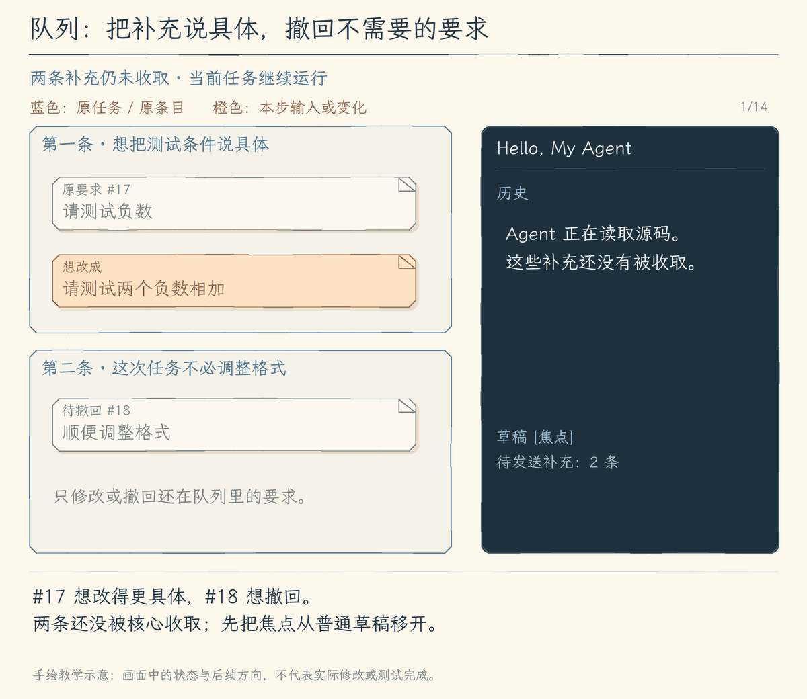
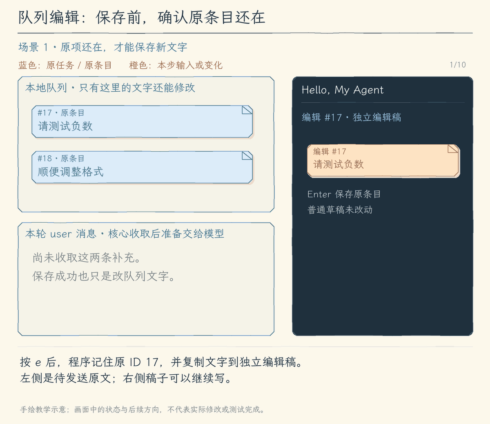

# 12.5 队列编辑与撤回

[第 12 章首页](../README.md) · [上一节：12.4 运行中补充与打断](../04-live-input/README.md) · [下一节：练习与答案](../EXERCISES.md)

## 问题：补充已经排队，文字仍可能需要调整

上一节能把运行中的要求排队，等下一次模型请求前送入。现在，我们提交了“请测试负数”，又发现它还不够具体：想检查的是“两个负数相加”。另外一条“顺便调整格式”并非这次任务必需，我们决定撤回。

这些文字还没被核心收取，模型尚未因为它们作出下一次决策。只要仍在队列里，就应该允许用户修改或删除。相反，已经加入本轮消息的要求，不能因为界面删除了一行就从模型上下文里消失。队列管理需要让这两种状态看得出来。



动画保留两条明确的要求：`#17` 是负数测试，`#18` 是格式调整。按两次 `Ctrl+O`，焦点依次从草稿经过历史，进入队列。按 `e` 编辑并用 Enter 保存 `#17` 后，再按 `↓` 选中 `#18`，用 `x` 撤回这一条。队列最后只保留“请测试两个负数相加”，此刻它仍未送到模型；后续核心收取时，已撤回的格式要求不会随之发送。[静态图](assets/queue-problem-60a66d9dab.jpg)

## 解决方案：按固定 ID 管理尚未被收取的补充

本节加入队列面板。`Ctrl+O` 依次切换草稿、历史和队列焦点，队列中可以用方向键或 `j/k` 选择条目。选中后按 `e` 进入编辑，Enter 尝试保存，Esc 放弃这次编辑；按 `x` 撤回当前待发送项。任务结束、TUI 空闲时，列表中的 Enter 可以明确把选中的旧条目作为新请求发送。

程序始终记住条目的稳定 ID。开始编辑时，先把原文字复制到单独的编辑稿，队列原文暂时不动；保存时，再按这个 ID 检查原项是否仍在。如果仍未收取，就校验并写回新文字；如果已被核心收取，就保留编辑稿并说明原因，避免丢掉用户新写的内容。

保存成功只改变待发送文字，不表示它已经进入模型上下文。收取仍由上一节的核心控制。若原项已收取，需要把新文字作为新的补充明确发送，而不是偷偷替换已经进入消息的旧要求。

## 工作原理

队列会变化，编辑却需要一直指向原来的那条文字。因此我们把“选择哪一条”“正在编辑什么”“哪些内容仍可修改”分别记清楚：用 ID 定位原条目，用副本保存正在写的文字，保存时再查询原条目的状态。



场景1展示正常保存：左侧 `#17` 原文不动，只有右侧独立编辑稿变成“请测试两个负数相加”；Enter 后按 ID 查到 `#17` 仍在，才更新它，保存后继续等核心收取。场景2从尚未保存的编辑稿重新开始：核心先把本轮的 `#17`、`#18` 一起收取，卡片进入本轮消息；再按 Enter，已经查不到原 ID `17`。消息里保留“请测试负数”，右侧新稿完整保留，程序不改旧消息，也不写别的条目。两种场景用来比较保存与收取的先后顺序，不表示一次编辑先成功再失败。[静态图](assets/queue-edit-745c4d925d.jpg)

### 固定 ID 为什么比画面位置可靠

队列中的位置只代表此刻排在第几行。例如原来有 `#17`、`#18` 两条，移出第一条后，`#18` 就从第二行移到第一行。若选择只记住“第二行”，位置变化后就找不到原要求，或之后误指向新加入的条目。

ID 不随显示位置变化。记住 `18`，就能再次查询同一条要求；若已经不在队列里，查询明确返回未找到，而不是改写旁边的内容。选择、编辑、撤回和空闲发送都沿用这一识别方式。

### 编辑副本，让保存之前的文字保持可控

按 `e` 时，程序记录原 ID，并把原文复制到独立草稿。普通任务草稿、队列原文和队列编辑稿各自保留。把“请测试负数”改成“请测试两个负数相加”时，变化只发生在编辑稿；此刻核心若收取，取得的仍是队列旧文。

Enter 才尝试写回，Esc 则丢弃本次编辑副本并返回列表。这样，输入到一半的文字不会提前进入模型消息，也不需要在取消编辑时把队列恢复到旧值。保存前同样检查空白和长度，不合法就显示原因、留下编辑稿，队列原文不变。

### 保存前重查，处理编辑与收取碰到一起的情况

编辑期间，当前任务仍可能推进到下一次模型请求。假设我们刚开始修改 `#17`，核心就收走了它，把原来的“请测试负数”加入本轮 user 消息；我们随后才写完“请测试两个负数相加”。这时新文字还在编辑稿里，但原队列项已经消失。同一轮的待发送内容会一起收取，所以图中的 `#18` 也随这一批移出；编辑失败检查的仍是原 ID `17`。

如果程序沿用编辑开始时的引用强行写回，就无法证明本轮消息也变了。实际收取时复制出去的仍是旧文字，新写的内容不会自动追进已经准备好的请求。因此 Enter 保存时必须重新按 ID 查找：找到才更新，查不到就返回失败，不改旧消息，也不把新文字写给另一条要求。

界面会说明原项已被收取，并保留新编辑稿。按 `Ctrl+B` 可以复制编辑文字，Esc 返回队列列表，再按 `Ctrl+O` 切到普通草稿，粘贴并按 Enter 作为新的补充提交。模型随后会依次看到原要求与修正要求，这个顺序是真实发生的；程序没有宣称旧请求已经包含新版本。

### 撤回与重新发送，各自改变什么

`x` 只移出仍在队列里的选中项，其他待发送内容保持。由于被撤回的文字还没有进入本轮消息，后续核心也就不会收取它。已经收取的内容只能通过新消息纠正，删除显示记录不能撤销已经交给当前任务的要求。

取消、预算耗尽或错误之后，旧轮可能留下未收取项。它们继续显示，并允许编辑或撤回。空闲时，选中其中一条按 Enter，程序再次按 ID 确认它还在，取出这一条，明确作为新轮的请求；其余旧项仍留在队列，不会连带发送。

任务清单与队列到这里也能清楚区分：清单是模型报告自己做到哪里，队列是用户尚未被核心收取的要求。整章的这些操作接入同一条 Agent Loop，一次仍只运行一轮，文件修改继续经过权限。下一章会把会话保存下来，让这些已发生的交互在退出与恢复之后仍能接续。

## 本节改动文件

本节围绕待发送队列增加按 ID 查询、编辑和撤回，再用独立面板处理选择与编辑稿。

| 状态 | 文件 | 本节变化 |
| --- | --- | --- |
| CHANGED | [src/ui/tui/input-queue.ts](src/ui/tui/input-queue.ts) | 按稳定 ID 查找、修改与撤回尚未收取的项 |
| NEW | [src/ui/tui/queue-panel.tsx](src/ui/tui/queue-panel.tsx) | 显示队列，编辑副本，保存前再查原项状态 |
| CHANGED | [src/ui/tui/app.tsx](src/ui/tui/app.tsx) | 加入队列焦点与空闲发送选中项的入口 |

## 动手构建

从 12.4 的完整 `src/` 继续，目标目录为 `chapter-12-task-control/05-manage-queue/`。先增加队列的按 ID 操作，再创建面板，最后接到焦点切换与单条发送入口。

以下代码是本节新增文件或明确替换片段。每一步先说明范围，再展开完整代码；没有列出的函数与文件继续沿用。

### 按稳定 ID 查找、修改与撤回尚未收取的项

完整替换 `src/ui/tui/input-queue.ts`。本文件较短，下面给出完整替换文件，保留沿用部分。

<details>
<summary>完整替换文件：input-queue.ts</summary>

<!-- source: src/ui/tui/input-queue.ts -->
```ts
/**
 * 12.5 队列编辑与撤回 | [CHANGED] ui/tui/input-queue.ts
 *
 * 学习目标：按固定 ID 修改或撤回未被核心收取的补充。
 * 输入：补充文字、所属 run、会话队列与要编辑或撤回的 ID。
 * 输出：入队条目带 ID；收取返回当前轮文字，编辑返回是否找到原条目，撤回返回移出的条目。
 * 状态：最多 20 项，每项原文最多 32000 个 UTF-16 单元；校验失败不提交修改。
 * 本文件局部流程（全局主流程见 agent/agent-loop.ts）：
 *   enqueue -> 文字有效且未满？-- 否 -> 抛错；是 -> 分配递增 ID、追加末尾
 *   take(run) -> 按原顺序选当前轮 -> 从队列移出 -> 返回 ID、文字；其他轮保留
 *   update / remove(id) -> 原 ID 仍存在？-- 否 -> false / undefined，队列不变
 *                                       +-- 是 -> 校验后更新，或移出这一项
 * 收取与模型请求由核心控制；入队不等于生效，旧轮剩余项不会自动进入新轮。
 * 运行观察：连续补充按原顺序收取，已移出的条目不再出现在待发送队列。
 */
// [KEEP 来自 12.4] 队列由会话持有；run 限定补充只能交给所属轮。
// [KEEP 来自 12.4] ID 在会话内递增，run 记录补充所属任务，文字只在未收取时保存在这里。
export type QueueEntry = { id: number; text: string; run: number };
export type InputQueue = { items: QueueEntry[]; nextId: number };
export const MAX_QUEUE_ITEMS = 20;
export const MAX_QUEUE_TEXT = 32_000;

/**
 * 为这次会话创建空的补充队列。
 * 条目按入队顺序保存，ID 从 1 开始递增；新一轮不重新创建这份队列。
 */
export function newInputQueue(): InputQueue { return { items: [], nextId: 1 }; }
/**
 * 检查一份补充或队列编辑稿，返回去掉首尾空白后的文字。
 * 空白和原文超过 32000 个 UTF-16 单元时抛错；长度检查使用原文，队列尚未改变。
 */
export function validateQueuedText(text: string): string {
  const value = text.trim();
  if (!value) throw new Error("补充内容不能为空。");
  if (text.length > MAX_QUEUE_TEXT) throw new Error(`补充内容最多 ${MAX_QUEUE_TEXT} 个 UTF-16 单元。`);
  return value;
}
/**
 * 把有效补充追加到所属轮的队列末尾。
 * 先检查文字和最多 20 项的容量，再分配递增 ID；run 由当前任务入口提供。
 * 返回新条目，入队只表示等待核心收取；失败不占用 ID，也不清调用方草稿。
 */
export function enqueueInput(queue: InputQueue, text: string, run: number): QueueEntry {
  const value = validateQueuedText(text);
  if (queue.items.length >= MAX_QUEUE_ITEMS) throw new Error(`最多保留 ${MAX_QUEUE_ITEMS} 条待发送补充，请先处理队列。`);
  const entry = { id: queue.nextId++, text: value, run };
  queue.items.push(entry);
  return entry;
}
/**
 * 检查指定轮是否仍有未收取的补充。
 * 只返回布尔值，不移出条目；用于最终回答之后决定是否还有一次继续决策的机会。
 */
export function hasPendingInputs(queue: InputQueue, run: number): boolean {
  return queue.items.some((entry) => entry.run === run);
}
/**
 * 一次取走当前轮的全部补充，保持它们原来的入队顺序。
 * 输入是会话队列和绑定的 run；先选出这一轮，再保留其他轮的条目。
 * 返回 ID 与文字；空数组表示本轮没有补充。核心把它们加入请求上下文后才发收取事件。
 * 旧轮条目仍保留，调用方不能换成新轮编号去自动收取。
 */
export function takePendingInputs(queue: InputQueue, run: number): { id: number; text: string }[] {
  // [KEEP 来自 12.4] 过滤保留原数组顺序，当前轮按 FIFO 收取，其他轮仍留存。
  const selected = queue.items.filter((entry) => entry.run === run);
  queue.items = queue.items.filter((entry) => entry.run !== run);
  return selected.map(({ id, text }) => ({ id, text }));
}

// [CHANGED 12.5] 新增按固定 ID 查找待发送条目。
/**
 * 按固定 ID 查找尚未被收取的条目。
 * 找到时返回原条目，失效 ID 返回 undefined；查找不移动或修改队列。
 */
export function findQueuedInput(queue: InputQueue, id: number): QueueEntry | undefined {
  return queue.items.find((entry) => entry.id === id);
}
// [CHANGED 12.5] 新增按固定 ID 校验并修改原条目。
/**
 * 只修改仍在队列中的原条目，避免覆盖邻项。
 * 先重新查固定 ID；已被收取就返回 false，调用方据此保留编辑稿。
 * 找到后先校验新文字再赋值，成功返回 true；无效文字抛错，原文保持不变。
 */
export function updateQueuedInput(queue: InputQueue, id: number, text: string): boolean {
  const entry = findQueuedInput(queue, id);
  // [CHANGED 12.5] 原 ID 已失效就告知界面保留编辑稿，不改队列。
  if (!entry) return false;
  entry.text = validateQueuedText(text);
  return true;
}
// [CHANGED 12.5] 新增按固定 ID 撤回待发送条目。
/**
 * 只移出固定 ID 对应的待发送补充。
 * 找到时返回移出的条目；ID 已失效返回 undefined，不能撤回已加入请求上下文的内容。
 */
export function removeQueuedInput(queue: InputQueue, id: number): QueueEntry | undefined {
  const index = queue.items.findIndex((entry) => entry.id === id);
  // [CHANGED 12.5] 已被收取的内容不能撤回，返回未找到。
  if (index < 0) return undefined;
  return queue.items.splice(index, 1)[0];
}
```

</details>

### 显示队列，编辑副本，保存前再查原项状态

创建 `src/ui/tui/queue-panel.tsx`。这是本节的新模块，完整实现如下。

<details>
<summary>创建文件：queue-panel.tsx</summary>

<!-- source: src/ui/tui/queue-panel.tsx -->
```ts
/**
 * 12.5 队列编辑与撤回 | [NEW] ui/tui/queue-panel.tsx
 *
 * 学习目标：查看、编辑和撤回尚未生效的补充，并保留已经失效的编辑稿。
 * 输入：会话队列、焦点、忙碌状态、尺寸以及刷新和发送回调。
 * 输出：队列列表或独立编辑器；只有空闲 Enter 才请求发送选中项。
 * 状态：选择和编辑都保存固定 ID，编辑稿与普通草稿分开；异步复制在卸载时取消。
 * 本文件局部流程（全局主流程见 agent/agent-loop.ts）：
 *   ↑↓ / j/k -> 选择 ID；e -> 复制条目文字到独立编辑稿；x -> 按 ID 撤回
 *   编辑 Enter -> 按原 ID 更新 -- 成功 -> 结束编辑，条目仍未生效
 *                              +-- 失效 / 文字无效 -> 留住编辑稿、显示原因
 *   Ctrl+B -> 复制编辑稿；Esc -> 取消本次编辑；Ctrl+Y 仍由草稿编辑器处理重做
 *   列表 Enter -> 忙碌？-- 是 -> 提示等待；否 -> onSend，父组件再次查 ID 后发送
 * 核心可能在编辑期间收取条目，所以保存必须重新查 ID，不能按数组位置写入邻项。
 * 运行观察：原条目消失后编辑文字仍在，可复制回普通草稿重新提交。
 */
// [NEW 12.5] 队列焦点占用原结果区；编辑文字与普通草稿分别保存。
import { useEffect, useRef, useState } from "react";
import { Box, Text, useInput } from "ink";
import { DraftEditor, newDraft, type Draft } from "./editor.js";
import { findQueuedInput, updateQueuedInput, removeQueuedInput, type InputQueue, type QueueEntry } from "./input-queue.js";
import { screenText } from "./state.js";
import { copyText } from "./system-actions.js";

// [NEW 12.5] 本文件以下类型、函数和界面均为本节新增。

/**
 * 让用户管理尚未被核心收取的补充。
 * 选择和编辑都保存固定 ID；编辑稿单独保存，核心移走原条目也不清除编辑文字。
 * e 开始编辑，x 撤回；列表 Enter 只在空闲时调用 onSend，父组件还会再次查 ID。
 * 编辑 Enter 保存，Ctrl+B 复制编辑稿，Esc 取消编辑；复制失败只显示原因，不改队列。
 */
export function QueuePanel({ queue, active, busy, width, height, onChange, onSend, onEditingChange }: {
  queue: InputQueue; active: boolean; busy: boolean; width: number; height: number;
  onChange: () => void; onSend: (entry: QueueEntry) => void; onEditingChange: (editing: boolean) => void;
}) {
  const [selected, setSelected] = useState<number>();
  // [NEW 12.5] 保存原条目 ID 和独立 Draft，队列重排不会改变编辑目标。
  const [editing, setEditing] = useState<{ id: number; draft: Draft }>();
  const [notice, setNotice] = useState("");
  const copying = useRef<AbortController | undefined>(undefined);
  useEffect(() => () => copying.current?.abort(), []);
  const chosen = findQueuedInput(queue, selected ?? -1) ?? queue.items[0];
  useInput((input, key) => {
    if (editing) {
      if (key.escape) { setEditing(undefined); onEditingChange(false); setNotice(""); }
      // [NEW 12.5] 用 Ctrl+B 复制编辑稿，Ctrl+Y 继续留给编辑器重做。
      if (key.ctrl && input === "b") {
        copying.current?.abort(); const controller = new AbortController(); copying.current = controller;
        void copyText(editing.draft.text, controller.signal).then(() => { if (!controller.signal.aborted) setNotice("编辑文字已复制；Esc 返回后可粘贴到普通草稿。"); })
          .catch((error) => { if (!controller.signal.aborted) setNotice((error as Error).message); });
      }
      return;
    }
    if (key.upArrow || key.downArrow || input === "j" || input === "k") {
      const index = chosen ? queue.items.findIndex((entry) => entry.id === chosen.id) : 0;
      const next = Math.max(0, Math.min(queue.items.length - 1, index + (key.upArrow || input === "k" ? -1 : 1)));
      setSelected(queue.items[next]?.id); return;
    }
    if (!chosen) return;
    if (input === "e") { setEditing({ id: chosen.id, draft: newDraft(chosen.text) }); onEditingChange(true); setNotice(""); return; }
    // [NEW 12.5] 撤回按固定 ID 操作，只影响尚未被收取的原条目。
    if (input === "x") { removeQueuedInput(queue, chosen.id); onChange(); setNotice(`补充 #${chosen.id} 已撤回。`); return; }
    // [NEW 12.5] 列表 Enter 只在空闲时交给父组件发送，忙碌时不创建新轮。
    if (key.return) {
      if (busy) { setNotice("任务运行中；此处 Enter 只在空闲时发送选中项。"); return; }
      onSend(chosen);
    }
  }, { isActive: active });
  /**
   * 把编辑稿保存回同一个待发送条目。
   * 每次提交重新按 editing.id 查找；成功才清编辑状态，条目仍等待核心收取。
   * 原条目已失效或文字校验失败时只显示提示并保留编辑稿，不写入别的条目。
   */
  const save = (text: string) => {
    if (!editing) return;
    try {
      // [NEW 12.5] 保存时重查原 ID；失效就留住 editing，不清稿也不改邻项。
      if (!updateQueuedInput(queue, editing.id, text)) {
        setNotice("原条目已被核心收取；编辑文字仍保留，Ctrl+B 复制到普通草稿后重新发送。");
        return;
      }
      const id = editing.id;
      onChange(); setEditing(undefined); onEditingChange(false); setSelected(id); setNotice(`补充 #${id} 已保存，仍未生效。`);
    } catch (error) { setNotice((error as Error).message); }
  };
  const index = chosen ? queue.items.findIndex((entry) => entry.id === chosen.id) : 0;
  const start = Math.max(0, index - Math.max(0, height - 1));
  return <Box flexDirection="column" height={height + 2} overflow="hidden">
    <Text wrap="truncate">待发送队列 {active ? "[焦点]" : ""} · {queue.items.length} 条</Text>
    {editing ? <>
      <Text wrap="truncate">编辑 #{editing.id} · {findQueuedInput(queue, editing.id) ? "Enter 保存原条目" : "原条目已被收取，编辑文字仍保留"}</Text>
      <DraftEditor value={editing.draft} onChange={(draft) => setEditing({ ...editing, draft })} onSubmit={save} active={active} width={width} height={Math.max(1, height - 1)} />
      <Text wrap="truncate">{notice || "Esc 取消编辑 · Ctrl+B 复制编辑文字；普通草稿未改动。"}</Text>
    </> : <>
      <Box flexDirection="column" height={height} overflow="hidden">
        {queue.items.length ? queue.items.slice(start, start + height).map((entry) => <Text key={entry.id} wrap="truncate">{entry.id === chosen?.id ? ">" : " "} #{entry.id} [第{entry.run}轮] {screenText(entry.text).replace(/\n/g, " ")}</Text>) : <Text>没有待发送补充。</Text>}
      </Box>
      <Text wrap="truncate">{notice || "↑↓ / j/k 选择 · e 编辑 · x 撤回 · 空闲 Enter 发送选中项"}</Text>
    </>}
  </Box>;
}
```

</details>

### 加入队列焦点与空闲发送选中项的入口

在 `src/ui/tui/app.tsx` 中，先替换文件开头的教学说明与全部导入，再在原定义位置完整替换 `TuiApp()`。

<details>
<summary>app.tsx 的完整替换范围</summary>

**文件说明与全部导入：**

<!-- source: src/ui/tui/app.tsx -->
```ts
/**
 * 12.5 队列编辑与撤回 | [CHANGED] ui/tui/app.tsx
 *
 * 学习目标：查看、编辑和撤回尚未送给模型的补充，让界面操作和本轮执行有清楚的先后关系。
 * 输入：模型、键盘、终端尺寸与执行事件；普通任务只在用户提交后启动。
 * 输出：草稿、历史、模式、运行状态和审批面板。
 * 状态：Session 持有会话数据和当前任务；React state 保存草稿、焦点与显示内容。
 * 失败：保留已收到的结果，等事件流清理后解除忙碌；取消不会撤销工具操作。
 *
 * 本文件局部流程（界面操作；全局主流程见 agent/agent-loop.ts）：
 *   startTui -> 创建 Session -> 注册监听 -> 挂载 TuiApp
 *   窗口至少 40 列、16 行？-- 否 -> 留存数据、暂停普通操作；是 -> 完整工作区
 *   草稿编辑 / 找回 / 补全 / 外部编辑 -> 更新草稿，尚未发送
 *   [KEEP 来自 12.1] 空闲 /mode -> 保存模式；开始任务 -> 固定本轮模式快照
 *   [KEEP 来自 12.4] 普通 Enter -> 忙碌？-- 是 -> 本地命令？-- 是 -> 保留草稿、提示等待
 *                                         +-- 否 -> 校验补充、加入当前轮队列、清草稿
 *                              +-- 否 -> 本地命令或 startRun
 *   [KEEP 来自 12.4] Ctrl+S -> 校验并保存新要求 -> clearing 锁住提交 -> abort 旧任务
 *                   -> await 旧 done -> closing？-- 是 -> 结束；否 -> startRun 新要求
 *   [KEEP 来自 12.2] 任务清单工具结果 -> 会话内清单 -> 摘要和至多三项进度
 *   [KEEP 来自 12.3] ask_user -> waitForAnswer -> 问答面板独占输入 -> 原问答 Promise
 *                   -> 回答 / Esc / 取消 -> 关闭面板，普通草稿继续保留
 *   [KEEP 来自 12.4] startRun -> 用当前 run 绑定收取回调 -> 事件流 -> input_applied 才显示生效
 *                   -> finally 等清理 -> 保留本轮未收取队列，下一轮不会自动使用它
 *   [CHANGED 12.5] Ctrl+O -> 草稿 / 历史 / 队列；正在编辑队列时暂不切换
 *   [CHANGED 12.5] 队列 -> e 编辑 / x 撤回 -> 固定 ID 查找；已收取 -> 编辑稿留存
 *                    空闲 Enter -> 再查 ID -> 移出队列 -> 作为新任务发送
 *   [KEEP] 审批 -> waitForApproval -> 面板独占输入 -> 明确决定交回原调用
 *   [KEEP] Ctrl+C -> 有任务？-- 是 -> 取消、等清理；否 -> quit
 *   [KEEP] quit -> closing=true -> 取消并等待任务与外部编辑 -> 卸载、移除监听
 *
 * 显示条目、已发送问题和模型消息各有用途；编辑草稿不会自动改变模型上下文。
 * 清单进度是模型通过工具报告的状态；实际测试是否成功要看命令的结果。
 * 输入队列最多 20 项，每项最多 32000 个 UTF-16 单元；拒绝入队时保留草稿。
 * 运行观察：队列编辑稿与普通草稿分开，失效条目不会把编辑内容写到邻项。
 */
import { useState } from "react";
import { Box, Text, render, useInput, usePaste, useWindowSize, useApp } from "ink";
// [KEEP 来自 11.5] 颜色开关统一读取 NO_COLOR，文字状态始终保留。
import { useColor } from "./layout.js";
import { emptyRunView, updateRunView, screenText, type RunView } from "./state.js";
import { approvalPages, waitForApproval, type PendingApproval } from "./approval.js";
import TextInput from "ink-text-input";
import { QuestionPanel, waitForAnswer, type PendingQuestion } from "./questions.js";
// [CHANGED 12.5] 引入 input-queue 的本节类型或实现。
import { newInputQueue, enqueueInput, takePendingInputs, hasPendingInputs, validateQueuedText, type InputQueue, removeQueuedInput, type QueueEntry } from "./input-queue.js";
// [CHANGED 12.5] 引入 queue-panel 的本节类型或实现。
import { QueuePanel } from "./queue-panel.js";
import { DraftEditor, newDraft, changeDraft } from "./editor.js";
import { Transcript, runEntries, type Entry } from "./transcript.js";
import { editExternally } from "./system-actions.js";
import type { Message, Model } from "../../models/client.js";
import { streamAgentRun } from "../../agent/run-stream.js";
import { explainError } from "../../errors.js";
import type { ExecutionMode, TaskState } from "../../agent/run-options.js";
```

**替换 TuiApp：**

<!-- source: src/ui/tui/app.tsx -->
```ts
/**
 * 把草稿、会话控制和执行事件连成可操作的终端工作区。
 * 普通任务只由提交 handler 启动；组件重绘不创建模型请求。
 * 焦点决定普通按键由哪一区处理，审批或澄清占用时暂停工作区输入。
 * 忙碌 Enter 入当前轮补充队列；Ctrl+S 先保存要求、取消旧轮并等清理，再开新轮。
 * 队列焦点使用独立编辑稿，保存和单独发送都重新查固定 ID。
 * 局部 current 顺序累积事件；finally 等事件流清理后才解除占用。
 * 显示条目与模型历史分别保存；本组件不直接执行工具、提交历史或撤销副作用。
 */
// [KEEP 来自 10.4] 单独接收 interrupt，让组件触发“取消本轮”而不是直接退出。
// [CHANGED 12.5] 界面接入本节操作；具体状态和按键变化在对应分支标明。
function TuiApp({ model, session, quit, interrupt }: { model: Model; session: Session; quit: (code: number) => void; interrupt: () => void }) {
  // 这些值描述画面；setter 通知 React 重新绘制，不能把模型任务写进组件渲染过程。
  const [draft, setDraft] = useState(newDraft());
  const [entries, setEntries] = useState<Entry[]>([]);
  const [busy, setBusy] = useState(false);
  // [CHANGED 12.5] 焦点增加队列；草稿、历史、队列只由当前焦点处理普通键。
  const [focus, setFocus] = useState<"draft" | "history" | "queue">("draft");
  const [notice, setNotice] = useState("");
  const [, refreshQueue] = useState(0);
  const [editing, setEditing] = useState(false);
  // [CHANGED 12.5] 编辑队列时暂停全局焦点切换，独立编辑稿继续保留。
  const [queueEditing, setQueueEditing] = useState(false);
  const { suspendTerminal } = useApp();
  const [approval, setApproval] = useState<PendingApproval>();
  // [KEEP 来自 12.3] 澄清面板保存当前请求，与审批和普通草稿分开。
  const [question, setQuestion] = useState<PendingQuestion>();
  const [view, setView] = useState<RunView>({ ...emptyRunView(), status: "就绪" });
  const { columns, rows } = useWindowSize();
  // [KEEP 来自 11.5] 先判断窗口是否容得下工作区，再决定普通输入是否激活。
  const tooSmall = columns < 40 || rows < 16;
  // 函数式更新接在上一次 entries 后追加，连续事件不依赖某次绘制时捕获的旧数组。
  /**
   * 把本地提示或已提交问题加入显示记录。
   * 分配稳定显示 ID，并以函数式更新追加到旧条目后；这里不提交模型历史。
   */
  const append = (label: Entry["label"], text: string) => {
    const entry = { id: `local:${session.nextId++}`, label, text: screenText(text) };
    setEntries((old) => [...old, entry]);
  };

  // [KEEP 来自 11.4] 暂时把整个终端交给编辑器，结束后只替换草稿。
  /**
   * 在空闲时把终端交给外部编辑器，再取回仍未发送的草稿。
   * 任务、审批、问答或退出正在占用时只提示等待。
   * 编辑成功形成一次草稿修改；失败保留原文，结束后解除外部占用。
   */
  const openEditor = () => {
    if (session.done || session.external || session.closing || session.clearing || approval || question) { setNotice("请在当前任务结束后编辑草稿。"); return; }
    const controller = new AbortController();
    setEditing(true);
    session.external = { controller, done: (async () => {
      try {
        let text = draft.text;
        await suspendTerminal(async () => { text = await editExternally(draft.text, controller.signal); });
        if (!session.closing) { setDraft(changeDraft(draft, text)); setNotice("已取回编辑内容，按 Enter 才会发送。"); }
      } catch (error) { if (!session.closing) setNotice(screenText((error as Error).message)); }
      finally { session.external = undefined; if (!session.closing) setEditing(false); }
    })() };
  };
  // [KEEP 来自 10.4] 先提示正在取消，保持 busy；任务真正结束后才由 finally 恢复输入。
  // [KEEP 来自 11.5] 小窗口保留取消与退出，暂停焦点切换和外部编辑入口。
  useInput((input, key) => {
    if (key.ctrl && input === "c") {
      // [KEEP 来自 12.4] 忙碌 Enter 进入当前轮补充队列，本地命令仍需空闲处理。
      if (session.done) { setView((current) => ({ ...current, status: "正在取消，等待清理…" })); }
      interrupt();
    }
    if (key.ctrl && input === "d") quit(0);
    // [KEEP 来自 12.4] Ctrl+S 只从草稿入口打断并发送，不抢审批或问答输入。
    if (!tooSmall && key.ctrl && input === "s" && focus === "draft" && !approval && !question && !editing) void interruptAndSend(draft.text);
    if (!tooSmall && key.ctrl && input === "g" && focus === "draft") openEditor();
    // [CHANGED 12.5] 三处焦点循环，队列编辑和清理期间不切换。
    if (!tooSmall && key.ctrl && input === "o" && !approval && !question && !queueEditing && !session.clearing) setFocus((old) => old === "draft" ? "history" : old === "history" ? "queue" : "draft");
  });

  /**
   * 处理普通草稿 Enter，决定本地命令、排队补充或新任务。
   * 忙碌时普通文字校验后入当前 run 队列，成功才清草稿；本地命令保留到空闲处理。
   * 新任务记录已发送问题，并使用启动时的模式快照；失败提示不会自动重发。
   */
  const submit = (value: string) => {
    // session.done 立即成为并发保护；不必等 React 把输入框换成忙碌画面后才阻止再次发送。
    if (session.closing || session.external || session.clearing) return;
    if (session.done) {
      if (isLocalCommand(value.trim())) { setNotice("本地命令需等待本轮结束；草稿已保留。"); return; }
      try {
        // [KEEP 来自 12.4] 校验和入队成功才清草稿；入队不表示已加入上下文。
        const entry = enqueueInput(session.queue, value, session.run);
        setDraft(newDraft());
        refreshQueue((old) => old + 1);
        setNotice(`补充 #${entry.id} 已排队，尚未送到模型；Ctrl+S 可打断并发送草稿。`);
      } catch (error) { setNotice((error as Error).message); }
      return;
    }
    setNotice("");
    const prompt = value.trim();
    if (!prompt) return;
    setDraft(newDraft());
    // 本地命令只改本地会话；它们不作为 user 消息送给模型。
    if (prompt === "/exit") { quit(0); return; }
    if (prompt === "/reset") { session.history.length = 0; append("本地", "对话历史已清空；会话授权保留。"); return; }
    if (prompt === "/permissions reset") { session.grants.clear(); append("本地", "本次会话的只读授权已撤销。"); return; }
    if (prompt === "/permissions") { append("本地", session.grants.size ? [...session.grants].join("\n") : "当前没有会话授权。"); return; }
    // [KEEP 来自 12.1] 空闲模式命令只修改会话选择，不修改已启动的一轮。
    if (prompt === "/mode" || prompt.startsWith("/mode ")) {
      const mode = prompt.slice(6).trim();
      if (mode === "plan" || mode === "execute") session.mode = mode;
      append("本地", `当前模式：${session.mode}${mode && mode !== "plan" && mode !== "execute" ? "；用法：/mode plan|execute" : ""}`);
      return;
    }
    startRun(prompt);
  };

  /**
   * 识别必须在空闲时本地处理的命令。
   * 只检查 exit、reset、permissions、mode 的命令前缀，返回布尔值，不执行命令。
   */
  const isLocalCommand = (text: string) => /^\/(exit|reset|permissions|mode)(?:\s|$)/.test(text);
  /**
   * 先结束旧任务，再把已经保存的新要求作为新一轮发送。
   * 先校验并保存 prompt，设置 clearing 封住提交，再取消旧控制器并 await 旧 done。
   * 等待后若已退出就停止；否则解锁、清草稿并 startRun。旧轮未收取队列仍留存。
   */
  const interruptAndSend = async (value: string) => {
    if (session.closing || session.external || session.clearing || approval || question || editing || tooSmall) return;
    let prompt: string;
    try { prompt = validateQueuedText(value); } catch (error) { setNotice((error as Error).message); return; }
    if (isLocalCommand(prompt)) { setNotice("Ctrl+S 需要新的任务要求，本地命令请在空闲时使用。"); return; }
    // [KEEP 来自 12.4] 先保存 prompt，再锁住提交入口，旧轮清理过程中禁止重入。
    session.clearing = true;
    setNotice("正在打断当前任务，清理完毕后发送草稿…");
    // [KEEP 来自 12.4] 先记住旧 done；abort 只是请求停止，必须继续等待清理。
    const previous = session.done;
    session.controller?.abort();
    // [KEEP 来自 12.4] 旧流完成 finally 后才允许新轮；不能让新旧工具同时运行。
    await previous;
    // [KEEP 来自 12.4] 等待期间若已退出，停止发送已保存的新要求。
    if (session.closing) return;
    session.clearing = false;
    setDraft(newDraft());
    startRun(prompt);
  };

  /**
   * 为空闲提交建立一次任务，并顺序消费它的事件。
   * 立即占住 session.done，创建新控制器、run 编号和模式快照；会话清单与历史继续复用。
   * 队列回调闭包固定当前 run，只能收取这一轮条目；askUser 只展示当前问答。
   * finally 等流清理后解除忙碌、保存显示结果，并提示未收取补充仍保留。
   */
  const startRun = (prompt: string) => {
    if (session.closing || session.external || session.clearing || session.done) return;
    session.prompts = [...session.prompts, prompt].slice(-100);
    append("你", prompt);
    const run = ++session.run;
    setBusy(true);
    setView(emptyRunView());
    // 一轮只对应一个控制器；history 与 grants 比这一轮活得更久，不能一起重新创建。
    const controller = new AbortController();

    // [KEEP 来自 12.1] 一轮取启动模式快照，后续重绘不改变它。
    const options = { mode: session.mode, tasks: session.tasks,
      // [KEEP 来自 12.3] 问答工具等待这次 Promise，面板 key 让旧请求回调失效。
      askUser: (request: import("../../agent/run-options.js").UserQuestion, signal: AbortSignal) => waitForAnswer(request, signal, (pending) => {
        if (!session.closing) setQuestion(pending);
      }),
      // [KEEP 来自 12.4] 收取闭包绑定 startRun 的 run，旧队列不注入新轮。
      takePendingInputs: () => { const inputs = takePendingInputs(session.queue, run); if (inputs.length && !session.closing) refreshQueue((old) => old + 1); return inputs; },
      // [KEEP 来自 12.4] 终轮回答后可检查剩余补充，尚不移出条目。
      hasPendingInputs: () => hasPendingInputs(session.queue, run),
    };
    session.controller = controller;
    session.done = (async () => {
      let current = emptyRunView();
      try {
        for await (const { event } of streamAgentRun(model, session.history, prompt, controller.signal, (request, signal) => waitForApproval(request, signal, (pending) => {
          if (!session.closing) setApproval(pending);
        }), session.grants, options)) {
          // [KEEP 来自 10.2] 本地变量保留每条事件；React 可以合并绘制，但不能丢掉已收到的数据。
          // [KEEP 来自 12.4] 只在核心确认收取并加入本次上下文后显示确认。
          if (event.type === "input_applied" && !session.closing) append("本地", `补充 #${event.id} 已加入第 ${event.call} 次请求的上下文：${event.text}`);
          current = updateRunView(current, event);
          if (!session.closing) setView(current);
        }
      } catch (error) {
        current = { ...current, status: controller.signal.aborted ? "已取消本轮" : `运行失败：${screenText(explainError(error))}` };
      } finally {
        // for await 完成或抛错前会等待生成器的 finally；此时才解除本轮占用。
        session.controller = undefined;
        session.done = undefined;
        if (!session.closing) {
          setEntries((old) => [...old, ...runEntries(current, run)]);
          setView(current);
          setApproval(undefined);
          // [KEEP 来自 12.3] 任务结束清掉当前面板，普通草稿未被改写。
          setQuestion(undefined);
          setBusy(false);
          // [KEEP 来自 12.4] 本轮剩余补充继续留存，下一轮不会自动使用。
          if (hasPendingInputs(session.queue, run)) setNotice("本轮已结束；未生效的补充仍保留在队列，不会自动进入下一轮。");
        }
      }
    })();
  };

  /**
   * 把空闲时选中的待发送补充作为新任务提交。
   * 先检查任务和交互占用，再按原 ID 从队列移出；已经失效时提示且不重复发送。
   * 成功移出后刷新列表并 startRun，不改原普通草稿。
   */
  const sendQueued = (entry: QueueEntry) => {
    if (session.done || session.closing || session.external || session.clearing || approval || question) return;
    // [CHANGED 12.5] 单独发送前再次查原 ID，已收取的条目不能重复发送。
    const pending = removeQueuedInput(session.queue, entry.id);
    if (!pending) { setNotice("该补充已被收取，不能重复发送。"); return; }
    refreshQueue((old) => old + 1);
    setNotice(`已将补充 #${pending.id} 作为新的任务发送。`);
    startRun(pending.text);
  };

  // [KEEP 来自 11.3] 当前轮与留存消息一起交给历史区，草稿输入由焦点决定。

  // [KEEP 来自 12.2] 按窗口显示摘要和至多三项，不丢弃真实清单。
  const taskLines = session.tasks.items.length === 0 ? 0 : 1 + (rows >= 20 ? Math.min(3, session.tasks.items.length, rows - 18) : 0);
  const display = busy ? [...entries, ...runEntries(view, session.run)] : entries;
  // [KEEP 来自 11.5] 尺寸不足时隐藏工作区并停用输入；放大后沿用原草稿与浏览状态。
  // [KEEP 来自 12.2] 下方清单区域从会话读取进度，显示报告不等于测试通过。
  // [KEEP 来自 12.3] 下方澄清面板用独立 key 挂载，占用时隐藏普通区但保留草稿。
  // [CHANGED 12.5] 下方队列焦点连接专用面板，编辑稿与普通草稿分别保存。
  return <Box flexDirection="column">
    <Text bold={useColor} wrap="truncate">Hello, My Agent · Ctrl+O 切换草稿 / 历史 / 队列</Text>
    {tooSmall && <Text wrap="truncate">请放大到 40 列、16 行；Ctrl+C 取消任务 · Ctrl+D 退出。</Text>}
    <Box display={tooSmall ? "none" : "flex"} flexDirection="column">
    {approval && <ApprovalPanel key={`${approval.key}:${columns}:${rows}`} pending={approval} columns={columns} rows={rows} />}
    {question && <QuestionPanel key={question.key} pending={question} columns={columns} rows={rows} />}
    <Box display={approval || question ? "none" : "flex"} flexDirection="column">
      {taskLines > 0 && <Box flexDirection="column">
        <Text wrap="truncate">任务：{session.tasks.items.filter((item) => item.status === "completed").length}/{session.tasks.items.length} 已完成 · {session.tasks.items.filter((item) => item.status === "in_progress").length} 进行中 · {session.tasks.items.filter((item) => item.status === "pending").length} 待办</Text>
        {session.tasks.items.slice(0, taskLines - 1).map((item) => <Text key={item.id} wrap="truncate">{item.status === "completed" ? "[完成]" : item.status === "in_progress" ? "[进行]" : "[待办]"} {screenText(item.text).replace(/\n/g, " ")}</Text>)}
      </Box>}
      <Box display={focus === "queue" ? "none" : "flex"} flexDirection="column">
        <Transcript entries={display} active={focus === "history" && !approval && !question && !editing && !session.clearing && !tooSmall} width={columns} height={Math.max(2, rows - 12 - taskLines)} />
      </Box>
      <Box display={focus === "queue" ? "flex" : "none"} flexDirection="column">
        <QueuePanel queue={session.queue} active={focus === "queue" && !approval && !question && !editing && !session.clearing && !tooSmall} busy={Boolean(session.done || session.clearing)} width={columns} height={Math.max(2, rows - 12 - taskLines)} onChange={() => refreshQueue((old) => old + 1)} onSend={sendQueued} onEditingChange={setQueueEditing} />
      </Box>
      <Text wrap="truncate">模式：{session.mode} · 状态：{view.status} · 待发送补充：{session.queue.items.length}</Text>
      <Box borderStyle="round" flexDirection="column" paddingX={1}>
        <Text wrap="truncate" color={useColor ? "cyan" : undefined}>草稿 {focus === "draft" ? "[焦点]" : ""}{busy ? " · Enter 排队补充，Ctrl+S 打断并发送" : ""}</Text>
        <DraftEditor value={draft} onChange={setDraft} onSubmit={submit} active={focus === "draft" && !approval && !question && !editing && !session.clearing && !tooSmall} prompts={session.prompts} width={columns - 4} />
      </Box>
      <Text wrap="truncate">{notice || "Enter 发送 / 排队 · Ctrl+S 打断发送 · Ctrl+J 换行 · Ctrl+C 取消 / 退出"}</Text>
    </Box>
    </Box>
  </Box>;
}
```

</details>

## 运行验证

完成本节构建后，在仓库根目录运行：

```bash
npm run lesson:12.5
```

继续在仓库根目录启动 TUI：

```bash
hello-my-agent --mode execute
```

发送“检查 chapter-12-task-control/demo-project/src/add.mjs 和 chapter-12-task-control/demo-project/test/add.test.mjs，修复数字加法；测试命令为 node --test test/add.test.mjs，cwd 为 chapter-12-task-control/demo-project”。任务运行时先排队“请测试负数”，再排队“顺便调整格式”。

从普通草稿开始，按两次 `Ctrl+O`，依次经过历史、到达队列。选择第一条，按 `e`，把文字改成“请测试两个负数相加”，再按 Enter 保存。核对改变的是同一条的文字，仍是待发送状态；随后选中第二条，按 `x`，观察它移出而第一条保留。实际编号按会话递增，不要求正好为图中的 `17` 和 `18`。

若第一条在编辑期间已经被收取，保存应提示已被收取，并留下编辑稿。按 `Ctrl+B` 复制修改版，Esc 返回队列列表，再按 `Ctrl+O` 切回普通草稿，粘贴后作为新要求发送。若取消后还有旧待发送项，等空闲后选中一条按 Enter，只发送明确选择的这一条。

这些状态取决于实际响应速度。固定输入检查会刻意把收取安排在编辑中途，验证文字保留；真实终端观察用来检查按键、焦点和提示。

## 本节完成后的 Agent

Agent 现在让待发送内容保持可见，也能按 ID 编辑、撤回或明确重发。编辑副本与保存重查保证我们不会把新文字写到别的条目；原项已经收取时，新写的文字仍可作为补充发送。计划、清单、澄清、运行中输入与队列整理共同构成了一次任务中的人机协作；下一章再处理退出后的保存和恢复。
