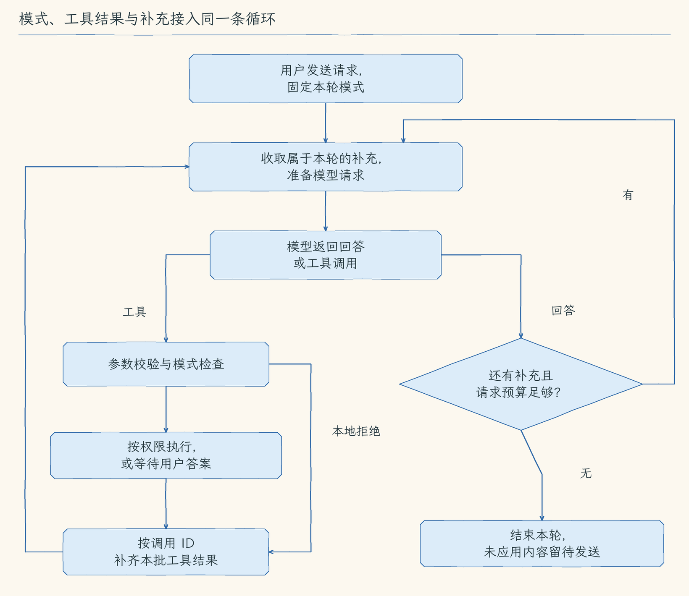

# 第 12 章：计划、执行与运行中干预

[12.1 计划与执行](01-plan-mode/README.md) · [12.2 任务清单](02-task-list/README.md) · [12.3 澄清问题](03-clarify-questions/README.md) · [12.4 补充与打断](04-live-input/README.md) · [12.5 编辑和撤回队列](05-manage-queue/README.md) · [练习与答案](EXERCISES.md)

第十一章把终端变成能编辑草稿、浏览历史的工作区。现在我们已经能够舒适地发送请求，但真实代码任务往往不会从一句话一路顺利走到完成：我们可能想先看方案，做到一半才发现需求没说清，也可能临时想补测试，或者决定先停止修改。

本章让人的这些决定接进 Agent 正在执行的过程。我们沿一份加法代码，先让 Agent 调查并提出可审阅的方案，再由用户决定执行；执行时用清单看进展，缺少条件时等用户答案，收到新要求时在合适的位置继续，方向改变时先停止旧轮。还没送入模型的文字，也可以继续编辑与撤回。

## 一份加法任务，为什么需要这些控制

本章的 [demo-project](demo-project/) 有两个文件：`src/add.mjs` 实现加法，`test/add.test.mjs` 检查 `add(2, 3)` 是否得到 `5`。初始实现写成 `left - right`，所以结果是 `-1`，现有测试会失败。这个错误很小，正适合把注意力放在 Agent 与人的协作上。

任务最初，我们只知道加法有问题，希望先看到 Agent 的判断。Plan 让它读取实现与测试，说明减号为什么不符合加法要求，提出修改表达式和运行测试的步骤。方案显示出来以后，用户可以讨论它，或切换到执行模式并明确请求实施。计划在这里是可审阅的普通回答，切换模式也不会自动执行它。

进入执行后，模型可以把检查、修复、测试写成任务清单，持续报告当前步骤。我们如果接着要求支持数字字符串，非法字符串究竟应报错还是返回 `0`，就需要 `ask_user` 等用户补齐需求。回答决定的是实现规则，后面的文件修改仍照常审批。

Agent 正在工作时，我们又想起负数测试，可以把“请测试两个负数相加”排队，等当前工具结果齐全、下一次模型请求开始之前加入对话。如果现在需要改变方向，`Ctrl+S` 先停止旧轮，再以新草稿开始。对尚未被收取的队列内容，可以修正文案，或撤回不再需要的格式调整；已经进入消息的要求则通过新消息纠正。

这些功能不要求每份任务都用齐，它们分别处理任务中会出现的决定。共同目标是让我们看清：Agent 现在在做什么，程序已经接受了哪份要求，哪些事情还需要人决定。

## 这些控制怎样接进同一条循环

前面已经建立“模型决定→工具执行→结果回模型”的 Agent Loop，本章继续沿用它。模式在一轮开始时固定；清单由模型通过工具更新；问答工具等待用户结果；补充在下一次模型请求前加入消息；打断则先结束旧轮，再开始新轮。界面的操作因此有了明确的数据去向和发生时机。

| 小节 | 用户得到的能力 | 程序怎样让它发生 |
| --- | --- | --- |
| [12.1 计划与执行](01-plan-mode/README.md) | 先看基于代码的修复与验证方案，再决定实施 | 用本轮模式组织调查提示和工具，本地拒绝提前写入；执行由新的明确请求开始 |
| [12.2 任务清单](02-task-list/README.md) | 在固定位置持续看见当前步骤 | 模型提交完整清单，程序全部检查后一次替换，界面读取会话状态 |
| [12.3 澄清问题](03-clarify-questions/README.md) | 未定的需求由用户回答，原任务得到答案后继续 | 专用问答函数保持等待，答案成为原工具调用的对应结果 |
| [12.4 补充与打断](04-live-input/README.md) | 运行中追加要求，或先停下再改变方向 | 队列只供所属轮收取；先补齐工具结果，再加入新要求；新轮等旧轮清理后启动 |
| [12.5 编辑和撤回队列](05-manage-queue/README.md) | 尚未被收取的文字仍可以整理 | 按固定 ID 管理条目，用独立编辑稿保存修改，写回前再次确认原项仍在 |

模式与权限承担不同判断：模式决定本轮能做哪类事，权限决定某次具体调用是否允许。任务清单与用户队列也不同：前者表达模型报告的进度，后者保存尚未加入本轮消息的要求。澄清答案补需求，不会批准修改；清单勾选报进展，不会证明测试通过。



这个流程一次运行一轮，工具仍依次执行。取消信号会传到正在等待的模型与工具，已经完成的文件修改不会回滚；`Ctrl+S` 的停止与清理也不承担文件恢复。第十三章把会话接到退出后的保存与恢复，第十四章再接入文件检查点，并在核对当前文件后处理恢复，第二十七章继续扩展受控并发。

每节先用问题动画展示为什么需要这项能力，以及我们希望看到的结果；原理动画随后展示一次真实的数据变化。橙框指出本步新增或改变的文字、状态和结果，蓝色标识当前流程或选中对象，灰色保留旧内容。对象保持位置，便于比较每一步的改变；静态备用图保留完整关键过程，不能播放 GIF 时也能顺序阅读。

## 从哪里继续，怎样跟写

起点是 [11.5](../chapter-11-terminal-workbench/05-terminal-layout/README.md) 与[第十一章练习](../chapter-11-terminal-workbench/EXERCISES.md)。练习是独立状态实验，没有修改正式主线，所以 12.1 从 11.5 的完整 `src/` 继续。五节各保留完整实现，下一节依次沿用前一节；“动手构建”给出本节新增和修改范围，没有列出的文件继续保留。

`demo-project` 是让 Agent 操作的加法练习项目，五节自己的 `src/` 则是我们构建的 Agent 实现。运行命令按各节“运行验证”指定的目录执行，沿用仓库根目录 `.env`。Agent 的项目根仍是教程仓库，实际请求写出练习项目相对于仓库根目录的路径。图和原理中的短文件名省略 `chapter-12-task-control/demo-project/` 前缀。注册章节只准备本地程序，启动并发送任务之后才会调用模型。

完成 12.5 后，用[章末练习](EXERCISES.md)核对清单提交、问答返回与队列收取这些时刻。使用完整配套仓库时，还可以在仓库根目录运行本章固定输入检查：

```bash
npm run check:12
```

固定输入检查使用本地模型替身，验证每次请求里的消息、工具结果与状态顺序。手动运行则用于观察真实终端、按键和模型行为。模型可能采用不同措辞与工具顺序，但不能因此把随机回答当作这些内部顺序正确的证明。
