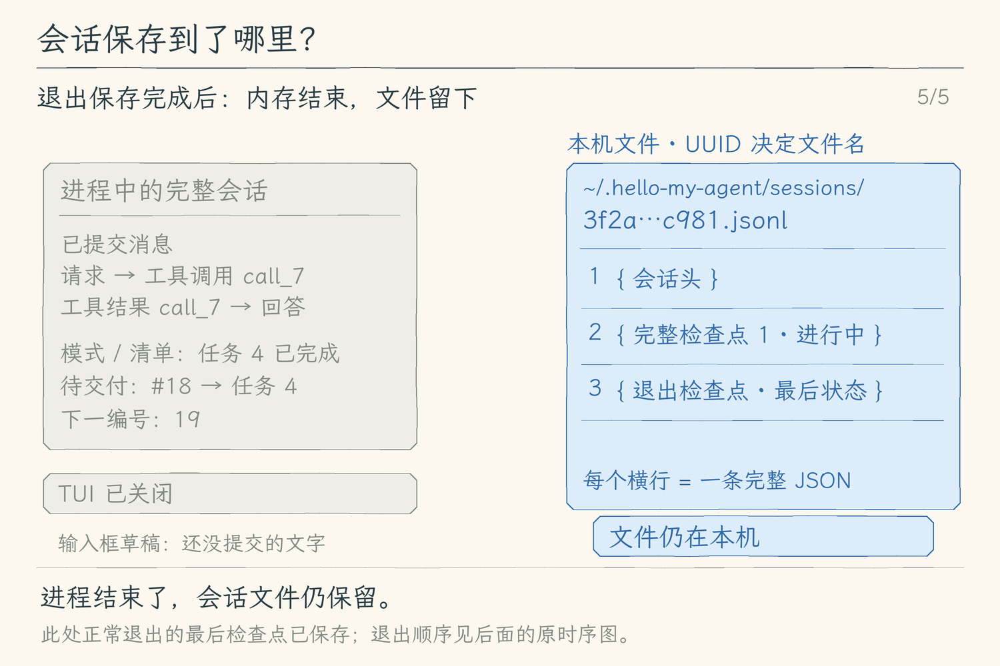
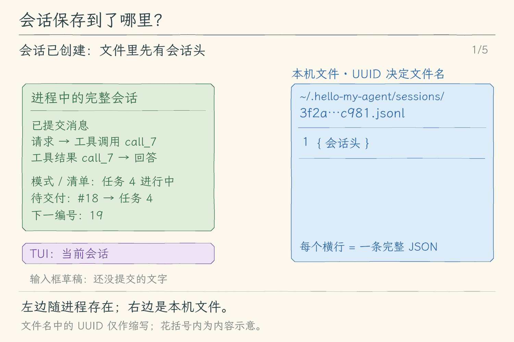
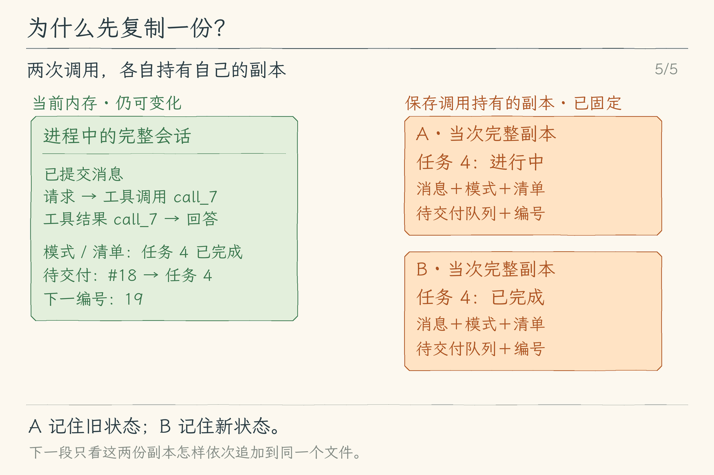
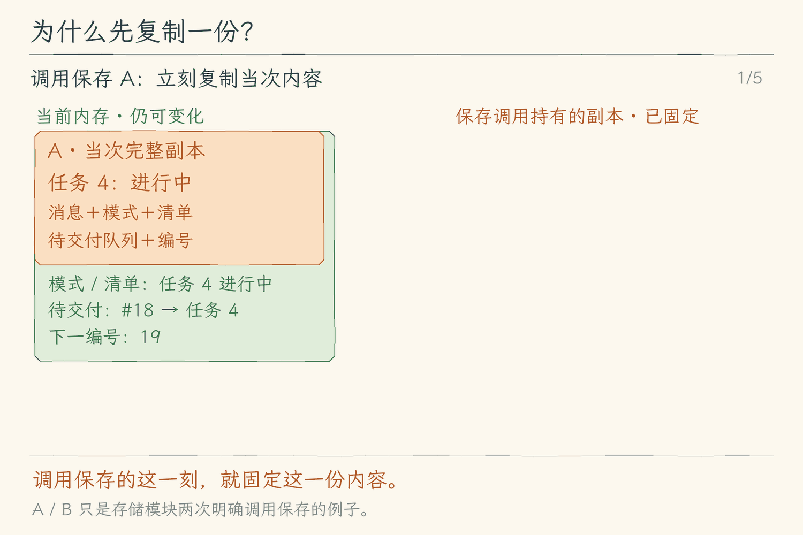
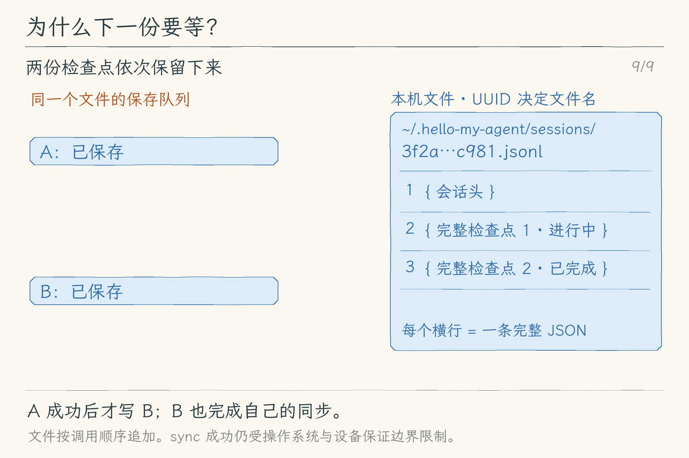
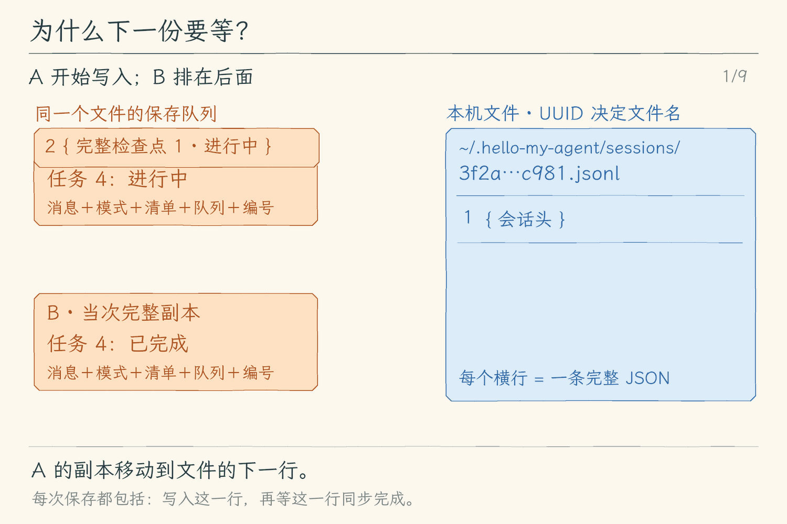
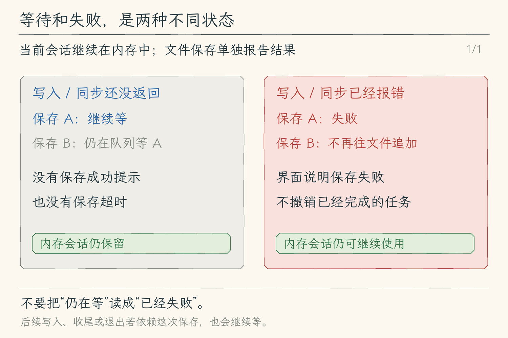
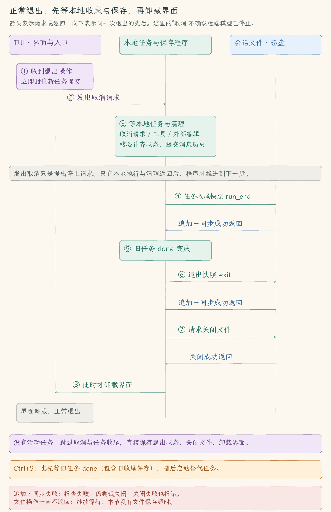

# 13.1 会话保存

[第 13 章首页](../README.md) · [上一节：第 12 章练习](../../chapter-12-task-control/EXERCISES.md) · [本章练习](../EXERCISES.md)

## 问题：退出以后，怎样留下已经发生的讨论

我们继续检查 `add.mjs`，要求 Agent 验证两个负数相加。它读取文件、执行检查，把结果返回给模型；任务结束时，屏幕上已经有了回答。此时退出，再次启动，工作区文件仍在，新进程里的消息历史却从空数组开始。即使文件没有变化，模型也不知道刚才为什么检查负数、用了什么工具、取得了什么结果。

把终端输出重定向到一个文件，可以留下看到的文字，却不等于留下完整会话。模型消息中还有工具调用的参数、调用 ID 和对应结果；TUI 则有当前模式、任务清单以及尚未被核心收取的要求。它们分别回答不同问题，不能只保存最后一句回答。

本节先解决“把这些已提交的会话状态写到哪里、何时可以确认写完”。读回文件、选择旧会话继续任务，会在后续小节实现。

## 解决方案：为本次启动保存完整快照

快照是选定时刻的一份状态副本。我们为本次启动生成一个会话 ID，创建对应的 JSONL 文件，先写入版本、创建时间与工作区信息，再在保存时机追加完整快照。文件把这些快照称为检查点（`checkpoint`），表示一次明确的保存状态。每个快照都能说明当时的消息、模式、清单与待处理要求，不需要先应用一串增量变化才能知道状态。

默认位置为 `~/.hello-my-agent/sessions/<会话 ID>.jsonl`，也可以通过 `--session-dir` 指定目录。text 与 TUI 接入这项保存；用于机器消费执行事件的 `--output jsonl` 仍使用原来的输出协议，本节没有为它增加会话文件，同时传入 `--session-dir` 会报错。

保存先捕获当次副本，再依次写入同一文件，等待文件同步操作完成后才提示成功。模型执行与保存分别说明结果：任务可以已经完成，而会话保存失败；保存失败不会把已经执行的检查改成失败，也不会撤销工作区操作。

<!-- ch13.1 figures: purpose start -->
<style>
.motion-player { position: relative; margin: 18px 0; padding: 0; border: 0; }
.motion-player summary { display: block; cursor: pointer; list-style: none; }
.motion-player img { display: block; width: 100%; height: auto; margin: 0; }
.motion-player .motion-gif { position: absolute; top: 0; left: 0; pointer-events: none; }
.motion-player[open] .motion-cover { visibility: hidden; }
.motion-player .motion-toggle { display: inline-block; margin-top: 12px; padding: 8px 18px; border-radius: 6px; background: #294c63; color: white; font-size: 16px; }
.motion-player .motion-stop, .motion-player[open] .motion-start { display: none; }
.motion-player[open] .motion-stop { display: inline; }
</style>

<details class="motion-player">
<summary>

<span class="motion-toggle"><span class="motion-start">▶ 开始播放动图</span><span class="motion-stop">■ 收起动图</span></span>
</summary>

</details>

[查看完整静态分镜](assets/session-file-storyboard-f954463b92.jpg)

文件第 1 行是会话头，之后每行是一份完整检查点；花括号内为内容示意，省略真实 JSON 字段。末帧展示正常退出保存已经完成后的结果，具体退出顺序见后面的原时序图。#18 仍是未交付队列项，保存它不表示已经发给模型。

<!-- ch13.1 figures: purpose end -->

## 工作原理

### 同一段讨论，需要保存哪些对象

先看贯穿本节的负数检查。下面是一个说明消息关系的例子，省略文件正文与命令输出的长内容，不是一次实际模型响应的逐字记录：

| 顺序 | 消息 | 保留的关系 |
| --- | --- | --- |
| 1 | user：请检查两个负数相加 | 用户提出的具体要求 |
| 2 | assistant：调用 `read_file`，调用 ID 为 `read-1` | 模型要求读取哪个文件，以及这次调用的身份 |
| 3 | tool：`toolCallId` 为 `read-1`，返回文件内容 | 结果对应哪次调用，而不是一段无来源的文字 |
| 4 | assistant：调用 `run_command`，调用 ID 为 `test-1` | 模型要求执行什么检查 |
| 5 | tool：`toolCallId` 为 `test-1`，返回命令结果 | 检查实际返回的内容与是否发生工具错误 |
| 6 | assistant：说明负数检查结果 | 模型根据前面消息形成的回答 |

保存完整 `Message[]`，就是保留这个顺序，以及每条消息真实携带的字段。只留下第 6 条，后续模型看不到检查依据；留下工具结果却丢掉调用 ID 和参数，则失去结果与操作的对应关系。本节直接保存核心已经提交的消息，不从屏幕上的“工具完成”等摘要反推历史。

同一时刻，TUI 可能还留着“顺便说明零相加”的补充。若核心尚未收取，它就在待处理队列里，带着条目 ID 与所属任务编号；若已经收取，它进入本地任务消息，最终由核心提交到历史。快照保留这两种对象各自的结构，不把队列文字伪装成已经交给模型的消息。

| 对象 | 本节是否保存 | 用途 |
| --- | --- | --- |
| 模型消息 `state.messages`（`Message[]`） | 保存 | 保留用户要求、完整模型消息、工具调用与结果的顺序 |
| 会话模式 `state.mode`、任务清单 `state.tasks` | 保存 | 说明下次运行选择的模式，以及模型报告的步骤进度 |
| TUI 未交付队列 `state.pendingInputs`、下一条 ID `state.nextInputId`、任务计数 `state.run` | 保存 | 保留仍待处理的要求及其身份、所属任务 |
| 普通草稿、队列编辑稿 | 不保存 | 键入中的副本尚未明确提交，不能当作任务要求 |
| TUI 显示条目、焦点和滚动位置 | 不保存 | 它们组织画面，不是模型上下文 |
| 当前进程的授权集合与模型连接配置 | 不保存 | 本节不会把一次批准或 API 密钥写入会话状态 |

清单中的 `completed` 仍只是模型报告的进度。保存它不会把报告变成测试证明；判断负数检查是否成功，要看对应工具返回值。保存工作区路径也只是记住当时在哪里工作，并没有为 `add.mjs` 建立文件备份。

### 一行一个 JSON，解决的是表示问题

一份文件的第一行是会话头，说明“这是谁、采用哪个格式版本、何时创建、在哪个工作区启动”；后续行依次记录完整快照。正文或工具输出中的换行由 JSON 字符串转义，所以一条记录仍占一行。

| 记录 | 关键字段 | 它们说明什么 |
| --- | --- | --- |
| 会话头 | `version: 1`、`type: "session"`、`sessionId`、`createdAt`、`cwd` | 这份新文件属于哪次启动，使用哪个格式，以及当时的工作区 |
| 检查点 | `version: 1`、`type: "checkpoint"`、`sessionId`、`seq`、`savedAt`、`reason`、`state` | 同一会话的第几次保存、何时发起、因何触发，以及完整状态副本 |

`seq` 是检查点编号，按保存调用依次增加；`reason` 区分任务收尾、清空历史、模式操作、队列编辑与退出。`state` 保存上一张表中的白名单字段。这里每行都包含完整状态，所以查看一个检查点时，可以直接知道当时还有哪些消息与队列项。


JSON Lines 约定使用 UTF-8，每一行是一份有效 JSON，并建议最后一条记录后也加换行。本节按这一约定序列化，每次追加一条完整记录和末尾换行，因此用编辑器或逐行读取程序可以找到清楚的记录边界。[JSON Lines 格式说明](https://jsonlines.org/)

这个边界不能证明写入已经全部完成。程序可能在追加过程中停止，最后一行只留下部分内容；同时往一个文件写入的操作也不会因为内容是 JSON，就自动排好先后。JSONL 负责“怎样表示记录”，本节的写入程序负责“捕获哪份状态、按什么顺序写、等到哪一步算完成”。后续读取还需要判断哪些记录符合约定。

本节每次启动都创建新的随机 UUID 文件，以 `wx` 模式打开：若文件已存在，就失败，不覆盖原文件。新目录与文件分别以 `0700`、`0600` 创建，在支持这些权限位的系统上把访问范围限于当前用户。`wx` 提供的是创建时的存在性检查；它没有规定其他进程怎样使用已有会话，因此不能称为会话锁。[Node.js 文件系统标志](https://nodejs.org/docs/latest-v22.x/api/fs.html#file-system-flags)、[创建文件接口](https://nodejs.org/docs/latest-v22.x/api/fs.html#fspromisesopenpath-flags-mode)

### 为什么要在等待之前捕获副本

假设清单里的一项仍是 `in_progress`，我们发起保存 A。文件正在处理上一份记录，A 需要排队；这时程序继续处理事件，清单被更新为 `completed`，随后发起保存 B。

如果 A 只记住清单对象的引用，等轮到它写入时才读值，就可能也取得 `completed`。文件里会出现两份完成后的清单，却没有留下 A 发起时正在进行的状态。我们原本想保存“调用保存那一刻”，实际上却保存了“文件有空时再去看的状态”。

因此，保存调用先同步选出需要的字段并复制为当次副本，然后才排入异步写入队列。A 的副本保持 `in_progress`，B 的副本是 `completed`。活跃会话继续变化，已经排队的副本不会被这些变化改掉；两份记录才分别对应各自的保存时刻。

这项复制也让保存范围明确。程序从白名单字段构建副本，没有把整个 TUI `Session` 交给 `JSON.stringify`，因此控制器、Promise、界面数据与授权集合不会因为挂在同一个对象上，就被顺带当成会话内容。

### 为什么同一文件的写入需要排队

保存 A、B 使用同一个文件句柄。我们把 B 接到 A 的 Promise 后面，使它等待 A 的追加与同步完成，再开始自己的追加与同步。于是文件中先出现 A，再出现 B，完成提示也各自对应已经等待结束的写入。

Node.js 的文件系统 Promise API 可以异步执行文件操作，等待期间 JavaScript 仍能处理其他事件；这不表示对同一文件的多次修改会自动同步。程序仍需要维护这一条写入链。[Node.js 文件系统 Promise API](https://nodejs.org/docs/latest-v22.x/api/fs.html#promises-api)

这里有两个独立约束。同步复制固定“写什么”，串行等待固定“先写哪份”。只有复制而没有写入排序，副本虽然各自正确，文件顺序仍缺少保证；只有排序而没有当次复制，顺序正确却可能写入后来变化的状态。

### `await` 等到哪一步，决定“已保存”的含义

一次保存先等待追加记录，再等待文件句柄的 `sync()`。写入 Promise 返回，并不自动等于请求把数据同步到设备；`sync()` 明确请求同步文件数据。本节把它也放进保存的等待链，操作系统报告同步成功后，保存 Promise 才成功完成。[Node.js `FileHandle.sync()`](https://nodejs.org/docs/latest-v22.x/api/fs.html#filehandlesync)

TypeScript 中保存接口写出的 `Promise<number>`，表示异步成功后返回检查点编号；关闭接口的 `Promise<void>` 则没有另外返回的业务值。这些类型本身不会写文件、排序或同步。实际编译运行后，是 JavaScript 函数先捕获副本、排队执行文件操作，调用方再用 `await` 等待这条执行过程结束。

如果把 `sync()` 移到保存 Promise 之外，调用方就可能在同步尚未完成时显示成功；如果连追加也没有等待，成功甚至可能只表示发起了操作。读代码时不能仅凭“返回 Promise”判断可靠性，要看这个 Promise 覆盖了哪几步，以及失败是否向外报告。

因此，本节“已保存”的依据是当次追加与同步请求都成功返回。实际同步语义还取决于操作系统和设备；它不是对任意断电情形的无限保证，也不能证明文件内容能通过后续恢复检查。

等待也没有时间上限。如果 `writeFile()` 或 `sync()` 一直不返回，保存 Promise 就保持未完成，等待它的后续写入、任务收尾或退出也会继续等待。本节尚无文件保存超时机制；`await` 让程序根据操作是否完成继续推进，不保证操作在有限时间内结束。

<!-- ch13.1 figures: save-order start -->
**先固定当次副本**

<details class="motion-player">
<summary>

<span class="motion-toggle"><span class="motion-start">▶ 开始播放动图</span><span class="motion-stop">■ 收起动图</span></span>
</summary>

</details>

[查看完整静态分镜](assets/session-capture-storyboard-bb47d26d4e.jpg)

A、B 只代表存储模块两次明确调用保存，不表示 Enter 或每个模型事件都会自动保存。橙色副本在调用时就已固定；绿色内存可以继续变化。

**再依次写入，等各自同步返回**

<details class="motion-player">
<summary>

<span class="motion-toggle"><span class="motion-start">▶ 开始播放动图</span><span class="motion-stop">■ 收起动图</span></span>
</summary>

</details>

[查看完整静态分镜](assets/session-serial-storyboard-dc3a143980.jpg)

橙色检查点进入文件的实际新行。A 正在写入或同步时，B 留在等待位置；蓝色结果返回给 A 后，B 才开始自己的写入与同步。两份记录在末帧都保留。



未返回就继续等，没有保存超时；依赖这次保存的后续写入、任务收尾或退出也会等待。写入或同步报错后停止后续追加，保存失败不会撤销已经完成的任务。此图讨论文件已创建后的检查点保存。

<!-- ch13.1 figures: save-order end -->

### 保存时机与退出顺序

任务执行中，模型文字可以先出现在屏幕上，工具也可能已经修改文件，但本轮消息还在核心的局部任务数据里。我们不在每个文字片段或“工具完成”显示事件上保存。等整条任务事件流结束、核心把成功结果或中断状态提交到会话历史，再捕获完整快照，才能保留已经配对的工具调用、结果与本地结束说明。

成功、错误和用户取消都经过 `reason: "run_end"` 的收尾保存点。错误或取消不会抹掉已经发生的操作；原有核心会补齐工具状态、注明本地中断，再提交历史。本节保存的是这份已经收束的状态，不把中途未收齐的模型片段写成完整回答。

有效的 `/mode plan|execute`、`/reset` 与成功的队列显式编辑或撤回也触发保存，分别使用 `mode`、`reset` 与 `queue_change`。单纯查询 `/mode`、输入无效模式或修改编辑稿不会触发这些检查点。`/reset` 对当前历史置空后追加新快照，文件中的旧快照仍保留；它没有删除历史文件，更没有回滚工作区。

队列可以在任务运行中成功编辑或撤回。这时的 `queue_change` 检查点保存此前已提交的 `history`，以及当前清单、未交付队列、`run` 和下一条输入 ID；当前轮仍在处理的局部 `turn` 消息、正在生成的文字片段，不会因此进入 `state.messages` 或落盘。等当前轮收束并提交历史，后续 `run_end` 才保存这些消息。因此，运行中的检查点可能同时包含此前的消息历史与当前任务的其他状态，不能直接当成完整的任务续跑点。

普通 Enter 在运行中仍只保证通过校验的文字进入内存队列，不表示立即同步到文件。未交付补充会随之后的任务收尾或其他保存点进入快照；若程序在此之前被强制结束，最新入队文字可能还没有记录。我们需要保留上一节的“入队”含义，不能因增加了自动保存，就把它改写成每次提交都已刷盘。

TUI 正常退出先封住新的任务提交，取消并等待现有任务与相关清理，再保存最后状态并关闭文件，最后卸载界面。打断并发送新任务的 `Ctrl+S` 也等待旧任务 `done`，其中包括旧任务收尾保存；旧保存完成后，才允许启动替代任务。这样退出与替代任务不会绕过本轮保存过程。

<!-- ch13.1 figures: exit start -->


<!-- ch13.1 figures: exit end -->

创建目录、打开新文件或写入并同步会话头失败时，CLI 报错退出，任务尚未开始。只有文件已经创建、后续检查点追加或同步失败时，内存中的消息和清单才仍可供当前进程继续使用，界面另外说明保存失败。

由于失败追加可能已经留下不完整尾行，本节停止继续往该文件追加，后续保存仍提示失败，不自动在坏尾后继续写新记录。这是停止进一步写入的策略；识别有效记录与处理坏尾属于后续读取工作。

## 本节改动文件

| 状态 | 文件 | 本节变化 |
| --- | --- | --- |
| NEW | [src/sessions/save-session.ts](src/sessions/save-session.ts) | 创建新会话文件，捕获白名单副本，串行写入、同步并返回保存反馈 |
| CHANGED | [src/cli.ts](src/cli.ts) | 增加保存目录选项，为 text / TUI 创建 writer 并在结束时关闭 |
| CHANGED | [src/ui/terminal.ts](src/ui/terminal.ts) | 保留单次文本历史，在任务收尾、本地状态操作与退出时保存 |
| CHANGED | [src/ui/tui/app.tsx](src/ui/tui/app.tsx) | 保存已提交历史与未交付队列，独立显示反馈，退出先等待保存与关闭 |

## 动手构建

从 [12.5](../../chapter-12-task-control/05-manage-queue/README.md) 的完整 `src/` 继续。核心已经负责在成功、错误或取消时收束消息历史；本节沿用这项提交规则，任务收尾保存等待消费者确认事件流结束，其他明确的本地操作保存各字段当时已经持有的值。下面的片段标明插入或替换位置，其他实现保留。

### 1. 建立独立的保存模块

新建 `src/sessions/save-session.ts`。白名单、复制与写入排序都放在这个模块里，消费者只需要提交状态并等待反馈。

`save()` 返回当次写入的 Promise，保留真实成功或失败。内部 `tail` 只表示前一项已经结束，失败也会结束等待；后续操作再检查 `failed` 并拒绝，不会因此继续往文件写入。`close()` 封住新保存并等这条链结束，即使前面保存失败，也仍尝试关闭句柄。

<details>
<summary>完整实现：src/sessions/save-session.ts（NEW）</summary>

<!-- source: src/sessions/save-session.ts -->
```ts
/**
 * 13.1 保存会话 | [NEW] sessions/save-session.ts
 *
 * 学习目标：把内存会话保存成版本明确、可逐行查看的 JSONL 检查点。
 * 输入：会话目录、模型消息、模式、清单和未交付补充；不接收模型连接配置或授权。
 * 输出：稳定会话 ID、新文件路径，以及写入并 sync 完成的检查点编号。
 * 状态：每次启动创建新文件；调用 save 时同步复制白名单，再按顺序写入。
 * 失败：append 或 sync 失败后停止追加，内存会话仍可继续；保存失败后，close 仍会尝试关闭句柄。
 *
 * 本文件局部流程（全局主流程见 agent/agent-loop.ts）：
 *   create -> mkdir -> randomUUID -> open(wx) -> 写元数据、sync
 *   save(state) -> 立即投影、JSON.stringify -> 排到 tail -> writeFile(一行) -> sync -> 成功
 *                                                +-- 失败 -> 记住错误、停止该文件后续追加
 *   close -> 封住新 save -> 等 tail（失败也等）-> close 文件句柄
 *
 * JSONL 的换行只分隔记录，正文中的换行由 JSON 转义；显示事件不是模型消息。
 * 本节只写新会话，不读取、恢复或锁住旧文件，也不修复损坏尾行。
 * sync 是本次保存的完成边界，不承诺异常断电或设备故障下绝对恢复。
 */
import { randomUUID } from "node:crypto";
import { mkdir, open } from "node:fs/promises";
import { homedir } from "node:os";
import { join, resolve } from "node:path";
import type { ExecutionMode, TaskItem } from "../agent/run-options.js";
import type { Message } from "../models/client.js";
import { UserFacingError } from "../errors.js";

// [NEW 13.1] 本文件以下实现均为本节新增。
export type CheckpointReason = "run_end" | "reset" | "mode" | "queue_change" | "exit";
export type SessionState = {
  messages: readonly Message[];
  mode: ExecutionMode;
  tasks: readonly TaskItem[];
  pendingInputs: readonly { id: number; text: string; run: number }[];
  run: number;
  nextInputId: number;
};
export type SessionWriter = {
  readonly id: string;
  readonly path: string;
  save(state: SessionState, reason: CheckpointReason): Promise<number>;
  close(): Promise<void>;
};
export type SaveFeedback = { ok: boolean; message: string };

/**
 * 用固定存储文案解释文件系统错误，避免泄露原始路径、内容或任意错误消息。
 * 已设计的 UserFacingError 保留文案；已知 errno 指向权限、目录或磁盘，其他用存储兜底。
 */
export function explainSessionError(error: unknown): string {
  if (error instanceof UserFacingError) return error.message;
  const code = error && typeof error === "object" && "code" in error ? error.code : undefined;
  if (code === "EACCES" || code === "EPERM") return "没有写入权限，请检查会话目录权限。";
  if (code === "ENOSPC" || code === "EDQUOT") return "磁盘空间或配额不足，请检查存储空间。";
  if (code === "ENOTDIR" || code === "EISDIR" || code === "ENOENT") return "会话目录不可用，请检查目录路径。";
  if (code === "EEXIST") return "同名会话文件已存在，请重新启动以创建新的会话 ID。";
  if (code === "EMFILE" || code === "ENFILE") return "可用文件句柄不足，请关闭其他文件后重试。";
  return "文件保存未完成，请检查目录、权限和磁盘状态。";
}

/**
 * 只复制存储契约允许的会话字段，避免把活动对象或配置整包写入文件。
 * 输入可能在下一次 await 后继续改变；本函数立即深复制消息、调用、清单和队列。
 * 输出不含授权、连接配置、屏幕事件或编辑草稿；它们不属于恢复模型上下文的消息。
 */
function copySessionState(state: SessionState): SessionState {
  return {
    messages: state.messages.map((message): Message => {
      if (message.role === "tool") return { role: "tool", toolCallId: message.toolCallId, content: message.content, isError: message.isError };
      if (message.role === "user") return { role: "user", content: message.content };
      return { role: "assistant", content: message.content, ...(message.toolCalls ? {
        toolCalls: message.toolCalls.map((call) => ({ id: call.id, name: call.name, arguments: call.arguments })),
      } : {}) };
    }),
    mode: state.mode,
    tasks: state.tasks.map((item) => ({ id: item.id, text: item.text, status: item.status })),
    pendingInputs: state.pendingInputs.map((entry) => ({ id: entry.id, text: entry.text, run: entry.run })),
    run: state.run,
    nextInputId: state.nextInputId,
  };
}

/**
 * 为本次进程创建一个独立会话文件，并返回串行保存与关闭入口。
 * directory 缺省为用户目录下的 .hello-my-agent/sessions，显式目录按当前 cwd 解析。
 * 元数据写入并 sync 后才返回；创建失败关闭已打开句柄并向调用方抛错。
 * wx 防止覆盖同名文件，权限限制新建目录和文件；这里没有跨进程锁或恢复逻辑。
 */
export async function createSessionWriter(directory = join(homedir(), ".hello-my-agent", "sessions")): Promise<SessionWriter> {
  const sessionDirectory = resolve(directory);
  const id = randomUUID();
  const path = join(sessionDirectory, `${id}.jsonl`);
  let file;
  try {
    await mkdir(sessionDirectory, { recursive: true, mode: 0o700 });
    file = await open(path, "wx", 0o600);
  } catch (error) { throw new UserFacingError(`无法创建会话文件：${explainSessionError(error)}`); }
  try {
    await file.writeFile(`${JSON.stringify({ version: 1, type: "session", sessionId: id, createdAt: new Date().toISOString(), cwd: process.cwd() })}\n`, "utf8");
    await file.sync();
  } catch (error) {
    await file.close().catch(() => {});
    throw new UserFacingError(`无法初始化会话文件：${explainSessionError(error)}`);
  }
  let sequence = 0;
  let failure: unknown;
  let failed = false;
  let closing = false;
  // tail 始终被处理为 fulfilled；每次 save 自己的 Promise 仍保留真实写入结果。
  let tail: Promise<void> = Promise.resolve();
  let closed: Promise<void> | undefined;
  return {
    id,
    path,
    /**
     * 调用时同步复制并编码一个完整检查点，再串行等待文件写入与 sync。
     * state 是当前会话白名单，reason 说明本次保存触发点；成功返回递增 seq。
     * 同一文件上不并发写入；任一写盘失败后，后续调用继续拒绝而不拼接潜在坏尾。
     */
    save(state, reason) {
      if (closing) return Promise.reject(new UserFacingError("会话文件已经关闭或正在关闭。"));
      if (failed) return Promise.reject(failure);
      const seq = ++sequence;
      // 必须在排队前复制；不能等旧写入完成后才读取可能已改变的 state。
      let line: string;
      try {
        line = `${JSON.stringify({ version: 1, type: "checkpoint", sessionId: id, seq, savedAt: new Date().toISOString(), reason, state: copySessionState(state) })}\n`;
      } catch (error) { failed = true; failure = error; return Promise.reject(error); }
      const pending = tail.then(async () => {
        if (failed) throw failure;
        try {
          await file.writeFile(line, "utf8");
          await file.sync();
          return seq;
        } catch (error) {
          failed = true;
          failure = error;
          throw error;
        }
      });
      tail = pending.then(() => {}, () => {});
      return pending;
    },
    /**
     * 封住新检查点，等待所有已排队保存，再关闭句柄。
     * 重复 close 复用同一 Promise；保存失败已由各次 save 报告，仍执行句柄关闭。
     * close 本身失败继续抛给入口，调用方不能把它说成正常完成。
     */
    close() {
      closing = true;
      closed ??= tail.then(async () => {
        try { await file.close(); } catch (error) { throw new UserFacingError(`会话文件关闭失败：${explainSessionError(error)}`); }
      });
      return closed;
    },
  };
}

/**
 * 把存储结果变成人类界面可分别显示的反馈，保存失败不抛进模型任务。
 * 未注入 writer 时返回 undefined，保留旧章节与离线调用者的使用方式。
 * 成功反馈只在 sync 后产生；失败明确说明内存仍在、该文件不再追加。
 */
export async function saveSessionCheckpoint(writer: SessionWriter | undefined, state: SessionState, reason: CheckpointReason): Promise<SaveFeedback | undefined> {
  if (!writer) return undefined;
  try {
    const seq = await writer.save(state, reason);
    return { ok: true, message: `会话已保存：检查点 #${seq}（${writer.id}）` };
  } catch (error) {
    return { ok: false, message: `会话保存失败：${explainSessionError(error)}；内存会话仍可继续，该文件已停止追加。` };
  }
}
```

</details>

### 2. 由 CLI 管理本次会话文件

在 `src/cli.ts` 的导入区增加存储入口，再扩展本地命令行类型与选项。`sessionDir` 用于本地文件，不加入模型连接配置。

<!-- source: src/cli.ts -->
```ts
// [CHANGED 13.1] 入口创建并最终关闭 writer，模型配置不进入存储模块。
import { createSessionWriter } from "./sessions/save-session.js";
```

<!-- source: src/cli.ts -->
```ts
// [CHANGED 13.1] 会话目录只属于本地持久化，不属于模型配置。
type CliOptions = Options & { prompt?: string; doctor?: boolean; output?: string; mode?: string; sessionDir?: string };
```

在 `--mode` 选项后加入：

<!-- source: src/cli.ts -->
```ts
  // [CHANGED 13.1] text / tui 保存新会话；JSONL 机器事件流暂不接入。
  .option("--session-dir <path>", "text / tui 的会话保存目录（默认 ~/.hello-my-agent/sessions）")
```

保留原有输出与模式校验。在 JSONL 必须提供 `--prompt` 的检查之后，把配置读取与消费者选择替换为下段。机器 JSONL 分支在创建 writer 之前返回；text / TUI 才创建新文件。消费者先保存最后状态，CLI 的 `finally` 再等待关闭。

<!-- source: src/cli.ts -->
```ts
    // [CHANGED 13.1] 在创建模型和文件前拒绝不支持的组合与空问题。
    if (options.output === "jsonl" && options.sessionDir !== undefined) throw new UserFacingError("--session-dir 只支持 text 或 tui；JSONL 机器输出暂不保存会话。");
    if (options.sessionDir !== undefined && !options.sessionDir.trim()) throw new UserFacingError("--session-dir 不能为空。");
    if (options.prompt !== undefined && !options.prompt.trim()) throw new UserFacingError("提问内容不能为空。");
    const config = readConfig(options);
    const model = createModel(config);
    // [CHANGED 13.1] JSONL 仍只输出机器事件；其余入口共用一次 writer 生命周期。
    if (options.output === "jsonl") {
      await runJsonlPrompt(model, options.prompt!, runOptions);
      return;
    }
    const writer = await createSessionWriter(options.sessionDir);
    console.error(`会话 ID：${writer.id}\n保存文件：${writer.path}`);
    try {
      if (options.prompt === undefined) {
        // [KEEP 来自 10.1] 选择 TUI 时才载入 React / Ink，不让脚本模式初始化界面。
        if (options.output === "tui") {
          const { startTui } = await import("./ui/tui/app.js");
          // [CHANGED 13.1] 会话 writer 与启动模式一起交给 TUI，授权仍由 TUI 保存在内存。
          await startTui(model, mode, writer);
        } else await startTerminal(model, runOptions, writer);
      } else await runSinglePrompt(model, options.prompt, runOptions, writer);
    } finally {
      // [CHANGED 13.1] 消费者先等任务和最后检查点；即使保存失败，这里仍关闭句柄。
      await writer.close();
    }
```

### 3. 在文本消费者的收尾位置保存

在 `src/ui/terminal.ts` 导入保存接口：

<!-- source: src/ui/terminal.ts -->
```ts
// [CHANGED 13.1] 存储只接收模型历史与本地会话白名单，不接收显示器或授权。
import { saveSessionCheckpoint, type SessionWriter, type CheckpointReason } from "../sessions/save-session.js";
```

`startTerminal` 增加可选 writer。在现有历史、模式与清单后加入任务计数和保存函数。文本会话没有 TUI 补充队列，统一结构中的队列为空、下一条输入 ID 为 1。

<!-- source: src/ui/terminal.ts -->
```ts
export async function startTerminal(model: Model, options: RunOptions = {}, writer?: SessionWriter): Promise<void> {
  const history: Message[] = [];
  let mode = options.mode ?? "execute";
  // [KEEP 来自 12.2] 持续会话复用清单，下一轮与模式切换不重建。
  const tasks = options.tasks ?? { items: [] };
  // [CHANGED 13.1] 文本会话没有补充队列，但保留统一状态结构和任务计数。
  let run = 0;
  /**
   * 在明确触发点保存当前文本会话，并单独报告存储结果。
   * 失败设 exitCode=1，保留 history 与 tasks；不会阻断内存中的下一轮。
   */
  const checkpoint = async (reason: CheckpointReason) => {
    const feedback = await saveSessionCheckpoint(writer, { messages: history, mode, tasks: tasks.items, pendingInputs: [], run, nextInputId: 1 }, reason);
    if (feedback) { console.error(feedback.message); if (!feedback.ok) process.exitCode = 1; }
  };
```

在现有 `SIGINT` 监听后加入结束整次会话的信号处理。它取消当前任务并关闭输入，后面的任务 `finally` 与循环 `finally` 继续完成保存。

<!-- source: src/ui/terminal.ts -->
```ts
  // [CHANGED 13.1] 终止和挂断关闭整个会话，当前任务仍先完成取消清理与保存。
  /** 以指定退出码结束文本会话，取消本轮并关闭输入；循环 finally 负责最后保存。 */
  const exit = (code: number) => { exiting = true; active?.abort(); input.close(); process.exitCode = code; };
  /** 将 SIGTERM 交给正常会话清理入口。 */
  const terminate = () => exit(143);
  /** 将 SIGHUP 交给正常会话清理入口。 */
  const hangup = () => exit(129);
  process.on("SIGTERM", terminate);
  process.on("SIGHUP", hangup);
```

把 `/reset` 与 `/mode` 分支替换为下段。它们在改变对应状态后等待保存，权限命令仍保留原有行为。

<!-- source: src/ui/terminal.ts -->
```ts
      if (text === "/reset") {
        history.length = 0;
        console.error("已清空当前对话，下次提问将开始新的上下文。");
        // [CHANGED 13.1] reset 只清模型历史，保存后的清单与授权规则各自不变。
        await checkpoint("reset");
        continue;
      }
      // [KEEP 来自 12.1] 空闲本地切换模式，不把命令发送给模型。
      if (text === "/mode" || text.startsWith("/mode ")) {
        const requested = text.slice(6).trim();
        if (requested === "plan" || requested === "execute") mode = requested;
        console.error(`当前模式：${mode}${requested && requested !== "plan" && requested !== "execute" ? "；用法：/mode plan|execute" : ""}`);
        // [CHANGED 13.1] 查询和无效 mode 不写文件；有效本地模式操作才保存。
        if (requested === "plan" || requested === "execute") await checkpoint("mode");
        continue;
      }
```

建立本轮控制器之后、创建 renderer 之前增加任务计数：

<!-- source: src/ui/terminal.ts -->
```ts
      // [CHANGED 13.1] 新任务计数也属于会话检查点。
      run++;
```

本轮 `try / catch` 继续消费原来的事件流。将本轮 `finally` 和外层循环 `finally` 替换为下段：收尾检查点先完成，才清除 `active`、接收下一轮；整个会话结束时再保存 `exit` 并释放监听。

<!-- source: src/ui/terminal.ts -->
```ts
      } finally {
        // [CHANGED 13.1] 流已清理并提交成功或中断历史；保存完成后才接收下一轮。
        await checkpoint("run_end");
        active = undefined;
      }
    }
  } finally {
    active?.abort();
    // [CHANGED 13.1] EOF、本地退出或终止都保存最后状态；CLI 在返回后 close。
    await checkpoint("exit");
    lines.dispose();
    input.off("SIGINT", stop);
    input.close();
    process.off("SIGINT", stop);
    process.off("SIGTERM", terminate);
    process.off("SIGHUP", hangup);
  }
}
```

单次 `--prompt` 以前直接把空数组传给核心，现在需要保留这个数组供收尾保存。修改 `runSinglePrompt` 签名与开头：

<!-- source: src/ui/terminal.ts -->
```ts
export async function runSinglePrompt(model: Model, prompt: string, options: RunOptions = {}, writer?: SessionWriter): Promise<void> {
  const history: Message[] = [];
  const tasks = options.tasks ?? { items: [] };
```

在单次模式已有 `SIGINT` 监听后加入 `SIGTERM`、`SIGHUP` 处理：

<!-- source: src/ui/terminal.ts -->
```ts
  // [CHANGED 13.1] 终止信号也等待流清理和最后检查点，避免直接退出丢掉取消历史。
  /** 取消单次任务并保留 SIGTERM 退出码，finally 随后保存。 */
  const terminate = () => { controller.abort(); input?.close(); process.exitCode = 143; };
  /** 取消单次任务并保留 SIGHUP 退出码，finally 随后保存。 */
  const hangup = () => { controller.abort(); input?.close(); process.exitCode = 129; };
  process.on("SIGTERM", terminate);
  process.on("SIGHUP", hangup);
```

把核心调用中的空数组换为 `history`，同时把本次保存使用的同一清单传给核心：

<!-- source: src/ui/terminal.ts -->
```ts
    // [CHANGED 13.1] 保留真实 Message[]，不从 stdout 或 AgentRecord 重建上下文。
    const reply = await showRun(streamAgentRun(model, history, prompt, signal,
      // [KEEP 来自 12.3] 单次文本任务也可等待澄清；非交互环境没有问答入口。
      createApprovalHandler(lines, interactive), new Set<string>(), { ...options, tasks, askUser: options.askUser ?? createQuestionHandler(lines, interactive) }), renderer);
```

单次任务的最后检查点就是 `run_end`，不再另外追加 `exit`。替换其 `finally`；这个消费者返回后，CLI 负责关闭 writer。

<!-- source: src/ui/terminal.ts -->
```ts
  } finally {
    renderer.finish();
    controller.abort();
    // [CHANGED 13.1] 单次任务收尾就是最后检查点；成功、失败和取消都保存已提交状态。
    const feedback = await saveSessionCheckpoint(writer, { messages: history, mode: options.mode ?? "execute", tasks: tasks.items, pendingInputs: [], run: 1, nextInputId: 1 }, "run_end");
    if (feedback) { console.error(feedback.message); if (!feedback.ok) process.exitCode = 1; }
    process.off("SIGINT", stop);
    process.off("SIGTERM", terminate);
    process.off("SIGHUP", hangup);
    lines?.dispose();
    input?.off("SIGINT", stop);
    input?.close();
  }
}
```

### 4. 将 TUI 的会话白名单与显示反馈分开

在 `src/ui/tui/app.tsx` 增加导入：

<!-- source: src/ui/tui/app.tsx -->
```tsx
// [CHANGED 13.1] 模型消息与未交付补充分开投影，授权和显示状态不进入文件。
import { saveSessionCheckpoint, type SessionWriter, type CheckpointReason, type SaveFeedback } from "../../sessions/save-session.js";
```

在 `Session` 的最后增加以下字段。writer 跨轮复用，保存请求计数只用于让画面保留最新请求的反馈；它不进入文件。

<!-- source: src/ui/tui/app.tsx -->
```tsx
  // [CHANGED 13.1] writer 跨轮复用；保存反馈单独显示，不混入模型执行状态。
  writer?: SessionWriter;
  saveRequest: number;
  saveMessage: string;
```

在 `Session` 类型后增加保存入口。这里明确取出历史、模式、清单、未交付队列与两项计数，界面条目和草稿没有传入。

<!-- source: src/ui/tui/app.tsx -->
```tsx
// [CHANGED 13.1] 界面动作和退出共用一次白名单检查点，不依赖 React effect。
/**
 * 保存当前 TUI 会话，并保留最新一次请求的反馈。
 * 调用立即将白名单传给 writer，同步复制之后才 await；权限、显示条目和草稿没有入口。
 * 较早保存完成不覆盖较新请求的状态；失败仅报告存储结果，内存会话仍可继续。
 */
async function checkpointTui(session: Session, reason: CheckpointReason): Promise<SaveFeedback | undefined> {
  const request = ++session.saveRequest;
  const feedback = await saveSessionCheckpoint(session.writer, {
    messages: session.history, mode: session.mode, tasks: session.tasks.items,
    pendingInputs: session.queue.items, run: session.run, nextInputId: session.queue.nextId,
  }, reason);
  if (feedback && request === session.saveRequest) session.saveMessage = feedback.message;
  if (feedback && !feedback.ok) process.exitCode = 1;
  return feedback;
}
```

在 `TuiApp` 的 `notice` 状态后加入独立保存状态：

<!-- source: src/ui/tui/app.tsx -->
```tsx
  // [CHANGED 13.1] 保存状态有独立一行，模型完成或取消不等于保存成功。
  const [saveMessage, setSaveMessage] = useState(session.saveMessage);
```

在 `append` 后加入用于刷新画面的包装函数。它先显示“正在保存”，完成后再显示结果；`void checkpoint(...)` 只表示界面不等待本地动作返回，writer 内部仍按顺序完成写入。

<!-- source: src/ui/tui/app.tsx -->
```tsx
  // [CHANGED 13.1] 只由明确操作调用；编辑草稿与 Enter 入队不自动刷盘。
  /**
   * 启动一次检查点并刷新独立保存状态，不改变模型任务的成功、失败或取消结果。
   * 保存失败由 checkpointTui 转为反馈，fire-and-forget 本地操作不会产生未处理拒绝。
   */
  const checkpoint = async (reason: CheckpointReason) => {
    if (session.writer) { session.saveMessage = "正在保存会话…"; setSaveMessage(session.saveMessage); }
    await checkpointTui(session, reason);
    if (!session.closing) setSaveMessage(session.saveMessage);
  };
```

将 `submit` 的 `/reset` 分支改为：

<!-- source: src/ui/tui/app.tsx -->
```tsx
    // [CHANGED 13.1] 清空后的模型历史进入检查点；授权不写入文件。
    if (prompt === "/reset") { session.history.length = 0; append("本地", "对话历史已清空；会话授权保留。"); void checkpoint("reset"); return; }
```

在 `/mode` 分支已有状态更新与 `append` 后、`return` 前加入：

<!-- source: src/ui/tui/app.tsx -->
```tsx
      // [CHANGED 13.1] 查询或非法 mode 不保存，有效本地模式操作才建立检查点。
      if (mode === "plan" || mode === "execute") void checkpoint("mode");
```

在 `startRun` 的任务 `finally` 开头加入下段。后面的控制器、`done` 和画面清理保持原顺序；因为保存仍在 `done` 覆盖的执行过程里，`Ctrl+S` 等旧任务结束时也会等待它。

<!-- source: src/ui/tui/app.tsx -->
```tsx
        // [CHANGED 13.1] 生成器已完成清理、提交 history；保存结果另行显示，done 继续占用。
        await checkpoint("run_end");
```

在 JSX 中替换 Transcript、QueuePanel 与模式状态行附近的下段。视口为独立保存状态留出一行；队列 `onChange` 只来自成功编辑或撤回，不会因键入编辑稿而保存。

<!-- source: src/ui/tui/app.tsx -->
```tsx
      <Box display={focus === "queue" ? "none" : "flex"} flexDirection="column">
        {/* [CHANGED 13.1] 保存状态占一行，历史视口相应减少高度。 */}
        <Transcript entries={display} active={focus === "history" && !approval && !question && !editing && !session.clearing && !tooSmall} width={columns} height={Math.max(2, rows - 13 - taskLines)} />
      </Box>
      <Box display={focus === "queue" ? "flex" : "none"} flexDirection="column">
        {/* [CHANGED 13.1] onChange 只在队列成功编辑或撤回时调用，不保存独立编辑草稿。 */}
        <QueuePanel queue={session.queue} active={focus === "queue" && !approval && !question && !editing && !session.clearing && !tooSmall} busy={Boolean(session.done || session.clearing)} width={columns} height={Math.max(2, rows - 13 - taskLines)} onChange={() => { refreshQueue((old) => old + 1); void checkpoint("queue_change"); }} onSend={sendQueued} onEditingChange={setQueueEditing} />
      </Box>
      <Text wrap="truncate">模式：{session.mode} · 状态：{view.status} · 待发送补充：{session.queue.items.length}</Text>
      {/* [CHANGED 13.1] 存储反馈不是 run_finish，不改模型任务状态。 */}
      <Text wrap="truncate">保存：{saveMessage}</Text>
```

最后替换 `startTui`。它只为本次启动创建一个 Session，并让所有退出入口共用 `shutdown`。任务与外部编辑清理完毕、最终检查点与文件关闭都结束后，才卸载界面；关闭失败也会恢复终端并报告错误。

<details>
<summary>替换 startTui：保存与关闭完成后退出（CHANGED）</summary>

<!-- source: src/ui/tui/app.tsx -->
```tsx
export async function startTui(model: Model, initialMode: ExecutionMode = "execute", writer?: SessionWriter): Promise<void> {
  // 组件可以多次重新绘制，这个对象只随本次 startTui 创建与销毁。
  // [CHANGED 13.1] 会话 ID 已在 writer 创建时固定，任务和组件重绘都不会重建文件。
  const session: Session = { mode: initialMode, tasks: { items: [] }, queue: newInputQueue(), clearing: false, history: [], prompts: [], run: 0, nextId: 0, grants: new Set(), closing: false, writer, saveRequest: 0, saveMessage: writer ? `会话 ${writer.id}，尚无检查点` : "未启用会话保存" };
  let instance: ReturnType<typeof render> | undefined;
  // [CHANGED 13.1] 退出 Promise 只创建一次；保存和关闭都结束才恢复终端。
  let shutdown: Promise<void> | undefined;
  /**
   * 完成一次整会话退出，顺序等待任务、最终检查点与文件关闭。
   * 保存或关闭失败设退出码 1 并报告，仍卸载恢复终端；重复入口共享 shutdown。
   */
  const finishSession = (code: number): Promise<void> => {
    shutdown ??= (async () => {
      session.closing = true;
      session.controller?.abort();
      session.external?.controller.abort();
      await Promise.all([session.done, session.external?.done]);
      const feedback = await checkpointTui(session, "exit");
      let closeError: unknown;
      try { await writer?.close(); } catch (error) { closeError = error; }
      process.exitCode = (feedback && !feedback.ok) || closeError ? 1 : code;
      instance?.unmount();
      if (feedback) console.error(`${feedback.message}\n保存文件：${writer!.path}`);
      if (closeError) console.error(`会话文件关闭失败：${explainError(closeError)}`);
    })();
    return shutdown;
  };
  /**
   * 开始退出，封住新提交后等待当前任务与外部编辑结束。
   * 取消对应控制器，清理完成才设置退出码并卸载界面；重复退出直接返回。
   */
  const quit = (code: number) => {
    if (session.closing) return;
    // [CHANGED 13.1] finishSession 同步封住新提交，直到保存并关闭后才卸载。
    void finishSession(code);
  };
  // [KEEP 来自 10.4] 有任务时只取消它；下一个问题会建立新的控制器。
  /**
   * 让 Ctrl+C 根据当前占用选择取消本轮或退出。
   * 外部编辑占用时留给编辑器；有任务控制器时只取消它，空闲时以 130 退出。
   */
  const interrupt = () => { if (session.external) return; if (session.controller) session.controller.abort(); else quit(130); };
  /**
   * 将 SIGTERM 交给同一退出清理入口，保留退出码 143。
   */
  const terminate = () => quit(143);
  /**
   * 将 SIGHUP 交给同一退出清理入口，保留退出码 129。
   */
  const hangup = () => quit(129);
  /**
   * 输入结束时正常退出，仍等待现有占用清理。
   */
  const endInput = () => quit(0);
  process.on("SIGINT", interrupt);
  process.on("SIGTERM", terminate);
  process.on("SIGHUP", hangup);
  process.stdin.on("end", endInput);
  try {
    // [KEEP 来自 10.4] 界面按键和进程 SIGINT 使用同一个 interrupt 选择取消或退出。
    instance = render(<TuiApp model={model} session={session} quit={quit} interrupt={interrupt} />, { exitOnCtrlC: false, patchConsole: false, alternateScreen: true });
    await instance.waitUntilExit();
  } finally {
    // [CHANGED 13.1] 挂载失败或其他退出也执行同一保存与关闭顺序。
    await finishSession(process.exitCode === undefined ? 0 : Number(process.exitCode));
    // 无论正常退出还是挂载失败，只移除本次添加的监听，避免下次进入界面收到重复通知。
    process.off("SIGINT", interrupt);
    process.off("SIGTERM", terminate);
    process.off("SIGHUP", hangup);
    process.stdin.off("end", endInput);
  }
}
```

</details>

## 运行验证

先在仓库根目录切换学习快照：

```bash
npm run lesson:13.1
```

然后运行确定性检查：

```bash
npm run check:13
```

这个检查使用临时目录、本地模型和真实文件句柄，不访问模型 API 或默认会话目录。它把“已保存”的含义拆成可检验的依据：

| 要确认的机制 | 检查怎样提供依据 |
| --- | --- |
| 保存当次副本、按调用顺序写入 | 暂停第一条写入，改变原消息、清单与队列，再发起第二次保存；第一份保持旧值，第二份记录新值，第二条不能抢先写入 |
| 保存完成包含 `sync()` | 允许追加完成，却暂停同步；当次保存仍未成功返回，关闭也继续等待 |
| 白名单与消息关系完整 | 保存真实核心提交的成功、取消与失败历史，逐一检查工具调用 ID 对应结果；额外配置、授权、显示与草稿不进入文件 |
| 失败之后停止追加并仍尝试关闭 | 分别模拟追加半行失败、同步失败；后续检查点只报失败、不再写入，关闭仍执行 |
| 本地命令和任务使用明确保存点 | 文本入口依次执行模式切换、任务、清空历史与退出，检查 `mode → run_end → reset → exit` 的记录顺序 |

接着观察自己的会话，继续使用[第 12 章演示项目](../../chapter-12-task-control/demo-project/)。从仓库根目录进入该工作区，为演示创建临时目录并启动：

```bash
cd chapter-12-task-control/demo-project
SESSION_DEMO_DIR=$(mktemp -d)
hello-my-agent --output text --session-dir "$SESSION_DEMO_DIR"
```

输入“请读取 src/add.mjs，检查两个负数相加，并说明检查依据”。任务结束后，应在 stderr 看到 `会话已保存：检查点 #...`；再输入 `/exit`，等待退出。启动时报告的路径指向本次 UUID 文件。可以用编辑器查看，也可以使用[练习二的只读脚本](../EXERCISES.md#练习二查看模式切换与清空历史留下的记录)展开它。

第一行应为会话头，任务收尾的检查点包含 `state.messages`。检查保存的实际工具调用参数、调用 ID 与对应工具结果，以及最终回答；具体模型可能选择不同工具，不必要求它逐字重现前面的说明例子。退出检查点应保留同一会话 ID，`seq` 按保存次序增加。

若模型使用了 `todo_write`，检查 `state.tasks` 的步骤与状态；若没使用，清单为空也是实际状态，不能据此断言任务失败。TUI 可以在交互终端用 `--output tui` 和另一个临时目录观察独立保存行。在运行中按 Enter 添加补充后，仍先看到内存入队提示；只有到任务收尾或其他保存点，文件才记录当时仍未交付的队列项。若核心已经收取它，收尾时应到 `messages` 中检查，而不是要求队列仍保留它。

这些观察说明本次保存文件包含什么。重启会生成新会话 ID，不会自动装回旧文件；能查看记录与能恢复讨论是两项不同能力。

## 本节完成后的 Agent

text 与 TUI 能把选定时刻的会话状态依次保存到文件，并说明当次保存是否完成。每次启动有一份独立记录，正常退出会等待最后保存与文件关闭。

本节还不能读回旧会话，强制结束也可能留下不完整尾行或未保存的最新变化。下一步需要先检查文件中的有效记录，再决定如何恢复讨论；已有工作区文件是否发生变化，仍需要另外核对。
