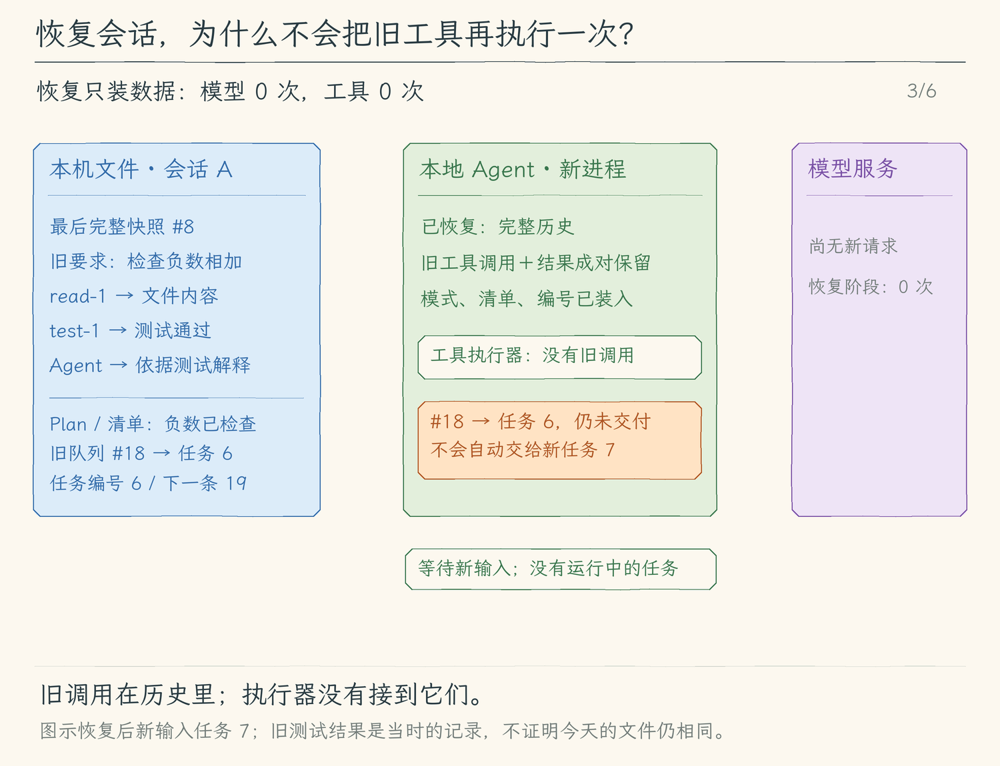
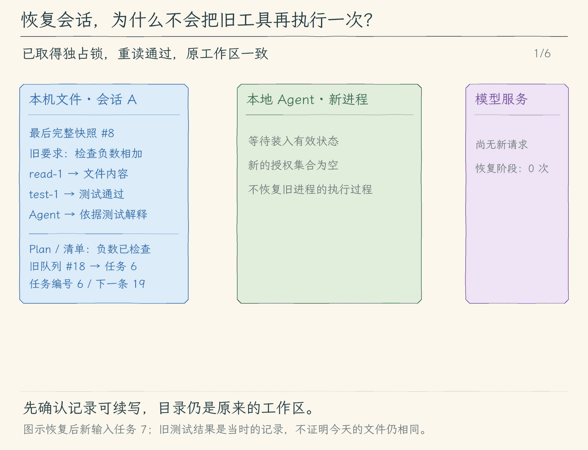
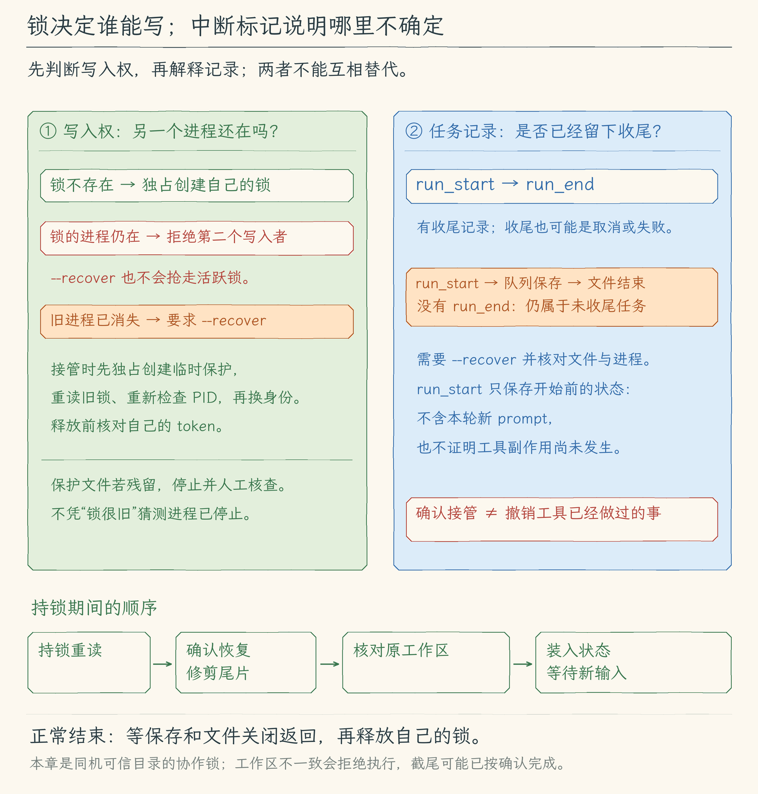

# 13.3 恢复会话并继续讨论

[第 13 章首页](../README.md) · [上一节：13.2 读取有效会话记录](../02-read-records/README.md) · [下一节：13.4 查找、命名与导出会话](../04-manage-sessions/README.md)

## 问题：把上次的讨论接回来，会不会把工具再执行一次

上次 Agent 已经读取 `src/add.ts`、运行 `npm test` 并解释了两个负数相加。退出后，我们想接着问“刚才为什么能说负数检查通过，再看一下零相加”。

现在读取器能取得最后完整状态，但还不能直接把文件交给 Agent Loop。两个进程可能同时选择这份会话，随后都从相同编号追加；如果恢复程序把历史工具调用当成待执行任务，又会重复运行已经执行过的命令。进程意外结束时，记录也可能只停在任务开始前，而工作区已经改变。

本节要建立的是一个明确的继续入口：取得这份会话的写入权，装回已经保存的讨论，说明不确定的部分，然后等新的用户输入。

## 解决方案：先持锁读回，再装入状态，新输入才开始任务

新建与恢复都为会话创建 `<UUID>.lock`。锁文件以“已存在就失败”的方式创建，同一时刻只允许一个遵守这套规则的进程持有写入权。恢复者取得锁后重新读取文件，只有通过上一节的检查，才移除未换行尾片，并从最后编号继续追加。

恢复不调用 Agent Loop。它把消息、模式、清单、队列和编号装入新的本地会话，授权集合与取消控制器重新创建。下一条用户输入才发起模型请求；旧工具调用和结果作为历史一起进入请求，不进入工具执行队列。

为识别执行途中退出的情况，本节在每次新任务开始外部操作前，先保存 `run_start`。若没有后续 `run_end` 或正常退出记录，恢复时要求显式 `--recover`，并提示核对当前工作区与进程。这个标记只能说明有一轮没有留下结束记录，不能还原崩溃前执行过哪些工具。

## 工作原理

### 同一份记录，先决定谁能写，再决定从哪里继续

假设文件最后编号是 #8。进程 A、B 都先读取到 #8，再各自决定下一条是 #9，就可能出现重复编号或交错追加。即使每个进程内部都串行保存，也只排好了自己那条写入链，没有给另一个进程排序。

锁把这个问题前移到读取之前：

| 顺序 | 恢复进程的动作 | 为什么放在这里 |
| --- | --- | --- |
| 1 | 用 `wx` 创建对应的 `.lock`，写下本机进程身份 | 先取得独占使用权，竞争者在这里停止 |
| 2 | 在持锁期间重新调用 `readSession()` | 取得接下来要续写的实际最后编号与状态 |
| 3 | 若有未结束任务或未换行尾片，要求显式 `--recover` | 先确认是否接管这个不确定状态 |
| 4 | 获准接管时，截掉未换行尾片并同步，建立可续写的 writer | 避免新 JSON 拼在旧半行后面；下一编号接在最后完整记录之后 |
| 5 | CLI 核对当前工作区，再装入状态并等待新输入 | 路径不一致就关闭 writer、释放锁，不启动模型或工具 |
| 6 | 会话结束时，等待保存和文件关闭，再释放自己的锁 | 写入过程没有结束前，其他进程不能接手 |

只读查看时取得的 #8 不能代替步骤 2；在它与恢复之间，原进程可能已追加 #9。把读取放进持锁范围，才能让“读到的最后编号”和“下一条准备写的位置”属于同一次独占使用过程。

若锁里的进程仍存在，第二个恢复者报错，`--recover` 也不能抢走它。若进程已不存在，锁只是意外退出留下的文件；程序仍要求显式 `--recover` 才接管。它不会把“锁文件很旧”当作进程死亡的证据，也不会替用户终止另一个进程。

接管死锁时还有一层短暂的 `.lock.recover` 保护。一个恢复者先独占创建它，再重读旧锁、重新检查 PID，并原位更新锁里的身份；第二个恢复者不能同时越过这段接管过程。释放锁前还要核对自己的随机 token，避免删掉已经换了拥有者的锁。若进程在接管途中退出，留下的恢复保护文件不会被自动删除，需要先人工核查；程序不能猜测另一个恢复者已经停止。

本章按本机 PID 判断，面向同一台机器、可信会话目录里的本地进程协作。它没有实现跨机器共享目录上的分布式锁；PID 也可能被系统复用，无法识别时宁可拒绝接管。应用层锁要求各个写入者遵守规则，不能阻止其他程序直接改文件。

### 尾片可以丢弃，完整坏行仍要停下

设完整记录到 #8 结束，后面还有一段没换行的 #9。读取器给出完整记录结束的字节位置；持锁恢复者只有取得显式 `--recover` 后才把文件截到这里，再同步。接着追加新的 #9，旧半行就不会和新记录拼在一起。

截尾发生在 writer 交回 CLI 之前；随后工作区不匹配时仍拒绝执行，文件可能已经按明确的 `--recover` 修剪了尾片。这个修改只丢弃上一节已经明确排除的未完成尾片。若 #9 本身是带换行的坏 JSON，或版本、工具配对不符合约定，读取器仍报错，恢复者释放锁并退出。`--recover` 表示确认接管中断状态，不能把不支持的记录改判成有效，也不能让程序跳过坏中间行。

修剪尾片和选择完整快照解决的是会话文件问题，不能撤销工具对 `src/add.ts` 的修改。恢复者不能因为截掉了半行，就宣布工作区也回到了 #8。

### 消息成为下一次请求的历史，旧工具不会进入执行队列

恢复后的本地会话包含这段已经配对的关系：

| 保存的内容 | 恢复后的去向 |
| --- | --- |
| user：请检查负数相加 | 装回 `history`，保留任务由来 |
| assistant：调用 `read-1`，tool：`read-1` 的文件内容 | 作为已经发生的一对消息装回历史 |
| assistant：调用 `test-1`，tool：`test-1` 的测试结果 | 作为已经发生的一对消息装回历史 |
| assistant：根据测试解释结果 | 装回历史，供接着讨论 |

装入这些对象没有调用工具函数。TUI 可以把旧消息投影为可浏览的显示内容，这也是显示数据变化，不是执行事件重放。

随后输入“刚才为什么说检查通过，再看零相加”。核心才用“恢复的历史 + 本次新 user 消息”调用模型。模型看到上次工具返回的依据，可以解释负数检查；若需要确认现在的文件和零相加，可以提出新的工具调用。只有**本次模型新返回的调用**才进入校验、权限与工具执行流程。

因此，本章能保证恢复入口不会主动重放旧工具，却不能保证模型永远不再次选择同一工具。对当前文件重新检查可能正是合理的新动作；判断依据是调用来自新模型结果，还是仅仅存在于旧历史。

恢复清单同样只是装入模型曾报告的步骤进度。`completed` 不会变成新的测试证明，旧工具结果也不会自动更新为今天的文件内容。

下面先观察恢复时的本地变化，再观察新输入形成请求的过程。历史装入与屏幕显示完成时，模型请求和工具执行都仍为零；直到新输入开始任务 7，历史才与这条新输入一起发给模型。

<style>
.motion-player { position: relative; margin: 18px 0; padding: 0; border: 0; }
.motion-player summary { display: block; cursor: pointer; list-style: none; }
.motion-player img { display: block; width: 100%; height: auto; margin: 0; }
.motion-player .motion-gif { position: absolute; top: 0; left: 0; pointer-events: none; }
.motion-player[open] .motion-cover { visibility: hidden; }
.motion-player .motion-toggle { display: inline-block; margin-top: 12px; padding: 8px 18px; border-radius: 6px; background: #294c63; color: white; font-size: 16px; }
.motion-player .motion-stop, .motion-player[open] .motion-start { display: none; }
.motion-player[open] .motion-stop { display: inline; }
</style>

<details class="motion-player">
<summary>

<span class="motion-toggle"><span class="motion-start">▶ 开始播放动图</span><span class="motion-stop">■ 收起动图</span></span>
</summary>

</details>

[查看完整静态分镜](assets/restore-session-storyboard-4da438613f.jpg)

队列 #18 仍属于任务 6。恢复与新提问都不会自动把它改成任务 7 的补充；后面再说明怎样明确选择这条要求。

### 为什么记录任务开始，仍然不知道工具执行到哪里

13.1 主要在任务收束后保存消息。若进程正在运行 `npm test` 时被强制结束，可能没有机会写下本轮历史；单凭上一份 `run_end`，无法知道后来还曾启动任务。

本节在任务编号增加后，先保存一次 `run_start`，等待追加和同步成功，才开始模型请求。此时消息仍是此前已提交的历史，新 prompt 尚未进入这份检查点；它表示“准备开始任务 N 前，保存了当前状态”，并不声称保存了本轮请求或全部执行过程。若这次保存失败，本轮模型与工具不开始。

若后续保存发生错误，当前内存中的消息仍保留，已经发生的工具操作也不会被撤销；这份文件会停止追加。之后每个新模型任务仍必须先成功保存 `run_start`，因此不能继续使用这个失败的 writer 启动任务，需要换新会话。程序会明确提示这个限制。

比较下面三种结尾：

| 完整记录中发生的顺序 | 读取结论 | 恢复时能说什么 |
| --- | --- | --- |
| `run_start → run_end` | 这轮有结束记录 | 可以使用已经收束并保存的历史；结束可能是成功、失败或取消 |
| `run_start → queue_change`，随后进程消失 | 这轮没有结束记录 | 队列变化保存过，但不能据此判定本轮工具已经结束 |
| `run_start` 后没有其他完整记录 | 这轮没有结束记录 | 只知道开始前保存成功，之后执行情况不确定 |

读取器记住是否存在尚未收尾的开始标记，不只查看最后一条记录的 `reason`。因此，运行中的队列保存或会话命名不会把中断误判成正常结束。

恢复中断会话需要 `--recover`，这只是对不确定状态的明确确认。接着应查看 `src/add.ts`、`test/add.test.ts`，运行当前测试，必要时核对是否还有原任务启动的进程，再决定下一步。比如文件修改已经完成、结束记录还没保存，重做修改就可能重复；文件尚未修改、开始记录已保存，也不能凭标记声称修改已发生。

本节没有对工具副作用逐项记账，没有给外部命令提供“恰好执行一次”保证。第 14 章的文件检查点会增加文件层面的核对与恢复，也不能撤销已经发送的网络请求等外部副作用。

把两个判断放在一起看：锁回答“现在谁能续写”，开始与结束记录回答“上轮是否留下收尾”。两者都不能代替检查当前文件与实际进程。



### 恢复同一个工作区，权限与未交付要求各自处理

会话头记住上次启动的工作区。本节把它与当前目录解析成真实路径后比较；不一致就拒绝进入执行入口，并提示先进入原目录。原因很具体：同样的 `src/add.ts`，在另一个项目里可能是另一个文件，旧历史和清单不能悄悄变成新项目的操作依据。

路径相同只确认“还是这个目录”，没有证明文件字节相同。两次启动之间的外部修改仍需要重新读取和测试。旧文件只有 `cwd` 时使用它，新文件也保存解析后的工作区路径；原目录已不可访问时同样不能自动换一个目录继续。

各类状态恢复后的处理如下：

| 对象 | 恢复后的处理 | 原因 |
| --- | --- | --- |
| 消息、模式、清单 | 沿用最后快照；显式 `--mode` 可覆盖模式 | 接上讨论与本地选择 |
| 未交付队列、条目 ID、任务编号 | 保留原文、ID 和原任务归属 | 仍能查到待办要求，但不能假装已经发给模型 |
| 会话授权 | 创建新的空集合 | 上次进程中的批准不会随文件跨进程生效 |
| 取消控制器、正在运行的 Promise | 重新创建 | 它们代表上一个进程的运行过程，不能从 JSON 继续 |
| 草稿、焦点、滚动位置 | 使用新界面的初始状态 | 它们没有进入保存白名单 |

特别看队列 `#18`“顺便说明零相加”，所属任务是 6。恢复后新输入开始任务 7，核心只收取归属当前任务的补充，所以 #18 不会自动投递给任务 7。TUI 中它仍可查看、编辑或撤回。任务空闲时，从草稿按两次 `Ctrl+O` 切到队列，用 `↑↓` 或 `j/k` 选中 #18，再按 `Enter` 明确单独发送；不需要重新抄写要求。忙碌时队列面板的 `Enter` 只提示等待。

父组件重新检查这个 ID，用原文启动新任务，开始检查点里仍保留旧条目。等核心把新 user 消息提交进本轮历史后，父组件才按 ID 移出旧项，并在 `run_end` 一起保存历史和队列。若运行中又编辑了这个条目，当前文字与本轮 prompt 已不同，就保留修改后的条目。这样，若开始保存失败，或任务在进入核心前取消，旧项仍可再次选择；若中途退出而没有保存结束状态，上次完整记录里仍有原文字，不能先从文件里删掉要求、再期待尚未发生的模型任务替它保管。

文本入口没有队列管理面板，但仍保留这些旧项，后续保存不会悄悄删掉它们。

## 本节改动文件

| 状态 | 文件 | 本节变化 |
| --- | --- | --- |
| CHANGED | [src/sessions/save-session.ts](src/sessions/save-session.ts) | 为新建和恢复加入独占锁；持锁重读、显式接管和截尾；增加任务开始与名称记录 |
| CHANGED | [src/ui/terminal.ts](src/ui/terminal.ts) | 装入已保存状态，先保存任务开始，再等待新请求；旧队列保留原任务归属 |
| CHANGED | [src/ui/tui/app.tsx](src/ui/tui/app.tsx) | 显示旧消息、恢复清单与队列，重建进程内状态，任务开始保存成功后才请求模型 |
| CHANGED | [src/cli.ts](src/cli.ts) | 增加恢复参数，核对工作区，传入持锁后读到的状态 |

## 动手构建

从 13.2 的完整 `src/` 继续，目标目录为 `chapter-13-session-persistence/03-resume-session/`。先建立锁与可续写的 writer，再将已校验状态传给文本和 TUI 入口，最后接入 CLI。核心执行循环和具体工具不需要遍历旧消息来执行。

### 替换保存模块，建立持锁续写入口

将 `src/sessions/save-session.ts` 整个替换为下面内容。`createSessionWriter()` 也取得锁，避免只有恢复者守规则；`resumeSessionWriter()` 取得锁后调用上一节读取器，并把这次读取结果放在 `writer.restored`。追加仍共用一条串行链，保存 Promise 在同步成功后完成。

<details>
<summary>完整替换：src/sessions/save-session.ts</summary>

<!-- source: src/sessions/save-session.ts -->
```ts
/**
 * 13.3 恢复会话 | [CHANGED] sessions/save-session.ts
 *
 * 学习目标：把内存会话保存成版本明确、可逐行查看的 JSONL 检查点。
 * 输入：会话目录、模型消息、模式、清单和未交付补充；不接收模型连接配置或授权。
 * 输出：稳定会话 ID、新文件路径，以及写入并 sync 完成的检查点编号。
 * 状态：新建或锁后读取旧文件；调用 save/rename 时同步复制，再按同一序号写入。
 * 失败：append 或 sync 失败后停止追加；close 仍关闭句柄并核对 token 后释放锁。
 *
 * 本文件局部流程（全局主流程见 agent/agent-loop.ts）：
 *   create -> mkdir -> randomUUID -> 锁(wx) -> 新文件(wx) -> 写元数据、sync
 *   resume -> 锁(wx/显式接管) -> 重读校验 -> 必要时截掉未完成尾片 -> 续接原 seq
 *   save(state) -> 立即投影、JSON.stringify -> 排到 tail -> writeFile(一行) -> sync -> 成功
 *                                                +-- 失败 -> 记住错误、停止该文件后续追加
 *   close -> 封住新写入 -> 等 tail（失败也等）-> close 文件句柄 -> 按 token 释放锁
 *
 * JSONL 的换行只分隔记录，正文中的换行由 JSON 转义；显示事件不是模型消息。
 * 恢复只提供数据，不重放历史工具，不恢复授权，不声称撤销过往文件操作。
 * sync 是本次保存的完成边界，不承诺异常断电或设备故障下绝对恢复。
 */
// [CHANGED 13.3] 增加持锁续写和恢复检查点。
import { randomUUID } from "node:crypto";
import { constants } from "node:fs";
import { lstat, mkdir, open, realpath, unlink, type FileHandle } from "node:fs/promises";
import { resolve } from "node:path";
import type { ExecutionMode, TaskItem } from "../agent/run-options.js";
import type { Message } from "../models/client.js";
import { UserFacingError } from "../errors.js";
import { DEFAULT_SESSION_DIRECTORY, MAX_SESSION_BYTES, readSession, sessionPath, validateSessionName, validateSessionState, type ReadSessionResult } from "./read-session.js";

// [KEEP 来自 13.1] 本文件以下实现均为本节新增。
export type CheckpointReason = "run_start" | "run_end" | "reset" | "mode" | "queue_change" | "exit";
export type SessionState = {
  messages: readonly Message[];
  mode: ExecutionMode;
  tasks: readonly TaskItem[];
  pendingInputs: readonly { id: number; text: string; run: number }[];
  run: number;
  nextInputId: number;
};
export type SessionWriter = {
  readonly id: string;
  readonly path: string;
  readonly restored?: ReadSessionResult;
  save(state: SessionState, reason: CheckpointReason): Promise<number>;
  rename(name: string): Promise<number>;
  close(): Promise<void>;
};
export type SaveFeedback = { ok: boolean; message: string };

/**
 * 用固定存储文案解释文件系统错误，避免泄露原始路径、内容或任意错误消息。
 * 已设计的 UserFacingError 保留文案；已知 errno 指向权限、目录或磁盘，其他用存储兜底。
 */
export function explainSessionError(error: unknown): string {
  if (error instanceof UserFacingError) return error.message;
  const code = error && typeof error === "object" && "code" in error ? error.code : undefined;
  if (code === "EACCES" || code === "EPERM") return "没有写入权限，请检查会话目录权限。";
  if (code === "ENOSPC" || code === "EDQUOT") return "磁盘空间或配额不足，请检查存储空间。";
  if (code === "ENOTDIR" || code === "EISDIR" || code === "ENOENT") return "会话目录不可用，请检查目录路径。";
  if (code === "EEXIST") return "同名会话文件已存在，请重新启动以创建新的会话 ID。";
  if (code === "EMFILE" || code === "ENFILE") return "可用文件句柄不足，请关闭其他文件后重试。";
  return "文件保存未完成，请检查目录、权限和磁盘状态。";
}

/**
 * 只复制存储契约允许的会话字段，避免把活动对象或配置整包写入文件。
 * 输入可能在下一次 await 后继续改变；本函数立即深复制消息、调用、清单和队列。
 * 输出不含授权、连接配置、屏幕事件或编辑草稿；它们不属于恢复模型上下文的消息。
 */
function copySessionState(state: SessionState): SessionState {
  return {
    messages: state.messages.map((message): Message => {
      if (message.role === "tool") return { role: "tool", toolCallId: message.toolCallId, content: message.content, isError: message.isError };
      if (message.role === "user") return { role: "user", content: message.content };
      return { role: "assistant", content: message.content, ...(message.toolCalls ? {
        toolCalls: message.toolCalls.map((call) => ({ id: call.id, name: call.name, arguments: call.arguments })),
      } : {}) };
    }),
    mode: state.mode,
    tasks: state.tasks.map((item) => ({ id: item.id, text: item.text, status: item.status })),
    pendingInputs: state.pendingInputs.map((entry) => ({ id: entry.id, text: entry.text, run: entry.run })),
    run: state.run,
    nextInputId: state.nextInputId,
  };
}

type LockRecord = { pid: number; token: string };
type HeldLock = { release(): Promise<void> };

/**
 * 只读一个有界、普通且未被替换的锁文件，返回拥有者和文件身份。
 * 无法解释的锁不会被视为空闲，避免误删其他进程或人工放置的文件。
 */
async function readLock(path: string) {
  const before = await lstat(path);
  if (!before.isFile() || before.isSymbolicLink() || before.size > 4096) throw new UserFacingError("锁文件不是可识别的普通文件，请先人工检查，程序不会删除它。");
  const file = await open(path, constants.O_RDONLY | (constants.O_NOFOLLOW ?? 0) | (constants.O_NONBLOCK ?? 0));
  try {
    const info = await file.stat();
    if (!info.isFile() || info.ino !== before.ino || info.dev !== before.dev || info.size > 4096) throw new UserFacingError("锁文件在检查时发生变化，请重试。");
    const buffer = Buffer.alloc(4097);
    const { bytesRead } = await file.read(buffer, 0, buffer.length, 0);
    if (bytesRead > 4096) throw new Error("锁过长");
    const value: unknown = JSON.parse(buffer.subarray(0, bytesRead).toString("utf8"));
    if (!value || typeof value !== "object" || Array.isArray(value)) throw new Error("锁不是对象");
    const record = value as Record<string, unknown>;
    if (Object.keys(record).length !== 2 || !Number.isSafeInteger(record.pid) || (record.pid as number) <= 0 || (record.pid as number) > 2_147_483_647
      || typeof record.token !== "string" || !/^[0-9a-f-]{36}$/.test(record.token)) throw new Error("锁字段无效");
    return { record: record as LockRecord, info };
  } catch (error) {
    if (error instanceof UserFacingError) throw error;
    throw new UserFacingError("锁文件内容无法识别，请先人工检查，程序不会删除它。");
  } finally { await file.close(); }
}

/**
 * 用 PID 检查占用是否仍有可能存在；权限不足也按占用处理。
 * PID 可能复用，所以活 PID 只意味着拒绝接管，不证明它仍是最初的会话进程。
 */
function processMayExist(pid: number): boolean {
  try { process.kill(pid, 0); return true; }
  catch (error) {
    if (error && typeof error === "object" && "code" in error && error.code === "ESRCH") return false;
    return true;
  }
}

/**
 * 释放前重新确认 token 和普通文件身份，绝不删掉后来替换的锁。
 * 缺失或变更也作为异常报告；调用方不能把未核对的释放说成成功。
 */
async function releaseLock(path: string, token: string): Promise<void> {
  const current = await readLock(path);
  if (current.record.token !== token || current.record.pid !== process.pid) throw new UserFacingError("锁的拥有者已经变化，当前进程没有删除它。");
  const latest = await lstat(path);
  if (!latest.isFile() || latest.ino !== current.info.ino || latest.dev !== current.info.dev) throw new UserFacingError("锁文件已经变化，当前进程没有删除它。");
  await unlink(path);
}

/**
 * 以 wx 创建锁并写入当前 PID 和随机 token；失败只清理自己刚创建的同一文件。
 * 这里不删除已有锁，是否允许接管由 acquireLock 在恢复保护内决定。
 */
async function createLock(path: string, record: LockRecord): Promise<void> {
  const file = await open(path, "wx", 0o600);
  const info = await file.stat();
  try {
    await file.writeFile(`${JSON.stringify(record)}\n`, "utf8");
    await file.sync();
  } catch (error) {
    const current = await lstat(path).catch(() => undefined);
    if (current?.isFile() && current.ino === info.ino && current.dev === info.dev) await unlink(path).catch(() => {});
    throw error;
  } finally { await file.close(); }
}

/**
 * 获取整次写入期间持有的锁；死 PID 也必须由人显式选择恢复。
 * 接管先创建短暂的恢复保护文件，再原位改写旧锁，避免两个恢复者越过同一空档。
 * 异常留下的恢复保护不能自动清除：宁可提示检查，也不猜测另一个恢复者已经退出。
 */
async function acquireLock(path: string, recover: boolean): Promise<HeldLock> {
  const record = { pid: process.pid, token: randomUUID() };
  try { await createLock(path, record); }
  catch (error) {
    if (!error || typeof error !== "object" || !("code" in error) || error.code !== "EEXIST") throw error;
    const previous = await readLock(path);
    if (processMayExist(previous.record.pid)) throw new UserFacingError("会话仍被一个活进程占用，不能同时恢复或修改。");
    if (!recover) throw new UserFacingError("会话留有旧锁；确认工作区和进程后，使用 --recover 显式接管。");
    const recoveryPath = `${path}.recover`;
    try { await createLock(recoveryPath, record); }
    catch { throw new UserFacingError("已有恢复保护文件，请检查是否有其他恢复操作；程序不会自动删除它。"); }
    try {
      const current = await readLock(path);
      if (processMayExist(current.record.pid)) throw new UserFacingError("检查期间已有活进程占用会话，已停止接管。");
      const file = await open(path, constants.O_RDWR | (constants.O_NOFOLLOW ?? 0) | (constants.O_NONBLOCK ?? 0));
      try {
        const info = await file.stat();
        if (!info.isFile() || info.ino !== current.info.ino || info.dev !== current.info.dev) throw new UserFacingError("锁文件在接管前发生变化，已停止接管。");
        await file.truncate(0);
        await file.writeFile(`${JSON.stringify(record)}\n`, "utf8");
        await file.sync();
      } finally { await file.close(); }
    } finally { await releaseLock(recoveryPath, record.token); }
  }
  return { release: () => releaseLock(path, record.token) };
}

/**
 * 用一个串行队列管理检查点和名称记录，两者共享序号与落盘完成边界。
 * 调用时复制数据；写入失败后封住所有后续追加，close 仍释放文件和当前锁。
 */
function makeWriter(id: string, path: string, file: FileHandle, lock: HeldLock, initialBytes: number, restored?: ReadSessionResult): SessionWriter {
  let sequence = restored?.seq ?? 0;
  let writtenBytes = initialBytes;
  let failure: unknown;
  let failed = false;
  let closing = false;
  // tail 始终被处理为 fulfilled；每次 save 自己的 Promise 仍保留真实写入结果。
  let tail: Promise<void> = Promise.resolve();
  let closed: Promise<void> | undefined;
  /**
   * 同步编码记录后接到 tail，真正写入时再检查大小和之前是否失败。
   * 这一入口同时服务保存与改名，避免相同 seq 或一行交错写入。
   */
  function append(type: "checkpoint" | "name", values: Record<string, unknown>): Promise<number> {
    if (closing) return Promise.reject(new UserFacingError("会话文件已经关闭或正在关闭。"));
    if (failed) return Promise.reject(failure);
    if (!Number.isSafeInteger(sequence + 1)) return Promise.reject(new UserFacingError("会话记录编号已达到限制，不能继续追加。"));
    const seq = ++sequence;
    let line: string;
    try { line = `${JSON.stringify({ version: 1, type, sessionId: id, seq, savedAt: new Date().toISOString(), ...values })}\n`; }
    catch (error) { failed = true; failure = error; return Promise.reject(error); }
    const pending = tail.then(async () => {
      if (failed) throw failure;
      try {
        const size = Buffer.byteLength(line);
        if (writtenBytes + size > MAX_SESSION_BYTES) throw new UserFacingError("会话文件将超过 64 MiB，已停止追加，请开启新会话。");
        await file.writeFile(line, "utf8");
        await file.sync();
        writtenBytes += size;
        return seq;
      } catch (error) { failed = true; failure = error; throw error; }
    });
    tail = pending.then(() => {}, () => {});
    return pending;
  }
  return { id, path, ...(restored ? { restored } : {}),
    /**
     * 调用时同步复制并编码一个完整检查点，再串行等待文件写入与 sync。
     * state 是当前会话白名单，reason 说明本次保存触发点；成功返回递增 seq。
     * 同一文件上不并发写入；任一写盘失败后，后续调用继续拒绝而不拼接潜在坏尾。
     */
    save(state, reason) {
      try {
        if (!["run_start", "run_end", "reset", "mode", "queue_change", "exit"].includes(reason)) throw new UserFacingError("不支持这个保存原因。");
        return append("checkpoint", { reason, state: validateSessionState(copySessionState(state)) });
      } catch (error) { return Promise.reject(error); }
    },
    /**
     * 名称记录与检查点串行保存，只改变显示名称，不替换最后状态或任务标记。
     * 先检查名称并去掉首尾空白；含控制字符或空名称时不产生记录。
     */
    rename(name) {
      try { return append("name", { name: validateSessionName(name) }); }
      catch (error) { return Promise.reject(error); }
    },
    /**
     * 封住新检查点，等待所有已排队保存，再关闭句柄。
     * 重复 close 复用同一 Promise；保存失败已由各次 save 报告，仍执行句柄关闭。
     * close 本身失败继续抛给入口，调用方不能把它说成正常完成。
     */
    close() {
      closing = true;
      closed ??= tail.then(async () => {
        let closingError: unknown;
        try { await file.close(); } catch (error) { closingError = error; }
        try { await lock.release(); } catch (error) { closingError ??= error; }
        if (closingError) throw new UserFacingError(`会话关闭或释放锁失败：${explainSessionError(closingError)}`);
      });
      return closed;
    },
  };
}

/**
 * 创建新会话并持锁，元数据 sync 完成后才交出保存入口。
 * 新头记录额外保存工作区真实路径，旧版只有 cwd 的文件仍由读取器兼容。
 */
export async function createSessionWriter(directory = DEFAULT_SESSION_DIRECTORY): Promise<SessionWriter> {
  const sessionDirectory = resolve(directory), id = randomUUID(), path = sessionPath(id, sessionDirectory);
  let lock: HeldLock;
  try {
    await mkdir(sessionDirectory, { recursive: true, mode: 0o700 });
    lock = await acquireLock(`${path.slice(0, -6)}.lock`, false);
  } catch (error) { throw new UserFacingError(`无法准备会话目录或锁：${explainSessionError(error)}`); }
  let file: FileHandle | undefined;
  try {
    file = await open(path, "wx", 0o600);
    const line = `${JSON.stringify({ version: 1, type: "session", sessionId: id, createdAt: new Date().toISOString(), cwd: process.cwd(), workspace: await realpath(process.cwd()) })}\n`;
    await file.writeFile(line, "utf8");
    await file.sync();
    return makeWriter(id, path, file, lock, Buffer.byteLength(line));
  } catch (error) {
    await file?.close().catch(() => {});
    await lock.release();
    throw new UserFacingError(`无法创建会话文件：${explainSessionError(error)}`);
  }
}

/**
 * 先占有旧会话的写入权，再重读所有记录；恢复采用的快照来自锁内检查。
 * 只有显式 recover 才允许处理未结束标记或截断未换行尾片，完整坏行始终拒绝。
 * 返回的 restored 是数据与警告，调用方仍须检查工作区并让用户决定下一步。
 */
export async function resumeSessionWriter(id: string, directory = DEFAULT_SESSION_DIRECTORY, recover = false): Promise<SessionWriter> {
  const path = sessionPath(id, directory);
  let lock: HeldLock;
  try { lock = await acquireLock(`${path.slice(0, -6)}.lock`, recover); }
  catch (error) { throw new UserFacingError(`无法取得会话写入权：${explainSessionError(error)}`); }
  let file: FileHandle | undefined;
  try {
    const restored = await readSession(id, directory);
    if ((restored.interrupted || restored.hasTrailingFragment) && !recover) throw new UserFacingError("会话有未结束任务或未完成尾片；请核对工作区和进程后使用 --recover。");
    const before = await lstat(path);
    file = await open(path, constants.O_RDWR | constants.O_APPEND | (constants.O_NOFOLLOW ?? 0) | (constants.O_NONBLOCK ?? 0));
    const info = await file.stat();
    if (!info.isFile() || info.ino !== before.ino || info.dev !== before.dev) throw new UserFacingError("会话文件在恢复前发生变化，已停止恢复。");
    if (restored.hasTrailingFragment) { await file.truncate(restored.validBytes); await file.sync(); }
    return makeWriter(id, path, file, lock, restored.validBytes, restored);
  } catch (error) {
    await file?.close().catch(() => {});
    await lock.release();
    if (error instanceof UserFacingError) throw error;
    throw new UserFacingError(`无法恢复会话：${explainSessionError(error)}`);
  }
}

/**
 * 把存储结果变成人类界面可分别显示的反馈，保存失败不抛进模型任务。
 * 未注入 writer 时返回 undefined，保留旧章节与离线调用者的使用方式。
 * 成功反馈只在 sync 后产生；失败明确说明内存仍在、该文件不再追加。
 */
export async function saveSessionCheckpoint(writer: SessionWriter | undefined, state: SessionState, reason: CheckpointReason): Promise<SaveFeedback | undefined> {
  if (!writer) return undefined;
  try {
    const seq = await writer.save(state, reason);
    return { ok: true, message: `会话已保存：检查点 #${seq}（${writer.id}）` };
  } catch (error) {
    return { ok: false, message: `会话保存失败：${explainSessionError(error)}；当前内存仍保留，该文件已停止追加，后续模型任务需换新会话。` };
  }
}
```

</details>

### 把状态装入文本与 TUI 消费者

下面的 diff 都以 13.2 的同名文件为起点：保留上下文行，删除 `-` 行，加入 `+` 行，不把行首符号写进 TypeScript。文本入口接收可选 `initial`，保留旧队列，并在两个任务入口的模型循环前等待 `run_start`；TUI 先把旧历史投影到显示条目，启动新任务时做同样的保存等待。取消控制器与授权集合仍由新进程创建。

<details>
<summary>完整改动：src/ui/terminal.ts</summary>

<!-- source: src/ui/terminal.ts -->
```diff
--- a/src/ui/terminal.ts
+++ b/src/ui/terminal.ts
@@ -1,5 +1,5 @@
 /**
- * 13.1 保存会话 | [KEEP] ui/terminal.ts
+ * 13.3 恢复会话 | [CHANGED] ui/terminal.ts
  *
  * 学习目标：等本轮历史提交后保存会话；模型结果与磁盘保存结果分别报告。
  * 输入：用户输入、本地命令、AgentRecord 记录流，以及 Ctrl+C / SIGINT / SIGTERM / SIGHUP。
@@ -42,7 +42,7 @@
 import { formatTeachingTrace } from "./teaching-trace.js";
 import type { RunOptions, QuestionHandler } from "../agent/run-options.js";
 // [KEEP 来自 13.1] 存储只接收模型历史与本地会话白名单，不接收显示器或授权。
-import { saveSessionCheckpoint, type SessionWriter, type CheckpointReason } from "../sessions/save-session.js";
+import { saveSessionCheckpoint, type SessionWriter, type CheckpointReason, type SessionState } from "../sessions/save-session.js";

 // ANSI 颜色只用于交互终端：用户标签为青色，Agent 标签为紫色。
 // 输出被管道或文件接收时不加控制字符，便于日志和脚本读取。
@@ -242,19 +242,23 @@
 // [KEEP 来自 08.3] controller 属于当前回合，终端与历史属于整个会话。
 // [KEEP 来自 09.3] 输入提示与本地交互输出使用 stderr。
 // [KEEP 来自 13.1] writer 由 CLI 管理；可选参数方便离线调用，不改变模型接口。
-export async function startTerminal(model: Model, options: RunOptions = {}, writer?: SessionWriter): Promise<void> {
-  const history: Message[] = [];
-  let mode = options.mode ?? "execute";
+export async function startTerminal(model: Model, options: RunOptions = {}, writer?: SessionWriter, initial?: SessionState): Promise<void> {
+  // [CHANGED 13.3] 只恢复白名单数据；控制器和授权仍由这次进程新建。
+  const history: Message[] = structuredClone([...(initial?.messages ?? [])]);
+  let mode = options.mode ?? initial?.mode ?? "execute";
   // [KEEP 来自 12.2] 持续会话复用清单，下一轮与模式切换不重建。
-  const tasks = options.tasks ?? { items: [] };
+  const tasks = initial ? { items: structuredClone([...initial.tasks]) } : options.tasks ?? { items: [] };
   // [KEEP 来自 13.1] 文本会话没有补充队列，但保留统一状态结构和任务计数。
-  let run = 0;
+  let run = initial?.run ?? 0;
+  const pendingInputs = structuredClone([...(initial?.pendingInputs ?? [])]);
+  const nextInputId = initial?.nextInputId ?? 1;
+  const snapshot = (): SessionState => ({ messages: history, mode, tasks: tasks.items, pendingInputs, run, nextInputId });
   /**
    * 在明确触发点保存当前文本会话，并单独报告存储结果。
-   * 失败设 exitCode=1，保留 history 与 tasks；不会阻断内存中的下一轮。
+   * 失败设 exitCode=1 并保留 history 与 tasks；下一轮必须先成功保存 run_start 才能请求模型。
    */
   const checkpoint = async (reason: CheckpointReason) => {
-    const feedback = await saveSessionCheckpoint(writer, { messages: history, mode, tasks: tasks.items, pendingInputs: [], run, nextInputId: 1 }, reason);
+    const feedback = await saveSessionCheckpoint(writer, snapshot(), reason);
     if (feedback) { console.error(feedback.message); if (!feedback.ok) process.exitCode = 1; }
   };
   const terminal = Boolean(process.stdin.isTTY && process.stdout.isTTY);
@@ -325,6 +329,9 @@
       run++;
       const renderer = createTurnRenderer();
       try {
+        // [CHANGED 13.3] 开始标记落盘后才能调用模型；写入失败时不启动外部操作。
+        await writer?.save(snapshot(), "run_start");
+        active.signal.throwIfAborted();
         // [KEEP 来自 09.2] 同一份事件流驱动本轮显示。
         const reply = await showRun(streamAgentRun(model, history, text, active.signal,
           // [KEEP 来自 12.2] 每轮固定模式，并把共用清单传到核心。
@@ -376,9 +383,12 @@
 // [KEEP 来自 08.3] 单次模式也使用可取消读取，并在退出时释放输入监听。
 // [KEEP 来自 09.3] readline 的回显与审批提示使用 stderr。
 // [KEEP 来自 13.1] 单次文本提问也有完整历史，writer 的关闭仍归 CLI。
-export async function runSinglePrompt(model: Model, prompt: string, options: RunOptions = {}, writer?: SessionWriter): Promise<void> {
-  const history: Message[] = [];
-  const tasks = options.tasks ?? { items: [] };
+export async function runSinglePrompt(model: Model, prompt: string, options: RunOptions = {}, writer?: SessionWriter, initial?: SessionState): Promise<void> {
+  // [CHANGED 13.3] 历史只成为新请求的上下文，旧工具不会从这里再次调度。
+  const history: Message[] = structuredClone([...(initial?.messages ?? [])]);
+  const tasks = initial ? { items: structuredClone([...initial.tasks]) } : options.tasks ?? { items: [] };
+  const mode = options.mode ?? initial?.mode ?? "execute";
+  const snapshot = (): SessionState => ({ messages: history, mode, tasks: tasks.items, pendingInputs: initial?.pendingInputs ?? [], run: (initial?.run ?? 0) + 1, nextInputId: initial?.nextInputId ?? 1 });
   const interactive = Boolean(process.stdin.isTTY && process.stdout.isTTY);
   const input = interactive
     ? createInterface({ input: process.stdin, output: process.stderr, terminal: true })
@@ -405,12 +415,14 @@
   const renderer = createTurnRenderer();
   try {
     const signal = controller.signal;
-    console.error(`当前模式：${options.mode ?? "execute"}`);
+    await writer?.save(snapshot(), "run_start");
+    signal.throwIfAborted();
+    console.error(`当前模式：${mode}`);
     // [KEEP 来自 09.2] 单次提问复用同一个事件消费者。
     // [KEEP 来自 13.1] 保留真实 Message[]，不从 stdout 或 AgentRecord 重建上下文。
     const reply = await showRun(streamAgentRun(model, history, prompt, signal,
       // [KEEP 来自 12.3] 单次文本任务也可等待澄清；非交互环境没有问答入口。
-      createApprovalHandler(lines, interactive), new Set<string>(), { ...options, tasks, askUser: options.askUser ?? createQuestionHandler(lines, interactive) }), renderer);
+      createApprovalHandler(lines, interactive), new Set<string>(), { ...options, mode, tasks, askUser: options.askUser ?? createQuestionHandler(lines, interactive) }), renderer);
     if (!controller.signal.aborted) renderer.reply(reply);
   } catch (error) {
     if (!controller.signal.aborted) throw error;
@@ -418,7 +430,7 @@
     renderer.finish();
     controller.abort();
     // [KEEP 来自 13.1] 单次任务收尾就是最后检查点；成功、失败和取消都保存已提交状态。
-    const feedback = await saveSessionCheckpoint(writer, { messages: history, mode: options.mode ?? "execute", tasks: tasks.items, pendingInputs: [], run: 1, nextInputId: 1 }, "run_end");
+    const feedback = await saveSessionCheckpoint(writer, snapshot(), "run_end");
     if (feedback) { console.error(feedback.message); if (!feedback.ok) process.exitCode = 1; }
     process.off("SIGINT", stop);
     process.off("SIGTERM", terminate);
```

</details>

<details>
<summary>完整改动：src/ui/tui/app.tsx</summary>

<!-- source: src/ui/tui/app.tsx -->
```diff
--- a/src/ui/tui/app.tsx
+++ b/src/ui/tui/app.tsx
@@ -1,5 +1,5 @@
 /**
- * 13.1 保存会话 | [KEEP] ui/tui/app.tsx
+ * 13.3 恢复会话 | [CHANGED] ui/tui/app.tsx
  *
  * 学习目标：在明确动作后保存会话白名单，并把任务状态与保存状态分别显示。
  * 输入：模型、键盘、终端尺寸与执行事件；普通任务只在用户提交后启动。
@@ -56,7 +56,7 @@
 import { explainError } from "../../errors.js";
 import type { ExecutionMode, TaskState } from "../../agent/run-options.js";
 // [KEEP 来自 13.1] 模型消息与未交付补充分开投影，授权和显示状态不进入文件。
-import { saveSessionCheckpoint, type SessionWriter, type CheckpointReason, type SaveFeedback } from "../../sessions/save-session.js";
+import { saveSessionCheckpoint, type SessionWriter, type CheckpointReason, type SaveFeedback, type SessionState } from "../../sessions/save-session.js";

 // [KEEP 来自 10.1] Session 属于一次 startTui 调用，不随组件重新绘制而重建。
 /**
@@ -168,7 +168,16 @@
 function TuiApp({ model, session, quit, interrupt }: { model: Model; session: Session; quit: (code: number) => void; interrupt: () => void }) {
   // 这些值描述画面；setter 通知 React 重新绘制，不能把模型任务写进组件渲染过程。
   const [draft, setDraft] = useState(newDraft());
-  const [entries, setEntries] = useState<Entry[]>([]);
+  // [CHANGED 13.3] 从模型消息重建阅读条目；不恢复旧流、审批等待或工具执行器。
+  const [entries, setEntries] = useState<Entry[]>(() => [
+    ...session.history.map((message, index): Entry => ({
+      id: `restored-${index}`,
+      label: message.role === "user" ? "你" : message.role === "assistant" ? "Agent" : "工具",
+      text: screenText(message.role === "tool" ? `${message.toolCallId} · ${message.isError ? "失败" : "已返回"}` : message.content),
+      ...(message.role === "tool" ? { details: screenText(message.content) } : {}),
+    })),
+    ...(session.writer?.restored ? [{ id: "restored-notice", label: "本地" as const, text: "会话已恢复；等待新要求，不重放旧工具。权限需重新确认，旧补充保留原任务归属。" }] : []),
+  ]);
   const [busy, setBusy] = useState(false);
   // [KEEP 来自 12.5] 焦点增加队列；草稿、历史、队列只由当前焦点处理普通键。
   const [focus, setFocus] = useState<"draft" | "history" | "queue">("draft");
@@ -319,11 +328,12 @@
    * 队列回调闭包固定当前 run，只能收取这一轮条目；askUser 只展示当前问答。
    * finally 等流清理后解除忙碌、保存显示结果，并提示未收取补充仍保留。
    */
-  const startRun = (prompt: string) => {
+  const startRun = (prompt: string, queuedId?: number) => {
     if (session.closing || session.external || session.clearing || session.done) return;
     session.prompts = [...session.prompts, prompt].slice(-100);
     append("你", prompt);
     const run = ++session.run;
+    const historyLength = session.history.length;
     setBusy(true);
     setView(emptyRunView());
     // 一轮只对应一个控制器；history 与 grants 比这一轮活得更久，不能一起重新创建。
@@ -344,6 +354,9 @@
     session.done = (async () => {
       let current = emptyRunView();
       try {
+        // [CHANGED 13.3] 先记下本轮开始前的状态；失败则停止，不调用模型。
+        await session.writer?.save({ messages: session.history, mode: session.mode, tasks: session.tasks.items, pendingInputs: session.queue.items, run: session.run, nextInputId: session.queue.nextId }, "run_start");
+        controller.signal.throwIfAborted();
         for await (const { event } of streamAgentRun(model, session.history, prompt, controller.signal, (request, signal) => waitForApproval(request, signal, (pending) => {
           if (!session.closing) setApproval(pending);
         }), session.grants, options)) {
@@ -356,6 +369,13 @@
       } catch (error) {
         current = { ...current, status: controller.signal.aborted ? "已取消本轮" : `运行失败：${screenText(explainError(error))}` };
       } finally {
+        // [CHANGED 13.3] 重发文字进入历史后才移出旧队列；开始前失败则保留，避免丢失已保存文字。
+        const committed = session.history[historyLength];
+        if (queuedId !== undefined && committed?.role === "user" && committed.content === prompt
+          && session.queue.items.find((item) => item.id === queuedId)?.text === prompt) {
+          removeQueuedInput(session.queue, queuedId);
+          if (!session.closing) refreshQueue((old) => old + 1);
+        }
         // [KEEP 来自 13.1] 生成器已完成清理、提交 history；保存结果另行显示，done 继续占用。
         await checkpoint("run_end");
         session.controller = undefined;
@@ -376,17 +396,16 @@

   /**
    * 把空闲时选中的待发送补充作为新任务提交。
-   * 先检查任务和交互占用，再按原 ID 从队列移出；已经失效时提示且不重复发送。
-   * 成功移出后刷新列表并 startRun，不改原普通草稿。
+   * 先检查任务和交互占用，再按原 ID 找到条目；已经失效时提示且不重复发送。
+   * 保留旧条目直到新任务提交历史，随后与结果一起保存；不改原普通草稿。
    */
   const sendQueued = (entry: QueueEntry) => {
     if (session.done || session.closing || session.external || session.clearing || approval || question) return;
-    // [KEEP 来自 12.5] 单独发送前再次查原 ID，已收取的条目不能重复发送。
-    const pending = removeQueuedInput(session.queue, entry.id);
+    // [CHANGED 13.3] 重发前查原 ID；旧条目仍保留在开始检查点中。
+    const pending = session.queue.items.find((item) => item.id === entry.id);
     if (!pending) { setNotice("该补充已被收取，不能重复发送。"); return; }
-    refreshQueue((old) => old + 1);
     setNotice(`已将补充 #${pending.id} 作为新的任务发送。`);
-    startRun(pending.text);
+    startRun(pending.text, pending.id);
   };

   // [KEEP 来自 11.3] 当前轮与留存消息一起交给历史区，草稿输入由焦点决定。
@@ -438,10 +457,13 @@
  * 退出先设置 closing 阻止新提交，再取消并等待任务和外部编辑，保存并关闭后才卸载。
  */
 // [KEEP 来自 13.1] CLI 注入 writer；TUI 退出前保存和关闭，CLI finally 可幂等重复关闭。
-export async function startTui(model: Model, initialMode: ExecutionMode = "execute", writer?: SessionWriter): Promise<void> {
+export async function startTui(model: Model, initialMode: ExecutionMode = "execute", writer?: SessionWriter, initial?: SessionState): Promise<void> {
   // 组件可以多次重新绘制，这个对象只随本次 startTui 创建与销毁。
   // [KEEP 来自 13.1] 会话 ID 已在 writer 创建时固定，任务和组件重绘都不会重建文件。
-  const session: Session = { mode: initialMode, tasks: { items: [] }, queue: newInputQueue(), clearing: false, history: [], prompts: [], run: 0, nextId: 0, grants: new Set(), closing: false, writer, saveRequest: 0, saveMessage: writer ? `会话 ${writer.id}，尚无检查点` : "未启用会话保存" };
+  // [CHANGED 13.3] 深拷贝可信快照，编号接着走；新一轮不能收取旧 run 的补充。
+  const history = structuredClone([...(initial?.messages ?? [])]);
+  const queue = initial ? { items: structuredClone([...initial.pendingInputs]), nextId: initial.nextInputId } : newInputQueue();
+  const session: Session = { mode: initialMode, tasks: { items: structuredClone([...(initial?.tasks ?? [])]) }, queue, clearing: false, history, prompts: history.filter((message) => message.role === "user").map((message) => message.content).slice(-100), run: initial?.run ?? 0, nextId: 0, grants: new Set(), closing: false, writer, saveRequest: 0, saveMessage: writer ? `会话 ${writer.id}${initial ? "，已恢复检查点" : "，尚无检查点"}` : "未启用会话保存" };
   let instance: ReturnType<typeof render> | undefined;
   // [KEEP 来自 13.1] 退出 Promise 只创建一次；保存和关闭都结束才恢复终端。
   let shutdown: Promise<void> | undefined;
```

</details>

### 最后接入 CLI，并在进入界面前核对工作区

对 `src/cli.ts` 应用下面完整改动。恢复使用 `writer.restored`，不能另拿锁外的只读结果代替；工作区比较失败时走 `finally` 关闭 writer。`--recover` 不能单用，恢复也不支持当前只面向单次新任务的 JSONL 输出入口。

<details>
<summary>完整改动：src/cli.ts</summary>

<!-- source: src/cli.ts -->
```diff
--- a/src/cli.ts
+++ b/src/cli.ts
@@ -1,6 +1,6 @@
 #!/usr/bin/env node
 /**
- * 13.1 保存会话 | [KEEP] cli.ts
+ * 13.3 恢复会话 | [CHANGED] cli.ts
  *
  * 学习目标：为人类交互入口创建会话文件，把存储句柄交给消费者，并在正常退出时关闭它。
  * 输入：命令行模型选项、--prompt 与 --output；输出格式默认是 auto。
@@ -35,6 +35,8 @@
  */

 import { readFileSync } from "node:fs";
+// [CHANGED 13.3] 使用真实目录比较工作区，符号链接别名不会误判成另一个项目。
+import { realpath } from "node:fs/promises";
 import { Command } from "commander";
 import { readConfig, type Options } from "./config/load-config.js";
 import { createModel } from "./models/client.js";
@@ -44,7 +46,7 @@
 import { runSinglePrompt, startTerminal } from "./ui/terminal.js";
 import { UserFacingError, explainError } from "./errors.js";
 // [KEEP 来自 13.1] 入口创建并最终关闭 writer，模型配置不进入存储模块。
-import { createSessionWriter } from "./sessions/save-session.js";
+import { createSessionWriter, resumeSessionWriter } from "./sessions/save-session.js";

 // [KEEP 第 01 章] 构建产物始终是 dist/cli.js，因此从它的上一级读取 package.json。
 const packageJson = JSON.parse(readFileSync(new URL("../package.json", import.meta.url), "utf8"));
@@ -65,7 +67,7 @@
 }
 // [KEEP 来自 09.3] output 只供入口选择消费者，不并入模型连接配置。
 // [KEEP 来自 13.1] 会话目录只属于本地持久化，不属于模型配置。
-type CliOptions = Options & { prompt?: string; doctor?: boolean; output?: string; mode?: string; sessionDir?: string };
+type CliOptions = Options & { prompt?: string; doctor?: boolean; output?: string; mode?: string; sessionDir?: string; resume?: string; recover?: boolean };
 const program = new Command();
 program
   // [KEEP 第 01 章] 帮助、版本无需配置模型，也不会发送请求。
@@ -85,9 +87,12 @@
   // [KEEP 来自 10.4] 默认值改为 auto；显式 text、tui、jsonl 仍由用户选择。
   .option("--output <format>", "输出格式：auto、tui、text 或 jsonl", "auto")
   // [KEEP 来自 12.1] 增加启动模式选项，默认 execute。
-  .option("--mode <mode>", "模式：plan（只读计划）或 execute（执行）", "execute")
+  .option("--mode <mode>", "模式：plan 或 execute（新会话默认 execute，恢复沿用已保存模式）")
   // [KEEP 来自 13.1] text / tui 保存新会话；JSONL 机器事件流暂不接入。
   .option("--session-dir <path>", "text / tui 的会话保存目录（默认 ~/.hello-my-agent/sessions）")
+  // [CHANGED 13.3] 恢复需要明确 ID；恢复中断需再明确 --recover。
+  .option("--resume <id>", "恢复指定会话，等待新输入；不重放旧工具")
+  .option("--recover", "确认恢复已中断会话或清理已失效的进程锁")
   // [KEEP 来自 09.3] 默认动作先检查输出约定，再装配模型并选择对应消费者。
   .action(async () => {
     const options = program.opts<CliOptions>();
@@ -97,7 +102,7 @@
     }
     // [KEEP 来自 12.1] 创建模型前检查模式，非法值不会启动任务。
     if (!["plan", "execute"].includes(options.mode ?? "execute")) throw new UserFacingError("--mode 只能是 plan 或 execute。");
-    const mode: ExecutionMode = options.mode === "plan" ? "plan" : "execute";
+    let mode: ExecutionMode = options.mode === "plan" ? "plan" : "execute";
     // [KEEP 来自 12.1] 把启动模式传到 text、JSONL 和连续会话入口。
     // [KEEP 来自 12.2] 非 TUI 入口创建共用清单；TUI 在自己的会话内创建。
     const runOptions: RunOptions = { mode, tasks: { items: [] } };
@@ -114,6 +119,8 @@
     if (options.output === "jsonl" && options.prompt === undefined) throw new UserFacingError("JSONL 模式需要 --prompt 提供一次任务。");
     // [KEEP 来自 13.1] 在创建模型和文件前拒绝不支持的组合与空问题。
     if (options.output === "jsonl" && options.sessionDir !== undefined) throw new UserFacingError("--session-dir 只支持 text 或 tui；JSONL 机器输出暂不保存会话。");
+    if (options.recover && options.resume === undefined) throw new UserFacingError("--recover 必须与 --resume <id> 一起使用。");
+    if (options.resume !== undefined && options.output === "jsonl") throw new UserFacingError("会话恢复只支持 text 或 tui。");
     if (options.sessionDir !== undefined && !options.sessionDir.trim()) throw new UserFacingError("--session-dir 不能为空。");
     if (options.prompt !== undefined && !options.prompt.trim()) throw new UserFacingError("提问内容不能为空。");
     const config = readConfig(options);
@@ -123,17 +130,31 @@
       await runJsonlPrompt(model, options.prompt!, runOptions);
       return;
     }
-    const writer = await createSessionWriter(options.sessionDir);
+    const writer = options.resume !== undefined
+      ? await resumeSessionWriter(options.resume, options.sessionDir, options.recover)
+      : await createSessionWriter(options.sessionDir);
     console.error(`会话 ID：${writer.id}\n保存文件：${writer.path}`);
     try {
+      // [CHANGED 13.3] 采用拿锁后重读的快照；任何失败都会走 finally 释放本进程的锁。
+      const restored = writer.restored;
+      const initial = restored?.state;
+      if (restored) {
+        const workspace = restored.header.workspace ?? await realpath(restored.header.cwd);
+        if (workspace !== await realpath(process.cwd())) throw new UserFacingError(`工作区不同：请先进入 ${restored.header.cwd} 再恢复，当前目录不会执行旧任务。`);
+        for (const warning of restored.warnings) console.error(`恢复提示：${warning}`);
+        console.error(`已恢复 ${initial?.messages.length ?? 0} 条消息；等待新要求，不重放旧工具；本进程权限需重新确认。`);
+        if (initial?.pendingInputs.length) console.error(`保留 ${initial.pendingInputs.length} 条旧补充；不会自动交给新任务，请在 TUI 队列中明确选择发送。`);
+      }
+      mode = (options.mode ?? initial?.mode ?? "execute") as ExecutionMode;
+      runOptions.mode = mode;
       if (options.prompt === undefined) {
         // [KEEP 来自 10.1] 选择 TUI 时才载入 React / Ink，不让脚本模式初始化界面。
         if (options.output === "tui") {
           const { startTui } = await import("./ui/tui/app.js");
           // [KEEP 来自 13.1] 会话 writer 与启动模式一起交给 TUI，授权仍由 TUI 保存在内存。
-          await startTui(model, mode, writer);
-        } else await startTerminal(model, runOptions, writer);
-      } else await runSinglePrompt(model, options.prompt, runOptions, writer);
+          await startTui(model, mode, writer, initial);
+        } else await startTerminal(model, runOptions, writer, initial);
+      } else await runSinglePrompt(model, options.prompt, runOptions, writer, initial);
     } finally {
       // [KEEP 来自 13.1] 消费者先等任务和最后检查点；即使保存失败，这里仍关闭句柄。
       await writer.close();
```

</details>

## 运行验证

先在仓库根目录切换快照：

```bash
npm run lesson:13.3
```

运行确定性检查，重点观察锁、尾片修剪、编号续写、工作区核对与恢复等待：

```bash
npm run check:13
```

接着在[章首页准备的 TypeScript 工作区](../README.md#准备本章的-typescript-小项目)启动一次新会话：

```bash
cd docs/.work/ch13-typescript-demo
SESSION_DEMO_DIR=$(mktemp -d)
hello-my-agent --output text --session-dir "$SESSION_DEMO_DIR"
```

输入“请读取 src/add.ts 和 test/add.test.ts，运行 npm test，说明两个负数相加的检查依据”。正常结束后输入 `/exit`，等待最后保存。记下程序显示的完整会话 ID；在同一个 shell 设置变量：

```bash
SESSION_ID='把刚才显示的完整小写 UUID 填在这里'
hello-my-agent --output text --session-dir "$SESSION_DEMO_DIR" --resume "$SESSION_ID"
```

先不输入新问题。应看到恢复说明，但不会自动出现新的模型请求或工具执行。然后输入“根据上次结果解释负数检查，再读取当前文件确认零相加”。这次请求应包含旧消息；新的检查走新的调用与权限流程。退出后仍是同一份 `<UUID>.jsonl`，记录编号继续增加，而不是重建文件或从 #1 开始。

在第一个恢复进程仍打开时，从另一个终端尝试相同恢复命令，应因活跃锁被拒绝。不要用强制结束自己的真实任务做损坏实验；[练习三](../EXERCISES.md#练习三验证恢复只装数据并继续编号)会用临时文件构造开始标记、死锁与未换行尾片，并直接检查恢复结果。

## 本节完成后的 Agent

Agent 能持锁恢复同一工作区里的讨论，保留旧消息和未交付要求，在新输入到来后继续请求模型，并向同一文件续写。旧工具不会因恢复而重放，旧授权也不会跨进程沿用。

遇到没有结束记录的任务，它明确报告不确定性并要求 `--recover`；确认接管仍需要核对实际工作区。下一节补上列表、命名、搜索和导出，让我们先找到并识别会话，再决定是否恢复。
