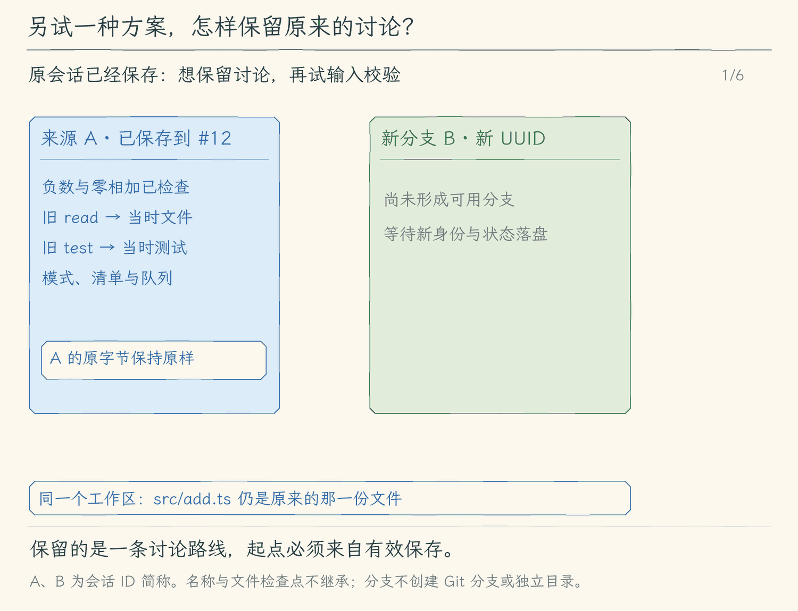

# 14.1 从已有会话创建分支

[第 14 章首页](../README.md) · [上一节：13.4 查找、命名与导出会话](../../chapter-13-session-persistence/04-manage-sessions/README.md) · [下一节：14.2 为工具写入保存文件检查点](../02-file-checkpoints/README.md)

## 问题：保留原讨论，再试另一种方案

加法小项目已经通过负数与零相加的测试。我们想继续研究：`add()` 遇到 `NaN` 时，是否应该抛出错误？这次可能会改函数约定，也可能最后决定保持原样。

直接 `--resume` 会在原会话后面继续保存。它适合接着做同一件事，但我们现在希望保留“只讨论普通数值”的记录，另开一份讨论尝试输入校验。导出的 Markdown 可以阅读，却不是能够继续工作的会话状态。

本节增加 `--fork <会话 ID>`：从来源会话最后保存的完整状态开始，创建一份有新身份的会话。新讨论记住已有上下文，之后追加到自己的文件，原记录保持原样。

## 解决方案：复制状态，换一个保存位置，并记住来源

分支复用第 13 章的读取器。来源记录验证通过后，程序生成新的 UUID，创建新的 JSONL 文件，并把消息、模式、任务清单和待处理队列等状态保存进去。新文件头记下来源的会话 ID 与读取到的最后记录编号，方便以后辨认这次分支从哪里开始。

分支完成后，程序进入已有的恢复路径：显示历史，等待新的要求，不执行历史工具。接下来输入“研究 `NaN`”，产生的消息只保存到新会话。

这里复制的是讨论状态。它既没有复制工作区，也没有撤销已经执行的修改。如果来源讨论里读过 `src/add.ts`，分支里的那条工具结果仍然只是当时的观察；要改代码，模型还需要重新读取当前文件。

## 工作原理

### 新的身份使后续保存自然分开

假设原会话 A 最后保存到记录 #12，其中有消息、清单和一条未交付补充。程序创建分支 B 时，关系可以简写成下面这样。A、B 是讲解用简称，实际 ID 都是 UUID；这里省略了时间、版本和状态中的其他字段。

| 对象 | 分支前 | 分支成功后 |
| --- | --- | --- |
| A 的 JSONL | 最后记录 #12 | 字节保持原样，仍到 #12 |
| B 的会话头 | 不存在 | 新 ID，`parent: { sessionId: A, seq: 12 }` |
| B 的状态 | 不存在 | 复制 A 最后保存的消息、模式、清单、队列和编号计数 |
| `src/add.ts` | 当前工作区文件 | 不因分支改变 |

不需要在每次保存时判断“这是原讨论还是新讨论”。B 的 writer 从一开始就持有新文件及自己的锁，后续检查点自然写向 B。来源关系只说明起点，B 不会随着 A 后来的变化自动更新；B 的记录编号也从自己的文件开始，不能把来源的 #12 当作 B 已经写了十二条记录。

同样，名称是第 13 章另行追加的元数据，不属于这次复制的状态。分支不会继承来源名称；需要名称时，可以正常退出后用 `--rename` 为新 ID 命名。

### 读到的是有效状态，才有可复用的起点

程序先通过已有的恢复 writer 取得来源会话的独占锁，再调用严格读取器。来源有未结束任务、未完成尾片，或记录损坏时，分支不会擅自补全，也不会顺便删除来源锁。先按 13.3 核对中断并正常结束，再建立分支。

这样做是为了让起点含义明确。一次任务尚未结束时，最后保存的消息可能早于实际发生的文件修改；把它直接复制出来，容易把“最后能读的状态”误当成“已经完成的任务”。本节沿用完整状态作为讨论起点，不把未确认的执行过程包装成成功。

来源工作区也必须与当前真实工作区一致。讨论里的相对路径、清单和工具结果来自那个项目；只换目录再分支，不能让 `src/add.ts` 自动指向另一个项目的正确文件。工作区检查失败时不创建可使用的新讨论。

分支复用来源 writer 只是为了独占读取，不向来源追加或截断任何记录。新文件创建与复制完成后关闭来源 writer，释放来源锁。来源正在运行时会因锁占用被拒绝，因此先正常关闭来源进程再建立分支。

### 复制未交付要求，不等于立即发送它们

待处理队列也属于保存状态。如果 A 的队列里还有“补测正负数混合”，B 会保留它的 ID、原任务归属与交付状态；它不会因为创建分支就冒充已发送的模型消息。新要求仍按第 12、13 章的队列规则进入下一轮。

会话授权则不同。它是当前进程里用户给出的允许范围，不能靠复制历史延续到另一个执行会话。分支和恢复一样，重新建立授权；旧消息里的“已经批准”也不会自动批准新工具调用。

历史工具同样只作为文字和消息关系加载。即使其中有 `edit_file` 或 `run_command`，分支也不会再执行一次。分支完成的依据是新文件头与复制状态已成功保存，随后显示旧历史、等待新输入，而不是屏幕重新刷出旧测试过程。

### 新讨论仍然使用同一份文件

现在在 B 里决定给 `add()` 增加校验，写入的仍是原工作区的 `src/add.ts`。以后恢复 A 时，A 会保留旧讨论，但读文件会看到新内容。这不是会话串写，而是两份讨论观察同一个磁盘目录。

因此，本节解决的是“保留两条讨论路线”。要比较两个独立目录里的代码，可以另用 Git 分支或工作树；要撤回当前目录中 Agent 的单项文件修改，下一节开始记录文件检查点。会话分支本身不提供这两种文件能力。

<!-- generated:media:start -->
下面沿着原会话 A 到新分支 B 观察状态副本的去向。复制完成后，装入历史仍不产生模型请求或工具执行；新的要求进入 B，工作区文件继续共用。



[静态封面](assets/fork-session-cover-f14f5d69a9.png) · [查看完整静态分镜](assets/fork-session-storyboard-daf9348b51.jpg)
<!-- generated:media:end -->

## 本节改动文件

<!-- generated:files:start -->
| 状态 | 文件 | 本节变化 |
| --- | --- | --- |
| CHANGED | [src/sessions/read-session.ts](src/sessions/read-session.ts) | 校验会话头中的可选来源关系 |
| CHANGED | [src/sessions/save-session.ts](src/sessions/save-session.ts) | 创建会话时接受来源 ID 与记录编号 |
| NEW | [src/sessions/fork-session.ts](src/sessions/fork-session.ts) | 持锁读取来源，创建新身份并保存复制状态 |
| CHANGED | [src/cli.ts](src/cli.ts) | 校验 --fork 组合，选择新分支 writer 并进入恢复入口 |

未列出的既有实现继续沿用（KEEP）；本节不重复展开。
<!-- generated:files:end -->

## 动手构建

从 13.4 的完整 `src/` 继续，目标目录为 `chapter-14-session-checkpoints/01-fork-session/`。先扩展会话头以保存可选来源关系，再新增分支创建函数，最后接到 CLI。读取器仍是唯一的记录验证入口，分支不另写宽松解析。

<!-- generated:build:start -->
### 1. 校验会话头中的可选来源关系

在上一节的 `src/sessions/read-session.ts` 上应用以下完整增量。`-` 是删除，`+` 是加入，其他行用于定位。

<details>
<summary>精确增量：src/sessions/read-session.ts（CHANGED）</summary>

<!-- source: src/sessions/read-session.ts -->
```diff
--- a/src/sessions/read-session.ts
+++ b/src/sessions/read-session.ts
@@ -1,5 +1,5 @@
 /**
- * 13.2 读取有效记录 | [KEEP] sessions/read-session.ts
+ * 14.1 会话分支 | [CHANGED] sessions/read-session.ts
  *
  * 学习目标：先检查文件内容，再把最后一个完整、可信的状态交给恢复入口。
  * 输入：会话 UUID 与保存目录；磁盘里的 JSON 仍是未知数据，不能直接当作 SessionState。
@@ -18,7 +18,8 @@
 // [KEEP 来自 13.2] 大小限制约束一次读取的内存；本章还没有增量索引或历史压缩。
 export const MAX_SESSION_BYTES = 64 * 1024 * 1024;
 export const DEFAULT_SESSION_DIRECTORY = join(homedir(), ".hello-my-agent", "sessions");
-export type SessionHeader = { version: 1; type: "session"; sessionId: string; createdAt: string; cwd: string; workspace?: string };
+// [CHANGED 14.1] 可选来源让旧记录继续可读。
+export type SessionHeader = { version: 1; type: "session"; sessionId: string; createdAt: string; cwd: string; workspace?: string; parent?: { sessionId: string; seq: number } };
 export type ReadSessionResult = {
   header: SessionHeader;
   state?: SessionState;
@@ -175,15 +176,22 @@
   for (let index = 0; index < lines.length; index++) {
     try {
       const record = objectWithKeys(JSON.parse(lines[index]), ["version", "type", "sessionId"], index === 0
-        ? ["createdAt", "cwd", "workspace"] : ["seq", "savedAt", "reason", "state", "name"]);
+        ? ["createdAt", "cwd", "workspace", "parent"] : ["seq", "savedAt", "reason", "state", "name"]);
       if (record.version !== 1) throw new Error("不支持这个记录版本");
       if (record.sessionId !== id) throw new Error("会话 ID 不一致");
       if (index === 0) {
-        objectWithKeys(record, ["version", "type", "sessionId", "createdAt", "cwd"], ["workspace"]);
+        objectWithKeys(record, ["version", "type", "sessionId", "createdAt", "cwd"], ["workspace", "parent"]);
         if (record.type !== "session" || !Number.isFinite(Date.parse(text(record.createdAt))) || !isAbsolute(text(record.cwd))) throw new Error("会话头无效");
         if (record.workspace !== undefined && !isAbsolute(text(record.workspace))) throw new Error("工作区路径无效");
+        // [CHANGED 14.1] 来源只描述分支起点，不赋予新文件改写源会话的权限。
+        if (record.parent !== undefined) {
+          const parent = objectWithKeys(record.parent, ["sessionId", "seq"]);
+          sessionPath(text(parent.sessionId)); integer(parent.seq, 0);
+          if (parent.sessionId === id) throw new Error("分支不能指向自身");
+        }
         header = { version: 1, type: "session", sessionId: id, createdAt: record.createdAt as string, cwd: record.cwd as string,
-          ...(record.workspace !== undefined ? { workspace: record.workspace as string } : {}) };
+          ...(record.workspace !== undefined ? { workspace: record.workspace as string } : {}),
+          ...(record.parent !== undefined ? { parent: record.parent as { sessionId: string; seq: number } } : {}) };
         updatedAt = header.createdAt;
         continue;
       }
```

</details>

### 2. 创建会话时接受来源 ID 与记录编号

在上一节的 `src/sessions/save-session.ts` 上应用以下完整增量。`-` 是删除，`+` 是加入，其他行用于定位。

<details>
<summary>精确增量：src/sessions/save-session.ts（CHANGED）</summary>

<!-- source: src/sessions/save-session.ts -->
```diff
--- a/src/sessions/save-session.ts
+++ b/src/sessions/save-session.ts
@@ -1,5 +1,5 @@
 /**
- * 13.3 恢复会话 | [KEEP] sessions/save-session.ts
+ * 14.1 会话分支 | [CHANGED] sessions/save-session.ts
  *
  * 学习目标：把内存会话保存成版本明确、可逐行查看的 JSONL 检查点。
  * 输入：会话目录、模型消息、模式、清单和未交付补充；不接收模型连接配置或授权。
@@ -267,7 +267,9 @@
  * 创建新会话并持锁，元数据 sync 完成后才交出保存入口。
  * 新头记录额外保存工作区真实路径，旧版只有 cwd 的文件仍由读取器兼容。
  */
-export async function createSessionWriter(directory = DEFAULT_SESSION_DIRECTORY): Promise<SessionWriter> {
+// [CHANGED 14.1] 来源元数据与新 UUID 同时落盘，原会话不被打开写入。
+export async function createSessionWriter(directory = DEFAULT_SESSION_DIRECTORY, parent?: { sessionId: string; seq: number }): Promise<SessionWriter> {
+  if (parent) { sessionPath(parent.sessionId); if (!Number.isSafeInteger(parent.seq) || parent.seq < 0) throw new UserFacingError("分支来源序号无效。"); }
   const sessionDirectory = resolve(directory), id = randomUUID(), path = sessionPath(id, sessionDirectory);
   let lock: HeldLock;
   try {
@@ -277,7 +279,7 @@
   let file: FileHandle | undefined;
   try {
     file = await open(path, "wx", 0o600);
-    const line = `${JSON.stringify({ version: 1, type: "session", sessionId: id, createdAt: new Date().toISOString(), cwd: process.cwd(), workspace: await realpath(process.cwd()) })}\n`;
+    const line = `${JSON.stringify({ version: 1, type: "session", sessionId: id, createdAt: new Date().toISOString(), cwd: process.cwd(), workspace: await realpath(process.cwd()), ...(parent ? { parent } : {}) })}\n`;
     await file.writeFile(line, "utf8");
     await file.sync();
     return makeWriter(id, path, file, lock, Buffer.byteLength(line));
```

</details>

### 3. 持锁读取来源，创建新身份并保存复制状态

新建 `src/sessions/fork-session.ts`，完整内容如下。

<details>
<summary>完整文件：src/sessions/fork-session.ts（NEW）</summary>

<!-- source: src/sessions/fork-session.ts -->
```ts
/**
 * 14.1 会话分支 | [NEW] sessions/fork-session.ts
 * 学习目标：复制上下文到新身份，原会话字节不变。
 * 输入：来源 ID 与会话目录；输出：持锁的新 writer 和复制后的状态。
 * 状态：只复制最后完整状态；不执行工具，不复制文件检查点或授权。
 * 失败：来源占用、中断、坏尾或工作区不同都拒绝；源文件保持原样。
 */
import { realpath } from "node:fs/promises";
import { UserFacingError } from "../errors.js";
import { DEFAULT_SESSION_DIRECTORY, readSession } from "./read-session.js";
import { createSessionWriter, resumeSessionWriter, type SessionWriter } from "./save-session.js";

// [NEW 14.1] 本文件以下实现均为本节新增。
/** 锁住来源后读取最后有效状态，新建独立身份并复制状态；无工具重放。 */
export async function forkSessionWriter(id: string, directory = DEFAULT_SESSION_DIRECTORY): Promise<SessionWriter> {
  // 来源也拿写入锁，但只读状态后关闭；不追加、不截断、不清理坏尾。
  const sourceWriter = await resumeSessionWriter(id, directory);
  try {
  const source = sourceWriter.restored!;
  if ((source.header.workspace ?? await realpath(source.header.cwd)) !== await realpath(process.cwd())) throw new UserFacingError("分支来源属于另一个工作区，请先进入来源目录。");
  const writer = await createSessionWriter(directory, { sessionId: id, seq: source.seq });
  try {
    if (source.state) await writer.save(source.state, "exit");
    const restored = await readSession(writer.id, directory);
    return { ...writer, restored };
  } catch (error) { await writer.close(); throw error; }
  } finally { await sourceWriter.close(); }
}
```

</details>

### 4. 校验 --fork 组合，选择新分支 writer 并进入恢复入口

在上一节的 `src/cli.ts` 上应用以下完整增量。`-` 是删除，`+` 是加入，其他行用于定位。

<details>
<summary>精确增量：src/cli.ts（CHANGED）</summary>

<!-- source: src/cli.ts -->
```diff
--- a/src/cli.ts
+++ b/src/cli.ts
@@ -1,6 +1,6 @@
 #!/usr/bin/env node
 /**
- * 13.4 查找与导出会话 | [CHANGED] cli.ts
+ * 14.1 会话分支 | [CHANGED] cli.ts
  *
  * 学习目标：为人类交互入口创建会话文件，把存储句柄交给消费者，并在正常退出时关闭它。
  * 输入：命令行模型选项、--prompt 与 --output；输出格式默认是 auto。
@@ -18,7 +18,7 @@
  *                否 -> 抛错；是 -> 读取配置、创建模型 -> 动态载入 app -> startTui
  *        +-- 否 -> jsonl 但缺少 --prompt？-- 是 -> 抛错
  *                                          +-- 否 -> 读取配置、创建模型
- *   [CHANGED 13.1] text / tui -> 创建新会话文件、显示 ID 和路径 -> 消费者 -> finally close
+ *   [KEEP 来自 13.1] text / tui -> 创建新会话文件、显示 ID 和路径 -> 消费者 -> finally close
  *   非 TUI 分支 -> 无 --prompt？-- 是 -> startTerminal
  *                              +-- 否 -> 内容为空？-- 是 -> 抛错
  *                                                  +-- 否 -> jsonl / text 单次消费者
@@ -36,6 +36,7 @@

 import { readFileSync } from "node:fs";
 // [KEEP 来自 13.3] 使用真实目录比较工作区，符号链接别名不会误判成另一个项目。
+import { forkSessionWriter } from "./sessions/fork-session.js";
 import { realpath } from "node:fs/promises";
 import { Command } from "commander";
 import { readConfig, type Options } from "./config/load-config.js";
@@ -47,7 +48,7 @@
 import { UserFacingError, explainError } from "./errors.js";
 // [KEEP 来自 13.1] 入口创建并最终关闭 writer，模型配置不进入存储模块。
 import { createSessionWriter, resumeSessionWriter } from "./sessions/save-session.js";
-// [NEW 13.4] 本地管理复用读取与写入协议，无需模型配置。
+// [KEEP 来自 13.4] 本地管理复用读取与写入协议，无需模型配置。
 import { listSessions, renameSession, exportSession } from "./sessions/manage-sessions.js";

 // [KEEP 第 01 章] 构建产物始终是 dist/cli.js，因此从它的上一级读取 package.json。
@@ -69,7 +70,7 @@
 }
 // [KEEP 来自 09.3] output 只供入口选择消费者，不并入模型连接配置。
 // [KEEP 来自 13.1] 会话目录只属于本地持久化，不属于模型配置。
-type CliOptions = Options & { prompt?: string; doctor?: boolean; output?: string; mode?: string; sessionDir?: string; resume?: string; recover?: boolean; sessions?: boolean; search?: string; rename?: string; name?: string; export?: string; exportTo?: string };
+type CliOptions = Options & { prompt?: string; doctor?: boolean; output?: string; mode?: string; sessionDir?: string; resume?: string; recover?: boolean; sessions?: boolean; search?: string; rename?: string; name?: string; export?: string; exportTo?: string; fork?: string };
 const program = new Command();
 program
   // [KEEP 第 01 章] 帮助、版本无需配置模型，也不会发送请求。
@@ -93,9 +94,11 @@
   // [KEEP 来自 13.1] text / tui 保存新会话；JSONL 机器事件流暂不接入。
   .option("--session-dir <path>", "text / tui 的会话保存目录（默认 ~/.hello-my-agent/sessions）")
   // [KEEP 来自 13.3] 恢复需要明确 ID；恢复中断需再明确 --recover。
+  // [CHANGED 14.1] fork 创建新身份；resume 继续旧身份。
+  .option("--fork <id>", "从指定会话的最后完整状态创建新分支，不重放工具")
   .option("--resume <id>", "恢复指定会话，等待新输入；不重放旧工具")
   .option("--recover", "确认恢复已中断会话或清理已失效的进程锁")
-  // [NEW 13.4] 显式管理动作在读取模型配置前完成。
+  // [KEEP 来自 13.4] 显式管理动作在读取模型配置前完成。
   .option("--sessions", "列出本地会话，可配合 --search")
   .option("--search <text>", "在会话 ID、名称、工作区和已保存消息中搜索")
   .option("--rename <id>", "给指定会话追加名称，需要 --name")
@@ -105,7 +108,7 @@
   // [KEEP 来自 09.3] 默认动作先检查输出约定，再装配模型并选择对应消费者。
   .action(async () => {
     const options = program.opts<CliOptions>();
-    // [NEW 13.4] 先排除含糊组合，再执行一个本地动作；没有 API Key 也可以管理。
+    // [KEEP 来自 13.4] 先排除含糊组合，再执行一个本地动作；没有 API Key 也可以管理。
     const management = Number(Boolean(options.sessions)) + Number(options.rename !== undefined) + Number(options.export !== undefined);
     if (management > 1) throw new UserFacingError("--sessions、--rename、--export 每次只能选择一个。");
     if (options.search !== undefined && !options.sessions) throw new UserFacingError("--search 必须与 --sessions 一起使用。");
@@ -113,7 +116,7 @@
     if (options.exportTo !== undefined && options.export === undefined) throw new UserFacingError("--export-to 必须与 --export <id> 一起使用。");
     if (options.sessionDir !== undefined && !options.sessionDir.trim()) throw new UserFacingError("--session-dir 不能为空。");
     if (management) {
-      if (options.resume !== undefined || options.recover || options.prompt !== undefined || options.doctor
+      if (options.fork !== undefined || options.resume !== undefined || options.recover || options.prompt !== undefined || options.doctor
         || options.mode !== undefined || options.model !== undefined || options.provider !== undefined || options.baseUrl !== undefined || options.output !== "auto") {
         throw new UserFacingError("本地会话管理请单独使用，不与恢复、提问、模型或输出模式选项混用。");
       }
@@ -160,6 +163,8 @@
     if (options.resume !== undefined && options.output === "jsonl") throw new UserFacingError("会话恢复只支持 text 或 tui。");
     if (options.sessionDir !== undefined && !options.sessionDir.trim()) throw new UserFacingError("--session-dir 不能为空。");
     if (options.prompt !== undefined && !options.prompt.trim()) throw new UserFacingError("提问内容不能为空。");
+    // [CHANGED 14.1] 含糊组合在创建模型或新文件之前拒绝。
+    if (options.fork !== undefined && (options.resume !== undefined || options.recover || options.output === "jsonl")) throw new UserFacingError("--fork 不与 --resume、--recover 或 JSONL 混用。");
     const config = readConfig(options);
     const model = createModel(config);
     // [KEEP 来自 13.1] JSONL 仍只输出机器事件；其余入口共用一次 writer 生命周期。
@@ -167,7 +172,10 @@
       await runJsonlPrompt(model, options.prompt!, runOptions);
       return;
     }
-    const writer = options.resume !== undefined
+    // [CHANGED 14.1] 新分支复制来源数据，随后所有检查点只写新文件。
+    const writer = options.fork !== undefined
+      ? await forkSessionWriter(options.fork, options.sessionDir)
+      : options.resume !== undefined
       ? await resumeSessionWriter(options.resume, options.sessionDir, options.recover)
       : await createSessionWriter(options.sessionDir);
     console.error(`会话 ID：${writer.id}\n保存文件：${writer.path}`);
```

</details>
<!-- generated:build:end -->

## 运行验证

先在仓库根目录编译并链接本节：

```bash
npm run lesson:14.1
```

进入[加法演示项目](../../chapter-13-session-persistence/README.md#准备本章的-typescript-小项目)，先列出已有会话，找到检查负数和零相加的完整 ID。来源会话必须已经正常退出。

```bash
cd docs/.work/ch13-typescript-demo
hello-my-agent --sessions
```

把列表中的完整 UUID 填到下面命令的参数位置；不要输入尖括号本身。

```bash
hello-my-agent --fork <来源会话的完整UUID>
```

启动后应显示一个新的会话 ID，并加载来源历史。此时还没有新的工具执行。输入：

```text
我们另试一个方案：先读取当前 src/add.ts，讨论 add 遇到 NaN 时是否应该抛错，暂时不要修改文件。
```

讨论结束后用 `/exit` 正常退出，再列出会话。新旧 ID 都应该存在；新会话多了这次讨论，原会话没有这条新要求。可以分别用 `--export` 核对最后状态中的消息，或按章末练习比较来源 JSONL 的字节。

再试来源仍开着时启动分支，程序应提示来源有锁，并要求先正常关闭或显式处理恢复。不要为了完成这个实验手动删除来源锁，也不要让两份进程同时写同一份来源记录。

## 本节完成后的 Agent

Agent 现在能从已有状态创建一份可继续讨论的新会话，并保存来源关系。旧消息能帮助新讨论理解背景，原记录不被续写；当前文件与执行授权仍要重新核对。下一节把关注点从讨论记录移到真正写入的文件，保存以后恢复所需的内容。
