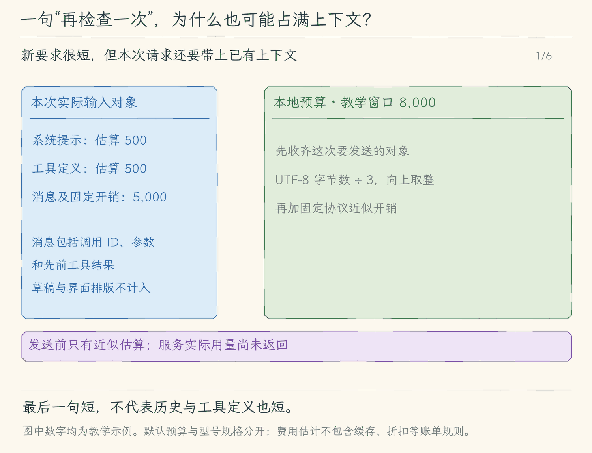

# 15.1 估算请求大小并预留输出

[第 15 章首页](../README.md) · [上一节：14.3 查看改动并按条件恢复](../../chapter-14-session-checkpoints/03-review-and-restore/README.md) · [下一节：15.2 缩短工具结果并保留完整日志](../02-bound-tool-results/README.md)

## 问题：屏幕上只有一行新要求，请求里却已经有很多内容

在加法小项目里，我们已经读过文件、讨论过输入校验、运行过测试，也留下了恢复通知。现在只输入一句“再检查一次”。这句话很短，但程序不会只发送这句话：模型还需要系统规则、可用工具及先前消息，才能理解“再”指什么。

这些内容共同占用上下文窗口。只统计当前草稿或最后一条回复，会漏掉反复发送的历史工具结果；只等服务报超限，又无法在请求前给用户一个可解释的判断。

本节先估算一次完整请求的输入大小，为模型输出留出空间，并在响应后单独显示服务报告的用量。这里先显示这些数字，15.3 再让估算结果决定是否发出请求。

## 解决方案：发送前算输入与预留，响应后记实际用量

程序在准备请求时，对系统提示、工具定义和消息分别估算，合成输入估算。再用本地配置的窗口减去输入估算、输出预留，得到剩余估算。

输出预留有两个作用：预算里先留下回答空间，请求参数也将本次生成上限设为这个数。如果只检查输入能装下，却允许模型继续生成很长的输出，仍没有完整规划一次请求。

服务响应中的 `usage` 保留为另一组数字。它是在请求结束后服务报告的输入与输出 Token，不能用本地估算替补。用户还可配置两种单价，用实际报告用量计算费用估计；缺用量或缺单价时不显示费用。

## 工作原理

### 预算面对的是本次要发送的所有对象

模型处理文本前，会由分词器把文本切成 Token。一个英文单词可能拆成多段，中文、标点和代码也各有切法。服务商模型采用哪种分词器、协议怎样增加隐藏开销，不会因为本地程序知道字符串长度就自动确定。

本节采用容易验证的近似：UTF-8 字节数除以 3，向上取整。比如 `add` 是 3 字节，估算为 1；`相加` 是 6 字节，估算为 2。这只能解释本地算法，不能据此断言服务一定按这些数计费。我们还给系统、工具和各条消息增加固定开销，明确它们同样是近似。

只对消息的 `content` 计数仍会遗漏工具调用。一次 assistant 消息还可能携带工具名称、调用 ID 与 JSON 参数；工具结果也带着调用 ID。程序因此对消息对象序列化后的 JSON 估算，工具定义则连名称、说明与参数 Schema 一起计算。

| 输入部分 | 本地估算范围 | 在加法任务里的例子 |
| --- | --- | --- |
| 系统提示 | 本次实际选择的完整系统提示与近似开销 | 当前模式规则、工具使用约束 |
| 工具定义 | 名称、说明、参数 Schema 的 JSON 与近似开销 | `edit_file` 的路径、旧文、新文字段 |
| 消息 | 每条消息完整 JSON、逐条开销与协议近似开销 | 新要求、历史工具调用、测试结果、恢复通知 |

还没交付给模型的队列文字，此时不在消息数组里，也不提前算作已经发送；一旦进入本轮历史，下一次估算就会包括它。TUI 上为排版生成的分行、进度动画和审批组件不属于模型输入，不应该一起数进去。

### 剩余空间为什么还要减掉输出

用一个方便心算的教学例子说明。以下数字不是服务商规格，也不是某次真实计量：窗口配置为 8,000，系统与工具估算 1,000，消息估算 5,000，输出预留 2,000。

```text
输入估算 = 1,000 + 5,000 = 6,000
剩余估算 = 8,000 - 6,000 - 2,000 = 0
```

剩余为零表示按本地规则刚好装下。再增加 1 个估算 Token，就没有满足预留输出的空间。减少预留可以给输入腾位置，但也会降低本次生成上限，模型可能更早停止；不能把它当成无代价地扩大窗口。

本地配置默认使用 32,768 的窗口和 2,048 的输出预留。它们是教学程序的默认预算，不是从模型名称推断出的能力。实际使用时，要按所接服务的规格配置；窗口必须大于预留，预留也必须为正整数。配置不合法时启动就报错，不进入模型任务。

两个模型协议分别使用自己的输出上限参数，但值都来自同一份预留配置。输出上限是请求约束；服务怎样切分和返回仍由实际协议决定，本地近似没有变成精确 tokenizer。

### 估算、实际用量、费用估计各回答一个问题

发送前，程序能回答“按本地规则，这次大约需要多少输入空间”。响应后，服务可能再报告“这次用了多少输入与输出 Token”。两者时间和来源不同，所以界面要分开展示；服务没给 usage 时写明不可用，不能显示成零，也不能借估算填一个看似实际的数字。

流式响应也可能直到结束才给完整 usage。程序只在取得服务数据后更新，缺一部分就保留该部分未知；一轮任务内多次模型调用的用量分别累加时，也要保留是否缺报，不能用某次已知值冒充完整总量。

费用还多一层条件。只有输入、输出实际用量和两种用户单价都齐全时，程序才计算：

```text
费用估计（美元）=（输入用量 × 每百万输入单价 + 输出用量 × 每百万输出单价）÷ 1,000,000
```

这是按配置价格计算的估计，没有计入缓存、折扣、阶梯定价等账单规则。数字旁仍要写“估计”，不能把它呈现为实际扣费，也不能把单价写死成某个会随时间变化的服务价格。

### 本节先观察，下一步再减少和限制输入

估算误差意味着“本地看起来放得下”仍可能被服务拒绝，这类请求错误按原流程报告，不能显示成功。本节也没有删消息、改摘要或阻止超限请求；预算数字先帮助我们看清输入从哪里增长。

当测试结果很长时，下次请求的消息估算会上升。下一节先缩短进入历史的单份工具结果，同时保留完整本机日志；15.3 再在每次调用前检查剩余是否小于零，决定本轮是否继续。

<!-- generated:media:start -->
下面的窗口 8,000、输入估算 6,000 和输出预留 2,000 都是教学数字。先看完整请求对象怎样进入估算，再区分响应后的服务用量与按用户价格计算的费用估计。



[静态封面](assets/estimate-request-cover-52017369f8.png) · [查看完整静态分镜](assets/estimate-request-storyboard-6b90de409a.jpg)
<!-- generated:media:end -->

## 本节改动文件

<!-- generated:files:start -->
| 状态 | 文件 | 本节变化 |
| --- | --- | --- |
| NEW | [src/context/budget.ts](src/context/budget.ts) | 估算完整输入、计算剩余与按实际用量计算可选费用估计 |
| CHANGED | [src/config/load-config.ts](src/config/load-config.ts) | 读取并校验窗口、输出预留与可选单价 |
| CHANGED | [src/models/client.ts](src/models/client.ts) | 使用同一请求对象估算，设置两协议输出上限并提取 usage |
| CHANGED | [src/agent/events.ts](src/agent/events.ts) | 声明预算与累计服务用量事件 |
| CHANGED | [src/agent/agent-loop.ts](src/agent/agent-loop.ts) | 每次请求前发预算事件，响应后累计已知用量并保留缺报 |
| CHANGED | [src/ui/teaching-trace.ts](src/ui/teaching-trace.ts) | 把预算与服务用量排成可解释的文本 |
| CHANGED | [src/ui/terminal.ts](src/ui/terminal.ts) | 在文本运行中显示估算与服务报告 |
| CHANGED | [src/ui/tui/state.ts](src/ui/tui/state.ts) | 保存最近预算与本轮用量的显示状态 |
| CHANGED | [src/ui/tui/app.tsx](src/ui/tui/app.tsx) | 接收事件并为预算和用量留出显示行 |

未列出的既有实现继续沿用（KEEP）；本节不重复展开。
<!-- generated:files:end -->

## 动手构建

从 14.3 的完整 `src/` 继续，目标目录为 `chapter-15-context-budget/01-estimate-tokens/`。先新增纯计算模块，再让配置、两个模型协议与运行事件传递同一份预算信息，最后由 text/TUI 显示。估算模块不调用网络，也不修改历史消息。

<!-- generated:build:start -->
### 1. 估算完整输入、计算剩余与按实际用量计算可选费用估计

新建 `src/context/budget.ts`，完整内容如下。

<details>
<summary>完整文件：src/context/budget.ts（NEW）</summary>

<!-- source: src/context/budget.ts -->
```ts
/**
 * 15.1 估算请求大小 | [NEW] context/budget.ts
 *
 * 学习目标：区分发出前的本地估算、服务商返回的用量和按配置价格计算的费用估计。
 * 输入：准备发送的系统提示、工具定义、消息，以及本地选择的窗口和输出预留。
 * 输出：分别列出的估算与剩余预算；不探测服务商窗口，也不承诺精确 token 数。
 * 本文件局部流程（全局主流程见 agent/agent-loop.ts）：
 *   文本 UTF-8 字节 -> 启发式 token 数；系统 + 工具 + 消息 -> 本次输入估算
 *   窗口 - 输出预留 - 输入估算 -> 剩余预算；服务商 usage + 本地单价 -> 非账单费用估计
 */
import type { Message } from "../models/client.js";

// [NEW 15.1] 窗口与价格来自本地配置，不是服务商已经确认的模型规格。
export type ContextLimits = {
  windowTokens: number;
  outputReserve: number;
  inputPricePerMillion?: number;
  outputPricePerMillion?: number;
};
export type ContextBudget = {
  inputEstimate: number;
  systemEstimate: number;
  toolsEstimate: number;
  messagesEstimate: number;
  windowTokens: number;
  outputReserve: number;
  remainingEstimate: number;
  withinBudget: boolean;
};
export const DEFAULT_CONTEXT_LIMITS: ContextLimits = { windowTokens: 32_768, outputReserve: 2_048 };

/**
 * 用 UTF-8 字节数作统一的本地近似，避免把字符数冒充服务商 tokenizer 的结果。
 * 每三个字节约算一个 token；中文、英文、代码的真实切分都可能不同。
 */
export function estimateTextTokens(text: string): number {
  return Math.ceil(Buffer.byteLength(text, "utf8") / 3);
}

/**
 * 把本次输入的各部分相加，再扣除本地为输出预留的位置。
 * 消息按 JSON 文本估算，包含角色、工具调用 ID 和参数；每项再加 8 的消息开销。
 * 工具定义含名称、说明、参数 Schema；额外 32 代表协议开销的近似，不是精确协议计费。
 * withinBudget 只比较本地数字，服务商仍可能按自己的窗口和切分拒绝请求。
 */
export function estimateContext(messages: Message[], prompt: string, definitions: unknown[], limits: ContextLimits): ContextBudget {
  const systemEstimate = estimateTextTokens(prompt) + 8;
  const toolsEstimate = estimateTextTokens(JSON.stringify(definitions)) + 16;
  const messagesEstimate = messages.reduce((sum, message) => sum + estimateTextTokens(JSON.stringify(message)) + 8, 0) + 32;
  const inputEstimate = systemEstimate + toolsEstimate + messagesEstimate;
  const remainingEstimate = limits.windowTokens - limits.outputReserve - inputEstimate;
  return { inputEstimate, systemEstimate, toolsEstimate, messagesEstimate, windowTokens: limits.windowTokens,
    outputReserve: limits.outputReserve, remainingEstimate, withinBudget: remainingEstimate >= 0 };
}

/**
 * 用服务商报告的本次 usage 和用户提供的美元单价计算费用估计。
 * 任一用量或单价缺失时返回 null；缓存、折扣等账单规则未计入，不能当作实际扣费。
 */
export function estimateCostUsd(input: number | null, output: number | null, limits: ContextLimits): number | null {
  if (input === null || output === null || limits.inputPricePerMillion === undefined || limits.outputPricePerMillion === undefined) return null;
  const cost = (input * limits.inputPricePerMillion + output * limits.outputPricePerMillion) / 1_000_000;
  return Number.isFinite(cost) ? cost : null;
}
```

</details>

### 2. 读取并校验窗口、输出预留与可选单价

在上一节的 `src/config/load-config.ts` 上应用以下完整增量。`-` 是删除，`+` 是加入，其他行用于定位。

<details>
<summary>精确增量：src/config/load-config.ts（CHANGED）</summary>

<!-- source: src/config/load-config.ts -->
```diff
--- a/src/config/load-config.ts
+++ b/src/config/load-config.ts
@@ -1,8 +1,7 @@
 /**
- * 13.1 保存会话 | [KEEP] config/load-config.ts
+ * 15.1 估算请求大小 | [CHANGED] config/load-config.ts
  *
- * 学习目标：把会话状态保存到磁盘；本文件沿用已有职责，负责读取模型连接配置和已有工具能力说明。
- * 阅读说明：本节沿用此模块；保存入口接在消费者收尾，不把本文件的配置、显示或控制对象整包存盘。
+ * 学习目标：分清本地输入估算、服务商用量与费用估计；本文件负责读取模型连接配置和已有工具能力说明。
  * 输入：provider、model、baseUrl 选项和对应的环境配置。
  * 输出：校验后的 Config，以及说明读取、修改文件与执行命令能力的 systemPrompt。
  * 状态：校验失败抛出 UserFacingError；不修改 process.env、会话历史或工作区文件。
@@ -22,6 +21,7 @@
 import { parseEnv } from "node:util";
 // [KEEP 来自 02.6] 错误提示集中管理，配置读取规则沿用 02.5。
 import { UserFacingError } from "../errors.js";
+import { DEFAULT_CONTEXT_LIMITS, type ContextLimits } from "../context/budget.js";

 // [KEEP] 可选字段对应 Commander 的选项；读取后统一转成必填的 Config。
 export type Options = { provider?: string; model?: string; baseUrl?: string };
@@ -30,6 +30,7 @@
   apiKey: string;
   model: string;
   baseURL: string;
+  contextLimits?: ContextLimits;
 };

 // [KEEP] 系统提示词约束当前助手的行为，独立于 user/assistant 历史。
@@ -101,5 +102,32 @@
   if (!["http:", "https:"].includes(url.protocol) || url.username || url.password || url.search || url.hash) {
     throw new UserFacingError("接口地址须为 HTTP(S) 基础地址，不能含用户名、密码、查询参数或片段。");
   }
-  return { provider, apiKey, model, baseURL };
+  // [NEW 15.1] 这些是本地教学参数，不是根据模型 ID 自动查到的真实规格。
+  const windowTokens = positiveInteger(env("AGENT_CONTEXT_WINDOW"), "AGENT_CONTEXT_WINDOW", DEFAULT_CONTEXT_LIMITS.windowTokens);
+  const outputReserve = positiveInteger(env("AGENT_OUTPUT_RESERVE"), "AGENT_OUTPUT_RESERVE", DEFAULT_CONTEXT_LIMITS.outputReserve);
+  if (outputReserve >= windowTokens) throw new UserFacingError("AGENT_OUTPUT_RESERVE 必须小于 AGENT_CONTEXT_WINDOW。");
+  const contextLimits: ContextLimits = { windowTokens, outputReserve,
+    inputPricePerMillion: optionalPrice(env("AGENT_INPUT_PRICE_PER_MILLION"), "AGENT_INPUT_PRICE_PER_MILLION"),
+    outputPricePerMillion: optionalPrice(env("AGENT_OUTPUT_PRICE_PER_MILLION"), "AGENT_OUTPUT_PRICE_PER_MILLION") };
+  return { provider, apiKey, model, baseURL, contextLimits };
 }
+
+/**
+ * 严格读取正整数预算，不接受负数、小数、无穷大、指数记法或超出安全整数范围的数。
+ * 缺少配置使用明确的本地默认值；不会据此声称服务商支持相同窗口。
+ */
+function positiveInteger(value: string | undefined, name: string, fallback: number): number {
+  if (value === undefined) return fallback;
+  if (!/^[1-9]\d*$/.test(value) || !Number.isSafeInteger(Number(value))) throw new UserFacingError(`${name} 必须是安全范围内的正整数。`);
+  return Number(value);
+}
+
+/**
+ * 读取用户提供的每百万 token 美元单价；不内置某个模型的价格。
+ * 未提供时不显示费用估计；提供值仅用于简单乘法，不包含缓存、折扣等账单规则。
+ */
+function optionalPrice(value: string | undefined, name: string): number | undefined {
+  if (value === undefined) return undefined;
+  if (!/^(?:0|[1-9]\d*)(?:\.\d+)?$/.test(value) || !Number.isFinite(Number(value))) throw new UserFacingError(`${name} 必须是有限的非负美元单价。`);
+  return Number(value);
+}
```

</details>

### 3. 使用同一请求对象估算，设置两协议输出上限并提取 usage

在上一节的 `src/models/client.ts` 上应用以下完整增量。`-` 是删除，`+` 是加入，其他行用于定位。

<details>
<summary>精确增量：src/models/client.ts（CHANGED）</summary>

<!-- source: src/models/client.ts -->
```diff
--- a/src/models/client.ts
+++ b/src/models/client.ts
@@ -1,8 +1,7 @@
 /**
- * 13.1 保存会话 | [KEEP] models/client.ts
- *
- * 学习目标：把会话状态保存到磁盘；本文件沿用已有职责，负责按本轮模式组装请求，收齐并检查模型结果。
- * 阅读说明：本节沿用此模块；保存入口接在消费者收尾，不把本文件的配置、显示或控制对象整包存盘。
+ * 15.1 估算请求大小 | [CHANGED] models/client.ts
+ *
+ * 学习目标：分清本地输入估算、服务商用量与费用估计；本文件负责按本轮模式组装请求，收齐并检查模型结果。
  * 输入：完整消息历史、工具定义、取消信号和文字回调；两种协议都使用 SDK 接收流。
  * 输出：文字片段供界面显示；完整结果包含文本、工具请求、用量和统一的 finishReason。
  * 状态：失败不返回半份可执行结果，也不在这里修改历史；已经发出的文字片段可能已被界面显示。
@@ -40,6 +39,7 @@
 import { UserFacingError } from "../errors.js";
 import { toolDefinitions, type ToolCall } from "../tools/registry.js";
 import type { ExecutionMode } from "../agent/run-options.js";
+import { DEFAULT_CONTEXT_LIMITS, estimateContext, estimateCostUsd, type ContextBudget, type ContextLimits } from "../context/budget.js";

 // [KEEP 来自 03.2] assistant 保存模型提出的调用；tool 保存本地执行结果和同一个调用 ID。
 export type Message =
@@ -64,6 +64,9 @@
  * 本轮模式通过 options 传入，省略时沿用 execute；接口本身不批准或执行工具。
  */
 export interface Model {
+  // [NEW 15.1] 估算与发送共用同一份系统提示和工具列表；其他教学测试模型可不提供此观察接口。
+  inspectContext?(messages: Message[], mode?: ExecutionMode): ContextBudget;
+  estimateCost?(input: number | null, output: number | null): number | null;
   // [KEEP 来自 08.1] 增量只用于显示，完整结果仍由 Promise 返回。
   // [KEEP 来自 12.1] 模式参数只影响本轮请求组装，本地权限策略还会再次检查。
   generate(messages: Message[], signal: AbortSignal, onText?: (text: string) => void,
@@ -74,7 +77,7 @@
  * 根据配置创建统一模型对象，并为每次请求设置总等待期限。
  *
  * - 输入：readConfig 已校验的协议、密钥、模型 ID 和基础地址。
- * - 输出：只暴露 generate 的 Model；创建对象时不发送请求，调用 generate 时才开始。
+ * - 输出：Model 可在本地估算请求；创建对象和 inspectContext 都不发送 HTTP，generate 才发送。
  * - 关键步骤：将调用方的取消信号与 60 秒期限合并，传给同一次 SDK 请求。
  * - 期限覆盖：等待响应和接收流都计入这 60 秒，不会因为收到一段文字重新计时。
  * - 失败方式：用户取消优先向外抛出取消原因；期限到达则抛出可显示的超时提示，其他错误继续向外传播。
@@ -91,10 +94,17 @@
     : new Anthropic({ ...options, authToken: null });
   // [KEEP 来自 08.1] 每次请求设置 60 秒总期限，接收正文期间也计时。
   // [KEEP 来自 12.1] 适配层将模式传给请求组装，沿用原取消和期限处理。
-  return { async generate(messages, signal, onText, options = {}) {
+  const limits = config.contextLimits ?? DEFAULT_CONTEXT_LIMITS;
+  return {
+    inspectContext(messages, mode = "execute") {
+      const { prompt, definitions } = requestParts(mode);
+      return estimateContext(messages, prompt, definitions, limits);
+    },
+    estimateCost(input, output) { return estimateCostUsd(input, output, limits); },
+    async generate(messages, signal, onText, options = {}) {
     const deadline = AbortSignal.timeout(60_000);
     try {
-      return await requestResult(client, config.model, messages, AbortSignal.any([signal, deadline]), onText, options.mode ?? "execute");
+      return await requestResult(client, config.model, messages, AbortSignal.any([signal, deadline]), onText, options.mode ?? "execute", limits);
     } catch (error) {
       signal.throwIfAborted();
       if (deadline.aborted) throw new UserFacingError("模型响应超过 60 秒，已停止接收。本次请求不会自动重试。");
@@ -249,22 +259,10 @@
 }

 /**
- * 接收模型文字和工具参数，等完整消息检查通过后返回统一结果。
- *
- * - 输入：SDK 客户端、模型 ID、本地消息数组、请求取消信号和可选文字回调。
- * - 输出：文字片段通过 onText 提前显示；返回值另有完整文本、工具调用、用量和结束原因。
- * - 关键步骤：OpenAI 使用 SDK 完整累积的参数；Anthropic 另外按内容块 index 累积原始 JSON 字符串。
- * - 参数检查：只在正常结束原因下检查整批工具的 ID 与 JSON 对象；字段值仍留给本地工具检查。
- * - 失败方式：SDK 失败、Anthropic 流未完整结束、片段顺序无效或参数损坏时抛错，不返回可执行的半份调用。
- * - 职责边界：length、refusal 等结束原因交给 Agent Loop 报告；这里不批准工具，也不提交历史。
- */
-// [KEEP 来自 08.2] 片段用于显示，完整响应才进入统一结果。
-async function requestResult(
-  client: OpenAI | Anthropic, model: string, messages: Message[], signal: AbortSignal,
-  onText?: (text: string) => void,
-  // [KEEP 来自 12.1] 本轮模式沿接口传到两种模型协议。
-  mode: ExecutionMode = "execute",
-): Promise<ModelResult> {
+ * 为估算与真实发送生成同一套系统提示和可见工具，避免估算漏掉隐藏的请求部分。
+ * 模式在本轮固定；这里仅组织数据，不探测服务商窗口，也不产生权限批准。
+ */
+function requestParts(mode: ExecutionMode): { prompt: string; definitions: typeof toolDefinitions } {
   // [KEEP 来自 12.1] 工具列表帮助模型选择；真正的禁止仍由本地权限策略执行。
   // [KEEP 来自 12.1] Plan 的可见工具列表帮助模型选择，本地策略仍会拒绝禁止请求。
   const definitions = mode === "plan"
@@ -274,6 +272,28 @@
   const prompt = systemPrompt + " 对包含多个步骤的任务，使用 todo_write 保存和更新完整任务清单；同一时刻最多一项执行中。只有依据实际工具结果完成的事项才可标为 completed。缺少会改变实现方案的重要信息时，使用 ask_user 澄清；没有回答时说明缺少的信息，不猜测用户选择。" + (mode === "plan"
     ? " 当前为 Plan 模式：只调查项目并给出可执行的计划，不修改文件、不执行命令。用户要求执行时，请说明需要切换到执行模式。"
     : " 当前为执行模式：按用户任务实施修改，仍需遵守每次工具的本地权限与审批规则。");
+  return { prompt, definitions };
+}
+
+/**
+ * 接收模型文字和工具参数，等完整消息检查通过后返回统一结果。
+ *
+ * - 输入：SDK 客户端、模型 ID、本地消息数组、请求取消信号和可选文字回调。
+ * - 输出：文字片段通过 onText 提前显示；返回值另有完整文本、工具调用、用量和结束原因。
+ * - 关键步骤：OpenAI 使用 SDK 完整累积的参数；Anthropic 另外按内容块 index 累积原始 JSON 字符串。
+ * - 参数检查：只在正常结束原因下检查整批工具的 ID 与 JSON 对象；字段值仍留给本地工具检查。
+ * - 失败方式：SDK 失败、Anthropic 流未完整结束、片段顺序无效或参数损坏时抛错，不返回可执行的半份调用。
+ * - 职责边界：length、refusal 等结束原因交给 Agent Loop 报告；这里不批准工具，也不提交历史。
+ */
+// [KEEP 来自 08.2] 片段用于显示，完整响应才进入统一结果。
+async function requestResult(
+  client: OpenAI | Anthropic, model: string, messages: Message[], signal: AbortSignal,
+  onText?: (text: string) => void,
+  // [KEEP 来自 12.1] 本轮模式沿接口传到两种模型协议。
+  mode: ExecutionMode = "execute",
+  limits: ContextLimits = DEFAULT_CONTEXT_LIMITS,
+): Promise<ModelResult> {
+  const { prompt, definitions } = requestParts(mode);
   if (client instanceof OpenAI) {
     // [KEEP 来自 08.1] SDK 解析 SSE 并累积完整响应，content.delta 用来及时显示新文字。
     const stream = client.chat.completions.stream({
@@ -287,6 +307,8 @@
           parameters: tool.inputSchema, strict: false,
         },
       })),
+      // [NEW 15.1] 输出上限与本地预留使用同一个值，包含服务商计入 completion 的生成 token。
+      max_completion_tokens: limits.outputReserve,
       stream_options: { include_usage: true },
     }, { signal });
     stream.on("content.delta", ({ delta }) => onText?.(delta));
@@ -316,7 +338,8 @@
     tools: definitions.map((tool) => ({
       name: tool.name, description: tool.description, input_schema: tool.inputSchema,
     })),
-    max_tokens: 2048,
+    // [NEW 15.1] Anthropic 使用本协议要求的输出上限字段。
+    max_tokens: limits.outputReserve,
   }, { signal });
   const argumentsByIndex = new Map<number, { json: string; initial: unknown; closed: boolean }>();
   let messageStopped = false;
```

</details>

### 4. 声明预算与累计服务用量事件

在上一节的 `src/agent/events.ts` 上应用以下完整增量。`-` 是删除，`+` 是加入，其他行用于定位。

<details>
<summary>精确增量：src/agent/events.ts（CHANGED）</summary>

<!-- source: src/agent/events.ts -->
```diff
--- a/src/agent/events.ts
+++ b/src/agent/events.ts
@@ -1,8 +1,7 @@
 /**
- * 13.1 保存会话 | [KEEP] agent/events.ts
+ * 15.1 估算请求大小 | [CHANGED] agent/events.ts
  *
- * 学习目标：把会话状态保存到磁盘；本文件沿用已有职责，负责传递已经发生的模型、权限和工具事件。
- * 阅读说明：本节沿用此模块；保存入口接在消费者收尾，不把本文件的配置、显示或控制对象整包存盘。
+ * 学习目标：分清本地输入估算、服务商用量与费用估计；本文件负责传递已经发生的模型、权限和工具事件。
  * 输入：runAgent 的开始/结束通知，或 Agent Loop 已发生的过程事件。
  * 输出：可选观察者同步收到一份深拷贝；没有观察者或通知失败时直接返回。
  * 状态：复制事件不修改历史；观察者直接抛错被捕获，但耗时和显式取消不由这里隔离。
@@ -23,6 +22,7 @@
  */

 // [KEEP 来自 08.2] 事件展示统一结束原因。
+import type { ContextBudget } from "../context/budget.js";
 import type { ModelFinishReason, Reply } from "../models/client.js";
 import type { ToolCall } from "../tools/registry.js";
 import type { ToolExecutionResult } from "../tools/types.js";
@@ -32,6 +32,9 @@
 // [KEEP 来自 09.1] 整轮任务开始与结束也使用事件通知。
 export type AgentEvent =
   | { type: "run_start" }
+  // [NEW 15.1] 估算是下次请求输入的本地预测；usage 是服务商已报告的本轮累计，缺失为 null。
+  | { type: "context_budget"; call: number; budget: ContextBudget }
+  | { type: "model_usage"; call: number; inputTokens: number | null; outputTokens: number | null; costEstimateUsd: number | null }
   | { type: "run_finish"; outcome: "completed"; reply: Reply }
   | { type: "run_finish"; outcome: "cancelled" | "error"; message: string }
   | { type: "text_delta"; call: number; text: string }
```

</details>

### 5. 每次请求前发预算事件，响应后累计已知用量并保留缺报

在上一节的 `src/agent/agent-loop.ts` 上应用以下完整增量。`-` 是删除，`+` 是加入，其他行用于定位。

<details>
<summary>精确增量：src/agent/agent-loop.ts（CHANGED）</summary>

<!-- source: src/agent/agent-loop.ts -->
```diff
--- a/src/agent/agent-loop.ts
+++ b/src/agent/agent-loop.ts
@@ -1,16 +1,19 @@
 /**
- * 14.2 文件检查点 | [CHANGED] agent/agent-loop.ts
+ * 15.1 估算请求大小 | [CHANGED] agent/agent-loop.ts
  *
- * 学习目标：区分核心提交模型历史与界面保存磁盘检查点，看清存储接在循环收尾的位置。
- * 输入：问题、已有模型历史、取消信号、观察者、审批入口，以及本轮模式和本地控制选项。
- * 输出：完成时返回回答并提交本轮历史；中断时补齐工具状态、保存中断说明后抛错。
+ * 学习目标：对即将发送的完整输入做本地估算，并把估算、服务商用量与费用估计分开。
+ * 输入：问题、历史、取消信号、事件消费者和审批入口；模型提供当前模式的输入估算和本地单价计算。
+ * 输出：回答和服务商累计用量；过程另发本地预算和费用估计，失败补齐工具状态、保留历史后抛错。
  * 状态：进入前已取消就不新增历史；清单由会话持有，已经发生的工具操作不会随取消撤销。
  *
  * 全局主流程（从这里进入各模块）：
  *   CLI -> 帮助 / 版本 / 诊断？-- 是 -> 显示后结束
  *                            +-- 否 -> 检查输出方式和模式 -- 无效 -> 错误结束
  *                                                         +-- 有效 -> 配置、模型、消费者
- *   [KEEP 来自 13.1] text / tui -> sessions/save-session 创建新 ID、wx 文件；jsonl 仍只输出事件
+ *   [KEEP 来自 13.3] text / TUI -> 新建 ID 或锁定、校验并恢复指定会话；jsonl 仍只输出事件
+ *   [KEEP 来自 13.4] --sessions / --search / --rename / --export -> 本地管理记录，不请求模型
+ *   [KEEP 来自 14.1] --fork ID -> 复制可信状态到新 ID；保留来源记录，不继承旧轮占用或授权
+ *   [KEEP 来自 14.3] 空闲 /changes、/restore ID -> 查看差异或按当前内容核验后恢复；不执行旧工具
  *   [KEEP 来自 10.4] auto：交互连续输入 -> TUI；单次问题或管道 -> text
  *   输入界面 -> 草稿 / 历史浏览 / 外部编辑 -> 等用户提交
  *   [KEEP 来自 12.1] 空闲 /mode plan|execute -> 保存会话模式；新一轮取启动快照
@@ -27,8 +30,11 @@
  *   [KEEP 来自 12.1] 固定本轮模式 -> A
  *   [KEEP 来自 12.2] 本轮共用会话清单（未提供时创建本轮容器）
  *   A: [KEEP 来自 12.4] 取出当前轮全部补充，保持入队顺序 -> 加入本轮 user 消息
- *       -> input_applied 确认核心收取并加入上下文 -> 再查取消 -> 请求模型
+ *       -> input_applied 确认核心收取并加入上下文 -> 再查取消 -> 准备完整输入
  *      [KEEP 来自 12.1] models/client 按模式提示、筛选工具；本地策略仍负责真正禁止
+ *      [NEW 15.1] 同一系统提示 + 实际工具定义 + 历史 / 本轮消息 -> UTF-8 启发式估算 -> context_budget
+ *      本节先显示预算；尚未启用超限停止 -> 请求模型
+ *      [NEW 15.1] 请求带输出上限；完整响应的服务商 usage -> 累计已知数 / 未知，另算非账单费用
  *      文字片段 -> 事件消费者；完整结果 -> 结束原因和工具数量一致？-- 否 -> X
  *                                                                        +-- 是 -> B
  *   B: 有工具请求？-- 否 -> 回答非空且未取消？-- 否 -> X
@@ -44,6 +50,7 @@
  *                                        +-- 成功 -> 等本次审批 -- 拒绝 -> 拒绝结果 -> D
  *                                                             +-- 批准 -> 执行 -> D
  *      allow -> 注册表找到工具 -> 执行 -> D
+ *        [KEEP 来自 14.2] write_file / edit_file -> 先保存前后内容检查点，成功才实际写入
  *        [KEEP 来自 12.2] todo_write -> 全部条目校验成功？-- 否 -> ToolError、旧清单不变
  *                                                     +-- 是 -> 一次替换内存清单 -> D
  *        [KEEP 来自 12.3] ask_user -> 校验问题 -> 专用 handler 等回答
@@ -69,7 +76,7 @@
  * 图中带当前编号的是本节增量；KEEP 表示已经建立的能力。
  * 普通事件最多暂存 128 条，结束事件另有位置；这是事件条数限制，不是总字节内存上限。
  * 工具结果仍给模型，界面只处理显示副本；模式选择、澄清答案和聊天文字都不能产生批准。
- * 运行观察：显示日志不作为模型历史保存；本节只写新会话，读取与恢复留到下一节。
+ * 运行观察：本地估算不是服务商计数或容量保证；服务商 usage 缺失时保持未知，本节不自动摘要。
  */

 import { ToolError, UserFacingError } from "../errors.js";
@@ -144,6 +151,10 @@
         emitAgentEvent(observer, { type: "input_applied", ...queued, call: modelCall });
       }
       signal.throwIfAborted();
+      // [NEW 15.1] 补充已经加入，工具已完成；估算的正是即将发出的整份输入。
+      const messages = [...history, ...turn];
+      const budget = model.inspectContext?.(messages, mode);
+      if (budget) emitAgentEvent(observer, { type: "context_budget", call: modelCall, budget });
       emitAgentEvent(observer, {
         type: "model_start",
         call: modelCall,
@@ -155,13 +166,16 @@
       pendingToolResults = 0;
       // [KEEP 来自 08.1] 增量成为观察事件，不提前执行工具，也不把半句回答写入历史。
       // [KEEP 来自 12.1] 模型请求也接收本轮模式；工具隐藏只是辅助。
-      const result = await model.generate([...history, ...turn], signal, (text) => {
+      const result = await model.generate(messages, signal, (text) => {
         if (!signal.aborted) emitAgentEvent(observer, { type: "text_delta", call: modelCall, text });

       }, { mode });
       inputTokens = addUsage(inputTokens, result.inputTokens);
       outputTokens = addUsage(outputTokens, result.outputTokens);
       truncated ||= result.truncated;
+      // [NEW 15.1] 任一次 usage 缺失后累计值保持未知，不以估算补充；费用只按用户配置计算。
+      emitAgentEvent(observer, { type: "model_usage", call: modelCall, inputTokens, outputTokens,
+        costEstimateUsd: model.estimateCost?.(inputTokens, outputTokens) ?? null });
       emitAgentEvent(observer, {
         type: "model_finish",
         call: modelCall,
@@ -213,7 +227,7 @@
         if (permission.action === "ask") {
           try {
             // [KEEP 来自 06.1] prepareTool 只检查并准备预览，不写文件，也不启动命令。
-            // [CHANGED 14.2] 把本地文件检查点入口传到写入准备层。
+            // [KEEP 来自 14.2] 把本地文件检查点入口传到写入准备层。
             prepared = await prepareTool(call, signal, options);
           } catch (error) {
             if (!(error instanceof ToolError)) throw error;
```

</details>

### 6. 把预算与服务用量排成可解释的文本

在上一节的 `src/ui/teaching-trace.ts` 上应用以下完整增量。`-` 是删除，`+` 是加入，其他行用于定位。

<details>
<summary>精确增量：src/ui/teaching-trace.ts（CHANGED）</summary>

<!-- source: src/ui/teaching-trace.ts -->
```diff
--- a/src/ui/teaching-trace.ts
+++ b/src/ui/teaching-trace.ts
@@ -1,8 +1,7 @@
 /**
- * 13.1 保存会话 | [KEEP] ui/teaching-trace.ts
- *
- * 学习目标：把会话状态保存到磁盘；本文件沿用已有职责，负责从结构化事件整理过程说明，保留模型正文的用途。
- * 阅读说明：本节沿用此模块；保存入口接在消费者收尾，不把本文件的配置、显示或控制对象整包存盘。
+ * 15.1 估算请求大小 | [CHANGED] ui/teaching-trace.ts
+ *
+ * 学习目标：分清本地输入估算、服务商用量与费用估计；本文件负责从结构化事件整理过程说明，保留模型正文的用途。
  * 输入：runAgent 与 Agent Loop 的结构化事件；输出：供终端打印的纯文本行数组。
  * 状态：本文件只生成显示字符串，不改变原事件、历史或审批决定。
  *
@@ -135,6 +134,13 @@
  * - 职责边界：常见凭据特征的隐藏不等于完整脱敏；这里只整理显示副本，不改变审批、执行或历史。
  */
 export function formatTeachingTrace(event: AgentEvent): string[] {
+  // [NEW 15.1] 估算和已报告用量使用不同标签；它们没有工具 sequence。
+  if (event.type === "context_budget") {
+    const b = event.budget;
+    return [`第 ${event.call} 次请求 · 本地估算：输入约 ${b.inputEstimate} + 输出预留 ${b.outputReserve} / 窗口 ${b.windowTokens} token；余量约 ${b.remainingEstimate}（可能与服务商不同）`];
+  }
+  if (event.type === "model_usage") return [`服务商报告本轮累计：输入 ${event.inputTokens ?? "未知"} / 输出 ${event.outputTokens ?? "未知"} token；`
+    + (event.costEstimateUsd === null ? "费用未估计（用量或本地单价缺失）" : `费用估计 $${event.costEstimateUsd.toFixed(6)}（按本地单价，非账单）`)];
   // [KEEP 来自 09.1] 整轮事件供界面判断任务状态，不重复打印最终正文。
   if (event.type === "run_start" || event.type === "run_finish") return [];
   // [KEEP 来自 08.1] 连续文字由终端追加，不能每段都包装成一行日志。
```

</details>

### 7. 在文本运行中显示估算与服务报告

在上一节的 `src/ui/terminal.ts` 上应用以下完整增量。`-` 是删除，`+` 是加入，其他行用于定位。

<details>
<summary>精确增量：src/ui/terminal.ts（CHANGED）</summary>

<!-- source: src/ui/terminal.ts -->
```diff
--- a/src/ui/terminal.ts
+++ b/src/ui/terminal.ts
@@ -1,7 +1,7 @@
 /**
- * 14.3 查看与恢复文件 | [CHANGED] ui/terminal.ts
- *
- * 学习目标：等本轮历史提交后保存会话；模型结果与磁盘保存结果分别报告。
+ * 15.1 估算请求大小 | [CHANGED] ui/terminal.ts
+ *
+ * 学习目标：分别显示请求前的本地预算、响应后的服务用量和会话保存结果，不把估算当成实际计费。
  * 输入：用户输入、本地命令、AgentRecord 记录流，以及 Ctrl+C / SIGINT / SIGTERM / SIGHUP。
  * 输出：stdout 显示模型正文；stderr 显示过程、审批、输入提示、本地状态与用量。
  * 状态：文本消费者沿用 09.3 的输出位置；失败或取消等待清理，不撤销已经发生的工具操作。
@@ -262,7 +262,7 @@
     const feedback = await saveSessionCheckpoint(writer, snapshot(), reason);
     if (feedback) { console.error(feedback.message); if (!feedback.ok) process.exitCode = 1; }
   };
-  // [CHANGED 14.3] 本地恢复命令串行执行，确认前不改文件。
+  // [KEEP 来自 14.3] 本地恢复命令串行执行，确认前不改文件。
   const fileCommand = createFileCheckpointCommands(options.fileCheckpoints);
   const terminal = Boolean(process.stdin.isTTY && process.stdout.isTTY);
   const input = createInterface({ input: process.stdin, output: process.stderr, terminal });
@@ -310,7 +310,7 @@
       const text = value.trim();
       if (!text) continue;
       if (text === "/exit") break;
-      // [CHANGED 14.3] 只在任务循环外处理文件恢复，不会与工具并发。
+      // [KEEP 来自 14.3] 只在任务循环外处理文件恢复，不会与工具并发。
       if (/^\/(changes|restore)(?:\s|$)/.test(text)) {
         const result = await fileCommand(text); console.error(result.message);
         if (result.restored) { history.push({ role: "user", content: `[本地文件恢复通知] ${result.message}` }); await checkpoint("file_restore"); }
@@ -463,7 +463,7 @@
 // [KEEP 来自 09.3] 正文写入 stdout，用量与提示写入 stderr。
 export function printReply(reply: Reply, showText = true): void {
   if (showText) console.log(`${colorLabel("Agent", 35)} > ${reply.text}`);
-  // 显示接口报告的本轮字段，不估算价格，也不把历史文本长度当成 token 数。
-  console.error(`用量：输入 ${reply.inputTokens ?? "未知"}，输出 ${reply.outputTokens ?? "未知"} token。`);
+  // [CHANGED 15.1] 显示服务商报告的本轮累计；缺失仍写未知，不用本地估算填补。
+  console.error(`服务商报告本轮累计：输入 ${reply.inputTokens ?? "未知"}，输出 ${reply.outputTokens ?? "未知"} token。`);
   if (reply.truncated) console.error("提示：回答达到输出上限，可能尚未完整。");
 }
```

</details>

### 8. 保存最近预算与本轮用量的显示状态

在上一节的 `src/ui/tui/state.ts` 上应用以下完整增量。`-` 是删除，`+` 是加入，其他行用于定位。

<details>
<summary>精确增量：src/ui/tui/state.ts（CHANGED）</summary>

<!-- source: src/ui/tui/state.ts -->
```diff
--- a/src/ui/tui/state.ts
+++ b/src/ui/tui/state.ts
@@ -1,8 +1,7 @@
 /**
- * 13.1 保存会话 | [KEEP] ui/tui/state.ts
+ * 15.1 估算请求大小 | [CHANGED] ui/tui/state.ts
  *
- * 学习目标：把会话状态保存到磁盘；本文件沿用已有职责，负责把已收到的事件累积成界面状态。
- * 阅读说明：本节沿用此模块；保存入口接在消费者收尾，不把本文件的配置、显示或控制对象整包存盘。
+ * 学习目标：分清本地输入估算、服务商用量与费用估计；本文件负责把已收到的事件累积成界面状态。
  * 输入：上一份 RunView 与下一条 AgentEvent；事件按 streamAgentRun 的顺序送达。
  * 输出：新的显示状态，或本轮结束后留在终端的文字记录；本文件没有终端写入和执行副作用。
  * 状态：更新时返回新对象，不修改传入状态或模型历史；失败与取消只改变显示中的结束状态。
@@ -33,6 +32,7 @@
   answers: { call: number; text: string }[];
   tools: { sequence: number; name: string; status: string; detail: string }[];
   usage: string;
+  budget: string;
 };

 /**
@@ -43,7 +43,7 @@
  * - 关键原因：每轮模型调用号和工具步骤号会重新计数，旧数组不能带进下一轮。
  */
 export function emptyRunView(): RunView {
-  return { status: "执行中", answers: [], tools: [], usage: "" };
+  return { status: "执行中", answers: [], tools: [], usage: "", budget: "" };
 }

 /**
@@ -70,6 +70,9 @@
  */
 export function updateRunView(view: RunView, event: AgentEvent): RunView {
   if (event.type === "run_start") return emptyRunView();
+  // [NEW 15.1] 预算与 usage 独立保存；错误或取消不会抹掉已经取得的服务商用量。
+  if (event.type === "context_budget") return { ...view, budget: formatTeachingTrace(event).join(" ") };
+  if (event.type === "model_usage") return { ...view, usage: formatTeachingTrace(event).join(" ") };
   // [KEEP 来自 12.4] 用户补充没有工具 sequence。
   // [KEEP 来自 12.4] 补充确认先独立处理，它没有工具 sequence。
   if (event.type === "input_applied") return { ...view, status: `补充 #${event.id} 已加入第 ${event.call} 次请求的上下文` };
@@ -85,7 +88,7 @@
     tools: event.outcome === "completed" ? view.tools : view.tools.map((tool) =>
       ["完成", "失败", "准备失败", "已拒绝"].includes(tool.status) ? tool : { ...tool, status: "已中断" }),
     status: event.outcome === "completed" ? "已完成" : event.outcome === "cancelled" ? "已取消本轮" : `运行失败：${screenText(event.message)}`,
-    usage: event.outcome === "completed" ? `输入 ${event.reply.inputTokens ?? "未知"} / 输出 ${event.reply.outputTokens ?? "未知"} token` : "",
+    usage: view.usage || (event.outcome === "completed" ? `服务商报告本轮累计：输入 ${event.reply.inputTokens ?? "未知"} / 输出 ${event.reply.outputTokens ?? "未知"} token` : ""),
   };
   // 前面的分支已经处理整轮与模型事件；剩下的事件都有工具 sequence，可更新同一行。
   const old = view.tools.find((tool) => tool.sequence === event.sequence);
```

</details>

### 9. 接收事件并为预算和用量留出显示行

在上一节的 `src/ui/tui/app.tsx` 上应用以下完整增量。`-` 是删除，`+` 是加入，其他行用于定位。

<details>
<summary>精确增量：src/ui/tui/app.tsx（CHANGED）</summary>

<!-- source: src/ui/tui/app.tsx -->
```diff
--- a/src/ui/tui/app.tsx
+++ b/src/ui/tui/app.tsx
@@ -1,9 +1,9 @@
 /**
- * 14.3 查看与恢复文件 | [CHANGED] ui/tui/app.tsx
+ * 15.1 估算请求大小 | [CHANGED] ui/tui/app.tsx
  *
- * 学习目标：在明确动作后保存会话白名单，并把任务状态与保存状态分别显示。
+ * 学习目标：在任务和保存状态之外单独显示本地预算，让输入估算与服务商用量各有明确来源。
  * 输入：模型、键盘、终端尺寸与执行事件；普通任务只在用户提交后启动。
- * 输出：草稿、历史、模式、运行状态和审批面板。
+ * 输出：草稿、历史、模式、本地预算、服务商用量、保存状态和审批面板。
  * 状态：Session 持有会话数据和当前任务；React state 保存草稿、焦点与显示内容。
  * 失败：保留已收到的结果，等事件流清理后解除忙碌；取消不会撤销工具操作。
  *
@@ -25,6 +25,8 @@
  *   [KEEP 来自 12.5] Ctrl+O -> 草稿 / 历史 / 队列；正在编辑队列时暂不切换
  *   [KEEP 来自 12.5] 队列 -> e 编辑 / x 撤回 -> 固定 ID 查找；已收取 -> 编辑稿留存
  *                    空闲 Enter -> 再查 ID -> 移出队列 -> 作为新任务发送
+ *   [NEW 15.1] context_budget -> 独立预算行；model_usage -> 历史状态，缺失用量显示未知
+ *   [NEW 15.1] 预算多占一行 -> 历史 / 队列视口减一行；16 行时隐藏任务摘要保住草稿
  *   [KEEP] 审批 -> waitForApproval -> 面板独占输入 -> 明确决定交回原调用
  *   [KEEP] Ctrl+C -> 有任务？-- 是 -> 取消、等清理；否 -> quit
  *   [KEEP] quit -> closing=true -> 取消并等待任务与外部编辑
@@ -88,7 +90,7 @@
   // [KEEP 来自 13.1] writer 跨轮复用；保存反馈单独显示，不混入模型执行状态。
   // [KEEP 来自 14.2] 会话长期持有检查点入口，组件重绘不重建。
   fileCheckpoints?: FileCheckpointStore;
-  // [CHANGED 14.3] 预览计划属于会话，不随 React 重绘丢失。
+  // [KEEP 来自 14.3] 预览计划属于会话，不随 React 重绘丢失。
   fileCommand: ReturnType<typeof createFileCheckpointCommands>;
   writer?: SessionWriter;
   saveRequest: number;
@@ -281,7 +283,7 @@
     setDraft(newDraft());
     // 本地命令只改本地会话；它们不作为 user 消息送给模型。
     if (prompt === "/exit") { quit(0); return; }
-    // [CHANGED 14.3] 立即占用，直到恢复和通知保存完成才开放下一任务。
+    // [KEEP 来自 14.3] 立即占用，直到恢复和通知保存完成才开放下一任务。
     if (/^\/(changes|restore)(?:\s|$)/.test(prompt)) {
       session.clearing = true; setNotice("正在核对文件检查点…");
       session.done = (async () => {
@@ -431,7 +433,8 @@
   // [KEEP 来自 11.3] 当前轮与留存消息一起交给历史区，草稿输入由焦点决定。

   // [KEEP 来自 12.2] 按窗口显示摘要和至多三项，不丢弃真实清单。
-  const taskLines = session.tasks.items.length === 0 ? 0 : 1 + (rows >= 20 ? Math.min(3, session.tasks.items.length, rows - 18) : 0);
+  // [NEW 15.1] 最小 16 行已占满；暂隐清单摘要，实际任务数据仍留在会话中。
+  const taskLines = session.tasks.items.length === 0 || rows < 17 ? 0 : 1 + (rows >= 20 ? Math.min(3, session.tasks.items.length, rows - 18) : 0);
   const display = busy ? [...entries, ...runEntries(view, session.run)] : entries;
   // [KEEP 来自 11.5] 尺寸不足时隐藏工作区并停用输入；放大后沿用原草稿与浏览状态。
   // [KEEP 来自 12.2] 下方清单区域从会话读取进度，显示报告不等于测试通过。
@@ -450,14 +453,16 @@
       </Box>}
       <Box display={focus === "queue" ? "none" : "flex"} flexDirection="column">
         {/* [KEEP 来自 13.1] 保存状态占一行，历史视口相应减少高度。 */}
-        <Transcript entries={display} active={focus === "history" && !approval && !question && !editing && !session.clearing && !tooSmall} width={columns} height={Math.max(2, rows - 13 - taskLines)} />
+        <Transcript entries={display} active={focus === "history" && !approval && !question && !editing && !session.clearing && !tooSmall} width={columns} height={Math.max(2, rows - 14 - taskLines)} />
       </Box>
       <Box display={focus === "queue" ? "flex" : "none"} flexDirection="column">
         {/* [KEEP 来自 13.1] onChange 只在队列成功编辑或撤回时调用，不保存独立编辑草稿。 */}
-        <QueuePanel queue={session.queue} active={focus === "queue" && !approval && !question && !editing && !session.clearing && !tooSmall} busy={Boolean(session.done || session.clearing)} width={columns} height={Math.max(2, rows - 13 - taskLines)} onChange={() => { refreshQueue((old) => old + 1); void checkpoint("queue_change"); }} onSend={sendQueued} onEditingChange={setQueueEditing} />
+        <QueuePanel queue={session.queue} active={focus === "queue" && !approval && !question && !editing && !session.clearing && !tooSmall} busy={Boolean(session.done || session.clearing)} width={columns} height={Math.max(2, rows - 14 - taskLines)} onChange={() => { refreshQueue((old) => old + 1); void checkpoint("queue_change"); }} onSend={sendQueued} onEditingChange={setQueueEditing} />
       </Box>
       <Text wrap="truncate">模式：{session.mode} · 状态：{view.status} · 待发送补充：{session.queue.items.length}</Text>
       {/* [KEEP 来自 13.1] 存储反馈不是 run_finish，不改模型任务状态。 */}
+      {/* [NEW 15.1] 预算独占一行，历史和队列视口相应减少一行。 */}
+      <Text wrap="truncate">{view.budget || "本地预算：等待请求估算；不是服务商实际用量"}</Text>
       <Text wrap="truncate">保存：{saveMessage}</Text>
       <Box borderStyle="round" flexDirection="column" paddingX={1}>
         <Text wrap="truncate" color={useColor ? "cyan" : undefined}>草稿 {focus === "draft" ? "[焦点]" : ""}{busy ? " · Enter 排队补充，Ctrl+S 打断并发送" : ""}</Text>
```

</details>
<!-- generated:build:end -->

## 运行验证

在仓库根目录编译并链接本节：

```bash
npm run lesson:15.1
```

进入加法演示项目，启动 Agent：

```bash
cd docs/.work/ch13-typescript-demo
hello-my-agent
```

输入：

```text
读取 src/add.ts，再运行 npm test，按当前文件和测试结果说明函数的行为，不要修改代码。
```

观察第一次模型请求与工具返回后的下一次请求：输入估算应随消息增加重新计算，输出预留保持配置值；不要期待每个模型都给出同样的实际用量。响应提供 usage 时，界面另列服务用量；没有提供时应显示不可用。

本地窗口通过 `AGENT_CONTEXT_WINDOW`、输出预留通过 `AGENT_OUTPUT_RESERVE` 配置；单价使用 `AGENT_INPUT_PRICE_PER_MILLION` 与 `AGENT_OUTPUT_PRICE_PER_MILLION`，单位是美元。把窗口或预留改小只影响本地预算和本次生成上限，不会把服务端模型的真实窗口变大。估算公式、边界和缺报行为的确定性验证放在[本章练习](../EXERCISES.md)，无需花费模型调用。

## 本节完成后的 Agent

Agent 现在能在每次请求前说明输入大约由哪些部分组成，并为输出留出空间。服务报告的实际用量和按用户价格算出的费用估计保持独立，缺数据就明确留空。下一节处理最容易膨胀的一类输入：很长、却会被后续请求反复携带的工具结果。
