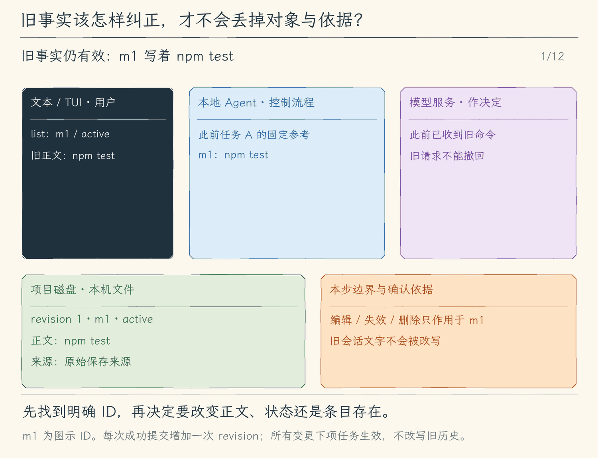

# 18.3 检查与纠正记忆

[第 18 章首页](../README.md) · [上一节：18.2 让模型提出记忆候选](../02-propose-memory/README.md) · [下一章：按需加载 Skills](../../chapter-19-skills/README.md) · [练习与答案](../EXERCISES.md)

## 问题：曾经正确的事实，也可能持续误导后续任务

项目原来使用 `npm test`，后来改成 `npm run test:unit`。若记忆只能添加，我们可能保存两句互相冲突的话，让模型自行猜测哪句更新。直接删除整个 JSON 虽然能清空，却无法解释当初从哪里来，也会丢掉其他仍然有用的事实。

长期保存必须配套检查和纠正。读者需要知道当前生效的是哪条、谁提出的、何时变化，并能只处理那一个对象。

## 解决方案：用 ID 修改对象，用状态决定是否进入参考

在 `list`、`show <id>` 之外，本节增加 `edit <id> <正文>`、`invalidate <id> <理由>` 与 `delete <id>`。CLI 的 `--memory` 和文本/TUI 的 `/memory` 使用相同语法与存储器。

编辑用于用已核实的新正文替换旧正文；失效用于暂时停止使用并保留现场；删除用于移除条目。所有变更都保留对应的操作来源记录，继续遵守 Plan 禁写和下项任务生效的规则。

## 工作原理

### 三种操作改变的对象不同

| 操作 | 条目发生什么 | 下一项任务加载什么 |
| --- | --- | --- |
| `edit` | 同一 ID 的正文、更新时间和来源更新，状态恢复为有效 | 新正文 |
| `invalidate` | 条目保留，状态变为 `invalid`，记录理由 | 不加载这条 |
| `delete` | 从 `entries` 移除，操作记录仍可按 ID 查看 | 不加载这条 |

编辑恢复有效状态，意味着用户已明确核实并重新采用这条事实。编辑后的来源变为用户明确修订；失效则保留原正文和原来源，把本次用户理由放入操作记录。失效理由说明为什么停止使用；例如“尚未核对迁移后的脚本名”。删除后 `show` 仍能显示该 ID 的操作记录，但不会还原被删正文。操作记录用来追溯动作，不是完整正文版本仓库；若需要历史备份，应在项目外另行归档文件。

不存在的 ID、空正文、空理由或无效命令都返回错误。程序不能根据相似文字猜测用户想改哪条。每次成功修改只提高一次修订号，写入仍在锁内重读和原子替换；失败不留下半次修改。

### “清单里存在”与“会进入模型参考”是两件事

`list` 用于管理，因此会列出有效与失效条目，并显示来源；模型参考只选 `active` 条目。这样用户仍能检查失效理由，同时避免失效正文继续作为常驻记忆影响新任务。

已经发送过的旧请求无法撤回，旧会话里也可能仍保留过去的说法或工具结果。失效与删除只控制后续任务重新组装的记忆参考，不会改写历史。任务内固定快照也继续有效：更改磁盘后，要等下一项用户任务刷新，才能验证新的参考状态。

### 核对要从文件变化一直到真实任务结果

先用 `show` 确认 ID、状态、正文、来源和操作记录，再发起新任务检查模型是否采用当前事实。若模型仍提出旧命令，应继续判断：是否在同一项目、任务是否在变更前已经开始、旧对话中是否还有相关文字，或模型是否忽略了新参考。

即使它提出了 `npm run test:unit`，也只证明选了命令。执行前的审批、进程退出码和日志仍是测试是否成功的依据。管理记忆不能代替验证项目本身。

### 小容量让问题可检查，达到上限则明确停止

当前实现最多保存 64 条，每条正文最多 1000 个 JavaScript UTF-16 代码单元，来源说明最多 300 个（常见汉字各占一个，部分表情占两个），文档最多 512 KiB，操作记录最多 500 条。它面向少量可审阅事实，不承担无限日志存档。达到上限时拒绝新写入，不会悄悄删旧记录。

操作记录达到 500 条后，`edit`、`invalidate`、`delete` 也会被拒绝，因为它们同样需要增加记录。当前实现没有自动轮换、清理记录或迁移命令；本章保证拒绝写入并保留原文件，仍可 `list`/`show` 和在新任务中读取有效事实。

回执中的“人工归档”不能直接当作清空指令：复制备份不会降低当前库的记录数；直接移走原文件，会让下一任务读取空库并失去仍有效的事实。若要恢复写入，需要另行设计并验证迁移：完整备份原文件，核对有效事实及其 ID、来源、状态和时间怎样保留，以及新文档是否满足校验。在完成这项核对前保留原库只读；本章没有提供可省略这些核对的重建步骤。

这些是教程实现的固定限制，不能直接等同 Token 预算或某个产品的记忆机制。真正的请求仍要通过第 15 章的上下文检查。

<!-- generated:media:start -->
下面是机制示意，不是终端录屏。沿同一个 m1 看三种改变：先编辑正确正文，再失效，最后删除。每次先经过本地提交；任务 B、C 的刷新和请求分别展示什么会成为模型参考。末尾的 show 返回真实空条目与保留的动作记录。



[静态流程图](assets/memory-correct-invalidate-delete-flow-09ab34b06c.png) · [静态封面](assets/memory-correct-invalidate-delete-cover-83a74cc03e.png) · [查看完整静态分镜](assets/memory-correct-invalidate-delete-storyboard-ce0de955d2.jpg)
<!-- generated:media:end -->

## 本节改动文件

<!-- generated:files:start -->
| 状态 | 文件 | 本节变化 |
| --- | --- | --- |
| CHANGED | [src/memory/store.ts](src/memory/store.ts) | 校验项目记忆并在锁内提交完整文件 |
| CHANGED | [src/memory/commands.ts](src/memory/commands.ts) | 把明确的本地命令接到项目记忆操作 |
| CHANGED | [src/cli.ts](src/cli.ts) | 在入口装配本节能力与本地命令 |

未列出的既有实现继续沿用（KEEP）；本节不重复展开。
<!-- generated:files:end -->

## 动手构建

从 18.2 的完整 `src/` 继续，目标为 `chapter-18-long-term-memory/03-manage-memory/`。扩展已有变更类型与本地解析入口，让所有修改共用同一提交点和审计规则。

<!-- generated:build:start -->
### 1. 校验项目记忆并在锁内提交完整文件

在上一节的 `src/memory/store.ts` 上应用以下完整增量。`-` 是删除，`+` 是加入，其他行用于定位。

<details>
<summary>精确增量：src/memory/store.ts（CHANGED）</summary>

<!-- source: src/memory/store.ts -->
```diff
--- a/src/memory/store.ts
+++ b/src/memory/store.ts
@@ -1,5 +1,5 @@
 /**
- * 18.1 显式保存项目记忆 | [NEW] memory/store.ts
+ * 18.3 纠正和移除旧记忆 | [CHANGED] memory/store.ts
  * 输入：真实项目根、用户明确提供的正文；输出：经过校验的记忆文档和可追溯的保存结果。
  * 状态：文件锁内重读，临时文件完整写入后原子替换；失败保留旧文件，取消不提交候选。
  * 本文件局部流程（全局主流程见 agent/agent-loop.ts）：校验路径 -> 有界读取 -> 校验JSON -> 独占锁 -> 重读 -> 修改 -> rename。
@@ -11,13 +11,17 @@
 import { join, resolve } from "node:path";
 import { UserFacingError } from "../errors.js";
 
-// [NEW 18.1] 本文件以下实现均为本节新增。
+// [KEEP 来自 18.1] 本文件以下实现均为本节新增。
 export const MEMORY_LIMITS = { entries: 64, content: 1000, source: 300, audit: 500, fileBytes: 524_288 } as const;
 export type MemorySource = { kind: "user" | "model"; detail: string };
 export type MemoryEntry = { id: string; content: string; source: MemorySource; status: "active" | "invalid"; createdAt: string; updatedAt: string };
 export type MemoryAudit = { id: string; action: "add" | "edit" | "invalidate" | "delete"; at: string; source: MemorySource };
 export type MemoryDocument = { version: 1; projectRoot: string; revision: number; entries: MemoryEntry[]; audit: MemoryAudit[] };
-export type MemoryChange = { action: "add"; content: string; source: MemorySource };
+// [CHANGED 18.3] 修改、失效和删除都留下编号、动作与来源；删除审计不保留正文。
+export type MemoryChange =
+  | { action: "add"; content: string; source: MemorySource }
+  | { action: "edit"; id: string; content: string; source: MemorySource }
+  | { action: "invalidate" | "delete"; id: string; source: MemorySource };
 const UUID = /^[0-9a-f]{8}-[0-9a-f]{4}-4[0-9a-f]{3}-[89ab][0-9a-f]{3}-[0-9a-f]{12}$/;
 
 /**
@@ -158,10 +162,26 @@
     if (data.audit.length >= MEMORY_LIMITS.audit) throw new UserFacingError("记忆来源记录达到500条，本次未写入；请先人工归档整个记忆文件。");
     if (!validSource(change.source)) throw new UserFacingError("记忆来源无效。");
     const now = new Date().toISOString();
-    if (data.entries.length >= MEMORY_LIMITS.entries) throw new UserFacingError("最多保存64条项目记忆，请先清理旧内容。");
-    const entry: MemoryEntry = { id: randomUUID(), content: memoryText(change.content), source: { ...change.source }, status: "active", createdAt: now, updatedAt: now };
-    data.entries.push(entry);
-    data.audit.push({ id: entry.id, action: change.action, at: now, source: { ...change.source } });
+    // [CHANGED 18.3] 先在内存副本完成一次明确变更；任何失败都还没有替换磁盘文件。
+    let entry: MemoryEntry | undefined;
+    let id: string;
+    if (change.action === "add") {
+      if (data.entries.length >= MEMORY_LIMITS.entries) throw new UserFacingError("最多保存64条项目记忆，请先清理旧内容。");
+      entry = { id: randomUUID(), content: memoryText(change.content), source: { ...change.source }, status: "active", createdAt: now, updatedAt: now };
+      data.entries.push(entry); id = entry.id;
+    } else {
+      id = change.id;
+      if (typeof id !== "string" || !UUID.test(id)) throw new UserFacingError("记忆ID格式无效。");
+      entry = data.entries.find(item => item.id === id);
+      if (!entry) throw new UserFacingError("找不到该记忆ID；本次未保存。");
+      if (change.action === "edit") {
+        entry.content = memoryText(change.content); entry.source = { ...change.source }; entry.status = "active";
+      } else if (change.action === "invalidate") entry.status = "invalid";
+      else if (change.action === "delete") { data.entries = data.entries.filter(item => item.id !== id); entry = undefined; }
+      else throw new UserFacingError("不支持的记忆变更。");
+      if (entry) entry.updatedAt = now;
+    }
+    data.audit.push({ id, action: change.action, at: now, source: { ...change.source } });
     data.revision += 1;
     const raw = JSON.stringify(data, null, 2) + "\n";
     if (Buffer.byteLength(raw) > MEMORY_LIMITS.fileBytes) throw new UserFacingError("记忆文件超出字节上限，本次未保存。");
```

</details>

### 2. 把明确的本地命令接到项目记忆操作

在上一节的 `src/memory/commands.ts` 上应用以下完整增量。`-` 是删除，`+` 是加入，其他行用于定位。

<details>
<summary>精确增量：src/memory/commands.ts（CHANGED）</summary>

<!-- source: src/memory/commands.ts -->
```diff
--- a/src/memory/commands.ts
+++ b/src/memory/commands.ts
@@ -1,5 +1,5 @@
 /**
- * 18.1 显式保存项目记忆 | [NEW] memory/commands.ts
+ * 18.3 纠正和移除旧记忆 | [CHANGED] memory/commands.ts
  * 输入：用户的本地命令和当前模式；输出：来源清单、单条正文或保存回执。
  * 状态：命令写盘不改变本项任务的请求快照；refresh成功才替换模型使用的字符串。
  * 本文件局部流程（全局主流程见 agent/agent-loop.ts）：本地命令 -> 校验 -> 读取/明确保存；新任务 -> 重读 -> 固定prompt。
@@ -7,9 +7,9 @@
  */
 import type { ExecutionMode } from "../agent/run-options.js";
 import { UserFacingError } from "../errors.js";
-import { changeMemory, memoryPrompt, readMemory } from "./store.js";
+import { changeMemory, memoryPrompt, memoryText, readMemory } from "./store.js";
 
-// [NEW 18.1] 本文件以下实现均为本节新增。
+// [KEEP 来自 18.1] 本文件以下实现均为本节新增。
 export type MemoryController = {
   readonly root: string;
   readonly prompt: string;
@@ -61,5 +61,16 @@
     const entry = await changeMemory(projectRoot, { action: "add", content: argument, source: { kind: "user", detail: "用户通过本地记忆命令明确保存" } });
     return `记忆已保存：${entry!.id}。下一项用户任务加载；当前任务的模型请求快照未改变。`;
   }
-  throw new UserFacingError("用法：/memory list | show <id> | add <正文>");
+  // [CHANGED 18.3] 对旧记忆的修正、失效或删除均由用户本地命令发起。
+  if (["edit", "invalidate", "delete"].includes(action)) {
+    if (mode === "plan") throw new UserFacingError("Plan模式不能修改记忆；请先切换execute。");
+    const target = /^(\S+)(?:\s+([\s\S]*))?$/.exec(argument);
+    if (!target || (action !== "delete" && !target[2]) || (action === "delete" && target[2])) throw new UserFacingError("用法：edit <id> <正文> | invalidate <id> <理由> | delete <id>");
+    const id = target[1];
+    if (action === "edit") await changeMemory(projectRoot, { action: "edit", id, content: target[2], source: { kind: "user", detail: "用户通过本地命令纠正正文并恢复有效" } });
+    else if (action === "invalidate") await changeMemory(projectRoot, { action: "invalidate", id, source: { kind: "user", detail: memoryText(target[2], 300) } });
+    else await changeMemory(projectRoot, { action: "delete", id, source: { kind: "user", detail: "用户通过本地命令删除正文，保留操作来源" } });
+    return `记忆${action === "edit" ? "已纠正并恢复有效" : action === "invalidate" ? "已失效" : "已删除正文"}：${id}。下一项用户任务加载；历史消息和当前请求快照不改写。`;
+  }
+  throw new UserFacingError("用法：/memory list | show <id> | add <正文> | edit <id> <正文> | invalidate <id> <理由> | delete <id>");
 }
```

</details>

### 3. 在入口装配本节能力与本地命令

在上一节的 `src/cli.ts` 上应用以下完整增量。`-` 是删除，`+` 是加入，其他行用于定位。

<details>
<summary>精确增量：src/cli.ts（CHANGED）</summary>

<!-- source: src/cli.ts -->
```diff
--- a/src/cli.ts
+++ b/src/cli.ts
@@ -1,6 +1,6 @@
 #!/usr/bin/env node
 /**
- * 18.1 显式保存项目记忆 | [CHANGED] cli.ts
+ * 18.3 纠正和移除旧记忆 | [CHANGED] cli.ts
  *
  * 学习目标：在密钥与会话之前处理本地记忆命令；正常任务装配项目根绑定的记忆控制器。
  * 输入：命令行模型选项、--prompt 与 --output；输出格式默认是 auto。
@@ -8,7 +8,7 @@
  * 状态：入口不持有消息历史或授权；只创建 writer，消费者提供白名单快照。
  *
  * 本文件局部流程（全局主流程见 agent/agent-loop.ts）：
- *   [CHANGED 18.1] --memory -> 检查混用和模式 -> 找真实项目根 -> 本地管理 -> 结束
+ *   [KEEP 来自 18.1] --memory -> 检查混用和模式 -> 找真实项目根 -> 本地管理 -> 结束
  *   --help / --version -> 显示文字 -> 结束；--doctor -> 显示环境 -> 结束
  *   [KEEP] 输出格式受支持？-- 否 -> 抛出 UserFacingError
  *                            +-- 是 -> 继续检查运行方式
@@ -35,7 +35,7 @@
  * 运行观察：直接在交互终端启动会进入 TUI；单次提问、管道和 dumb 终端仍走 text。
  */
 
-// [CHANGED 18.1] 本地记忆动作在模型配置与会话创建前完成。
+// [KEEP 来自 18.1] 本地记忆动作在模型配置与会话创建前完成。
 import { createMemoryController, memoryCommand } from "./memory/commands.js";
 import { findProjectRoot } from "./project/instructions.js";
 import { dirname } from "node:path";
@@ -90,8 +90,9 @@
   .option("--doctor", "显示当前运行环境")
   // [KEEP 来自 17.3] 本地检查在读取模型配置和创建会话之前完成。
   .option("--project-info", "显示项目说明来源、范围、版本和加载预算")
-  // [CHANGED 18.1] 显式管理命令无需API Key。
-  .option("--memory <command>", "本地项目记忆：list、show <id>、add <正文>")
+  // [KEEP 来自 18.1] 显式管理命令无需API Key。
+  // [CHANGED 18.3] 帮助文字列出按ID纠正、失效与删除入口；动作由同一控制器校验。
+  .option("--memory <command>", "本地项目记忆：list、show <id>、add <正文>、edit <id> <正文>、invalidate <id> <理由>、delete <id>")
   // [KEEP 来自 02.1] 允许本次启动覆盖模型和基础地址，不在参数中传密钥。
   .option("--model <id>", "本次使用的模型 ID")
   .option("--base-url <url>", "本次使用的接口基础地址")
@@ -120,7 +121,7 @@
   // [KEEP 来自 09.3] 默认动作先检查输出约定，再装配模型并选择对应消费者。
   .action(async () => {
     const options = program.opts<CliOptions>();
-    // [CHANGED 18.1] 管理动作拒绝混用提问、会话和连接选项；Plan只可查询。
+    // [KEEP 来自 18.1] 管理动作拒绝混用提问、会话和连接选项；Plan只可查询。
     if (options.memory !== undefined) {
       if (options.prompt !== undefined || options.projectInfo || options.doctor || options.model !== undefined || options.baseUrl !== undefined
         || options.provider !== undefined || options.output !== "auto" || options.sessionDir !== undefined || options.resume !== undefined || options.recover
@@ -201,7 +202,7 @@
     // [KEEP 来自 17.1] 不改 cwd，不把项目说明当作审批或脚本运行入口。
     const project = await loadProjectInstructions();
     const config = readConfig(options);
-    // [CHANGED 18.1] 初始记忆供界面估算，正式任务开始时会重新加载并冻结。
+    // [KEEP 来自 18.1] 初始记忆供界面估算，正式任务开始时会重新加载并冻结。
     const memory = await createMemoryController(project.root);
     const model = createModel(config, project, memory);
     for (const line of projectInstructionInfo(project)) console.error(line);
```

</details>
<!-- generated:build:end -->

## 运行验证

在仓库根编译本节，然后建立独立演示项目。

```bash
npm run lesson:18.3
```

```bash
MEMORY_DEMO="$(mktemp -d)"
cd "$MEMORY_DEMO"
cat > package.json <<'JSON'
{"private":true,"scripts":{"test:unit":"node --test"}}
JSON
hello-my-agent --memory 'add 本项目测试命令是 npm test'
hello-my-agent --memory list
```

复制返回的真实 ID，依次执行下面的命令，将 `<id>` 替换为该值。

```bash
hello-my-agent --memory 'edit <id> 本项目测试命令是 npm run test:unit'
hello-my-agent --memory 'show <id>'
hello-my-agent --memory 'invalidate <id> 尚未核对迁移后的测试入口'
hello-my-agent --memory list
hello-my-agent --memory 'show <id>'
hello-my-agent --memory 'delete <id>'
hello-my-agent --memory 'show <id>'
```

编辑后 ID 相同、正文改变；失效后仍可检查，但状态是 `invalid`；删除后条目为空而操作记录保留。每一步核对修订号只增加一次。无需模型即可验证这些本地状态。章末实验再检查有效参考是否确实排除失效和已删条目，以及修改何时进入下一任务。

## 本节完成后的 Agent

Agent 能保存、建议、检查与纠正少量项目事实，并明确区分磁盘、任务快照和已存在的会话历史。下一章处理完成任务的“方法”：先让模型知道有哪些 Skills，再按需读取所选正文和资源。
