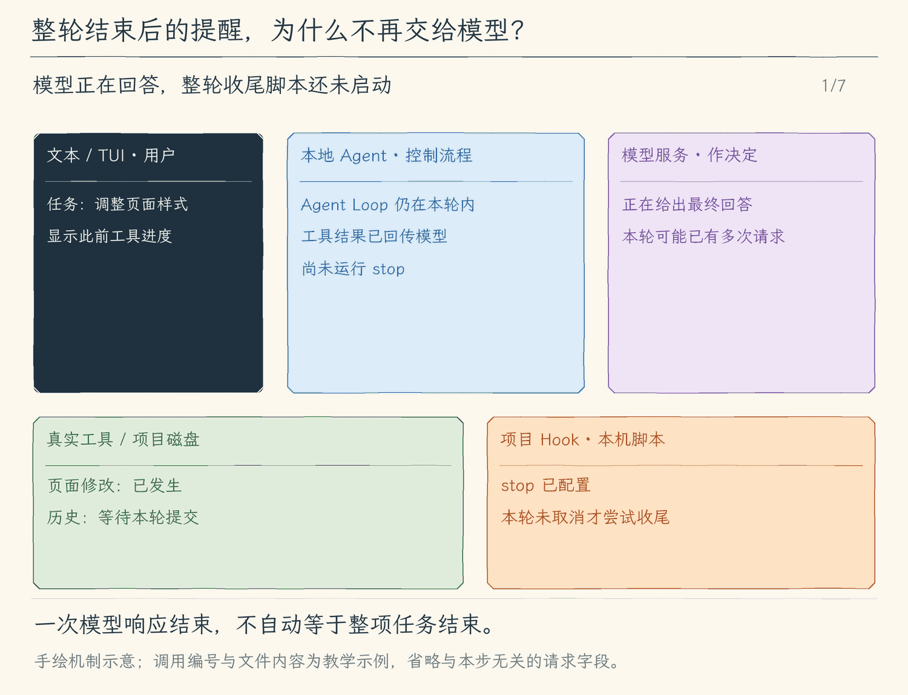

# 20.3 结束钩子：区分任务收尾与模型继续执行

[第 20 章首页](../README.md) · [上一节：20.2 执行后钩子](../02-after-tool/README.md) · [本章练习与答案](../EXERCISES.md)

## 问题：整项任务结束后，谁来留下最后一条本地反馈

前两节的钩子都围绕工具调用。一次任务可能调用十次工具，也可能只返回一段解释，一次工具调用都没有。如果项目想在整项任务结束时写一份本地记录，或者提醒用户还要人工检查某项事项，就不能随便选“最后一个工具”来承担收尾：工具执行时还不知道后面是否会继续。

本节加入结束钩子（`stop`）。它挂在整轮任务的外层，等 Agent Loop 已经得出结果或抛出错误后再运行。它提供的是本地收尾反馈；它不会再把任务自动交回模型重做。

## 解决方案：由任务外层触发一次，反馈标明来自本地

我们沿用同一个 Hook 执行器，在 `runAgent` 等待 Agent Loop 结束的位置触发 `stop`。正常返回时，脚本收到 `outcome: "completed"`；任务出错且没有取消时，收到 `outcome: "error"`。Plan 模式跳过脚本，已经取消的任务也不再启动新的结束脚本。

正常完成时，脚本的 `message` 加到最终回复与历史中，并带上“本地结束钩子反馈”的来源说明。它不会新增一次模型请求。脚本失败则显示收尾失败，保留模型已经得到的结果；错误任务的收尾也不会替换最初的错误。

## 工作原理

### 最后一次模型返回，不一定是整项任务完成

模型返回工具调用后，程序还会执行工具，再发下一次模型请求。模型返回普通文字时，Agent Loop 才能正常结束这一轮。因而 `model_finish` 表示一次模型请求结束，`run_finish` 才表示整轮任务结束；在两者之间混放收尾逻辑，可能每轮工具调用后都运行一遍。

`stop` 选择的边界是 Agent Loop 已经返回或失败、外层准备发出 `run_finish` 之前。假设任务完成了两次文件修改和一次读取，`before_tool` 与 `after_tool` 各有三次机会，`stop` 仍只有整轮的一次机会。纯解释任务没有工具，依然可以有一次 `stop`。

正常完成时，输入很小：

```json
{"event":"stop","outcome":"completed"}
```

它不附带整段聊天或模型凭据。脚本如果需要生成项目报告，应读取明确的本地材料；这个输入只告诉它收尾的原因，并不证明模型已经完成所有业务要求。

### 为什么反馈不再送入一次模型请求

假设模型已经回答“修改完成”，结束脚本又返回“请人工检查页面”。程序将它标记为本地反馈，附在结果后交给用户。如果程序无条件把这句话当成新任务送给模型，模型再次完成后又会触发结束脚本，同一条收尾信息就可能不断启动下一轮。

本节把这个闭环切断在任务外层：`stop` 运行完只整理回复与历史，然后发出任务结束事件。`continue: false` 不会让模型继续；`message` 也不会自动变成新问题。项目若希望检查结果驱动模型继续修正，应在工具结果还要回到模型的 `after_tool` 中表达；最后需要用户处理的事项则适合留在 `stop`。

结束反馈会进入本地历史，因此未来用户主动发起下一轮时，模型可能看到这条有来源的记录。这与本轮自动多请求一次是两回事。反馈始终是项目脚本提供的信息，不是用户批准，也不是模型已经复核过的结论。

### 完成、错误与取消分别怎样收尾

正常任务中，程序等待结束脚本，成功就追加反馈；脚本超时、格式错误或非零退出，就追加“结束钩子失败”。模型已经生成的正文保留，用户能分辨任务结果和收尾状态。

原任务抛错时，若信号尚未取消，程序尝试一次 `outcome: "error"` 的结束脚本，把反馈或收尾失败记入历史，再继续报告原错误。这样“记录失败现场”的脚本自己失败，也不会掩盖最初的问题。

用户取消时，程序不再启动新的 `stop`。若取消恰好发生在已经运行的结束脚本中，同一信号会中止等待并交给进程执行器清理，任务最终按取消结束。停止等待与撤销脚本已经完成的写入仍然不同；本节不承诺回滚外部副作用。

因此我们可以预测：把 `stop` 的 JSON 写成普通日志，正常模型回答还会保留，但旁边出现本地结束钩子失败；把同样的格式错误放到 `before_tool`，原工具会被挡住。两处都遵守相同的 JSON 协议，时机不同，能影响的事情便不同。

<!-- media:lesson:start -->
下面从最后一次模型响应开始，观察 Agent Loop、外层收尾与界面的交接。最后只把本地提醒追加到回答和历史，没有再向模型服务发送请求。



[静态流程图](assets/stop-hook-flow-1b85eea196.png) · [静态封面](assets/hooks-stop-once-cover-0c97006a59.png) · [查看完整静态分镜](assets/hooks-stop-once-storyboard-882174ad6e.jpg)
<!-- media:lesson:end -->

## 本节改动文件

<!-- generated:files:start -->

| 状态 | 文件 | 本节变化 |
| --- | --- | --- |
| CHANGED | [src/hooks/lifecycle.ts](src/hooks/lifecycle.ts) | 接纳 stop 事件，沿用相同的进程与输出限制。 |
| CHANGED | [src/agent/run.ts](src/agent/run.ts) | 在整轮外层完成一次收尾，错误与取消分别处理。 |
| CHANGED | [src/ui/tui/state.ts](src/ui/tui/state.ts) | 整轮结束时采用含本地收尾信息的最终文本。 |
| CHANGED | [src/ui/terminal.ts](src/ui/terminal.ts) | 流式正文结束后显示最终回答新增的本地收尾说明。 |

<!-- generated:files:end -->

## 动手构建

从上一公开小节 20.2 的完整 `src/` 继续。下面只列本节新增与修改的文件；其余实现沿用。新增文件完整保存，修改文件按差异应用到当前工作树。标记中的 `KEEP` 说明来源，不需要为它复制整份未改动文件。

结束事件属于整轮外层。先扩展事件集合，再在 `runAgent` 中收尾，并让 TUI 接纳最终含本地反馈的文本。

<!-- generated:build:start -->

<details>
<summary>CHANGED：src/hooks/lifecycle.ts 的精确差异</summary>

<!-- source: src/hooks/lifecycle.ts -->
```diff
--- a/src/hooks/lifecycle.ts
+++ b/src/hooks/lifecycle.ts
@@ -1,7 +1,7 @@
 /**
- * 20.2 执行后反馈与真实结果 | [CHANGED] hooks/lifecycle.ts
+ * 20.3 结束钩子与有界收尾 | [CHANGED] hooks/lifecycle.ts
  *
- * 学习目标：工具返回后再运行项目检查，把反馈附在真实结果后；检查失败不能抹掉已发生的操作。
+ * 学习目标：在原有前后检查之外，接入整轮结束的 stop 脚本；完成或错误只收尾一次，取消不启动新脚本。
  * 输入：显式启用状态、项目配置、事件数据与取消信号。
  * 输出：校验后的 HookState，或事件的 blocked/messages；失败以 ToolError 说明。
  * 状态：配置完整校验后才交出列表；脚本自行产生的外部副作用不回滚。
@@ -11,7 +11,7 @@
  *                                             +-- 是 -> 解析单个 JSON -> 收集 message
  *   before_tool 且 continue=false？-- 是 -> blocked；否 -> 下一脚本 / 返回反馈
  *   取消 -> 请求停止同组进程 -> 等待 close 清理 -> 抛出取消原因
- * 观察：after_tool 取得已发生的结果；continue=false 不撤销工具，反馈和失败说明留在同一结果中。
+ * 观察：stop 收到整轮的 completed 或 error；其反馈留作本地说明，不再触发模型。
  */
 
 import { open, realpath } from "node:fs/promises";
@@ -21,8 +21,9 @@
 import type { ToolCall } from "../tools/registry.js";
 
 // [KEEP 来自 20.1] 执行器整体来自 20.1；当前事件集合见下方类型。
-// [CHANGED 20.2] 后置输出作为反馈，不重新执行原工具。
-export type HookEvent = "before_tool" | "after_tool";
+// [KEEP 来自 20.2] 后置输出作为反馈，不重新执行原工具。
+// [CHANGED 20.3] stop只收尾一次，不把反馈重新交模型而形成结束循环。
+export type HookEvent = "before_tool" | "after_tool" | "stop";
 type Hook = { command: string; args: string[]; timeout_ms: number };
 export type HookState = { root: string; hooks: Partial<Record<HookEvent, Hook[]>> };
 
@@ -44,7 +45,7 @@
     if (!input || typeof input !== "object" || Array.isArray(input)) throw new Error();
     const hooks: HookState["hooks"] = {};
     for (const [event, value] of Object.entries(input)) {
-      if (!["before_tool", "after_tool"].includes(event) || !Array.isArray(value) || value.length > 8) throw new Error();
+      if (!["before_tool", "after_tool", "stop"].includes(event) || !Array.isArray(value) || value.length > 8) throw new Error();
       hooks[event as HookEvent] = value.map((item: unknown) => {
         if (!item || typeof item !== "object" || Array.isArray(item)) throw new Error();
         const record = item as Record<string, unknown>;
```

</details>

<details>
<summary>CHANGED：src/agent/run.ts 的精确差异</summary>

<!-- source: src/agent/run.ts -->
```diff
--- a/src/agent/run.ts
+++ b/src/agent/run.ts
@@ -1,24 +1,28 @@
 /**
- * 19.3 模型选择与资源读取 | [KEEP] agent/run.ts
+ * 20.3 结束钩子与有界收尾 | [CHANGED] agent/run.ts
  *
- * 学习目标：把会话状态保存到磁盘；本文件沿用已有职责，负责给整轮任务发出开始、完成、取消或失败通知。
- * 阅读说明：本节沿用此模块；保存入口接在消费者收尾，不把本文件的配置、显示或控制对象整包存盘。
+ * 学习目标：等待核心任务与本地 stop 收尾，再统一发出整轮结束事件；本层不再请求模型，也不负责保存会话文件。
+ * 职责说明：历史由核心提交，会话文件由消费者保存；本文件只组织整轮调用、结束脚本与通知。
  * 输入：模型、历史、用户问题、取消信号、可选观察者、审批函数和会话只读授权。
  * 输出：run_start 与一次 run_finish 通知；成功返回 Reply，失败继续抛出原因。
  * 状态：核心仍负责成功或中断后的历史提交；外层通知不新增工具副作用，也不负责回滚。
  *
  * 本文件局部流程（全局主流程见 agent/agent-loop.ts）：
- *   [KEEP] run_start -> 调用原有 agentLoop -> 成功？-- 是 -> run_finish/completed -> 返回 Reply
+ *   [KEEP] run_start -> 调用 agentLoop -> 成功？-- 是 -> 等 stop 或失败说明 -> run_finish/completed -> 返回 Reply
  *                                                   +-- 否 -> 选择取消原因或原错误
  *   信号已取消且原因不是 UserFacingError？-- 是 -> run_finish/cancelled -> 抛出原因
  *                                        +-- 否 -> run_finish/error -> 抛出原因
  *
+ * [CHANGED 20.3] Loop 返回后先等 stop，再发 run_finish；反馈不再触发模型请求。
+ * 取消不新启结束脚本；错误收尾保留原错误，脚本副作用不因失败回滚。
  * 整轮可能包含多次模型请求；model_finish 只说明一次模型返回，run_finish 才说明整轮结束。
  * 事件发送复用 emitAgentEvent，观察者直接抛错不会成为任务失败；同步观察仍会占用当前线程。
  *
  * [KEEP 来自 12.1] RunOptions 随同一轮传入核心；本层不重新选择模式或处理工具业务。
- * 运行观察：普通任务收到开始、模型与工具过程、结束；取消或失败也有对应的结束状态。
+ * 运行观察：模型最终回答先返回，stop 反馈随后补入本地回答；run_finish 在收尾之后发出，取消不启动新脚本。
  */
+// [CHANGED 20.3] 结束钩子复用同一个有界进程执行器。
+import { runHooks } from "../hooks/lifecycle.js";
 import { agentLoop } from "./agent-loop.js";
 import { emitAgentEvent, type AgentObserver } from "./events.js";
 import { explainError, UserFacingError } from "../errors.js";
@@ -47,11 +51,31 @@
   // 先通知开始，即使传入的信号已经取消，外层仍能说明这次任务的结束状态。
   emitAgentEvent(observer, { type: "run_start" });
   try {
-    const reply = await agentLoop(model, history, input, signal, observer, requestApproval, sessionGrants, options);
+    let reply = await agentLoop(model, history, input, signal, observer, requestApproval, sessionGrants, options);
+    // [CHANGED 20.3] 完成后只收尾一次，反馈明确来自本地，不再调用模型。
+    if (options.mode !== "plan" && model.hooks?.hooks.stop?.length) {
+      let feedback: string;
+      try { feedback = (await runHooks(model.hooks, "stop", { outcome: "completed" }, signal)).messages.join("\n"); }
+      catch (error) { signal.throwIfAborted(); feedback = `结束钩子失败：${explainError(error)}`; }
+      if (feedback) {
+        const content = `[本地结束钩子反馈；不是模型回答或权限]\n${feedback}`;
+        history.push({ role: "assistant", content });
+        reply = { ...reply, text: `${reply.text}\n\n${content}` };
+      }
+    }
     emitAgentEvent(observer, { type: "run_finish", outcome: "completed", reply });
     return reply;
   } catch (error) {
     // 内部停止也可能使用取消信号；UserFacingError 表示需要报告的失败，不能全算用户取消。
+    // [CHANGED 20.3] 错误也可收尾；取消不再启动新脚本。收尾失败保持原错误。
+    if (!signal.aborted && options.mode !== "plan" && model.hooks?.hooks.stop?.length) {
+      try {
+        const stop = await runHooks(model.hooks, "stop", { outcome: "error" }, signal);
+        if (stop.messages.length) history.push({ role: "assistant", content: `[本地结束钩子反馈] ${stop.messages.join("\n")}` });
+      } catch (stopError) {
+        history.push({ role: "assistant", content: `[本地结束钩子失败] ${explainError(stopError)}` });
+      }
+    }
     const reason = signal.aborted ? signal.reason : error;
     const cancelled = signal.aborted && !(reason instanceof UserFacingError);
     emitAgentEvent(observer, { type: "run_finish", outcome: cancelled ? "cancelled" : "error",
```

</details>

<details>
<summary>CHANGED：src/ui/tui/state.ts 的精确差异</summary>

<!-- source: src/ui/tui/state.ts -->
```diff
--- a/src/ui/tui/state.ts
+++ b/src/ui/tui/state.ts
@@ -1,7 +1,7 @@
 /**
- * 19.3 模型选择与资源读取 | [KEEP] ui/tui/state.ts
+ * 20.3 结束钩子与有界收尾 | [CHANGED] ui/tui/state.ts
  *
- * 学习目标：分清本地输入估算、服务商用量与费用估计；本文件负责把已收到的事件累积成界面状态。
+ * 学习目标：把同一轮事件累积成显示状态；结束时采用包含本地 stop 反馈的完整回答，避免只留下较早的模型片段。
  * 输入：上一份 RunView 与下一条 AgentEvent；事件按 streamAgentRun 的顺序送达。
  * 输出：新的显示状态，或本轮结束后留在终端的文字记录；本文件没有终端写入和执行副作用。
  * 状态：更新时返回新对象，不修改传入状态或模型历史；失败与取消只改变显示中的结束状态。
@@ -9,7 +9,7 @@
  * 本文件局部流程（全局主流程见 agent/agent-loop.ts）：
  *   事件 -> run_start？-- 是 -> 空白本轮状态
  *                      +-- 否 -> 模型事件？-- 是 -> 按 call 更新文字与阶段
- *                                         +-- 否 -> run_finish？-- 是 -> 写结束状态与用量
+ *                                         +-- 否 -> run_finish？-- 是 -> 采用完整 Reply、写结束状态与用量
  *                                                              |       非 completed 时标记未结束工具为已中断
  *                                                              +-- 否 -> 按 sequence 新建或替换工具行
  *   工具完成 -> 保存完整结果的显示副本 -> 历史区折叠或展开；本轮结束 -> 留存记录
@@ -21,7 +21,7 @@
  *
  * [KEEP 来自 12.4] input_applied 表示核心已收取并加入本次请求上下文，不保证远端收到或需求完成。
  * 该事件没有工具 sequence，必须先于通用工具分支处理。
- * 运行观察：工具批准、执行、完成各有状态；取消后尚未结束的工具不再显示为执行中。
+ * 运行观察：整轮完成后能看到模型回答及本地结束反馈；错误或取消保留已收到的内容，并收束未结束的工具状态。
  */
 import type { AgentEvent } from "../../agent/events.js";
 import { formatTeachingTrace } from "../teaching-trace.js";
@@ -88,7 +88,9 @@
     answers: view.answers.map((answer) => answer.call === event.call && !answer.text ? { ...answer, text: screenText(event.text) } : answer),
   };
   // run_finish 才结束整轮；异常结束后保留已完成的结果，只收束仍在等待或执行的状态。
+  // [CHANGED 20.3] 运行结果含本地收尾反馈，替换最后回答，避免只保留较早的模型片段。
   if (event.type === "run_finish") return { ...view,
+    answers: event.outcome === "completed" ? view.answers.map((answer, index) => index === view.answers.length - 1 ? { ...answer, text: screenText(event.reply.text) } : answer) : view.answers,
     tools: event.outcome === "completed" ? view.tools : view.tools.map((tool) =>
       ["完成", "失败", "准备失败", "已拒绝"].includes(tool.status) ? tool : { ...tool, status: "已中断" }),
     status: event.outcome === "completed" ? "已完成" : event.outcome === "cancelled" ? "已取消本轮" : `运行失败：${screenText(event.message)}`,
```

</details>

<details>
<summary>CHANGED：src/ui/terminal.ts 的精确差异</summary>

<!-- source: src/ui/terminal.ts -->
```diff
--- a/src/ui/terminal.ts
+++ b/src/ui/terminal.ts
@@ -1,7 +1,7 @@
 /**
- * 19.3 模型选择与资源读取 | [KEEP] ui/terminal.ts
- *
- * 学习目标：本地命令与模型工具共用技能状态；真实接纳与读取结果进入可检查记录。
+ * 20.3 结束钩子与有界收尾 | [CHANGED] ui/terminal.ts
+ *
+ * 学习目标：消费同一任务事件，显示模型正文，并在结束后补打新增的本地反馈。
  * 输入：用户输入、本地命令、AgentRecord 记录流，以及 Ctrl+C / SIGINT / SIGTERM / SIGHUP。
  * 输出：stdout 显示模型正文；stderr 显示过程、审批、输入提示、本地状态与用量。
  * 状态：文本消费者沿用 09.3 的输出位置；失败或取消等待清理，不撤销已经发生的工具操作。
@@ -12,7 +12,7 @@
  *   事件流 -> showRun -> renderer -> 模型文字？-- 是 -> stdout
  *                                            +-- 否 -> [KEEP] 步骤说明写 stderr
  *   completed -> Reply -> 正文已显示？-- 否 -> stdout 补正文
- *                                    +-- 是 -> 不重复正文
+ *                                    +-- 是 -> 只补最终Reply新增尾部（收尾/引用反馈）
  *                         -> [KEEP] 用量与截断提示写 stderr
  *   审批 -> [KEEP] stderr 显示请求与预览 -> 可交互？-- 是 -> 共用输入读取决定
  *                                                             +-- 否 -> deny
@@ -87,13 +87,15 @@
  * - 输入：本轮 AgentEvent；输出是 observe、finish 和 reply 三个显示入口。
  * - 显示片段：第一次 text_delta 写出 Agent 标签，后续片段直接追加；切到步骤或错误提示前补换行。
  * - 完整响应：某次模型决策没有发出片段时，model_finish 仍可显示完整文字。
- * - 避免重复：每次 model_start 重置是否显示过文字的记录，reply 根据最后一次决策决定是否再打印正文。
+ * - 避免重复：每次 model_start 重置是否显示过文字的记录，reply 对照最后一次决策已显示原文，只补最终结果新增的尾部。
  * - 职责边界：这里只保存显示状态，不提交历史；已显示的片段也不能证明本轮已经成功。
  */
-// [KEEP 来自 08.1] 每轮创建独立显示状态，结束时不会再重复打印已显示的回答。
+// [CHANGED 20.3] 本轮保留最后一次模型已显示正文，最终回复只补本地收尾新增尾部。
 export function createTurnRenderer() {
   let opened = false;
   let streamed = false;
+  // [CHANGED 20.3] 最终Reply可追加本地收尾；保留已显示原文，只补尚未显示的尾部。
+  let displayedText = "";
   const finish = () => {
     if (opened) process.stdout.write("\n");
     opened = false;
@@ -103,18 +105,25 @@
       if (!opened) process.stdout.write(`${colorLabel("Agent", 35)} > `);
       opened = true;
       streamed = true;
+      displayedText += event.text;
       process.stdout.write(event.text.replace(/[\x00-\x08\x0b-\x1f\x7f-\x9f\u202a-\u202e\u2066-\u2069]/g, ""));
       return;
     }
     finish();
-    if (event.type === "model_start") streamed = false;
+    if (event.type === "model_start") { streamed = false; displayedText = ""; }
     if (event.type === "model_finish" && !streamed && event.text) {
       console.log(`${colorLabel("Agent", 35)} > ${event.text}`);
       streamed = true;
+      displayedText = event.text;
     }
     printProgress(event);
   };
-  return { observe, finish, reply: (reply: Reply) => { finish(); printReply(reply, !streamed); } };
+  return { observe, finish, reply: (reply: Reply) => {
+    finish();
+    const remaining = streamed && reply.text.startsWith(displayedText)
+      ? reply.text.slice(displayedText.length).replace(/^\n+/, "") : reply.text;
+    printReply({ ...reply, text: remaining }, Boolean(remaining));
+  } };
 }
 
 // [KEEP 来自 09.2] 显示与执行分开推进，结果仍由同一条事件流给出。
```

</details>

<!-- generated:build:end -->

## 运行验证

先回到仓库根，编译本节完整快照：

```bash
npm run lesson:20.3
```

示例脚本也是完整 TypeScript。仓库中的 [examples/stop.ts](../examples/stop.ts) 与下方内容一致；跟写时将它保存为该文件，再编译。标准输出只写协议 JSON，错误信息写到标准错误。

<details>
<summary>展开完整项目脚本</summary>

```ts
/**
 * 20.3 结束检查示例 | [NEW 练习] stop.ts
 * 学习目标：在整轮 completed 或 error 后给出本地复核提示。
 * 输入：stdin 中一个 stop 事件；它不代表每次 model_finish。
 * 输出：stdout 的单个 message JSON；非法输入写 stderr 并非零退出。
 * 本文件局部流程（全局主流程见 agent/agent-loop.ts）：
 *   完整读事件 -> stop 且 outcome 有效？-- 否 -> 失败；是 -> 完成/错误对应提示
 * 状态与观察：不改文件、不请求模型；提示由外层加入本地结果，不是新的测试结论。
 */

// [NEW 练习] 项目自定义 stop 协议实现。

/**
 * 只消费整轮结束事件，stdout 输出一个反馈对象。
 * 读取并校验输入后执行上面的局部流程；失败交给入口 catch 输出诊断并设置非零退出。
 */
async function main(): Promise<void> {
  let text = "";
  for await (const chunk of process.stdin) text += String(chunk);
  const value: unknown = JSON.parse(text);
  if (!value || typeof value !== "object" || Array.isArray(value)) throw new Error("需要事件对象");
  const event = value as Record<string, unknown>;
  if (event.event !== "stop" || !["completed", "error"].includes(String(event.outcome))) {
    throw new Error("事件无效");
  }
  process.stdout.write(JSON.stringify({ message: event.outcome === "completed"
    ? "本地收尾提醒：请人工查看这次改动；此提示没有执行测试。"
    : "本地收尾记录：本轮出错，请保留原始错误排查。" }));
}

main().catch(error => {
  console.error(error instanceof Error ? error.message : String(error));
  process.exitCode = 1;
});
```

</details>

仍在仓库根执行以下准备命令。临时项目的 `package.json` 固定工具工作区；脚本编译到这个项目自己的元数据目录。

```bash
export HMA_REPO="$PWD"
DEMO="$(mktemp -d)"
mkdir -p "$DEMO/.hello-my-agent/compiled" "$DEMO/generated" "$DEMO/src"
cat > "$DEMO/package.json" <<'JSON'
{"private":true,"type":"module"}
JSON
"$HMA_REPO/node_modules/.bin/tsc" "$HMA_REPO/chapter-20-hooks/examples/stop.ts" \
  --target ES2022 --module NodeNext --moduleResolution NodeNext --skipLibCheck \
  --outDir "$DEMO/.hello-my-agent/compiled"
cat > "$DEMO/.hello-my-agent/hooks.json" <<'JSON'
{
  "stop": [
    {
      "command": "node",
      "args": [
        ".hello-my-agent/compiled/stop.js"
      ],
      "timeout_ms": 5000
    }
  ]
}
JSON
cat > "$DEMO/README.md" <<'TEXT'
这是结束钩子的临时项目。
TEXT
cd "$DEMO"
```

这次只读取文件，结束时观察最后追加的本地说明。

```bash
hello-my-agent --enable-project-hooks --prompt "请读取 README.md，简短说明它写了什么，不修改文件。"
```

模型正文之后应出现带来源标记的本地收尾提醒。它明确说明没有执行测试；过程不会因为这条提醒再启动一次模型请求。纯解释任务也会触发结束钩子。将脚本改成格式错误会保留原回答并显示收尾失败；任务开始前已取消则不启动新收尾脚本，练习三会固定验证这些区别。

实验结束后返回仓库根；临时项目可按需保留或删除。

```bash
cd "$HMA_REPO"
rm -rf "$DEMO"
```

## 本节完成后的 Agent

现在，三个时机各有明确作用：执行前可以额外否决，执行后将检查交回模型，结束时留下本地反馈。它们共用受限进程执行器，不能替代审批或回滚。下一章把已有工具通道接向 MCP 服务，继续沿用相同的权限与结果回传规则。

本节已落地的实现与限制如上；本章已于 2026-10-15 按用户通知确认完成。
