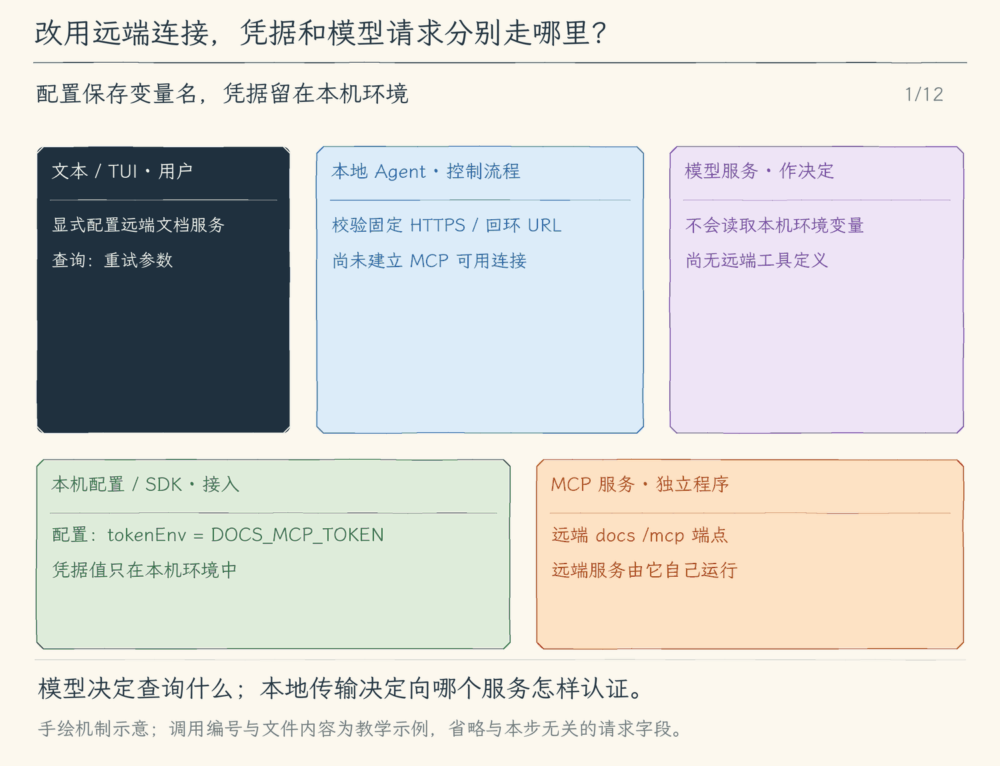

# 21.2 Streamable HTTP：连接远端 MCP 服务

[第 21 章首页](../README.md) · [上一节：21.1 stdio MCP](../01-stdio-tools/README.md) · [本章练习与答案](../EXERCISES.md)

## 问题：远端服务不能通过启动本地子进程连接

上一节的文档服务与 Agent 在同一台机器上，Agent 能启动它，并持有它的标准输入输出。如果团队已经运行一个远端文档服务，我们只有 `https://docs.example.com/mcp` 这个地址，就无法对它使用本地进程的管道。

改变的是连接方式，查询工具的用途没有改变。我们仍希望启动时取得工具描述、模型按需调用、结果回到模型；同时需要说明请求发往哪个地址、怎样携带凭据，以及认证失败会停在哪一步。

本节增加 Streamable HTTP 传输，并用一个明确的环境变量为服务提供固定 Bearer token。这是本章支持的一种认证接入方式；用户登录、发现认证服务、自动刷新凭据等完整 OAuth 流程尚未实现。

## 解决方案：为同一个客户端选择另一种传输

配置里的 `transport` 区分本地 `stdio` 和远端 HTTP。HTTP 配置使用 URL，并可指定 `tokenEnv`；程序从这个名称对应的环境变量读取 token，构造请求头，再交给 SDK 的 Streamable HTTP 客户端。地址只接受 HTTPS 或回环 HTTP，不能含用户名、密码、查询串或片段；请求拒绝重定向，避免把固定认证头转送到另一个地址。

连接成功后仍走上一节的工具发现、注册、权限与调用。模型不需要知道 token，也不直接发送 HTTP。服务拒绝认证时，程序报告连接或请求错误，不把密钥正文打印给模型或写进普通工具描述。

## 工作原理

### 更换的是消息走的路，保留的是消息含义

stdio 把一条 MCP 请求写进进程管道，Streamable HTTP 把一条请求发送到 MCP HTTP 端点。服务器可以返回一份 JSON 响应，也可以用事件流分段送回协议消息；SDK 负责理解这两种响应形式。模型所见的工具名、参数和返回内容仍使用本地适配层整理后的格式。[Streamable HTTP 规范](https://modelcontextprotocol.io/specification/2025-11-25/basic/transports)

以“查询重试参数”为例，启动时客户端仍先握手、列工具；批准后才发送 `tools/call`。把服务从本地移动到远端，不会使本地权限检查消失，也不会让一次网络连接自动批准后续所有调用。连接参数属于本地配置，调用参数来自模型，程序在两者之间保持明确的分工。

### tokenEnv 表示从哪里取值，不是把值放进配置

假设配置写 `"tokenEnv": "DOCS_MCP_TOKEN"`。启动时程序读取 `process.env.DOCS_MCP_TOKEN`，把实际值用于 `Authorization: Bearer ...` 请求头。配置记录的是变量名，项目文件无需保存 token 正文；模型的系统提示和工具描述也不需要看到它。

这里仅仅移动了凭据的保存位置，没有自动证明远端服务可信。请求最终仍会把凭据交给配置中的服务地址，所以地址与凭据应匹配。本章实现固定 Bearer 接入：变量缺失时在连接前报错，服务返回 401 或 403 时报告认证或访问问题。它不会弹出登录页面，也不会替我们刷新过期 token。

凭据若不对，错误发生在协议调用之前或期间。只有握手与工具发现都成功，程序才有依据把服务工具加入模型工具列表；一个 HTTP 200 页面也不够，它可能只是普通 HTML，未必是 MCP 响应。因此我们验证的是成功列出工具并完成一次实际调用，而不只是 URL 能打开。

### 本地服务的退出与远端连接的关闭不同

对于 stdio，Agent 持有自己启动的子进程，关闭时先等待 SDK 清理，再额外检查直接子进程 PID 是否退出，最多再等两秒；不能确认时明确报失败。SDK 传输没有建立本书自己的进程组，因此这里不能保证清理服务的所有派生进程。对于 HTTP，远端服务可能同时服务许多客户端，本地关闭只结束自己的连接与 SDK 资源，不会关闭整台远端服务。

同样，网络断开不能说明远端工具没有执行。请求可能已经送达，响应在途中丢失。程序能报告这次调用没有取得正常响应，却不能凭此宣称服务端副作用已撤销。涉及写操作时，自动重试可能造成重复执行，所以本章不在断线后无条件重放调用。

这个区别会影响我们怎样读错误：连接前认证失败意味着没有完成可用连接；调用中断意味着没有取得完整结果；取得明确工具错误意味着服务已经响应并说明失败。把三者都写成“查询失败”会丢掉下一步判断所需的信息。下一节把这些状态与关闭动作统一起来。

<!-- media:lesson:start -->
下面跟随同一个文档查询，分别看本机环境变量到 HTTP 传输、工具描述到模型、查询结果再回模型的三条路径。图中不展示凭据正文；最后的关闭只确认本地资源收回。



[静态流程图](assets/mcp-http-credentials-flow-a27b3ceb02.png) · [静态封面](assets/mcp-http-credentials-cover-02b4fa5b80.png) · [查看完整静态分镜](assets/mcp-http-credentials-storyboard-060c23a042.jpg)
<!-- media:lesson:end -->

## 本节改动文件

<!-- generated:files:start -->

| 状态 | 文件 | 本节变化 |
| --- | --- | --- |
| CHANGED | [src/mcp/client.ts](src/mcp/client.ts) | 接纳固定 HTTP 端点与 tokenEnv，使用官方 Streamable HTTP 传输。 |

<!-- generated:files:end -->

## 动手构建

从上一公开小节 21.1 的完整 `src/` 继续。新增文件完整保存，修改文件按精确差异应用；未列出的实现沿用。差异以前面公开块累计形成的读者工作树为基线。

<!-- generated:build:start -->

<details>
<summary>CHANGED：src/mcp/client.ts 的精确差异</summary>

<!-- source: src/mcp/client.ts -->
```diff
--- a/src/mcp/client.ts
+++ b/src/mcp/client.ts
@@ -1,7 +1,7 @@
 /**
- * 21.1 发现并审批本地MCP工具 | [NEW] mcp/client.ts
+ * 21.2 远端HTTP与固定令牌认证 | [CHANGED] mcp/client.ts
  *
- * 学习目标：把独立服务的工具目录适配为模型工具，并保留本地审批边界。
+ * 学习目标：通过固定目标的 Streamable HTTP 传输接入远端，凭据仅从本地环境读取。
  * 输入：显式配置路径、固定项目根、工具调用与本轮取消信号。
  * 输出：完整发现的工具映射、服务状态，或带来源的工具文本/明确错误。
  * 状态：每服务完整目录才提交；描述不能授权，超时/取消不能回滚远端副作用。
@@ -10,24 +10,30 @@
  *   tools/list 分页 -> 全部有效？-- 否 -> 关闭该服务并诊断；是 -> 提交映射、ready
  *   模型工具名 -> 映射当前可用？-- 否 -> 错误；是 -> tools/call -> 文本与isError
  *   管理器close -> 等官方close -> stdio核实直接PID退出 -> closed / 明确失败
+ *   HTTP：固定URL + 本地tokenEnv -> Bearer头；拒绝重定向，不执行自动登录
  */
 
 import { open } from "node:fs/promises";
+// [CHANGED 21.2] 官方远端传输，不把普通HTTP接口称作MCP。
+import { StreamableHTTPClientTransport, StreamableHTTPError } from "@modelcontextprotocol/sdk/client/streamableHttp.js";
+import { UnauthorizedError } from "@modelcontextprotocol/sdk/client/auth.js";
 import { Client } from "@modelcontextprotocol/sdk/client/index.js";
 import { StdioClientTransport } from "@modelcontextprotocol/sdk/client/stdio.js";
 import { ToolError } from "../errors.js";
 import type { ToolDefinition, ToolExecutionResult } from "../tools/types.js";
 import type { ToolCall } from "../tools/registry.js";
 
-// [NEW 21.1] 本文件以下实现均为本节新增。
-type ServerConfig = { name: string; transport: "stdio"; command: string; args: string[] };
+// [KEEP 来自 21.1] 配置与工具适配来自21.1，传输和生命周期增量在相邻标记说明。
+// [CHANGED 21.2] 认证仅选择环境变量名，配置和日志不存令牌值；不实现OAuth。
+type ServerConfig = { name: string; transport: "stdio"; command: string; args: string[] }
+  | { name: string; transport: "http"; url: string; tokenEnv?: string };
 export type McpServer = { name: string; client: Client; close(): Promise<void>; status: "connecting" | "loading" | "ready" | "error" | "closed"; reason?: string };
 type Registered = { server: McpServer; original: string; definition: ToolDefinition };
 export type McpState = { servers: McpServer[]; tools: Map<string, Registered>; close(): Promise<void> };
 
 /**
  * 从用户显式指定的配置文件读取最多四个服务，完整校验后才启动任何进程。
- * stdio 使用 command/args；配置最多32KiB，不自动发现项目里的服务。
+ * stdio 使用 command/args；HTTP 使用固定 url/tokenEnv；配置最多32KiB，不自动发现项目里的服务。
  */
 async function readServers(path: string): Promise<ServerConfig[]> {
   let handle;
@@ -46,12 +52,20 @@
       const record = item as Record<string, unknown>;
       if (typeof record.name !== "string" || !/^[a-z][a-z0-9-]{0,15}$/.test(record.name) || names.has(record.name)) throw new Error();
       names.add(record.name);
+      // [CHANGED 21.2] 仅HTTPS或loopback HTTP；URL不准携带用户信息、查询密钥或片段。
+      if (record.transport === "http") {
+        if (Object.keys(record).some(key => !["name", "transport", "url", "tokenEnv"].includes(key)) || typeof record.url !== "string") throw new Error();
+        const url = new URL(record.url);
+        if (url.username || url.password || url.hash || url.search || (url.protocol !== "https:" && !(url.protocol === "http:" && ["localhost", "127.0.0.1", "[::1]"].includes(url.hostname)))) throw new Error();
+        if (record.tokenEnv !== undefined && (typeof record.tokenEnv !== "string" || !/^[A-Z][A-Z0-9_]{0,63}$/.test(record.tokenEnv))) throw new Error();
+        return record as ServerConfig;
+      }
       if (record.transport !== "stdio" || Object.keys(record).some(key => !["name", "transport", "command", "args"].includes(key))
         || typeof record.command !== "string" || !record.command.trim() || !Array.isArray(record.args)
         || record.args.length > 64 || record.args.some(arg => typeof arg !== "string" || arg.length > 4096)) throw new Error();
       return record as ServerConfig;
     });
-  } catch { throw new ToolError("MCP 配置无效：需要最多四个名称唯一的 stdio 服务及 command / args；上限32768字节。"); }
+  } catch { throw new ToolError("MCP 配置无效：需要最多四个名称唯一的 stdio(command/args) 或 http(url/tokenEnv) 服务；上限32768字节。"); }
   finally { await handle?.close(); }
 }
 
@@ -78,8 +92,15 @@
       const server: McpServer = { name: config.name, client, close: () => client.close(), status: "connecting" };
       state.servers.push(server);
       try {
-        const transport = new StdioClientTransport({ command: config.command, args: config.args, cwd: root, stderr: "ignore", maxBufferSize: 1024 * 1024 });
-        // [CHANGED 21.1] SDK关闭后核实直接子进程退出；不声称管理脱离的后代。
+        // [CHANGED 21.2] Bearer仅发给显式目标，禁重定向；SDK重连设为0，不重试工具。
+        const token = config.transport === "http" && config.tokenEnv ? process.env[config.tokenEnv] : undefined;
+        if (config.transport === "http" && config.tokenEnv && (!token || /[\r\n]/.test(token))) throw new ToolError("MCP认证环境变量缺失或无效；请在终端配置指定变量，不要写入配置文件。");
+        const transport = config.transport === "stdio"
+          ? new StdioClientTransport({ command: config.command, args: config.args, cwd: root, stderr: "ignore", maxBufferSize: 1024 * 1024 })
+          : new StreamableHTTPClientTransport(new URL(config.url), {
+              requestInit: { redirect: "error", headers: token ? { Authorization: `Bearer ${token}` } : {} },
+              reconnectionOptions: { maxRetries: 0, maxReconnectionDelay: 1000, initialReconnectionDelay: 1000, reconnectionDelayGrowFactor: 1 } });
+        // [KEEP 来自 21.1] SDK关闭后核实直接子进程退出；不声称管理脱离的后代。
         server.close = async () => {
           const pid = transport instanceof StdioClientTransport ? transport.pid : undefined;
           await client.close();
@@ -117,7 +138,10 @@
         await server.close();
         signal.throwIfAborted();
         server.status = "error";
-        server.reason = error instanceof ToolError ? error.message : "连接或工具发现失败，请检查程序、协议与服务状态。";
+        server.reason = error instanceof ToolError ? error.message
+          : error instanceof UnauthorizedError ? "MCP认证失败（401）；检查Bearer环境变量，本章不自动登录。"
+          : error instanceof StreamableHTTPError && [401, 403].includes(error.code ?? 0) ? `MCP认证或访问权限失败（${error.code}），请检查配置的Bearer环境变量；本章不自动登录。`
+          : "连接或工具发现失败，请检查程序、协议、HTTP认证与服务状态。";
       }
     }
     return state;
```

</details>

<!-- generated:build:end -->

## 运行验证

从仓库根编译本节完整快照：

```bash
npm run lesson:21.2
```

仓库中的 [examples/docs-http.ts](../examples/docs-http.ts) 是完整 TypeScript 服务。将下面内容保存为该文件；服务不依赖读者另补处理函数。

<details>
<summary>展开完整服务</summary>

```ts
/**
 * 21.2 HTTP 文档服务 | [NEW 练习] docs-http.ts
 * 学习目标：用固定 Bearer 演示无状态 Streamable HTTP，不引入自动登录。
 * 输入：本地 DOCS_MCP_TOKEN/PORT 和回环地址 /mcp 的请求。
 * 输出：认证通过的 POST 由 SDK 回 JSON；路径、Origin、认证、方法失败各有状态码。
 * 本文件局部流程（全局主流程见 agent/agent-loop.ts）：
 *   校验环境 -> 监听回环 -> 路径/Origin/token/POST 有效？-- 否 -> 拒绝
 *     是 -> 本次新建 SDK 服务与传输 -> 处理请求 -> 响应关闭后关闭对应服务
 *   SIGINT/SIGTERM -> 关连接与 HTTP 监听；错误写 stderr
 * 状态与观察：本例不提供 GET 事件流和 DELETE 会话；固定演示文档不代表真实线上查询。
 */
import { createServer } from "node:http";
import { McpServer } from "@modelcontextprotocol/sdk/server/mcp.js";
import { StreamableHTTPServerTransport } from "@modelcontextprotocol/sdk/server/streamableHttp.js";
import * as z from "zod/v4";

// [NEW 练习] 可独立运行的 MCP HTTP 服务。

/**
 * 在回环地址启动带固定 token 检查的 HTTP 监听。
 * 每个有效 POST 使用一组 SDK 对象，响应关闭后释放；信号负责停止监听和现有连接。
 * token 只来自本地环境，既不打印，也不由模型工具参数选择。
 */
async function main(): Promise<void> {
  const token = process.env.DOCS_MCP_TOKEN;
  if (!token || /[\r\n]/.test(token)) throw new Error("请先设置 DOCS_MCP_TOKEN。");
  const port = Number(process.env.DOCS_MCP_PORT ?? "17721");
  if (!Number.isInteger(port) || port < 1 || port > 65535) throw new Error("端口无效。");
  const http = createServer(async (request, response) => {
    if (request.url !== "/mcp") { response.writeHead(404).end(); return; }
    const origin = request.headers.origin;
    if (origin && origin !== `http://127.0.0.1:${port}`) { response.writeHead(403).end(); return; }
    if (request.headers.authorization !== `Bearer ${token}`) { response.writeHead(401).end(); return; }
    // 本例不提供独立 GET 事件流与 DELETE 会话终止；POST 响应使用 JSON。
    if (request.method !== "POST") { response.writeHead(405).end(); return; }
    const server = new McpServer({ name: "tutorial-http-docs", version: "1.0.0" });
    server.registerTool("lookup_docs", {
      description: "查询远端演示文档。",
      inputSchema: { topic: z.string().min(1) },
    }, async ({ topic }) => ({ content: [{ type: "text", text: `远端演示文档：${topic}；maxRetries 默认值为 2。` }] }));
    const transport = new StreamableHTTPServerTransport({ sessionIdGenerator: undefined, enableJsonResponse: true });
    response.once("close", () => { void server.close().catch(error => console.error(error)); });
    try {
      await server.connect(transport);
      await transport.handleRequest(request, response);
    } catch (error) {
      console.error(error);
      await server.close();
      if (!response.headersSent) response.writeHead(500).end();
    }
  });
  http.on("error", error => { console.error(error); process.exitCode = 1; });
  http.listen(port, "127.0.0.1", () => console.error(`MCP 演示端点 http://127.0.0.1:${port}/mcp`));
  process.once("SIGINT", () => { http.closeAllConnections(); http.close(); });
  process.once("SIGTERM", () => { http.closeAllConnections(); http.close(); });
}

main().catch(error => { console.error(error); process.exitCode = 1; });
```

</details>

从仓库根编译服务。临时目录自己的模块声明和依赖链接，保证离开仓库目录运行时也能解析 SDK。

```bash
export HMA_REPO="$PWD"
MCP_DEMO="$(mktemp -d)"
printf '%s\n' '{"private":true,"type":"module"}' > "$MCP_DEMO/package.json"
ln -s "$HMA_REPO/node_modules" "$MCP_DEMO/node_modules"
"$HMA_REPO/node_modules/.bin/tsc" chapter-21-mcp/examples/docs-http.ts \
  --target ES2022 --module NodeNext --moduleResolution NodeNext --strict --skipLibCheck \
  --outDir "$MCP_DEMO"
export DOCS_MCP_TOKEN="tutorial-local-demo-token"
node "$MCP_DEMO/docs-http.js" &
MCP_PID=$!
cat > "$MCP_DEMO/mcp.json" <<'JSON'
{"servers":[{"name":"remote","transport":"http","url":"http://127.0.0.1:17721/mcp","tokenEnv":"DOCS_MCP_TOKEN"}]}
JSON
```

这里的 token 是只用于本机实验的公开演示值。先等终端显示监听地址，再运行诊断；成功应是 `remote: ready` 与一个定义。此服务为简化演示采用无状态 POST/JSON 响应，GET 事件流与 DELETE 返回 405；它仍通过官方 SDK 处理 MCP 请求。

```bash
hello-my-agent --mcp-config "$MCP_DEMO/mcp.json" --mcp-info
hello-my-agent --mcp-config "$MCP_DEMO/mcp.json" --prompt "请调用远端文档工具查询重试参数，并引用工具给出的默认值。"
DOCS_MCP_TOKEN="wrong-demo-token" hello-my-agent --mcp-config "$MCP_DEMO/mcp.json" --mcp-info
```

正常任务批准后应有 `remote/lookup_docs` 来源；错凭据诊断应报告认证失败且没有定义，不能打印 token。把地址改为普通 HTML 页面也不能通过发现，只得到 HTTP 200 并不够。所有网络调用仍逐次审批；凭据不会进入工具参数。

实验结束后停止本机演示服务并等待它退出，临时目录可按需保留：

```bash
kill "$MCP_PID"
wait "$MCP_PID"
```

远端生产服务的关闭只影响本地连接。不要将这一段对本机演示进程的 `kill`，理解成 Agent 会终止团队远端服务。

## 本节完成后的 Agent

现在，远端地址与固定凭据可以接入同一工具流程。认证、工具业务错误和网络中断提供不同证据；下一节让工具目录与实时连接状态保持一致。

本节已于 2026-10-15 按用户通知确认完成。
