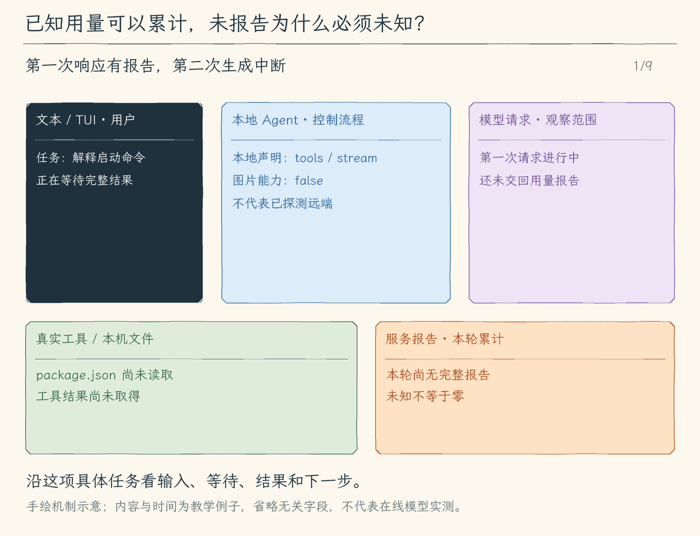

# 23.3 区分能力限制、请求错误与未知用量

[第 23 章首页](../README.md) · [上一节：23.2 模型切换](../02-model-switching/README.md) · [本章练习与答案](../EXERCISES.md)

## 问题

模型切换以后，失败可能出现在不同位置：当前配置不接收某类输入、认证失败、服务限流、连接中断，或服务返回了错误格式。若界面都写成“模型失败”，我们不知道应该修改输入、调整配置，还是稍后重新发起任务。

数字也有类似问题。流式请求取消后，服务可能没有返回最终 token 用量。若程序默认填入 `0`，界面看似完整，却把“没有拿到数字”解释成了“没有消耗”。缓存用量也不能仅凭连续两次输入相同，就由本地推断命中。

## 解决方案

我们在模型边界保留三类事实：本地声明的能力、请求实际失败的类别，以及服务确实返回的用量字段。能力检查在发送前进行；错误归类帮助下一步处理；用量缺失时保持未知。

这三类事实服务于同一个目的：让用户和后续程序根据证据决定下一步，而不是根据一条笼统提示猜测。

## 工作原理

### 一、能力检查先回答“这份请求能否构造”

第 24 章会让用户把截图附到消息。若当前配置明确为 `text`，程序已经有足够证据拒绝构造图片请求，无需先上传，再等待服务报错。

拒绝的含义应是“这份配置不支持当前输入”，因此下一步可以切换到已声明支持图片的配置，或移除图片。程序不能悄悄丢掉图片，只把用户文字发给模型；否则模型看不到截图，却可能回答得像已经看过。

能力声明也有边界：兼容 OpenAI 请求格式的端点，不一定实现所有模型特性。我们只承诺本课程适配器已经实现、配置明确声明的组合。远端是否接纳，仍由实际响应确认。

### 二、错误类别说明应调整哪一层

认证错误说明当前请求没有通过身份验证；限流说明服务暂时不接受这次负载；网络错误说明程序没有取得完整响应。这些类别比原始异常堆栈更适合界面说明，但归类不能把不确定性变成成功。

例如，网络中断可能发生在服务已开始生成之后。程序知道的是“本地没有拿到完整结果”，无法据此断言远端没有处理。已有工具更不能因模型请求失败而自行重放。用户重新发起任务时，循环从已有会话事实继续判断。

取消则来自当前任务的停止信号，含义是“用户要求停止等待或继续执行”。它不应被展示成认证失败，也不应触发自动重试。主循环把取消带入本轮收尾，避免一边显示已停止，一边又启动新的请求。

### 三、未知与零是两种不同的数据

我们把“服务明确报告 0”和“服务没有报告”分开保存。前者可以参与统计；后者需要显示为未知，不能偷偷参与求和，制造一个精确的总量。

OpenAI 的流式用量通常由额外的最终块提供，流中断或取消时可能拿不到它；Claude 的流式事件也有自己的 usage 字段与到达位置。适配器分别读取对应字段，主循环只处理内部统一结果。[OpenAI 流式文档](https://developers.openai.com/api/reference/resources/chat/subresources/completions/streaming-events)和[Claude 流式文档](https://platform.claude.com/docs/en/build-with-claude/streaming)描述了这些事件形式。

一轮任务可能包含多次生成和压缩摘要请求，因此累计量要覆盖这些请求。任一次对应字段缺失，累计字段也保持未知；不能只把已知部分相加，叫作整轮总量。Anthropic 报告的普通输入、缓存读入与缓存创建分开提供，我们把三者相加作为总输入；OpenAI 已报告的总输入直接使用，缓存读入是其中的细分。

缓存读入量也是服务报告。程序可以展示已报告的缓存 token，但不能把它当成折扣金额；不同服务的计费口径需要另行核对。缺少缓存字段，表示本次没有可展示的报告，不证明命中或未命中。

### 四、统一的是处理方式，保留的是实际证据

两种协议最终都会给循环一个可以处理的结果：文本、工具调用、已知用量，或可解释的失败。统一之后，工具和任务控制无需理解每家服务的异常结构；保留差异之后，界面也不会用一个虚假的数字或笼统错误掩盖事实。

本章完成了模型出口。下一章把文件引入消息时，我们便有了两处明确检查点：附件模块证明“这份文件是什么”，模型配置证明“当前请求准备怎样使用它”。

<!-- media:lesson:start -->
下面用“第一次有报告、第二次连接中断”说明整轮统计：先前的文件结果保留，缺失用量却不能补成零。缓存示例采用 OpenAI 的总输入口径；Claude 的字段加法与能力限制在静态图补充。



[静态流程图](assets/model-evidence-usage-flow-f458e96f69.png) · [静态封面](assets/model-evidence-usage-cover-cda11284ea.png) · [查看完整静态分镜](assets/model-evidence-usage-storyboard-d2d3aad626.jpg)
<!-- media:lesson:end -->

## 本节改动文件

<!-- generated:files:start -->

| 状态 | 文件 | 本节变化 |
| --- | --- | --- |
| CHANGED | [src/models/protocol.ts](src/models/protocol.ts) | 转换已报告的缓存字段，缺失用量保持未知。 |
| NEW | [src/models/model-errors.ts](src/models/model-errors.ts) | 依据状态码与错误类型生成有边界的本地说明。 |
| CHANGED | [src/models/client.ts](src/models/client.ts) | 区分用户取消与服务错误，标记请求已发起而尚无完整回报。 |
| CHANGED | [src/agent/events.ts](src/agent/events.ts) | 用量事件携带缓存读写字段。 |
| CHANGED | [src/context/compaction.ts](src/context/compaction.ts) | 摘要请求沿用相同的发送与回报依据，缺失用量保持未知。 |
| CHANGED | [src/agent/agent-loop.ts](src/agent/agent-loop.ts) | 摘要与常规请求一同累计用量，已发起但未完整回报时累计保持未知。 |
| CHANGED | [src/ui/teaching-trace.ts](src/ui/teaching-trace.ts) | 显示缓存用量时保留未知状态。 |

<!-- generated:files:end -->

## 动手构建

先按[环境准备文档](../../docs/SETUP.md) 准备依赖、构建脚本与模型配置，再从上一公开小节 23.2 的完整 `src/` 继续。新增文件完整保存，修改文件按精确差异应用；未列出的实现沿用。下面差异以前面公开块累计形成的读者工作树为基线，不需要复制仓库内最终快照覆盖自己的实现。

<!-- generated:build:start -->

<details>
<summary>CHANGED：src/models/protocol.ts 的精确差异</summary>

<!-- source: src/models/protocol.ts -->
```diff
--- a/src/models/protocol.ts
+++ b/src/models/protocol.ts
@@ -1,5 +1,5 @@
 /**
- * 23.1 协议适配接口 | [NEW] models/protocol.ts
+ * 23.3 能力与错误 | [CHANGED] models/protocol.ts
  *
  * 学习目标：把协议差异留在一个出口；核心只看统一消息与完整结果。
  * 输入：本地已校验的配置或消息；外部字段仍要在使用处检查。
@@ -18,14 +18,13 @@
 import type { ToolDefinition } from "../tools/types.js";
 import type { Message, ModelFinishReason, ModelResult } from "./client.js";
 
-// [NEW 23.1] 集中两种 SDK 的消息、增量、工具调用与摘要转换。
 export type ModelCapabilities = { tools: true; streaming: true; images: boolean; cacheUsage: "reported-only" };
 export type ModelProfile = { provider: Config["provider"]; model: string; capabilities: ModelCapabilities };
-export type ProtocolRequest = { prompt: string; definitions: ToolDefinition[]; limits: ContextLimits };
+export type ProtocolRequest = { prompt: string; definitions: ToolDefinition[]; limits: ContextLimits; onRequestStart?: () => void };
 export interface ProtocolAdapter {
   readonly profile: ModelProfile;
   generate(messages: Message[], signal: AbortSignal, onText: ((text: string) => void) | undefined, request: ProtocolRequest): Promise<ModelResult>;
-  summarize(source: string, signal: AbortSignal, reserve: number): Promise<ModelResult>;
+  summarize(source: string, signal: AbortSignal, reserve: number, onRequestStart?: () => void): Promise<ModelResult>;
 }
 
 /**
@@ -41,10 +40,20 @@
   const profile: ModelProfile = { provider: config.provider, model: config.model,
     capabilities: { tools: true, streaming: true, images: config.imageInput === true, cacheUsage: "reported-only" } };
   return { profile,
-    generate: (messages, signal, onText, request) => requestResult(client, config.model, messages, signal, onText, request.limits, request.prompt, request.definitions),
-    summarize: (source, signal, reserve) => requestSummary(client, config.model, source, signal, reserve),
+    generate: (messages, signal, onText, request) => requestResult(observeRequestStart(client, request.onRequestStart), config.model, messages, signal, onText, request.limits, request.prompt, request.definitions),
+    summarize: (source, signal, reserve, onRequestStart) => requestSummary(observeRequestStart(client, onRequestStart), config.model, source, signal, reserve),
   };
 }
+// [CHANGED 23.3] 每次请求单独观察 fetch；预算、附件材料化和 SDK 本地构建失败不算已发送。
+function observeRequestStart(client: OpenAI | Anthropic, onRequestStart?: () => void): OpenAI | Anthropic {
+  if (!onRequestStart) return client;
+  return client.withOptions({ fetch: (input, init) => {
+    init?.signal?.throwIfAborted();
+    onRequestStart();
+    return fetch(input, init);
+  } });
+}
+
 /**
  * 把服务商返回的用量字段转换成通过基础数字检查的 token 数量。
  *
@@ -201,6 +210,7 @@
  * - 职责边界：length、refusal 等结束原因交给 Agent Loop 报告；这里不批准工具，也不提交历史。
  */
 // [KEEP 来自 08.2] 片段用于显示，完整响应才进入统一结果。
+// [CHANGED 23.3] 转换已报告的缓存字段，缺失用量保持未知。
 async function requestResult(
   client: OpenAI | Anthropic, model: string, messages: Message[], signal: AbortSignal,
   onText: ((text: string) => void) | undefined,
@@ -242,6 +252,7 @@
       : [];
     return {
       text: choice.message.content ?? "", toolCalls: validateToolCalls(calls), finishReason: reason,
+      cachedInputTokens: tokenCount(response.usage?.prompt_tokens_details?.cached_tokens), cacheWriteTokens: null,
       inputTokens: tokenCount(response.usage?.prompt_tokens),
       outputTokens: tokenCount(response.usage?.completion_tokens),
       truncated: reason === "length",
@@ -296,7 +307,9 @@
   return {
     text: response.content.filter((block) => block.type === "text").map((block) => block.text).join(""),
     toolCalls: validateToolCalls(calls), finishReason: reason,
-    inputTokens: tokenCount(response.usage?.input_tokens),
+    cachedInputTokens: tokenCount(response.usage?.cache_read_input_tokens),
+    cacheWriteTokens: tokenCount(response.usage?.cache_creation_input_tokens),
+    inputTokens: anthropicInputTokens(response.usage),
     outputTokens: tokenCount(response.usage?.output_tokens),
     truncated: reason === "length",
   };
@@ -317,12 +330,22 @@
     const choice = response.choices?.[0];
     if (!choice) throw new UserFacingError("摘要响应没有完整结果，候选未采用。");
     return { text: choice.message.content ?? "", toolCalls: [], finishReason: choice.message.tool_calls?.length ? "unsupported" : finishReason(choice.finish_reason),
+      cachedInputTokens: tokenCount(response.usage?.prompt_tokens_details?.cached_tokens), cacheWriteTokens: null,
       inputTokens: tokenCount(response.usage?.prompt_tokens), outputTokens: tokenCount(response.usage?.completion_tokens), truncated: false };
   }
   const response = await client.messages.create({ model, system: SUMMARY_PROMPT,
     messages: [{ role: "user", content: source }], max_tokens: reserve,
   }, { signal });
   return { text: response.content.map(block => block.type === "text" ? block.text : "").join(""), toolCalls: [],
-    finishReason: response.content.some(block => block.type !== "text") ? "unsupported" : finishReason(response.stop_reason), inputTokens: tokenCount(response.usage.input_tokens),
+    finishReason: response.content.some(block => block.type !== "text") ? "unsupported" : finishReason(response.stop_reason), cachedInputTokens: tokenCount(response.usage.cache_read_input_tokens), cacheWriteTokens: tokenCount(response.usage.cache_creation_input_tokens), inputTokens: anthropicInputTokens(response.usage),
     outputTokens: tokenCount(response.usage.output_tokens), truncated: false };
 }
+
+/**
+ * Anthropic 三种输入计量互不重叠。
+ * 任一缺失就无法报告完整输入总量，不把缺失字段当成零。
+ */
+export function anthropicInputTokens(usage: { input_tokens?: unknown; cache_read_input_tokens?: unknown; cache_creation_input_tokens?: unknown } | undefined): number | null {
+  const parts = [usage?.input_tokens, usage?.cache_read_input_tokens, usage?.cache_creation_input_tokens].map(tokenCount);
+  return parts.some(part => part === null) ? null : (parts as number[]).reduce((sum, part) => sum + part, 0);
+}
```

</details>

<details>
<summary>NEW：src/models/model-errors.ts 的完整文件</summary>

<!-- source: src/models/model-errors.ts -->
```ts
/**
 * 23.3 能力与错误 | [NEW] models/model-errors.ts
 *
 * 学习目标：用可处理的错误类别解释失败，避免把服务商原文中的凭据输出。
 * 输入：本地已校验的配置或消息；外部字段仍要在使用处检查。
 * 输出：独立的转换结果；失败停止当前操作，保留已提交历史。
 * 本文件局部流程：SDK错误 -> status/name分类 -> 安全文案；不自动重试
 * 观察：调用方等待完整结果后才继续，类型声明不会产生权限批准。
 */
import { UserFacingError } from "../errors.js";
// [NEW 23.3] 依据状态码与错误类型生成有边界的本地说明。
export type ModelErrorKind = "authentication" | "rate_limit" | "request" | "unavailable" | "connection" | "unknown";

/**
 * 只读 status/name，不打印远端 message、请求头或 URL；分类不表示请求可以安全重放。
 * 本地预算与协议校验的 UserFacingError 由调用方保留，真正取消优先保留原 signal.reason。
 */
export function classifyModelError(error: unknown): ModelErrorKind {
  const value = error && typeof error === "object" ? error as { status?: unknown; name?: unknown } : {};
  const status = value.status;
  if (status === 401 || status === 403) return "authentication";
  if (status === 429) return "rate_limit";
  if (typeof status === "number" && status >= 500) return "unavailable";
  if (typeof status === "number" && status >= 400) return "request";
  if (typeof value.name === "string" && /Connection|Timeout|Abort/.test(value.name)) return "connection";
  return "unknown";
}

/**
 * 返回不包含服务端原文的错误。
 * 不会替调用方重发可能已经消耗 token 的请求。
 */
export function safeModelError(error: unknown): UserFacingError {
  if (error instanceof UserFacingError) return error;
  const messages: Record<ModelErrorKind, string> = {
    authentication: "模型认证或访问权限失败，请核对当前协议专用密钥。",
    rate_limit: "模型服务限流或配额不足，请核对配额后再自行重试。",
    request: "模型服务拒绝请求，请核对模型ID、工具/图片能力与上下文限制。",
    unavailable: "模型服务暂时不可用，本次请求不会自动重试。",
    connection: "模型连接中断或超时，已接收片段不是完整回答。",
    unknown: "模型请求失败，未取得可执行的完整结果。",
  };
  return new UserFacingError(messages[classifyModelError(error)]);
}
```

</details>

<details>
<summary>CHANGED：src/models/client.ts 的精确差异</summary>

<!-- source: src/models/client.ts -->
```diff
--- a/src/models/client.ts
+++ b/src/models/client.ts
@@ -1,5 +1,5 @@
 /**
- * 23.2 空闲切换模型 | [CHANGED] models/client.ts
+ * 23.3 能力与错误 | [CHANGED] models/client.ts
  *
  * 学习目标：每次估算和请求使用相同来源编号提示及工具定义；URL与正文保留在工具消息中，提示不复制网页正文。
  * 输入：完整消息历史、工具定义、取消信号和文字回调；两种协议都使用 SDK 接收流。
@@ -38,6 +38,7 @@
 import type { MemoryController } from "../memory/commands.js";
 // [KEEP 来自 17.1] 项目说明在模型创建时冻结；估算与发送使用相同文本。
 import { projectInstructionInfo, projectInstructionPrompt, type ProjectInstructions } from "../project/instructions.js";
+import { safeModelError } from "./model-errors.js";
 import { createProtocolAdapter, SUMMARY_PROMPT, type ModelProfile } from "./protocol.js";
 import { readConfig, systemPrompt, type Config } from "../config/load-config.js";
 import { UserFacingError } from "../errors.js";
@@ -57,23 +58,39 @@
   | { role: "assistant"; content: string; toolCalls?: ToolCall[] }
   | { role: "tool"; toolCallId: string; content: string; isError: boolean };
 
+// [CHANGED 23.3] 区分用户取消与服务错误，不透出远端原始错误。
 export type Reply = {
   text: string;
   inputTokens: number | null;
   outputTokens: number | null;
   truncated: boolean;
+  cachedInputTokens?: number | null;
+  cacheWriteTokens?: number | null;
 };
 // [KEEP 来自 08.2] 把两种接口的结束原因转成核心可以统一判断的值。
 export type ModelFinishReason = "stop" | "tool_calls" | "length" | "refusal" | "unsupported";
 // [KEEP 来自 08.2] 完整结果同时携带结束原因，主循环据此决定是否继续。
 export type ModelResult = Reply & { toolCalls: ToolCall[]; finishReason: ModelFinishReason };
 
+// [CHANGED 23.3] 只记录请求异常的本地边界，不改错误对象或 Model 接口；旧测试模型未标记时保守视为可能已发送。
+const failedRequestStarts = new WeakMap<object, boolean>();
+export function requestFailedBeforeSending(error: unknown): boolean {
+  return typeof error === "object" && error !== null && failedRequestStarts.get(error) === false;
+}
+async function trackRequest<T>(operation: (onRequestStart: () => void) => Promise<T>): Promise<T> {
+  let started = false;
+  try { return await operation(() => { started = true; }); }
+  catch (error) {
+    if (typeof error === "object" && error !== null) failedRequestStarts.set(error, started);
+    throw error;
+  }
+}
+
 /**
  * 核心使用的统一模型接口。
  * 输入完整消息、取消信号和可选文字回调；Promise 返回经过检查的完整结果。
  * 本轮模式通过 options 传入，省略时沿用 execute；接口本身不批准或执行工具。
  */
-// [CHANGED 23.2] 管理可切换的 profile 与覆盖整轮任务的引用计数锁。
 export interface Model {
   // [KEEP 来自 18.1] 本地管理入口不属于会话消息或模型授权。
   // [KEEP 来自 20.1] 本地启用状态不进入聊天或会话文件。
@@ -154,18 +171,20 @@
       return estimateContext([{ role: "user", content: source }], SUMMARY_PROMPT, [], summaryLimits());
     },
     async summarize(source, signal) {
-      signal.throwIfAborted();
-      const messages: Message[] = [{ role: "user", content: source }];
-      if (!estimateContext(messages, SUMMARY_PROMPT, [], summaryLimits()).withinBudget) throw new UserFacingError("摘要请求本身超出本地预算，未发送。");
-      const deadline = AbortSignal.timeout(60_000);
-      activeRequests += 1;
-      try {
-        return await adapter.summarize(source, AbortSignal.any([signal, deadline]), summaryLimits().outputReserve);
-      } catch (error) {
+      return trackRequest(async onRequestStart => {
         signal.throwIfAborted();
-        if (deadline.aborted) throw new UserFacingError("摘要超过 60 秒，候选未采用；不会自动重试同一段内容。");
-        throw error;
-      } finally { activeRequests -= 1; }
+        const messages: Message[] = [{ role: "user", content: source }];
+        if (!estimateContext(messages, SUMMARY_PROMPT, [], summaryLimits()).withinBudget) throw new UserFacingError("摘要请求本身超出本地预算，未发送。");
+        const deadline = AbortSignal.timeout(60_000);
+        activeRequests += 1;
+        try {
+          return await adapter.summarize(source, AbortSignal.any([signal, deadline]), summaryLimits().outputReserve, onRequestStart);
+        } catch (error) {
+          signal.throwIfAborted();
+          if (deadline.aborted) throw new UserFacingError("摘要超过 60 秒，候选未采用；不会自动重试同一段内容。");
+          throw safeModelError(error);
+        } finally { activeRequests -= 1; }
+      });
     },
     inspectContext(messages, mode = "execute") {
       const { prompt, definitions } = requestParts(mode, projectPrompt + (memory?.prompt ?? "") + (skills ? skillPrompt(skills) : "") + webPrompt(web), [...mcpDefinitions(mcp), ...webDefinitions(web)]);
@@ -173,24 +192,27 @@
     },
     estimateCost(input, output) { return estimateCostUsd(input, output, limits); },
     async generate(messages, signal, onText, options = {}) {
-    // [KEEP 来自 15.3] 直接调用模型适配器也执行相同门槛，避免绕过 Agent Loop 发出超本地预算的请求。
-    signal.throwIfAborted();
-    // [KEEP 来自 19.1] 本次请求固定相同字符串；加载工具完成后下一次请求才重组正文。
-    // [KEEP 来自 22.3] 估算和真实发送共用同份已登记来源提示。
-      const references = projectPrompt + (memory?.prompt ?? "") + (skills ? skillPrompt(skills) : "") + webPrompt(web);
-    const { prompt, definitions } = requestParts(options.mode ?? "execute", references, [...mcpDefinitions(mcp), ...webDefinitions(web)]);
-    const budget = estimateContext(messages, prompt, definitions, limits);
-    if (!budget.withinBudget) throw new UserFacingError(`本地上下文预算不足：输入估算 ${budget.inputEstimate} + 输出预留 ${budget.outputReserve} > 窗口 ${budget.windowTokens}。本次请求未发送。`);
-    const deadline = AbortSignal.timeout(60_000);
-    activeRequests += 1;
-    try {
-      return await adapter.generate(messages, AbortSignal.any([signal, deadline]), onText, { prompt, definitions, limits });
-    } catch (error) {
-      signal.throwIfAborted();
-      if (deadline.aborted) throw new UserFacingError("模型响应超过 60 秒，已停止接收。本次请求不会自动重试。");
-      throw error;
-    } finally { activeRequests -= 1; }
-  } };
+      return trackRequest(async onRequestStart => {
+        // [KEEP 来自 15.3] 直接调用模型适配器也执行相同门槛，避免绕过 Agent Loop 发出超本地预算的请求。
+        signal.throwIfAborted();
+        // [KEEP 来自 19.1] 本次请求固定相同字符串；加载工具完成后下一次请求才重组正文。
+        // [KEEP 来自 22.3] 估算和真实发送共用同份已登记来源提示。
+        const references = projectPrompt + (memory?.prompt ?? "") + (skills ? skillPrompt(skills) : "") + webPrompt(web);
+        const { prompt, definitions } = requestParts(options.mode ?? "execute", references, [...mcpDefinitions(mcp), ...webDefinitions(web)]);
+        const budget = estimateContext(messages, prompt, definitions, limits);
+        if (!budget.withinBudget) throw new UserFacingError(`本地上下文预算不足：输入估算 ${budget.inputEstimate} + 输出预留 ${budget.outputReserve} > 窗口 ${budget.windowTokens}。本次请求未发送。`);
+        const deadline = AbortSignal.timeout(60_000);
+        activeRequests += 1;
+        try {
+          return await adapter.generate(messages, AbortSignal.any([signal, deadline]), onText, { prompt, definitions, limits, onRequestStart });
+        } catch (error) {
+          signal.throwIfAborted();
+          if (deadline.aborted) throw new UserFacingError("模型响应超过 60 秒，已停止接收。本次请求不会自动重试。");
+          throw safeModelError(error);
+        } finally { activeRequests -= 1; }
+      });
+    },
+  };
 }
 
 /**
```

</details>

<details>
<summary>CHANGED：src/agent/events.ts 的精确差异</summary>

<!-- source: src/agent/events.ts -->
```diff
--- a/src/agent/events.ts
+++ b/src/agent/events.ts
@@ -1,5 +1,5 @@
 /**
- * 19.3 模型选择与资源读取 | [KEEP] agent/events.ts
+ * 23.3 能力与错误 | [CHANGED] agent/events.ts
  *
  * 学习目标：分清本地输入估算、服务商用量与费用估计；本文件负责传递已经发生的模型、权限和工具事件。
  * 输入：runAgent 的开始/结束通知，或 Agent Loop 已发生的过程事件。
@@ -30,6 +30,7 @@
 
 // [KEEP 来自 08.1] 原有观察通道增加文字片段，TUI 与文本界面可消费同一种事件。
 // [KEEP 来自 09.1] 整轮任务开始与结束也使用事件通知。
+// [CHANGED 23.3] 用量事件携带缓存读写字段。
 export type AgentEvent =
   | { type: "run_start" }
   // [KEEP 来自 16.3] 摘要准备、候选与实际采用分开；这些事件不能执行工具或修改历史。
@@ -39,7 +40,7 @@
   | { type: "compaction_finish"; outcome: "retained"; message: string }
   // [KEEP 来自 15.1] 估算是下次请求输入的本地预测；usage 是服务商已报告的本轮累计，缺失为 null。
   | { type: "context_budget"; call: number; budget: ContextBudget }
-  | { type: "model_usage"; call: number; inputTokens: number | null; outputTokens: number | null; costEstimateUsd: number | null }
+  | { type: "model_usage"; call: number; inputTokens: number | null; outputTokens: number | null; costEstimateUsd: number | null; cachedInputTokens?: number | null; cacheWriteTokens?: number | null }
   | { type: "run_finish"; outcome: "completed"; reply: Reply }
   | { type: "run_finish"; outcome: "cancelled" | "error"; message: string }
   | { type: "text_delta"; call: number; text: string }
```

</details>

<details>
<summary>CHANGED：src/context/compaction.ts 的精确差异</summary>

<!-- source: src/context/compaction.ts -->
```diff
--- a/src/context/compaction.ts
+++ b/src/context/compaction.ts
@@ -1,5 +1,5 @@
 /**
- * 19.3 模型选择与资源读取 | [KEEP] context/compaction.ts
+ * 23.3 能力与错误 | [CHANGED] context/compaction.ts
  * 学习目标：完整记录照常保存，请求只用摘要覆盖旧前缀，并保留原要求与近期完整工具组。
  * 输入：完整 Message[]、摘要游标和当前任务清单；输出：请求视图与可摘要的完整前缀。
  * 状态：纯函数不删除消息、不修改摘要；调用者在摘要通过检查后才提交游标。
@@ -85,14 +85,17 @@
 // [KEEP 来自 16.2] 每次覆盖位置严格前进，已失败的相同摘要输入不会在本函数中自动重试。
 export async function prepareCompaction(model: Model, messages: readonly Message[], state: CompactionState,
   signal: AbortSignal, mode: "plan" | "execute", tasks: readonly TaskItem[] = [],
-  onResult?: (result: ModelResult) => void): Promise<{
+  onResult?: (result: ModelResult) => void, onRequestError?: (error: unknown) => void): Promise<{
     state: CompactionState; result: ModelResult; before: number; after: number;
   }> {
   signal.throwIfAborted();
   if (!model.inspectContext || !model.inspectSummary || !model.summarize) throw new UserFacingError("模型未提供有界摘要入口，完整记录保留，本轮停止。");
   const selected = selectCompaction(messages, state, source => model.inspectSummary!(source).withinBudget, tasks);
   if (!selected) throw new UserFacingError("没有能放入摘要请求的旧完整组；近期消息和用户原文保留，本轮停止。");
-  const result = await model.summarize(selected.source, signal);
+  // [CHANGED 23.3] 只报告摘要请求本身失败；完整结果之后的候选验收失败仍保留已报告用量。
+  let result: ModelResult;
+  try { result = await model.summarize(selected.source, signal); }
+  catch (error) { onRequestError?.(error); throw error; }
   // 已收到的用量即使候选被拒绝也应计入；没有完整响应则无法取得实际 usage。
   onResult?.(result);
   signal.throwIfAborted();
```

</details>

<details>
<summary>CHANGED：src/agent/agent-loop.ts 的精确差异</summary>

<!-- source: src/agent/agent-loop.ts -->
```diff
--- a/src/agent/agent-loop.ts
+++ b/src/agent/agent-loop.ts
@@ -1,5 +1,5 @@
 /**
- * 23.2 空闲切换模型 | [CHANGED] agent/agent-loop.ts
+ * 23.3 能力与错误 | [CHANGED] agent/agent-loop.ts
  *
  * 学习目标：保持网页结果回原调用的流程，并在最终回答后核对来源编号；本地反馈不自动制造新一轮模型请求。
  * 输入：问题、历史、取消信号、事件消费者和审批入口；模型提供实际输入估算，选项连接队列、文件检查点与工具日志。
@@ -114,7 +114,7 @@
 import { emptyCompaction, prepareCompaction, requestMessages } from "../context/compaction.js";
 import { explainError, ToolError, UserFacingError } from "../errors.js";
 import { boundToolResult, clippedToolText } from "../context/tool-results.js";
-import type { Message, Model, Reply } from "../models/client.js";
+import { requestFailedBeforeSending, type Message, type Model, type ModelResult, type Reply } from "../models/client.js";
 import { decideToolPermission, type ApprovalHandler } from "../permissions/policy.js";
 import { executePreparedTool, executeTool, prepareTool } from "../tools/registry.js";
 import type { PreparedToolCall } from "../tools/types.js";
@@ -146,7 +146,7 @@
  * 本函数不会撤销已执行的操作，也不会把聊天、问答或模型承诺当成批准。
  */
 // [KEEP 来自 08.3] 本轮中断后保存完整工具状态，下一轮使用新的取消信号继续。
-// [CHANGED 23.2] 从模型决策到工具与摘要结束，持有同一模型配置。
+// [CHANGED 23.3] 摘要与常规请求一同累计用量，任一未知保持未知。
 export async function agentLoop(
   model: Model,
   history: Message[],
@@ -173,6 +173,14 @@
   let inputTokens: number | null = 0;
   let outputTokens: number | null = 0;
   let truncated = false;
+  let cachedInputTokens: number | null = 0, cacheWriteTokens: number | null = 0;
+  // [CHANGED 23.3] 已发送但未收齐结果时，累计值不能继续冒充整轮总量；未发送的预检拒绝保留旧值。
+  const incompleteUsage = (call: number, error: unknown) => {
+    if (requestFailedBeforeSending(error)) return;
+    inputTokens = outputTokens = cachedInputTokens = cacheWriteTokens = null;
+    emitAgentEvent(observer, { type: "model_usage", call, inputTokens, outputTokens,
+      costEstimateUsd: null, cachedInputTokens, cacheWriteTokens });
+  };
   let toolSequence = 0;
   let pendingToolResults = 0;
   // [KEEP 来自 16.3] 整项用户任务至多两次摘要请求，独立于八次普通决策；候选不原地修改会话。
@@ -209,9 +217,11 @@
               toolOptions.tasks?.items, result => {
                 inputTokens = addUsage(inputTokens, result.inputTokens);
                 outputTokens = addUsage(outputTokens, result.outputTokens);
+                cachedInputTokens = addUsage(cachedInputTokens, result.cachedInputTokens ?? null);
+                cacheWriteTokens = addUsage(cacheWriteTokens, result.cacheWriteTokens ?? null);
                 emitAgentEvent(observer, { type: "model_usage", call: modelCall, inputTokens, outputTokens,
-                  costEstimateUsd: model.estimateCost?.(inputTokens, outputTokens) ?? null });
-              });
+                  costEstimateUsd: model.estimateCost?.(inputTokens, outputTokens) ?? null, cachedInputTokens, cacheWriteTokens });
+              }, error => incompleteUsage(modelCall, error));
             Object.assign(candidate, prepared.state);
             messages = requestMessages([...history, ...turn], candidate, toolOptions.tasks?.items);
             budget = model.inspectContext!(messages, mode);
@@ -240,16 +250,20 @@
       pendingToolResults = 0;
       // [KEEP 来自 08.1] 增量成为观察事件，不提前执行工具，也不把半句回答写入历史。
       // [KEEP 来自 12.1] 模型请求也接收本轮模式；工具隐藏只是辅助。
-      const result = await model.generate(messages, signal, (text) => {
-        if (!signal.aborted) emitAgentEvent(observer, { type: "text_delta", call: modelCall, text });
-
-      }, { mode });
+      let result: ModelResult;
+      try {
+        result = await model.generate(messages, signal, (text) => {
+          if (!signal.aborted) emitAgentEvent(observer, { type: "text_delta", call: modelCall, text });
+        }, { mode });
+      } catch (error) { incompleteUsage(modelCall, error); throw error; }
       inputTokens = addUsage(inputTokens, result.inputTokens);
       outputTokens = addUsage(outputTokens, result.outputTokens);
       truncated ||= result.truncated;
+      cachedInputTokens = addUsage(cachedInputTokens, result.cachedInputTokens ?? null);
+      cacheWriteTokens = addUsage(cacheWriteTokens, result.cacheWriteTokens ?? null);
       // [KEEP 来自 15.1] 任一次 usage 缺失后累计值保持未知，不以估算补充；费用只按用户配置计算。
       emitAgentEvent(observer, { type: "model_usage", call: modelCall, inputTokens, outputTokens,
-        costEstimateUsd: model.estimateCost?.(inputTokens, outputTokens) ?? null });
+        costEstimateUsd: model.estimateCost?.(inputTokens, outputTokens) ?? null, cachedInputTokens, cacheWriteTokens });
       emitAgentEvent(observer, {
         type: "model_finish",
         call: modelCall,
@@ -278,7 +292,7 @@
         // [KEEP 来自 12.4] 最终回答后仍有补充且有请求预算就继续；第 8 次后的剩余条目保留。
         if (modelCall < MAX_MODEL_CALLS && options.takePendingInputs && options.hasPendingInputs?.()) continue;
         history.push(...turn);
-        return { text: finalText, inputTokens, outputTokens, truncated };
+        return { text: finalText, inputTokens, outputTokens, truncated, cachedInputTokens, cacheWriteTokens };
       }
 
       // 最后一次模型机会仍要求工具时，结果已不可能再反馈给模型，因此不执行无用操作。
```

</details>

<details>
<summary>CHANGED：src/ui/teaching-trace.ts 的精确差异</summary>

<!-- source: src/ui/teaching-trace.ts -->
```diff
--- a/src/ui/teaching-trace.ts
+++ b/src/ui/teaching-trace.ts
@@ -1,5 +1,5 @@
 /**
- * 22.1 有界抓取网页 | [CHANGED] ui/teaching-trace.ts
+ * 23.3 能力与错误 | [CHANGED] ui/teaching-trace.ts
  *
  * 学习目标：从真实网页结果元数据展示来源数量、字节和截断状态；外部工具参数在审批中完整展示，轨迹只显示摘要。
  * 输入：runAgent 与 Agent Loop 的结构化事件；输出：供终端打印的纯文本行数组。
@@ -92,7 +92,7 @@
   // [KEEP 来自 18.2] 保存结果只报告已落盘编号，不声称本次请求已加载。
   // [KEEP 来自 19.3] 来源与版本直接来自结构化结果；资源正文仍回原工具消息。
   // [KEEP 来自 21.1] 来源取真实映射，正文仍显示在工具详情。
-  // [CHANGED 22.1] 界面来源来自结构化真实响应，不从网页正文猜测。
+  // [KEEP 来自 22.1] 界面来源来自结构化真实响应，不从网页正文猜测。
   if (metadata.kind === "web") return `网页 ${metadata.sources.length} 个来源 · ${metadata.bytes} 字节${metadata.truncated ? " · 文本截断" : ""}`;
   if (metadata.kind === "mcp") return `MCP ${toTraceText(metadata.server)}/${toTraceText(metadata.tool)}`;
   if (metadata.kind === "load_skill" || metadata.kind === "read_skill_resource") return `${metadata.kind === "load_skill" ? "已加载正文" : "已读取资源"} ${toTraceText(metadata.name)}；来源 ${toTraceText(metadata.path, 160)}；${metadata.bytes} 字节；SHA256 ${toTraceText(metadata.sha256, 64)}`;
@@ -142,6 +142,7 @@
  * - 显示规则：工具状态来自元数据，参数与摘要经过字段筛选、控制字符处理和长度限制。
  * - 职责边界：常见凭据特征的隐藏不等于完整脱敏；这里只整理显示副本，不改变审批、执行或历史。
  */
+// [CHANGED 23.3] 显示缓存用量时保留未知状态。
 export function formatTeachingTrace(event: AgentEvent): string[] {
   // [KEEP 来自 16.3] 只在 applied 时说已采用，生成候选不等于请求已经发出。
   if (event.type === "compaction_start") return [`正在压缩旧记录：本项任务第 ${event.attempt}/2 次摘要准备，完整记录保留。`];
@@ -155,6 +156,7 @@
     return [`第 ${event.call} 次请求 · 本地估算：输入约 ${b.inputEstimate} + 输出预留 ${b.outputReserve} / 窗口 ${b.windowTokens} token；余量约 ${b.remainingEstimate}（可能与服务商不同）`];
   }
   if (event.type === "model_usage") return [`服务商报告本轮累计：输入 ${event.inputTokens ?? "未知"} / 输出 ${event.outputTokens ?? "未知"} token；`
+    + `缓存读取 ${event.cachedInputTokens ?? "未知"} / 写入 ${event.cacheWriteTokens ?? "未知"} token；`
     + (event.costEstimateUsd === null ? "费用未估计（用量或本地单价缺失）" : `费用估计 $${event.costEstimateUsd.toFixed(6)}（按本地单价，非账单）`)];
   // [KEEP 来自 09.1] 整轮事件供界面判断任务状态，不重复打印最终正文。
   if (event.type === "run_start" || event.type === "run_finish") return [];
```

</details>

<!-- generated:build:end -->

## 运行验证

先从仓库根编译本节完整快照：

```bash
npm run lesson:23.3
```

再按照 [本章完整答案](../EXERCISES.md#构建与运行) 的“单独编译练习”步骤，准备 `MODEL_EXERCISE`。本节只运行第 3 组，运行命令与上面的构建命令分开：

```bash
node "$MODEL_EXERCISE/verify-models.js" 3
```

输出“通过一”和“通过三”：双协议响应转换后，总输入与缓存字段符合各自报告；缺失 usage 仍是 null，错误分类不暴露远端原文。累计字段还需结合本节循环代码理解：摘要请求也在本轮内。

## 本节完成后的 Agent

现在，程序能区分本地能力声明、远端请求失败与缺失用量。下一章把文件和截图附到消息里，继续在发送边界核对当前配置与材料。

本节状态：待用户确认。
