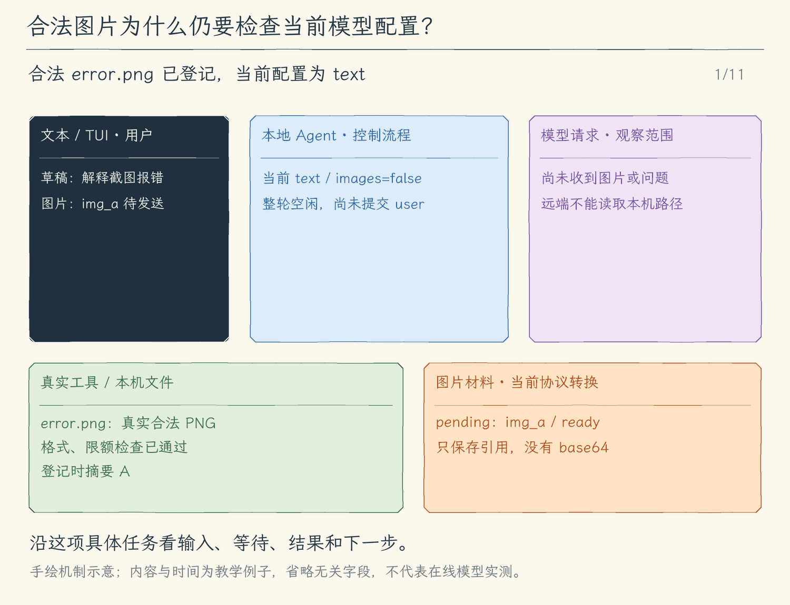

# 24.2 把截图转换成模型能接收的图片内容

[第 24 章首页](../README.md) · [上一节：24.1 附件引用](../01-attachment-references/README.md) · [本章练习与答案](../EXERCISES.md)

## 问题

文本附件可以解码成文字，截图却不行。把 PNG 字节当作 UTF-8 发送，会得到无意义字符；把路径 `screens/error.png` 写进消息，远端模型也看不到图片。

我们希望发送“根据这张错误截图，指出可确认的报错信息”，模型能实际接收图片。如果当前模型配置只支持文本，程序应在发请求前明确说明，而不是丢掉图片后让模型凭文字猜测。

## 解决方案

本节让附件引用支持有上限的 PNG 和 JPEG。程序先检查文件真实类型与大小，材料化时取得图片字节，再由 23.1 的适配器转换成对应协议的图片内容块。能力检查在转换前进行。

图片字节只在内存中参与本次请求。消息历史保留引用，不保留一长串 base64；会话写盘将在 24.3 接入这些引用。两种协议收到的 JSON 形状不同，附件指向的那张图片保持相同。

## 工作原理

### 一、扩展名和实际图片格式必须相符

把 `report.pdf` 重命名为 `report.png`，不会使它变成 PNG。程序需要检查文件开头的格式特征，并把确认的媒体类型记入引用。否则适配器可能声称上传的是 `image/png`，实际却发出另一种内容。

本节只接纳非交错 PNG，以及常见的基线或渐进 JPEG。PNG 还会检查块结构、校验码与有界解压后的扫描行，JPEG 检查段与扫描结构；目标服务仍负责自己的最终解码。每张图片最多 4 MiB，宽高各不超过 4096，像素总数不超过 16,777,216；一条消息最多两张图片、四份附件、附件总字节数最多 8 MiB。这里的范围是课程运行时已实现的范围；服务本身可能支持更多格式，我们仍需逐种实现和验证后才能接纳。

字节数限制也不等于精确 token 预算。图片的模型成本与服务处理规则相关，不能用“文件只有几 KB”推算真实 token。程序在本地先约束读取与请求大小，并为每张 ready 图片固定预留 8192 个估算 token。这是课程的保守估算值，不能冒充服务商 tokenizer；真实用量仍以服务报告为准。

### 二、图片与提问属于同一条用户消息

用户先 `/attach screens/error.png`，再输入问题。请求里的 user 内容会同时包含问题文本和图片块。这样模型能把“这张错误截图”与同条消息里的图片对应起来，而不是收到一份脱离任务的孤立图片。

OpenAI Chat Completions 使用图片 URL 内容块；本节将本地图片编码为带媒体类型的 data URL。Anthropic Messages 使用 image 内容块，其 source 描述 base64 编码、媒体类型和数据。两种形式的差异留在适配器，主循环继续保存内部消息。[OpenAI 图片输入文档](https://developers.openai.com/api/docs/guides/images-vision)、[Claude 视觉文档](https://platform.claude.com/docs/en/build-with-claude/vision)说明了各自可接收的内容形式。

base64 是把二进制字节表示成可放入 JSON 的文字。它不是对图片内容的理解，也不是压缩历史的办法；因此本节不会把 base64 写入会话存档。

### 三、能力检查要检查整份请求

23.2 的配置声明当前是否允许图片。声明为 `text` 时，即使图片文件本身完全合法，程序仍不能构造这份多模态请求。用户需要选择支持图片的配置，或移除图片。

检查对象不只包括新输入。切换模型后，历史里的旧 user 消息也可能关联图片；下次请求重放历史时，同样会遇到当前模型的能力边界。因此“切换配置成功”不保证“已有会话能够立即发给新模型”。请求前检查完整材料，才能解释真正发生冲突的位置。

能力检查失败时，不进入模型请求，也不把它伪装成一条模型回答。界面说明当前配置与附件的冲突，用户据此修正下一步。新的模型声明也只是本地配置；目标服务最终是否接受，由实际 API 响应确认。

### 四、模型看到了图片，也需要区分观察和推测

一张报错截图可能只显示半行日志。图片成功发送，只证明模型有机会读取这些像素，不保证每个字都识别正确，更不证明程序根因已经确定。

运行验证时，我们先让模型复述可见报错，再说明依据。若截图不足以定位问题，模型应继续请求必要文本或工具读取。这样图片进入了既有循环：观察材料→判断还缺什么→调用工具或给出有依据的回答。

<!-- media:lesson:start -->
下面从合法图片配 text 的拒绝开始：预检不提交问题、不收走 pending；用户切到 images 配置并再次提交后，请求准备才把真实字节转成当前协议内容块。两家内容块是替代形式，图片发送成功也不等于识别或根因判断正确。



[静态流程图](assets/attachment-image-preflight-flow-dc9c1661ec.png) · [静态封面](assets/attachment-image-preflight-cover-ac76723a9e.png) · [查看完整静态分镜](assets/attachment-image-preflight-storyboard-8ecfe7f46d.jpg)
<!-- media:lesson:end -->

## 本节改动文件

<!-- generated:files:start -->

| 状态 | 文件 | 本节变化 |
| --- | --- | --- |
| NEW | [src/attachments/image-format.ts](src/attachments/image-format.ts) | 按实际字节检查支持的 PNG/JPEG 格式、尺寸与像素上限。 |
| CHANGED | [src/attachments/store.ts](src/attachments/store.ts) | 增加图片类型、数量与字节限制，材料化为临时 base64。 |
| CHANGED | [src/models/protocol.ts](src/models/protocol.ts) | 把同一图片字节转换成各协议的图片内容块。 |

<!-- generated:files:end -->

## 动手构建

先按[环境准备文档](../../docs/SETUP.md) 准备依赖、构建脚本与模型配置，再从上一公开小节 24.1 的完整 `src/` 继续。新增文件完整保存，修改文件按精确差异应用；未列出的实现沿用。下面差异以前面公开块累计形成的读者工作树为基线，不需要复制仓库内最终快照覆盖自己的实现。

<!-- generated:build:start -->

<details>
<summary>NEW：src/attachments/image-format.ts 的完整文件</summary>

<!-- source: src/attachments/image-format.ts -->
```ts
/**
 * 24.2 图片协议转换 | [NEW] attachments/image-format.ts
 *
 * 学习目标：用本地文件的真实字节判断格式与尺寸，再转图片协议。
 * 输入：本地已校验的配置或消息；外部字段仍要在使用处检查。
 * 输出：独立的转换结果；失败停止当前操作，保留已提交历史。
 * 本文件局部流程：签名 -> 有界格式/尺寸检查 -> PNG/JPEG类型；错误拒绝发送
 * 观察：调用方等待完整结果后才继续，类型声明不会产生权限批准。
 */
import { inflateSync } from "node:zlib";
import { UserFacingError } from "../errors.js";
import { ATTACHMENT_LIMITS, type AttachmentRef } from "./store.js";

/**
 * PNG 块校验使用标准 CRC32，逐字节计算有界文件；不把扩展名当作格式证据。
 * 校验覆盖块类型和数据，避免缺块或损坏数据被直接转换为 base64。
 */
// [NEW 24.2] 按实际字节检查支持的 PNG/JPEG 格式、尺寸与像素上限。
function crc32(bytes: Buffer): number {
  let crc = 0xffffffff;
  for (const byte of bytes) {
    crc ^= byte;
    for (let bit = 0; bit < 8; bit++) crc = (crc >>> 1) ^ ((crc & 1) ? 0xedb88320 : 0);
  }
  return (crc ^ 0xffffffff) >>> 0;
}

/**
 * 检查 PNG 签名、块边界、CRC、IHDR 与解压后的扫描线长度和过滤字节。
 * 为保持无额外依赖的边界，课程只支持非交错 PNG；不把此检查宣称为通用图片解码器。
 */
function pngDimensions(bytes: Buffer): [number, number] {
  let offset = 8, width = 0, height = 0, expected = 0, rowBytes = 0, ended = false, sawData = false;
  const data: Buffer[] = [];
  while (offset + 12 <= bytes.length) {
    const size = bytes.readUInt32BE(offset), end = offset + size + 12;
    if (end > bytes.length || size > ATTACHMENT_LIMITS.imageBytes) throw new UserFacingError("PNG 块长度无效。");
    const type = bytes.toString("ascii", offset + 4, offset + 8), chunk = bytes.subarray(offset + 8, end - 4);
    if (crc32(bytes.subarray(offset + 4, end - 4)) !== bytes.readUInt32BE(end - 4)) throw new UserFacingError("PNG 块校验失败。");
    if (!width && type !== "IHDR") throw new UserFacingError("PNG 缺少起始 IHDR。");
    if (type === "IHDR") {
      if (width || size !== 13) throw new UserFacingError("PNG IHDR 无效。");
      width = chunk.readUInt32BE(0); height = chunk.readUInt32BE(4); checkDimensions(width, height);
      const depth = chunk[8], color = chunk[9], channels: Record<number, number> = { 0: 1, 2: 3, 3: 1, 4: 2, 6: 4 };
      const depths: Record<number, number[]> = { 0: [1, 2, 4, 8, 16], 2: [8, 16], 3: [1, 2, 4, 8], 4: [8, 16], 6: [8, 16] };
      if (!depths[color]?.includes(depth) || chunk[10] !== 0 || chunk[11] !== 0 || chunk[12] !== 0) throw new UserFacingError("仅支持标准压缩、非交错 PNG。");
      rowBytes = Math.ceil(width * channels[color] * depth / 8); expected = (rowBytes + 1) * height;
      if (expected > 128 * 1024 * 1024) throw new UserFacingError("PNG 解压数据超过本地限制。");
    } else if (type === "IDAT") { data.push(chunk); sawData = true; }
    else if (type === "IEND") { if (size || end !== bytes.length || !sawData) throw new UserFacingError("PNG 结束块无效。"); ended = true; break; }
    offset = end;
  }
  if (!ended) throw new UserFacingError("PNG 文件不完整。");
  let raw: Buffer;
  try { raw = inflateSync(Buffer.concat(data), { maxOutputLength: expected }); } catch { throw new UserFacingError("PNG 压缩内容无效或超过尺寸。"); }
  if (raw.length !== expected) throw new UserFacingError("PNG 扫描线长度与尺寸不一致。");
  for (let row = 0; row < height; row++) if (raw[row * (rowBytes + 1)] > 4) throw new UserFacingError("PNG 扫描线过滤类型无效。");
  return [width, height];
}

/**
 * 检查 JPEG 标记边界与帧尺寸，要求扫描数据和末尾 EOI。
 * 课程接纳常见 baseline/progressive JPEG；熵编码的完整解码仍由服务端图片解析器完成。
 */
function jpegDimensions(bytes: Buffer): [number, number] {
  let offset = 2, width = 0, height = 0, scan = false;
  if (bytes.length < 12 || bytes.readUInt16BE(bytes.length - 2) !== 0xffd9) throw new UserFacingError("JPEG 文件不完整。");
  while (offset < bytes.length - 2) {
    if (bytes[offset++] !== 0xff) throw new UserFacingError("JPEG 标记无效。");
    while (bytes[offset] === 0xff) offset++;
    const marker = bytes[offset++];
    if (marker === 0xd9) break;
    if (marker === 0x00 || marker === 0xd8 || marker >= 0xd0 && marker <= 0xd7) throw new UserFacingError("JPEG 段顺序无效。");
    if (offset + 2 > bytes.length) throw new UserFacingError("JPEG 段不完整。");
    const length = bytes.readUInt16BE(offset), end = offset + length;
    if (length < 2 || end > bytes.length - 2) throw new UserFacingError("JPEG 段长度无效。");
    if (marker === 0xc0 || marker === 0xc2) {
      if (width || length < 11 || bytes[offset + 2] !== 8) throw new UserFacingError("JPEG 帧格式不支持。");
      height = bytes.readUInt16BE(offset + 3); width = bytes.readUInt16BE(offset + 5); checkDimensions(width, height);
      const components = bytes[offset + 7];
      if (![1, 3, 4].includes(components) || length !== 8 + components * 3) throw new UserFacingError("JPEG 颜色分量无效。");
    } else if ([0xc1, 0xc3, 0xc5, 0xc6, 0xc7, 0xc9, 0xca, 0xcb, 0xcd, 0xce, 0xcf].includes(marker)) throw new UserFacingError("只支持 baseline/progressive JPEG。");
    if (marker === 0xda) {
      if (!width || length < 6) throw new UserFacingError("JPEG 扫描数据缺少帧信息。");
      scan = true; offset = end;
      while (offset < bytes.length - 2) {
        if (bytes[offset] !== 0xff) { offset++; continue; }
        const next = bytes[offset + 1];
        if (next === 0x00 || next >= 0xd0 && next <= 0xd7) { offset += 2; continue; }
        break;
      }
    } else offset = end;
  }
  if (!width || !scan || offset !== bytes.length - 2) throw new UserFacingError("JPEG 缺少完整扫描数据。");
  return [width, height];
}

/**
 * 像素边长和面积同时检查，防止很小的压缩文件声明超大图像。
 * 这里的限制是课程本地策略，不冒充任何模型服务的公开上限。
 */
function checkDimensions(width: number, height: number): void {
  if (!width || !height || width > ATTACHMENT_LIMITS.edge || height > ATTACHMENT_LIMITS.edge || width * height > ATTACHMENT_LIMITS.pixels) throw new UserFacingError("图片尺寸超过 4096×4096 或像素限制。");
}

/**
 * 按真实签名选择 PNG/JPEG，并要求扩展名声明一致；限制格式后才做协议转换。
 * 返回类型来自字节检查，既不推测 URL，也不下载远端附件。
 */
export function validateImage(bytes: Buffer, extension: string): AttachmentRef["mediaType"] {
  if (bytes.length > ATTACHMENT_LIMITS.imageBytes) throw new UserFacingError("图片附件超过 4 MiB。");
  const png = bytes.length >= 8 && bytes.subarray(0, 8).equals(Buffer.from([137,80,78,71,13,10,26,10]));
  const jpeg = bytes.length >= 3 && bytes[0] === 0xff && bytes[1] === 0xd8 && bytes[2] === 0xff;
  if (png && extension === ".png") { pngDimensions(bytes); return "image/png"; }
  if (jpeg && [".jpg", ".jpeg"].includes(extension)) { jpegDimensions(bytes); return "image/jpeg"; }
  throw new UserFacingError("图片内容与 PNG/JPEG 扩展名不一致，或格式不支持。");
}
```

</details>

<details>
<summary>CHANGED：src/attachments/store.ts 的精确差异</summary>

<!-- source: src/attachments/store.ts -->
```diff
--- a/src/attachments/store.ts
+++ b/src/attachments/store.ts
@@ -1,5 +1,5 @@
 /**
- * 24.1 附件引用 | [NEW] attachments/store.ts
+ * 24.2 图片协议转换 | [CHANGED] attachments/store.ts
  *
  * 学习目标：把可发送附件与聊天文字分开，读取时固定来源与内容摘要。
  * 输入：本地已校验的配置或消息；外部字段仍要在使用处检查。
@@ -7,6 +7,7 @@
  * 本文件局部流程：/attach -> 有界读取/校验 -> pending ref -> user消息 -> 请求前重新校验
  * 观察：调用方等待完整结果后才继续，类型声明不会产生权限批准。
  */
+import { validateImage } from "./image-format.js";
 import { open, realpath } from "node:fs/promises";
 import { isAbsolute, relative, resolve, sep, extname } from "node:path";
 import { createHash, randomUUID } from "node:crypto";
@@ -14,7 +15,6 @@
 import { UserFacingError } from "../errors.js";
 import type { Message } from "../models/client.js";
 
-// [NEW 24.1] 登记有界 UTF-8 引用，预检后提交，请求前再次核对内容。
 export const ATTACHMENT_LIMITS = { textBytes: 64 * 1024, imageBytes: 4 * 1024 * 1024, totalBytes: 8 * 1024 * 1024, count: 4, images: 2, edge: 4096, pixels: 16_777_216 } as const;
 export type AttachmentRef = { id: string; path: string; mediaType: "text/plain" | "image/png" | "image/jpeg"; byteLength: number; sha256: string; status: "ready" | "missing" | "reattach" };
 export type PreparedAttachment = { ref: AttachmentRef; text?: string; base64?: string };
@@ -81,11 +81,12 @@
 }
 
 /**
- * 24.1 只接纳严格 UTF-8 文本；不靠扩展名把任意二进制伪装成文字。
- * 图片在后续协议节添加独立签名与尺寸检查，此处先完整拒绝。
+ * 文本须为严格 UTF-8；图片扩展名必须与真实签名、结构和尺寸一致。
+ * 二进制数据不能经过文字分支伪装成可用的附件正文。
  */
+// [CHANGED 24.2] 增加图片类型、数量与字节限制，材料化为临时 base64。
 function describeBytes(bytes: Buffer, path: string): { mediaType: AttachmentRef["mediaType"]; text?: string } {
-  if ([".png", ".jpg", ".jpeg"].includes(extname(path).toLowerCase())) throw new UserFacingError("本节只支持 UTF-8 文本附件。");
+  if ([".png", ".jpg", ".jpeg"].includes(extname(path).toLowerCase())) return { mediaType: validateImage(bytes, extname(path).toLowerCase()) };
   if (bytes.length > ATTACHMENT_LIMITS.textBytes) throw new UserFacingError("文本附件超过 64 KiB。");
   let text: string;
   try { text = new TextDecoder("utf-8", { fatal: true }).decode(bytes); } catch { throw new UserFacingError("文本附件必须是有效 UTF-8。"); }
```

</details>

<details>
<summary>CHANGED：src/models/protocol.ts 的精确差异</summary>

<!-- source: src/models/protocol.ts -->
```diff
--- a/src/models/protocol.ts
+++ b/src/models/protocol.ts
@@ -1,5 +1,5 @@
 /**
- * 24.1 附件引用 | [CHANGED] models/protocol.ts
+ * 24.2 图片协议转换 | [CHANGED] models/protocol.ts
  *
  * 学习目标：把协议差异留在一个出口；核心只看统一消息与完整结果。
  * 输入：本地已校验的配置或消息；外部字段仍要在使用处检查。
@@ -34,7 +34,6 @@
  * generate 统一接收消息、工具、提示和预算；完整参数校验仍在协议响应出口完成。
  * 创建对象不发送请求；SDK 禁止自动重试，取消由调用方传入。
  */
-// [CHANGED 24.1] 把经核验的文本作为用户材料加入两种请求。
 export function createProtocolAdapter(config: Config): ProtocolAdapter {
   const workspaceRoot = findProjectRoot();
   const options = { apiKey: config.apiKey, baseURL: config.baseURL, timeout: 60_000, maxRetries: 0, logLevel: "off" as const };
@@ -139,9 +138,18 @@
  * - 关键步骤：工具结果转换成 `role=tool`，助手工具请求转换成 `tool_calls`。
  * - 职责边界：只转换内存数据，不发送请求，也不执行工具。
  */
+// [CHANGED 24.2] 把同一图片字节转换成各协议的图片内容块。
 export function toOpenAIMessages(messages: Message[], prepared: Map<string, PreparedAttachment> = new Map()): ChatCompletionMessageParam[] {
   return messages.map((message) => {
-    if (message.role === "user") return { role: "user", content: [message.content, ...(message.attachments ?? []).map(ref => prepared.get(ref.id)?.text ?? `[附件 ${ref.path} 未提供正文]`)].join("\n\n") };
+    if (message.role === "user") {
+      const content: import("openai/resources/chat/completions/completions").ChatCompletionContentPart[] = [{ type: "text", text: message.content }];
+      for (const ref of message.attachments ?? []) {
+        const item = prepared.get(ref.id);
+        if (item?.base64) content.push({ type: "image_url", image_url: { url: `data:${ref.mediaType};base64,${item.base64}`, detail: "auto" } });
+        else content.push({ type: "text", text: item?.text ?? `[附件 ${ref.path} 未提供正文]` });
+      }
+      return { role: "user", content };
+    }
     if (message.role === "tool") {
       return { role: "tool", tool_call_id: message.toolCallId, content: message.content };
     }
@@ -188,7 +196,13 @@
       continue;
     }
     if (message.role === "user") {
-      converted.push({ role: "user", content: [message.content, ...(message.attachments ?? []).map(ref => prepared.get(ref.id)?.text ?? `[附件 ${ref.path} 未提供正文]`)].join("\n\n") });
+      const blocks: ContentBlockParam[] = [{ type: "text", text: message.content }];
+      for (const ref of message.attachments ?? []) {
+        const item = prepared.get(ref.id);
+        if (item?.base64 && ref.mediaType !== "text/plain") blocks.push({ type: "image", source: { type: "base64", media_type: ref.mediaType, data: item.base64 } });
+        else blocks.push({ type: "text", text: item?.text ?? `[附件 ${ref.path} 未提供正文]` });
+      }
+      converted.push({ role: "user", content: blocks });
       index += 1;
       continue;
     }
```

</details>

<!-- generated:build:end -->

## 运行验证

先从仓库根编译本节完整快照：

```bash
npm run lesson:24.2
```

再按照 [本章完整答案](../EXERCISES.md#构建与运行) 的“单独编译练习”步骤，准备 `ATTACHMENT_EXERCISE`。本节只运行第 2 组，运行命令与上面的构建命令分开：

```bash
node "$ATTACHMENT_EXERCISE/verify-attachments.js" 2
```

输出“通过二”说明同一张真实 PNG 被转换成两种协议的图片块，文本配置在准备请求时拒绝图片。断言检查字节与字段，不替在线模型判断图片语义。

需要观察交互入口时，在同一份编译结果上另行运行：

```bash
node dist/cli.js --output tui
```

## 本节完成后的 Agent

现在，一张合规截图可以在声明接纳图片的配置下形成真实图片内容块；字节与身份校验仍先于请求。下一节处理保存后文件变化、缺失与重新选择。

本节状态：待用户确认。
