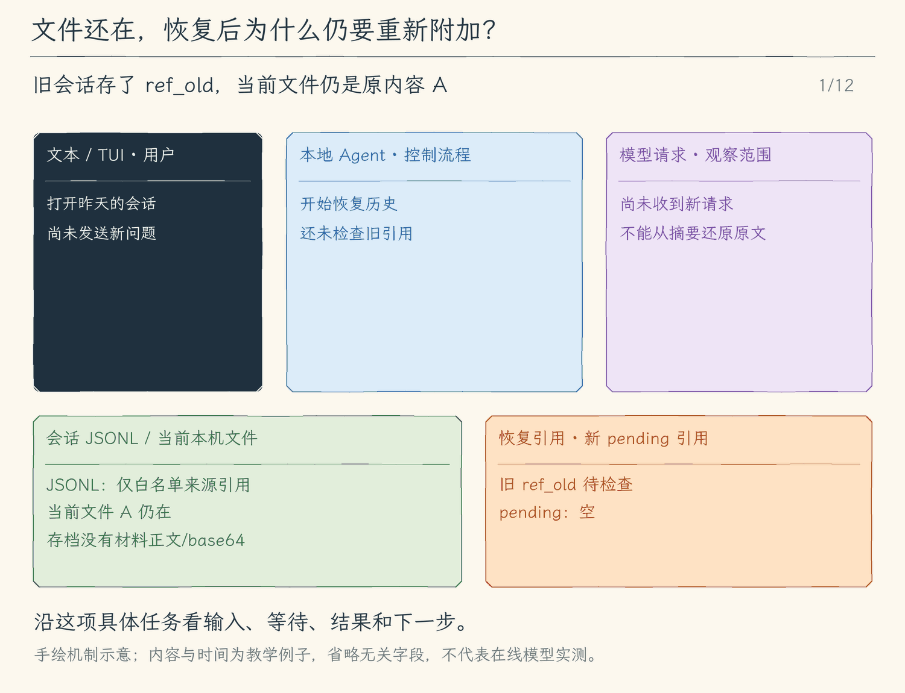

# 24.3 恢复会话时重新核对附件

[第 24 章首页](../README.md) · [上一节：24.2 图片协议](../02-image-protocol/README.md) · [本章练习与答案](../EXERCISES.md)

## 问题

昨天附上的 `screens/error.png`，今天可能已经被删除，也可能被另一张同名截图覆盖。会话 JSON 仍保存相同路径，但磁盘上的现状已不同。

如果恢复时直接重新读取路径并发送，模型会把今天的图片放进昨天的对话位置。它可能继续回答得很流畅，却是在一条被悄悄替换证据的历史上推理。反过来，如果文件不存在，程序也不能用空内容代替，让模型以为旧材料仍在。

## 解决方案

恢复会话时，我们保留“曾经附过什么”的引用，并检查当前文件状态；旧引用不自动取得重新发送的资格。需要原材料参与新请求时，用户通过 `/attach` 再次明确选择当前文件。

这条规则把两件事分开：恢复历史记录，和重新授权使用磁盘上的当前内容。路径、大小和摘要能帮助解释变化，显式重新附加则表明用户现在要使用哪份材料。

## 工作原理

### 一、存档可以记录身份，不能还原未保存的字节

前两节已经让内存消息只保留引用，本节把这份契约扩展到会话存档：保存时只投影白名单引用字段，恢复时再校验字段与文件状态。因此存档里有路径、媒体类型、字节数和摘要，却没有图片本体。恢复 JSON 后，程序能知道“这条消息曾附过一张摘要为 A 的 PNG”，无法根据摘要计算回原图。

因此恢复不是复制粘贴旧请求。程序需要重新评估外部依赖：当前路径还存在吗？内容还与记录一致吗？即使内容一致，当前进程是否已经确认本次使用？

这与恢复一条纯文本消息不同。文本已经在 JSON 中，读回就是相同内容；附件字节留在磁盘，存档和文件可能各自变化。

### 二、文件存在也不能默认重新发出

考虑恢复后的两种情况：

```text
旧引用：screens/error.png，摘要 A
情况一：文件找不到、内容变化或检查失败 → missing
情况二：文件存在且与旧引用相符 → reattach
两种情况都不重发旧附件字节
```

`missing` 表示旧材料当前不可用，`reattach` 表示找到了相同材料但需要重新选择。第二种情况刻意保守：恢复一个旧聊天，不应自动把当前磁盘上的图片发送到模型。即使文件内容没变，用户也可能只想查阅历史；即使路径没变，内容也可能已经更新。

程序用状态说明“历史引用仍在，但当前请求不携带其字节”。模型需要看到相应解释，不能把未发送的图片当作自己已经看见的材料。缺失状态同样不是一份空图片，而是一条材料不可用的事实。

### 三、重新附加建立本次可用的引用

用户确认当前文件后执行 `/attach screens/error.png`。程序按 24.1/24.2 的同一流程检查路径、类型、大小与内容摘要，创建待发送引用。下一个问题将这份引用关联到新的 user 消息，再在请求前材料化。

这样历史无需被改写：旧消息记录当时使用过的附件，新消息记录现在重新选定的附件。若文件已变化，新的摘要自然不同，程序不会把新内容冒充旧证据。

如果文件确实丢失，下一步由用户提供可用文件，或继续提问时明确接受缺少材料的范围。程序不自行搜索一个同名文件代替，因为路径相似不证明内容相同。

### 四、恢复检查与发送前检查各解决一个时间窗口

恢复时检查，帮助界面尽早解释哪些附件不可用；用户重新附加形成 ready 新引用后，发送前再次检查，捕捉登记之后、点击发送之前的改动。旧的 missing/reattach 引用只生成状态说明，不再取回字节。前者改善可见性，后者维护本次请求的内容承诺。

二者都需要失败路径：文件移动、解码失败、超限或摘要变化，都应回到明确可修正的状态。不会因为旧会话里曾经接纳过，就跳过新一次磁盘读取的验证。

本章最终得到一条完整链路：用户选择文件→引用关联消息→发送前校验→协议转换→模型判断；保存恢复之后，文件内容重新经过显式选择。下一章会让另一条独立 Agent 循环处理局部任务，同样需要把输入来源、执行过程与返回结果区分清楚。

<!-- media:lesson:start -->
下面让旧文件完全不变：恢复仍把旧引用标为 reattach，请求只携带说明；用户显式重新附加后，新引用才随新问题提供实际材料。若文件缺失或变化，静态图中的 missing 分支同样允许文字会话继续。



[静态流程图](assets/attachment-explicit-reattach-flow-2901c1bfa2.png) · [静态封面](assets/attachment-explicit-reattach-cover-fbdadc61d0.png) · [查看完整静态分镜](assets/attachment-explicit-reattach-storyboard-0fb9007468.jpg)
<!-- media:lesson:end -->

## 本节改动文件

<!-- generated:files:start -->

| 状态 | 文件 | 本节变化 |
| --- | --- | --- |
| CHANGED | [src/sessions/save-session.ts](src/sessions/save-session.ts) | 对白名单附件引用持久化，拒绝原始字节与额外字段。 |
| CHANGED | [src/sessions/read-session.ts](src/sessions/read-session.ts) | 恢复后核对文件并把旧引用标为 reattach 或 missing。 |

<!-- generated:files:end -->

## 动手构建

先按[环境准备文档](../../docs/SETUP.md) 准备依赖、构建脚本与模型配置，再从上一公开小节 24.2 的完整 `src/` 继续。新增文件完整保存，修改文件按精确差异应用；未列出的实现沿用。下面差异以前面公开块累计形成的读者工作树为基线，不需要复制仓库内最终快照覆盖自己的实现。

<!-- generated:build:start -->

<details>
<summary>CHANGED：src/sessions/save-session.ts 的精确差异</summary>

<!-- source: src/sessions/save-session.ts -->
```diff
--- a/src/sessions/save-session.ts
+++ b/src/sessions/save-session.ts
@@ -1,5 +1,5 @@
 /**
- * 19.3 模型选择与资源读取 | [KEEP] sessions/save-session.ts
+ * 24.3 附件会话恢复 | [CHANGED] sessions/save-session.ts
  *
  * 学习目标：把内存会话保存成版本明确、可逐行查看的 JSONL 检查点。
  * 输入：会话目录、模型消息、模式、清单和未交付补充；不接收模型连接配置或授权。
@@ -71,11 +71,12 @@
  * 输入可能在下一次 await 后继续改变；本函数立即深复制消息、调用、清单和队列。
  * 输出不含授权、连接配置、屏幕事件或编辑草稿；它们不属于恢复模型上下文的消息。
  */
+// [CHANGED 24.3] 对白名单附件引用持久化，拒绝原始字节与额外字段。
 function copySessionState(state: SessionState): SessionState {
   return {
     messages: state.messages.map((message): Message => {
       if (message.role === "tool") return { role: "tool", toolCallId: message.toolCallId, content: message.content, isError: message.isError };
-      if (message.role === "user") return { role: "user", content: message.content };
+      if (message.role === "user") return { role: "user", content: message.content, ...(message.attachments ? { attachments: message.attachments.map(ref => ({ ...ref })) } : {}) };
       return { role: "assistant", content: message.content, ...(message.toolCalls ? {
         toolCalls: message.toolCalls.map((call) => ({ id: call.id, name: call.name, arguments: call.arguments })),
       } : {}) };
```

</details>

<details>
<summary>CHANGED：src/sessions/read-session.ts 的精确差异</summary>

<!-- source: src/sessions/read-session.ts -->
```diff
--- a/src/sessions/read-session.ts
+++ b/src/sessions/read-session.ts
@@ -1,5 +1,5 @@
 /**
- * 19.3 模型选择与资源读取 | [KEEP] sessions/read-session.ts
+ * 24.3 附件会话恢复 | [CHANGED] sessions/read-session.ts
  *
  * 学习目标：先检查文件内容，再把最后一个完整、可信的状态交给恢复入口。
  * 输入：会话 UUID 与保存目录；磁盘里的 JSON 仍是未知数据，不能直接当作 SessionState。
@@ -14,6 +14,7 @@
 import { UserFacingError } from "../errors.js";
 import type { Message } from "../models/client.js";
 import { validateCompaction } from "../context/compaction.js";
+import { validateAttachmentRefs, restoreAttachmentStatuses } from "../attachments/store.js";
 import type { CheckpointReason, SessionState } from "./save-session.js";
 
 // [KEEP 来自 13.2] 大小限制约束一次读取的内存；本章还没有增量索引或历史压缩。
@@ -75,6 +76,7 @@
  * 工具结果必须紧跟自己的调用批次、逐一对应；这里只检查关系，不调用工具注册表。
  * 队列编号、任务归属和下一编号一起检查，避免恢复后发生编号碰撞或跨任务投递。
  */
+// [CHANGED 24.3] 恢复后核对文件并把旧引用标为 reattach 或 missing。
 export function validateSessionState(value: unknown): SessionState {
   const state = objectWithKeys(value, ["messages", "mode", "tasks", "pendingInputs", "run", "nextInputId"], ["context"]);
   if (state.mode !== "plan" && state.mode !== "execute") throw new Error("未知模式");
@@ -82,7 +84,7 @@
   if (!Array.isArray(state.messages) || !Array.isArray(state.tasks) || !Array.isArray(state.pendingInputs)) throw new Error("状态列表不是数组");
   let expected: string[] = [];
   const messages: Message[] = state.messages.map((value): Message => {
-    const message = objectWithKeys(value, ["role", "content"], ["toolCalls", "toolCallId", "isError"]);
+    const message = objectWithKeys(value, ["role", "content"], ["toolCalls", "toolCallId", "isError", "attachments"]);
     if (typeof message.content !== "string") throw new Error("消息正文不是文字");
     if (message.role === "tool") {
       objectWithKeys(message, ["role", "content", "toolCallId", "isError"]);
@@ -91,9 +93,9 @@
     }
     if (expected.length) throw new Error("工具批次缺少结果");
     if (message.role === "user") {
-      objectWithKeys(message, ["role", "content"]);
+      objectWithKeys(message, ["role", "content"], ["attachments"]);
       text(message.content);
-      return { role: "user", content: message.content };
+      return { role: "user", content: message.content, ...(message.attachments !== undefined ? { attachments: validateAttachmentRefs(message.attachments) } : {}) };
     }
     if (message.role !== "assistant") throw new Error("未知消息角色");
     objectWithKeys(message, ["role", "content"], ["toolCalls"]);
@@ -222,5 +224,6 @@
   const hasTrailingFragment = validBytes < bytes.length;
   const warnings = hasTrailingFragment ? ["末尾有未换行片段，已忽略该片段；前面的完整记录仍可查看，原文件未修改。"] : [];
   if (interrupted) warnings.push("最后启动的任务没有结束记录，可能已有未记录的操作；继续前请核对工作区和进程，不要直接重做工具。");
+  if (state && await restoreAttachmentStatuses(state.messages as Message[], header!.workspace ?? header!.cwd)) warnings.push("已恢复附件来源引用；文件缺失/变化标记 missing，其余标记 reattach。旧正文不会自动重发，请重新 /attach 后提交新消息。");
   return { header: header!, state, seq, warnings, interrupted, name, lastReason, validBytes, hasTrailingFragment, updatedAt };
 }
```

</details>

<!-- generated:build:end -->

## 运行验证

先从仓库根编译本节完整快照：

```bash
npm run lesson:24.3
```

再按照 [本章完整答案](../EXERCISES.md#构建与运行) 的“单独编译练习”步骤，准备 `ATTACHMENT_EXERCISE`。本节只运行第 3 组，运行命令与上面的构建命令分开：

```bash
node "$ATTACHMENT_EXERCISE/verify-attachments.js" 3
```

输出“通过三”说明真实 JSONL 只保存引用，恢复后文件尚在也不会重发正文；文件缺失仍能恢复聊天，重新附加产生新引用。检查恢复状态，比只看到“会话已打开”更能证明材料边界。

## 本节完成后的 Agent

现在，恢复聊天会保留附件来源而不自动重发磁盘当前内容；重新选择建立本次引用。下一章把局部调查交给独立循环，再把有来源的结果接回主任务。

本节状态：待用户确认。
