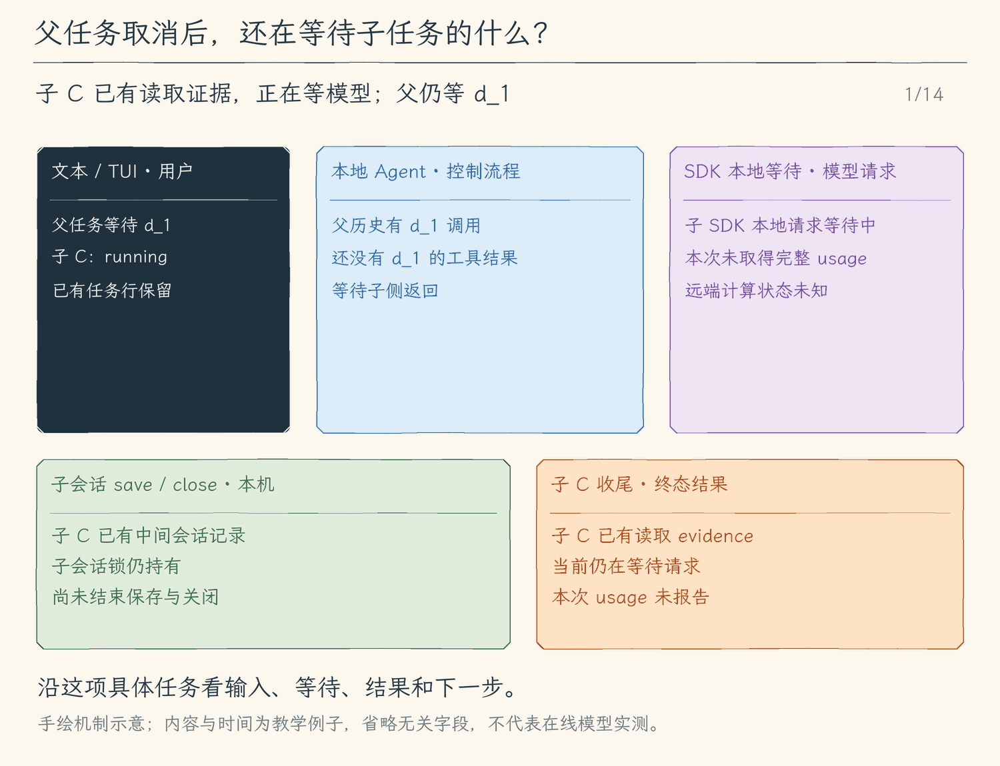

# 25.3 把子任务进度与终态交还父任务

[第 25 章首页](../README.md) · [上一节：25.2 只读角色](../02-readonly-roles/README.md) · [本章练习与答案](../EXERCISES.md)

## 问题

父循环等待子任务时，终端可能一段时间没有父模型文字。如果界面只显示一个持续转动的等待标记，用户无法知道程序正在找文件、读材料，还是已经卡在一个失败的请求上。

另一种误解发生在取消之后：界面写“已停止”，是否就证明远端模型已经不再消耗算力？程序能确认的是本地取消链路及清理完成情况，不能仅凭一个状态标签证明远端计算已经停止。

本节让子任务进度可见，并把成功、失败和取消的结果明确交回父流程。

## 解决方案

子循环向父侧发出带子任务身份的观察事件。界面显示角色、当前状态和工具活动；子任务结束时，程序形成结构化结果，包含终态、摘要或错误，以及本地证据。

观察事件用于让用户理解过程，工具结果用于让父模型继续判断。两者来自同一任务，却承担不同职责：界面显示过一次“读取文件”，不能代替父历史中的实际读取结果。

## 工作原理

### 一、子任务身份把事件归到正确的行

子侧把已建立会话、模型请求、工具开始和最终收尾转换成 `child_state` 事件。事件携带子会话编号、父会话编号、角色、状态和说明；父循环只转发这些状态事件，不转发子模型的文字增量。TUI 的 `RunView.children` 按子会话编号替换最新记录，历史显示再据此生成子任务条目。这样“开始”“只读工具执行中”“结束”更新的是对应任务行，而不是父模型回答。

例如，父任务正在组织会话机制说明，子任务正在搜索 `saveSession`。界面可以分别显示父任务等待委派、子任务读取文件；不会把子模型的一段中间推测提前展示成父模型的最终结论。

本章顺序运行子任务，因此同一时刻只等待当前委派。独立编号仍然必要：前一个任务的完成记录会保留，下一次委派需要新的状态，旧事件不能污染新任务。

### 二、终态是程序收齐的结果，结论仍需判断

正常结束说明子循环取得了可接受的模型终止结果，不代表它的结论已经由程序证实。失败说明某一步没有完成，返回内容应保留失败原因与已经取得的证据，不能把部分工作改写成“检查通过”。

父模型收到这些结果后可以做不同决策：正常且证据充分，继续组织答案；正常但证据不足，补充读取；失败但已定位入口，解释当前已知范围并决定是否重试。结构化终态的价值，是让这些选择基于实际经过。

步骤上限也需要清晰收尾。子模型若持续搜索而不结束，循环不能无限占用父任务。达到本地上限应成为未完成结果，已有证据仍有价值，但不能包装成完整审查。

### 三、取消沿父子链路传播，并等待本地收尾

假设子任务正在等模型响应。用户取消父任务后，父子共用的停止信号被中止，适配器已把它传给 SDK，SDK 的本地请求等待因取消而退出。若正在读取文件，则工具在取消检查点退出；子循环不再发起下一步。这能证明本地链路停止等待，不能证明远端服务已立即停止计算。

退出循环之后，子侧仍要在 `finally` 中等待结束检查点保存，再等待会话关闭、释放锁。保存或关闭失败会追加错误说明，不能冒充已保存成功；这些尝试结束后，才返回带 `cancelled` 的结构化结果。已经取得的文件证据保留；已发出请求却没有完整响应或用量报告时，用量是未知 `null`，本地清理不能把它补成零。

| 时刻 | 子任务状态 | 父侧在等什么或保存什么 |
| --- | --- | --- |
| 取消前 | 请求或工具正在运行。 | 顺序等待本次委派结果。 |
| 本地收尾中 | 当前等待已退出，仍在保存结束检查点并关闭会话。 | 继续等待子侧返回，不能只见到中止信号就宣布收尾完成。 |
| 子侧返回后 | 结果含 `cancelled`、证据及可能的保存错误。 | 按原委派调用编号保存工具结果，追加本轮取消说明，再保存父检查点。 |

父循环接到结果后仍遵守同一个取消信号，因此不会再请求模型自动总结。取消结果此时已经进入父历史，但父模型要等用户下一条输入发起新请求，才能看到它并据此继续判断。

### 四、父模型收到结果，用户看见工作边界

最终，子任务的中间历史留在子循环里，供它完成局部推理；父历史获得一次带原委派调用编号的结果；界面获得可识别的进度与终态。三份数据分别回答“子模型据什么继续”“父模型据什么继续”“用户看见正在发生什么”。

本章没有改变 Agent 的基本循环。我们只是把它放进一个范围更小、历史独立、工具更少的任务里，再通过工具结果接回父循环。理解这条返回路径，才能在后续增加并行和后台任务时，继续保持状态与结果一致。

<!-- media:lesson:start -->
下面取消一个正在等模型响应的子任务：共享信号先结束 SDK 的本地等待，子侧再等待结束保存和 close；cancelled 结构结果按原 d_1 进入父历史，本轮停止。最后两步明确属于用户新输入启动的下一轮，此时父模型才读到取消结果。远端是否停算始终未知。



[静态流程图](assets/child-cancel-cleanup-flow-0ea0900a4b.png) · [静态封面](assets/child-cancel-cleanup-cover-25449047bb.png) · [查看完整静态分镜](assets/child-cancel-cleanup-storyboard-8f7172e521.jpg)
<!-- media:lesson:end -->

## 本节改动文件

<!-- generated:files:start -->

| 状态 | 文件 | 本节变化 |
| --- | --- | --- |
| CHANGED | [src/subagents/runner.ts](src/subagents/runner.ts) | 把开始、运行与清理后的终态转为带身份的 child_state。 |
| CHANGED | [src/agent/events.ts](src/agent/events.ts) | 定义子任务身份、角色、状态与说明的观察事件。 |
| CHANGED | [src/agent/agent-loop.ts](src/agent/agent-loop.ts) | 只把子状态转发给父观察者，子文字留在子历史。 |
| CHANGED | [src/ui/teaching-trace.ts](src/ui/teaching-trace.ts) | 把子状态转换成可读过程说明。 |
| CHANGED | [src/ui/tui/state.ts](src/ui/tui/state.ts) | 按子会话编号保存最新显示状态。 |
| CHANGED | [src/ui/tui/transcript.tsx](src/ui/tui/transcript.tsx) | 从本地子状态生成可区分的任务条目。 |

<!-- generated:files:end -->

## 动手构建

先按[环境准备文档](../../docs/SETUP.md) 准备依赖、构建脚本与模型配置，再从上一公开小节 25.2 的完整 `src/` 继续。新增文件完整保存，修改文件按精确差异应用；未列出的实现沿用。下面差异以前面公开块累计形成的读者工作树为基线，不需要复制仓库内最终快照覆盖自己的实现。

<!-- generated:build:start -->

<details>
<summary>CHANGED：src/subagents/runner.ts 的精确差异</summary>

<!-- source: src/subagents/runner.ts -->
```diff
--- a/src/subagents/runner.ts
+++ b/src/subagents/runner.ts
@@ -1,5 +1,5 @@
 /**
- * 25.2 只读角色与结果 | [CHANGED] subagents/runner.ts
+ * 25.3 子任务状态 | [CHANGED] subagents/runner.ts
  *
  * 学习目标：用相同循环创建独立子会话，父任务等待结构化结果再继续。
  * 输入：本地已校验的配置或消息；外部字段仍要在使用处检查。
@@ -9,7 +9,7 @@
  */
 import { randomUUID } from "node:crypto";
 import { agentLoop } from "../agent/agent-loop.js";
-import type { AgentObserver } from "../agent/events.js";
+import { emitAgentEvent, type AgentObserver } from "../agent/events.js";
 import type { Message, Model } from "../models/client.js";
 import type { ApprovalHandler } from "../permissions/policy.js";
 import { createSessionWriter, type SessionWriter } from "../sessions/save-session.js";
@@ -19,7 +19,6 @@
 export const CHILD_TOOLS = ["read_file", "glob", "grep"] as const;
 export type ChildRole = "explore" | "review";
 export type ChildStatus = "completed" | "failed" | "cancelled" | "budget_exhausted";
-// [CHANGED 25.2] 从成功本地工具元数据收集有界证据，保留未知用量。
 export type ChildEvidence = { kind: "read" | "match" | "listed"; path: string; startLine?: number; endLine?: number };
 export type ChildResult = { sessionId: string; parentSessionId: string; role: ChildRole; status: ChildStatus; summary: string; evidence: ChildEvidence[]; usage: { inputTokens: number | null; outputTokens: number | null; cachedInputTokens: number | null; cacheWriteTokens: number | null }; modelCalls: number; requestTokensReserved: number; error?: string };
 export type ChildOptions = { parentSessionId?: string; sessionDirectory?: string; requestApproval?: ApprovalHandler; observer?: AgentObserver; depth?: number; maxModelCalls?: number; requestTokenBudget?: number };
@@ -66,6 +65,7 @@
  * 子历史、清单、摘要游标、授权与预算各自持有；父取消等待子循环、检查点与句柄关闭。
  * 失败和取消仍返回结构化状态，写盘失败不会掩盖原取消，finally 总尝试关闭会话锁。
  */
+// [CHANGED 25.3] 把开始、运行与清理后的终态转为带身份的 child_state。
 export async function runSubagent(model: Model, argumentsJson: string, signal: AbortSignal, options: ChildOptions = {}): Promise<ChildResult> {
   const { role, task } = parseChildTask(argumentsJson);
   const parentSessionId = options.parentSessionId ?? randomUUID();
@@ -75,15 +75,25 @@
   let usageReports = 0;
   const maxCalls = Math.min(4, Math.max(1, Math.floor(Number.isFinite(options.maxModelCalls) ? options.maxModelCalls! : 4)));
   const tokenBudget = Math.min(32_768, Math.max(1, Math.floor(Number.isFinite(options.requestTokenBudget) ? options.requestTokenBudget! : 32_768)));
+  /**
+   * 只发送本地确定的子状态；状态通知不替代父工具结果，也不控制子任务权限。
+   * 使用共同 emit 保护结果对象，观察者抛错不会阻止保存或句柄关闭。
+   */
+  const state = (status: "starting" | "running" | ChildStatus, detail: string) => {
+    emitAgentEvent(options.observer, { type: "child_state", sessionId: result.sessionId, parentSessionId, role, status, detail });
+  };
   const observe: AgentObserver = event => {
+    if (event.type === "model_start") state("running", `子模型第 ${event.call} 次请求`);
+    if (event.type === "tool_start") state("running", `只读工具 ${event.call.name} 执行中`);
     if (event.type === "model_usage") { usageReports++; result.usage = { inputTokens: event.inputTokens, outputTokens: event.outputTokens, cachedInputTokens: event.cachedInputTokens ?? null, cacheWriteTokens: event.cacheWriteTokens ?? null }; }
     collectEvidence(result.evidence, event);
-    options.observer?.(event);
+    emitAgentEvent(options.observer, event);
   };
   try {
     signal.throwIfAborted();
     if ((options.depth ?? 0) >= 1) throw new UserFacingError("子任务深度最多为 1，子助手不能继续委派。");
     writer = await createSessionWriter(options.sessionDirectory, { sessionId: parentSessionId, seq: 0 }); result.sessionId = writer.id;
+    state("starting", "独立子会话已建立；即将保存开始检查点");
     await writer.save({ messages: [], mode: "plan", tasks: [], pendingInputs: [], run: 1, nextInputId: 1 }, "run_start");
     const reply = await agentLoop(childModel(model, role, maxCalls, tokenBudget, metrics), history, task, signal, observe, options.requestApproval, new Set(), { mode: "plan", allowedTools: [...CHILD_TOOLS], childDepth: 1, maxModelCalls: maxCalls });
     result.status = "completed"; result.summary = reply.text;
@@ -101,6 +111,7 @@
       finally { try { await writer.close(); } catch { if (result.status === "completed") result.status = "failed"; result.error = `${result.error ?? ""} 子会话关闭失败。`.trim(); } }
     }
   }
+  state(result.status, result.error ?? `子任务结束；${result.modelCalls} 次模型请求，${result.evidence.length} 条文件证据`);
   return result;
 }
 
```

</details>

<details>
<summary>CHANGED：src/agent/events.ts 的精确差异</summary>

<!-- source: src/agent/events.ts -->
```diff
--- a/src/agent/events.ts
+++ b/src/agent/events.ts
@@ -1,5 +1,5 @@
 /**
- * 23.3 能力与错误 | [CHANGED] agent/events.ts
+ * 25.3 子任务状态 | [CHANGED] agent/events.ts
  *
  * 学习目标：分清本地输入估算、服务商用量与费用估计；本文件负责传递已经发生的模型、权限和工具事件。
  * 输入：runAgent 的开始/结束通知，或 Agent Loop 已发生的过程事件。
@@ -30,9 +30,11 @@
 
 // [KEEP 来自 08.1] 原有观察通道增加文字片段，TUI 与文本界面可消费同一种事件。
 // [KEEP 来自 09.1] 整轮任务开始与结束也使用事件通知。
-// [CHANGED 23.3] 用量事件携带缓存读写字段。
+// [CHANGED 25.3] 定义子任务身份、角色、状态与说明的观察事件。
 export type AgentEvent =
   | { type: "run_start" }
+  // [NEW 25.3] 子会话状态独立于父模型 call 和工具 sequence，不包含子文字增量。
+  | { type: "child_state"; sessionId: string; parentSessionId: string; role: import("../subagents/runner.js").ChildRole; status: "starting" | "running" | import("../subagents/runner.js").ChildStatus; detail: string }
   // [KEEP 来自 16.3] 摘要准备、候选与实际采用分开；这些事件不能执行工具或修改历史。
   | { type: "compaction_start"; attempt: number }
   | { type: "compaction_candidate"; attempt: number; before: number; after: number; through: number }
```

</details>

<details>
<summary>CHANGED：src/agent/agent-loop.ts 的精确差异</summary>

<!-- source: src/agent/agent-loop.ts -->
```diff
--- a/src/agent/agent-loop.ts
+++ b/src/agent/agent-loop.ts
@@ -1,5 +1,5 @@
 /**
- * 25.2 只读角色与结果 | [CHANGED] agent/agent-loop.ts
+ * 25.3 子任务状态 | [CHANGED] agent/agent-loop.ts
  *
  * 学习目标：保持网页结果回原调用的流程，并在最终回答后核对来源编号；本地反馈不自动制造新一轮模型请求。
  * 输入：问题、历史、取消信号、事件消费者和审批入口；模型提供实际输入估算，选项连接队列、文件检查点与工具日志。
@@ -148,7 +148,7 @@
  * 本函数不会撤销已执行的操作，也不会把聊天、问答或模型承诺当成批准。
  */
 // [KEEP 来自 08.3] 本轮中断后保存完整工具状态，下一轮使用新的取消信号继续。
-// [CHANGED 25.2] 在已有白名单执行边界上校准子任务结果和观察。
+// [CHANGED 25.3] 只把子状态转发给父观察者，子文字留在子历史。
 export async function agentLoop(
   model: Model,
   history: Message[],
@@ -179,7 +179,10 @@
   const toolOptions: RunOptions = { ...options, mcp: model.mcp, web: model.web, skills: model.skills, memoryRoot: model.memory?.root, tasks: options.tasks ?? { items: [] } };
   toolOptions.delegateTask = async (argumentsJson, childSignal) => {
     if (options.childDepth || ++childCount > 3) throw new ToolError("每轮最多三个只读子任务，子任务不能继续委派。");
-    return runSubagent(model, argumentsJson, childSignal, { parentSessionId, sessionDirectory: options.childSessionDirectory, requestApproval, depth: options.childDepth ?? 0 });
+    return runSubagent(model, argumentsJson, childSignal, { parentSessionId, sessionDirectory: options.childSessionDirectory, requestApproval, depth: options.childDepth ?? 0,
+      // [NEW 25.3] 子增量和模型编号不混入父流；结构化状态与最终工具结果分别转交。
+      observer: event => { if (event.type === "child_state") emitAgentEvent(observer, event); },
+    });
   };
   const attachments = model.attachments?.take();
   const turn: Message[] = [{ role: "user", content: input, ...(attachments?.length ? { attachments } : {}) }];
```

</details>

<details>
<summary>CHANGED：src/ui/teaching-trace.ts 的精确差异</summary>

<!-- source: src/ui/teaching-trace.ts -->
```diff
--- a/src/ui/teaching-trace.ts
+++ b/src/ui/teaching-trace.ts
@@ -1,5 +1,5 @@
 /**
- * 25.1 独立子会话 | [CHANGED] ui/teaching-trace.ts
+ * 25.3 子任务状态 | [CHANGED] ui/teaching-trace.ts
  *
  * 学习目标：从真实网页结果元数据展示来源数量、字节和截断状态；外部工具参数在审批中完整展示，轨迹只显示摘要。
  * 输入：runAgent 与 Agent Loop 的结构化事件；输出：供终端打印的纯文本行数组。
@@ -86,7 +86,6 @@
  * 返回值只给终端显示，输出会清理、限长并隐藏常见凭据特征；不改工具 content。
  * 命令是否失败由结果的 isError 交给外层决定，这里不会因为 stderr 有文字就改判结果。
  */
-// [CHANGED 25.1] 解释委派工具的本地运行结果。
 function describeToolResult(metadata: ToolResultMetadata): string {
   // [KEEP 来自 12.3] 回答是工具结果，不当作文件内容。
   // [KEEP 来自 12.3] 澄清结果显示已答或未答，不当作文件结果。
@@ -144,7 +143,9 @@
  * - 显示规则：工具状态来自元数据，参数与摘要经过字段筛选、控制字符处理和长度限制。
  * - 职责边界：常见凭据特征的隐藏不等于完整脱敏；这里只整理显示副本，不改变审批、执行或历史。
  */
+// [CHANGED 25.3] 把子状态转换成可读过程说明。
 export function formatTeachingTrace(event: AgentEvent): string[] {
+  if (event.type === "child_state") return [`子任务 ${event.role} ${event.sessionId}：${event.status} · ${toTraceText(event.detail, 160)}`];
   // [KEEP 来自 16.3] 只在 applied 时说已采用，生成候选不等于请求已经发出。
   if (event.type === "compaction_start") return [`正在压缩旧记录：本项任务第 ${event.attempt}/2 次摘要准备，完整记录保留。`];
   if (event.type === "compaction_candidate") return [`摘要候选：输入估算 ${event.before} → ${event.after}，覆盖前 ${event.through} 条；尚未采用。`];
```

</details>

<details>
<summary>CHANGED：src/ui/tui/state.ts 的精确差异</summary>

<!-- source: src/ui/tui/state.ts -->
```diff
--- a/src/ui/tui/state.ts
+++ b/src/ui/tui/state.ts
@@ -1,5 +1,5 @@
 /**
- * 20.3 结束钩子与有界收尾 | [CHANGED] ui/tui/state.ts
+ * 25.3 子任务状态 | [CHANGED] ui/tui/state.ts
  *
  * 学习目标：把同一轮事件累积成显示状态；结束时采用包含本地 stop 反馈的完整回答，避免只留下较早的模型片段。
  * 输入：上一份 RunView 与下一条 AgentEvent；事件按 streamAgentRun 的顺序送达。
@@ -27,9 +27,11 @@
 import { formatTeachingTrace } from "../teaching-trace.js";
 
 // [KEEP 来自 10.2] RunView 继续保存显示数据，不替代模型历史。
+// [CHANGED 25.3] 按子会话编号保存最新显示状态。
 export type RunView = {
   status: string;
   answers: { call: number; text: string }[];
+  children: Extract<AgentEvent, { type: "child_state" }>[];
   tools: { sequence: number; name: string; status: string; detail: string }[];
   usage: string;
   budget: string;
@@ -43,7 +45,7 @@
  * - 关键原因：每轮模型调用号和工具步骤号会重新计数，旧数组不能带进下一轮。
  */
 export function emptyRunView(): RunView {
-  return { status: "执行中", answers: [], tools: [], usage: "", budget: "" };
+  return { status: "执行中", answers: [], children: [], tools: [], usage: "", budget: "" };
 }
 
 /**
@@ -70,6 +72,11 @@
  */
 export function updateRunView(view: RunView, event: AgentEvent): RunView {
   if (event.type === "run_start") return emptyRunView();
+  if (event.type === "child_state") {
+    const child = { ...event, detail: screenText(event.detail) };
+    return { ...view, status: formatTeachingTrace(event).join(" "), children: view.children.some(item => item.sessionId === child.sessionId)
+      ? view.children.map(item => item.sessionId === child.sessionId ? child : item) : [...view.children, child] };
+  }
   // [KEEP 来自 16.3] 压缩状态独立于模型正文和工具 sequence，取消由原本 run_finish 收尾。
   if (event.type === "compaction_start" || event.type === "compaction_candidate" || event.type === "compaction_finish") {
     return { ...view, status: formatTeachingTrace(event).join(" ") };
@@ -88,7 +95,7 @@
     answers: view.answers.map((answer) => answer.call === event.call && !answer.text ? { ...answer, text: screenText(event.text) } : answer),
   };
   // run_finish 才结束整轮；异常结束后保留已完成的结果，只收束仍在等待或执行的状态。
-  // [CHANGED 20.3] 运行结果含本地收尾反馈，替换最后回答，避免只保留较早的模型片段。
+  // [KEEP 来自 20.3] 运行结果含本地收尾反馈，替换最后回答，避免只保留较早的模型片段。
   if (event.type === "run_finish") return { ...view,
     answers: event.outcome === "completed" ? view.answers.map((answer, index) => index === view.answers.length - 1 ? { ...answer, text: screenText(event.reply.text) } : answer) : view.answers,
     tools: event.outcome === "completed" ? view.tools : view.tools.map((tool) =>
@@ -122,6 +129,7 @@
  */
 export function runTranscript(view: RunView): string {
   return [...view.answers.filter((answer) => answer.text).map((answer) => answer.text),
+    ...view.children.map(child => `子任务 ${child.role} ${child.sessionId}：${child.status}\n${child.detail}`),
     ...view.tools.map((tool) => `工具 #${tool.sequence} ${tool.name}：${tool.status}\n${tool.detail}`),
     `状态：${view.status}${view.usage ? ` · ${view.usage}` : ""}`].join("\n\n");
 }
```

</details>

<details>
<summary>CHANGED：src/ui/tui/transcript.tsx 的精确差异</summary>

<!-- source: src/ui/tui/transcript.tsx -->
```diff
--- a/src/ui/tui/transcript.tsx
+++ b/src/ui/tui/transcript.tsx
@@ -1,5 +1,5 @@
 /**
- * 19.3 模型选择与资源读取 | [KEEP] ui/tui/transcript.tsx
+ * 25.3 子任务状态 | [CHANGED] ui/tui/transcript.tsx
  *
  * 学习目标：把会话状态保存到磁盘；本文件沿用已有职责，负责浏览完整模型文字和工具结果，保留正在看的正文位置。
  * 阅读说明：本节沿用此模块；保存入口接在消费者收尾，不把本文件的配置、显示或控制对象整包存盘。
@@ -39,8 +39,10 @@
  * - 关键原因：ID 由轮次加工具序号或模型调用号组成，运行中重绘和结束后留存可以指向同一消息。
  * - 职责边界：这是显示分组，不重建原始事件发生顺序，也不写模型消息历史。
  */
+// [CHANGED 25.3] 从本地子状态生成可区分的任务条目。
 export function runEntries(view: RunView, run: number): Entry[] {
   return [
+    ...view.children.map((child): Entry => ({ id: `${run}:child:${child.sessionId}`, label: "本地", text: `子任务 ${child.role}：${child.status} · ${child.sessionId}`, details: child.detail })),
     ...view.tools.map((tool): Entry => ({ id: `${run}:tool:${tool.sequence}`, label: "工具", text: `${tool.name}：${tool.status}`, details: tool.detail })),
     ...view.answers.filter((answer) => answer.text).map((answer): Entry => ({ id: `${run}:answer:${answer.call}`, label: "Agent", text: answer.text })),
     { id: `${run}:status`, label: "本地", text: `${view.status}${view.usage ? ` · ${view.usage}` : ""}` },
```

</details>

<!-- generated:build:end -->

## 运行验证

先从仓库根编译本节完整快照：

```bash
npm run lesson:25.3
```

再按照 [本章完整答案](../EXERCISES.md#构建与运行) 的“单独编译练习”步骤，准备 `SUBAGENT_EXERCISE`。本节只运行第 3 组，运行命令与上面的构建命令分开：

```bash
node "$SUBAGENT_EXERCISE/verify-subagents.js" 3
```

输出“通过三”说明父信号使本地等待退出、子会话锁已释放、终态为 cancelled；预算耗尽在请求前停止。它证明本地收尾与发请求边界，不证明远端服务已停止计算。

需要观察交互入口时，在同一份编译结果上另行运行：

```bash
node dist/cli.js --output tui
```

## 本节完成后的 Agent

现在，独立子循环、父工具结果与用户可见状态接成同一条链路。子任务结束后，父模型仍须依据终态和证据决定下一步；取消则结束本轮并等待新的用户输入。

本节状态：待用户确认。
