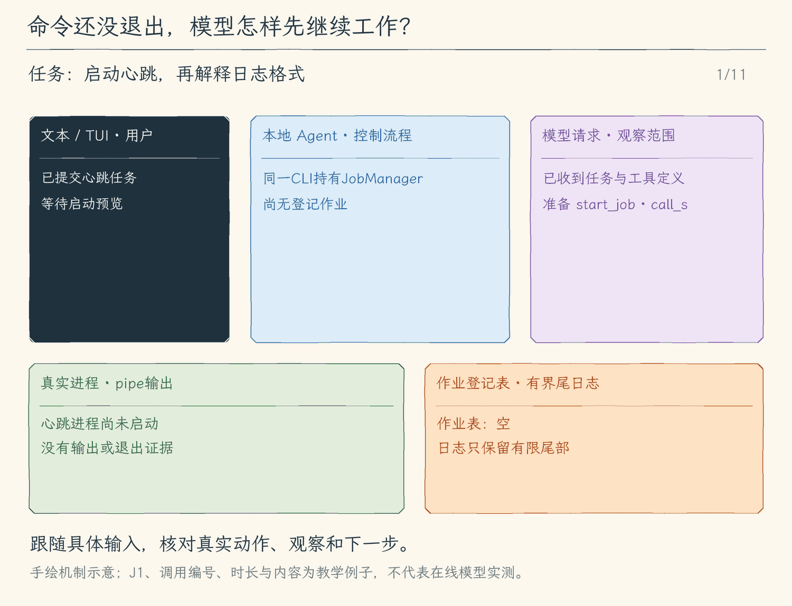

# 26.1 让命令在后台继续运行

[第 26 章首页](../README.md) · [上一节：25.3 子任务观察与取消](../../chapter-25-subagents/03-child-observation/README.md) · [本章练习与答案](../EXERCISES.md)

## 问题：命令还没退出，我们却要继续工作

第七章的 `run_command` 会等命令结束，再把退出码和输出交回模型。这个约定适合测试、搜索和一次性构建。开发服务器却常常一直监听端口：它已经打印了启动信息，进程仍未退出，工具就继续等待；模型也拿不到这次调用的结果。

第 25 章让父 Agent 等待子 Agent 的结构化结果，解决了局部推理的组织问题。这里等待的是另一个对象：操作系统里的长驻进程。我们希望它继续运行，同时让当前工具及时返回，用户可以继续聊天，并且以后还能明确地查询、停止它。

直接在 shell 后面加 `&` 不够。程序还需要知道自己创建了哪一个进程、输出保存在哪里、停止要等到哪一步。否则下一轮模型只能猜一个 PID，退出 Agent 时也无法判断哪些服务属于自己。

## 解决方案：先返回 JobID，再按身份观察

我们保留 `run_command` 的等待退出语义，另加三个工具：`start_job` 启动后台作业，`read_job` 查询，`stop_job` 停止。启动和停止分别经过本次审批；只读查询只能访问当前 CLI 创建的登记表。

例如用户要求“启动一个每秒打印心跳的进程，再继续解释日志格式”。模型发出一次 `start_job`，程序先展示命令、工作目录和期限；用户批准后，`JobManager` 启动 `/bin/sh`。等 Node 确认子进程已经创建，工具就返回本地生成的 JobID 与当前快照，模型收到结果后可以继续解释。心跳进程仍由同一个 CLI 会话持有。

这次返回证明“进程已启动”。它既不是“服务已经可以访问”，也不是“命令已经成功完成”。服务是否可用需要额外证据，退出是否成功要等退出码；后续 [26.3](../03-job-lifecycle/README.md) 将把这几种观察接起来。

## 工作原理

### JobID 连接模型调用与真实进程

`createModel` 为一次 CLI 启动创建一个 `JobManager`。后续各轮 Agent Loop 把同一个管理器交给工具，所以模型完成一轮回答不会丢掉作业。它的登记表以随机 JobID 为键，保存命令、目录、PID、状态、时间、退出信息和有界日志。

这里有两个不同的身份。工具调用编号关联“一次 `start_job` 调用和它的返回消息”；JobID 关联“这个后台进程及以后的查询、停止”。第二次 `read_job` 有自己的调用编号，却仍指向原来的 JobID。PID 只是诊断信息，接口不接受任意 PID，也不会从恢复的会话文件重建进程控制权。

`start_job` 复用已有命令准备逻辑：校验命令、项目内的工作目录与 100—60000 毫秒期限，保存本次参数；批准后再次核对目录身份，再调用管理器。登记表最多同时保留 4 个活跃作业，最多保存 32 条记录。容量满时只淘汰已经结束的旧记录，不能为了启动新作业丢掉仍在运行的控制句柄。

### 启动返回之后，谁继续读输出

本节使用 pipe。子进程的 stdout、stderr 接到 Node 的两条管道，管理器持续消费两条流，把到达的文字合进一份日志尾部；返回工具结果不会撤掉这些监听器。Node 的管道容量有限，若没人继续读，输出足够多时子进程会被反压阻住。[Node 官方说明](https://nodejs.org/api/child_process.html)

日志最多保留 64 KiB，并记录保留字节数与丢弃字节数。超过限额时继续排空管道，只裁掉旧日志，保留最近到达的内容。因而“日志有截断”不等于“进程停了”；stdout 与 stderr 的合并也只反映本地到达顺序，不能据此还原跨流的严格时间顺序。

本节启动后立即关闭父侧 stdin，给非交互子进程送出 EOF；它不能在后台一直等我们继续输入。pipe 传的是数据流，没有终端尺寸、回显或终端行规程。需要密码提示、交互选择、全屏界面的程序可能按不同方式工作；本节还没有把键盘交给它们。下一节会创建真实 PTY，并明确此时由谁读取键盘。

### 取消当前回答和停止后台作业是两个动作

启动窗口仍使用本轮的取消信号。如果取消发生在启动确认前，程序先停止并等这个新进程收尾，再把取消抛回 Agent Loop。启动成功后，这个监听就移除：已经登记的后台作业归 CLI 会话持有，取消一次模型回答不会顺便杀掉服务器。

要停止它，模型提出 `stop_job` 并取得本次批准，或用户执行本地 `/stop <JobID>`。管理器把状态改为 `stopping`，向自己创建的 POSIX 进程组发送 SIGTERM，300 毫秒后仍需强制终止时发送 SIGKILL。它继续等待子进程与输出流的 `close`，才返回带退出信息的快照。`exit` 说明直接子进程已经终止，`close` 还说明它的 stdio 已关闭；二者不能互换。[Node 事件定义](https://nodejs.org/api/child_process.html)

`timeout_ms` 到期也走这条停止链路，快照保留 `timeout` 原因。CLI 正常退出则封住新启动，停止并等待所有自有作业。它不按端口找服务、不扫描全机进程，也不接受旧会话的 PID。停止回收的是受管理的进程与管道，不会回滚已经写入的文件或发出的网络请求；写到一半时被停止，也可能留下部分文件。本节没有提供任意 shell 副作用的恢复。命令仍有普通用户的文件和网络权限，进程组并非沙箱；主动脱离这个组的外部进程也不在这套归属保证内。

### 用户看见的查询，怎样成为模型的依据

工具返回 `content` 包含 JobID、状态、退出码、停止原因和日志尾部；同一份快照放进 `metadata`，供现有观察事件和界面使用。Agent Loop 把结果按当前工具调用编号加入历史，下一次模型请求才会看到这次观察。`failed`，或已经退出且退出码非零、带停止原因的结果，会带上 `isError`；stderr 有文字本身不判失败。

用户还可以在交互界面输入 `/jobs` 查看列表，`/job <JobID>` 查看快照，`/stop <JobID>` 停止。它们直接操作当前登记表，界面显示本地反馈，停止时会等收尾完成再恢复输入。这些本地命令不发模型请求，也不自动把日志写进聊天历史；如果希望模型依据最新日志判断，应让它再调用 `read_job`。这样模型读到的是有明确调用身份的工具观察。

<!-- media:lesson:start -->
下面追踪一次心跳作业：批准、真实启动、J1返回、持续排日志、再次读取和停止收尾。J1是便于辨认的示意JobID，实际返回的是本地UUID，不能把J1直接输入工具。



[静态流程图](assets/job-background-lifecycle-flow-f535ef9567.png) · [静态封面](assets/job-background-lifecycle-cover-a369db0e64.png) · [查看完整静态分镜](assets/job-background-lifecycle-storyboard-fa08a18e51.jpg)
<!-- media:lesson:end -->

## 本节改动文件

<!-- generated:files:start -->

| 状态 | 文件 | 本节变化 |
| --- | --- | --- |
| NEW | [src/processes/jobs.ts](src/processes/jobs.ts) | 登记真实进程、维护有界尾日志，并等待停止与会话退出清理。 |
| CHANGED | [src/processes/run-process.ts](src/processes/run-process.ts) | 导出已有的最小环境构造，供后台进程复用。 |
| CHANGED | [src/tools/run-command.ts](src/tools/run-command.ts) | 复用已校验参数、目录身份检查和本次批准，注入后台启动执行。 |
| NEW | [src/tools/job-tools.ts](src/tools/job-tools.ts) | 定义启动、查询与停止工具，返回带身份的作业快照。 |
| CHANGED | [src/tools/types.ts](src/tools/types.ts) | 在工具结果元数据中携带当前作业快照。 |
| CHANGED | [src/tools/registry.ts](src/tools/registry.ts) | 发现作业工具并区分只读查询和获批执行入口。 |
| CHANGED | [src/permissions/policy.ts](src/permissions/policy.ts) | Plan 拒绝启动和停止；执行模式下逐次批准。 |
| CHANGED | [src/agent/run-options.ts](src/agent/run-options.ts) | 把当前会话的作业管理器传给工具。 |
| CHANGED | [src/models/client.ts](src/models/client.ts) | 在模型实例上持有跨轮共用的作业管理器。 |
| CHANGED | [src/agent/agent-loop.ts](src/agent/agent-loop.ts) | 把同一管理器接入本轮工具选项。 |
| CHANGED | [src/ui/terminal.ts](src/ui/terminal.ts) | 提供本地列表、查询、停止，反馈不进入模型历史。 |
| CHANGED | [src/ui/tui/app.tsx](src/ui/tui/app.tsx) | 接入本地作业命令，并在退出前等待自有作业清理。 |
| CHANGED | [src/cli.ts](src/cli.ts) | 确保所有 CLI 输出路径最终关闭自有作业。 |

<!-- generated:files:end -->

## 动手构建

先按[环境准备文档](../../docs/SETUP.md) 准备依赖、构建脚本与模型配置，再从上一公开小节 25.3 的完整 `src/` 继续。本节目标目录是 `chapter-26-interactive-jobs/01-background-jobs`。新增文件完整保存，修改文件按精确差异应用；未列出的实现沿用。下面差异以前面公开块累计形成的读者工作树为基线。

<!-- generated:build:start -->

<details>
<summary>NEW：src/processes/jobs.ts 的完整文件</summary>

<!-- source: src/processes/jobs.ts -->
```ts
/**
 * 26.1 后台作业 | [NEW] processes/jobs.ts
 *
 * 会话内自有进程登记表。start 等真实 spawn；wait 等 close，stop/close 等清理。
 * 只保存有界尾日志；不从历史文件恢复 PID，不接管用户原有服务，也不构成沙箱。
 */
import { spawn, type ChildProcessWithoutNullStreams } from "node:child_process";
import { randomUUID } from "node:crypto";
import { StringDecoder } from "node:string_decoder";
import { ToolError } from "../errors.js";
import { processEnvironment } from "./run-process.js";

// [NEW 26.1] JobID 是本实例的引用，PID 仅供观察，不能作为外部控制入口。
export type JobSnapshot = {
  id: string; pid: number | null; command: string; cwd: string;
  state: "starting" | "running" | "stopping" | "exited" | "failed";
  startedAt: string | null; endedAt: string | null;
  exitCode: number | null; signal: string | null;
  stopReason?: "user" | "timeout" | "shutdown" | "start_cancelled";
  log: string; retainedBytes: number; droppedBytes: number;
};
export type JobInput = { command: string; cwd: string; timeoutMs: number };
type Entry = { snapshot: JobSnapshot; child: ChildProcessWithoutNullStreams; done: Promise<JobSnapshot>;
  stop: (reason: NonNullable<JobSnapshot["stopReason"]>) => void };

/** 管理一个 CLI 会话创建的 POSIX 进程；已登记后台任务不绑定单轮模型信号。 */
export class JobManager {
  private readonly entries = new Map<string, Entry>();
  private closed = false;
  private closing?: Promise<void>;
  constructor(readonly limits = { active: 4, history: 32, logBytes: 64 * 1024 }) {
    if (![limits.active, limits.history, limits.logBytes].every(n => Number.isInteger(n) && n > 0)
        || limits.history < limits.active) throw new ToolError("作业限额必须为正整数，历史限额不能小于活跃限额。");
  }

  /** 只返回脱离内部对象的观察快照，调用者不能修改登记表。 */
  list(): JobSnapshot[] { return [...this.entries.values()].map(entry => structuredClone(entry.snapshot)); }
  /** 不接受 PID；未知、已淘汰或旧会话的 JobID 均拒绝。 */
  get(id: string): JobSnapshot { return structuredClone(this.entry(id).snapshot); }
  /** 等直接子进程、输出流关闭以及本进程组的停止请求发完。 */
  wait(id: string): Promise<JobSnapshot> { return this.entry(id).done.then(value => structuredClone(value)); }
  /** 停止只作用于本登记表创建的进程组，重复请求保留第一个原因。 */
  async stop(id: string, reason: NonNullable<JobSnapshot["stopReason"]> = "user"): Promise<JobSnapshot> {
    const entry = this.entry(id); entry.stop(reason); return this.wait(id);
  }
  /** 会话退出封住新启动，等待所有自有作业；重复关闭共用同一个 Promise。 */
  close(): Promise<void> {
    this.closed = true;
    return this.closing ??= Promise.all([...this.entries.keys()].map(id => this.stop(id, "shutdown"))).then(() => undefined);
  }
  /** 本地记录查找不提供导入、恢复或按任意 PID 发信号的后门。 */
  private entry(id: string): Entry {
    const entry = this.entries.get(id); if (!entry) throw new ToolError("未知 JobID；只能访问本次会话创建且尚未淘汰的作业。");
    return entry;
  }
  /** 验证限额后启动真实 /bin/sh；启动失败不返回 started，启动取消先等清理再抛出。 */
  async start(input: JobInput, signal?: AbortSignal): Promise<JobSnapshot> {
    signal?.throwIfAborted();
    if (process.platform === "win32") throw new ToolError("作业需要 macOS/Linux 的 POSIX 进程组；Windows 请使用 WSL。");
    if (this.closed) throw new ToolError("作业管理器已关闭。");
    if (!input.command.trim() || input.command.length > 4000 || /\x00/.test(input.command)
        || !Number.isInteger(input.timeoutMs) || input.timeoutMs < 100 || input.timeoutMs > 60_000) throw new ToolError("作业命令或运行期限无效。");
    const active = [...this.entries.values()].filter(e => !["exited", "failed"].includes(e.snapshot.state));
    if (active.length >= this.limits.active) throw new ToolError(`活跃作业已达上限 ${this.limits.active}，请先停止或等待已有作业。`);
    while (this.entries.size >= this.limits.history) {
      const oldest = [...this.entries.values()].find(e => ["exited", "failed"].includes(e.snapshot.state));
      if (!oldest) throw new ToolError("作业历史已满。"); this.entries.delete(oldest.snapshot.id);
    }
    const id = randomUUID();
    const snapshot: JobSnapshot = { id, pid: null, command: input.command, cwd: input.cwd, state: "starting",
      startedAt: null, endedAt: null, exitCode: null, signal: null, log: "", retainedBytes: 0, droppedBytes: 0 };
    const child = spawn("/bin/sh", ["-c", input.command], { cwd: input.cwd, env: processEnvironment(), detached: true, stdio: "pipe" });
    let finish!: (snapshot: JobSnapshot) => void;
    const done = new Promise<JobSnapshot>(resolve => { finish = resolve; });
    let timer: ReturnType<typeof setTimeout> | undefined, hardKill: ReturnType<typeof setTimeout> | undefined;
    let spawnError: Error | undefined;
    let totalBytes = 0;
    /** 仅向 spawn 创建的 POSIX 组发信号；退出清理不扫描全机 PID 或端口。 */
    const kill = (name: NodeJS.Signals) => {
      if (child.pid === undefined) return;
      try { process.kill(-child.pid, name); } catch (error) { if ((error as NodeJS.ErrnoException).code !== "ESRCH") child.kill(name); }
    };
    /** 持续排空两条管道，只保留合计 byte 上限的尾部，避免日志反压堵住进程。 */
    const append = (data: string) => {
      totalBytes += Buffer.byteLength(data);
      const bytes = Buffer.from(snapshot.log + data);
      const excess = Math.max(0, bytes.length - this.limits.logBytes);
      // UTF-8 切片可能产生边缘替换符；再次按字节裁去首字符，保证严格内存预算。
      snapshot.log = bytes.subarray(excess).toString("utf8");
      while (Buffer.byteLength(snapshot.log) > this.limits.logBytes) snapshot.log = snapshot.log.slice(1);
      snapshot.retainedBytes = Buffer.byteLength(snapshot.log);
      snapshot.droppedBytes = totalBytes - snapshot.retainedBytes;
    };
    /** 第一次停止记录原因，宽限 300ms 后升级；Promise 仍等待 close。 */
    const stop = (reason: NonNullable<JobSnapshot["stopReason"]>) => {
      if (["exited", "failed"].includes(snapshot.state) || snapshot.stopReason) return;
      snapshot.stopReason = reason; snapshot.state = "stopping"; kill("SIGTERM");
      hardKill = setTimeout(() => kill("SIGKILL"), 300);
    };
    this.entries.set(id, { snapshot, child, done, stop });
    const stdout = new StringDecoder("utf8"), stderr = new StringDecoder("utf8");
    child.stdout.on("data", (data: Buffer) => append(stdout.write(data)));
    child.stderr.on("data", (data: Buffer) => append(stderr.write(data)));
    // [NEW 26.1] Noninteractive pipe gets EOF; it never reads the chat input.
    child.stdin.end();
    child.stdin.on("error", () => { /* 子进程自行关闭 stdin 不使会话崩溃。 */ });
    child.on("error", error => { spawnError = error; });
    child.once("exit", () => { kill("SIGTERM"); hardKill ??= setTimeout(() => kill("SIGKILL"), 300); });
    child.once("close", (code, exitSignal) => {
      clearTimeout(timer); clearTimeout(hardKill); kill("SIGKILL");
      append(stdout.end()); append(stderr.end());
      snapshot.exitCode = code; snapshot.signal = exitSignal;
      snapshot.endedAt = new Date().toISOString(); snapshot.state = spawnError ? "failed" : "exited";
      finish(structuredClone(snapshot));
    });
    /** 取消仅覆盖启动窗口；登记成功后后台作业归会话，不归某一轮。 */
    const abort = () => stop("start_cancelled");
    signal?.addEventListener("abort", abort, { once: true });
    try {
      await new Promise<void>((resolve, reject) => {
        child.once("spawn", resolve); child.once("error", reject);
      });
      snapshot.pid = child.pid!; snapshot.startedAt = new Date().toISOString();
      if (signal?.aborted || this.closed) {
        stop(this.closed ? "shutdown" : "start_cancelled"); await done;
        signal?.throwIfAborted(); throw new ToolError("会话在启动作业期间关闭。");
      }
      snapshot.state = "running";
      timer = setTimeout(() => stop("timeout"), input.timeoutMs);
      return structuredClone(snapshot);
    } catch (error) {
      stop("start_cancelled"); await done;
      if (signal?.aborted) throw signal.reason;
      throw new ToolError(`作业启动失败：${error instanceof Error ? error.message : "未知原因"}`);
    } finally { signal?.removeEventListener("abort", abort); }
  }
}

/** 有界状态和日志同时给模型/本地命令；state=running 仅证明进程已启动。 */
export function describeJob(job: JobSnapshot): string {
  return `JobID: ${job.id}\nPID: ${job.pid ?? "无"}\n状态: ${job.state}\n退出码: ${job.exitCode ?? "无"}\n信号: ${job.signal ?? "无"}\n停止原因: ${job.stopReason ?? "无"}\n日志尾部 (${job.retainedBytes} bytes，已丢弃 ${job.droppedBytes} bytes):\n${job.log || "（空）"}`;
}

/** 人类本地查询和停止不进入模型上下文；不从聊天文字推导批准。 */
export async function jobCommand(text: string, jobs?: JobManager): Promise<string> {
  if (!jobs) throw new ToolError("当前会话未连接作业管理器。");
  if (text === "/jobs") return jobs.list().map(job => `${job.id} ${job.state} pid=${job.pid ?? "无"}`).join("\n") || "本次会话没有作业。";
  const match = /^\/(job|stop) ([0-9a-f-]{36})$/.exec(text);
  if (!match) throw new ToolError("用法：/jobs；/job <JobID>；/stop <JobID>。");
  return describeJob(match[1] === "stop" ? await jobs.stop(match[2]!) : jobs.get(match[2]!));
}
```

</details>

<details>
<summary>CHANGED：src/processes/run-process.ts 的精确差异</summary>

<!-- source: src/processes/run-process.ts -->
```diff
--- a/src/processes/run-process.ts
+++ b/src/processes/run-process.ts
@@ -1,8 +1,8 @@
 /**
- * 20.1 执行前钩子与显式启用 | [CHANGED] processes/run-process.ts
+ * 26.1 后台作业 | [CHANGED] processes/run-process.ts
  *
- * 学习目标：为命令、搜索与 Hook 等待外部进程，统一输出、取消和进程组清理。
- * Hook 可提供专用 JSON stdin；没有 input 的调用继续使用 EOF，不占用聊天输入。
+ * 学习目标：等待外部程序真实结束，处理有界输出、取消与同组进程清理。
+ * 阅读说明：前台命令、搜索与Git查询复用本模块；后台作业只复用最小环境，持有自己的生命周期。
  * 输入：程序名称、参数数组、真实 cwd、取消信号、时间与合计输出上限。
  * 输出：stdout/stderr、退出码、终止信号与可选停止原因；启动失败或取消向外抛出。
  * 状态：失败和取消会清理同组进程，不能撤销进程结束前已经产生的文件或网络副作用。
@@ -20,7 +20,7 @@
  *
  * 输出预算按两条流的字节合计，默认 32 KiB；超出部分继续从管道读出，但不保存在内存。
  * 默认 30 秒只触发停止请求，随后还要等进程与管道关闭，不能把计时器返回当成进程已结束。
- * [CHANGED 20.1] stdin默认ignore；钩子收到专用JSON后关闭管道，不取走聊天或审批输入。
+ * [KEEP 来自 20.1] stdin默认ignore；钩子收到专用JSON后关闭管道，不取走聊天或审批输入。
  * 只管理仍在本次 POSIX 进程组里的程序；脱离进程组的服务与操作系统隔离留到后续章节。
  * 观察：超时和超量返回已有日志与停止原因，取消在清理后向外结束本轮。
  */
@@ -45,7 +45,8 @@
  * PATH 优先包含当前 Node 的目录，方便相同机器上的测试调用同一个 Node。
  * 不自动传递模型 API Key、NODE_OPTIONS 或 BASH_ENV；它并不限制磁盘与网络访问。
  */
-function processEnvironment(): NodeJS.ProcessEnv {
+// [CHANGED 26.1] 常驻作业复用同一份最小环境，避免继承模型密钥。
+export function processEnvironment(): NodeJS.ProcessEnv {
   const env: NodeJS.ProcessEnv = {};
   for (const key of ["HOME", "TMPDIR", "LANG", "LC_ALL"]) {
     if (process.env[key] !== undefined) env[key] = process.env[key];
@@ -86,7 +87,7 @@
     const child = spawn(file, args, {
       cwd, env: processEnvironment(), shell: false, detached: true,
       // ignore 使子进程读取 stdin 时得到 EOF，不会争抢用户的输入。
-      // [CHANGED 20.1] 钩子专用JSON输入不读取聊天stdin；其他调用仍得到EOF。
+      // [KEEP 来自 20.1] 钩子专用JSON输入不读取聊天stdin；其他调用仍得到EOF。
       stdio: [input === undefined ? "ignore" : "pipe", "pipe", "pipe"],
     });

@@ -115,7 +116,7 @@
       bytes += Math.min(remaining, chunk.length);
       if (chunk.length > remaining) stop("output_limit");
     };
-    // [CHANGED 20.1] EPIPE由退出结果解释，避免子进程提前关闭stdin导致未处理异常。
+    // [KEEP 来自 20.1] EPIPE由退出结果解释，避免子进程提前关闭stdin导致未处理异常。
     child.stdin?.on("error", () => {});
     if (input !== undefined) child.stdin?.end(input);
     child.stdout!.on("data", (chunk: Buffer) => collect(stdout, chunk));
```

</details>

<details>
<summary>CHANGED：src/tools/run-command.ts 的精确差异</summary>

<!-- source: src/tools/run-command.ts -->
```diff
--- a/src/tools/run-command.ts
+++ b/src/tools/run-command.ts
@@ -1,8 +1,8 @@
 /**
- * 19.3 模型选择与资源读取 | [KEEP] tools/run-command.ts
+ * 26.1 后台作业 | [CHANGED] tools/run-command.ts
  *
- * 学习目标：把会话状态保存到磁盘；本文件沿用已有职责，负责准备命令和目录预览，批准后按期限运行。
- * 阅读说明：本节沿用此模块；保存入口接在消费者收尾，不把本文件的配置、显示或控制对象整包存盘。
+ * 学习目标：校验命令、目录与期限，准备审批预览并返回真实执行结果。
+ * 阅读说明：run_command等待进程结束；本节导出的准备函数供start_job复用参数与目录核对，不改变前台工具语义。
  * 输入：command、cwd、可选 timeout_ms；省略时使用 30000 毫秒。
  * 输出：带命令、目录和时间的预览；批准后返回真实进程结果。
  * 状态：准备失败时没有启动命令；执行后失败或取消可能已有副作用，不自动回滚。
@@ -59,7 +59,7 @@
  * - 失败方式：无效参数抛出 ToolError；这里只检查参数，真实目录稍后再查。
  */
 // [KEEP 来自第 07 章练习] 返回已校验的等待时间，后面的预览和执行共用它。
-function parseArguments(argumentsJson: string): { command: string; cwd: string; timeoutMs: number } {
+export function parseCommandArguments(argumentsJson: string): { command: string; cwd: string; timeoutMs: number } {
   let value: unknown;
   try { value = JSON.parse(argumentsJson); }
   catch { throw new ToolError("run_command 参数不是有效的 JSON。"); }
@@ -122,14 +122,16 @@
  * - 执行检查：批准后复查目录身份，发现变化就抛出 ToolError，否则用保存的 timeoutMs 执行命令。
  * - 职责边界：路径检查与启动仍有时间间隔，也不限制命令自行访问其他路径，不能当作 shell 沙箱。
  */
+// [CHANGED 26.1] 共享准备允许后台工具复用目录身份复查；默认仍等待 run_command 退出。
 export async function prepareRunCommand(
   argumentsJson: string,
   projectRoot = findProjectRoot(),
   signal?: AbortSignal,
+  execute: typeof executeCommand = executeCommand,
 ): Promise<PreparedToolCall> {
   signal?.throwIfAborted();
   if (process.platform === "win32") throw new ToolError("本章命令工具需要 macOS 或 Linux 的 /bin/sh；Windows 请在 WSL 中运行。");
-  const input = parseArguments(argumentsJson);
+  const input = parseCommandArguments(argumentsJson);
   let cwd: string;
   try {
     const root = await realpath(projectRoot);
@@ -154,7 +156,7 @@
       if (!current || current.dev !== before.dev || current.ino !== before.ino) {
         throw new ToolError("工作目录在等待审批期间发生了变化，请重新请求执行。");
       }
-      return executeCommand(input.command, cwd, executionSignal, input.timeoutMs);
+      return execute(input.command, cwd, executionSignal, input.timeoutMs);
     },
   };
 }
```

</details>

<details>
<summary>NEW：src/tools/job-tools.ts 的完整文件</summary>

<!-- source: src/tools/job-tools.ts -->
```ts
/**
 * 26.1 后台作业 | [NEW] tools/job-tools.ts
 * 模型只能批准启动/停止和只读观察；没有模型 stdin 工具。JobID 来自本会话真实 spawn。
 */
import { ToolError } from "../errors.js";
import { describeJob, type JobManager, type JobSnapshot } from "../processes/jobs.js";
import { prepareRunCommand } from "./run-command.js";
import type { PreparedToolCall, ToolExecutionResult } from "./types.js";

// [NEW 26.1] start_job 与 run_command 的等待退出语义各自明确。
export const startJobDefinition = {
  name: "start_job", description: "逐次批准后启动后台 pipe 作业，返回真实 JobID；running 不证明服务就绪。作业属于当前CLI会话；用read_job观察、stop_job停止。",
  inputSchema: { type: "object" as const, properties: { command: { type: "string" }, cwd: { type: "string" }, timeout_ms: { type: "integer", minimum: 100, maximum: 60_000 } }, required: ["command", "cwd"], additionalProperties: false },
};
export const readJobDefinition = {
  name: "read_job", description: "只读本次会话自有JobID的当前状态与有界尾日志；不知道ID时返回列表。旧会话的PID不能恢复。",
  inputSchema: { type: "object" as const, properties: { job_id: { type: "string" } }, additionalProperties: false },
};
export const stopJobDefinition = {
  name: "stop_job", description: "逐次批准后停止本会话自有JobID，等待进程与管道关闭后返回结果。",
  inputSchema: { type: "object" as const, properties: { job_id: { type: "string" } }, required: ["job_id"], additionalProperties: false },
};
/** 参数、ID 与登记表在本地检查；不能靠模型给出的 PID 选中外部程序。 */
function parseId(json: string, required: boolean): string | undefined {
  let value: unknown; try { value = JSON.parse(json); } catch { throw new ToolError("作业参数不是JSON。"); }
  if (!value || typeof value !== "object" || Array.isArray(value)) throw new ToolError("作业参数必须是对象。");
  const input = value as Record<string, unknown>;
  if (Object.keys(input).some(key => key !== "job_id") || (input.job_id !== undefined && (typeof input.job_id !== "string" || !/^[0-9a-f-]{36}$/.test(input.job_id))) || (required && input.job_id === undefined)) throw new ToolError("只接受本次会话的 job_id，不接受PID。");
  return input.job_id as string | undefined;
}
/** 每条观察把同一状态同时送给模型与界面，不把stderr非空直接视为失败。 */
function result(job: JobSnapshot): ToolExecutionResult {
  return { content: describeJob(job), isError: job.state === "failed" || (job.state === "exited" && (job.exitCode !== 0 || Boolean(job.stopReason))), metadata: { kind: "job", job } };
}
/** 启动/停止均先保存本次参数；批准前不启动或发信号。 */
export async function prepareJob(name: string, json: string, jobs: JobManager | undefined, signal: AbortSignal): Promise<PreparedToolCall> {
  if (!jobs) throw new ToolError("当前会话未连接作业管理器。");
  if (name === "start_job") {
    const prepared = await prepareRunCommand(json, undefined, signal, async (command, cwd, executionSignal, timeoutMs) => result(await jobs.start({ command, cwd, timeoutMs }, executionSignal)));
    return { ...prepared, preview: `启动后台作业（不会等待退出）\n${prepared.preview}\n只管理本会话自有进程组；日志有界，退出Agent会清理作业。` };
  }
  const id = parseId(json, true)!;
  const job = jobs.get(id);
  return { preview: `停止本次会话作业\n${describeJob(job)}\n命令：${JSON.stringify(job.command)}\n目录：${JSON.stringify(job.cwd)}\n只批准这一次停止。`, async execute(executionSignal) { executionSignal.throwIfAborted(); return result(await jobs.stop(id)); } };
}
/** 只读观察无需审批，但只能查询当前登记表，不重连历史PID。 */
export async function readJob(json: string, jobs: JobManager | undefined, signal: AbortSignal): Promise<ToolExecutionResult> {
  signal.throwIfAborted(); if (!jobs) throw new ToolError("当前会话未连接作业管理器。");
  const id = parseId(json, false);
  if (id) return result(jobs.get(id));
  return { content: jobs.list().map(job => `${job.id} ${job.state}`).join("\n") || "本次会话没有作业。", metadata: { kind: "job", job: null } };
}
```

</details>

<details>
<summary>CHANGED：src/tools/types.ts 的精确差异</summary>

<!-- source: src/tools/types.ts -->
```diff
--- a/src/tools/types.ts
+++ b/src/tools/types.ts
@@ -1,5 +1,5 @@
 /**
- * 25.1 独立子会话 | [CHANGED] tools/types.ts
+ * 26.1 后台作业 | [CHANGED] tools/types.ts
  *
  * 学习目标：用同一工具契约携带网页启用状态、来源及字节元数据；网页正文通过 content 回模型，显示信息通过 metadata 回界面。
  * 输入：本地网页状态、工具准备出的预览和执行闭包，或已取得的正文、来源与截断标志。
@@ -18,8 +18,9 @@
 // [KEEP 来自 21.1] 外部JSON Schema保留原样，工具名由可信映射提供。
 export type ToolDefinition = { name: string; description: string; inputSchema: { type: "object"; properties: Record<string, unknown>; required?: string[]; [key: string]: unknown } };
 // [KEEP 来自 22.1] 来源只由已完整读完的真实HTTP响应提供。
-// [CHANGED 25.1] 工具结果能携带结构化子任务结果。
 export type ToolResultMetadata =
+  // [NEW 26.1] Job状态在内存登记表；保存metadata不表示能恢复控制权。
+  | { kind: "job"; job: import("../processes/jobs.js").JobSnapshot | null }
   | { kind: "subagent"; result: import("../subagents/runner.js").ChildResult }
   | { kind: "web"; sources: import("../web/client.js").WebSource[]; bytes: number; truncated: boolean }
   | { kind: "mcp"; server: string; tool: string }
```

</details>

<details>
<summary>CHANGED：src/tools/registry.ts 的精确差异</summary>

<!-- source: src/tools/registry.ts -->
```diff
--- a/src/tools/registry.ts
+++ b/src/tools/registry.ts
@@ -1,5 +1,5 @@
 /**
- * 25.1 独立子会话 | [CHANGED] tools/registry.ts
+ * 26.1 后台作业 | [CHANGED] tools/registry.ts
  *
  * 学习目标：分别准备网页 URL 或搜索查询的完整预览，复制本次参数；批准后才执行对应的网络请求。
  * 输入：模型给出的工具名称、JSON 参数与取消信号。
@@ -27,6 +27,8 @@
 // [KEEP 来自 19.3] 专用只读技能工具不执行正文中的命令。
 // [KEEP 来自 21.1] 动态映射属于本次进程，不从模型文字创建。
 // [KEEP 来自 22.1] 网页GET也先固定参数和本次审批预览。
+// [NEW 26.1] 后台作业沿用统一准备/审批通道，只读观察只访问会话登记表。
+import { prepareJob, readJob, startJobDefinition, readJobDefinition, stopJobDefinition } from "./job-tools.js";
 import { delegateTaskDefinition, delegateTaskTool } from "./delegate-task.js";
 import { callWeb, parseWebCall } from "../web/client.js";
 import { callMcp } from "../mcp/client.js";
@@ -54,8 +56,9 @@

 // [KEEP 来自 06.1] write_file 进入模型可见的工具列表，但只能走准备与审批通道。
 // [KEEP 来自 06.2] edit_file 与 write_file 共用准备、审批和执行入口。
-// [CHANGED 25.1] 接纳委派定义，真实运行交由循环处理。
 export const toolDefinitions = [
+  // [NEW 26.1] 启动与停止逐次审批，观察不执行进程。
+  startJobDefinition, readJobDefinition, stopJobDefinition,
   delegateTaskDefinition,
   // [KEEP 来自 19.3] 两个独立按需动作，正文加载和资源结果各有去向。
   loadSkillDefinition, readSkillResourceDefinition,
@@ -99,6 +102,8 @@
     return { preview: `外部MCP工具：${call.name}\n本次完整参数：\n${JSON.stringify(args, null, 2)}\n外部服务可能有副作用；只批准本次。`, execute: signal => callMcp(options.mcp, frozen, signal) };
   }
   // [KEEP 来自 18.2] 存储范围来自本地控制器，模型参数不能选择目录。
+  // [NEW 26.1] 启动/停止只在已批准闭包执行。
+  if (call.name === "start_job" || call.name === "stop_job") return prepareJob(call.name, call.arguments, options.jobs, signal);
   if (call.name === proposeMemoryDefinition.name) return prepareMemory(call.arguments, options.memoryRoot, signal);
   if (call.name === writeFileDefinition.name) return prepareWriteFile(call.arguments, undefined, signal, options.fileCheckpoints);
   // [KEEP 来自 06.2] 精确替换也必须在审批前解析当前文件并生成 diff。
@@ -123,6 +128,9 @@
   signal.throwIfAborted();
   if (options.allowedTools && !options.allowedTools.includes(call.name)) throw new ToolError(`子任务不允许工具：${call.name}`);
   // [KEEP 来自 21.1] 主循环先审批，注册表只按已发现映射执行。
+  // [NEW 26.1] 观察入口拒绝跨会话PID，启动/停止禁止直接调用。
+  if (call.name === "read_job") return readJob(call.arguments, options.jobs, signal);
+  if (call.name === "start_job" || call.name === "stop_job") throw new ToolError(`${call.name} 必须先生成预览并获得本次批准。`);
   if (call.name === delegateTaskDefinition.name) return delegateTaskTool(call.arguments, signal, options);
   if (call.name === "web_fetch" || call.name === "web_search") return callWeb(options.web, call, signal);
   if (call.name.startsWith("mcp__")) return callMcp(options.mcp, call, signal);
```

</details>

<details>
<summary>CHANGED：src/permissions/policy.ts 的精确差异</summary>

<!-- source: src/permissions/policy.ts -->
```diff
--- a/src/permissions/policy.ts
+++ b/src/permissions/policy.ts
@@ -1,5 +1,5 @@
 /**
- * 25.1 独立子会话 | [CHANGED] permissions/policy.ts
+ * 26.1 后台作业 | [CHANGED] permissions/policy.ts
  *
  * 学习目标：把本次启用的网页工具与 MCP 一并列为外部工具；Plan 硬拒绝，执行模式仍逐次询问，网页文字不产生批准。
  * 输入：模型给出的工具名、JSON 参数和当前进程的只读授权集合。
@@ -162,7 +162,6 @@
  * 返回 ask 时附本地生成的 scope 和 remember；只有可记住的只读范围才可进入授权集合。
  * 这里只返回决定，准备和执行仍要检查参数与路径，拒绝不会运行工具。
  */
-// [CHANGED 25.1] 允许委派作为受限只读任务，继续应用现有权限规则。
 export async function decideToolPermission(
   call: ToolCall,
   // [KEEP 来自 05.3] 策略会查询已批准记录，但每次仍先执行 deny 检查。
@@ -186,12 +185,15 @@
   if (!input) return { action: "deny", reason: "工具参数不是有效的 JSON 对象" };

   // [KEEP 来自 12.1] Plan 的硬拒绝早于预览和审批，会话授权也不能跳过。
-  if (mode === "plan" && ["write_file", "edit_file", "run_command", "propose_memory"].includes(call.name)) {
+  if (mode === "plan" && ["write_file", "edit_file", "run_command", "propose_memory", "start_job", "stop_job"].includes(call.name)) {
     return { action: "deny", reason: "Plan 模式只允许调查和制定计划，不能修改文件或执行命令" };
   }
   // [KEEP 来自 19.3] 只读专用入口仍自行检查名字、路径和大小；不会授权其他工具。
   if (["load_skill", "read_skill_resource"].includes(call.name)) return { action: "allow", reason: "技能只读加载，范围与格式由专用工具再次检查" };
   // [KEEP 来自 18.2] 候选不能用会话授权，也不能靠项目文字跳过逐次审批。
+  // [NEW 26.1] 模型启动/停止各批准一次；本地stdin不变成模型授权。
+  if (call.name === "start_job" || call.name === "stop_job") return { action: "ask", reason: "后台进程有文件/网络副作用，停止也可能中断写入，请核对本次作业", resource: "本次后台作业", scope: `${call.name}:once`, remember: false };
+  if (call.name === "read_job") return { action: "allow", reason: "只读本次会话作业状态和有界日志" };
   if (call.name === "propose_memory") return { action: "ask", reason: "长期记忆会跨会话保留，请核对正文、项目范围和来源", resource: "本项目长期记忆", scope: "propose_memory:once", remember: false };
   // [KEEP 来自 12.2] 放行内存清单工具，内容是否合法仍由工具完整校验。
   // [KEEP 来自 15.2] 仅放行专用日志读取入口；UUID、范围和目录由工具再次检查，不授予任意路径读取权。
```

</details>

<details>
<summary>CHANGED：src/agent/run-options.ts 的精确差异</summary>

<!-- source: src/agent/run-options.ts -->
```diff
--- a/src/agent/run-options.ts
+++ b/src/agent/run-options.ts
@@ -1,5 +1,5 @@
 /**
- * 25.1 独立子会话 | [CHANGED] agent/run-options.ts
+ * 26.1 后台作业 | [CHANGED] agent/run-options.ts
  *
  * 学习目标：把本进程已启用的 WebState 传给工具执行层；模型不能从网页文字选择配置或取得运行权限。
  * 输入：本地入口选定的模式、会话状态、已加载的网页配置与本轮交互回调。
@@ -61,8 +61,9 @@
  */
 // [KEEP 来自 14.2] 写入前的持久化入口属于本地运行控制，不交给模型。
 // [KEEP 来自 19.3] 工具使用进程内已发现目录，模型不能自行选择根目录。
-// [CHANGED 25.1] 把父关联、子会话目录与白名单传入循环。
 export type RunOptions = {
+  // [NEW 26.1] 作业属于会话，不能从磁盘恢复PID；子任务allowlist仍阻止启动。
+  jobs?: import("../processes/jobs.js").JobManager;
   sessionId?: string;
   childSessionDirectory?: string;
   childDepth?: number;
```

</details>

<details>
<summary>CHANGED：src/models/client.ts 的精确差异</summary>

<!-- source: src/models/client.ts -->
```diff
--- a/src/models/client.ts
+++ b/src/models/client.ts
@@ -1,5 +1,5 @@
 /**
- * 25.1 独立子会话 | [CHANGED] models/client.ts
+ * 26.1 后台作业 | [CHANGED] models/client.ts
  *
  * 学习目标：每次估算和请求使用相同来源编号提示及工具定义；URL与正文保留在工具消息中，提示不复制网页正文。
  * 输入：完整消息历史、工具定义、取消信号和文字回调；两种协议都使用 SDK 接收流。
@@ -39,6 +39,8 @@
 // [KEEP 来自 17.1] 项目说明在模型创建时冻结；估算与发送使用相同文本。
 import { projectInstructionInfo, projectInstructionPrompt, type ProjectInstructions } from "../project/instructions.js";
 import { createAttachmentState, type AttachmentRef, type AttachmentState } from "../attachments/store.js";
+// [NEW 26.1] 会话级进程所有权不在消息或会话文件里。
+import { JobManager } from "../processes/jobs.js";
 import { safeModelError } from "./model-errors.js";
 import { createProtocolAdapter, SUMMARY_PROMPT, type ModelProfile } from "./protocol.js";
 import { readConfig, systemPrompt, type Config } from "../config/load-config.js";
@@ -91,10 +93,11 @@
  * 输入完整消息、取消信号和可选文字回调；Promise 返回经过检查的完整结果。
  * 本轮模式通过 options 传入，省略时沿用 execute；接口本身不批准或执行工具。
  */
-// [CHANGED 25.1] 按当前角色筛选工具定义和角色提示。
 export type ModelRequestScope = { allowedTools?: readonly string[]; rolePrompt?: string };

 export interface Model {
+  // [NEW 26.1] 单轮结束保留registry；整次CLI退出才close。
+  readonly jobs?: import("../processes/jobs.js").JobManager;
   // [KEEP 来自 18.1] 本地管理入口不属于会话消息或模型授权。
   // [KEEP 来自 20.1] 本地启用状态不进入聊天或会话文件。
   // [KEEP 来自 21.1] 本地连接不进入模型消息或保存记录。
@@ -139,6 +142,8 @@
   const projectPrompt = project ? projectInstructionPrompt(project) : "";
   const projectInfo = project ? Object.freeze(projectInstructionInfo(project)) : undefined;
   const attachments = createAttachmentState();
+  // [NEW 26.1] createModel一次创建，后续run共用；不会从历史加载PID。
+  const jobs = new JobManager();
   let adapter = createProtocolAdapter(config);
   let activeRequests = 0;
   // [KEEP 来自 08.1] 每次请求设置 60 秒总期限，接收正文期间也计时。
@@ -149,7 +154,7 @@
   return {
     // [KEEP 来自 18.1] 整项任务固定记忆；保存不在中途替换此引用里的prompt。
     // [KEEP 来自 20.1] TUI与text从同一模型对象取得可信状态。
-    memory, skills, hooks, mcp, web, attachments,
+    memory, skills, hooks, mcp, web, attachments, jobs,
     get profile() { return structuredClone(adapter.profile); },
     beginRun() {
       activeRequests += 1; let released = false;
```

</details>

<details>
<summary>CHANGED：src/agent/agent-loop.ts 的精确差异</summary>

<!-- source: src/agent/agent-loop.ts -->
```diff
--- a/src/agent/agent-loop.ts
+++ b/src/agent/agent-loop.ts
@@ -1,5 +1,5 @@
 /**
- * 25.3 子任务状态 | [CHANGED] agent/agent-loop.ts
+ * 26.1 后台作业 | [CHANGED] agent/agent-loop.ts
  *
  * 学习目标：保持网页结果回原调用的流程，并在最终回答后核对来源编号；本地反馈不自动制造新一轮模型请求。
  * 输入：问题、历史、取消信号、事件消费者和审批入口；模型提供实际输入估算，选项连接队列、文件检查点与工具日志。
@@ -148,7 +148,7 @@
  * 本函数不会撤销已执行的操作，也不会把聊天、问答或模型承诺当成批准。
  */
 // [KEEP 来自 08.3] 本轮中断后保存完整工具状态，下一轮使用新的取消信号继续。
-// [CHANGED 25.3] 只把子状态转发给父观察者，子文字留在子历史。
+// [KEEP 25.3] 只把子状态转发给父观察者，子文字留在子历史。
 export async function agentLoop(
   model: Model,
   history: Message[],
@@ -176,11 +176,12 @@
   // [KEEP 来自 12.2] 未提供会话容器时，本轮仍能使用同一份任务清单。
   // [KEEP 来自 12.2] 所有清单工具共用同一份容器，未传入时在本轮创建。
   // [KEEP 来自 19.3] 两个只读技能工具共享本模型的已加载集合；审批与Plan仍走原策略。
-  const toolOptions: RunOptions = { ...options, mcp: model.mcp, web: model.web, skills: model.skills, memoryRoot: model.memory?.root, tasks: options.tasks ?? { items: [] } };
+  // [CHANGED 26.1] 会话登记表传入每次工具执行，单轮结束不关闭后台作业。
+  const toolOptions: RunOptions = { ...options, jobs: model.jobs ?? options.jobs, mcp: model.mcp, web: model.web, skills: model.skills, memoryRoot: model.memory?.root, tasks: options.tasks ?? { items: [] } };
   toolOptions.delegateTask = async (argumentsJson, childSignal) => {
     if (options.childDepth || ++childCount > 3) throw new ToolError("每轮最多三个只读子任务，子任务不能继续委派。");
     return runSubagent(model, argumentsJson, childSignal, { parentSessionId, sessionDirectory: options.childSessionDirectory, requestApproval, depth: options.childDepth ?? 0,
-      // [NEW 25.3] 子增量和模型编号不混入父流；结构化状态与最终工具结果分别转交。
+      // [KEEP 来自 25.3] 子增量和模型编号不混入父流；结构化状态与最终工具结果分别转交。
       observer: event => { if (event.type === "child_state") emitAgentEvent(observer, event); },
     });
   };
```

</details>

<details>
<summary>CHANGED：src/ui/terminal.ts 的精确差异</summary>

<!-- source: src/ui/terminal.ts -->
```diff
--- a/src/ui/terminal.ts
+++ b/src/ui/terminal.ts
@@ -1,5 +1,5 @@
 /**
- * 25.1 独立子会话 | [CHANGED] ui/terminal.ts
+ * 26.1 后台作业 | [CHANGED] ui/terminal.ts
  *
  * 学习目标：消费同一任务事件，显示模型正文，并在结束后补打新增的本地反馈。
  * 输入：用户输入、本地命令、AgentRecord 记录流，以及 Ctrl+C / SIGINT / SIGTERM / SIGHUP。
@@ -45,6 +45,8 @@
 import type { AgentEvent } from "../agent/events.js";
 import { explainError, UserFacingError } from "../errors.js";
 import { createFileCheckpointCommands } from "../sessions/file-checkpoints.js";
+// [NEW 26.1] 人类本地命令只使用当前进程登记表。
+import { jobCommand } from "../processes/jobs.js";
 import type { Message, Model, Reply } from "../models/client.js";
 import type { ApprovalHandler } from "../permissions/policy.js";
 import { formatTeachingTrace } from "./teaching-trace.js";
@@ -259,7 +261,6 @@
 // [KEEP 来自 08.3] controller 属于当前回合，终端与历史属于整个会话。
 // [KEEP 来自 09.3] 输入提示与本地交互输出使用 stderr。
 // [KEEP 来自 13.1] writer 由 CLI 管理；可选参数方便离线调用，不改变模型接口。
-// [CHANGED 25.1] 把当前会话身份传给父循环。
 export async function startTerminal(model: Model, options: RunOptions = {}, writer?: SessionWriter, initial?: SessionState): Promise<void> {
   options = { ...options, sessionId: writer?.id ?? options.sessionId };
   // [KEEP 来自 13.3] 只恢复白名单数据；控制器和授权仍由这次进程新建。
@@ -330,6 +331,12 @@
       const text = value.trim();
       if (!text) continue;
       if (text === "/exit") break;
+      // [NEW 26.1] 本地停止等待进程和输出流关闭，查询不触发模型请求。
+      if (/^\/(jobs|job|stop)(?:\s|$)/.test(text)) {
+        try { console.error(screenText(await jobCommand(text, model.jobs))); }
+        catch (error) { console.error(screenText(explainError(error))); }
+        continue;
+      }
       if (/^\/model(?:\s|$)/.test(text)) { console.error(screenText(model.command?.(text).message ?? "当前模型不支持本地切换。")); continue; }
       if (/^\/(attach|attachments|detach)(?:\s|$)/.test(text)) {
         active = new AbortController();
```

</details>

<details>
<summary>CHANGED：src/ui/tui/app.tsx 的精确差异</summary>

<!-- source: src/ui/tui/app.tsx -->
```diff
--- a/src/ui/tui/app.tsx
+++ b/src/ui/tui/app.tsx
@@ -1,5 +1,5 @@
 /**
- * 25.1 独立子会话 | [CHANGED] ui/tui/app.tsx
+ * 26.1 后台作业 | [CHANGED] ui/tui/app.tsx
  *
  * 学习目标：显示模型的加载与资源结果；本地命令、审批、任务取消保持各自入口。
  * 输入：模型、键盘、终端尺寸与执行事件；普通任务只在用户提交后启动。
@@ -57,6 +57,8 @@
 import { Transcript, runEntries, type Entry } from "./transcript.js";
 import { editExternally } from "./system-actions.js";
 import { createFileCheckpointCommands, type FileCheckpointStore } from "../../sessions/file-checkpoints.js";
+// [NEW 26.1] 本地作业命令不作为模型消息或权限记录。
+import { jobCommand } from "../../processes/jobs.js";
 import type { Message, Model } from "../../models/client.js";
 import { streamAgentRun } from "../../agent/run-stream.js";
 import { explainError } from "../../errors.js";
@@ -178,7 +180,6 @@
  */
 // [KEEP 来自 10.4] 单独接收 interrupt，让组件触发“取消本轮”而不是直接退出。
 // [KEEP 来自 12.5] 界面接入本节操作；具体状态和按键变化在对应分支标明。
-// [CHANGED 25.1] TUI 运行时传递父会话关联。
 function TuiApp({ model, session, quit, interrupt }: { model: Model; session: Session; quit: (code: number) => void; interrupt: () => void }) {
   // 这些值描述画面；setter 通知 React 重新绘制，不能把模型任务写进组件渲染过程。
   const [draft, setDraft] = useState(newDraft());
@@ -293,6 +294,15 @@
     setDraft(newDraft());
     // 本地命令只改本地会话；它们不作为 user 消息送给模型。
     if (prompt === "/exit") { quit(0); return; }
+    // [NEW 26.1] 停止等close后才恢复输入；日志由现有显示层转义。
+    if (/^\/(jobs|job|stop)(?:\s|$)/.test(prompt)) {
+      session.clearing = true;
+      session.done = (async () => {
+        try { append("本地", await jobCommand(prompt, model.jobs)); }
+        catch (error) { append("本地", explainError(error)); }
+        finally { session.done = undefined; session.clearing = false; }
+      })(); return;
+    }
     if (/^\/model(?:\s|$)/.test(prompt)) { const result = model.command?.(prompt); append("本地", result?.message ?? "当前模型不支持本地切换。"); if (!result?.ok) setDraft(draft); return; }
     if (/^\/(attach|attachments|detach)(?:\s|$)/.test(prompt)) {
       const controller = new AbortController();
@@ -371,7 +381,7 @@
    * 识别必须在空闲时本地处理的命令。
    * 只检查 exit、reset、permissions、mode 的命令前缀，返回布尔值，不执行命令。
    */
-  const isLocalCommand = (text: string) => /^\/(exit|reset|permissions|mode|model|attach|attachments|detach|changes|restore|memory|skills|skill)(?:\s|$)/.test(text);
+  const isLocalCommand = (text: string) => /^\/(exit|reset|permissions|mode|model|jobs|job|stop|attach|attachments|detach|changes|restore|memory|skills|skill)(?:\s|$)/.test(text);
   /**
    * 先结束旧任务，再把已经保存的新要求作为新一轮发送。
    * 先校验并保存 prompt，设置 clearing 封住提交，再取消旧控制器并 await 旧 done。
@@ -588,6 +598,8 @@
       session.controller?.abort();
       session.external?.controller.abort();
       await Promise.all([session.done, session.external?.done]);
+      // [NEW 26.1] 所有自有作业清理后才卸载终端；普通run结束不执行这里。
+      await model.jobs?.close();
       const feedback = await checkpointTui(session, "exit");
       let closeError: unknown;
       try { await writer?.close(); } catch (error) { closeError = error; }
```

</details>

<details>
<summary>CHANGED：src/cli.ts 的精确差异</summary>

<!-- source: src/cli.ts -->
```diff
--- a/src/cli.ts
+++ b/src/cli.ts
@@ -1,6 +1,6 @@
 #!/usr/bin/env node
 /**
- * 22.2 显式搜索提供方与来源摘要 | [CHANGED] cli.ts
+ * 26.1 后台作业 | [CHANGED] cli.ts
  *
  * 学习目标：从显式搜索配置装配固定提供方，同时启用抓取；Plan 不加载网络能力，配置有效不代表已经查询。
  * 输入：命令行模型选项、--prompt 与 --output；输出格式默认是 auto。
@@ -101,7 +101,7 @@
   // [KEEP 来自 20.1] 仅这次启动授权项目生命周期脚本；恢复会话不恢复启用状态。
   // [KEEP 来自 21.1] 不自动读取仓库中的MCP启动命令。
   // [KEEP 来自 22.1] 启用仅注册，真正GET仍逐次审批。
-  // [CHANGED 22.2] 提供配置也明确启用网页工具；无提供方不注册web_search。
+  // [KEEP 来自 22.2] 提供配置也明确启用网页工具；无提供方不注册web_search。
   .option("--web-search-config <path>", "配置JSON GET搜索提供方(endpoint/queryParam/tokenEnv)")
   .option("--enable-web", "明确启用逐次审批的网页抓取工具")
   .option("--mcp-config <path>", "明确启用指定MCP配置（会启动或连接其中的服务）")
@@ -280,7 +280,8 @@
       // [KEEP 来自 13.1] 消费者先等任务和最后检查点；即使保存失败，这里仍关闭句柄。
       await writer.close();
     }
-    } finally { await mcp?.close(); }
+    // [NEW 26.1] 退出等待自有作业清理；即使close失败也关闭MCP。
+    } finally { try { await model.jobs?.close(); } finally { await mcp?.close(); } }
   });

 // [KEEP 来自 02.2] 请求返回 Promise，parseAsync 会等待默认操作结束。
```

</details>

<!-- generated:build:end -->

## 运行验证

先从仓库根编译本节完整快照：

```bash
npm run lesson:26.1
```

先用不调用模型的探针确认后台生命周期。保存的快照只是观察副本；`wait` 才等待进程和管道真正关闭。

```bash
node --input-type=module <<'NODE'
import assert from 'node:assert/strict';
import { JobManager } from './dist/processes/jobs.js';
const jobs = new JobManager();
try {
  const job = await jobs.start({
    command: `node -e 'process.stdout.write("JOB_STARTED\\n"); setInterval(() => {}, 1000)'`,
    cwd: process.cwd(), timeoutMs: 5000,
  });
  assert.equal(job.state, 'running');
  const logDeadline = Date.now() + 2500;
  while (!jobs.get(job.id).log.includes('JOB_STARTED') && Date.now() < logDeadline) {
    await new Promise(resolve => setTimeout(resolve, 20));
  }
  assert.ok(jobs.get(job.id).log.includes('JOB_STARTED'), '应在有界等待内观察到真实输出');
  const stopped = await jobs.stop(job.id);
  assert.equal(stopped.state, 'exited');
  assert.equal(stopped.stopReason, 'user');
  assert.ok(stopped.endedAt);
  console.log('通过：启动返回身份，日志可读，停止等待关闭。');
} finally { await jobs.close(); }
NODE
```

再启动交互界面 `hello-my-agent --output tui`，请模型“用 start_job 启动每秒输出一次心跳的 Node 进程，期限 60000 毫秒，返回 JobID”。先核对审批预览，再批准这一次启动。模型返回后，先执行 `/jobs` 记下 JobID，再用 `/job <JobID>` 确认状态为 running 并记下当前日志。保持作业运行，提交一个后续问题，在模型回答期间按 Ctrl+C 取消本轮。等界面恢复输入后，再执行 `/job <同一个JobID>`：状态仍应为 running，心跳日志应继续增长。最后执行 `/stop <同一个JobID>` 查看退出信息。不要把示例尖括号原样输入。若 60000 毫秒期限先到，先重新启动再做取消实验；已退出的登记记录不能证明进程仍在运行。

配套仓库的进程验收可在安装依赖后运行：

```bash
LESSON_26=01-background-jobs node tests/verify-chapter-26.mjs
```

它不调用在线模型；真实子进程检查启动、EOF、有界日志、停止与归属。聊天里一句“启动成功”不能代替这些观察。

## 本节完成后的 Agent

我们已经能把长命令留在当前 CLI 的后台，用本地 JobID 查询和停止；模型取得的是某一时刻的状态与日志。下一节会处理需要终端输入的进程：创建真实 PTY，并在接管时让 Agent 输入框让出键盘。

本节状态：待用户确认。
