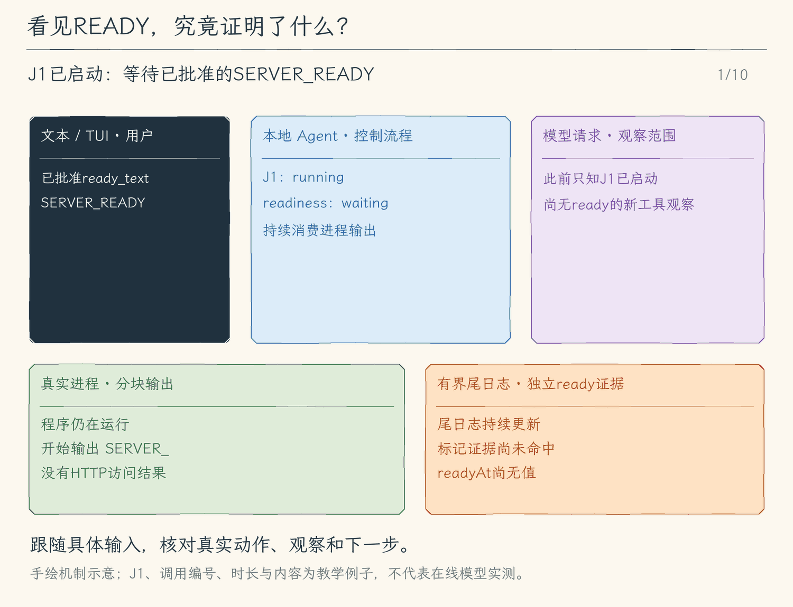

# 26.3 作业生命周期：什么证据说明它能用了

[第 26 章首页](../README.md) · [上一节：26.2 真实 PTY 与人工接管](../02-pty-takeover/README.md) · [本章练习与答案](../EXERCISES.md)

26.2 已经让一个交互程序在后台运行，并在需要时把终端交给用户。现在看另一类常见程序：开发服务器。`start_job` 返回了 JobID，日志里还没有地址；过一会儿，程序打印 `SERVER_READY`，随后持续等待请求。模型怎样知道现在可以继续检查页面？如果它在打印标记前退出，又该怎样结束这次等待？

本节把三个问题分开回答：操作系统是否已经创建进程，声明的输出是否已经出现，进程是否已经收尾。我们会保留每个判断的依据，把变化通知当前界面，并让模型在下一次读取时获得同一份事实。

## 先给“就绪”找一条可观察的依据

假设命令会在初始化结束后输出 `SERVER_READY`。启动时，模型同时提交命令和 `ready_text: "SERVER_READY"`；用户在批准预览里看见两者。程序只负责检查后续输出有没有出现这段字面文本。

这是一份明确而有限的约定：`running` 说明进程已启动，`ready` 说明它确实输出过声明的文本。即使 PID 已经存在，也不能据此推断初始化完成；即使出现了 `SERVER_READY`，也不能直接推断 HTTP 请求成功。程序完全可以先打印这句话，再因为端口占用而退出。需要判断服务是否可访问时，仍要通过后续工具取得访问结果，把该结果交给模型继续判断。

因此，作业同时保存两组状态：

| 观察对象 | 状态 | 具体含义 |
| --- | --- | --- |
| 进程 | `starting` / `running` / `stopping` / `exited` / `failed` | 仍沿用前两节的创建、运行、停止与收尾依据 |
| 输出约定 | `not_configured` | 启动时没有声明标记，不推断就绪 |
| 输出约定 | `waiting` | 声明了标记，目前尚未观察到 |
| 输出约定 | `ready` | 至少观察到一次声明的字面文本 |
| 输出约定 | `ended_before_ready` | 进程已经收尾，到最后也没有观察到标记 |

两组状态不能合成一个字段。作业可以同时是 `running + waiting`、`running + ready`，也可以是 `exited + ready`：最后一种保存的是“退出前曾输出标记”这个历史事实。它没有把已经退出的服务重新变成可用。

## 输出被拆开，也要保留同一条证据

操作系统交付的是输出块，不保证一行对应一个块。一次回调可能只收到 `SERVER_`，下一次才收到 `READY\n`。若只在当前块里查找，就会错过完整标记；若永久拼接全部日志，又会失去26.1建立的内存上限。

我们在等待阶段保留一个很短的尾部。若标记有12个字符，前一块最多留下11个字符，再与下一块拼接查找。任何跨块的完整匹配都必须从这个尾部开始，因此无需保存更长的匹配缓存。标记采用单行字面文本，长度限制为1–200字符；它不是可执行的正则表达式。

当 `SERVER_` 与 `READY\n` 拼出完整标记时，管理器把输出状态从 `waiting` 改为 `ready`，记录观察时刻 `readyAt` 和实际匹配的声明 `evidence`。后续输出只更新日志，不再反复发送就绪通知。尾日志可以继续淘汰旧字节，证据单独保留，所以过几分钟再读这个作业，仍能说明当初为什么记录为 `ready`。

这里匹配的是作业的输出观察通道。pipe 的 stdout、stderr 会汇入管理器；PTY 本来就是合并的终端输出。它不保留“这几个字符来自哪一个流”的健康证明。不同输出块恰好拼出标记，也满足当前的字面约定；需要更强的业务依据，应改变明确的验证方式，不能扩大 `ready` 的含义。

## 通知界面，与向模型交付结果，是两条路径

标记可能在模型本轮回答结束后才出现。界面需要及时告诉用户，但这并不意味着程序可以凭空插入一条工具结果，更不意味着应当自动再发起一次模型请求。

管理器提供订阅：状态第一次变为 `ready` 时发布一次通知，进程完成收尾时再发布一次 `ended`。通知携带脱离内部对象的作业快照，文本界面和 TUI 把它显示为本地消息。一个显示监听器即使抛出异常，也不能阻止进程继续清理；不再使用时需要解除订阅。

模型仍遵守原来的调用关系：它提交 `read_job`，程序按 JobID 取出当前快照，把状态、证据和有界日志放进这次工具结果，再随下一次请求发给模型。用户刚看见本地通知，并不代表模型上下文已经拥有这条新观察。这样，同一次状态变化既能及时反馈给人，也保留了模型消息里“哪一次调用得到了哪一次结果”的对应关系。

## 什么时候停止等待，什么时候能说清理结束

再看一个没有成功初始化的程序：它输出错误，退出码为1，却从未输出 `SERVER_READY`。管理器不能永远留下 `waiting`。只有对应 transport 完成收尾后，它才把进程写成终态，把输出状态改成 `ended_before_ready`，发布 `ended`，并完成 `wait`。模型随后读到的是退出事实和错误日志，可以修复原因或换一种方案。

另一种情况是用户停止、运行期限到达或 CLI 退出。发出 SIGTERM 只是停止请求；300毫秒宽限后仍可能需要 SIGKILL。`stop` 与 `close` 必须等待真实收尾，才把结果交还调用者。若标记此前已经出现，历史状态仍为 `ready`；结果中的退出状态、信号与停止原因会说明它现在已经结束。不能只看一个 `ready` 就继续使用它。

本节也补上极短进程的顺序问题：进程可能在启动等待恢复前就已收尾。启动路径返回快照时不能再无条件把它改回 `running`。最终状态必须由真实退出事实决定，不能由较晚恢复的一段程序覆盖。

会话退出时，文本入口先等待 `jobs.close()`，再解除通知订阅；TUI 沿用前节的终端归还和作业清理顺序。`close` 会封住新启动，并等待本会话登记的自有作业。它不撤销命令已经写入的文件、网络请求或其他外部影响，也不能保证收回自行脱离进程组的后代。这里结束的是本会话对这些自有进程的管理过程。

<!-- media:lesson:start -->
下面展示跨块命中、通知、日志截断与进程退出。ready保存的是已观察到的输出证据；模型要通过新的read_job取得它，HTTP健康需要另外执行真实访问。



[静态流程图](assets/job-readiness-evidence-flow-ff9ff1a9ff.png) · [静态封面](assets/job-readiness-evidence-cover-3c3596af6e.png) · [查看完整静态分镜](assets/job-readiness-evidence-storyboard-b767f7b229.jpg)
<!-- media:lesson:end -->

## 本节改动文件

<!-- generated:files:start -->

| 状态 | 文件 | 本节变化 |
| --- | --- | --- |
| CHANGED | [src/processes/jobs.ts](src/processes/jobs.ts) | 独立记录输出就绪、跨块证据与终态通知，防止极短进程的终态被启动路径覆写。 |
| CHANGED | [src/tools/job-tools.ts](src/tools/job-tools.ts) | 在启动审批中声明字面标记，并把就绪证据与退出事实交给模型。 |
| CHANGED | [src/ui/terminal.ts](src/ui/terminal.ts) | 显示本地作业通知，退出时先等作业收尾再解除订阅。 |
| CHANGED | [src/ui/tui/app.tsx](src/ui/tui/app.tsx) | 把就绪和结束作为本地消息显示，不自动触发模型请求。 |

<!-- generated:files:end -->

## 动手构建

先按[环境准备文档](../../docs/SETUP.md) 准备依赖、构建脚本与模型配置，再从上一公开小节 26.2 的完整 `src/` 继续。本节目标目录是 `chapter-26-interactive-jobs/03-job-lifecycle`。新增文件完整保存，修改文件按精确差异应用；未列出的实现沿用。下面差异以前面公开块累计形成的读者工作树为基线。

<!-- generated:build:start -->

<details>
<summary>CHANGED：src/processes/jobs.ts 的精确差异</summary>

<!-- source: src/processes/jobs.ts -->
```diff
--- a/src/processes/jobs.ts
+++ b/src/processes/jobs.ts
@@ -1,8 +1,12 @@
 /**
- * 26.2 真实PTY | [CHANGED] processes/jobs.ts
+ * 26.3 作业生命周期 | [CHANGED] processes/jobs.ts
  *
  * 会话内自有进程登记表。start 等真实 spawn；pipe wait 等 close，PTY wait 等原生 onExit。
  * 终态前解除订阅并发完自有进程组停止请求；不宣称能追踪自行脱离进程组的后代。
+ * 本文件局部流程（全局主流程见 agent/agent-loop.ts）：
+ *   spawn -> running；显式输出标记匹配 -> ready通知；transport收尾 -> 终态通知
+ *   未匹配就退出 -> ended_before_ready；退出CLI -> stop自有作业 -> 等真实收尾
+ * 观察：PID不证明服务就绪；ready只证明声明的输出已出现，不验证端口或HTTP健康。
  * 只保存有界尾日志；不从历史文件恢复 PID，不接管用户原有服务，也不构成沙箱。
  */
 import { EventEmitter } from "node:events";
@@ -11,7 +15,10 @@
 import { ToolError } from "../errors.js";
 
 // [KEEP 来自 26.1] JobID 是本实例的引用，PID 仅供观察，不能作为外部控制入口。
+// [CHANGED 26.3] 进程状态与输出就绪分别记录；历史证据不会随尾日志淘汰。
 export type JobSnapshot = {
+  readiness: "not_configured" | "waiting" | "ready" | "ended_before_ready";
+  readyText: string | null; readyAt: string | null; evidence: string | null;
   transport: "pipe" | "pty";
   id: string; pid: number | null; command: string; cwd: string;
   state: "starting" | "running" | "stopping" | "exited" | "failed";
@@ -20,10 +27,13 @@
   stopReason?: "user" | "timeout" | "shutdown" | "start_cancelled";
   log: string; retainedBytes: number; droppedBytes: number;
 };
-// [CHANGED 26.2] 默认pipe仍非交互；pty才有终端输入通道。
-export type JobInput = { command: string; cwd: string; timeoutMs: number; transport?: "pipe" | "pty" };
+// [KEEP 来自 26.2] 默认pipe仍非交互；pty才有终端输入通道。
+export type JobInput = { command: string; cwd: string; timeoutMs: number; transport?: "pipe" | "pty"; readyText?: string };
 type Entry = { snapshot: JobSnapshot; child: Transport; owner?: symbol; done: Promise<JobSnapshot>;
   stop: (reason: NonNullable<JobSnapshot["stopReason"]>) => void };
+
+// [NEW 26.3] 通知只供本地显示；不会伪造工具结果或自动触发模型请求。
+export type JobNotice = { type: "ready" | "ended"; job: JobSnapshot };
 
 /** 管理一个 CLI 会话创建的 POSIX 进程；已登记后台任务不绑定单轮模型信号。 */
 export class JobManager {
@@ -36,6 +46,15 @@
         || limits.history < limits.active) throw new ToolError("作业限额必须为正整数，历史限额不能小于活跃限额。");
   }
 
+  // [NEW 26.3] 观察者异常不能妨碍进程清理；解除订阅后不会再收到本会话通知。
+  subscribe(listener: (notice: JobNotice) => void): () => void {
+    this.output.on("notice", listener); return () => { this.output.off("notice", listener); };
+  }
+  private notify(type: JobNotice["type"], job: JobSnapshot): void {
+    for (const listener of this.output.listeners("notice")) {
+      try { listener({ type, job: structuredClone(job) }); } catch { /* 本地观察失败不改变作业状态。 */ }
+    }
+  }
   /** 只返回脱离内部对象的观察快照，调用者不能修改登记表。 */
   list(): JobSnapshot[] { return [...this.entries.values()].map(entry => structuredClone(entry.snapshot)); }
   /** 不接受 PID；未知、已淘汰或旧会话的 JobID 均拒绝。 */
@@ -46,7 +65,7 @@
   async stop(id: string, reason: NonNullable<JobSnapshot["stopReason"]> = "user"): Promise<JobSnapshot> {
     const entry = this.entry(id); entry.stop(reason); return this.wait(id);
   }
-  // [NEW 26.2] owner只授予本地接管桥，不能被模型调用参数伪造。
+  // [KEEP 来自 26.2] owner只授予本地接管桥，不能被模型调用参数伪造。
   /** 人类独占PTY，返回的句柄不进入模型工具；释放只detach，不kill。 */
   attach(id: string, onData: (data: string) => void): { write(data: string): void; eof(): void; resize(cols: number, rows: number): void; onExit(listener: () => void): () => void; detach(): void } {
     const entry = this.entry(id);
@@ -84,6 +103,8 @@
     if (this.closed) throw new ToolError("作业管理器已关闭。");
     if (!input.command.trim() || input.command.length > 4000 || /\x00/.test(input.command)
         || !Number.isInteger(input.timeoutMs) || input.timeoutMs < 100 || input.timeoutMs > 60_000) throw new ToolError("作业命令或运行期限无效。");
+    // [NEW 26.3] 标记在批准时已经声明；只做有界字面匹配，不执行模型提供的正则。
+    if (input.readyText !== undefined && (typeof input.readyText !== "string" || !input.readyText.trim() || input.readyText.length > 200 || /[\r\n\x00]/.test(input.readyText))) throw new ToolError("ready_text必须是1–200字符的单行字面标记。");
     const active = [...this.entries.values()].filter(e => !["exited", "failed"].includes(e.snapshot.state));
     if (active.length >= this.limits.active) throw new ToolError(`活跃作业已达上限 ${this.limits.active}，请先停止或等待已有作业。`);
     while (this.entries.size >= this.limits.history) {
@@ -91,7 +112,7 @@
       if (!oldest) throw new ToolError("作业历史已满。"); this.entries.delete(oldest.snapshot.id);
     }
     const id = randomUUID();
-    const snapshot: JobSnapshot = { transport: input.transport ?? "pipe", id, pid: null, command: input.command, cwd: input.cwd, state: "starting",
+    const snapshot: JobSnapshot = { readiness: input.readyText ? "waiting" : "not_configured", readyText: input.readyText ?? null, readyAt: null, evidence: null, transport: input.transport ?? "pipe", id, pid: null, command: input.command, cwd: input.cwd, state: "starting",
       startedAt: null, endedAt: null, exitCode: null, signal: null, log: "", retainedBytes: 0, droppedBytes: 0 };
     if (input.transport !== undefined && input.transport !== "pipe" && input.transport !== "pty") throw new ToolError("transport只能是pipe或pty。");
     const child = spawnJobTransport(input.command, input.cwd, input.transport ?? "pipe");
@@ -99,6 +120,8 @@
     const done = new Promise<JobSnapshot>(resolve => { finish = resolve; });
     let timer: ReturnType<typeof setTimeout> | undefined, hardKill: ReturnType<typeof setTimeout> | undefined;
     let totalBytes = 0;
+    // [NEW 26.3] 跨输出块最多保留标记长度减一的尾部，匹配内存不随日志增长。
+    let readyTail = "";
     /** 只向该transport真实创建的进程组发信号。 */
     const kill = (name: NodeJS.Signals) => child.kill(name);
     /** 持续读取transport输出：pipe排空stdout/stderr，PTY读取单通道；只保留合计byte上限的尾部。 */
@@ -111,6 +134,14 @@
       while (Buffer.byteLength(snapshot.log) > this.limits.logBytes) snapshot.log = snapshot.log.slice(1);
       snapshot.retainedBytes = Buffer.byteLength(snapshot.log);
       snapshot.droppedBytes = totalBytes - snapshot.retainedBytes;
+      // [NEW 26.3] 保留精确声明和观察时刻；即使该行后来被尾日志淘汰，也能核对依据。
+      if (snapshot.readiness === "waiting" && input.readyText) {
+        const text = readyTail + data;
+        if (text.includes(input.readyText)) {
+          snapshot.readiness = "ready"; snapshot.readyAt = new Date().toISOString(); snapshot.evidence = input.readyText;
+          this.notify("ready", snapshot); readyTail = "";
+        } else readyTail = text.slice(-(input.readyText.length - 1 || 1));
+      }
       this.output.emit("data", id, data);
     };
     /** 第一次停止记录原因，宽限 300ms 后升级；Promise 仍等待对应transport收尾。 */
@@ -127,6 +158,9 @@
       unlistenData(); unlistenExit();
       snapshot.exitCode = code; snapshot.signal = exitSignal;
       snapshot.endedAt = new Date().toISOString(); snapshot.state = error ? "failed" : "exited";
+      // [NEW 26.3] 只有transport真正收尾才发布终态；未匹配的声明不会变成ready。
+      if (snapshot.readiness === "waiting") snapshot.readiness = "ended_before_ready";
+      this.notify("ended", snapshot);
       this.output.emit("exit", id);
       finish(structuredClone(snapshot));
     });
@@ -140,8 +174,10 @@
         stop(this.closed ? "shutdown" : "start_cancelled"); await done;
         signal?.throwIfAborted(); throw new ToolError("会话在启动作业期间关闭。");
       }
-      snapshot.state = "running";
-      timer = setTimeout(() => stop("timeout"), input.timeoutMs);
+      // [CHANGED 26.3] 极短进程可能已收尾，不能用spawn回调把终态覆写为running。
+      if (!["exited", "failed"].includes(snapshot.state)) {
+        snapshot.state = "running"; timer = setTimeout(() => stop("timeout"), input.timeoutMs);
+      }
       return structuredClone(snapshot);
     } catch (error) {
       stop("start_cancelled"); await done;
@@ -152,8 +188,9 @@
 }
 
 /** 有界状态和日志同时给模型/本地命令；state=running 仅证明进程已启动。 */
+// [CHANGED 26.3] 展示就绪证据和时间，不从PID或退出码推测服务可用。
 export function describeJob(job: JobSnapshot): string {
-  return `JobID: ${job.id}\nPID: ${job.pid ?? "无"}\n状态: ${job.state}\n退出码: ${job.exitCode ?? "无"}\n信号: ${job.signal ?? "无"}\n停止原因: ${job.stopReason ?? "无"}\n日志尾部 (${job.retainedBytes} bytes，已丢弃 ${job.droppedBytes} bytes):\n${job.log || "（空）"}`;
+  return `JobID: ${job.id}\nPID: ${job.pid ?? "无"}\n状态: ${job.state}\n就绪: ${job.readiness}\n声明标记: ${JSON.stringify(job.readyText)}\n就绪时刻: ${job.readyAt ?? "无"}\n输出证据: ${JSON.stringify(job.evidence)}\n退出码: ${job.exitCode ?? "无"}\n信号: ${job.signal ?? "无"}\n停止原因: ${job.stopReason ?? "无"}\n日志尾部 (${job.retainedBytes} bytes，已丢弃 ${job.droppedBytes} bytes):\n${job.log || "（空）"}`;
 }
 
 /** 人类本地查询和停止不进入模型上下文；不从聊天文字推导批准。 */
```

</details>

<details>
<summary>CHANGED：src/tools/job-tools.ts 的精确差异</summary>

<!-- source: src/tools/job-tools.ts -->
```diff
--- a/src/tools/job-tools.ts
+++ b/src/tools/job-tools.ts
@@ -1,5 +1,7 @@
 /**
- * 26.2 真实PTY | [CHANGED] tools/job-tools.ts
+ * 26.3 作业生命周期 | [CHANGED] tools/job-tools.ts
+ * 本文件局部流程（全局主流程见 agent/agent-loop.ts）：参数/标记 -> 完整预览 -> 批准后spawn -> 原JobID观察。
+ * ready_text只声明输出依据；参数失败不创建进程，终态与就绪分别展示。
  * 模型只能批准启动/停止和只读观察；没有模型 stdin 工具。JobID 来自本会话真实 spawn。
  */
 import { ToolError } from "../errors.js";
@@ -10,7 +12,7 @@
 // [KEEP 来自 26.1] start_job 与 run_command 的等待退出语义各自明确。
 export const startJobDefinition = {
   name: "start_job", description: "逐次批准后启动后台 pipe 或真实PTY作业，返回真实 JobID；running 不证明服务就绪。作业属于当前CLI会话；用read_job观察、stop_job停止。",
-  inputSchema: { type: "object" as const, properties: { command: { type: "string" }, cwd: { type: "string" }, timeout_ms: { type: "integer", minimum: 100, maximum: 60_000 }, transport: { type: "string", enum: ["pipe", "pty"], description: "省略为非交互pipe；需要人类终端输入时选择真实pty" } }, required: ["command", "cwd"], additionalProperties: false },
+  inputSchema: { type: "object" as const, properties: { command: { type: "string" }, cwd: { type: "string" }, timeout_ms: { type: "integer", minimum: 100, maximum: 60_000 }, ready_text: { type: "string", minLength: 1, maxLength: 200, description: "可选单行字面输出标记；匹配只证明该输出出现，不能代替HTTP健康检查" }, transport: { type: "string", enum: ["pipe", "pty"], description: "省略为非交互pipe；需要人类终端输入时选择真实pty" } }, required: ["command", "cwd"], additionalProperties: false },
 };
 export const readJobDefinition = {
   name: "read_job", description: "只读本次会话自有JobID的当前状态与有界尾日志；不知道ID时返回列表。旧会话的PID不能恢复。",
@@ -36,12 +38,14 @@
 export async function prepareJob(name: string, json: string, jobs: JobManager | undefined, signal: AbortSignal): Promise<PreparedToolCall> {
   if (!jobs) throw new ToolError("当前会话未连接作业管理器。");
   if (name === "start_job") {
-    // [NEW 26.2] 先验证transport，再把其余参数交给已有命令/目录验证，禁止未知字段。
+    // [KEEP 来自 26.2] 先验证transport，再把其余参数交给已有命令/目录验证，禁止未知字段。
     let input: Record<string, unknown>; try { const parsed = JSON.parse(json); if (!parsed || typeof parsed !== "object" || Array.isArray(parsed)) throw new Error(); input = parsed; } catch { throw new ToolError("start_job参数必须是JSON对象。"); }
-    const { transport = "pipe", ...commandInput } = input;
+    // [CHANGED 26.3] 标记进入批准预览；其余参数仍由原命令准备层严格校验。
+    const { transport = "pipe", ready_text: readyText, ...commandInput } = input;
     if (transport !== "pipe" && transport !== "pty") throw new ToolError("transport只能是pipe或pty。");
-    const prepared = await prepareRunCommand(JSON.stringify(commandInput), undefined, signal, async (command, cwd, executionSignal, timeoutMs) => result(await jobs.start({ command, cwd, timeoutMs, transport }, executionSignal)));
-    return { ...prepared, preview: `启动后台作业（不会等待退出），transport=${transport}\n${prepared.preview}\n只管理本会话自有进程组；日志有界，退出Agent会清理作业。` };
+    if (readyText !== undefined && (typeof readyText !== "string" || !readyText.trim() || readyText.length > 200 || /[\r\n\x00]/.test(readyText))) throw new ToolError("ready_text必须是1–200字符的单行字面标记。");
+    const prepared = await prepareRunCommand(JSON.stringify(commandInput), undefined, signal, async (command, cwd, executionSignal, timeoutMs) => result(await jobs.start({ command, cwd, timeoutMs, transport, ...(typeof readyText === "string" ? { readyText } : {}) }, executionSignal)));
+    return { ...prepared, preview: `启动后台作业（不会等待退出），transport=${transport}\n就绪依据：${readyText === undefined ? "未配置；不推断就绪" : JSON.stringify(readyText) + "（仅输出标记，不验证HTTP健康）"}\n${prepared.preview}\n只管理本会话自有进程组；日志有界，退出Agent会清理作业。` };
   }
   const id = parseId(json, true)!;
   const job = jobs.get(id);
```

</details>

<details>
<summary>CHANGED：src/ui/terminal.ts 的精确差异</summary>

<!-- source: src/ui/terminal.ts -->
```diff
--- a/src/ui/terminal.ts
+++ b/src/ui/terminal.ts
@@ -1,5 +1,5 @@
 /**
- * 26.2 真实PTY | [CHANGED] ui/terminal.ts
+ * 26.3 作业生命周期 | [CHANGED] ui/terminal.ts
  *
  * 学习目标：消费同一任务事件，显示模型正文，并在结束后补打新增的本地反馈。
  * 输入：用户输入、本地命令、AgentRecord 记录流，以及 Ctrl+C / SIGINT / SIGTERM / SIGHUP。
@@ -287,6 +287,10 @@
   const fileCommand = createFileCheckpointCommands(options.fileCheckpoints);
   const terminal = Boolean(process.stdin.isTTY && process.stdout.isTTY);
   const input = createInterface({ input: process.stdin, output: process.stderr, terminal });
+  // [NEW 26.3] 会话级通知即使模型空闲也可见；不写入模型历史。
+  const unsubscribeJobs = model.jobs?.subscribe(({ type, job }) => {
+    console.error(screenText(`[作业${type === "ready" ? "输出就绪" : "已结束"}] ${job.id} ${job.state} readiness=${job.readiness}${job.evidence ? ` evidence=${JSON.stringify(job.evidence)}` : ""}`));
+  });
   const lines = createLineReader(input);
   const requestApproval = createApprovalHandler(lines, terminal);
   // [KEEP 来自 12.3] 交互问答复用同一行读取器，不能与聊天竞争输入。
@@ -331,9 +335,9 @@
       const text = value.trim();
       if (!text) continue;
       if (text === "/exit") break;
-      // [NEW 26.2] text的行读取器始终拥有stdin；接管只能使用可暂停Ink的TUI。
+      // [KEEP 来自 26.2] text的行读取器始终拥有stdin；接管只能使用可暂停Ink的TUI。
       if (/^\/fg(?:\s|$)/.test(text)) { console.error("PTY接管请使用 --output tui；text入口只支持/jobs /job /stop。"); continue; }
-      // [CHANGED 26.2] 本地停止等待对应transport收尾，查询不触发模型请求。
+      // [KEEP 来自 26.2] 本地停止等待对应transport收尾，查询不触发模型请求。
       if (/^\/(jobs|job|stop)(?:\s|$)/.test(text)) {
         try { console.error(screenText(await jobCommand(text, model.jobs))); }
         catch (error) { console.error(screenText(explainError(error))); }
@@ -420,6 +424,8 @@
     active?.abort();
     // [KEEP 来自 13.1] EOF、本地退出或终止都保存最后状态；CLI 在返回后 close。
     await checkpoint("exit");
+    // [NEW 26.3] 退出先等自有作业收尾，最后移除本地通知。
+    try { await model.jobs?.close(); } finally { unsubscribeJobs?.(); }
     lines.dispose();
     input.off("SIGINT", stop);
     input.close();
```

</details>

<details>
<summary>CHANGED：src/ui/tui/app.tsx 的精确差异</summary>

<!-- source: src/ui/tui/app.tsx -->
```diff
--- a/src/ui/tui/app.tsx
+++ b/src/ui/tui/app.tsx
@@ -1,5 +1,5 @@
 /**
- * 26.2 真实PTY | [CHANGED] ui/tui/app.tsx
+ * 26.3 作业生命周期 | [CHANGED] ui/tui/app.tsx
  *
  * 学习目标：显示模型的加载与资源结果；本地命令、审批、任务取消保持各自入口。
  * 输入：模型、键盘、终端尺寸与执行事件；普通任务只在用户提交后启动。
@@ -41,7 +41,8 @@
  */
 // [KEEP 来自 19.1] 来源作为本地显示条目，不进入模型历史。
 import { skillInfo, skillCommand } from "../../skills/catalog.js";
-import { useState } from "react";
+// [CHANGED 26.3] 订阅随组件装卸，通知不创建模型回合。
+import { useEffect, useState } from "react";
 import { Box, Text, render, useInput, usePaste, useWindowSize, useApp } from "ink";
 // [KEEP 来自 11.5] 颜色开关统一读取 NO_COLOR，文字状态始终保留。
 import { useColor } from "./layout.js";
@@ -58,7 +59,7 @@
 import { editExternally } from "./system-actions.js";
 import { createFileCheckpointCommands, type FileCheckpointStore } from "../../sessions/file-checkpoints.js";
 // [KEEP 来自 26.1] 本地作业命令不作为模型消息或权限记录。
-// [NEW 26.2] Ink暂停期间，独占的人类输入通道才会监听stdin。
+// [KEEP 来自 26.2] Ink暂停期间，独占的人类输入通道才会监听stdin。
 import { takeoverJob } from "../../processes/takeover.js";
 import { jobCommand } from "../../processes/jobs.js";
 import type { Message, Model } from "../../models/client.js";
@@ -225,6 +226,10 @@
     const entry = { id: `local:${session.nextId++}`, label, text: screenText(text) };
     setEntries((old) => [...old, entry]);
   };
+  // [NEW 26.3] 输出就绪和终态单独进入本地记录，正文来自同一个登记表快照。
+  useEffect(() => model.jobs?.subscribe(({ type, job }) => {
+    if (!session.closing) append("本地", `[作业${type === "ready" ? "输出就绪" : "已结束"}] ${job.id} ${job.state} readiness=${job.readiness}${job.evidence ? ` evidence=${JSON.stringify(job.evidence)}` : ""}`);
+  }), [model, session]);
   // [KEEP 来自 13.1] 只由明确操作调用；编辑草稿与 Enter 入队不自动刷盘。
   /**
    * 启动一次检查点并刷新独立保存状态，不改变模型任务的成功、失败或取消结果。
@@ -296,7 +301,7 @@
     setDraft(newDraft());
     // 本地命令只改本地会话；它们不作为 user 消息送给模型。
     if (prompt === "/exit") { quit(0); return; }
-    // [NEW 26.2] suspendTerminal暂停Ink唯一底层读者；保留React输入订阅，避免resume早于active效果。
+    // [KEEP 来自 26.2] suspendTerminal暂停Ink唯一底层读者；保留React输入订阅，避免resume早于active效果。
     if (/^\/fg(?:\s|$)/.test(prompt)) {
       const match = /^\/fg ([0-9a-f-]{36})$/.exec(prompt);
       if (!match || !model.jobs) { append("本地", "用法：/fg <本次会话PTY的JobID>。"); return; }
@@ -307,7 +312,7 @@
         finally { session.external = undefined; if (!session.closing) setNotice("已收回终端；/job核对状态，/stop显式停止。"); }
       })() }; return;
     }
-    // [CHANGED 26.2] 停止等对应transport收尾后才恢复输入；日志由现有显示层转义。
+    // [KEEP 来自 26.2] 停止等对应transport收尾后才恢复输入；日志由现有显示层转义。
     if (/^\/(jobs|job|stop)(?:\s|$)/.test(prompt)) {
       session.clearing = true;
       session.done = (async () => {
```

</details>

<!-- generated:build:end -->

## 运行验证

先从仓库根编译本节完整快照：

```bash
npm run lesson:26.3
```

先做不调用模型的生命周期实验。标记被分两次写出，管理器仍应记录一次就绪；命令随后退出时，历史证据应当保留。另一个作业从未打印标记，应在真实收尾后结束等待。

```bash
node --input-type=module <<'NODE'
import assert from 'node:assert/strict';
import { JobManager } from './dist/processes/jobs.js';
const jobs = new JobManager();
const notices = [];
const unsubscribe = jobs.subscribe(notice => notices.push(notice));
try {
  const ready = await jobs.start({
    command: `node -e 'process.stdout.write("SERVER_"); setTimeout(() => { process.stdout.write("READY\\n"); }, 40)'`,
    cwd: process.cwd(), timeoutMs: 3000, readyText: 'SERVER_READY',
  });
  const ended = await jobs.wait(ready.id);
  assert.equal(ended.state, 'exited');
  assert.equal(ended.exitCode, 0);
  assert.equal(ended.readiness, 'ready');
  assert.equal(ended.evidence, 'SERVER_READY');
  assert.ok(ended.readyAt);
  assert.equal(notices.filter(n => n.type === 'ready' && n.job.id === ready.id).length, 1);
  const missing = await jobs.start({
    command: `node -e 'process.stderr.write("port occupied\\n"); process.exitCode = 1'`,
    cwd: process.cwd(), timeoutMs: 3000, readyText: 'SERVER_READY',
  });
  const failed = await jobs.wait(missing.id);
  assert.equal(failed.readiness, 'ended_before_ready');
  assert.equal(failed.exitCode, 1);
  assert.equal(failed.readyAt, null);
  assert.match(failed.log, /port occupied/);
  assert.equal(notices.filter(n => n.type === 'ended').length, 2);
  console.log('通过：跨块就绪、历史证据、未就绪退出、各一次通知。');
} finally { await jobs.close(); unsubscribe(); }
NODE
```

这段命令没有启动 HTTP 服务，却能得到 `ready`，正好验证了含义边界：标记出现不能代替服务访问结果。再从 TUI 启动一个延迟打印标记后继续等待的作业，核对审批预览里的 `ready_text`。本轮回答结束后，应看到本地“输出就绪”通知；随后让模型用 `read_job` 读取同一个 JobID，核对状态、声明、证据和时间都进入这次工具结果。最后用 `/stop <实际JobID>` 停止，或退出 CLI，确认进程收尾。

配套仓库还可运行真实 pipe/PTY 检查：

```bash
LESSON_26=03-job-lifecycle node tests/verify-chapter-26.mjs
```

它检查分块标记、未就绪退出、通知、尾日志与证据分别保留、停止与会话清理；不调用在线模型。

## 本节完成后的 Agent

现在模型可以分清启动、输出证据与进程终态；用户也能在当前界面及时看见作业变化。每次新的推理仍以本次工具读取到的观察为准，退出则等待自有作业真实收尾。下一章会把多次独立只读工具放进有界调度，同时保持调用、结果与取消的归属。

本节状态：待用户确认。
