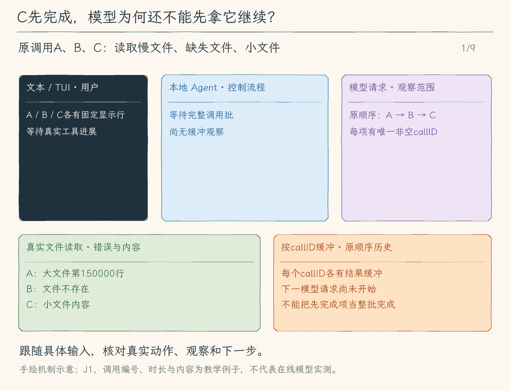

# 27.3 结果屏障：先完成的可以先显示，模型等整批观察

[第 27 章首页](../README.md) · [上一节：27.2 超时与清理](../02-cancel-and-cleanup/README.md) · [本章练习与答案](../EXERCISES.md)

模型一次提出三项读取：A读取入口，B读取一个不存在的文件，C搜索测试。实际完成顺序却是C、B、A。C一结束，用户就可以在界面看见搜索结果；但模型此时还不知道入口内容，也没有看到B的失败原因。若立刻开始下一次推理，它只能依据不完整的观察继续做决定。

本节给一批调用增加一个明确的等待点：所有项目都有结果或中断说明，才把这一批观察交给下一次模型请求。完成顺序决定界面何时反馈，原调用身份决定结果属于谁；两者不能混用。

## 一份请求清单，对应一份结果清单

同一批调用必须具有非空且唯一的callID。两个调用若使用同一个ID，后续观察就无法区分归属；程序会在这批请求进入历史、任何工具开始前拒绝它。不同批次可以再次使用相同ID，结果仍要在各自批次内配对。

先把这次工具请求看成三张有编号的凭条：`call-A`、`call-B`、`call-C`。完成一个项目时，程序按其callID保存观察，而不是把它塞进“第一个空位”。因此C先完成，只会填上C的位置，不能占用A的位置。

结果中继续保留原来的内容和错误标记。B的“文件不存在”也是一份有效观察：工具确实尝试了这次读取，并说明失败原因。它不需要抛弃A和C，也不应让整批只能返回一句“某个工具失败了”。下一次请求里，模型能同时看见入口、缺失文件和搜索结果，再决定是否改路径、补读或作答。

程序最终按原请求顺序A、B、C把工具消息加入本轮历史，每条消息都带原callID。这个固定顺序让检查、回放和后续模型适配更稳定；配对本身仍依靠ID。界面上的sequence则是本地显示编号，不是服务商的工具调用身份。

## 等待点怎样知道整批已经结束

不能把“最后一个开始的项目完成了”当作整批结束，因为最早开始的读取可能还在清理。屏障要等调度器返回：该等待覆盖所有已启动项目的Promise，超时与取消也已走完27.2的收尾过程。

随后检查每一张请求凭条是否已有对应观察。普通成功、工具错误、权限拒绝、排队超时和执行超时，都能填上各自的位置。已开始但因本轮中断没有完整结果的操作，要保留“已开始、结果不完整”的说明；从未启动的项目则明确记为未执行。不能把这两种情况写成同一句“失败”，更不能为补齐数量伪造成功内容。

只有这份结果清单形成后，模型循环才允许继续。若这一轮被用户取消，程序收齐并保存的是可恢复的历史，随后结束当前轮次；它不会因历史已经补齐而自动发出一次新模型请求。下一次用户继续时，模型才能依据留下的实际状态重新判断。

## 界面反馈不必等到屏障之后

屏障限制的是下一次推理的输入时刻，不要求把界面冻结。工具C完成时，程序立即发出带sequence与callID的完成事件；TUI更新C的行，教学跟踪也可显示C的结果。A仍是执行中，B可以先显示失败，用户能看见整批当前的真实进度。

所有项目收尾并按原顺序提交历史后，程序发出一次整批结束事件，交代结果数量与这一批是否被中断。它不取代每项的内容，也不表示任务需求已经实现。

这些事件是观察副本。它们不负责向模型历史插入消息，也不能凭一次显示成功就宣布整批结束。模型使用的是等待点之后按ID收齐的工具消息。因此界面能及时响应，模型仍能获得完整、有归属的输入。

## 普通失败留下结果，程序异常先收尾再上抛

“文件不存在”或参数无效属于工具能够解释的普通失败。它们形成带错误标记的观察，其他读取继续进行，整批到齐后一起交给模型。

意料外的程序异常则可能破坏本轮继续执行的条件。此时调度器停止发放新项目，向同伴传播取消，等待已经启动的工作收尾，再把异常交给外层。结果屏障即使在这条异常路径上也要提交已经取得的观察；外层只为仍缺结果的调用补入与实际执行情况一致的说明，避免覆盖已完成的成果或把已开始的操作写成未执行。

这样，一次错误不会抹掉同伴结果，一次取消也不会留下悬空的工具调用。下一次模型读到的历史能够回答三个问题：这批请求有哪些，分别取得了什么，哪些结果仍需重新核实。

<!-- media:lesson:start -->
下面分开追踪C的界面完成事件与模型观察：B错误、C成功可以先显示和缓冲，A真实收尾后才按A、B、C原顺序提交。动画里的最后一次模型请求只展示正常未取消分支。



[静态流程图](assets/tool-results-batch-barrier-flow-cce98d8c66.png) · [静态封面](assets/tool-results-batch-barrier-cover-db716066cc.png) · [查看完整静态分镜](assets/tool-results-batch-barrier-storyboard-037e1a80ac.jpg)
<!-- media:lesson:end -->

## 本节改动文件

<!-- generated:files:start -->

| 状态 | 文件 | 本节变化 |
| --- | --- | --- |
| CHANGED | [src/agent/tool-batch.ts](src/agent/tool-batch.ts) | 操作前拒绝空或重复ID，并在整批收尾后按原调用顺序返回观察摘要。 |
| CHANGED | [src/agent/agent-loop.ts](src/agent/agent-loop.ts) | 逐项缓冲工具消息，正常与中断路径都按原callID提交，再继续模型或抛出中断。 |
| CHANGED | [src/agent/events.ts](src/agent/events.ts) | 在历史提交后报告整批结果数量与是否中断。 |
| CHANGED | [src/ui/teaching-trace.ts](src/ui/teaching-trace.ts) | 显示整批等待点，区分单项完成和允许下一次模型请求。 |
| CHANGED | [src/ui/tui/state.ts](src/ui/tui/state.ts) | 显示整批结果收齐或中断。 |

<!-- generated:files:end -->

## 动手构建

先按[环境准备文档](../../docs/SETUP.md) 准备依赖、构建脚本与模型配置，再从上一公开小节 27.2 的完整 `src/` 继续。本节目标目录是 `chapter-27-tool-concurrency/03-batch-results`。新增文件完整保存，修改文件按精确差异应用；未列出的实现沿用。下面差异以前面公开块累计形成的读者工作树为基线。

<!-- generated:build:start -->

<details>
<summary>CHANGED：src/agent/tool-batch.ts 的精确差异</summary>

<!-- source: src/agent/tool-batch.ts -->
```diff
--- a/src/agent/tool-batch.ts
+++ b/src/agent/tool-batch.ts
@@ -1,5 +1,5 @@
 /**
- * 27.2 取消与收尾 | [CHANGED] agent/tool-batch.ts
+ * 27.3 整批结果屏障 | [CHANGED] agent/tool-batch.ts
  *
  * 学习目标：只让相邻本地只读调用共享有限容量，其他调用构成串行屏障。
  * 输入：带稳定 sequence/callID 的完整调用批、父取消信号、单项执行函数。
@@ -13,7 +13,20 @@
 // [KEEP 来自 27.1] 新工具默认串行；load_skill 改已加载集合，必须先完成再读资源。
 const PARALLEL_READS = new Set(["read_file", "glob", "grep", "read_tool_result", "read_job", "read_skill_resource"]);
 export type BatchItem = { call: ToolCall; sequence: number };
-// [CHANGED 27.2] 超时的两种终态分别说明在队列中、还是开始执行后超期。
+// [NEW 27.3] 屏障摘要按调用身份返回；界面完成顺序不改变下一次模型消息配对。
+export type BatchObservation = BatchItem & { state: ToolState; started: boolean };
+/**
+ * [NEW 27.3] 整批入队前校验原调用身份，禁止空 ID 或同批重复 ID。
+ * 校验失败时不发排队事件，也不启动任何真实操作。
+ */
+export function validateBatch(items: readonly BatchItem[]): void {
+  const ids = new Set<string>();
+  for (const { call } of items) {
+    if (!call.id.trim() || ids.has(call.id)) throw new Error("工具批调用ID必须非空且唯一");
+    ids.add(call.id);
+  }
+}
+// [KEEP 来自 27.2] 超时的两种终态分别说明在队列中、还是开始执行后超期。
 export type ToolState = "queued" | "running" | "succeeded" | "failed" | "cancelled" | "queue_timeout" | "execution_timeout";
 export type BatchFailure = { state: "cancelled" | "queue_timeout" | "execution_timeout"; started: boolean; message: string };
 export type BatchOptions = { concurrency?: number; serial?: boolean;
@@ -31,7 +44,7 @@
   return value;
 }
 /**
- * [NEW 27.2] 排队与执行使用两只独立时钟，范围由本地控制。
+ * [KEEP 来自 27.2] 排队与执行使用两只独立时钟，范围由本地控制。
  * 省略时使用各自默认值；无效期限在调用入队前失败。
  */
 function deadline(value: number | undefined, fallback: number): number {
@@ -41,7 +54,7 @@
 }
 
 /**
- * [CHANGED 27.2] 超期只发出停止请求，始终 await 执行函数 settle 后归还容量。
+ * [KEEP 来自 27.2] 超期只发出停止请求，始终 await 执行函数 settle 后归还容量。
  * fs 的 realpath/stat/readFile 请求不能强杀，可能超过期限后才返回；本调度器不会提前释放槽。
  * 只读白名单才有期限，其权限/审批等待也计入领槽后的执行期限。
  * 非白名单调用沿用原信号与语义，远端效果不能撤回。
@@ -51,7 +64,10 @@
   execute: (item: BatchItem, signal: AbortSignal) => Promise<boolean>,
   state: (item: BatchItem, state: ToolState) => void,
   options: BatchOptions = {},
-): Promise<void> {
+): Promise<BatchObservation[]> {
+  // [NEW 27.3] 在任何排队事件和真实操作前拒绝无法配对的调用。
+  validateBatch(items);
+  const started = new Set<string>();
   const capacity = options.serial ? 1 : batchConcurrency(options.concurrency);
   const queueMs = deadline(options.queueTimeoutMs, 10_000), executionMs = deadline(options.executionTimeoutMs, 15_000);
   const batch = new AbortController();
@@ -86,10 +102,12 @@
           const abort = () => own.abort(batch.signal.reason);
           batch.signal.addEventListener("abort", abort, { once: true });
           let timedOut = false;
-          // [NEW 27.2] 执行时钟从真正领槽起算，超时不以 Promise.race 提前腾槽。
+          // [KEEP 来自 27.2] 执行时钟从真正领槽起算，超时不以 Promise.race 提前腾槽。
           const timer = isParallelRead(item.call) ? setTimeout(() => {
             timedOut = true; own.abort(new Error("只读工具执行期限已到"));
           }, executionMs) : undefined;
+          // [NEW 27.3] 记录领过槽的身份，排队超时不能误报已开始。
+          started.add(item.call.id);
           change(item, "running");
           try {
             const succeeded = await execute(item, own.signal);
@@ -110,10 +128,12 @@
         }
       }));
     }
-    // [NEW 27.2] 未发放的调用也有终态；父取消必须等待所有已启动工作收尾。
+    // [KEEP 来自 27.2] 未发放的调用也有终态；父取消必须等待所有已启动工作收尾。
     for (const item of items) if (status.get(item) === "queued") fail(item, { state: "cancelled", started: false, message: "本轮在该工具启动前中断，这个调用未执行。" });
     if (failed) throw firstError;
     signal.throwIfAborted();
+    // [NEW 27.3] 这是整批结果屏障；不是先完成一项就请求一次模型。
+    return items.map(item => ({ ...item, state: status.get(item)!, started: started.has(item.call.id) }));
   } finally {
     for (const timer of queueTimers.values()) clearTimeout(timer);
     signal.removeEventListener("abort", cancel);
```

</details>

<details>
<summary>CHANGED：src/agent/agent-loop.ts 的精确差异</summary>

<!-- source: src/agent/agent-loop.ts -->
```diff
--- a/src/agent/agent-loop.ts
+++ b/src/agent/agent-loop.ts
@@ -1,9 +1,10 @@
 /**
- * 27.2 取消与收尾 | [CHANGED] agent/agent-loop.ts
+ * 27.3 整批结果屏障 | [CHANGED] agent/agent-loop.ts
  *
  * [KEEP 来自 27.1] 工具批 -> 相邻只读段(最多 N 项) -> 串行屏障 -> 本批完成 -> 下一次模型决策。
- * [CHANGED 27.2] 排队期限 / 领槽后的执行期限 -> 发停止请求 -> await底层收尾 -> 归还槽。
- * 学习目标：区分排队与执行期限，发出停止请求后等待底层真实收尾，再归还容量。
+ * [KEEP 来自 27.2] 排队期限 / 领槽后的执行期限 -> 发停止请求 -> await底层收尾 -> 归还槽。
+ * [CHANGED 27.3] 每项独立缓冲 -> 同伴全部收尾 -> 按原callID顺序提交整批观察 -> 下一次模型。
+ * 学习目标：每项单独保存观察，同伴收尾后按原调用身份提交整批结果，再请求模型。
  * 输入：问题、历史、取消信号、事件消费者和审批入口；模型提供实际输入估算，选项连接队列、文件检查点与工具日志。
  * 输出：回答和服务商累计用量；过程另发本地预算和费用估计，失败补齐工具状态、保留历史后抛错。
  * 状态：进入前已取消就不新增历史；清单由会话持有，已经发生的工具操作不会随取消撤销。
@@ -127,7 +128,7 @@
 import { emitAgentEvent, type AgentObserver } from "./events.js";
 import type { RunOptions } from "./run-options.js";
 // [KEEP 来自 27.1] 原单项权限链由调度器调用，相邻白名单读取才共用有限容量。
-import { runToolBatch } from "./tool-batch.js";
+import { runToolBatch, validateBatch } from "./tool-batch.js";
 
 const MAX_MODEL_CALLS = 8;
 
@@ -331,13 +332,18 @@
       // 最后一次模型机会仍要求工具时，结果已不可能再反馈给模型，因此不执行无用操作。
       if (modelCall === maxModelCalls) break;
 
+      // [KEEP 来自 27.1] 先固定编号，后续完成乱序不会改变调用身份；副作用与依赖工具是屏障。
+      const items = result.toolCalls.map((call, index) => ({ call, sequence: toolSequence + index + 1 }));
+      // [NEW 27.3] 无法配对的响应尚未进入历史，也没有工具开始。
+      validateBatch(items);
       turn.push({ role: "assistant", content: result.text, toolCalls: result.toolCalls });
-      // [KEEP 来自 27.1] 先固定编号，后续完成乱序不会改变调用身份；副作用与依赖工具是屏障。
-      // [NEW 27.2] 相同ID在另一批复用时，也只找当前批已有结果。
-      const batchTurnStart = turn.length;
-      const items = result.toolCalls.map((call, index) => ({ call, sequence: toolSequence + index + 1 }));
       toolSequence += items.length;
+      const observations = new Map(items.map(item => [item.call.id, [] as Message[]]));
+      let batchFailed = false, batchError: unknown;
+      try {
       await runToolBatch(items, signal, async ({ call, sequence }, callSignal) => {
+        // [NEW 27.3] 同伴不会写进本项数组；完成顺序仅影响即时事件。
+        const callMessages = observations.get(call.id)!;
         callSignal.throwIfAborted();
         // [KEEP 来自 12.1] 每次请求仍经过本地模式检查，不能靠模型工具列表保证禁止。
         const permission = options.allowedTools && !options.allowedTools.includes(call.name)
@@ -361,7 +367,7 @@
             prepared = await prepareTool(call, callSignal, toolOptions);
           } catch (error) {
             if (!(error instanceof ToolError)) throw error;
-            turn.push({
+            callMessages.push({
               role: "tool",
               toolCallId: call.id,
               content: `工具准备失败：${error.message}`,
@@ -421,7 +427,7 @@
           if (response.decision === "deny") rejection = `用户未批准工具执行：${response.reason}`;
         }
         if (rejection) {
-          turn.push({ role: "tool", toolCallId: call.id, content: rejection, isError: true });
+          callMessages.push({ role: "tool", toolCallId: call.id, content: rejection, isError: true });
           pendingToolResults += 1;
           return false;
         }
@@ -448,7 +454,7 @@
             emitAgentEvent(observer, { type: "model_usage", call: modelCall, inputTokens, outputTokens, cachedInputTokens, cacheWriteTokens, costEstimateUsd: model.estimateCost?.(inputTokens, outputTokens) ?? null });
           }
           if (result.metadata.kind === "subagent" && callSignal.aborted) {
-            turn.push({ role: "tool", toolCallId: call.id, content: result.content, isError: true });
+            callMessages.push({ role: "tool", toolCallId: call.id, content: result.content, isError: true });
             executingCallIds.delete(call.id);
             emitAgentEvent(observer, { type: "tool_finish", sequence, call, outcome: "success", result });
             callSignal.throwIfAborted();
@@ -460,7 +466,7 @@
               if (after.messages.length) result = { ...result, content: `${result.content}\n\n[本地执行后钩子反馈；不是权限]\n${after.messages.join("\n")}` };
             } catch (error) {
               if (!(error instanceof ToolError)) {
-                turn.push({ role: "tool", toolCallId: call.id, content: result.content + "\n[本地状态] 后置钩子中断；工具已返回，副作用未撤销。", isError: result.isError ?? false });
+                callMessages.push({ role: "tool", toolCallId: call.id, content: result.content + "\n[本地状态] 后置钩子中断；工具已返回，副作用未撤销。", isError: result.isError ?? false });
                 executingCallIds.delete(call.id);
                 throw error;
               }
@@ -474,12 +480,12 @@
           catch (error) {
             // 原工具的错误标记保持不变；给本次调用留下明确摘要，不声明不存在的日志引用。
             const content = `[本地状态：工具已返回，但完整日志未保存；本轮停止，以下仅为头尾，不能找回被省略部分]\n${clippedToolText(result.content)}`;
-            turn.push({ role: "tool", toolCallId: call.id, content, isError: result.isError ?? false });
+            callMessages.push({ role: "tool", toolCallId: call.id, content, isError: result.isError ?? false });
             emitAgentEvent(observer, { type: "tool_finish", sequence, call, outcome: "success", result: { ...result, content } });
             throw error;
           }
           // [KEEP 来自 07.1] 非零退出码仍是错误；裁剪不改变原调用编号或成功/失败。
-          turn.push({ role: "tool", toolCallId: call.id, content: modelContent, isError: result.isError ?? false });
+          callMessages.push({ role: "tool", toolCallId: call.id, content: modelContent, isError: result.isError ?? false });
           pendingToolResults += 1;
           emitAgentEvent(observer, {
             type: "tool_finish",
@@ -493,7 +499,7 @@
         } catch (error) {
           // [KEEP 来自 03.3] 预期内的工具错误回到循环；编程错误、系统异常仍交给外层处理。
           if (!(error instanceof ToolError)) throw error;
-          turn.push({
+          callMessages.push({
             role: "tool",
             toolCallId: call.id,
             content: `工具执行失败：${error.message}`,
@@ -512,17 +518,29 @@
           return false;
         }
       }, (item, state) => emitAgentEvent(observer, { type: "tool_state", ...item, state }),
-      // [NEW 27.2] 超时与取消交代原调用身份；已返回的真实结果保留并补充本地状态。
+      // [KEEP 来自 27.2] 超时与取消交代原调用身份；已返回的真实结果保留并补充本地状态。
       { concurrency: options.toolConcurrency, serial: Boolean(model.hooks),
         queueTimeoutMs: options.toolQueueTimeoutMs, executionTimeoutMs: options.toolExecutionTimeoutMs,
         onFailure: ({ call, sequence }, failure) => {
-          const last = turn.slice(batchTurnStart).reverse().find(message => message.role === "tool" && message.toolCallId === call.id);
+          // [NEW 27.3] 超时/取消也填入同一项；真实结果已返回时追加状态，不重复一份消息。
+          const callMessages = observations.get(call.id)!;
+          const last = callMessages[callMessages.length - 1];
           if (last?.role === "tool") { last.content += `\n[本地状态] ${failure.message}`; last.isError = true; }
-          else { turn.push({ role: "tool", toolCallId: call.id, content: failure.message, isError: true }); pendingToolResults += 1; }
+          else { callMessages.push({ role: "tool", toolCallId: call.id, content: failure.message, isError: true }); pendingToolResults += 1; }
           executingCallIds.delete(call.id);
           emitAgentEvent(observer, { type: "tool_finish", sequence, call, outcome: "error", error: last?.role === "tool" ? last.content : failure.message });
         },
       });
+      } catch (error) { batchFailed = true; batchError = error; }
+      finally {
+        // [NEW 27.3] 即使父取消或同伴异常，也先提交已取得的真实结果及未启动交代。
+        for (const { call } of items) turn.push(...observations.get(call.id)!);
+        pendingToolResults = items.length;
+        emitAgentEvent(observer, { type: "tool_batch_finish", call: modelCall,
+          results: items.length, interrupted: batchFailed });
+      }
+      if (batchFailed) throw batchError;
+
     }
 
     if (options.childDepth) throw new ChildBudgetError("子任务已用尽模型决策次数，尚未得到完整最终回答。");
```

</details>

<details>
<summary>CHANGED：src/agent/events.ts 的精确差异</summary>

<!-- source: src/agent/events.ts -->
```diff
--- a/src/agent/events.ts
+++ b/src/agent/events.ts
@@ -1,5 +1,5 @@
 /**
- * 27.1 有界只读并发 | [CHANGED] agent/events.ts
+ * 27.3 整批结果屏障 | [CHANGED] agent/events.ts
  *
  * 学习目标：分清本地输入估算、服务商用量与费用估计；本文件负责传递已经发生的模型、权限和工具事件。
  * 输入：runAgent 的开始/结束通知，或 Agent Loop 已发生的过程事件。
@@ -90,7 +90,9 @@
       hasPreview: boolean;
     }
   | { type: "approval_finish"; sequence: number; call: ToolCall; response: ApprovalResponse }
-  // [NEW 27.1] sequence/callID 从请求顺序固定，不按完成先后重编号。
+  // [KEEP 来自 27.1] sequence/callID 从请求顺序固定，不按完成先后重编号。
+  // [NEW 27.3] 屏障发生在所有结果已经按调用顺序提交之后。
+  | { type: "tool_batch_finish"; call: number; results: number; interrupted: boolean }
   | { type: "tool_state"; sequence: number; call: ToolCall; state: import("./tool-batch.js").ToolState }
   | { type: "tool_start"; sequence: number; call: ToolCall }
   | {
```

</details>

<details>
<summary>CHANGED：src/ui/teaching-trace.ts 的精确差异</summary>

<!-- source: src/ui/teaching-trace.ts -->
```diff
--- a/src/ui/teaching-trace.ts
+++ b/src/ui/teaching-trace.ts
@@ -1,7 +1,7 @@
 /**
- * 27.1 有界只读并发 | [CHANGED] ui/teaching-trace.ts
- *
- * 学习目标：显示固定sequence对应的排队、运行与终态，及时反馈真实工具进展。
+ * 27.3 整批结果屏障 | [CHANGED] ui/teaching-trace.ts
+ *
+ * 学习目标：显示各项真实进展与整批结果提交屏障，区分本地完成反馈和模型历史提交。
  * 输入：runAgent 与 Agent Loop 的结构化事件；输出：供终端打印的纯文本行数组。
  * 状态：本文件只生成显示字符串，不改变原事件、历史或审批决定。
  *
@@ -189,6 +189,8 @@
     return [`模型 < 第 ${event.call} 次决策`, `  返回：${result}`];
   }
 
+  // [NEW 27.3] 单项完成事件可乱序，整批收齐后才继续模型。
+  if (event.type === "tool_batch_finish") return [`[工具批 ${event.call}] ${event.results} 项观察已收齐${event.interrupted ? "；本轮中断" : "，交回模型"}`];
   if (event.type === "permission_check") {
     const tool = describeToolCall(event.call);
     const decision = event.decision.action === "allow"
@@ -241,7 +243,7 @@
     ];
   }
 
-  // [NEW 27.1] 排队/运行/终态属于同一调用，结果正文仍由 tool_finish 展示。
+  // [KEEP 来自 27.1] 排队/运行/终态属于同一调用，结果正文仍由 tool_finish 展示。
   if (event.type === "tool_state") return [`[工具 #${event.sequence} ${event.call.id}] ${event.call.name}: ${event.state}`];
   const tool = describeToolCall(event.call);
   if (event.type === "tool_start") {
```

</details>

<details>
<summary>CHANGED：src/ui/tui/state.ts 的精确差异</summary>

<!-- source: src/ui/tui/state.ts -->
```diff
--- a/src/ui/tui/state.ts
+++ b/src/ui/tui/state.ts
@@ -1,5 +1,5 @@
 /**
- * 27.2 取消与收尾 | [CHANGED] ui/tui/state.ts
+ * 27.3 整批结果屏障 | [CHANGED] ui/tui/state.ts
  *
  * 学习目标：把同一轮事件累积成显示状态；结束时采用包含本地 stop 反馈的完整回答，避免只留下较早的模型片段。
  * 输入：上一份 RunView 与下一条 AgentEvent；事件按 streamAgentRun 的顺序送达。
@@ -71,6 +71,8 @@
  * - 职责边界：这里只处理显示副本，不发起网络请求、不执行工具，也不替用户作出审批决定。
  */
 export function updateRunView(view: RunView, event: AgentEvent): RunView {
+  // [NEW 27.3] 整批结束不冒充整轮结束，保留每项结果。
+  if (event.type === "tool_batch_finish") return { ...view, status: formatTeachingTrace(event).join(" ") };
   if (event.type === "run_start") return emptyRunView();
   if (event.type === "child_state") {
     const child = { ...event, detail: screenText(event.detail) };
@@ -106,7 +108,7 @@
   // 前面的分支已经处理整轮与模型事件；剩下的事件都有工具 sequence，可更新同一行。
   const old = view.tools.find((tool) => tool.sequence === event.sequence);
   // [KEEP 来自 27.1] 调度状态按固定 sequence 更新；终态不覆盖此前收到的完整结果。
-  // [CHANGED 27.2] 分开展示排队与执行超时，整轮结束保留这些已确认终态。
+  // [KEEP 来自 27.2] 分开展示排队与执行超时，整轮结束保留这些已确认终态。
   const status = event.type === "tool_state" ? ({ queued: "排队中", running: "执行中", succeeded: "完成", failed: "失败", cancelled: "已中断", queue_timeout: "排队超时", execution_timeout: "执行超时" }[event.state])
     : event.type === "permission_check" ? ({ allow: "允许", ask: "等待确认", deny: "已拒绝" }[event.decision.action])
     : event.type === "tool_prepare" ? event.outcome === "success" ? "预览已准备" : "准备失败"
```

</details>

<!-- generated:build:end -->

## 运行验证

先从仓库根编译本节完整快照：

```bash
npm run lesson:27.3
```

先用真实临时文件与模型替身检查结果屏障。模型替身第一次固定提出三次读取，第二次只检查收到什么；它不访问在线服务。大文件的高行号读取比小文件晚结束，缺失文件则保留自己的错误结果。

```bash
node --input-type=module <<'NODE'
import assert from 'node:assert/strict';
import { mkdtemp, writeFile, rm } from 'node:fs/promises';
import { tmpdir } from 'node:os';
import { join } from 'node:path';
import { agentLoop } from './dist/agent/agent-loop.js';
const cwd = process.cwd(), directory = await mkdtemp(join(tmpdir(), 'batch-barrier-'));
const reply = (text, toolCalls = []) => ({ text, toolCalls,
  finishReason: toolCalls.length ? 'tool_calls' : 'stop',
  inputTokens: 3, outputTokens: 2, truncated: false });
const call = (id, path, offset = 1) => ({ id, name: 'read_file',
  arguments: JSON.stringify({ path, offset, limit: 2 }) });
const history = [], trace = [];
let requests = 0;
try {
  await writeFile(join(directory, 'package.json'), '{"type":"module"}');
  await writeFile(join(directory, 'large.ts'), 'const observed = 7;\n'.repeat(160000));
  await writeFile(join(directory, 'small.ts'), 'SMALL_OBSERVED\n');
  process.chdir(directory);
  await agentLoop({ async generate(messages) {
    requests += 1; trace.push('model:' + requests);
    if (requests === 1) return reply('', [call('slow', 'large.ts', 150000),
      call('missing', 'absent.ts'), call('fast', 'small.ts')]);
    const tools = messages.filter(message => message.role === 'tool');
    assert.deepEqual(tools.map(message => message.toolCallId), ['slow', 'missing', 'fast']);
    assert.match(tools[0].content, /150000:/);
    assert.equal(tools[1].isError, true);
    assert.match(tools[2].content, /SMALL_OBSERVED/);
    return reply('ALL_OBSERVED');
  } }, history, '检查这批读取', new AbortController().signal, event => {
    if (event.type === 'tool_finish') trace.push('finish:' + event.call.id);
    if (event.type === 'tool_batch_finish') trace.push('barrier:' + event.results);
  });
  assert.ok(trace.indexOf('finish:fast') < trace.indexOf('finish:slow'));
  assert.ok(trace.indexOf('model:2') > trace.indexOf('barrier:3'));
  assert.equal(requests, 2);
  assert.equal(history.filter(message => message.role === 'tool').length, 3);
  console.log('通过：先显示已完成项，按原ID收齐三份观察后才请求模型。');
} finally { process.chdir(cwd); await rm(directory, { recursive: true, force: true }); }
NODE
```

这里的缺失文件不是整批异常：模型仍同时收到大文件、小文件与缺失原因。界面事件可以先显示fast，下一次模型请求却只能发生在 `barrier:3` 之后。

配套仓库另检查重复ID在任何工具开始前被拒绝、父取消为未启动写入补齐观察、日志保存异常保留已经返回的短结果与长结果头尾。它们验证失败路径也没有悬空调用，不依赖在线模型。

```bash
LESSON_27=03-batch-results node tests/verify-chapter-27.mjs
```

## 本节完成后的 Agent

同一批读取可以倒序完成并及时显示，每份观察仍归原callID；正常结果、普通错误与中断交代在等待点收齐，模型才获得下一次完整输入。下一章会为需要修改项目的任务准备独立Git工作区，再把固定版本的评审、整合和清理分别建立证据。

本节状态：待用户确认。
