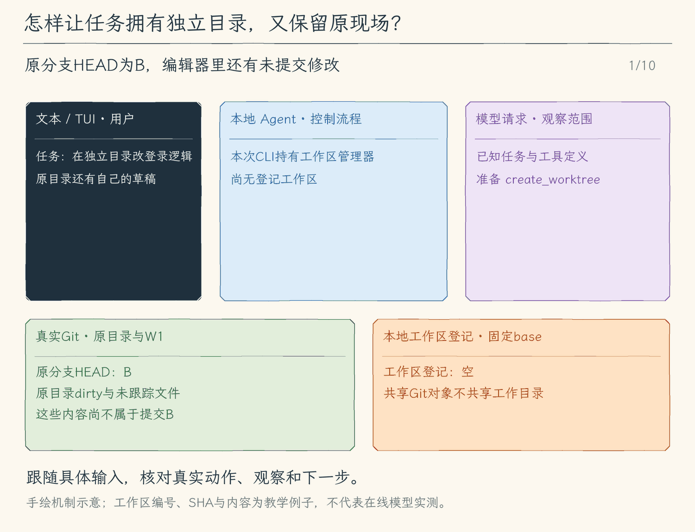

# 28.1 独立工作区：从同一提交出发，各自修改与提交

[第 28 章首页](../README.md) · [上一节：27.3 结果屏障](../../chapter-27-tool-concurrency/03-batch-results/README.md) · [本章练习与答案](../EXERCISES.md)

假设我们要同时修复登录按钮和调整日志格式。两项任务都需要改 `src/main.ts`。即使给每个 Agent 不同的任务说明，只要它们仍写同一目录，后写者就可能覆盖前写者刚保存的内容；运行测试时，也可能把另一项尚未完成的修改一起测进去。第27章的并发容量只能限制“同时做几件事”，不能让同一个文件自动拥有两份独立内容。

本节为每项修改创建一个真实 Git worktree。它可以理解为同一仓库的一份额外工作目录：共享提交对象，各自持有工作文件、索引和当前分支。任务A、B可以从同一个已提交版本出发，在各自目录修改同名文件，再分别提交。A的保存不会改写B的文件，A的提交也不会移动B所在的分支。

## 起点是一条提交，不是原目录此刻看起来的样子

创建工作区时先记下原目录的当前分支与HEAD提交，称为目标分支与base SHA。例如，目标 `main` 目前指向提交B；任务工作区会从B建立自己的 `codex/hello-agent-<uuid>` 分支。UUID是程序生成的唯一标识，模型不需要拼路径或选择任意已有分支。

如果原目录还有未提交修改，它们只存在于原工作目录或索引，不属于B。新工作区从B检出，因此不会自动带走这些修改。未跟踪文件、被忽略文件也不会复制过去。这个区别直接决定任务能看见什么：用户刚改好但尚未提交的登录文案，任务A可能根本看不到；不能仅因“创建成功”就认为它继承了原目录的一切。

因此创建结果必须同时交代仓库、目标分支、base SHA、任务分支和工作区路径。它们分别回答：属于哪个项目、最后准备交回哪里、从哪个已提交版本开始、成果保存在哪条分支、命令实际在哪个目录运行。读取快照还能看见两边当前SHA与dirty状态，用来核对后来发生的变化。

本节模型工具的输入如下。返回的ID要原样用于后续操作，不要把表里的示意文字当作真实ID。

| 工具 | 参数 | 返回或执行的对象 |
| --- | --- | --- |
| `create_worktree` | `{}` | 从批准的当前HEAD创建自有任务分支与目录 |
| `read_worktree` | `{}`或`{ "worktree_id": "返回的UUID" }` | 列出当前登记，或读取该ID的最新快照 |
| `run_worktree_command` | `{ "worktree_id": "返回的UUID", "command": "要执行的完整命令", "timeout_ms": 10000 }` | 核对目录后逐次审批执行；期限可省略 |

## 单独的目录怎样成为可核对的任务身份

模型拿到的是当前会话登记的worktree ID，后续工具按ID找回路径和分支。程序不会因模型传来一个相似目录，就把外部目录导入管理；旧会话ID也不能恢复控制权。

每次真实操作前，管理器还要核对实际路径、Git工作区根、共享仓库目录、任务分支与Git登记。这样可以拒绝已被改成静态符号链接的路径、切到其他分支的目录或冒充的工作区。登记记录提供预期身份，Git与文件系统提供当前事实，二者相符后才继续。

这些核对适用于可信的本机项目，不能抵御恶意程序恰好在核对与执行之间替换目录。工作目录隔离也不等于命令沙箱：获批的shell命令仍可能访问其他路径。我们得到的是独立的Git修改空间，以及每次操作可检查的执行位置。

## 怎样在任务目录里完成读、改、测和提交

创建与执行命令仍沿用已有的权限链：模式检查、参数准备、预览、逐次批准、真实执行。Plan模式不会创建工作区或运行命令。预览先固定仓库、分支、提交或命令目录；用户批准后，程序在真实执行前再核对，避免拿过期预览直接操作已经变化的位置。

`run_worktree_command`接收ID与命令，在该工作区运行原有命令执行器。它不调用全局 `process.chdir()`，所以另一个任务的执行目录不会被这个调用改掉。每一次读、改、测试或提交都需要核对自己的命令预览；创建一次工作区，并没有授予模型以后任意执行命令的永久许可。

第25章的只读子Agent保持原来的工具范围。本章的写入能力属于单独的工作区工具，没有因为“子任务”三个字就让所有子Agent获得写权限。当前调度也把工作区工具作为串行屏障；独立目录为修改提供归属，不表示本节会自动同时启动多个写任务。

任务在目录里提交后，变化才获得稳定的Git版本。仅仅测试通过却没有提交，文件仍可能继续变化；仅仅产生提交，也不能证明测试已经通过。后两节会分别处理固定版本评审、整合与删除条件。

## 创建、命令失败和取消分别留下什么

创建成功需要Git命令真实返回，并能从登记与路径核对出这份工作区。工具结果会带回身份与快照，模型据此决定下一步进入哪个ID执行命令。创建命令若部分成功后失败，磁盘上可能已经留下目录或分支；错误结果要保留可核对的信息，不能用一句“失败”暗示什么都没发生。

工作区命令返回时，沿用现有退出码、信号、超时和有界输出。模型收到的是这一次命令的结果，再结合最新工作区快照决定改参数、读错误或继续测试。取消会要求已启动进程停止并等待收尾，但已经写入的文件与提交不会自动撤销；之后要先读取状态，再判断如何恢复。

会话登记只活在当前CLI进程中，退出不会自动删除Git工作区与任务分支。这个保留策略让未交付成果仍能按Git事实找回；重启后的新会话不会凭旧ID接管它。到本节结束，完成依据是“独立工作区已建立、命令确实在该目录执行、成果以任务提交保存”，还没有完成评审或回到原目标分支。

<!-- media:lesson:start -->
下面从原目录的未提交草稿出发，追踪固定提交B、创建W1、返回身份，再逐次批准工作区命令。图中W1是简称，真实工具参数必须使用返回的完整UUID；只展示一次状态命令，不把后续改测提交当作已发生事实。



[静态流程图](assets/worktree-fixed-base-flow-2d44f72aa9.png) · [静态封面](assets/worktree-fixed-base-cover-5f05cc19c6.png) · [查看完整静态分镜](assets/worktree-fixed-base-storyboard-e962136a7a.jpg)
<!-- media:lesson:end -->

## 本节改动文件

<!-- generated:files:start -->

| 状态 | 文件 | 本节变化 |
| --- | --- | --- |
| NEW | [src/workspaces/worktrees.ts](src/workspaces/worktrees.ts) | 固定仓库与base，创建自有Git工作区，复核身份并在指定目录执行获批命令。 |
| NEW | [src/tools/worktree-tools.ts](src/tools/worktree-tools.ts) | 定义严格ID参数的创建、只读查询与命令工具，拒绝任意路径和分支。 |
| CHANGED | [src/agent/agent-loop.ts](src/agent/agent-loop.ts) | 把会话管理器交给统一工具链，并在全局图中标明工作区结果回流。 |
| CHANGED | [src/agent/run-options.ts](src/agent/run-options.ts) | 在可信本地选项中传递当前会话的工作区管理器。 |
| CHANGED | [src/models/client.ts](src/models/client.ts) | 为同一CLI持有跨轮共用的工作区管理器。 |
| CHANGED | [src/permissions/policy.ts](src/permissions/policy.ts) | 创建与命令逐次审批，Plan拒绝副作用，子任务范围保持原约定。 |
| CHANGED | [src/tools/registry.ts](src/tools/registry.ts) | 发现工作区工具，并分别走只读执行或准备审批入口。 |
| CHANGED | [src/tools/types.ts](src/tools/types.ts) | 让正文和界面元数据携带同一份工作区身份快照。 |
| CHANGED | [src/ui/teaching-trace.ts](src/ui/teaching-trace.ts) | 在教学跟踪中显示工作区ID、路径、分支与当前提交。 |
| CHANGED | [src/ui/tui/state.ts](src/ui/tui/state.ts) | 以工具结果中的真实身份更新工作区显示。 |

<!-- generated:files:end -->

## 动手构建

先按[环境准备文档](../../docs/SETUP.md) 准备依赖、构建脚本与模型配置，再从上一公开小节 27.3 的完整 `src/` 继续。本节目标目录是 `chapter-28-isolated-workspaces/01-worktree-base`。新增文件完整保存，修改文件按精确差异应用；未列出的实现沿用。下面差异以前面公开块累计形成的读者工作树为基线。

<!-- generated:build:start -->

<details>
<summary>NEW：src/workspaces/worktrees.ts 的完整文件</summary>

<!-- source: src/workspaces/worktrees.ts -->
```ts
/**
 * 28.1 独立工作区 | [NEW] workspaces/worktrees.ts
 * 学习目标：从固定base创建会话自有Git worktree，让结果返回真实身份。
 * 输入：本地启动目录、本管理器生成的ID、取消信号；不接受任意目录或分支。
 * 输出：身份快照或固定预览/执行闭包；Git失败保留目录、分支与冲突，不自动回滚。
 * 本文件局部流程（全局主流程见 agent/agent-loop.ts）：
 *   创建 -> 固定目标branch/HEAD -> 审批 -> 复查 -> git worktree add -> 登记实际状态
 *   命令 -> 预览自有目录/完整命令 -> 审批 -> 复查身份 -> 执行 -> 最新状态回模型
 * 观察：dirty/untracked/ignored留在原处；自有工作区不等于安全沙箱。
 * shortcut: 登记只存当前CLI内存，重启后须按Git事实人工恢复；不把worktree当安全沙箱。
 */
import { lstat, mkdtemp, realpath } from "node:fs/promises";
import { join, resolve } from "node:path";
import { tmpdir } from "node:os";
import { randomUUID } from "node:crypto";
import { ToolError } from "../errors.js";
import { runProcess, type ProcessResult } from "../processes/run-process.js";
import { prepareRunCommand } from "../tools/run-command.js";
import type { PreparedToolCall, ToolExecutionResult } from "../tools/types.js";

// [NEW 28.1] 本文件以下实现均为本节新增；ID和分支由本实例生成，路径只从本地登记表取得。
export type WorktreeSnapshot = {
  id: string; path: string; repository: string; commonDirectory: string; branch: string;
  baseSha: string; targetBranch: string; currentTargetBranch: string; headSha: string | null; targetSha: string | null;
  dirty: boolean; hasIgnored: boolean; targetDirty: boolean; operation: string | null; targetOperation: string | null; state: "creating" | "ready" | "failed" | "removed";
  failure?: string;
};
type Entry = { snapshot: WorktreeSnapshot };
type Origin = { repository: string; commonDirectory: string; branch: string; sha: string; dirty: boolean; operation: string | null };

// [KEEP 来自 28.1] 不拼shell；固定Git设置不执行hooks、签名和外部diff；受信本机Git过滤器/merge driver仍不是沙箱。
/** 运行固定Git程序与参数数组，不经过shell。
 * 输入真实cwd、受本模块控制的argv与轮次信号；输出有界日志、退出码和停止原因。
 * hooks/fsmonitor/签名在本次命令关闭，diff另设no-ext-diff/no-textconv；filter/merge driver仍可能运行。
 * 取消会等待进程组收尾后抛出，已发生的Git或文件副作用不会回滚。
 */
async function git(cwd: string, args: string[], signal?: AbortSignal): Promise<ProcessResult> {
  return runProcess("git", ["-c", "core.hooksPath=/dev/null", "-c", "core.fsmonitor=false", "-c", "commit.gpgSign=false", "-c", "merge.gpgSign=false", ...args], { cwd, signal, timeoutMs: 30_000, maxOutputBytes: 256 * 1024 });
}
/** 把Git退出事实保留成工具可见文字。
 * 输入ProcessResult，输出退出码、信号、停止原因和已有两条流；不把stderr单独当成失败。
 * 这里只排版，不检查成功、不丢弃冲突现场。
 */
function failure(result: ProcessResult): string { return `exit=${result.exitCode} signal=${result.signal ?? "none"} stop=${result.stopReason ?? "none"}\n${result.stdout}${result.stderr}`; }
/** 只接纳完整结束且退出码为0的Git查询/操作。
 * 输入cwd、参数和取消信号；输出trim后的完整stdout；超时、超量或非0抛ToolError。
 * 不完整diff不能进入评审；抛错仍可能发生在Git已经写盘之后。
 */
async function checked(cwd: string, args: string[], signal?: AbortSignal): Promise<string> {
  const result = await git(cwd, args, signal);
  if (result.exitCode !== 0 || result.signal || result.stopReason) throw new ToolError(`Git ${args[0]} 未完成：${failure(result)}`);
  return result.stdout.trim();
}
/** 读取任务或目标目录的已跟踪修改与全部未跟踪文件。
 * 输入真实cwd，输出porcelain是否非空；ignored另记供清理检查。
 * Git失败向上抛错，不能把观察失败当作clean。
 */
async function dirty(cwd: string, signal?: AbortSignal): Promise<boolean> {
  return Boolean(await checked(cwd, ["status", "--porcelain=v1", "--untracked-files=all"], signal));
}
/** 只把不存在视为false，不能把权限或IO错误当作安全的空现场。
 * 输入本模块从Git/登记表取得的路径，输出是否有目录项；其他错误继续抛出。
 * 使用lstat保留符号链接本身的存在事实，不跟随未知目标判断删除成功。
 */
async function exists(path: string): Promise<boolean> {
  try { await lstat(path); return true; }
  catch (error) { if ((error as NodeJS.ErrnoException).code === "ENOENT") return false; throw error; }
}
/** 检查即使porcelain为clean也可能残留的Git操作标记。
 * 输入真实cwd，输出首个merge/cherry-pick/revert/rebase/sequencer标记或null。
 * 路径由git rev-parse给出；发现标记只报告，绝不自行abort或清理。
 */
async function operation(cwd: string, signal?: AbortSignal): Promise<string | null> {
  for (const name of ["MERGE_HEAD", "CHERRY_PICK_HEAD", "REVERT_HEAD", "rebase-merge", "rebase-apply", "sequencer"]) {
    const path = resolve(cwd, await checked(cwd, ["rev-parse", "--git-path", name], signal));
    if (await exists(path)) return name;
  }
  return null;
}
/** 取得当前提交的固定对象名。
 * 输入真实cwd与信号，输出Git验证过的HEAD commit SHA。
 * 无提交、无效仓库或取消向上失败，不接受模型自报SHA。
 */
async function head(cwd: string, signal?: AbortSignal): Promise<string> { return checked(cwd, ["rev-parse", "--verify", "HEAD^{commit}"], signal); }
/** 取得当前工作目录实际检出的分支。
 * 输入真实cwd与信号，输出symbolic-ref短分支名。
 * detached HEAD直接失败，不能猜测需要整合到哪个分支。
 */
async function branch(cwd: string, signal?: AbortSignal): Promise<string> { return checked(cwd, ["symbolic-ref", "--quiet", "--short", "HEAD"], signal); }
/** 把启动目录解析成可核实的本地Git身份。
 * 输入cwd与信号，输出canonical根/common-dir、实际分支/HEAD、dirty及未结束操作。
 * 不改变目录或Git状态；任一步观察失败都阻止后续副作用。
 */
async function origin(cwd: string, signal?: AbortSignal): Promise<Origin> {
  const repository = await realpath(await checked(cwd, ["rev-parse", "--show-toplevel"], signal));
  const commonDirectory = await realpath(resolve(repository, await checked(repository, ["rev-parse", "--git-common-dir"], signal)));
  return { repository, commonDirectory, branch: await branch(repository, signal), sha: await head(repository, signal), dirty: await dirty(repository, signal), operation: await operation(repository, signal) };
}
/** 预览与execute只使用同一份输入，避免批准后重新解析模型参数。
 * 输入完整预览与执行函数，输出一次性PreparedToolCall。
 * 取消先拒绝；同一闭包再次执行失败，调用者必须重新请求预览。
 */
function once(preview: string, execute: PreparedToolCall["execute"]): PreparedToolCall {
  let used = false;
  return { preview, async execute(signal) { signal.throwIfAborted(); if (used) throw new ToolError("本次工作区操作已经执行，请重新请求。"); used = true; return execute(signal); } };
}
/** 给模型返回完整身份快照。
 * 输入本地观测对象，输出JSON文字；不从模型回答补充缺少的状态。
 * 显示控制字符由UI处理，这里保留工具结果原文。
 */
export function describeWorktree(value: WorktreeSnapshot): string { return JSON.stringify(value, null, 2); }
/** 让模型正文和界面元数据携带同一工作区事实。
 * 输入快照、说明与失败标志，输出ToolExecutionResult。
 * isError表示操作未确认成功，目录或成果仍可能存在，不能据此自动回滚。
 */
export function worktreeResult(snapshot: WorktreeSnapshot, message: string, isError = false): ToolExecutionResult {
  return { content: `${message}\n${describeWorktree(snapshot)}`, isError, metadata: { kind: "worktree", worktree: snapshot } };
}

/** 管理当前CLI自己登记的工作区，所有自有副作用在本实例串行。
 * 输入可信本地启动目录；公开API返回快照或固定preview/execute。
 * 本机其他进程仍可能修改Git，身份检查与执行之间不是操作系统隔离。
 * 没有自动恢复、丢弃、reset、abort或递归删除入口。
 */
export class WorktreeManager {
  private readonly entries = new Map<string, Entry>();
  private directory?: string;
  private tail: Promise<unknown> = Promise.resolve();
  constructor(private readonly cwd = process.cwd()) {}
  private exclusive<T>(action: () => Promise<T>): Promise<T> { const result = this.tail.then(action); this.tail = result.catch(() => {}); return result; }
  private entry(id: string): Entry { const entry = this.entries.get(id); if (!entry) throw new ToolError("未知WorktreeID；只接受本次CLI会话创建的工作区。"); return entry; }
  // [KEEP 来自 28.1] 检查时拒绝路径/仓库/分支身份冒充；路径检查与Git调用仍有TOCTOU间隔。
  private async verify(entry: Entry, signal?: AbortSignal): Promise<void> {
    const value = entry.snapshot;
    if (value.state !== "ready") throw new ToolError(`工作区状态为${value.state}，保留路径${value.path}，请先人工核实。`);
    if (await realpath(value.path) !== value.path) throw new ToolError("工作区真实路径发生变化。");
    const current = await origin(value.path, signal);
    if (current.repository !== value.path || current.commonDirectory !== value.commonDirectory || current.branch !== value.branch) throw new ToolError("工作区根、仓库或分支身份变化，拒绝操作。");
    const registration = await checked(value.repository, ["worktree", "list", "--porcelain"], signal);
    if (!registration.split("\n\n").some(block => block.split("\n").includes(`worktree ${value.path}`) && block.split("\n").includes(`branch refs/heads/${value.branch}`))) throw new ToolError("Git工作区登记与本地身份不一致。");
  }
  private async inspect(entry: Entry, signal?: AbortSignal): Promise<WorktreeSnapshot> {
    const value = entry.snapshot;
    if (value.state === "ready") {
      await this.verify(entry, signal);
      const target = await origin(value.repository, signal);
      if (target.repository !== value.repository || target.commonDirectory !== value.commonDirectory) throw new ToolError("原目标仓库身份变化。");
      value.headSha = await head(value.path, signal); value.targetSha = target.sha; value.currentTargetBranch = target.branch;
      value.dirty = await dirty(value.path, signal); value.targetDirty = target.dirty;
      value.hasIgnored = Boolean(await checked(value.path, ["ls-files", "--others", "--ignored", "--exclude-standard", "--directory"], signal));
      value.operation = await operation(value.path, signal); value.targetOperation = target.operation;
    }
    return structuredClone(value);
  }
  get(id: string, signal?: AbortSignal): Promise<WorktreeSnapshot> { return this.exclusive(() => this.inspect(this.entry(id), signal)); }
  list(signal?: AbortSignal): Promise<WorktreeSnapshot[]> { return this.exclusive(() => Promise.all([...this.entries.values()].map(entry => this.inspect(entry, signal)))); }
  async prepareCreate(signal?: AbortSignal): Promise<PreparedToolCall> {
    const before = await origin(this.cwd, signal), id = randomUUID(), taskBranch = `codex/hello-agent-${id}`;
    return once(`创建独立Git worktree\n仓库：${before.repository}\n目标分支：${before.branch}\nbase SHA：${before.sha}\n原目录dirty：${before.dirty}\n任务分支：${taskBranch}\n未提交、未跟踪和ignored文件仍留在原目录，不复制。工作区不是安全沙箱；当前CLI退出后登记不会恢复。Git可能运行受信本机仓库配置的filter/merge driver。`, executionSignal => this.exclusive(async () => {
      const current = await origin(this.cwd, executionSignal);
      if (current.repository !== before.repository || current.commonDirectory !== before.commonDirectory || current.branch !== before.branch || current.sha !== before.sha) throw new ToolError("创建审批后目标仓库、分支或HEAD变化，请重新请求。");
      if ([...this.entries.values()].filter(entry => entry.snapshot.state !== "removed").length >= 4 || this.entries.size >= 16) throw new ToolError("最多保留4个工作区、16条会话登记，请先处理已有成果。");
      this.directory ??= await realpath(await mkdtemp(join(tmpdir(), "hello-agent-worktrees-")));
      const value: WorktreeSnapshot = { id, path: join(this.directory, id), repository: before.repository, commonDirectory: before.commonDirectory,
        branch: taskBranch, baseSha: before.sha, targetBranch: before.branch, currentTargetBranch: current.branch, headSha: null, targetSha: before.sha, dirty: false, hasIgnored: false, operation: null, targetOperation: current.operation,
        targetDirty: current.dirty, state: "creating" };
      const entry: Entry = { snapshot: value }; this.entries.set(id, entry);
      try {
        await checked(value.repository, ["worktree", "add", "-b", taskBranch, "--", value.path, value.baseSha], executionSignal);
        value.state = "ready";
        return worktreeResult(await this.inspect(entry, executionSignal), "已创建真实工作区；未自动复制原目录dirty内容。");
      } catch (error) {
        value.state = "failed"; value.failure = error instanceof Error ? error.message : String(error);
        if (executionSignal.aborted) throw error;
        return worktreeResult(structuredClone(value), "创建未确认成功；保留登记、目录与可能已创建的分支，请按Git事实核实。", true);
      }
    }));
  }
  async prepareCommand(id: string, argumentsJson: string, signal?: AbortSignal): Promise<PreparedToolCall> {
    const entry = this.entry(id); await this.verify(entry, signal);
    const prepared = await prepareRunCommand(argumentsJson, entry.snapshot.path, signal);
    return once(`WorktreeID：${id}\n任务分支：${entry.snapshot.branch}\nbase SHA：${entry.snapshot.baseSha}\n${prepared.preview}\n命令仍可能访问工作区外的文件/网络；请核对完整命令。`, executionSignal => this.exclusive(async () => {
      await this.verify(entry, executionSignal);
      const result = await prepared.execute(executionSignal);
      return worktreeResult(await this.inspect(entry, executionSignal), result.content, Boolean(result.isError));
    }));
  }
}
```

</details>

<details>
<summary>NEW：src/tools/worktree-tools.ts 的完整文件</summary>

<!-- source: src/tools/worktree-tools.ts -->
```ts
/**
 * 28.1 独立工作区 | [NEW] tools/worktree-tools.ts
 * 学习目标：让模型取得真实工作区身份，所有修改仍走统一逐次审批。
 * 输入：严格JSON对象和当前CLI持有的管理器；不接受任意path、branch或伪造ID。
 * 输出：只读快照，或固定预览/execute；失败回到Agent Loop形成工具错误，不自动清冲突。
 * 本文件局部流程（全局主流程见 agent/agent-loop.ts）：
 *   JSON/字段/ID有效？-- 否 -> ToolError；是 -> 当前会话manager -> 只读或prepare
 *   prepare -> 统一审批 -> execute；模型从content、界面从metadata取得同一身份。
 * 观察：Plan和只读child没有副作用入口；命令明确显示自有目录，结果返回当前分支与dirty状态。
 */
import { ToolError } from "../errors.js";
import { WorktreeManager, worktreeResult } from "../workspaces/worktrees.js";
import type { PreparedToolCall, ToolDefinition, ToolExecutionResult } from "./types.js";

// [NEW 28.1] 本文件以下实现均为本节新增； 模型只能引用管理器返回的UUID，不能指定任意worktree目录。
const idProperty = { type: "string", description: "本次CLI创建的WorktreeID" };
/** 构造模型可见的严格工作区工具Schema。
 * 输入本地工具名、说明、附加字段和ID要求，输出ToolDefinition。
 * additionalProperties=false只是模型提示，执行前parse还要再次拒绝未知字段。
 */
function definition(name: string, description: string, extra: Record<string, unknown> = {}, idRequired = true): ToolDefinition {
  return { name, description, inputSchema: { type: "object", properties: { ...(name === "create_worktree" ? {} : { worktree_id: idProperty }), ...extra }, required: idRequired ? ["worktree_id", ...(name === "run_worktree_command" ? ["command"] : [])] : [], additionalProperties: false } };
}
export const worktreeDefinitions: ToolDefinition[] = [
  definition("create_worktree", "逐次批准后从当前HEAD创建自有独立Git worktree；原目录dirty不复制。返回WorktreeID、base/branch和真实目录；不是安全sandbox。", {}, false),
  definition("read_worktree", "只读当前CLI自有工作区状态；省略ID列出登记。返回base、当前/目标SHA和dirty状态，不导入旧会话路径。", {}, false),
  definition("run_worktree_command", "逐次批准后在自有工作区执行读/改/测/提交命令；命令仍可访问别处，不是安全sandbox。结果同时返回最新身份和状态。", { command: { type: "string" }, timeout_ms: { type: "integer", minimum: 100, maximum: 60_000 } }),
];
// [NEW 28.1] 工具定义与副作用gate共享同一集合。
export const worktreeMutations = new Set(worktreeDefinitions.filter(tool => tool.name !== "read_worktree").map(tool => tool.name));
/** 校验模型参数，不让路径或分支冒充当前CLI登记身份。
 * 输入工具名和JSON，输出已检查的普通对象；格式、未知字段或UUID不符抛ToolError。
 * UUID格式通过仍不代表拥有该工作区，后续管理器必须查询自己的Map。
 */
function parse(name: string, json: string): Record<string, unknown> {
  let value: unknown; try { value = JSON.parse(json); } catch { throw new ToolError("工作区参数不是有效JSON。"); }
  if (!value || typeof value !== "object" || Array.isArray(value)) throw new ToolError("工作区参数必须是对象。");
  const input = value as Record<string, unknown>;
  const keys = name === "create_worktree" ? [] : name === "run_worktree_command" ? ["worktree_id", "command", "timeout_ms"] : ["worktree_id"];
  if (Object.keys(input).some(key => !keys.includes(key))) throw new ToolError("工作区参数含未知字段；不能传入任意path/branch。");
  if (name !== "create_worktree" && (input.worktree_id !== undefined || name !== "read_worktree")
      && (typeof input.worktree_id !== "string" || !/^[0-9a-f]{8}-[0-9a-f]{4}-4[0-9a-f]{3}-[89ab][0-9a-f]{3}-[0-9a-f]{12}$/.test(input.worktree_id))) throw new ToolError("需要本次会话生成的WorktreeID。");
  return input;
}
/** 要求当前CLI确实持有工作区登记管理器。
 * 输入可信RunOptions注入的可选实例，输出实例；缺失时抛ToolError。
 * 不从模型参数、磁盘目录或旧会话自动接管工作区。
 */
function manager(value?: WorktreeManager): WorktreeManager { if (!value) throw new ToolError("当前会话没有工作区管理器。"); return value; }
/** 读取本次会话已有登记，省略ID时返回列表。
 * 输入严格JSON、当前管理器和取消信号；输出实际快照正文与结构化元数据。
 * ready身份检查失败向上抛错；failed/removed保留最后登记，帮助定位部分成功的现场。
 */
export async function readWorktree(json: string, worktrees: WorktreeManager | undefined, signal: AbortSignal): Promise<ToolExecutionResult> {
  signal.throwIfAborted(); const input = parse("read_worktree", json), own = manager(worktrees);
  if (input.worktree_id) return worktreeResult(await own.get(input.worktree_id as string, signal), "当前真实工作区状态：");
  const items = await own.list(signal);
  return { content: JSON.stringify(items, null, 2), metadata: { kind: "worktree", worktree: null } };
}
/** 把已登记操作交给管理器生成固定预览。
 * 输入工具名、JSON、管理器和信号，输出PreparedToolCall；此时不执行副作用。
 * run_worktree_command固定cwd为自有根，完整命令仍沿用普通命令校验与逐次审批。
 * 未知操作抛ToolError；调用者必须先经过统一权限策略再调用执行闭包。
 */
export async function prepareWorktree(name: string, json: string, worktrees: WorktreeManager | undefined, signal: AbortSignal): Promise<PreparedToolCall> {
  signal.throwIfAborted(); const input = parse(name, json), own = manager(worktrees), id = input.worktree_id as string;
  if (name === "create_worktree") return own.prepareCreate(signal);
  if (name === "run_worktree_command") return own.prepareCommand(id, JSON.stringify({ command: input.command, cwd: ".", ...(input.timeout_ms !== undefined ? { timeout_ms: input.timeout_ms } : {}) }), signal);
  throw new ToolError(`未知工作区操作：${name}`);
}
```

</details>

<details>
<summary>CHANGED：src/agent/agent-loop.ts 的精确差异</summary>

<!-- source: src/agent/agent-loop.ts -->
```diff
--- a/src/agent/agent-loop.ts
+++ b/src/agent/agent-loop.ts
@@ -1,9 +1,9 @@
 /**
- * 27.3 整批结果屏障 | [CHANGED] agent/agent-loop.ts
+ * 28.1 独立工作区 | [CHANGED] agent/agent-loop.ts
  *
  * [KEEP 来自 27.1] 工具批 -> 相邻只读段(最多 N 项) -> 串行屏障 -> 本批完成 -> 下一次模型决策。
  * [KEEP 来自 27.2] 排队期限 / 领槽后的执行期限 -> 发停止请求 -> await底层收尾 -> 归还槽。
- * [CHANGED 27.3] 每项独立缓冲 -> 同伴全部收尾 -> 按原callID顺序提交整批观察 -> 下一次模型。
+ * [KEEP 来自 27.3] 每项独立缓冲 -> 同伴全部收尾 -> 按原callID顺序提交整批观察 -> 下一次模型。
  * 学习目标：每项单独保存观察，同伴收尾后按原调用身份提交整批结果，再请求模型。
  * 输入：问题、历史、取消信号、事件消费者和审批入口；模型提供实际输入估算，选项连接队列、文件检查点与工具日志。
  * 输出：回答和服务商累计用量；过程另发本地预算和费用估计，失败补齐工具状态、保留历史后抛错。
@@ -64,6 +64,7 @@
  *   S: [KEEP 来自 27.1] 固定 sequence/callID -> 相邻白名单只读段最多 N 项；其他调用为串行屏障
  *       -> 每项分别进入 C；Hooks 启用时整批串行；当前段全部收尾后才进入下一段
  *       -> 全部段收尾 -> 本批观察齐全 -> A
+ *   [NEW 28.1] create/read/run_worktree_command -> 会话自有ID/base/path -> 同一gate -> 实际状态回D
  *   C: 单项调用 -> [KEEP 来自 12.1] 权限策略 -> Plan 的写入 / 编辑 / 命令？-- 是 -> 拒绝结果 -> D
  *                                                             +-- 否 -> 原有 deny / ask / allow
  *      deny -> 拒绝结果 -> D；ask -> 准备预览 -- 失败 -> 错误结果 -> D
@@ -183,7 +184,8 @@
   // [KEEP 来自 12.2] 未提供会话容器时，本轮仍能使用同一份任务清单。
   // [KEEP 来自 12.2] 所有清单工具共用同一份容器，未传入时在本轮创建。
   // [KEEP 来自 19.3] 两个只读技能工具共享本模型的已加载集合；审批与Plan仍走原策略。
-  const toolOptions: RunOptions = { ...options, jobs: model.jobs ?? options.jobs, mcp: model.mcp, web: model.web, skills: model.skills, memoryRoot: model.memory?.root, tasks: options.tasks ?? { items: [] } };
+  // [NEW 28.1] 本轮采用CLI对象持有的自有工作区登记；不把Git身份写进会话恢复状态。
+  const toolOptions: RunOptions = { ...options, jobs: model.jobs ?? options.jobs, worktrees: model.worktrees ?? options.worktrees, mcp: model.mcp, web: model.web, skills: model.skills, memoryRoot: model.memory?.root, tasks: options.tasks ?? { items: [] } };
   toolOptions.delegateTask = async (argumentsJson, childSignal) => {
     if (options.childDepth || ++childCount > 3) throw new ToolError("每轮最多三个只读子任务，子任务不能继续委派。");
     return runSubagent(model, argumentsJson, childSignal, { parentSessionId, sessionDirectory: options.childSessionDirectory, requestApproval, depth: options.childDepth ?? 0,
@@ -334,7 +336,7 @@
 
       // [KEEP 来自 27.1] 先固定编号，后续完成乱序不会改变调用身份；副作用与依赖工具是屏障。
       const items = result.toolCalls.map((call, index) => ({ call, sequence: toolSequence + index + 1 }));
-      // [NEW 27.3] 无法配对的响应尚未进入历史，也没有工具开始。
+      // [KEEP 来自 27.3] 无法配对的响应尚未进入历史，也没有工具开始。
       validateBatch(items);
       turn.push({ role: "assistant", content: result.text, toolCalls: result.toolCalls });
       toolSequence += items.length;
@@ -342,7 +344,7 @@
       let batchFailed = false, batchError: unknown;
       try {
       await runToolBatch(items, signal, async ({ call, sequence }, callSignal) => {
-        // [NEW 27.3] 同伴不会写进本项数组；完成顺序仅影响即时事件。
+        // [KEEP 来自 27.3] 同伴不会写进本项数组；完成顺序仅影响即时事件。
         const callMessages = observations.get(call.id)!;
         callSignal.throwIfAborted();
         // [KEEP 来自 12.1] 每次请求仍经过本地模式检查，不能靠模型工具列表保证禁止。
@@ -522,7 +524,7 @@
       { concurrency: options.toolConcurrency, serial: Boolean(model.hooks),
         queueTimeoutMs: options.toolQueueTimeoutMs, executionTimeoutMs: options.toolExecutionTimeoutMs,
         onFailure: ({ call, sequence }, failure) => {
-          // [NEW 27.3] 超时/取消也填入同一项；真实结果已返回时追加状态，不重复一份消息。
+          // [KEEP 来自 27.3] 超时/取消也填入同一项；真实结果已返回时追加状态，不重复一份消息。
           const callMessages = observations.get(call.id)!;
           const last = callMessages[callMessages.length - 1];
           if (last?.role === "tool") { last.content += `\n[本地状态] ${failure.message}`; last.isError = true; }
@@ -533,7 +535,7 @@
       });
       } catch (error) { batchFailed = true; batchError = error; }
       finally {
-        // [NEW 27.3] 即使父取消或同伴异常，也先提交已取得的真实结果及未启动交代。
+        // [KEEP 来自 27.3] 即使父取消或同伴异常，也先提交已取得的真实结果及未启动交代。
         for (const { call } of items) turn.push(...observations.get(call.id)!);
         pendingToolResults = items.length;
         emitAgentEvent(observer, { type: "tool_batch_finish", call: modelCall,
```

</details>

<details>
<summary>CHANGED：src/agent/run-options.ts 的精确差异</summary>

<!-- source: src/agent/run-options.ts -->
```diff
--- a/src/agent/run-options.ts
+++ b/src/agent/run-options.ts
@@ -1,7 +1,7 @@
 /**
- * 27.2 取消与收尾 | [CHANGED] agent/run-options.ts
+ * 28.1 独立工作区 | [CHANGED] agent/run-options.ts
  *
- * 学习目标：以本地选项分别配置只读排队与执行期限，模型不能通过工具参数放宽限制。
+ * 学习目标：传递会话持有的工作区管理器与本地调度选项，模型不能自行选择控制对象。
  * 输入：本地入口选定的模式、会话控制对象、调度限制与本轮交互回调。
  * 输出：RunOptions 描述这一轮允许使用的控制入口；这里只定义类型，不执行任务。
  * 状态：模式由启动入口取快照；清单属于会话，补充的收取回调只绑定当前轮。
@@ -64,11 +64,13 @@
 export type RunOptions = {
   // [KEEP 来自 27.1] 本地入口配置容量；未列入白名单或有 Hooks 的调用仍串行。
   toolConcurrency?: number;
-  // [NEW 27.2] 白名单只读调用从入批开始计排队，从领槽开始计执行；超期后仍等待收尾。
+  // [KEEP 来自 27.2] 白名单只读调用从入批开始计排队，从领槽开始计执行；超期后仍等待收尾。
   toolQueueTimeoutMs?: number;
   toolExecutionTimeoutMs?: number;
   // [KEEP 来自 26.1] 作业属于会话，不能从磁盘恢复PID；子任务allowlist仍阻止启动。
   jobs?: import("../processes/jobs.js").JobManager;
+  // [NEW 28.1] 当前CLI持有自有工作区登记，child不继承写入能力。
+  worktrees?: import("../workspaces/worktrees.js").WorktreeManager;
   sessionId?: string;
   childSessionDirectory?: string;
   childDepth?: number;
```

</details>

<details>
<summary>CHANGED：src/models/client.ts 的精确差异</summary>

<!-- source: src/models/client.ts -->
```diff
--- a/src/models/client.ts
+++ b/src/models/client.ts
@@ -1,5 +1,5 @@
 /**
- * 26.1 后台作业 | [CHANGED] models/client.ts
+ * 28.1 独立工作区 | [CHANGED] models/client.ts
  *
  * 学习目标：每次估算和请求使用相同来源编号提示及工具定义；URL与正文保留在工具消息中，提示不复制网页正文。
  * 输入：完整消息历史、工具定义、取消信号和文字回调；两种协议都使用 SDK 接收流。
@@ -39,7 +39,9 @@
 // [KEEP 来自 17.1] 项目说明在模型创建时冻结；估算与发送使用相同文本。
 import { projectInstructionInfo, projectInstructionPrompt, type ProjectInstructions } from "../project/instructions.js";
 import { createAttachmentState, type AttachmentRef, type AttachmentState } from "../attachments/store.js";
-// [NEW 26.1] 会话级进程所有权不在消息或会话文件里。
+// [KEEP 来自 26.1] 会话级进程所有权不在消息或会话文件里。
+// [NEW 28.1] text/TUI共用同一模型对象持有的会话工作区登记。
+import { WorktreeManager } from "../workspaces/worktrees.js";
 import { JobManager } from "../processes/jobs.js";
 import { safeModelError } from "./model-errors.js";
 import { createProtocolAdapter, SUMMARY_PROMPT, type ModelProfile } from "./protocol.js";
@@ -96,8 +98,10 @@
 export type ModelRequestScope = { allowedTools?: readonly string[]; rolePrompt?: string };
 
 export interface Model {
-  // [NEW 26.1] 单轮结束保留registry；整次CLI退出才close。
+  // [KEEP 来自 26.1] 单轮结束保留registry；整次CLI退出才close。
   readonly jobs?: import("../processes/jobs.js").JobManager;
+  // [NEW 28.1] 不随消息持久化，也不导入旧CLI的Git目录。
+  readonly worktrees?: WorktreeManager;
   // [KEEP 来自 18.1] 本地管理入口不属于会话消息或模型授权。
   // [KEEP 来自 20.1] 本地启用状态不进入聊天或会话文件。
   // [KEEP 来自 21.1] 本地连接不进入模型消息或保存记录。
@@ -142,8 +146,10 @@
   const projectPrompt = project ? projectInstructionPrompt(project) : "";
   const projectInfo = project ? Object.freeze(projectInstructionInfo(project)) : undefined;
   const attachments = createAttachmentState();
-  // [NEW 26.1] createModel一次创建，后续run共用；不会从历史加载PID。
+  // [KEEP 来自 26.1] createModel一次创建，后续run共用；不会从历史加载PID。
   const jobs = new JobManager();
+  // [NEW 28.1] 创建管理器不创建Git工作区，副作用必须等工具批准。
+  const worktrees = new WorktreeManager();
   let adapter = createProtocolAdapter(config);
   let activeRequests = 0;
   // [KEEP 来自 08.1] 每次请求设置 60 秒总期限，接收正文期间也计时。
@@ -154,7 +160,7 @@
   return {
     // [KEEP 来自 18.1] 整项任务固定记忆；保存不在中途替换此引用里的prompt。
     // [KEEP 来自 20.1] TUI与text从同一模型对象取得可信状态。
-    memory, skills, hooks, mcp, web, attachments, jobs,
+    memory, skills, hooks, mcp, web, attachments, jobs, worktrees,
     get profile() { return structuredClone(adapter.profile); },
     beginRun() {
       activeRequests += 1; let released = false;
@@ -237,7 +243,7 @@
   // [KEEP 来自 19.3] Plan仍可读取技能和资源；命令与文件写入继续从工具表移除。
   const definitions = mode === "plan"
     // [KEEP 来自 12.2] Plan 中仍可更新内存清单和等待澄清。
-    ? toolDefinitions.filter((tool) => ["read_file", "read_tool_result", "glob", "grep", "todo_write", "ask_user", "load_skill", "read_skill_resource"].includes(tool.name))
+    ? toolDefinitions.filter((tool) => ["read_worktree", "read_file", "read_tool_result", "glob", "grep", "todo_write", "ask_user", "load_skill", "read_skill_resource"].includes(tool.name))
     : [...toolDefinitions, ...external];
   // [KEEP 来自 15.2] 提示模型识别裁剪，并说明完整内容的取回方式。
   const prompt = systemPrompt + " 大工具结果只显示头尾，裁剪可能省略重要信息；完整原文保存在本机，必要时使用 read_tool_result 按日志编号、行号和列号读取，不能把磁盘路径直接交给项目 read_file，也不能仅凭被裁掉的输出声称测试成功。 对包含多个步骤的任务，使用 todo_write 保存和更新完整任务清单；同一时刻最多一项执行中。只有依据实际工具结果完成的事项才可标为 completed。缺少会改变实现方案的重要信息时，使用 ask_user 澄清；没有回答时说明缺少的信息，不猜测用户选择。" + (mode === "plan"
```

</details>

<details>
<summary>CHANGED：src/permissions/policy.ts 的精确差异</summary>

<!-- source: src/permissions/policy.ts -->
```diff
--- a/src/permissions/policy.ts
+++ b/src/permissions/policy.ts
@@ -1,5 +1,5 @@
 /**
- * 26.1 后台作业 | [CHANGED] permissions/policy.ts
+ * 28.1 独立工作区 | [CHANGED] permissions/policy.ts
  *
  * 学习目标：把本次启用的网页工具与 MCP 一并列为外部工具；Plan 硬拒绝，执行模式仍逐次询问，网页文字不产生批准。
  * 输入：模型给出的工具名、JSON 参数和当前进程的只读授权集合。
@@ -23,6 +23,8 @@
  * 观察：网页请求在 Plan 被拒绝，在执行模式每次审批；上次批准不会给下一 URL 或查询授权。
  */
 
+// [NEW 28.1] 副作用集合由实际登记的工作区工具生成，不给会话记住权限。
+import { worktreeMutations } from "../tools/worktree-tools.js";
 import { realpath } from "node:fs/promises";
 import { isAbsolute, relative, resolve, sep, win32 } from "node:path";
 import { toolDefinitions, type ToolCall } from "../tools/registry.js";
@@ -185,13 +187,16 @@
   if (!input) return { action: "deny", reason: "工具参数不是有效的 JSON 对象" };
 
   // [KEEP 来自 12.1] Plan 的硬拒绝早于预览和审批，会话授权也不能跳过。
-  if (mode === "plan" && ["write_file", "edit_file", "run_command", "propose_memory", "start_job", "stop_job"].includes(call.name)) {
+  if (mode === "plan" && (worktreeMutations.has(call.name) || ["write_file", "edit_file", "run_command", "propose_memory", "start_job", "stop_job"].includes(call.name))) {
     return { action: "deny", reason: "Plan 模式只允许调查和制定计划，不能修改文件或执行命令" };
   }
+  // [NEW 28.1] 只读登记不会授予路径控制；创建/命令/后续副作用逐次审批。
+  if (call.name === "read_worktree") return { action: "allow", reason: "只读当前CLI自有Git工作区状态" };
+  if (worktreeMutations.has(call.name)) return { action: "ask", reason: "工作区操作可能修改本地Git或文件，请核对本次身份、版本和命令", resource: typeof input.worktree_id === "string" ? input.worktree_id : "当前仓库的固定HEAD", scope: `${call.name}:once`, remember: false };
   // [KEEP 来自 19.3] 只读专用入口仍自行检查名字、路径和大小；不会授权其他工具。
   if (["load_skill", "read_skill_resource"].includes(call.name)) return { action: "allow", reason: "技能只读加载，范围与格式由专用工具再次检查" };
   // [KEEP 来自 18.2] 候选不能用会话授权，也不能靠项目文字跳过逐次审批。
-  // [NEW 26.1] 模型启动/停止各批准一次；本地stdin不变成模型授权。
+  // [KEEP 来自 26.1] 模型启动/停止各批准一次；本地stdin不变成模型授权。
   if (call.name === "start_job" || call.name === "stop_job") return { action: "ask", reason: "后台进程有文件/网络副作用，停止也可能中断写入，请核对本次作业", resource: "本次后台作业", scope: `${call.name}:once`, remember: false };
   if (call.name === "read_job") return { action: "allow", reason: "只读本次会话作业状态和有界日志" };
   if (call.name === "propose_memory") return { action: "ask", reason: "长期记忆会跨会话保留，请核对正文、项目范围和来源", resource: "本项目长期记忆", scope: "propose_memory:once", remember: false };
```

</details>

<details>
<summary>CHANGED：src/tools/registry.ts 的精确差异</summary>

<!-- source: src/tools/registry.ts -->
```diff
--- a/src/tools/registry.ts
+++ b/src/tools/registry.ts
@@ -1,5 +1,5 @@
 /**
- * 26.1 后台作业 | [CHANGED] tools/registry.ts
+ * 28.1 独立工作区 | [CHANGED] tools/registry.ts
  *
  * 学习目标：分别准备网页 URL 或搜索查询的完整预览，复制本次参数；批准后才执行对应的网络请求。
  * 输入：模型给出的工具名称、JSON 参数与取消信号。
@@ -27,7 +27,9 @@
 // [KEEP 来自 19.3] 专用只读技能工具不执行正文中的命令。
 // [KEEP 来自 21.1] 动态映射属于本次进程，不从模型文字创建。
 // [KEEP 来自 22.1] 网页GET也先固定参数和本次审批预览。
-// [NEW 26.1] 后台作业沿用统一准备/审批通道，只读观察只访问会话登记表。
+// [KEEP 来自 26.1] 后台作业沿用统一准备/审批通道，只读观察只访问会话登记表。
+// [NEW 28.1] 自有工作区修改仍走同一prepare/approval入口。
+import { worktreeDefinitions, worktreeMutations, readWorktree, prepareWorktree } from "./worktree-tools.js";
 import { prepareJob, readJob, startJobDefinition, readJobDefinition, stopJobDefinition } from "./job-tools.js";
 import { delegateTaskDefinition, delegateTaskTool } from "./delegate-task.js";
 import { callWeb, parseWebCall } from "../web/client.js";
@@ -57,7 +59,9 @@
 // [KEEP 来自 06.1] write_file 进入模型可见的工具列表，但只能走准备与审批通道。
 // [KEEP 来自 06.2] edit_file 与 write_file 共用准备、审批和执行入口。
 export const toolDefinitions = [
-  // [NEW 26.1] 启动与停止逐次审批，观察不执行进程。
+  // [NEW 28.1] 只读身份和逐次批准命令分开登记。
+  ...worktreeDefinitions,
+  // [KEEP 来自 26.1] 启动与停止逐次审批，观察不执行进程。
   startJobDefinition, readJobDefinition, stopJobDefinition,
   delegateTaskDefinition,
   // [KEEP 来自 19.3] 两个独立按需动作，正文加载和资源结果各有去向。
@@ -88,6 +92,11 @@
 ): Promise<PreparedToolCall | null> {
   signal.throwIfAborted();
   if (options.allowedTools && !options.allowedTools.includes(call.name)) throw new ToolError(`子任务不允许工具：${call.name}`);
+  // [NEW 28.1] Plan先拒绝；管理器不接受模型提供的任意path或branch。
+  if (worktreeMutations.has(call.name)) {
+    if (options.mode === "plan") throw new ToolError("Plan模式不执行工作区副作用。");
+    return prepareWorktree(call.name, call.arguments, options.worktrees, signal);
+  }
   // [KEEP 来自 22.1] 准备仅校验URL，批准前不发送请求。
   if (call.name === "web_fetch" || call.name === "web_search") {
     const parsed = parseWebCall(call), frozen = { ...call };
@@ -102,7 +111,7 @@
     return { preview: `外部MCP工具：${call.name}\n本次完整参数：\n${JSON.stringify(args, null, 2)}\n外部服务可能有副作用；只批准本次。`, execute: signal => callMcp(options.mcp, frozen, signal) };
   }
   // [KEEP 来自 18.2] 存储范围来自本地控制器，模型参数不能选择目录。
-  // [NEW 26.1] 启动/停止只在已批准闭包执行。
+  // [KEEP 来自 26.1] 启动/停止只在已批准闭包执行。
   if (call.name === "start_job" || call.name === "stop_job") return prepareJob(call.name, call.arguments, options.jobs, signal);
   if (call.name === proposeMemoryDefinition.name) return prepareMemory(call.arguments, options.memoryRoot, signal);
   if (call.name === writeFileDefinition.name) return prepareWriteFile(call.arguments, undefined, signal, options.fileCheckpoints);
@@ -127,8 +136,11 @@
 ): Promise<ToolExecutionResult> {
   signal.throwIfAborted();
   if (options.allowedTools && !options.allowedTools.includes(call.name)) throw new ToolError(`子任务不允许工具：${call.name}`);
+  // [NEW 28.1] 只读快照直接执行；副作用禁止绕过预览和审批。
+  if (call.name === "read_worktree") return readWorktree(call.arguments, options.worktrees, signal);
+  if (worktreeMutations.has(call.name)) throw new ToolError(`${call.name} 必须先生成预览并获得本次批准。`);
   // [KEEP 来自 21.1] 主循环先审批，注册表只按已发现映射执行。
-  // [NEW 26.1] 观察入口拒绝跨会话PID，启动/停止禁止直接调用。
+  // [KEEP 来自 26.1] 观察入口拒绝跨会话PID，启动/停止禁止直接调用。
   if (call.name === "read_job") return readJob(call.arguments, options.jobs, signal);
   if (call.name === "start_job" || call.name === "stop_job") throw new ToolError(`${call.name} 必须先生成预览并获得本次批准。`);
   if (call.name === delegateTaskDefinition.name) return delegateTaskTool(call.arguments, signal, options);
```

</details>

<details>
<summary>CHANGED：src/tools/types.ts 的精确差异</summary>

<!-- source: src/tools/types.ts -->
```diff
--- a/src/tools/types.ts
+++ b/src/tools/types.ts
@@ -1,5 +1,5 @@
 /**
- * 26.1 后台作业 | [CHANGED] tools/types.ts
+ * 28.1 独立工作区 | [CHANGED] tools/types.ts
  *
  * 学习目标：用同一工具契约携带网页启用状态、来源及字节元数据；网页正文通过 content 回模型，显示信息通过 metadata 回界面。
  * 输入：本地网页状态、工具准备出的预览和执行闭包，或已取得的正文、来源与截断标志。
@@ -18,8 +18,10 @@
 // [KEEP 来自 21.1] 外部JSON Schema保留原样，工具名由可信映射提供。
 export type ToolDefinition = { name: string; description: string; inputSchema: { type: "object"; properties: Record<string, unknown>; required?: string[]; [key: string]: unknown } };
 // [KEEP 来自 22.1] 来源只由已完整读完的真实HTTP响应提供。
+// [NEW 28.1] 界面直接消费工作区身份，不从工具正文猜测。
 export type ToolResultMetadata =
-  // [NEW 26.1] Job状态在内存登记表；保存metadata不表示能恢复控制权。
+  | { kind: "worktree"; worktree: import("../workspaces/worktrees.js").WorktreeSnapshot | null }
+  // [KEEP 来自 26.1] Job状态在内存登记表；保存metadata不表示能恢复控制权。
   | { kind: "job"; job: import("../processes/jobs.js").JobSnapshot | null }
   | { kind: "subagent"; result: import("../subagents/runner.js").ChildResult }
   | { kind: "web"; sources: import("../web/client.js").WebSource[]; bytes: number; truncated: boolean }
```

</details>

<details>
<summary>CHANGED：src/ui/teaching-trace.ts 的精确差异</summary>

<!-- source: src/ui/teaching-trace.ts -->
```diff
--- a/src/ui/teaching-trace.ts
+++ b/src/ui/teaching-trace.ts
@@ -1,7 +1,7 @@
 /**
- * 27.3 整批结果屏障 | [CHANGED] ui/teaching-trace.ts
- *
- * 学习目标：显示各项真实进展与整批结果提交屏障，区分本地完成反馈和模型历史提交。
+ * 28.1 独立工作区 | [CHANGED] ui/teaching-trace.ts
+ *
+ * 学习目标：从工具元数据展示作业、调度与工作区事实，摘要不代替交给模型的完整观察。
  * 输入：runAgent 与 Agent Loop 的结构化事件；输出：供终端打印的纯文本行数组。
  * 状态：本文件只生成显示字符串，不改变原事件、历史或审批决定。
  *
@@ -93,6 +93,11 @@
   // [KEEP 来自 19.3] 来源与版本直接来自结构化结果；资源正文仍回原工具消息。
   // [KEEP 来自 21.1] 来源取真实映射，正文仍显示在工具详情。
   // [KEEP 来自 22.1] 界面来源来自结构化真实响应，不从网页正文猜测。
+  // [NEW 28.1] 直接显示结构化Git身份；控制字符仍只影响显示副本。
+  if (metadata.kind === "worktree") {
+    const item = metadata.worktree;
+    return item ? `WorktreeID ${toTraceText(item.id, 36)}；${item.state}；目录 ${toTraceText(item.path, 200)}；分支 ${toTraceText(item.branch, 100)}；base ${item.baseSha}；HEAD ${item.headSha ?? "未知"}；目标 ${toTraceText(item.currentTargetBranch, 100)}@${item.targetSha ?? "未知"}；dirty ${item.dirty} / 目标dirty ${item.targetDirty}` : "当前CLI工作区登记列表";
+  }
   if (metadata.kind === "subagent") return `子任务 ${metadata.result.role}：${metadata.result.status}；会话 ${metadata.result.sessionId}`;
   if (metadata.kind === "web") return `网页 ${metadata.sources.length} 个来源 · ${metadata.bytes} 字节${metadata.truncated ? " · 文本截断" : ""}`;
   if (metadata.kind === "mcp") return `MCP ${toTraceText(metadata.server)}/${toTraceText(metadata.tool)}`;
@@ -189,7 +194,7 @@
     return [`模型 < 第 ${event.call} 次决策`, `  返回：${result}`];
   }
 
-  // [NEW 27.3] 单项完成事件可乱序，整批收齐后才继续模型。
+  // [KEEP 来自 27.3] 单项完成事件可乱序，整批收齐后才继续模型。
   if (event.type === "tool_batch_finish") return [`[工具批 ${event.call}] ${event.results} 项观察已收齐${event.interrupted ? "；本轮中断" : "，交回模型"}`];
   if (event.type === "permission_check") {
     const tool = describeToolCall(event.call);
```

</details>

<details>
<summary>CHANGED：src/ui/tui/state.ts 的精确差异</summary>

<!-- source: src/ui/tui/state.ts -->
```diff
--- a/src/ui/tui/state.ts
+++ b/src/ui/tui/state.ts
@@ -1,5 +1,5 @@
 /**
- * 27.3 整批结果屏障 | [CHANGED] ui/tui/state.ts
+ * 28.1 独立工作区 | [CHANGED] ui/tui/state.ts
  *
  * 学习目标：把同一轮事件累积成显示状态；结束时采用包含本地 stop 反馈的完整回答，避免只留下较早的模型片段。
  * 输入：上一份 RunView 与下一条 AgentEvent；事件按 streamAgentRun 的顺序送达。
@@ -71,7 +71,7 @@
  * - 职责边界：这里只处理显示副本，不发起网络请求、不执行工具，也不替用户作出审批决定。
  */
 export function updateRunView(view: RunView, event: AgentEvent): RunView {
-  // [NEW 27.3] 整批结束不冒充整轮结束，保留每项结果。
+  // [KEEP 来自 27.3] 整批结束不冒充整轮结束，保留每项结果。
   if (event.type === "tool_batch_finish") return { ...view, status: formatTeachingTrace(event).join(" ") };
   if (event.type === "run_start") return emptyRunView();
   if (event.type === "child_state") {
@@ -117,8 +117,11 @@
     : event.type === "tool_start" ? "执行中"
     : event.outcome === "error" || event.result.isError ? "失败" : "完成";
   // [KEEP 来自 11.3] 完成时保留完整工具正文的显示副本，折叠由历史区决定，不能在这里截成摘要。
+  // [NEW 28.1] 身份摘要来自同一元数据；工具全文仍保留在展开详情。
+  const identity = event.type === "tool_finish" && event.outcome === "success" && event.result.metadata.kind === "worktree"
+    ? `${formatTeachingTrace(event).join("\n")}\n` : "";
   const tool = { sequence: event.sequence, name: screenText(event.call.name), status,
-    detail: event.type === "tool_finish" ? screenText(event.outcome === "success" ? event.result.content : event.error) : old?.detail ?? formatTeachingTrace(event).join("\n") };
+    detail: event.type === "tool_finish" ? identity + screenText(event.outcome === "success" ? event.result.content : event.error) : old?.detail ?? formatTeachingTrace(event).join("\n") };
   return { ...view, status: `${tool.name}：${status}`, tools: old
     ? view.tools.map((item) => item.sequence === event.sequence ? tool : item)
     : [...view.tools, tool] };
```

</details>

<!-- generated:build:end -->

## 运行验证

先从仓库根编译本节完整快照：

```bash
npm run lesson:28.1
```

先用本机Git与临时仓库验证隔离，不在当前课程仓库创建分支或工作区。下面直接调用准备/执行API，是固定输入的本地验证；正式Agent仍通过统一权限与逐次审批。

```bash
node --input-type=module <<'NODE'
import assert from 'node:assert/strict';
import { execFileSync } from 'node:child_process';
import { mkdtemp, writeFile, readFile, rm } from 'node:fs/promises';
import { tmpdir } from 'node:os';
import { join, dirname } from 'node:path';
import { WorktreeManager } from './dist/workspaces/worktrees.js';
const root = await mkdtemp(join(tmpdir(), 'worktree-base-')), owned = new Set();
const git = (...args) => execFileSync('git', ['-c', 'core.hooksPath=/dev/null',
  '-c', 'commit.gpgSign=false', ...args], { cwd: root, encoding: 'utf8', stdio: ['ignore', 'pipe', 'pipe'] }).trim();
const signal = () => new AbortController().signal;
try {
  git('init', '-b', 'main'); git('config', 'user.name', 'Probe');
  git('config', 'user.email', 'probe@example.invalid');
  await writeFile(join(root, 'shared.txt'), 'BASE\n');
  git('add', '--', 'shared.txt'); git('commit', '-m', 'base');
  const base = git('rev-parse', 'HEAD'), manager = new WorktreeManager(root);
  await writeFile(join(root, 'shared.txt'), 'USER_DIRTY\n');
  const create = async () => {
    const prepared = await manager.prepareCreate(signal());
    assert.match(prepared.preview, /base SHA/);
    const result = await prepared.execute(signal()); assert.ok(!result.isError, result.content);
    const job = result.metadata.worktree; owned.add(dirname(job.path)); return job;
  };
  const a = await create(), b = await create();
  assert.equal(a.baseSha, base); assert.equal(b.baseSha, base);
  assert.notEqual(a.path, b.path); assert.notEqual(a.branch, b.branch);
  await writeFile(join(a.path, 'shared.txt'), 'TASK_A\n');
  assert.equal(await readFile(join(root, 'shared.txt'), 'utf8'), 'USER_DIRTY\n');
  assert.equal(await readFile(join(b.path, 'shared.txt'), 'utf8'), 'BASE\n');
  assert.equal((await manager.get(a.id)).dirty, true);
  await assert.rejects(new WorktreeManager(root).get(a.id), /未知WorktreeID/);
  console.log('通过：固定base、独立目录与分支、原dirty不复制、旧ID不接管。');
} finally {
  for (const directory of owned) await rm(directory, { recursive: true, force: true });
  await rm(root, { recursive: true, force: true });
}
NODE
```

finally只删除探针自己创建的临时实验数据；正式管理器没有这个递归删除入口。实际使用时，可请模型创建工作区，先核对预览中的仓库、目标分支和base，再批准。在后续 `run_worktree_command` 审批中核对返回的任务路径；一次命令成功后，让模型通过 `read_worktree`核对当前SHA与dirty，不凭回答文字认定提交已经保存。

配套仓库的真实Git回归还检查原未跟踪文件保留、路径身份拒绝、命令执行目录、Plan与只读子任务gate，以及取消或部分创建失败留下的登记事实。

```bash
LESSON_28=01-worktree-base node tests/verify-chapter-28.mjs
```

## 本节完成后的 Agent

每项修改现在有独立目录、任务分支与固定base；所有命令仍逐次审批，模型从结果和最新快照核对真实状态。下一节先把干净的已提交成果固定成评审候选，避免批准之后版本继续变化却沿用旧许可。

本节状态：待用户确认。
