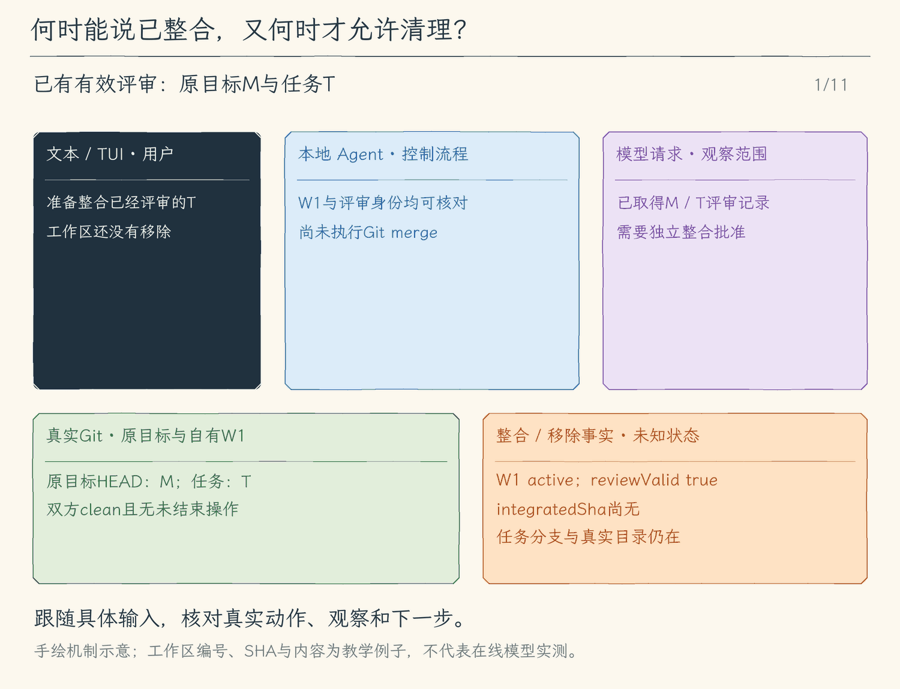

# 28.3 整合与清理：先证明成果进入目标，再删除工作目录

[第 28 章首页](../README.md) · [上一节：28.2 固定版本评审](../02-versioned-review/README.md) · [本章练习与答案](../EXERCISES.md)

评审只确认过一对版本，尚未让任务代码进入原目标分支。即使Git打印过“merge”，也不能直接删除任务目录：合并可能冲突，可能被取消，或者任务还有未提交的文件。这一节把整合成功与允许清理分成两个判断，各自用磁盘与Git事实确认。

两个工具都只接收 `{ "worktree_id": "返回的UUID" }`。它们分别请求批准，评审批准不会跳过整合或清理的预览。

## 整合必须使用仍然有效的候选提交

`integrate_worktree`先读取28.2的批准记录，核对目标分支、两端SHA、clean与未结束Git操作。准备出来的预览固定将要整合的任务提交；用户批准后，执行前还要再核对一次。若目标或任务在等待批准期间变化，就拒绝使用旧预览，先重新评审。

真实合并使用这条已审任务SHA，而不是临时再读一个可能移动的分支名。Git会依据共同祖先尝试把任务提交并入目标；目标已有其他提交时，最终结果可能形成新的合并提交。

成功依据需要同时满足：Git进程正常以0退出、没有超时或取消、原目标分支保持正确、目录干净且没有未结束Git操作，以及已审任务提交确实是目标当前HEAD的祖先。最后这项包含关系说明那条候选提交已经进入目标历史，不是仅凭一行输出猜测。工具随后记录整合后的SHA并把快照交给模型。

包含提交不等于运行验证通过。模型还需按任务要求在整合后的目标运行测试；测试失败时要保留对应命令结果，再决定修复。不能因为merge成功就自动声称功能已经可用。

## 冲突和取消为什么保留现场

假设目标和任务分别修改了同一行，Git无法自动选择。合并会以错误退出，原目标目录留下冲突文件与未结束merge状态。工具结果把退出事实、输出和最新Git快照一起交给模型；任务分支与目录仍保留，便于用户核对两份版本。

程序不会自动reset或abort。那样可能抹去用户正在处理的冲突或其他本地修改，也会把“尝试合并后留下什么”藏起来。模型先读取工作区状态，再向用户解释冲突位置和可选择的后续处理；未经新的明确操作，不能假设已经回到合并前。

取消也遵守同一条因果关系：停止进程与等待收尾，只证明本次执行已经结束，不证明Git修改被撤销。取消恰好发生在提交产生之后，磁盘可能已经前进；发生在合并途中，可能留下未结束操作。此时本次调用可能直接抛出取消，后续Git状态查询也会被已取消的信号阻止，因此这一次取消观察不保证附带新的工作区快照。下一次用有效信号调用 `read_worktree`，取得当前事实后，再决定重新评审、继续或人工处理。

## 允许删除工作区，需要哪些事实

清理的目标是释放任务工作目录，已经提交的成果仍保存在Git历史中。`remove_worktree`只接受当前管理器创建的ID，重新检查其真实路径、Git登记、仓库身份与任务分支，不会删除任意传入目录。

随后要求任务目录没有dirty、未跟踪或被忽略文件，并且两边都没有未结束Git操作，目标仍在原分支且干净。被忽略文件也会拒绝清理：例如一次测试生成的数据库虽然不出现在普通status里，删除目录仍会让它消失。用户需要先确认并搬走或处理这些文件，再重试清理。

还要检查任务当前HEAD已经包含在目标当前HEAD的历史里。这证明所有已提交任务成果已有目标保存位置；若任务在上次整合后又多了一条提交，旧的“整合成功”记录不能替它担保，清理应拒绝。这里看当前提交包含关系，不靠一枚过去打过的完成标记。

这些条件通过后，准备清理预览；用户批准后再复查，才执行 `git worktree remove`。命令正常结束，还要确认路径和Git工作区登记都已消失，才能把会话记录标为removed。没有使用强制删除；任务分支仍保留，已提交成果可以继续按分支核对。

## 从一次尝试到可以交付的结果

模型依据每次实际取得的工具观察决定后续操作：整合成功返回目标包含候选提交的证据；正常返回的合并冲突结果包含错误与当时快照；前置条件变化会拒绝过期操作；清理成功只说明指定目录与登记已经移除。取消可能只留下中断说明，不能据此声称已经读到最新Git状态，下一次应先调用 `read_worktree` 核实，再决定测试、报告或重新申请操作。

CLI退出不会自动走清理流程，重启也不会恢复旧登记的控制权。遗留目录与分支由用户按真实Git信息处理。因此最后向用户汇报时，要分别说明评审版本、整合结果、测试结果以及目录是否已清理；任何一步尚未取得证据，都保留为待处理事项。

<!-- media:lesson:start -->
下面先走正常整合与独立清理，再切换到“merge期间取消”的另一分支。正常成功要核验原目标确实包含T；取消当次不保证能返回新快照，必须在下一次有效信号下read_worktree重新检查，未知状态不能冒充成功。



[静态流程图](assets/worktree-integrate-cleanup-flow-c09116dd27.png) · [静态封面](assets/worktree-integrate-cleanup-cover-c4a892f583.png) · [查看完整静态分镜](assets/worktree-integrate-cleanup-storyboard-2dc40ea40b.jpg)
<!-- media:lesson:end -->

## 本节改动文件

<!-- generated:files:start -->

| 状态 | 文件 | 本节变化 |
| --- | --- | --- |
| CHANGED | [src/workspaces/worktrees.ts](src/workspaces/worktrees.ts) | 复核被审版本后真实merge，检查提交包含关系；清理只移除自有且无遗留成果的目录。 |
| CHANGED | [src/tools/worktree-tools.ts](src/tools/worktree-tools.ts) | 增加逐次审批的整合与清理工具，保留冲突和任务分支。 |

<!-- generated:files:end -->

## 动手构建

先按[环境准备文档](../../docs/SETUP.md) 准备依赖、构建脚本与模型配置，再从上一公开小节 28.2 的完整 `src/` 继续。本节目标目录是 `chapter-28-isolated-workspaces/03-integrate-and-cleanup`。新增文件完整保存，修改文件按精确差异应用；未列出的实现沿用。下面差异以前面公开块累计形成的读者工作树为基线。

<!-- generated:build:start -->

<details>
<summary>CHANGED：src/workspaces/worktrees.ts 的精确差异</summary>

<!-- source: src/workspaces/worktrees.ts -->
```diff
--- a/src/workspaces/worktrees.ts
+++ b/src/workspaces/worktrees.ts
@@ -1,12 +1,14 @@
 /**
- * 28.2 固定评审版本 | [CHANGED] workspaces/worktrees.ts
+ * 28.3 整合与清理 | [CHANGED] workspaces/worktrees.ts
  * 学习目标：把会话自有目录、起始提交、被审版本和真实整合结果连起来。
  * 输入：本地启动目录、本管理器生成的ID、取消信号；不接受任意目录或分支。
  * 输出：身份快照或固定预览/执行闭包；Git失败保留目录、分支与冲突，不自动回滚。
  * 本文件局部流程（全局主流程见 agent/agent-loop.ts）：
  *   创建 -> 固定目标branch/HEAD -> 审批 -> 复查 -> git worktree add -> 登记实际状态
  *   评审 -> 两端clean？-- 否 -> 拒绝；是 -> 固定diff/SHA -> 审批 -> 复查 -> 记录版本
- * 观察：固定比较双方SHA和完整diff；目标或任务改变后旧review失效，批准不证明测试通过。
+ *   整合 -> 版本仍有效？-- 否 -> 拒绝；是 -> git merge -> 成功/冲突事实交回模型
+ *   清理 -> 自有+clean+已整合？-- 否 -> 保留；是 -> git worktree remove -> 保留任务分支
+ * 观察：dirty留在原处；改动使旧review失效；冲突返回错误但文件和任务分支仍存在。
  * shortcut: 登记只存当前CLI内存，重启后须按Git事实人工恢复；不把worktree当安全沙箱。
  */
 import { lstat, mkdtemp, realpath } from "node:fs/promises";
@@ -19,13 +21,14 @@
 import type { PreparedToolCall, ToolExecutionResult } from "../tools/types.js";
 
 // [KEEP 来自 28.1] ID和分支由本实例生成，路径只从本地登记表取得。
-// [NEW 28.2] 记录评审比较双方和预览摘要，不存可复用执行授权。
+// [KEEP 来自 28.2] 记录评审比较双方和预览摘要，不存可复用执行授权。
 export type WorktreeReview = { targetSha: string; reviewedSha: string; diffSha256: string; approvedAt: string };
+// [CHANGED 28.3] 真实merge确认成功后，快照另外保留integratedSha；其余身份字段继续沿用。
 export type WorktreeSnapshot = {
   id: string; path: string; repository: string; commonDirectory: string; branch: string;
   baseSha: string; targetBranch: string; currentTargetBranch: string; headSha: string | null; targetSha: string | null;
   dirty: boolean; hasIgnored: boolean; targetDirty: boolean; operation: string | null; targetOperation: string | null; state: "creating" | "ready" | "failed" | "removed";
-  review: WorktreeReview | null; reviewValid: boolean; failure?: string;
+  review: WorktreeReview | null; reviewValid: boolean; integratedSha: string | null; failure?: string;
 };
 type Entry = { snapshot: WorktreeSnapshot };
 type Origin = { repository: string; commonDirectory: string; branch: string; sha: string; dirty: boolean; operation: string | null };
@@ -151,7 +154,7 @@
       value.dirty = await dirty(value.path, signal); value.targetDirty = target.dirty;
       value.hasIgnored = Boolean(await checked(value.path, ["ls-files", "--others", "--ignored", "--exclude-standard", "--directory"], signal));
       value.operation = await operation(value.path, signal); value.targetOperation = target.operation;
-      // [NEW 28.2] 任一端SHA、dirty或未结束Git操作变化后，旧评审不能用于整合。
+      // [KEEP 来自 28.2] 任一端SHA、dirty或未结束Git操作变化后，旧评审不能用于整合。
       value.reviewValid = Boolean(value.review && !value.dirty && !value.targetDirty && !value.operation && !value.targetOperation && target.branch === value.targetBranch
         && value.review.reviewedSha === value.headSha && value.review.targetSha === value.targetSha);
     }
@@ -168,7 +171,7 @@
       this.directory ??= await realpath(await mkdtemp(join(tmpdir(), "hello-agent-worktrees-")));
       const value: WorktreeSnapshot = { id, path: join(this.directory, id), repository: before.repository, commonDirectory: before.commonDirectory,
         branch: taskBranch, baseSha: before.sha, targetBranch: before.branch, currentTargetBranch: current.branch, headSha: null, targetSha: before.sha, dirty: false, hasIgnored: false, operation: null, targetOperation: current.operation,
-        targetDirty: current.dirty, state: "creating", review: null, reviewValid: false };
+        targetDirty: current.dirty, state: "creating", review: null, reviewValid: false, integratedSha: null };
       const entry: Entry = { snapshot: value }; this.entries.set(id, entry);
       try {
         await checked(value.repository, ["worktree", "add", "-b", taskBranch, "--", value.path, value.baseSha], executionSignal);
@@ -191,7 +194,7 @@
       return worktreeResult(await this.inspect(entry, executionSignal), result.content, Boolean(result.isError));
     }));
   }
-  // [NEW 28.2] 评审固定比较双方；完整diff无法取得就不提供可批准预览。
+  // [KEEP 来自 28.2] 评审固定比较双方；完整diff无法取得就不提供可批准预览。
   async prepareReview(id: string, signal?: AbortSignal): Promise<PreparedToolCall> {
     const entry = this.entry(id), before = await this.get(id, signal);
     if (before.dirty || before.targetDirty || before.operation || before.targetOperation || before.state !== "ready") throw new ToolError("评审需要任务与目标目录都clean（包括未跟踪文件）且没有未结束Git操作，先保存成果再请求。");
@@ -208,4 +211,41 @@
       return worktreeResult(await this.inspect(entry, executionSignal), "已批准固定版本；后续代码或目标变化将使批准失效。");
     }));
   }
-}
+  // [NEW 28.3] 整合只消费仍有效的评审；失败不abort/reset，不删除冲突现场。
+  async prepareIntegrate(id: string, signal?: AbortSignal): Promise<PreparedToolCall> {
+    const entry = this.entry(id), before = await this.get(id, signal);
+    if (!before.reviewValid || !before.review) throw new ToolError("缺少仍有效的已批准评审，请先提交、清理并重新评审。");
+    return once(`整合WorktreeID：${id}\n目录：${before.path}\n原目标：${before.repository}\n目标分支：${before.targetBranch}\n目标SHA：${before.targetSha}\n被审SHA：${before.review.reviewedSha}\n执行git merge --no-edit；冲突保留现场与任务分支，不自动撤销。`, executionSignal => this.exclusive(async () => {
+      const now = await this.inspect(entry, executionSignal);
+      if (!now.reviewValid || now.targetSha !== before.targetSha || now.headSha !== before.headSha || now.review?.diffSha256 !== before.review?.diffSha256) throw new ToolError("整合审批后版本或目标状态变化，本次整合取消。");
+      const result = await git(before.repository, ["merge", "--no-edit", "--no-stat", "--", before.review!.reviewedSha], executionSignal);
+      const observed = await this.inspect(entry, executionSignal);
+      const contains = await git(before.repository, ["merge-base", "--is-ancestor", before.review!.reviewedSha, "HEAD"], executionSignal);
+      const success = result.exitCode === 0 && !result.signal && !result.stopReason && contains.exitCode === 0 && !contains.stopReason && !contains.signal && !observed.targetDirty && !observed.targetOperation && observed.currentTargetBranch === before.targetBranch;
+      if (success) { entry.snapshot.integratedSha = observed.targetSha; entry.snapshot.reviewValid = false; }
+      return worktreeResult(structuredClone(entry.snapshot), `${success ? "Git整合成功；包含被审提交。项目测试仍须另行执行。" : "未确认整合成功；冲突/未完成状态保留在原目标目录，任务成果仍在任务分支。"}\n${failure(result)}`, !success);
+    }));
+  }
+  // [NEW 28.3] 没有丢弃入口；即使提交已整合，有dirty/ignored也拒绝删除。
+  async prepareRemove(id: string, signal?: AbortSignal): Promise<PreparedToolCall> {
+    const entry = this.entry(id), before = await this.get(id, signal);
+    await this.removable(before, signal);
+    return once(`清理自有WorktreeID：${id}\n目录：${before.path}\n任务分支：${before.branch}\nHEAD：${before.headSha}\n仅git worktree remove，不force；已提交成果保留在任务分支。`, executionSignal => this.exclusive(async () => {
+      const now = await this.inspect(entry, executionSignal); await this.removable(now, executionSignal);
+      if (now.headSha !== before.headSha || now.targetSha !== before.targetSha) throw new ToolError("清理审批后版本变化，请重新核对。");
+      const result = await git(before.repository, ["worktree", "remove", "--", before.path], executionSignal);
+      if (result.exitCode !== 0 || result.signal || result.stopReason) return worktreeResult(now, `工作区清理未确认成功；保留分支，不重试强制删除。\n${failure(result)}`, true);
+      const registrations = await checked(before.repository, ["worktree", "list", "--porcelain"], executionSignal);
+      if (await exists(before.path) || registrations.split("\n").includes(`worktree ${before.path}`)) return worktreeResult(now, "Git已返回成功，但路径或登记仍存在；没有确认清理完成，请人工核实。", true);
+      entry.snapshot.state = "removed"; entry.snapshot.reviewValid = false;
+      return worktreeResult(structuredClone(entry.snapshot), "Git已移除自有worktree；任务分支仍保留。");
+    }));
+  }
+  private async removable(value: WorktreeSnapshot, signal?: AbortSignal): Promise<void> {
+    if (value.state !== "ready" || value.dirty || value.hasIgnored || value.targetDirty || value.operation || value.targetOperation) throw new ToolError("工作区/目标仍有未保存、未跟踪、ignored或冲突内容，拒绝清理。");
+    const target = await origin(value.repository, signal);
+    if (target.branch !== value.targetBranch) throw new ToolError("目标分支变化，拒绝清理。");
+    const contains = await git(value.repository, ["merge-base", "--is-ancestor", value.headSha!, target.sha], signal);
+    if (contains.exitCode !== 0 || contains.signal || contains.stopReason) throw new ToolError("任务HEAD尚未包含在原目标分支，拒绝清理；先保存并整合成果。");
+  }
+}
```

</details>

<details>
<summary>CHANGED：src/tools/worktree-tools.ts 的精确差异</summary>

<!-- source: src/tools/worktree-tools.ts -->
```diff
--- a/src/tools/worktree-tools.ts
+++ b/src/tools/worktree-tools.ts
@@ -1,5 +1,5 @@
 /**
- * 28.2 固定评审版本 | [CHANGED] tools/worktree-tools.ts
+ * 28.3 整合与清理 | [CHANGED] tools/worktree-tools.ts
  * 学习目标：让模型取得真实工作区身份，所有修改仍走统一逐次审批。
  * 输入：严格JSON对象和当前CLI持有的管理器；不接受任意path、branch或伪造ID。
  * 输出：只读快照，或固定预览/execute；失败回到Agent Loop形成工具错误，不自动清冲突。
@@ -25,8 +25,11 @@
   definition("create_worktree", "逐次批准后从当前HEAD创建自有独立Git worktree；原目录dirty不复制。返回WorktreeID、base/branch和真实目录；不是安全sandbox。", {}, false),
   definition("read_worktree", "只读当前CLI自有工作区状态；省略ID列出登记。返回base、当前/目标/被审SHA和评审是否失效，不导入旧会话路径。", {}, false),
   definition("run_worktree_command", "逐次批准后在自有工作区执行读/改/测/提交命令；命令仍可访问别处，不是安全sandbox。结果同时返回最新身份和状态。", { command: { type: "string" }, timeout_ms: { type: "integer", minimum: 100, maximum: 60_000 } }),
-  // [NEW 28.2] 批准固定比较双方；不是模型自报review通过。
+  // [KEEP 来自 28.2] 批准固定比较双方；不是模型自报review通过。
   definition("review_worktree", "预览完整diff并逐次批准目标SHA与任务SHA；两边clean且无未结束Git操作才可评审，修改后失效。批准不证明测试通过。"),
+  // [NEW 28.3] 整合和清理均逐次批准，并在执行前重新检查。
+  definition("integrate_worktree", "仅整合仍有效的已批准SHA；原目标branch/HEAD/clean复查成功才merge，冲突保留现场和任务分支。"),
+  definition("remove_worktree", "仅移除本次CLI自有、clean且HEAD已进入原目标的worktree；有未跟踪/ignored成果拒绝，不force，提交保留在任务分支。"),
 ];
 // [KEEP 来自 28.1] 工具定义与副作用gate共享同一集合。
 export const worktreeMutations = new Set(worktreeDefinitions.filter(tool => tool.name !== "read_worktree").map(tool => tool.name));
@@ -69,5 +72,7 @@
   if (name === "create_worktree") return own.prepareCreate(signal);
   if (name === "run_worktree_command") return own.prepareCommand(id, JSON.stringify({ command: input.command, cwd: ".", ...(input.timeout_ms !== undefined ? { timeout_ms: input.timeout_ms } : {}) }), signal);
   if (name === "review_worktree") return own.prepareReview(id, signal);
+  if (name === "integrate_worktree") return own.prepareIntegrate(id, signal);
+  if (name === "remove_worktree") return own.prepareRemove(id, signal);
   throw new ToolError(`未知工作区操作：${name}`);
 }
```

</details>

<!-- generated:build:end -->

## 运行验证

先从仓库根编译本节完整快照：

```bash
npm run lesson:28.3
```

先在临时仓库走完一次固定评审、整合与清理。探针故意在任务目录留下ignored产物：即使提交已进入目标，也必须拒绝删除；只在探针处理自己的产物后，才允许清理。

```bash
node --input-type=module <<'NODE'
import assert from 'node:assert/strict';
import { execFileSync } from 'node:child_process';
import { mkdtemp, mkdir, writeFile, rm } from 'node:fs/promises';
import { tmpdir } from 'node:os';
import { join, dirname } from 'node:path';
import { WorktreeManager } from './dist/workspaces/worktrees.js';
const root = await mkdtemp(join(tmpdir(), 'worktree-integrate-')), owned = new Set();
const git = (cwd, ...args) => execFileSync('git', ['-c', 'core.hooksPath=/dev/null',
  '-c', 'commit.gpgSign=false', ...args], { cwd, encoding: 'utf8', stdio: ['ignore', 'pipe', 'pipe'] }).trim();
const signal = () => new AbortController().signal;
try {
  git(root, 'init', '-b', 'main'); git(root, 'config', 'user.name', 'Probe');
  git(root, 'config', 'user.email', 'probe@example.invalid');
  await writeFile(join(root, '.gitignore'), 'ignored/\n');
  git(root, 'add', '--', '.gitignore'); git(root, 'commit', '-m', 'base');
  const manager = new WorktreeManager(root);
  const created = await (await manager.prepareCreate(signal())).execute(signal());
  assert.ok(!created.isError, created.content);
  const task = created.metadata.worktree; owned.add(dirname(task.path));
  await writeFile(join(task.path, 'result.txt'), 'TASK_RESULT\n');
  git(task.path, 'add', '--', 'result.txt'); git(task.path, 'commit', '-m', 'task result');
  await assert.rejects(manager.prepareRemove(task.id, signal()), /尚未包含/);
  await (await manager.prepareReview(task.id, signal())).execute(signal());
  const merged = await (await manager.prepareIntegrate(task.id, signal())).execute(signal());
  assert.ok(!merged.isError, merged.content);
  git(root, 'merge-base', '--is-ancestor', git(task.path, 'rev-parse', 'HEAD'), 'HEAD');
  await mkdir(join(task.path, 'ignored'));
  await writeFile(join(task.path, 'ignored', 'artifact.txt'), 'KEEP\n');
  await assert.rejects(manager.prepareRemove(task.id, signal()), /ignored/);
  await rm(join(task.path, 'ignored'), { recursive: true });
  const removed = await (await manager.prepareRemove(task.id, signal())).execute(signal());
  assert.ok(!removed.isError, removed.content);
  assert.equal((await manager.get(task.id)).state, 'removed');
  git(root, 'show-ref', '--verify', 'refs/heads/' + task.branch);
  console.log('通过：包含任务提交、ignored拒绝、清理真实目录，任务分支保留。');
} finally {
  for (const directory of owned) await rm(directory, { recursive: true, force: true });
  await rm(root, { recursive: true, force: true });
}
NODE
```

finally只清理这次探针的临时仓库和管理器目录。真实任务遇到ignored文件，要由用户决定如何保存；工具本身没有自动丢弃入口。[本章练习](../EXERCISES.md)还会制造真实同一行冲突，检查原目录留下MERGE_HEAD与冲突标记、任务分支内容保留，且清理被拒绝。

配套仓库回归覆盖成功整合、两端改版与等待期间变化、合并冲突、取消、清理前后事实核对，以及未知ID/非自有路径拒绝。

```bash
LESSON_28=03-integrate-and-cleanup node tests/verify-chapter-28.mjs
```

## 本节完成后的 Agent

任务从固定base出发，在独立目录保存提交；评审绑定两端版本，整合检查真实包含关系，清理检查当前文件与Git登记。模型得到每次操作的实际观察，再分别报告版本、测试、整合与目录状态；未完成的Git现场继续保留给用户核实。

本节状态：待用户确认。
