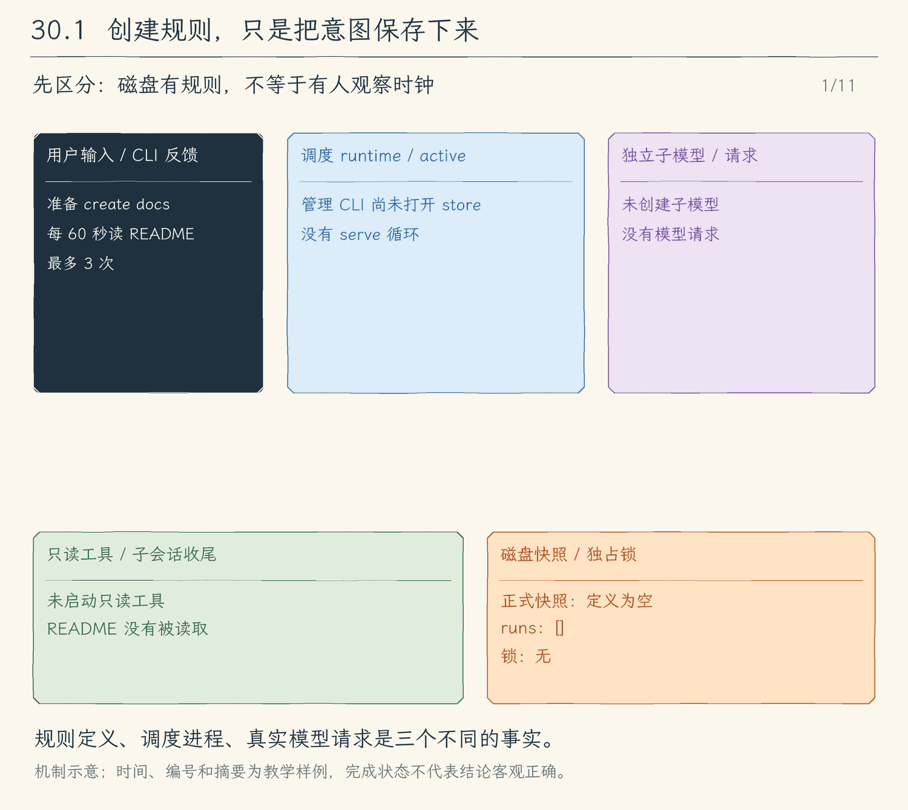

# 30.1 持久任务定义：先保存规则，再谈按时运行

[第 30 章首页](../README.md) · [上一节：29.3 Agent 消息与确认](../../chapter-29-shared-tasks/03-agent-messages/README.md) · [下一节：30.2 到期与真实执行](../02-runtime-dispatch/README.md) · [练习与答案](../EXERCISES.md)

## 问题：同一项调查，能不能不再每次手动输入

上一节中，worker 从共享清单领取工作，调查后提交任务状态；Agent 消息传递补充线索，确认消息并不等于任务完成。现在我们希望保留另一种用户意图：“每分钟读取 README，列出尚未完成的条目，最多执行三次。”即使退出当前 CLI，也不想重新输入这条规则。

如果只在内存里写一个 `setInterval`，进程结束后规则也消失了。如果只保存提示词，重启时又不知道间隔、下次时间和总共允许尝试多少次。因此第一步先解决保存：`create` 写入完整定义，`list` 重新打开同一份文件并显示它。本节还不启动模型。

## 解决方案：把任务定义与一次运行分开

任务定义回答“以后怎样做”；运行记录回答“某一次到底发生了什么”。`docs` 可以有三次运行，三次使用不同运行编号，不能反复覆盖一份结果。两类数据放在同一个有版本的快照中，后续才能把启动时的计数和 running 一起提交。

下面是字段关系示例，省略了工作区、预算和运行详情，不能直接替换完整文件：

```json
{
  "schema": 1,
  "schedules": [{ "id": "docs", "intervalMs": 60000, "nextRunAt": 60000, "state": "enabled" }],
  "runs": []
}
```

假设创建时刻为 0，首次到期就是 60000 毫秒。enabled 的意思是允许调度器考虑这项任务，不是已经执行成功。此时 runs 为空，程序没有发出模型请求。文件不会观察时钟；只有下一节启动的 `serve` 进程才会比较当前时间和 nextRunAt。程序关闭、电脑休眠而进程没有运行时，不会触发。

## 工作原理：让每次管理都从同一份可信状态开始

### 一个进程持锁，避免两个修改互相覆盖

设两个进程都读到空清单，A 加入 docs，B 加入 code；如果各自写回完整数组，后写入的一份会抹掉先写入的定义。这里沿用第 13 章的独占锁办法：程序用只能新建的方式取得 `store.lock`，成功后才读 `store.json`。整个管理动作期间，其他进程不能同时读改这份存储。

锁记录 PID 和随机 token。PID 仍可能存在，就按占用拒绝；即使传入恢复选项，也不能接管活进程。释放时核对 token 和文件身份，避免删掉后来持有者的锁。正常命令结束会释放，异常中断可能留下锁；30.3 再把明确的恢复入口接到 CLI，本节不要手工删除一个仍在运行的进程所持有的锁。

同一进程内部也可能有两个异步管理动作。store 用 Promise 队列逐项提交，每项拿上一项已经提交的状态再复制和修改，避免它们同时从旧副本出发。

### 先校验完整副本，再替换正式文件

直接打开正式文件截断后写入，写到一半失败可能只剩半份 JSON。store 先复制内存状态，在副本上加入定义，检查全部字段，再把完整 JSON 写进同目录的随机临时文件。写入、sync 和关闭成功后才 rename 为 `store.json`，最后更新内存引用。普通读者由此只会见到替换前或替换后的完整快照，不把写了一半的内容当成成功状态；这里不承诺断电后的目录持久性。

若校验不通过，正式文件和内存都不改，命令显示错误。若真正写盘或替换失败，程序保留上次已提交状态，停止后续写入并退出这个动作，不能继续显示“已保存”。临时文件会尝试清理，finally 仍要释放锁。操作系统文件错误也会走已有 CLI 的错误出口。

### 磁盘内容仍然是输入

读取时检查普通文件、有界读取和 JSON，再逐字段验证 schema、编号、状态、整数范围及运行记录关联。类型声明只约束编译时的代码，不能使一个手改后的文件自动合法。额外的 apiKey、工具列表或授权字段会被拒绝，不会借持久化恢复旧权限。

为了让载入、复制和报告都有明确上限，当前快照最多 512 KiB，定义最多 32 项、近期运行记录最多 128 项；提示最多 2000 字符，间隔为 1 秒至 24 小时。每项最多 100 次尝试、100 万本地 token 预留。达到限制时拒绝保存。截掉旧运行详情也不能退还定义上的累计计数。

create 保存当前工作区的真实路径。后续运行仍要从这个目录启动，避免同一条相对路径提示悄悄读到别的项目。连接密钥仍从 serve 当次配置读取，存储结构没有保存它的位置；提示和未来的摘要是明文，内容本身没有自动脱敏。

<!-- media:lesson:start -->
下面按“取得锁 → 临时写入 → rename → 返回”播放。紫色模型和绿色工具始终没有启动：create 只留下规则；磁盘上的 enabled 也不会自己触发运行。



[静态流程图](assets/schedule-persistent-definition-flow-d295698051.png) · [静态封面](assets/schedule-persistent-definition-cover-79489dcb22.png) · [查看完整静态分镜](assets/schedule-persistent-definition-storyboard-6ffc4e51ae.jpg)
<!-- media:lesson:end -->

## 本节改动文件

<!-- generated:files:start -->

| 状态 | 文件 | 本节变化 |
| --- | --- | --- |
| NEW | [src/schedules/store.ts](src/schedules/store.ts) | 有界schema=1快照、独占锁、串行原子提交与定义创建。 |
| NEW | [src/schedules/commands.ts](src/schedules/commands.ts) | create/list独立管理入口，不读取模型配置。 |
| CHANGED | [src/cli.ts](src/cli.ts) | schedule分支先于普通聊天初始化。 |

<!-- generated:files:end -->

## 动手构建

我们从 29.3 的完整 `src/` 继续，目标目录为 `chapter-30-scheduled-tasks/01-persistent-schedules`。先新增 store，定义可保存的对象与唯一提交出口；再新增管理命令；最后让 CLI 的 schedule 分支在普通配置读取之前返回。其余代码沿用，头部更新为本节编号与 KEEP。

store 中先看 `validateScheduleState` 的字段约定，再看 `update` 的提交顺序。create 只向该出口提交新定义，不自行打开正式文件。CLI 分支必须放在原来 parseAsync 调用的位置，不能先运行普通聊天初始化再判断是否管理命令。

<!-- generated:build:start -->

<details>
<summary>NEW：src/schedules/store.ts 的完整文件</summary>

<!-- source: src/schedules/store.ts -->
```ts
/**
 * 30.1 持久任务定义 | [NEW] schedules/store.ts
 *
 * 学习目标：让时间规则与运行记录有独立、可校验的磁盘来源。
 * 输入：本地管理命令；输出：schema=1 的原子快照，不保存连接配置或权限。
 * 本文件局部流程（全局主流程见 agent/agent-loop.ts）：
 *   open -> 取得独占锁？否 -> busy；是 -> 有界读取 -> 校验 -> 管理
 *   update -> 复制 -> 修改 -> 校验 -> 临时文件sync -> rename -> 提交内存
 *   失败 -> 保留上次完整快照并封住后续写入；close -> 等待队列 -> 释放自有锁
 * 观察：重开后定义仍在，文件存在不会启动模型或恢复授权。
 */
import { constants } from "node:fs";
import { lstat, mkdir, open, realpath, rename, unlink, type FileHandle } from "node:fs/promises";
import { randomUUID } from "node:crypto";
import { homedir } from "node:os";
import { isAbsolute, join, resolve } from "node:path";
import { UserFacingError } from "../errors.js";

// [NEW 30.1] 本文件以下实现均为本节新增；锁沿用第13章的PID、token与显式恢复办法。
export const DEFAULT_SCHEDULE_DIRECTORY = join(homedir(), ".hello-my-agent", "schedules");
export const MAX_SCHEDULE_BYTES = 524_288;
export const RUN_TOKEN_RESERVATION = 32_768;
export type Schedule = {
  id: string; prompt: string; workspace: string; intervalMs: number; nextRunAt: number;
  state: "enabled" | "paused" | "stopped"; maxRuns: number; maxTokens: number;
  attempts: number; reservedTokens: number;
};
export type ScheduleRun = {
  id: string; scheduleId: string; scheduledAt: number; startedAt: number; finishedAt: number | null;
  status: "running" | "completed" | "failed" | "cancelled" | "budget_exhausted" | "interrupted";
  reservation: number; summary: string; childSessionId: string | null;
  modelCalls: number; requestTokensReserved: number;
};
export type ScheduleState = { schema: 1; schedules: Schedule[]; runs: ScheduleRun[] };
export type NewSchedule = Pick<Schedule, "id" | "prompt" | "workspace" | "intervalMs" | "maxRuns" | "maxTokens">;

/** 检查对象只有约定字段；磁盘或CLI输入中的额外配置不能混入持久状态。 */
function fields(value: unknown, keys: string[]): asserts value is Record<string, unknown> {
  if (!value || typeof value !== "object" || Array.isArray(value) || Object.keys(value).sort().join() !== [...keys].sort().join()) throw new UserFacingError("定时任务数据字段不符合 schema=1。");
}
/** 整数边界同时拒绝NaN、小数、无穷与不安全整数。 */
function integer(value: unknown, min: number, max: number): boolean {
  return Number.isSafeInteger(value) && (value as number) >= min && (value as number) <= max;
}
/** 逐项校验完整快照；类型声明不能代替磁盘输入、预算和关联编号检查。 */
export function validateScheduleState(value: unknown): asserts value is ScheduleState {
  fields(value, ["schema", "schedules", "runs"]);
  if (value.schema !== 1 || !Array.isArray(value.schedules) || value.schedules.length > 32 || !Array.isArray(value.runs) || value.runs.length > 128) throw new UserFacingError("定时任务版本或条目数量无效。");
  const ids = new Set<string>(), runIds = new Set<string>();
  for (const item of value.schedules) {
    fields(item, ["id", "prompt", "workspace", "intervalMs", "nextRunAt", "state", "maxRuns", "maxTokens", "attempts", "reservedTokens"]);
    if (typeof item.id !== "string" || !/^[a-zA-Z0-9][a-zA-Z0-9_-]{0,47}$/.test(item.id) || ids.has(item.id)
      || typeof item.prompt !== "string" || !item.prompt.trim() || item.prompt.length > 2000
      || typeof item.workspace !== "string" || !isAbsolute(item.workspace) || item.workspace.length > 4096
      || !integer(item.intervalMs, 1000, 86_400_000) || !integer(item.nextRunAt, 0, 8_000_000_000_000_000)
      || typeof item.state !== "string" || !["enabled", "paused", "stopped"].includes(item.state)
      || !integer(item.maxRuns, 1, 100) || !integer(item.maxTokens, 1, 1_000_000)
      || !integer(item.attempts, 0, item.maxRuns as number) || !integer(item.reservedTokens, 0, item.maxTokens as number)) throw new UserFacingError("定时任务定义、编号或预算无效。");
    ids.add(item.id);
  }
  const active = new Set<string>();
  for (const run of value.runs) {
    fields(run, ["id", "scheduleId", "scheduledAt", "startedAt", "finishedAt", "status", "reservation", "summary", "childSessionId", "modelCalls", "requestTokensReserved"]);
    if (typeof run.id !== "string" || !/^[0-9a-f-]{36}$/.test(run.id) || runIds.has(run.id)
      || typeof run.scheduleId !== "string" || !ids.has(run.scheduleId)
      || !integer(run.scheduledAt, 0, 8_000_000_000_000_000) || !integer(run.startedAt, 0, 8_000_000_000_000_000)
      || typeof run.status !== "string" || !["running", "completed", "failed", "cancelled", "budget_exhausted", "interrupted"].includes(run.status)
      || (run.status === "running" ? run.finishedAt !== null || active.has(run.scheduleId) : !integer(run.finishedAt, run.startedAt as number, 8_000_000_000_000_000))
      || !integer(run.reservation, 1, RUN_TOKEN_RESERVATION) || typeof run.summary !== "string" || run.summary.length > 2000
      || (run.childSessionId !== null && (typeof run.childSessionId !== "string" || !/^[0-9a-f-]{36}$/.test(run.childSessionId)))
      || !integer(run.modelCalls, 0, 4) || !integer(run.requestTokensReserved, 0, run.reservation as number)) throw new UserFacingError("定时任务运行记录无效。");
    runIds.add(run.id); if (run.status === "running") active.add(run.scheduleId);
  }
}

type LockRecord = { pid: number; token: string };
type HeldLock = { release(): Promise<void> };

/**
 * 只读一个有界、普通且未被替换的锁文件，返回拥有者和文件身份。
 * 无法解释的锁不会被视为空闲，避免误删其他进程或人工放置的文件。
 */
async function readLock(path: string) {
  const before = await lstat(path);
  if (!before.isFile() || before.isSymbolicLink() || before.size > 4096) throw new UserFacingError("锁文件不是可识别的普通文件，请先人工检查，程序不会删除它。");
  const file = await open(path, constants.O_RDONLY | (constants.O_NOFOLLOW ?? 0) | (constants.O_NONBLOCK ?? 0));
  try {
    const info = await file.stat();
    if (!info.isFile() || info.ino !== before.ino || info.dev !== before.dev || info.size > 4096) throw new UserFacingError("锁文件在检查时发生变化，请重试。");
    const buffer = Buffer.alloc(4097);
    const { bytesRead } = await file.read(buffer, 0, buffer.length, 0);
    if (bytesRead > 4096) throw new Error("锁过长");
    const value: unknown = JSON.parse(buffer.subarray(0, bytesRead).toString("utf8"));
    if (!value || typeof value !== "object" || Array.isArray(value)) throw new Error("锁不是对象");
    const record = value as Record<string, unknown>;
    if (Object.keys(record).length !== 2 || !Number.isSafeInteger(record.pid) || (record.pid as number) <= 0 || (record.pid as number) > 2_147_483_647
      || typeof record.token !== "string" || !/^[0-9a-f-]{36}$/.test(record.token)) throw new Error("锁字段无效");
    return { record: record as LockRecord, info };
  } catch (error) {
    if (error instanceof UserFacingError) throw error;
    throw new UserFacingError("锁文件内容无法识别，请先人工检查，程序不会删除它。");
  } finally { await file.close(); }
}

/**
 * 用 PID 检查占用是否仍有可能存在；权限不足也按占用处理。
 * PID 可能复用，所以活 PID 只意味着拒绝接管，不证明它仍是最初的定时任务存储进程。
 */
function processMayExist(pid: number): boolean {
  try { process.kill(pid, 0); return true; }
  catch (error) {
    if (error && typeof error === "object" && "code" in error && error.code === "ESRCH") return false;
    return true;
  }
}

/**
 * 释放前重新确认 token 和普通文件身份，绝不删掉后来替换的锁。
 * 缺失或变更也作为异常报告；调用方不能把未核对的释放说成成功。
 */
async function releaseLock(path: string, token: string): Promise<void> {
  const current = await readLock(path);
  if (current.record.token !== token || current.record.pid !== process.pid) throw new UserFacingError("锁的拥有者已经变化，当前进程没有删除它。");
  const latest = await lstat(path);
  if (!latest.isFile() || latest.ino !== current.info.ino || latest.dev !== current.info.dev) throw new UserFacingError("锁文件已经变化，当前进程没有删除它。");
  await unlink(path);
}

/**
 * 以 wx 创建锁并写入当前 PID 和随机 token；失败只清理自己刚创建的同一文件。
 * 这里不删除已有锁，是否允许接管由 acquireLock 在恢复保护内决定。
 */
async function createLock(path: string, record: LockRecord): Promise<void> {
  const file = await open(path, "wx", 0o600);
  const info = await file.stat();
  try {
    await file.writeFile(`${JSON.stringify(record)}\n`, "utf8");
    await file.sync();
  } catch (error) {
    const current = await lstat(path).catch(() => undefined);
    if (current?.isFile() && current.ino === info.ino && current.dev === info.dev) await unlink(path).catch(() => {});
    throw error;
  } finally { await file.close(); }
}

/**
 * 获取整次写入期间持有的锁；死 PID 也必须由人显式选择恢复。
 * 接管先创建短暂的恢复保护文件，再原位改写旧锁，避免两个恢复者越过同一空档。
 * 异常留下的恢复保护不能自动清除：宁可提示检查，也不猜测另一个恢复者已经退出。
 */
async function acquireLock(path: string, recover: boolean): Promise<HeldLock> {
  const record = { pid: process.pid, token: randomUUID() };
  try { await createLock(path, record); }
  catch (error) {
    if (!error || typeof error !== "object" || !("code" in error) || error.code !== "EEXIST") throw error;
    const previous = await readLock(path);
    if (processMayExist(previous.record.pid)) throw new UserFacingError("定时任务存储仍被一个活进程占用，不能同时恢复或修改。");
    if (!recover) throw new UserFacingError("定时任务存储留有旧锁；确认工作区和进程后，使用 --recover 显式接管。");
    const recoveryPath = `${path}.recover`;
    try { await createLock(recoveryPath, record); }
    catch { throw new UserFacingError("已有恢复保护文件，请检查是否有其他恢复操作；程序不会自动删除它。"); }
    try {
      const current = await readLock(path);
      if (processMayExist(current.record.pid)) throw new UserFacingError("检查期间已有活进程占用定时任务存储，已停止接管。");
      const file = await open(path, constants.O_RDWR | (constants.O_NOFOLLOW ?? 0) | (constants.O_NONBLOCK ?? 0));
      try {
        const info = await file.stat();
        if (!info.isFile() || info.ino !== current.info.ino || info.dev !== current.info.dev) throw new UserFacingError("锁文件在接管前发生变化，已停止接管。");
        await file.truncate(0);
        await file.writeFile(`${JSON.stringify(record)}\n`, "utf8");
        await file.sync();
      } finally { await file.close(); }
    } finally { await releaseLock(recoveryPath, record.token); }
  }
  return { release: () => releaseLock(path, record.token) };
}

/**
 * 读取同一个普通文件句柄，最多读上限加一字节；坏JSON和未知版本都拒绝，不覆盖旧文件。
 * 缺少文件表示首次使用；检查时已经是符号链接或特殊文件则拒绝。
 */
async function readState(path: string): Promise<ScheduleState> {
  let file: FileHandle;
  try { file = await open(path, constants.O_RDONLY | constants.O_NOFOLLOW | constants.O_NONBLOCK); }
  catch (error) { if ((error as NodeJS.ErrnoException).code === "ENOENT") return { schema: 1, schedules: [], runs: [] }; throw error; }
  try {
    const info = await file.stat();
    if (!info.isFile() || info.size > MAX_SCHEDULE_BYTES) throw new UserFacingError("定时任务文件不是有界普通文件。");
    const buffer = Buffer.alloc(MAX_SCHEDULE_BYTES + 1); let offset = 0;
    while (offset < buffer.length) { const part = await file.read(buffer, offset, buffer.length - offset, offset); if (!part.bytesRead) break; offset += part.bytesRead; }
    if (offset > MAX_SCHEDULE_BYTES) throw new UserFacingError("定时任务文件超过大小上限。");
    let value: unknown;
    try { value = JSON.parse(buffer.subarray(0, offset).toString("utf8")); } catch { throw new UserFacingError("定时任务文件不是完整JSON，旧内容未被修改。"); }
    validateScheduleState(value); return value;
  } finally { await file.close(); }
}

/**
 * 独占整个管理动作或serve生命周期；磁盘成功rename后才替换内存快照。
 * snapshot返回副本，所有异步修改共用一条队列，避免完成回调互相覆盖。
 */
export class ScheduleStore {
  private queue: Promise<void> = Promise.resolve();
  private closed = false;
  private failed = false;
  private constructor(readonly directory: string, private state: ScheduleState, private lock: HeldLock) {}

  /** 打开目录、持有独占锁再读取；打开失败仍释放自己取得的锁。 */
  static async open(directory = DEFAULT_SCHEDULE_DIRECTORY, recover = false): Promise<ScheduleStore> {
    await mkdir(resolve(directory), { recursive: true, mode: 0o700 });
    const root = await realpath(resolve(directory));
    const lock = await acquireLock(join(root, "store.lock"), recover);
    try { return new ScheduleStore(root, await readState(join(root, "store.json")), lock); }
    catch (error) { await lock.release(); throw error; }
  }

  /** 返回已提交状态的副本；持锁期间没有其他合规写入者。 */
  snapshot(): ScheduleState { return structuredClone(this.state); }

  /**
   * 在串行队列里修改副本并写入同目录临时文件；失败封住后续写入，原快照保持可读。
   * rename保证正常文件系统中读到旧版或新版；不声称断电后目录项一定持久化。
   */
  update(change: (next: ScheduleState) => void): Promise<void> {
    if (this.closed) return Promise.reject(new UserFacingError("定时任务存储已经关闭。"));
    const operation = this.queue.then(async () => {
      if (this.failed) throw new UserFacingError("上次保存失败，定时任务存储已停止接收修改。");
      const next = structuredClone(this.state); change(next); validateScheduleState(next);
      const text = `${JSON.stringify(next)}\n`;
      if (Buffer.byteLength(text) > MAX_SCHEDULE_BYTES) throw new UserFacingError("定时任务快照超过大小上限。");
      const temporary = join(this.directory, `.store-${randomUUID()}.tmp`);
      try {
        const file = await open(temporary, "wx", 0o600);
        try { await file.writeFile(text, "utf8"); await file.sync(); } finally { await file.close(); }
        await rename(temporary, join(this.directory, "store.json")); this.state = next;
      } catch (error) { this.failed = true; throw error; }
      finally { await unlink(temporary).catch(() => {}); }
    });
    this.queue = operation.catch(() => {}); return operation;
  }

  /** 创建定义时保存真实工作区；首次到期是创建时间加间隔，不会立即请求模型。 */
  async create(input: NewSchedule, now = Date.now()): Promise<void> {
    const workspace = await realpath(input.workspace);
    await this.update(next => {
      next.schedules.push({ id: input.id, prompt: input.prompt.trim(), workspace, intervalMs: input.intervalMs,
        nextRunAt: now + input.intervalMs, state: "enabled", maxRuns: input.maxRuns, maxTokens: input.maxTokens,
        attempts: 0, reservedTokens: 0 });
    });
  }

  /** 等待已排队的提交，再释放独占锁；重复关闭不会删掉后来持有者的锁。 */
  async close(): Promise<void> {
    if (this.closed) return; this.closed = true;
    await this.queue; await this.lock.release();
  }
}
```

</details>

<details>
<summary>NEW：src/schedules/commands.ts 的完整文件</summary>

<!-- source: src/schedules/commands.ts -->
```ts
/**
 * 30.1 持久任务定义 | [NEW] schedules/commands.ts
 *
 * 学习目标：把本地定义管理接到真实CLI，管理不需要模型密钥。
 * 输入：schedule子命令；输出：已保存定义或schema=1快照。
 * 本文件局部流程（全局主流程见 agent/agent-loop.ts）：
 *   create/list -> 获取store锁 -> 校验/保存/显示 -> finally close
 *   未知参数或存储失败 -> 抛给cli错误出口；不进入普通聊天。
 */
import { Command, CommanderError } from "commander";
import { ScheduleStore } from "./store.js";

// [NEW 30.1] 本文件以下实现均为本节新增。
/** 独立解析schedule命令；返回后CLI结束本次管理动作，不读取模型配置。 */
export async function runScheduleCommand(args: string[]): Promise<void> {
  const program = new Command("hello-my-agent schedule").exitOverride();
  program.option("--state-dir <path>", "定时任务存储目录");
  program.command("list").description("显示定义与最近运行记录").action(async () => {
    const store = await ScheduleStore.open(program.opts<{ stateDir?: string }>().stateDir);
    try { console.log(JSON.stringify(store.snapshot(), null, 2)); } finally { await store.close(); }
  });
  program.command("create").description("保存间隔任务；不会立即执行")
    .requiredOption("--id <id>", "任务编号：字母、数字、下划线、连字符")
    .requiredOption("--prompt <text>", "只读调查任务，最多2000字符")
    .requiredOption("--every-ms <milliseconds>", "间隔：1000至86400000毫秒")
    .option("--max-runs <count>", "最多尝试次数，包含失败", "3")
    .option("--max-tokens <tokens>", "累计本地token预留预算", "98304")
    .action(async (options: { id: string; prompt: string; everyMs: string; maxRuns: string; maxTokens: string }) => {
      const store = await ScheduleStore.open(program.opts<{ stateDir?: string }>().stateDir);
      try {
        await store.create({ id: options.id, prompt: options.prompt, workspace: process.cwd(),
          intervalMs: Number(options.everyMs), maxRuns: Number(options.maxRuns), maxTokens: Number(options.maxTokens) });
        console.log(`已保存定时任务 ${options.id}；只有serve运行期间才会触发。`);
      } finally { await store.close(); }
    });
  try { await program.parseAsync(args, { from: "user" }); }
  catch (error) { if (!(error instanceof CommanderError && error.code === "commander.helpDisplayed")) throw error; }
}
```

</details>

<details>
<summary>CHANGED：src/cli.ts 的精确差异</summary>

<!-- source: src/cli.ts -->
```diff
--- a/src/cli.ts
+++ b/src/cli.ts
@@ -1,6 +1,6 @@
 #!/usr/bin/env node
 /**
- * 28.3 整合与清理 | [KEEP] cli.ts
+ * 30.1 持久任务定义 | [CHANGED] cli.ts
  *
  * 学习目标：从显式搜索配置装配固定提供方，同时启用抓取；Plan 不加载网络能力，配置有效不代表已经查询。
  * 输入：命令行模型选项、--prompt 与 --output；输出格式默认是 auto。
@@ -8,6 +8,7 @@
  * 状态：入口不持有消息历史或授权；只创建 writer，消费者提供白名单快照。
  *
  * 本文件局部流程（全局主流程见 agent/agent-loop.ts）：
+ *   [NEW 30.1] argv[2]=schedule？-- 是 -> 独立定时管理 -> 结束；否 -> 普通聊天入口
  *   显式网页/搜索选项且非 Plan？-- 是 -> 完整校验本地配置 -> 创建 WebState；否 -> 不启用网页
  *   配置失败 -> 启动错误；配置成功只装配工具，不提前抓取或查询
  *   [KEEP 来自 18.1] --memory -> 检查混用和模式 -> 找真实项目根 -> 本地管理 -> 结束
@@ -42,6 +43,8 @@
 // [KEEP 来自 20.1] 项目脚本必须由本次启动显式启用。
 // [KEEP 来自 21.1] 显式配置授权启动服务，退出始终关闭本次连接。
 // [KEEP 来自 22.1] 网络开关不读取网页或会话里的指令。
+// [CHANGED 30.1] 定时管理先于普通模型与会话初始化。
+import { runScheduleCommand } from "./schedules/commands.js";
 import { loadWeb } from "./web/client.js";
 import { connectMcp, mcpInfo } from "./mcp/client.js";
 import { loadHooks } from "./hooks/lifecycle.js";
@@ -286,7 +289,9 @@

 // [KEEP 来自 02.2] 请求返回 Promise，parseAsync 会等待默认操作结束。
 try {
-  await program.parseAsync();
+  // [CHANGED 30.1] schedule动作结束后不再进入普通聊天入口。
+  if (process.argv[2] === "schedule") await runScheduleCommand(process.argv.slice(3));
+  else await program.parseAsync();
 } catch (error) {
   console.error(`错误：${explainError(error)}`);
   process.exitCode = 1;
```

</details>

<!-- generated:build:end -->

## 运行验证

按[环境准备](../../docs/SETUP.md)安装依赖后，在项目根构建本节：

```bash
npm run lesson:30.1
```

在希望调查的项目目录执行，保存目录用同一个路径：

```bash
hello-my-agent schedule --state-dir .agent-schedules create --id docs --prompt "读取README.md，列出尚未完成的条目" --every-ms 60000 --max-runs 3 --max-tokens 98304
```

```bash
hello-my-agent schedule --state-dir .agent-schedules list
```

预期 create 输出已保存，list 中有 docs、enabled、attempts=0、runs=[]。不需要模型密钥。关闭后重新 list，仍能读取定义；等待一分钟也不会自行出现运行记录，本节尚未启动检查时间的进程。

再以相同 id 创建，应报编号或定义无效且原数据保留。把间隔改为 0 也应被拒绝。可以先备份存储，再人工给 JSON 添加 apiKey 字段，list 应拒绝这份输入；不要在里面放真实密钥。恢复备份后继续下一节。

## 本节完成后的 Agent

Agent 有了独立的时间规则管理入口，定义随文件保留，而不是随聊天历史或某个定时器对象消失。现在还没有执行器；下一节让长期运行的 serve 读取这份状态，依据时间、active 和预算发起真正的只读调查。
