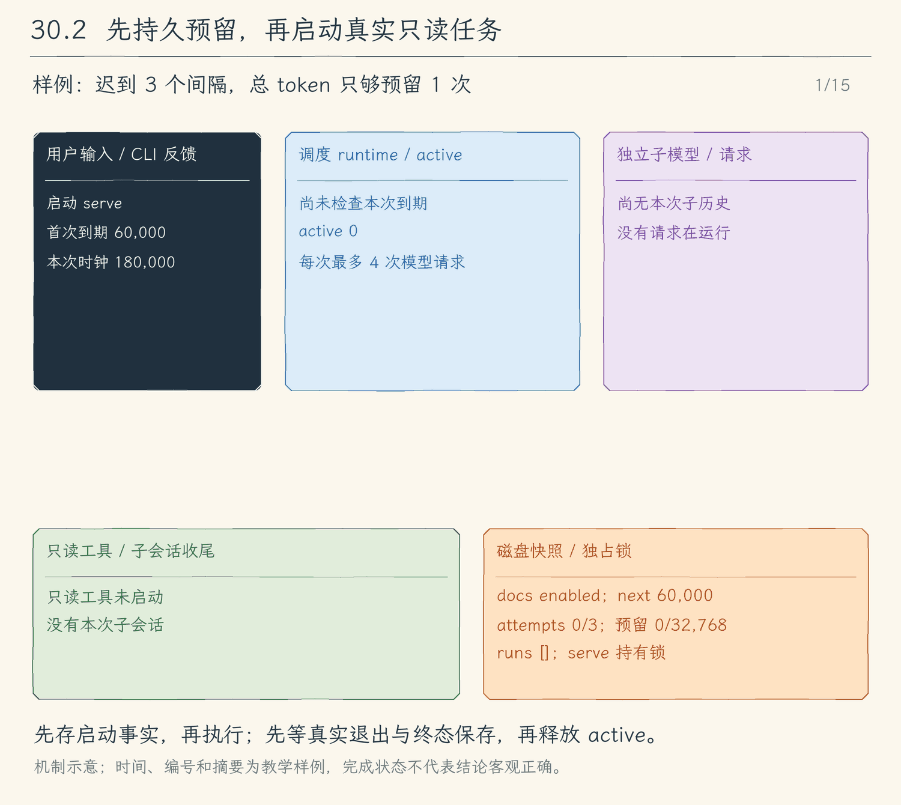

# 30.2 到期与真实执行：先预留预算，再启动只读子任务

[第 30 章首页](../README.md) · [上一节：30.1 持久任务定义](../01-persistent-schedules/README.md) · [下一节：30.3 停止与恢复](../03-stop-and-recover/README.md) · [练习与答案](../EXERCISES.md)

## 问题：保存了 enabled，谁来让调查真正发生

上一节的 create 只保存规则。我们要让运行中的 `serve` 不断检查时间：docs 到期时读取 README，最终把调查摘要保存为一条运行记录。`serve` 期间终端保持占用，程序关闭以后不会继续触发。

直接在每次检查时调用模型还不够。一次调查可能比间隔更久，下一次检查又会启动同一项调查；服务也可能在模型请求之后、计数保存之前退出，重启后仿佛没有花过预算。所以，时间只是启动条件之一。

## 解决方案：到期、空闲、有余额，三项一起决定启动

调度器每次 tick 都检查 enabled、nextRunAt 已到，以及当前进程没有这个编号的 active。active 保存控制器和真正代表子任务结束的 Promise：只要底层尚未收尾，同一项任务就不能再启动。

满足时间和空闲条件后，程序先在一次 store 提交里加入 running 记录、累加 attempts 和 token 预留、更新 nextRunAt。提交成功才启动固定的只读 `runSubagent`。提交失败就没有模型调用，调度服务退出并报告存储失败。不同任务可以各自执行，同一编号最多一个实例。

## 工作原理：沿一项每分钟调查看清启动与结束

### 错过多个间隔，只合并执行一次

假设 docs 在时刻 0 创建，间隔为一分钟，原定下一次为 60000。直到 180000 程序才检查到它。这时一次提交的教学摘要如下，省略了其他字段：

| 对象 | 提交前 | 提交后 |
| --- | --- | --- |
| 定义 attempts | 0 | 1 |
| 定义 reservedTokens | 0 | 32768 |
| 定义 nextRunAt | 60000 | 240000 |
| 新运行记录 | 不存在 | scheduledAt=60000，startedAt=180000，status=running |

scheduledAt 留住原本到期时间，startedAt 记录真正开始检查的时刻。程序不会为错过的 60000、120000、180000 各发一次请求，而是合并成一个机会，下一次从当前时刻加间隔计算。调查尚未结束时，即使后来又到期，active 也使 tick 跳过它，不另外积累队列；它结束后若仍已过期，下次检查最多合并启动一次。

这适合周期性查看最新文件：迟到后读取当前版本一次，通常比立刻重复读取三次更有用。如果业务要求每个时间点都必须处理，就需要另一种持久队列，本章不声称提供这种保证。

### token 预留是发请求前的硬限制

attempts 统计启动尝试，失败也计数。reservedTokens 统计本地预留，不是服务商账单中的实际 token。每次启动最多预留 32768，剩余总预算更少时只预留剩余量；这笔额度不因失败、取消或未用完而退回，避免退出程序后再次使用同一份预算。

例如总预算为 65536，即使最多允许三次尝试，前两次各预留 32768 后也没有第三次额度。runner 内部还会在每次真正 generate 前检查“本次输入估算＋输出预留”是否放得进该次额度，并最多请求四次模型。预算不足时返回 budget_exhausted，未经检查的下一次请求不会发出。服务商不返回 usage，也不影响这条本地执行上限；但它不能据此精确计算费用。

到期时若次数或总额度已用完，定义变为 paused。运行结束时若刚好用完，也立即暂停。resume 不会充值，预算用尽要创建新编号。保留这些累计计数，使最近运行详情被清理后也不能重新得到旧额度。

### 每一次调查都走已有的工具反馈循环

serve 仅在启动时读取当前模型连接配置。runner 核对当前真实工作区与定义一致，固定角色为 explore，创建新的子会话和空历史，只提供 read_file、glob、grep。定义没有选择写入工具、shell 或继承父授权的入口。

沿着 README 调查，子模型先提出 read_file，工具读到的内容作为原调用的 tool 结果回到子历史。子模型看完真实文件后可以继续搜索，也可以返回最终摘要；读取失败也作为错误观察交回模型，由它决定换路径还是报告缺失。若它请求写入，已有子任务白名单和本地策略会拒绝，这个错误同样回到子模型。只在最终回答被核心接受、子会话检查点和句柄关闭以后，runner 才返回 completed。

调度器接到真正返回的 ChildResult，把 status、摘要、子会话编号和请求指标写入同一条运行记录。保存成功才删除 active。用户输入 list 看见这份已提交结果；过程细节和读取观察留在独立的 child-sessions 中，不接进另一个聊天任务的父历史。completed 表示这次循环正常交付结果，不等于模型结论已经得到外部正确性证明。

### 暂停与服务关闭怎样收尾

pause 把定义改成 paused，只禁止新的启动；已经开始的调查继续产生结果。resume 先检查剩余预算，再从当前时刻重新计时，不补暂停期间的间隔。这两个动作可在 serve 的标准输入中执行，始终使用持锁进程的 store。

serve 整个生命周期独占锁。另一个终端执行 list 或 pause 会收到占用错误；它没有跨进程控制通道，不能显示“已暂停”来冒充控制成功。标准输入结束只意味着不再接收管理命令，服务仍继续运行。

Ctrl+C 或 SIGTERM 则让循环停止接受新 tick，对所有 active 发 abort，再等待它们的真实 Promise 结束、终态保存完成，最后关闭模型资源、释放 store 锁。取消请求不会立刻删除 active。如果底层不响应取消，关闭也必须继续等待；不能用一个超时包装假装它已经结束。普通子任务失败记录 failed，循环可以等待下一次到期；存储失败使运行记录无法可靠提交，必须停止整个服务。

标准输入控制也必须遵守这条规则。输错编号只产生参数错误，store 没有封写，用户可以改正后继续操作。真正写入或 rename 失败时，store 的 hasWriteFailure 变为 true；控制队列保存异常并发出 shutdown，让正在等下一次 tick 的循环立即进入 finally。即使全部定义都 paused、没有 active，也不能靠下一次到期来发现故障。服务等待真实实例收尾、关闭资源、释放锁，最后由 CLI 报错并以非零状态退出。进程被强杀时没有机会执行这些 finally，下一节处理它留下的 running。

<!-- media:lesson:start -->
本图把总 token 预算改为 32,768、次数上限保留 3，直观看“额度先耗尽”。迟到三个间隔仍只合并一次；active 要等真实子会话退出和终态提交后才释放。



[静态流程图](assets/schedule-runtime-dispatch-flow-3d0a98ecdb.png) · [静态封面](assets/schedule-runtime-dispatch-cover-96dca061f8.png) · [查看完整静态分镜](assets/schedule-runtime-dispatch-storyboard-d256dc726b.jpg)
<!-- media:lesson:end -->

## 本节改动文件

<!-- generated:files:start -->

| 状态 | 文件 | 本节变化 |
| --- | --- | --- |
| NEW | [src/schedules/runtime.ts](src/schedules/runtime.ts) | 到期合并、active防重叠、持久预留与真实只读runner。 |
| CHANGED | [src/schedules/commands.ts](src/schedules/commands.ts) | serve长期循环与标准输入pause/resume，控制写盘失败或信号触发关闭等待。 |
| CHANGED | [src/schedules/store.ts](src/schedules/store.ts) | 只读暴露写盘失败状态，控制入口据此停止整个服务。 |

<!-- generated:files:end -->

## 动手构建

从 30.1 的完整 `src/` 继续，目标目录为 `chapter-30-scheduled-tasks/02-runtime-dispatch`。先新增 runtime，把启动条件、提交与真实 Promise 连起来；再替换 commands，加入 serve、pause 和 resume。store 增加只读的 hasWriteFailure，区分参数校验与真正保存失败；cli 分支沿用，头部更新为当前编号与 KEEP。

跟写 runtime 时，把“提交后才 launch”和“终态提交后才删除 active”作为两处对应点。tick 的 Promise 只等启动提交，active 中的 settled 才等子任务真正结束；如果把它们混成一个 Promise，轮询会被某项调查堵住，或者提前放掉实例。

<!-- generated:build:start -->

<details>
<summary>NEW：src/schedules/runtime.ts 的完整文件</summary>

<!-- source: src/schedules/runtime.ts -->
```ts
/**
 * 30.2 到期与真实执行 | [NEW] schedules/runtime.ts
 *
 * 学习目标：把持久定义交给同一个只读子Agent，每次启动先保存次数和token预留。
 * 输入：clock、真实runner与store；输出：持久运行记录，active只存在本进程。
 * 本文件局部流程（全局主流程见 agent/agent-loop.ts）：
 *   tick -> enabled且到期且不active？否 -> 跳过；是 -> 有剩余预算？
 *       否 -> paused；是 -> 原子保存running/次数/预留/下次时间 -> 启动runner
 *   runner真正settle -> 保存终态 -> 删除active；取消仍要等待同一个Promise
 *   关闭 -> 拒绝新tick -> abort全部 -> await settle -> 交还store给入口关闭
 * 观察：错过多个间隔只合并执行一次，同一任务从不重叠。
 */
import { randomUUID } from "node:crypto";
import { join } from "node:path";
import { realpath } from "node:fs/promises";
import type { Model } from "../models/client.js";
import { runSubagent, type ChildResult } from "../subagents/runner.js";
import { UserFacingError } from "../errors.js";
import { RUN_TOKEN_RESERVATION, ScheduleStore, type Schedule, type ScheduleRun, type ScheduleState } from "./store.js";

// [NEW 30.2] 本文件以下实现均为本节新增。
export type ScheduleResult = Pick<ChildResult, "sessionId" | "status" | "summary" | "modelCalls" | "requestTokensReserved" | "error">;
export type ScheduleRunner = (schedule: Schedule, runId: string, signal: AbortSignal, reservation: number) => Promise<ScheduleResult>;
type Active = { controller: AbortController; settled: Promise<void> };

/**
 * 将固定只读角色接到已有runSubagent；磁盘定义不能提供权限、工具列表或任意执行器。
 * 每次使用新子历史与新授权集合，累计token预留上限交给子模型的真正请求入口检查。
 */
export function createScheduleRunner(model: Model, directory: string): ScheduleRunner {
  return async (schedule, runId, signal, reservation) => {
    if (await realpath(process.cwd()) !== schedule.workspace) throw new UserFacingError("请从任务创建时的工作区启动serve，不能替换任务的读取根目录。");
    return runSubagent(model, JSON.stringify({ role: "explore", task: schedule.prompt }), signal,
      { parentSessionId: runId, sessionDirectory: join(directory, "child-sessions"), maxModelCalls: 4, requestTokenBudget: reservation });
  };
}

/** 定位本地编号；未知编号变成可读错误，不能误改数组中的另一项。 */
function scheduleById(state: ScheduleState, id: string): Schedule {
  const schedule = state.schedules.find(item => item.id === id);
  if (!schedule) throw new UserFacingError(`未知定时任务编号：${id}`);
  return schedule;
}

/**
 * 离线CLI和serve内控制共用同一个状态修改；管理不需要模型连接。
 * stopped与用尽预算不能恢复；恢复重新计时，不补暂停期间错过的间隔。
 */
export async function changeScheduleState(store: ScheduleStore, action: "pause" | "resume", id: string, now = Date.now()): Promise<void> {
  await store.update(state => {
    const task = scheduleById(state, id);
    if (task.state === "stopped") throw new UserFacingError("stopped任务不能恢复，请创建新编号。");
    if (action === "pause") task.state = "paused";
    else {
      if (task.attempts >= task.maxRuns || task.reservedTokens >= task.maxTokens) throw new UserFacingError("预算用尽的任务不能恢复，请创建新编号。");
      task.state = "enabled"; task.nextRunAt = now + task.intervalMs;
    }
  });
}

/**
 * 持有当前进程的active与取消控制器；store锁由调用方持有直到close完成。
 * tick串行只负责启动，runner在后台执行；active保存到终态提交成功才删除。
 */
export class Scheduler {
  private active = new Map<string, Active>();
  private dispatch: Promise<void> = Promise.resolve();
  private closing = false;
  private failure: unknown;
  constructor(readonly store: ScheduleStore, private runner: ScheduleRunner, private clock: () => number = Date.now) {
    if (store.snapshot().runs.some(run => run.status === "running")) throw new UserFacingError("存在未收尾的running记录；本节不猜测是否需要重做，请使用30.3的显式恢复流程。");
  }

  /** 返回本进程真实持有的任务数量；取消请求尚未settle时仍占据active。 */
  get activeCount(): number { return this.active.size; }

  /**
   * 原子保存running与预算后才允许启动；到期落后多个间隔也只启动一个实例。
   * 下次时间从本次检查时刻重新计算；active时不补队列，结束后最多合并一次过期机会。
   */
  tick(): Promise<void> {
    const operation = this.dispatch.then(async () => {
      if (this.closing) return;
      if (this.failure) throw this.failure;
      const now = this.clock(), launches: { schedule: Schedule; run: ScheduleRun }[] = [];
      const snapshot = this.store.snapshot();
      if (!snapshot.schedules.some(item => item.state === "enabled" && item.nextRunAt <= now && !this.active.has(item.id))) return;
      await this.store.update(state => {
        for (const schedule of state.schedules) {
          if (schedule.state !== "enabled" || schedule.nextRunAt > now || this.active.has(schedule.id)) continue;
          const remaining = schedule.maxTokens - schedule.reservedTokens;
          if (schedule.attempts >= schedule.maxRuns || remaining <= 0) { schedule.state = "paused"; continue; }
          const reservation = Math.min(RUN_TOKEN_RESERVATION, remaining);
          const run: ScheduleRun = { id: randomUUID(), scheduleId: schedule.id, scheduledAt: schedule.nextRunAt,
            startedAt: now, finishedAt: null, status: "running", reservation, summary: "", childSessionId: null,
            modelCalls: 0, requestTokensReserved: 0 };
          schedule.attempts++; schedule.reservedTokens += reservation; schedule.nextRunAt = now + schedule.intervalMs;
          state.runs.push(run);
          // 只丢最旧终态详情；任务累计次数和预留计数一直保留，不能靠截断历史重获预算。
          while (state.runs.length > 128) { const index = state.runs.findIndex(item => item.status !== "running"); if (index < 0) throw new UserFacingError("运行记录没有可清理的终态。"); state.runs.splice(index, 1); }
          launches.push({ schedule: structuredClone(schedule), run: structuredClone(run) });
        }
      });
      for (const { schedule, run } of launches) this.launch(schedule, run);
    });
    this.dispatch = operation.catch(() => {}); return operation;
  }

  /**
   * 先登记active再进入runner；runner抛错也转成有界终态，原始错误不写进文件。
   * 保存失败时保留active并封住调度，由serve停止后报告存储失败。
   */
  private launch(schedule: Schedule, run: ScheduleRun): void {
    const controller = new AbortController();
    const settled = Promise.resolve().then(async () => {
      let result: ScheduleResult;
      try { result = await this.runner(schedule, run.id, controller.signal, run.reservation); }
      catch { result = { sessionId: "", status: controller.signal.aborted ? "cancelled" : "failed", summary: "子任务没有取得完整结果。", modelCalls: 0, requestTokensReserved: 0 }; }
      await this.store.update(state => {
        const record = state.runs.find(item => item.id === run.id);
        if (!record || record.status !== "running") throw new UserFacingError("当前运行记录已经改变，拒绝覆盖。");
        record.status = controller.signal.aborted ? "cancelled" : result.status;
        record.finishedAt = Math.max(run.startedAt, this.clock()); record.summary = (result.summary || result.error || "未取得摘要。").slice(0, 2000);
        record.childSessionId = /^[0-9a-f-]{36}$/.test(result.sessionId) ? result.sessionId : null;
        record.modelCalls = result.modelCalls; record.requestTokensReserved = result.requestTokensReserved;
        const task = scheduleById(state, schedule.id);
        if (task.state === "enabled" && (task.attempts >= task.maxRuns || task.reservedTokens >= task.maxTokens)) task.state = "paused";
      });
      this.active.delete(schedule.id);
    });
    this.active.set(schedule.id, { controller, settled });
    void settled.catch(error => { this.failure = error; });
  }

  /** 暂停只禁止新的到期启动；已经开始的只读任务继续保存自己的结果。 */
  async pause(id: string): Promise<void> { await changeScheduleState(this.store, "pause", id, this.clock()); }

  /** 恢复从当前时刻重新计时，不补暂停期间的次数；预算没有充值入口。 */
  async resume(id: string): Promise<void> { await changeScheduleState(this.store, "resume", id, this.clock()); }

  /**
   * 关闭先禁新调度，等待正在提交的tick，再取消并等待每个真实runner。
   * 下层若不理会取消，close也会继续等待；没有超时后假装释放active的分支。
   */
  async close(): Promise<void> {
    this.closing = true; await this.dispatch;
    const active = [...this.active.values()];
    for (const item of active) item.controller.abort(new UserFacingError("定时执行器正在关闭。"));
    const results = await Promise.allSettled(active.map(item => item.settled));
    const failed = results.find(result => result.status === "rejected");
    if (failed?.status === "rejected") throw failed.reason;
    if (this.failure) throw this.failure;
  }
}
```

</details>

<details>
<summary>CHANGED：src/schedules/commands.ts 的精确差异</summary>

<!-- source: src/schedules/commands.ts -->
```diff
--- a/src/schedules/commands.ts
+++ b/src/schedules/commands.ts
@@ -1,38 +1,100 @@
 /**
- * 30.1 持久任务定义 | [NEW] schedules/commands.ts
+ * 30.2 到期与真实执行 | [CHANGED] schedules/commands.ts
  *
- * 学习目标：把本地定义管理接到真实CLI，管理不需要模型密钥。
- * 输入：schedule子命令；输出：已保存定义或schema=1快照。
+ * 学习目标：本地管理无需密钥；serve才建立模型连接并保持真正的轮询循环。
+ * 输入：schedule子命令或serve标准输入；输出：定义、运行快照与持久终态。
  * 本文件局部流程（全局主流程见 agent/agent-loop.ts）：
- *   create/list -> 获取store锁 -> 校验/保存/显示 -> finally close
- *   未知参数或存储失败 -> 抛给cli错误出口；不进入普通聊天。
+ *   管理 -> 独占store -> 保存/显示 -> close；serve -> 配置 -> tick循环
+ *   serve内list/pause/resume -> 同一store；SIGINT/SIGTERM -> abort并await -> close
+ *   第二进程 -> busy，不冒充已经控制正在运行的任务；失败统一交给cli出口。
  */
 import { Command, CommanderError } from "commander";
+import { createInterface } from "node:readline";
+import { setTimeout as delay } from "node:timers/promises";
+import { createModel } from "../models/client.js";
+import { readConfig, type Options } from "../config/load-config.js";
+import { UserFacingError } from "../errors.js";
 import { ScheduleStore } from "./store.js";
+import { Scheduler, changeScheduleState, createScheduleRunner } from "./runtime.js";

-// [NEW 30.1] 本文件以下实现均为本节新增。
-/** 独立解析schedule命令；返回后CLI结束本次管理动作，不读取模型配置。 */
+// [CHANGED 30.2] 管理共用本地状态修改；模型只在serve动作中创建。
+/** 显示当前已提交的本地快照；不会把控制命令写成模型消息。 */
+function printSchedules(store: ScheduleStore): void { console.log(JSON.stringify(store.snapshot(), null, 2)); }
+
+/**
+ * serve持锁直到全部runner收尾；标准输入控制与tick使用同一store提交队列。
+ * stdin结束只关闭控制输入，循环继续；进程信号结束循环并取消真实任务。
+ */
+async function serve(store: ScheduleStore, options: Options): Promise<void> {
+  const model = createModel(readConfig(options));
+  let scheduler: Scheduler | undefined;
+  const shutdown = new AbortController();
+  const onSignal = () => shutdown.abort();
+  const input = createInterface({ input: process.stdin });
+  let controls: Promise<void> = Promise.resolve();
+  let controlFailure: unknown;
+  process.once("SIGINT", onSignal); process.once("SIGTERM", onSignal);
+  try {
+    scheduler = new Scheduler(store, createScheduleRunner(model, store.directory));
+    const current = scheduler;
+    input.on("line", line => {
+      controls = controls.then(async () => {
+        if (shutdown.signal.aborted) return;
+        const [command, id, extra] = line.trim().split(/\s+/);
+        if (command === "list" && !id) printSchedules(store);
+        else if ((command === "pause" || command === "resume") && id && !extra) {
+          await current[command](id); console.log(`已${command === "pause" ? "暂停" : "恢复"} ${id}`);
+        } else throw new UserFacingError("serve内可输入list、pause <id>、resume <id>。");
+      }).catch(error => {
+        // 写盘失败已使store封写；即使没有enabled任务，也必须唤醒循环进入finally。
+        if (store.hasWriteFailure) { controlFailure = error; shutdown.abort(); }
+        else console.error(error instanceof UserFacingError ? error.message : "控制命令未完成。");
+      });
+    });
+    console.log("定时执行器已启动；输入list、pause <id>、resume <id>；Ctrl+C关闭并等待收尾。");
+    while (!shutdown.signal.aborted) {
+      await current.tick();
+      try { await delay(100, undefined, { signal: shutdown.signal }); }
+      catch (error) { if (!shutdown.signal.aborted) throw error; }
+    }
+  } finally {
+    process.removeListener("SIGINT", onSignal); process.removeListener("SIGTERM", onSignal);
+    input.close(); await controls;
+    try { await scheduler?.close(); } finally { await model.jobs?.close(); }
+  }
+  if (controlFailure !== undefined) throw controlFailure;
+}
+
+/** 独立解析schedule命令；本地管理动作在普通模型配置之前返回。 */
 export async function runScheduleCommand(args: string[]): Promise<void> {
   const program = new Command("hello-my-agent schedule").exitOverride();
   program.option("--state-dir <path>", "定时任务存储目录");
-  program.command("list").description("显示定义与最近运行记录").action(async () => {
+  /** 每次动作持有一次锁；serve动作返回代表真实任务已经settle。 */
+  const withStore = async (action: (store: ScheduleStore) => Promise<void>) => {
     const store = await ScheduleStore.open(program.opts<{ stateDir?: string }>().stateDir);
-    try { console.log(JSON.stringify(store.snapshot(), null, 2)); } finally { await store.close(); }
-  });
+    try { await action(store); } finally { await store.close(); }
+  };
+  program.command("list").description("显示定义与最近运行记录").action(() => withStore(async store => printSchedules(store)));
   program.command("create").description("保存间隔任务；不会立即执行")
     .requiredOption("--id <id>", "任务编号：字母、数字、下划线、连字符")
     .requiredOption("--prompt <text>", "只读调查任务，最多2000字符")
     .requiredOption("--every-ms <milliseconds>", "间隔：1000至86400000毫秒")
     .option("--max-runs <count>", "最多尝试次数，包含失败", "3")
     .option("--max-tokens <tokens>", "累计本地token预留预算", "98304")
-    .action(async (options: { id: string; prompt: string; everyMs: string; maxRuns: string; maxTokens: string }) => {
-      const store = await ScheduleStore.open(program.opts<{ stateDir?: string }>().stateDir);
-      try {
-        await store.create({ id: options.id, prompt: options.prompt, workspace: process.cwd(),
-          intervalMs: Number(options.everyMs), maxRuns: Number(options.maxRuns), maxTokens: Number(options.maxTokens) });
-        console.log(`已保存定时任务 ${options.id}；只有serve运行期间才会触发。`);
-      } finally { await store.close(); }
-    });
+    .action((options: { id: string; prompt: string; everyMs: string; maxRuns: string; maxTokens: string }) => withStore(async store => {
+      await store.create({ id: options.id, prompt: options.prompt, workspace: process.cwd(),
+        intervalMs: Number(options.everyMs), maxRuns: Number(options.maxRuns), maxTokens: Number(options.maxTokens) });
+      console.log(`已保存定时任务 ${options.id}；只有serve运行期间才会触发。`);
+    }));
+  for (const action of ["pause", "resume"] as const) {
+    program.command(`${action} <id>`).description(action === "pause" ? "暂停新的启动，现有运行继续" : "重新计时，保留已用预算")
+      .action((id: string) => withStore(store => changeScheduleState(store, action, id)));
+  }
+  program.command("serve").description("保持本进程运行，执行到期的只读任务")
+    .option("--provider <name>", "模型协议")
+    .option("--model <id>", "模型ID")
+    .option("--base-url <url>", "模型基础地址")
+    .action((options: Options) => withStore(store => serve(store, options)));
   try { await program.parseAsync(args, { from: "user" }); }
   catch (error) { if (!(error instanceof CommanderError && error.code === "commander.helpDisplayed")) throw error; }
 }
```

</details>

<details>
<summary>CHANGED：src/schedules/store.ts 的精确差异</summary>

<!-- source: src/schedules/store.ts -->
```diff
--- a/src/schedules/store.ts
+++ b/src/schedules/store.ts
@@ -1,5 +1,5 @@
 /**
- * 30.1 持久任务定义 | [NEW] schedules/store.ts
+ * 30.2 到期与真实执行 | [CHANGED] schedules/store.ts
  *
  * 学习目标：让时间规则与运行记录有独立、可校验的磁盘来源。
  * 输入：本地管理命令；输出：schema=1 的原子快照，不保存连接配置或权限。
@@ -16,7 +16,7 @@
 import { isAbsolute, join, resolve } from "node:path";
 import { UserFacingError } from "../errors.js";

-// [NEW 30.1] 本文件以下实现均为本节新增；锁沿用第13章的PID、token与显式恢复办法。
+// [KEEP 来自 30.1] 定义、运行记录与独占锁沿用前节。
 export const DEFAULT_SCHEDULE_DIRECTORY = join(homedir(), ".hello-my-agent", "schedules");
 export const MAX_SCHEDULE_BYTES = 524_288;
 export const RUN_TOKEN_RESERVATION = 32_768;
@@ -217,6 +217,10 @@
   /** 返回已提交状态的副本；持锁期间没有其他合规写入者。 */
   snapshot(): ScheduleState { return structuredClone(this.state); }

+  // [NEW 30.2] 参数错误可以改正；真正写盘失败则要求serve停止并释放锁。
+  /** 只读暴露封写状态，让控制输入也能触发服务收尾。 */
+  get hasWriteFailure(): boolean { return this.failed; }
+
   /**
    * 在串行队列里修改副本并写入同目录临时文件；失败封住后续写入，原快照保持可读。
    * rename保证正常文件系统中读到旧版或新版；不声称断电后目录项一定持久化。
```

</details>

<!-- generated:build:end -->

## 运行验证

在项目根构建：

```bash
npm run lesson:30.2
```

在 30.1 创建 docs 的同一工作区、使用同一 state-dir，按[环境准备](../../docs/SETUP.md)提供本次模型连接配置。开始服务：

```bash
hello-my-agent schedule --state-dir .agent-schedules serve
```

若 docs 早已到期，应开始一次调查，而不是按错过的分钟数补跑。终端显示已启动后，可在该终端逐行输入以下本地命令，Enter 提交：

```text
list
pause docs
list
resume docs
```

list 中可以看见 running 随实际收尾变成 completed、failed、cancelled 或 budget_exhausted，带摘要和子会话编号。模型的回答因文件与服务不同而不同；判断真正接通，要看记录从 running 到终态，而不是只看“已启动”的日志。暂停时若已有实例，它仍会收尾；恢复后的 nextRunAt 是恢复时刻加间隔。

另一个终端对相同目录执行 list，会收到占用提示，这是独占存储的预期行为。结束服务输入 Ctrl+C，程序等待真实子任务收尾后回到 shell；此时再执行离线 list，应没有 running，并能重新取得锁。

配套仓库还可以运行确定性检查，它使用可控时钟检查迟到与重叠，再用真实 runSubagent 和本地 SDK 服务验证接线。故障检查先让所有定义 paused，确认输错编号后服务仍可接收 list，再把实验目录中的 store.json 暂时换成同名目录，使 resume 的真实 rename 失败；预期服务非零退出、锁被释放、没有模型请求，也没有显示恢复成功。实验只使用临时目录，不改已有任务数据：

```bash
npm run check:30
```

## 本节完成后的 Agent

保存的规则已经能触发真正的调查：时间判断交给程序，文件观察交给工具，观察后的决策仍交给子模型，收尾结果保存给用户查看。pause 只控制未来启动，服务关闭则取消并等待全部 active；下一节再单独停止某一项，并处理没有机会写终态的崩溃现场。
