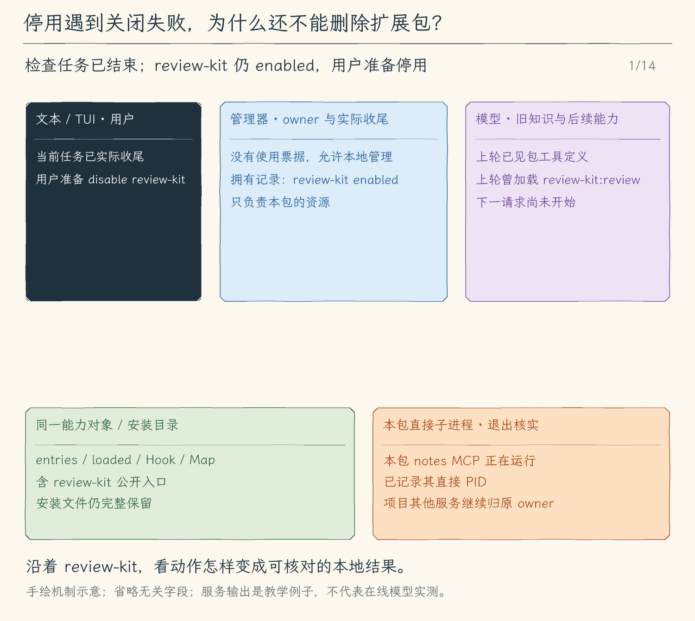

# 31.3 停用、卸载与诊断：先确认资源结束，再删除包

[第 31 章首页](../README.md) · [上一节：显式启用扩展能力](../02-enable-capabilities/README.md) · [本章练习与答案](../EXERCISES.md)

## 当前不用，与彻底删除，是两个决定

上一节启用的 `review-kit` 正在给当前 Agent 提供能力。审查结束后，用户可能希望留着文件，下次再用；也可能决定从项目中删掉它。前者是停用，后者是卸载。

停用的产出是当前进程再也不能选用这套能力，而且它启动的直接 MCP 子进程已经退出。安装文件继续保留。卸载则要先做到同样的收尾，再删除属于这个包的目录。仅把 enabled 改为 false，不能证明服务已经停止；仅删文件，也可能留下仍在运行的进程。

本节增加 `/extension disable review-kit`、`/extension uninstall review-kit` 和 `/extension diagnose review-kit`。CLI 的独立管理入口也能 diagnose 和 uninstall；另一个进程仍持有扩展锁时，写入继续返回 busy，不提供跨进程热控制。

## 停用沿能力的发布路线反向处理

继续看已启用并已加载 Skill 的 `review-kit`。它此时有一条 entries、一条 loaded 正文、一条 before_tool，以及若干 MCP 工具。停用首先撤下这些可被后续任务选择的入口：按 owner 删除 Skill 目录条目，删掉带 `review-kit:` 的 loaded 正文，从事件数组移走该包的钩子，移走该包服务对象及其工具定义。

撤下也必须原地修改前节交给模型的对象。下一次 generate 才会同时失去 MCP 工具定义和已加载 Skill 正文，下一次 runHooks 也不再触发该包的脚本。项目原有 Skill、Hooks 和 MCP 条目继续保留；过滤依据来自本地安装时记录的 owner 或实际服务对象，不根据包返回的文字猜测。

接下来等待这个包自己的 MCP 状态 close。停用不能调用“关闭整个项目”的方法，否则其他项目服务也会被关闭。包拥有的状态保存着自己连接的那组服务，聚合 Map 和数组则只是这些服务的公开入口。撤下入口与关闭资源因此可以分开处理，也能分别核对。

本地管理只在任务空闲时运行，正在执行的模型或工具不会被中途拆走定义。若任务还没结束，disable 返回 busy，用户先取消任务并等待实际收尾，再进行停用。管理器不会绕过整轮任务票据，强行把它正在使用的服务销毁。

正常完成后，拥有记录从 active 删除，list 回到 installed。对没有启用的包再次 disable 会说明当前未启用，不启动服务，也不伪造新的执行过程。

## 为什么关闭失败要留下 cleanup_failed

假设工具定义已经撤下，SDK close 却没有确认直接子进程退出。此时后续任务不能再调用该包，但程序还欠着一项资源清理。把状态直接写成 installed 会让用户误以为它从来没有执行资源。

程序因此先把拥有记录保留为 cleanup_failed，再等待 close；只有真正成功才删除记录。失败会返回本地错误，list 仍显示 cleanup_failed，用户可以再次 disable 重试。不能在重试前 enable 同一包，否则旧进程尚未结束又可能启动新进程。

| 当前事实 | 后续任务能否选择这个包 | 安装文件 | 下一步 |
| --- | --- | --- | --- |
| enabled | 可以，仍受模式和审批限制 | 保留 | 空闲时 disable |
| cleanup_failed | 能力入口已撤下 | 保留 | 核对进程并重试 disable |
| installed | 未启用 | 保留 | 明确 enable 或 uninstall |
| 卸载成功 | 没有该包的入口 | 已删除 | 需要时重新 install |

关闭整个 Agent 时也采用同样的拥有关系。管理器先封闭新入口、等待已排队的本地变更，再按启用顺序反向停用包。依赖先于依赖者启用，所以反序先关闭依赖者。任一资源关闭无法确认，管理器保留包与锁并报错；外层仍尝试关闭项目原有资源，不能用一个失败跳过其余收尾。

依赖也影响单独停用。若 `review-more` 的 requires 包含 `review-kit`，前者还在 active 时，后者不能停用或卸载。用户先停用 review-more，再停用 review-kit。保留为 cleanup_failed 的依赖者仍占有依赖关系，因为它的真实资源尚未确认结束。

## 卸载的提交依据是已完成清理

uninstall 调用同一条 stop 路线。只有依赖允许、资源关闭成功，程序才重新读取目标包，核对目录名与 manifest.id 一致，确认目标仍是管理器安装区内的普通目录，然后执行删除。关闭失败时不会走到 rm；安装文件和拥有记录都留下，便于重试。

删除目录前会再次检查取消信号；如果这时已经取消，就保留文件。进入 recursive rm 以后，Node 的这次删除没有接收 AbortSignal，不能把 Ctrl+C 描述成原子撤销。删除失败可能留下部分文件，list 会报告 invalid，需要用户核对实际目录；程序不会为了方便而把清单损坏、ID 不符或链接目标作为正常包递归删除。

所以卸载的保证是“先确认自己的执行资源结束，再尝试删除自己拥有的目录”。它不提供文件系统删除事务，也不会撤销 Hook 先前写到别处的文件或远端 MCP 已完成的操作。示例 Hook 的日志恰好写在包目录中，随目录删除只是这个例子的结果，不能推广为副作用自动恢复。

## 诊断只检查它实际能知道的事

用户看到 enable 失败，先要分清是文件和环境还没准备好，还是服务本身无法工作。diagnose 复用安装和启用的静态预检：读取清单、确认 API 版本和路径、解析三种配置、查看依赖、在 PATH 中检查可执行程序，以及检查指定认证变量是否存在且格式有效。

它不会启动程序，也不连接网络。因此“静态检查通过”只说明本地配置可以继续尝试启用，不证明 URL 可达、令牌有权限或服务协议正确。缺少程序时会指出命令名；涉及认证时只说明变量缺失或无效，不打印令牌值或完整敏感启动参数。

list 则适合先看总体状态。某个包文件损坏时，它保留一行 invalid 与安全诊断，不把这个包静默漏掉。diagnose 需要清单仍可解析；损坏时返回具体静态错误。这里没有“诊断顺便修复并执行”的隐藏动作。

## 正常结束、常见失败与取消怎样回到界面

这些都是本地命令。成功时 text 或 TUI 显示完成文本，失败时显示可解释的错误；它们不进入发送给模型的历史，也不产生模型工具消息。启用、停用和卸载共享串行变更入口，模型无法通过 tools/call 绕过本地选择。

disable 的 close 一旦开始，会等待实际清理，不因用户又按 Ctrl+C 就提前打印已停止。uninstall 可以在读取及删除前响应取消；删除一旦开始，则等待真实文件系统结果。diagnose 在读取边界响应取消，结束后没有新执行资源需要关闭。这些路径共用界面控制器，让用户能发出停止请求，但各自的“已结束”仍取决于底层操作的实际结果。

<!-- media:lesson:start -->
先追踪一次未确认退出的 stop：入口已撤下，cleanup_failed、资源引用和安装文件仍留下；重试核实退出以后才允许删目录。上轮模型知识不会被抹掉，后续请求只从当前能力对象取定义。



[静态流程图](assets/extension-disable-flow-76dc58fbb9.png) · [静态封面](assets/extension-disable-cover-b7fe5368fb.png) · [查看完整静态分镜](assets/extension-disable-storyboard-652edd7444.jpg)
<!-- media:lesson:end -->

## 本节改动文件

| 状态 | 文件 | 本节变化 |
| --- | --- | --- |
| CHANGED | [src/cli.ts](src/cli.ts) | 无需密钥的管理入口及显式启动、退出收尾。 |
| CHANGED | [src/extensions/commands.ts](src/extensions/commands.ts) | 本地命令参数校验与管理器分发。 |
| CHANGED | [src/extensions/manager.ts](src/extensions/manager.ts) | 安装与拥有关系；本节新增的生命周期操作。 |
| CHANGED | [src/ui/tui/input-assist.ts](src/ui/tui/input-assist.ts) | 补全当前小节支持的本地管理命令。 |

## 动手构建

从 31.2 继续。管理器增加公开 disable、uninstall 和静态 diagnose，命令分发与补全同步扩展；正常退出仍复用同一个私有 stop。下面给出本节全部修改文件的完整内容，按路径替换即可。其他模块保持上一节的稳定对象、使用票据和 MCP 进程核实机制。

<details>
<summary>src/cli.ts（完整文件）</summary>

```typescript
#!/usr/bin/env node
/**
 * 31.3 停用、卸载与诊断 | [CHANGED] cli.ts
 *
 * 学习目标：提供本地停用、卸载与静态诊断，退出时先等资源关闭再释放安装锁。
 * 输入：命令行模型选项、--prompt 与 --output；输出格式默认是 auto。
 * 输出：装配模型后选择一个消费者；入口错误由 stderr 说明并设置 exitCode=1。
 * 状态：入口不持有消息历史或授权；只创建 writer，消费者提供白名单快照。
 *
 * 本文件局部流程（全局主流程见 agent/agent-loop.ts）：
 *   [KEEP 来自 30.1] argv[2]=schedule？-- 是 -> 独立定时管理 -> 结束；否 -> 普通聊天入口
 *   显式网页/搜索选项且非 Plan？-- 是 -> 完整校验本地配置 -> 创建 WebState；否 -> 不启用网页
 *   配置失败 -> 启动错误；配置成功只装配工具，不提前抓取或查询
 *   [KEEP 来自 18.1] --memory -> 检查混用和模式 -> 找真实项目根 -> 本地管理 -> 结束
 *   [KEEP 来自 19.1] 正常启动 -> 同根discoverSkills -> 只把名称/用途交给模型和启动信息
 *   --help / --version -> 显示文字 -> 结束；--doctor -> 显示环境 -> 结束
 *   [KEEP] 输出格式受支持？-- 否 -> 抛出 UserFacingError
 *                            +-- 是 -> 继续检查运行方式
 *   [KEEP] auto？-- 是 -> 无 --prompt 且 stdin/stdout 为 TTY、TERM 非 dumb？
 *                     是 -> tui；否 -> text
 *                +-- 否 -> 保留显式选择
 *   tui？-- 是 -> stdin/stdout 为 TTY、TERM 非 dumb，且没有 --prompt？
 *                否 -> 抛错；是 -> 读取配置、创建模型 -> 动态载入 app -> startTui
 *        +-- 否 -> jsonl 但缺少 --prompt？-- 是 -> 抛错
 *                                          +-- 否 -> 读取配置、创建模型
 *   [KEEP 来自 13.1] text / tui -> 创建新会话文件、显示 ID 和路径 -> 消费者 -> finally close
 *   非 TUI 分支 -> 无 --prompt？-- 是 -> startTerminal
 *                              +-- 否 -> 内容为空？-- 是 -> 抛错
 *                                                  +-- 否 -> jsonl / text 单次消费者
 *   运行抛错 -> explainError -> stderr、exit 1；单次用户取消由消费者设 exit 130
 *
 * auto 在没有 --prompt、stdin/stdout 都是 TTY 且 TERM 不是 dumb 时选择 tui，其余选择 text。
 * TUI 只接受连续输入，单次任务继续用 text 或 jsonl；JSONL 必须同时给 --prompt。
 * 动态 import 只在 tui 分支载入 React / Ink，脚本模式不需要初始化终端界面。
 * --help、--version 和 --doctor 不读取模型配置；界面选择不改变模型、工具或权限协议。
 *
 * [KEEP 来自 12.1] --mode plan|execute 在创建模型前校验，再传给每种消费者。
 * [KEEP 来自 12.2] 非 TUI 入口为当前会话准备共用清单；TUI 在 startTui 内创建自己的清单。
 * 运行观察：直接在交互终端启动会进入 TUI；单次提问、管道和 dumb 终端仍走 text。
 */
// [CHANGED 31.3] 无需密钥的管理入口及显式启动、退出收尾。


// [KEEP 来自 18.1] 本地记忆动作在模型配置与会话创建前完成。
// [KEEP 来自 20.1] 项目脚本必须由本次启动显式启用。
// [KEEP 来自 21.1] 显式配置授权启动服务，退出始终关闭本次连接。
// [KEEP 来自 22.1] 网络开关不读取网页或会话里的指令。
import { loadWeb } from "./web/client.js";
import { runScheduleCommand } from "./schedules/commands.js";
import { ExtensionManager } from "./extensions/manager.js";
import { extensionCommand } from "./extensions/commands.js";
import { connectMcp, mcpInfo } from "./mcp/client.js";
import { loadHooks } from "./hooks/lifecycle.js";
// [KEEP 来自 19.1] 固定项目目录发现元信息，不加载正文。
import { discoverSkills, skillInfo } from "./skills/catalog.js";
import { createMemoryController, memoryCommand } from "./memory/commands.js";
import { findProjectRoot } from "./project/instructions.js";
import { dirname } from "node:path";
// [KEEP 来自 17.1] 启动时完成项目说明快照，进入模型与界面前只读一次。
import { loadProjectInstructions, projectInstructionInfo } from "./project/instructions.js";
import { createFileCheckpointStore } from "./sessions/file-checkpoints.js";
import { readFileSync } from "node:fs";
// [KEEP 来自 13.3] 使用真实目录比较工作区，符号链接别名不会误判成另一个项目。
import { forkSessionWriter } from "./sessions/fork-session.js";
import { realpath } from "node:fs/promises";
import { Command } from "commander";
import { readConfig, type Options } from "./config/load-config.js";
import { createModel } from "./models/client.js";
import type { ExecutionMode, RunOptions } from "./agent/run-options.js";
// [KEEP 来自 09.3] 机器输出也调用相同的 Agent 事件流。
import { runJsonlPrompt } from "./ui/jsonl.js";
import { runSinglePrompt, startTerminal } from "./ui/terminal.js";
import { UserFacingError, explainError } from "./errors.js";
// [KEEP 来自 13.1] 入口创建并最终关闭 writer，模型配置不进入存储模块。
import { createSessionWriter, resumeSessionWriter } from "./sessions/save-session.js";
// [KEEP 来自 13.4] 本地管理复用读取与写入协议，无需模型配置。
import { listSessions, renameSession, exportSession } from "./sessions/manage-sessions.js";

// [KEEP 第 01 章] 构建产物始终是 dist/cli.js，因此从它的上一级读取 package.json。
const packageJson = JSON.parse(readFileSync(new URL("../package.json", import.meta.url), "utf8"));

// [KEEP 来自第 01 章练习] 环境诊断不读取模型配置，也不会发送模型请求。
/**
 * 显示当前 Node.js 进程的最小诊断信息，不读取模型配置。
 *
 * - 输入：无显式参数；版本、平台、架构和工作目录都来自 Node.js 的 `process`。
 * - 输出：向终端依次打印 Node、Platform 和 Working directory 三行文本。
 * - 关键原因：诊断发生在 `readConfig()` 之前，因此缺少 API Key 时也能运行。
 * - 职责边界：不读取 `.env`，不创建模型客户端，也不发送网络请求。
 */
function printDoctor(): void {
  console.log(`Node: ${process.version}`);
  console.log(`Platform: ${process.platform} ${process.arch}`);
  console.log(`Working directory: ${process.cwd()}`);
}
// [KEEP 来自 09.3] output 只供入口选择消费者，不并入模型连接配置。
// [KEEP 来自 13.1] 会话目录只属于本地持久化，不属于模型配置。
type CliOptions = Options & { extension?: string[]; enableExtension?: string[]; enableProjectHooks?: boolean; mcpConfig?: string; mcpInfo?: boolean; enableWeb?: boolean; webSearchConfig?: string;  memory?: string; projectInfo?: boolean; prompt?: string; doctor?: boolean; output?: string; mode?: string; sessionDir?: string; resume?: string; recover?: boolean; sessions?: boolean; search?: string; rename?: string; name?: string; export?: string; exportTo?: string; fork?: string };
const program = new Command();
program
  // [KEEP 第 01 章] 帮助、版本无需配置模型，也不会发送请求。
  .name("hello-my-agent")
  .description("你好，我的 Agent：从 0 到 npm 发布")
  .version(packageJson.version, "-v, --version", "显示版本号")
  .helpOption("-h, --help", "显示帮助")
  // [KEEP 来自第 01 章练习] --doctor 在读取模型配置前结束，因此没有 API Key 也能使用。
  // [KEEP 来自 20.1] 仅这次启动授权项目生命周期脚本；恢复会话不恢复启用状态。
  // [KEEP 来自 21.1] 不自动读取仓库中的MCP启动命令。
  // [KEEP 来自 22.1] 启用仅注册，真正GET仍逐次审批。
  // [KEEP 来自 22.2] 提供配置也明确启用网页工具；无提供方不注册web_search。
  .option("--web-search-config <path>", "配置JSON GET搜索提供方(endpoint/queryParam/tokenEnv)")
  .option("--enable-web", "明确启用逐次审批的网页抓取工具")
  .option("--extension <command...>", "本地扩展管理：list/install/diagnose/uninstall，无需模型密钥")
  .option("--enable-extension <id...>", "仅本进程明确启用列出的已安装扩展；可能启动脚本和服务")
  .option("--mcp-config <path>", "明确启用指定MCP配置（会启动或连接其中的服务）")
  .option("--mcp-info", "连接、发现并诊断指定MCP配置后退出，无需模型密钥")
  .option("--enable-project-hooks", "明确启用项目 .hello-my-agent/hooks.json 中的脚本")
  .option("--doctor", "显示当前运行环境")
  // [KEEP 来自 17.3] 本地检查在读取模型配置和创建会话之前完成。
  .option("--project-info", "显示项目说明来源、范围、版本和加载预算")
  // [KEEP 来自 18.1] 显式管理命令无需API Key。
  .option("--memory <command>", "本地项目记忆：list、show <id>、add <正文>、edit <id> <正文>、invalidate <id> <理由>、delete <id>")
  // [KEEP 来自 02.1] 允许本次启动覆盖模型和基础地址，不在参数中传密钥。
  .option("--model <id>", "本次使用的模型 ID")
  .option("--base-url <url>", "本次使用的接口基础地址")
  // [KEEP 来自 02.2] 单次提问；02.4 增加连续输入后仍保留此用法。
  .option("--prompt <text>", "提问一次后退出")
  // [KEEP 来自 02.5] 本次启动选择接口协议。
  .option("--provider <type>", "接口协议：openai 或 anthropic")
  // [KEEP 来自 10.4] 默认值改为 auto；显式 text、tui、jsonl 仍由用户选择。
  .option("--output <format>", "输出格式：auto、tui、text 或 jsonl", "auto")
  // [KEEP 来自 12.1] 增加启动模式选项，默认 execute。
  .option("--mode <mode>", "模式：plan 或 execute（新会话默认 execute，恢复沿用已保存模式）")
  // [KEEP 来自 13.1] text / tui 保存新会话；JSONL 机器事件流暂不接入。
  .option("--session-dir <path>", "text / tui 的会话保存目录（默认 ~/.hello-my-agent/sessions）")
  // [KEEP 来自 13.3] 恢复需要明确 ID；恢复中断需再明确 --recover。
  // [KEEP 来自 14.1] fork 创建新身份；resume 继续旧身份。
  .option("--fork <id>", "从指定会话的最后完整状态创建新分支，不重放工具")
  .option("--resume <id>", "恢复指定会话，等待新输入；不重放旧工具")
  .option("--recover", "确认恢复已中断会话或清理已失效的进程锁")
  // [KEEP 来自 13.4] 显式管理动作在读取模型配置前完成。
  .option("--sessions", "列出本地会话，可配合 --search")
  .option("--search <text>", "在会话 ID、名称、工作区和已保存消息中搜索")
  .option("--rename <id>", "给指定会话追加名称，需要 --name")
  .option("--name <text>", "会话名称，1—80 个字符")
  .option("--export <id>", "将指定会话导出为 Markdown，默认输出到 stdout")
  .option("--export-to <path>", "导出到一个尚不存在的文件，需要 --export")
  // [KEEP 来自 09.3] 默认动作先检查输出约定，再装配模型并选择对应消费者。
  .action(async () => {
    const options = program.opts<CliOptions>();
    // [KEEP 来自 18.1] 管理动作拒绝混用提问、会话和连接选项；Plan只可查询。
    if (options.memory !== undefined) {
      if (options.prompt !== undefined || options.projectInfo || options.doctor || options.model !== undefined || options.baseUrl !== undefined
        || options.provider !== undefined || options.output !== "auto" || options.sessionDir !== undefined || options.resume !== undefined || options.recover
        || options.fork !== undefined || options.sessions || options.search !== undefined || options.rename !== undefined || options.name !== undefined
        || options.export !== undefined || options.exportTo !== undefined) throw new UserFacingError("--memory请单独使用，可配合--mode plan查询。");
      if (!["execute", "plan"].includes(options.mode ?? "execute")) throw new UserFacingError("--mode只能是plan或execute。");
      console.log(await memoryCommand(findProjectRoot(), options.memory, options.mode as ExecutionMode | undefined));
      return;
    }
    // [KEEP 来自 17.3] 本地检查是单独动作，拒绝会让用户误以为发送了任务的选项组合。
    if (options.projectInfo) {
      if (options.prompt !== undefined || options.doctor || options.model !== undefined || options.baseUrl !== undefined
        || options.provider !== undefined || options.mode !== undefined || options.output !== "auto"
        || options.sessionDir !== undefined || options.resume !== undefined || options.recover || options.fork !== undefined
        || options.sessions || options.search !== undefined || options.rename !== undefined || options.name !== undefined
        || options.export !== undefined || options.exportTo !== undefined) throw new UserFacingError("--project-info 请单独使用，不与提问、模型、模式、会话或输出选项混用。 ");
      const project = await loadProjectInstructions();
      for (const line of projectInstructionInfo(project)) console.log(line);
      return;
    }
    // [KEEP 来自 13.4] 先排除含糊组合，再执行一个本地动作；没有 API Key 也可以管理。
    const management = Number(Boolean(options.sessions)) + Number(options.rename !== undefined) + Number(options.export !== undefined);
    if (management > 1) throw new UserFacingError("--sessions、--rename、--export 每次只能选择一个。");
    if (options.search !== undefined && !options.sessions) throw new UserFacingError("--search 必须与 --sessions 一起使用。");
    if (options.name !== undefined && options.rename === undefined) throw new UserFacingError("--name 必须与 --rename <id> 一起使用。");
    if (options.exportTo !== undefined && options.export === undefined) throw new UserFacingError("--export-to 必须与 --export <id> 一起使用。");
    if (options.sessionDir !== undefined && !options.sessionDir.trim()) throw new UserFacingError("--session-dir 不能为空。");
    if (management) {
      if (options.fork !== undefined || options.resume !== undefined || options.recover || options.prompt !== undefined || options.doctor
        || options.mode !== undefined || options.model !== undefined || options.provider !== undefined || options.baseUrl !== undefined || options.output !== "auto") {
        throw new UserFacingError("本地会话管理请单独使用，不与恢复、提问、模型或输出模式选项混用。");
      }
      if (options.sessions) {
        const result = await listSessions(options.sessionDir, options.search);
        for (const warning of result.warnings) console.error(`会话提示：${warning}`);
        if (!result.sessions.length) console.log("没有匹配的本地会话。");
        for (const session of result.sessions) console.log(`${session.id}  ${session.name}\n  ${session.updatedAt} · ${session.messages} 条消息 · ${session.pending} 条待交付${session.interrupted ? " · 上次中断" : ""}\n  ${session.cwd}`);
      } else if (options.rename !== undefined) {
        if (options.name === undefined) throw new UserFacingError("--rename <id> 需要 --name <text>。");
        const seq = await renameSession(options.rename, options.name, options.sessionDir);
        console.log(`名称已保存：${options.rename} · 第 ${seq} 条记录。`);
      } else {
        const markdown = await exportSession(options.export!, options.sessionDir, options.exportTo);
        if (options.exportTo === undefined) process.stdout.write(markdown);
        else console.log(`已导出：${options.exportTo}`);
      }
      return;
    }
    // [KEEP 来自 21.1] 本地诊断在readConfig前完成，不需要模型凭据。
    if (options.mcpInfo) {
      if (!options.mcpConfig) throw new UserFacingError("--mcp-info 需要 --mcp-config <path>。");
      const mcp = await connectConfiguredMcp(options.mcpConfig, findProjectRoot());
      try { for (const line of mcpInfo(mcp)) console.log(line); } finally { await mcp?.close(); }
      return;
    }
    // [KEEP 来自 31.1] 本地安装与诊断无需模型凭据，完成后一定关闭管理器。
    if (options.extension) {
      if (options.enableExtension || options.prompt || options.resume || options.fork || options.mcpConfig || options.enableProjectHooks) throw new UserFacingError("--extension 不与运行或其他能力启用参数混用。");
      if (!["plan", "execute"].includes(options.mode ?? "execute")) throw new UserFacingError("--mode 只能是 plan 或 execute。");
      if (options.extension[0] === "enable") throw new UserFacingError("独立管理命令不保留进程；请用 --enable-extension <id...> 启动，或在会话中 /extension enable <id>。");
      const root = findProjectRoot(), manager = new ExtensionManager(root, await discoverSkills(root));
      const controller = new AbortController(), cancel = () => controller.abort(new UserFacingError("扩展操作已取消。"));
      process.once("SIGINT", cancel);
      try { console.log(await extensionCommand(options.extension, manager, options.mode ?? "execute", controller.signal)); }
      finally { process.removeListener("SIGINT", cancel); await manager.close(); }
      return;
    }
    if (options.doctor) {
      printDoctor();
      return;
    }
    // [KEEP 来自 12.1] 创建模型前检查模式，非法值不会启动任务。
    if (!["plan", "execute"].includes(options.mode ?? "execute")) throw new UserFacingError("--mode 只能是 plan 或 execute。");
    let mode: ExecutionMode = options.mode === "plan" ? "plan" : "execute";
    // [KEEP 来自 12.1] 把启动模式传到 text、JSONL 和连续会话入口。
    // [KEEP 来自 12.2] 非 TUI 入口创建共用清单；TUI 在自己的会话内创建。
    const runOptions: RunOptions = { mode, tasks: { items: [] } };
    // [KEEP 来自 10.4] 校验允许 auto，下一步再把它解析成具体消费者。
    if (!["auto", "tui", "text", "jsonl"].includes(options.output ?? "auto")) throw new UserFacingError("--output 只能是 auto、tui、text 或 jsonl。");
    // [KEEP 来自 10.4] 只在真实终端的连续会话中自动选择 TUI；--prompt 和管道默认仍用文本。
    if (options.output === "auto") options.output = options.prompt === undefined
      && process.stdin.isTTY && process.stdout.isTTY && process.env.TERM !== "dumb" ? "tui" : "text";
    // [KEEP 来自 10.1] 只有真实终端才能把按键交给 Ink；单次问题继续使用已有输出模式。
    if (options.output === "tui" && (!process.stdin.isTTY || !process.stdout.isTTY || process.env.TERM === "dumb")) {
      throw new UserFacingError("TUI 需要交互终端，请使用 --output text 或 --output jsonl --prompt 提问。");
    }
    if (options.output === "tui" && options.prompt !== undefined) throw new UserFacingError("TUI 使用连续输入；单次提问请使用 --output text 或 jsonl。");
    if (options.output === "jsonl" && options.prompt === undefined) throw new UserFacingError("JSONL 模式需要 --prompt 提供一次任务。");
    // [KEEP 来自 13.1] 在创建模型和文件前拒绝不支持的组合与空问题。
    if (options.output === "jsonl" && options.sessionDir !== undefined) throw new UserFacingError("--session-dir 只支持 text 或 tui；JSONL 机器输出暂不保存会话。");
    if (options.recover && options.resume === undefined) throw new UserFacingError("--recover 必须与 --resume <id> 一起使用。");
    if (options.resume !== undefined && options.output === "jsonl") throw new UserFacingError("会话恢复只支持 text 或 tui。");
    if (options.sessionDir !== undefined && !options.sessionDir.trim()) throw new UserFacingError("--session-dir 不能为空。");
    if (options.prompt !== undefined && !options.prompt.trim()) throw new UserFacingError("提问内容不能为空。");
    // [KEEP 来自 14.1] 含糊组合在创建模型或新文件之前拒绝。
    if (options.fork !== undefined && (options.resume !== undefined || options.recover || options.output === "jsonl")) throw new UserFacingError("--fork 不与 --resume、--recover 或 JSONL 混用。");
    // [KEEP 来自 17.1] 不改 cwd，不把项目说明当作审批或脚本运行入口。
    if (options.enableExtension?.length && (mode === "plan" || options.resume || options.fork)) throw new UserFacingError("启动启用扩展仅支持新的execute会话；恢复后请在本地明确启用。");
    const project = await loadProjectInstructions();
    const config = readConfig(options);
    // [KEEP 来自 18.1] 初始记忆供界面估算，正式任务开始时会重新加载并冻结。
    const memory = await createMemoryController(project.root);
    const skills = await discoverSkills(project.root);
    // [KEEP 来自 20.1] Plan不读取/运行钩子；执行模式没有显式开关也不读取。
    const hooks = await loadHooks(project.root, Boolean(options.enableProjectHooks) && mode !== "plan");
    // [KEEP 来自 21.1] Plan不启动本地服务；恢复与新启动都必须再次显式选择。
    const mcp = mode === "plan" ? undefined : await connectConfiguredMcp(options.mcpConfig, project.root);
    const extensions = new ExtensionManager(project.root, skills, hooks, mcp);
    let model: ReturnType<typeof createModel> | undefined;
    try {
    // [KEEP 来自 31.2] 启动显式启用也接收Ctrl+C；只在资源收尾后离开初始化阶段。
    const extensionAbort = new AbortController(), cancelExtension = () => extensionAbort.abort(new UserFacingError("扩展初始化已取消。"));
    process.once("SIGINT", cancelExtension);
    try { for (const id of options.enableExtension ?? []) console.error(await extensions.enable(id, mode, extensionAbort.signal)); }
    finally { process.removeListener("SIGINT", cancelExtension); }
    const web = mode === "plan" ? undefined : await loadWeb(Boolean(options.enableWeb), options.webSearchConfig);
    model = createModel(config, project, memory, skills, extensions.hooks, extensions.mcp, web, extensions);
    for (const line of mcpInfo(model.mcp)) console.error(line);
    for (const line of skillInfo(skills)) console.error(line);
    for (const line of projectInstructionInfo(project)) console.error(line);
    // [KEEP 来自 13.1] JSONL 仍只输出机器事件；其余入口共用一次 writer 生命周期。
    if (options.output === "jsonl") {
      await runJsonlPrompt(model, options.prompt!, runOptions);
      return;
    }
    // [KEEP 来自 14.1] 新分支复制来源数据，随后所有检查点只写新文件。
    const writer = options.fork !== undefined
      ? await forkSessionWriter(options.fork, options.sessionDir)
      : options.resume !== undefined
      ? await resumeSessionWriter(options.resume, options.sessionDir, options.recover)
      : await createSessionWriter(options.sessionDir);
    // [KEEP 来自 14.2] 文件恢复数据与会话同属一个身份，分支自动使用新的目录。
    runOptions.fileCheckpoints = createFileCheckpointStore(writer.id, dirname(writer.path));
    console.error(`会话 ID：${writer.id}\n保存文件：${writer.path}`);
    try {
      // [KEEP 来自 13.3] 采用拿锁后重读的快照；任何失败都会走 finally 释放本进程的锁。
      const restored = writer.restored;
      const initial = restored?.state;
      if (restored) {
        const workspace = restored.header.workspace ?? await realpath(restored.header.cwd);
        if (workspace !== await realpath(process.cwd())) throw new UserFacingError(`工作区不同：请先进入 ${restored.header.cwd} 再恢复，当前目录不会执行旧任务。`);
        for (const warning of restored.warnings) console.error(`恢复提示：${warning}`);
        console.error(`已恢复 ${initial?.messages.length ?? 0} 条消息；等待新要求，不重放旧工具；本进程权限需重新确认。`);
        if (initial?.pendingInputs.length) console.error(`保留 ${initial.pendingInputs.length} 条旧补充；不会自动交给新任务，请在 TUI 队列中明确选择发送。`);
      }
      mode = (options.mode ?? initial?.mode ?? "execute") as ExecutionMode;
      runOptions.mode = mode;
      if (options.prompt === undefined) {
        // [KEEP 来自 10.1] 选择 TUI 时才载入 React / Ink，不让脚本模式初始化界面。
        if (options.output === "tui") {
          const { startTui } = await import("./ui/tui/app.js");
          // [KEEP 来自 13.1] 会话 writer 与启动模式一起交给 TUI，授权仍由 TUI 保存在内存。
          await startTui(model, mode, writer, initial, runOptions.fileCheckpoints);
        } else await startTerminal(model, runOptions, writer, initial);
      } else await runSinglePrompt(model, options.prompt, runOptions, writer, initial);
    } finally {
      // [KEEP 来自 13.1] 消费者先等任务和最后检查点；即使保存失败，这里仍关闭句柄。
      await writer.close();
    }
    // [KEEP 来自 26.1] 退出等待自有作业清理；即使close失败也关闭MCP。
    } finally { try { await model?.jobs?.close(); } finally { try { await extensions.close(); } finally { await mcp?.close(); } } }
  });

// [KEEP 来自 02.2] 请求返回 Promise，parseAsync 会等待默认操作结束。
try {
  // [KEEP 来自 30.3] schedule动作结束后不再进入普通聊天入口。
  if (process.argv[2] === "schedule") await runScheduleCommand(process.argv.slice(3));
  else await program.parseAsync();
} catch (error) {
  console.error(`错误：${explainError(error)}`);
  process.exitCode = 1;
}

/**
 * [KEEP 来自 21.1] 让启动时的 Ctrl+C 也能停止正在建立的 MCP 连接。
 * 输入是本地配置路径与已确定的项目根；取消信号交给连接器，等待它关闭已启动的服务。
 * 无论连接成功、失败还是取消，最后都移除本次 SIGINT 监听，避免影响之后的任务。
 */
async function connectConfiguredMcp(path: string | undefined, root: string) {
  const controller = new AbortController();
  const cancel = () => controller.abort(new UserFacingError("MCP初始化已取消。"));
  process.once("SIGINT", cancel);
  try { return await connectMcp(path, root, controller.signal); }
  finally { process.removeListener("SIGINT", cancel); }
}
```

</details>

<details>
<summary>src/extensions/commands.ts（完整文件）</summary>

```typescript
/**
 * 31.3 停用、卸载与诊断 | [CHANGED] extensions/commands.ts
 * 学习目标：把扩展管理限制为本地CLI/TUI入口，不注册成模型工具。
 * 输入：本地命令、当前模式和取消信号；输出：状态文本；失败交给界面显示。
 * 本文件局部流程（全局主流程见 agent/agent-loop.ts）：
 *   命令 -> 严格参数个数 -> 同一个管理器方法 -> 完成/失败/取消 -> 本地反馈
 * 边界：enable是显式本地授权，包说明、模型文字与恢复的历史都不能触发它。
 */
// [CHANGED 31.3] 本地命令参数校验与管理器分发。

import type { ExtensionManager } from "./manager.js";
import { ToolError } from "../errors.js";

/** CLI传参数数组保留空格路径；TUI只支持不带空格的包ID，不接受安装路径。 */
export async function extensionCommand(input: string[] | string, manager: ExtensionManager | undefined, mode: string, signal: AbortSignal): Promise<string> {
  if (!manager) throw new ToolError("当前模型未连接扩展管理器。");
  const args = typeof input === "string" ? input.trim().split(/\s+/).slice(1) : input;
  const [command = "list", argument] = args;
  if (command === "list" && args.length <= 1) return (await manager.list(signal)).join("\n");
  if (args.length !== 2 || !argument) throw new ToolError("用法：extension list | install <目录> | enable <id> | disable <id> | uninstall <id> | diagnose <id>。");
  if (command === "install" && Array.isArray(input)) return manager.install(argument, signal);
  if (command === "enable") return manager.enable(argument, mode, signal);
  if (command === "disable") return manager.disable(argument);
  if (command === "uninstall") return manager.uninstall(argument, signal);
  if (command === "diagnose") return manager.diagnose(argument, signal);
  throw new ToolError("未知扩展命令；install只在CLI中接收明确的本地目录。");
}
```

</details>

<details>
<summary>src/extensions/manager.ts（完整文件）</summary>

```typescript
/**
 * 31.3 停用、卸载与诊断 | [CHANGED] extensions/manager.ts
 * 学习目标：把安装文件、当前启用状态和实际执行资源分开，并让失败可收尾。
 * 输入：本地明确选择、取消信号；输出：本地状态，不接受模型或包替用户授权。
 * 本文件局部流程（全局主流程见 agent/agent-loop.ts）：
 *   安装 -> 有界快照/校验 -> 临时目录 -> rename提交；启用 -> 预检 -> 连接 -> 原地发布
 *   停用 -> 撤下定义 -> 关闭资源 -> 确认；卸载 -> 停用成功 -> 删除拥有目录
 * 状态：单进程串行变更，首次变更持磁盘独占锁直到close；失败保留可诊断状态。
 * 边界：显式启用可运行任意本地程序，不是沙箱；不自动恢复死锁、不自动重试外部调用。
 */
import { constants } from "node:fs";
import { access, lstat, mkdir, open, opendir, rename, rm } from "node:fs/promises";
import type { FileHandle } from "node:fs/promises";
import { delimiter, dirname, join, resolve } from "node:path";
import { randomUUID } from "node:crypto";
import { ToolError } from "../errors.js";
import { discoverSkills } from "../skills/catalog.js";
import type { SkillState } from "../skills/catalog.js";
import { loadHooks } from "../hooks/lifecycle.js";
import type { HookState } from "../hooks/lifecycle.js";
import { connectMcp, readServers } from "../mcp/client.js";
import type { McpState, ServerConfig } from "../mcp/client.js";
import { EXTENSION_LIMITS, extensionId, ordinaryDirectory, packagePath, readPackage } from "./manifest.js";
import type { PackageSnapshot } from "./manifest.js";

type Prepared = { snapshot: PackageSnapshot; skills: SkillState; hooks?: HookState; servers: ServerConfig[] };
type Active = { prepared: Prepared; mcp?: McpState; status: "enabled" | "cleanup_failed" };
const events = ["before_tool", "after_tool", "stop"] as const;

/**
 * 聚合对象只创建一次；模型、工具注册表和界面始终读取这些同一对象。
 * 项目能力保留原有引用和执行目录，扩展停用仅删除带自己owner的内容。
 */
export class ExtensionManager {
  readonly hooks: HookState;
  readonly mcp: McpState;
  readonly directory: string;
  private readonly active = new Map<string, Active>();
  private lock?: FileHandle;
  private tail: Promise<unknown> = Promise.resolve();
  private users = 0;
  private mutations = 0;
  private closing = false;
  private closed = false;
  constructor(readonly root: string, readonly skills: SkillState, projectHooks?: HookState, projectMcp?: McpState) {
    this.root = skills.root;
    this.directory = join(this.root, ".hello-my-agent/extensions");
    this.hooks = projectHooks ?? { root, hooks: {} };
    this.mcp = projectMcp ?? { servers: [], tools: new Map(), async close() {} };
  }

  /** 整轮任务持使用票据；本地变更只能在空闲时进行，释放幂等。 */
  beginUse(): () => void {
    if (this.closed || this.closing || this.mutations) throw new ToolError("扩展正在变更或关闭，请等待本地操作结束后开始任务。");
    this.users++; let released = false;
    return () => { if (!released) { released = true; this.users--; } };
  }

  /** 入队前同步占用变更票据；任务不能在异步连接间隙取得使用票据。 */
  private mutate<T>(operation: () => Promise<T>): Promise<T> {
    if (this.closed || this.closing || this.users) return Promise.reject(new ToolError("扩展当前忙碌或已关闭，请在任务结束后操作。"));
    // [KEEP 来自 31.2] 在第一次await之前占用；反向的beginUse也必须看到这次变更。
    this.mutations++;
    const next = this.tail.then(async () => {
      await this.ownStore(); return operation();
    }).finally(() => { this.mutations--; });
    this.tail = next.catch(() => {}); return next;
  }

  /** 首次变更拿锁并持到退出；其他进程明确busy，不冒险删除活动脚本。 */
  private async ownStore(): Promise<void> {
    if (this.lock) return;
    const metadata = dirname(this.directory);
    await mkdir(metadata, { recursive: true }); await ordinaryDirectory(metadata);
    await mkdir(this.directory, { recursive: true }); await ordinaryDirectory(this.directory);
    try { this.lock = await open(join(this.directory, ".lock"), "wx", 0o600); }
    catch (error) { if ((error as NodeJS.ErrnoException).code === "EEXIST") throw new ToolError("扩展目录被其他进程占用（.lock）；请先正常退出持有者。崩溃遗留锁需人工确认进程已退出后移走。"); throw error; }
    await this.lock.writeFile(JSON.stringify({ pid: process.pid, startedAt: new Date().toISOString() }) + "\n"); await this.lock.sync();
  }

  /** 返回安装清单；损坏的包留在列表中作为诊断，不静默忽略。 */
  async list(signal: AbortSignal): Promise<string[]> {
    signal.throwIfAborted();
    let names: string[];
    try {
      await ordinaryDirectory(this.directory); names = [];
      for await (const entry of await opendir(this.directory)) {
        if (names.length >= 64) throw new ToolError("扩展安装目录超过64项；请先核对本地目录。");
        names.push(entry.name);
      }
    }
    catch (error) { if ((error as NodeJS.ErrnoException).code === "ENOENT") return ["没有已安装扩展。"]; throw error; }
    const lines: string[] = [];
    for (const id of names.sort().filter(name => !name.startsWith("."))) {
      signal.throwIfAborted();
      try { extensionId(id); const item = await readPackage(join(this.directory, id), signal); if (item.manifest.id !== id) throw new ToolError("目录与清单id不一致。"); lines.push(`${id}@${item.manifest.version} · ${this.active.get(id)?.status ?? "installed"}`); }
      catch (error) { signal.throwIfAborted(); lines.push(`${id} · invalid · ${error instanceof ToolError ? error.message : "文件不可读"}`); }
    }
    return lines.length ? lines : ["没有已安装扩展。"];
  }

  /** 静态预检复用原解析器，只生成配置与目录；绝不启动脚本、服务或安装依赖。 */
  private async prepare(idOrPath: string, signal: AbortSignal, source = false): Promise<Prepared> {
    const snapshot = await readPackage(source ? idOrPath : join(this.directory, extensionId(idOrPath)), signal);
    if (!source && snapshot.manifest.id !== idOrPath) throw new ToolError("扩展目录与清单id不一致。");
    const { manifest, root } = snapshot;
    const skills = manifest.skills ? await discoverSkills(this.root, signal, { directory: join(root, manifest.skills), owner: manifest.id }) : { root: this.root, entries: [], notices: [], loaded: new Map() };
    if (skills.notices.length) throw new ToolError(`扩展 Skills 校验失败：${skills.notices.map(notice => `${notice.path}: ${notice.reason}`).join("；")}`);
    const hooks = manifest.hooks ? await loadHooks(root, true, join(root, manifest.hooks)) : undefined;
    for (const event of events) for (const hook of hooks?.hooks[event] ?? []) {
      hook.owner = manifest.id; hook.cwd = root;
      const resolved = this.processConfig(root, hook.command, hook.args, snapshot); hook.command = resolved.command; hook.args = resolved.args;
    }
    const servers = manifest.mcp ? await readServers(join(root, manifest.mcp)) : [];
    for (const server of servers) if (server.transport === "stdio") Object.assign(server, this.processConfig(root, server.command, server.args, snapshot));
    return { snapshot, skills, hooks, servers };
  }

  /** 包内脚本使用./路径，安装后重新定位；拒绝越界参数和有路径的可执行文件。 */
  private processConfig(root: string, command: string, args: string[], snapshot: PackageSnapshot): { command: string; args: string[] } {
    if (!/^[a-zA-Z0-9_.-]{1,64}$/.test(command) || [".", ".."].includes(command)) throw new ToolError("扩展command须为PATH中的可执行名称；包内脚本放在args的./相对路径中。");
    return { command, args: args.map(arg => {
      if (arg.includes("../") || arg.includes("..\\") || arg.startsWith("/") || arg.includes("\\")) throw new ToolError("扩展参数不能包含绝对或越界路径。");
      if (!arg.startsWith("./")) return arg;
      const path = packagePath(arg.slice(2)); if (!snapshot.files.has(path)) throw new ToolError("扩展命令引用的包内脚本不存在。"); return join(root, path);
    }) };
  }

  /** 先完整复制到私有临时目录，再校验复制品；唯一rename是可见提交点。 */
  install(source: string, signal: AbortSignal): Promise<string> {
    return this.mutate(async () => {
      const snapshot = await readPackage(resolve(source), signal), target = join(this.directory, snapshot.manifest.id);
      if ((await this.list(signal)).filter(line => !line.startsWith("没有")).length >= EXTENSION_LIMITS.packages) throw new ToolError("最多安装16个扩展。");
      try { await lstat(target); throw new ToolError("同名扩展已安装；先停用并卸载，再安装明确选择的版本。"); }
      catch (error) { if ((error as NodeJS.ErrnoException).code !== "ENOENT") throw error; }
      const temporary = join(this.directory, `.tmp-${randomUUID()}`);
      try {
        await mkdir(temporary, { mode: 0o700 });
        for (const [path, bytes] of snapshot.files) {
          signal.throwIfAborted(); const destination = join(temporary, path); await mkdir(dirname(destination), { recursive: true });
          const file = await open(destination, "wx", 0o600); try { await file.writeFile(bytes); await file.sync(); } finally { await file.close(); }
        }
        await this.prepare(temporary, signal, true); signal.throwIfAborted();
        await ordinaryDirectory(this.directory); await rename(temporary, target);
        return `已安装 ${snapshot.manifest.id}@${snapshot.manifest.version}；当前未启用，未执行安装脚本。`;
      } finally { await rm(temporary, { recursive: true, force: true }); }
    });
  }

  /** 检查依赖必须先显式启用；不替用户自动启动依赖。 */
  private checkDependencies(item: Prepared): void {
    for (const dependency of item.snapshot.manifest.requires ?? []) if (this.active.get(dependency)?.status !== "enabled") throw new ToolError(`依赖 ${dependency} 尚未启用；请先明确启用该包。`);
  }

  /** 缺少二进制和认证变量在连接前报告；诊断不会打印令牌或启动参数。 */
  private async environment(item: Prepared): Promise<void> {
    const commands = new Set<string>();
    for (const event of events) for (const hook of item.hooks?.hooks[event] ?? []) commands.add(hook.command);
    for (const server of item.servers) {
      if (server.transport === "stdio") commands.add(server.command);
      else if (server.tokenEnv && (!process.env[server.tokenEnv] || /[\r\n]/.test(process.env[server.tokenEnv]!))) throw new ToolError("扩展认证环境变量缺失或无效；请在终端配置清单选择的变量。");
    }
    for (const command of commands) {
      let found = false;
      for (const directory of (process.env.PATH ?? "").split(delimiter).filter(Boolean)) { try { await access(join(directory, command), constants.X_OK); found = true; break; } catch {} }
      if (!found) throw new ToolError(`扩展所需可执行程序不可用：${command}。`);
    }
  }

  /**
   * [KEEP 来自 31.2] 先预检、连接、检查总预算，再原地发布到现成Skills/Hooks/MCP对象。
   * 任何失败先关闭新资源；关闭未确认则保留cleanup_failed，不能伪称未启动。
   */
  enable(id: string, mode: string, signal: AbortSignal): Promise<string> {
    return this.mutate(async () => {
      extensionId(id); if (mode !== "execute") throw new ToolError("Plan模式不能启用扩展；请在本地切换execute后明确选择。");
      if (this.active.has(id)) throw new ToolError("扩展已启用或仍待清理；先停用后再试。");
      const item = await this.prepare(id, signal); this.checkDependencies(item); await this.environment(item);
      if (this.skills.entries.length + item.skills.entries.length > 64 || item.skills.entries.some(entry => this.skills.entries.some(old => old.name === entry.name))) throw new ToolError("扩展Skills名称冲突或总数超过64。");
      for (const event of events) if ((this.hooks.hooks[event]?.length ?? 0) + (item.hooks?.hooks[event]?.length ?? 0) > 8) throw new ToolError("扩展Hooks总数超过每事件8条。");
      if (this.mcp.servers.length + item.servers.length > 4) throw new ToolError("扩展MCP总服务数超过4。");
      let own: McpState | undefined;
      try {
        own = item.snapshot.manifest.mcp ? await connectMcp(join(item.snapshot.root, item.snapshot.manifest.mcp), item.snapshot.root, signal, id, item.servers, state => { own = state; }) : undefined;
        if (own?.servers.some(server => server.status !== "ready")) throw new ToolError("扩展MCP连接或发现失败；新增能力未发布。");
        const definitions = [...this.mcp.tools.values(), ...own?.tools.values() ?? []];
        if (definitions.length > 64 || Buffer.byteLength(JSON.stringify(definitions.map(entry => entry.definition))) > 65536 || [...own?.tools.keys() ?? []].some(name => this.mcp.tools.has(name))) throw new ToolError("扩展MCP工具名称冲突或总定义超过64个/64KiB。");
        signal.throwIfAborted();
        this.skills.entries.push(...item.skills.entries);
        for (const event of events) (this.hooks.hooks[event] ??= []).push(...item.hooks?.hooks[event] ?? []);
        this.mcp.servers.push(...own?.servers ?? []); for (const [name, value] of own?.tools ?? []) this.mcp.tools.set(name, value);
        this.active.set(id, { prepared: item, mcp: own, status: "enabled" });
        return `已启用 ${id}；Skills=${item.skills.entries.length}，Hooks=${events.reduce((sum, event) => sum + (item.hooks?.hooks[event]?.length ?? 0), 0)}，MCP=${own?.tools.size ?? 0}。仅本进程有效。`;
      } catch (error) {
        try { await own?.close(); }
        catch { this.active.set(id, { prepared: item, mcp: own, status: "cleanup_failed" }); throw new ToolError("启用失败且新MCP进程关闭未确认；包文件保留，请停用重试清理。"); }
        throw error;
      }
    });
  }

  /** [KEEP 来自 31.2] 先撤下能力，再等待自有资源关闭；失败保留拥有记录以便重试。 */
  private async stop(id: string): Promise<string> {
    extensionId(id);
    for (const [other, active] of this.active) if (other !== id && active.prepared.snapshot.manifest.requires?.includes(id)) throw new ToolError(`扩展 ${other} 仍依赖 ${id}；先停用依赖者。`);
    const item = this.active.get(id); if (!item) return `${id} 当前未启用。`;
    this.skills.entries.splice(0, this.skills.entries.length, ...this.skills.entries.filter(entry => entry.owner !== id));
    for (const name of this.skills.loaded.keys()) if (name.startsWith(`${id}:`)) this.skills.loaded.delete(name);
    for (const event of events) { const hooks = this.hooks.hooks[event]; if (hooks) hooks.splice(0, hooks.length, ...hooks.filter(hook => hook.owner !== id)); }
    const servers = new Set(item.mcp?.servers ?? []);
    this.mcp.servers.splice(0, this.mcp.servers.length, ...this.mcp.servers.filter(server => !servers.has(server)));
    for (const [name, tool] of this.mcp.tools) if (servers.has(tool.server)) this.mcp.tools.delete(name);
    item.status = "cleanup_failed";
    await item.mcp?.close(); this.active.delete(id); return `已停用 ${id}，本进程能力已撤下，资源关闭已确认。`;
  }
  disable(id: string): Promise<string> { return this.mutate(() => this.stop(id)); }

  /** [NEW 31.3] 只有停用清理成功，且目标仍是本管理器拥有的普通目录时才删除。 */
  uninstall(id: string, signal: AbortSignal): Promise<string> {
    return this.mutate(async () => {
      extensionId(id); await this.stop(id); const item = await readPackage(join(this.directory, id), signal);
      if (item.manifest.id !== id) throw new ToolError("清单与目标目录不一致；未删除。");
      signal.throwIfAborted(); await ordinaryDirectory(this.directory); await ordinaryDirectory(item.root);
      await rm(item.root, { recursive: true }); return `已卸载 ${id}；不会撤销脚本或远端服务此前产生的副作用。`;
    });
  }

  /** [NEW 31.3] 静态诊断只读取；不连接网络、不执行程序、不打印令牌。 */
  async diagnose(id: string, signal: AbortSignal): Promise<string> {
    const item = await this.prepare(extensionId(id), signal); await this.environment(item);
    const missing = (item.snapshot.manifest.requires ?? []).filter(dependency => this.active.get(dependency)?.status !== "enabled");
    return `${id}@${item.snapshot.manifest.version} · API兼容 · 包内路径与配置有效 · ${this.active.get(id)?.status ?? "installed"}${missing.length ? ` · 未启用依赖：${missing.join(", ")}` : " · 依赖满足"}；这是静态检查，服务可用性需显式启用后验证。`;
  }

  /** 退出先等本地操作结束；有活动任务拒绝提前销毁。反序关闭符合依赖的启用顺序。 */
  async close(): Promise<void> {
    if (this.users) throw new ToolError("仍有任务使用扩展；先取消并等待任务结束。");
    this.closing = true; await this.tail;
    let failed = false;
    for (const id of [...this.active.keys()].reverse()) { try { await this.stop(id); } catch { failed = true; } }
    if (failed) { this.closing = false; throw new ToolError("扩展资源关闭未确认；保留包与锁，请核对本地进程。"); }
    this.closed = true;
    if (this.lock) { await this.lock.close(); this.lock = undefined; await rm(join(this.directory, ".lock")); }
  }
}
```

</details>

<details>
<summary>src/ui/tui/input-assist.ts（完整文件）</summary>

```typescript
/**
 * 31.3 停用、卸载与诊断 | [CHANGED] ui/tui/input-assist.ts
 *
 * 学习目标：补全本节支持的扩展管理命令，沿用问题历史和项目路径补全。
 * 阅读说明：本节沿用此模块；保存入口接在消费者收尾，不把本文件的配置、显示或控制对象整包存盘。
 * 输入：本次会话的问题列表，或当前草稿、光标和取消信号。
 * 输出：搜索候选，或补全后的文字、光标和提示；失败向调用方抛错，不提交问题。
 *
 * 本文件局部流程（全局主流程见 agent/agent-loop.ts）：
 *   历史查询 -> 倒序、去重、按子串筛选 -> 返回候选
 *   Tab -> 光标前是单行 / 命令？-- 是 -> 匹配本地命令表
 *                                +-- 否 -> 有 @路径？-- 否 -> 原草稿与用法提示
 *                                                     +-- 是 -> 搜索项目内路径
 *   候选超出 20 项？-- 是 -> 保留原草稿，提示继续缩小范围
 *                    +-- 否 -> 唯一候选或共同前缀 -> 接回光标右侧文字
 *
 * 补全只查文件名称；项目根和忽略规则复用已有 glob 工具，不读取文件正文。
 * 运行观察：Tab 补入 @ 后的路径，仍需按 Enter 发送；候选过多时先继续输入。
 */
// [CHANGED 31.3] 补全当前小节支持的本地管理命令。

import { findMatchingFiles, validateGlobPattern } from "../../tools/glob.js";
import { findProjectRoot } from "../../tools/workspace.js";

// [KEEP 来自 11.2] 输入历史和补全只修改草稿，不启动 Agent 或读取文件正文。
/**
 * 按关键词找出之前发送过的问题，优先显示最近一次。
 *
 * - 输入：当前进程保存的问题数组和查询字符串。
 * - 输出：倒序、去重后匹配查询的文字数组；空查询可浏览全部唯一记录。
 * - 关键原因：先倒序再去重，重复问题留下最近的位置；比较忽略大小写。
 * - 职责边界：不读取模型回答、不修改原数组，也不从磁盘恢复历史。
 */
export function searchPrompts(prompts: string[], query: string): string[] {
  return [...new Set([...prompts].reverse())].filter((text) => text.toLocaleLowerCase().includes(query.toLocaleLowerCase()));
}
/**
 * 找出所有候选共有的开头，避免替用户随意选择一项。
 *
 * - 输入：已经筛选过的候选字符串数组。
 * - 输出：所有值共同的前缀；空数组或没有共同开头时返回空字符串。
 * - 关键步骤：从第一项开始缩短前缀，直到每一项都以它开头；每次按完整 Unicode 码点缩短。
 * - 职责边界：不重新排序或查询候选；这里不按终端列宽截取文字。
 */
export function commonPrefix(values: string[]): string {
  let prefix = values[0] ?? "";
  for (const value of values.slice(1)) while (!value.startsWith(prefix)) prefix = Array.from(prefix).slice(0, -1).join("");
  return prefix;
}
/**
 * 只补全光标前的命令或 @路径，并保留后面的草稿。
 *
 * - 输入：草稿、UTF-16 光标下标及可选取消信号；光标由编辑器维护。
 * - 输出：新文字、新光标和提示；无候选、无补全位置或候选过多时保留原草稿。
 * - 关键步骤：本地命令查固定表；路径识别不要求 @ 前有空格；转义 glob 特殊符号后复用项目根和忽略规则，先筛选完整路径前缀，再检查 20 项上限。
 * - 候选处理：唯一候选补全整项，多个候选只延长共同前缀；唯一且含空白的路径用 JSON 引号保留边界。
 * - 失败方式：路径检查、搜索或取消错误交给编辑器显示；返回前检查取消，但是否仍是原草稿由组件另行确认。
 * - 职责边界：读取的是路径名，不是文件正文；函数返回文字，不执行工具或提交模型请求。
 */
export async function completeInput(text: string, cursor: number, signal?: AbortSignal): Promise<{ text: string; cursor: number; hint: string }> {
  const left = text.slice(0, cursor), right = text.slice(cursor);
  let candidates: string[], start: number, prefix: string;
  if (left.startsWith("/") && !left.includes("\n")) {
    prefix = left; start = 0;
    candidates = ["/exit", "/reset", "/permissions", "/permissions reset", "/mode plan", "/mode execute", "/extension list", "/extension enable ", "/extension disable ", "/extension diagnose ", "/extension uninstall "].filter((command) => command.startsWith(prefix));
  } else {
    const match = /@([^\s]*)$/.exec(left);
    if (!match) return { text, cursor, hint: "输入 / 补全本地命令，或 @ 后面的项目路径，再按 Tab。" };
    prefix = match[1]; start = left.length - prefix.length;
    const pattern = validateGlobPattern(prefix.replace(/[?*\[\]{}\\]/g, "\\$&") + "*");
    // [KEEP 来自 11.2] 名称匹配可能包含各目录同名文件，先筛选真正的路径候选，再限制数量。
    const result = await findMatchingFiles(pattern, findProjectRoot(), Infinity, signal);
    candidates = result.paths.filter((path) => path.startsWith(prefix));
    if (candidates.length > 20) return { text, cursor, hint: "候选超过 20 项，请继续输入更完整的路径。" };
  }
  signal?.throwIfAborted();
  if (!candidates.length) return { text, cursor, hint: "没有匹配的候选。" };
  let replacement = candidates.length === 1 ? candidates[0] : commonPrefix(candidates);
  if (candidates.length === 1 && /\s/.test(replacement) && !left.startsWith("/")) replacement = JSON.stringify(replacement);
  const next = left.slice(0, start) + replacement;
  return { text: next + right, cursor: next.length, hint: candidates.length === 1 ? "已补入草稿，尚未发送。" : `候选：${candidates.join(" · ")}` };
}
```

</details>


## 运行与核对

先构建 31.3。包如果前节尚未安装，先按 31.1 的步骤手动编译示例，再使用独立 install 命令安装；启用发生在当前会话中：

```bash
npm run lesson:31.3
```

再启动 execute 会话：

```bash
hello-my-agent --mode execute
```

```text
/extension enable review-kit
/skill review-kit:review
/extension diagnose review-kit
/extension disable review-kit
/extension list
/skills
/extension uninstall review-kit
/extension list
```

diagnose 应明确显示“静态检查”，不会再启动一个服务。disable 成功以后，list 显示 installed，`/skills` 不再列出 `review-kit:review`。下一次模型请求也不应携带该包的 MCP 定义或已加载正文。uninstall 成功以后，正式目录消失，list 不再包含该包。

从新的管理进程读取安装清单或做静态诊断，也不需要模型密钥：

```bash
hello-my-agent --extension list
hello-my-agent --extension diagnose review-kit
```

对尚在另一个进程启用的包做 uninstall 会返回 busy。关闭原会话后再从管理 CLI 卸载，不能跳过真实持有者的资源收尾。

```bash
node tests/verify-chapter-31.mjs
```

验证脚本除了正常流程，还让 close 故意失败，检查卸载被拒绝、文件保留、入口撤下、cleanup_failed 可见；恢复 close 后重试停用，确认 PID 退出。它同时检查原项目 hooks/MCP 对象与条目未被替换或关闭，以及部分连接失败时已成功启动的服务也被清理。

## 本章完成后的 Agent

扩展包从本地文件开始，经明确选择接入真实能力，再按拥有关系撤下并清理。安装版本、当前启用状态和执行资源分别记录，错误反馈以程序实际能确认的结果为准。我们现在得到的是可运行、可停用、可诊断的本地扩展机制；网络分发、自动升级和操作系统隔离仍需要另外设计。
