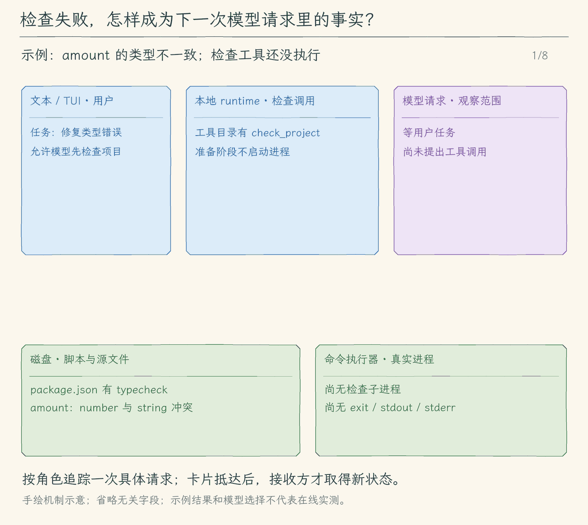

# 32.1 把检查结果交回模型

[本章首页](../README.md) · [下一节：用语言服务定位符号](../02-lsp-navigation/README.md) · [练习与答案](../EXERCISES.md)

## 代码改完以后，下一条证据从哪里来

上一章的 Agent 已经可以读文件、搜索符号、修改代码并运行命令。假设模型把函数返回类型从 `number` 改成了 `string`，然后告诉用户“已经修复”。文件确实写入了，但调用者是否还把返回值当数字使用、测试里的行为是否仍然成立，都没有经过检查。

我们需要把检查接回同一个任务循环：模型提出检查，本地程序执行，结果作为对应工具调用的消息进入历史，模型再决定修复、补查或结束。终端里出现一行红字还不够；如果这条红字只显示给人，下一次模型请求仍然不知道失败发生在哪里。

这一节增加 `check_project`，参数只有 `script: "test" | "typecheck"`。它在当前项目的 `package.json` 中确认这个脚本存在，随后准备 `npm run test` 或 `npm run typecheck`。我们用有限的名字表达检查意图，让模型不必重新猜每个项目的检查命令。项目怎样测试，仍由项目脚本决定。

## 固定名字为什么仍然要批准

`test` 是意图，不是权限。项目可以把 `test` 写成启动数据库、下载文件甚至删除目录的命令，npm还可能执行相应的前后置脚本。因此本地策略把 `check_project` 与 `run_command` 一样处理：Plan直接拒绝，执行模式每次询问，不记住永久批准。

准备阶段读取脚本，并把脚本正文、npm实际调用、项目目录和超时一起放进预览。此时没有启动进程。用户批准后，闭包再次核对 `package.json` 内容，再交给已有的命令执行器。如果预览后脚本被改了，本次批准就失去依据，程序返回错误，请模型重新提出检查。

这次复核只覆盖我们展示的包文件；脚本引用的其他文件仍可能变化。它不是整个项目的执行快照，也不是沙箱。我们仍然依靠本次批准来决定是否执行项目代码，下一章再给命令增加操作系统隔离。

## 一次失败怎样成为下一次修改的输入

检查正常退出时，命令执行器交回退出码、stdout和stderr。退出码非零时返回 `isError: true`，但工具执行本身已经结束：Agent Loop保存结果，按原工具调用ID追加工具消息，然后继续请求模型。模型可以根据具体报错读取调用者、提出修改并再次检查。

例如类型检查报告“string不能赋给number”，这能证明检查器在这次运行中发现了类型不兼容；不能据此宣称已经定位到所有业务问题。测试退出0也只说明实际运行的测试通过。工具结果中的命令、输出与退出状态共同构成证据，模型最终应说明运行了哪项检查及结果。

脚本不存在、包文件无效、审批被拒绝，都会成为可恢复的工具错误。程序不会悄悄把缺少typecheck当作通过，也不会未经批准改用任意shell命令。模型可以先读 `package.json`，说明当前项目缺少什么，再选择已有的搜索路径。

超时和输出上限继续由已有进程执行器处理。用户取消则沿本轮信号停止执行并等待收尾，整轮任务进入取消状态，不再把“检查被取消”当作普通检查失败继续自动修复。取消也不会撤销测试脚本已经做出的外部改变。

<!-- media:lesson:start -->
从检查脚本的审批开始，追踪非零退出码怎样连同调用编号进入下一次模型请求。



[静态流程图](assets/project-check-feedback-flow-e4d13708cf.png) · [静态封面](assets/project-check-feedback-cover-b05314fc7a.png) · [查看完整静态分镜](assets/project-check-feedback-storyboard-f4a4e2c8db.jpg)
<!-- media:lesson:end -->

## 本节改动文件

| 状态 | 文件 | 本节变化 |
| --- | --- | --- |
| NEW | [src/tools/check-project.ts](src/tools/check-project.ts) | 固定检查名，展示脚本，批准后复核包文件并执行。 |
| CHANGED | [src/tools/registry.ts](src/tools/registry.ts) | 登记工具并只开放准备与审批入口。 |
| CHANGED | [src/permissions/policy.ts](src/permissions/policy.ts) | Plan拒绝；执行模式逐次批准。 |

## 动手构建

以31.3的完整源码为起点，保留未列入本节变更表的文件。按下面路径保存完整内容，每份文件都位于本节自己的 `src/` 中。

### src/tools/check-project.ts

目标文件：[src/tools/check-project.ts](src/tools/check-project.ts)。

<!-- build-file: src/tools/check-project.ts -->
<details>
<summary>src/tools/check-project.ts 完整文件</summary>

```typescript
/**
 * 32.1 把检查结果交回模型 | [NEW] tools/check-project.ts
 * 输入：固定的test/typecheck与取消信号；输出：脚本预览和获批执行闭包。
 * 状态：准备只读；批准后包文件变化即失败；执行后的副作用不回滚。
 * JSON -> 声明存在？-- 否 -> ToolError -> 模型可继续调查
 *                  +-- 是 -> 预览 -> 批准 -> 包文件相同？-- 否 -> 错误
 *                                                     +-- 是 -> 原命令执行器 -> 真实结果
 */
import { readFile, realpath } from "node:fs/promises";
import { join } from "node:path";
import { ToolError } from "../errors.js";
import { prepareRunCommand } from "./run-command.js";
import { findProjectRoot } from "./workspace.js";
import type { PreparedToolCall } from "./types.js";

// [NEW 32.1] 模型只能选择检查意图，不能提供shell片段。
export const checkProjectDefinition = {
  name: "check_project",
  description: "逐次批准后运行项目package.json里的test或typecheck脚本；失败结果用于继续修复。",
  inputSchema: { type: "object" as const, properties: {
    script: { type: "string" as const, enum: ["test", "typecheck"] },
  }, required: ["script"], additionalProperties: false },
};

/** 只准备项目检查；批准后复核展示的package.json，再调用原有命令执行器。 */
export async function prepareCheckProject(json: string, projectRoot = findProjectRoot(), signal?: AbortSignal): Promise<PreparedToolCall> {
  signal?.throwIfAborted();
  let input: { script: "test" | "typecheck" };
  try {
    const value = JSON.parse(json);
    if (!value || typeof value !== "object" || Array.isArray(value) || Object.keys(value).length !== 1 || !["test", "typecheck"].includes(value.script)) throw new Error();
    input = value;
  } catch { throw new ToolError("check_project只接受script:test或typecheck。"); }
  const root = await realpath(projectRoot), manifest = join(root, "package.json");
  const original = await readFile(manifest, "utf8").catch(() => { throw new ToolError("项目根目录缺少可读的package.json。"); });
  let scripts: Record<string, unknown>;
  try { scripts = JSON.parse(original).scripts; }
  catch { throw new ToolError("package.json不是有效JSON。"); }
  if (!scripts || typeof scripts[input.script] !== "string" || !(scripts[input.script] as string).trim()) throw new ToolError(`项目未声明${input.script}脚本；请先读package.json确认检查方式。`);
  const prepared = await prepareRunCommand(JSON.stringify({ command: `npm run ${input.script}`, cwd: ".", timeout_ms: 30_000 }), root, signal);
  const hooks = [`pre${input.script}`, input.script, `post${input.script}`].filter(name => typeof scripts[name] === "string").map(name => `${name}: ${scripts[name]}`).join("\n");
  return { preview: `项目检查（会执行项目代码）：\n${hooks}\n\n${prepared.preview}`, async execute(signal) {
    signal.throwIfAborted();
    if (await readFile(manifest, "utf8") !== original) throw new ToolError("package.json在预览后变化，请重新提出检查并批准。");
    return prepared.execute(signal);
  } };
}
```

</details>

### src/tools/registry.ts

目标文件：[src/tools/registry.ts](src/tools/registry.ts)。

<!-- build-file: src/tools/registry.ts -->
<details>
<summary>src/tools/registry.ts 完整文件</summary>

```typescript
/**
 * 32.1 把检查结果交回模型 | [CHANGED] tools/registry.ts
 *
 * 本节变化：项目检查先预览审批；语言服务只从本地绑定的客户端分发。
 * 学习目标：分别准备网页 URL 或搜索查询的完整预览，复制本次参数；批准后才执行对应的网络请求。
 * 输入：模型给出的工具名称、JSON 参数与取消信号。
 * 输出：本地直接工具返回实际结果；需审批的文件修改、命令与外部工具返回 preview/execute，批准后才执行。
 * 状态：分发失败向外抛错；执行入口调用过的工具可能已有副作用，注册表不负责回滚。
 *
 * 本文件局部流程（全局主流程见 agent/agent-loop.ts）：
 *   网页调用 -> 校验 URL 或查询、复制参数 -> 返回本次网络预览和 execute；此时不发请求
 *   prepareTool -> MCP工具？-- 是 -> 复制参数、生成完整来源预览 -> 返回 execute，尚未调用服务
 *                 +-- 否 -> 写入或命令？-- 是 -> 对应准备函数 -> 返回预览，或抛错
 *                             +-- 否 -> 返回 null
 *   executeTool -> MCP名称？-- 是 -> 按当前连接映射调用 -> 带来源结果或错误
 *                 +-- 否 -> read_tool_result？-- 是 -> 传入本轮日志目录 -> 按编号读取 -> 结果或错误
 *                           +-- 否 -> 已有直接工具？-- 是 -> 对应执行函数 -> 结果或错误
 *                           +-- 否 -> 拒绝直接写入、命令或未知工具
 *   executePreparedTool -> 保存的 execute -> 结果或错误
 *
 * 注册表只寻找实现，不产生批准；permissions/policy.ts 决定是否需要询问用户。
 * 核心先完成权限与审批才调用执行入口；准备预览不会调用服务或执行文件修改。
 * 观察：准备预览不会发出 GET；用户批准本次 URL 或查询后，保存的 execute 才调用网页模块。
 */

// [KEEP 来自 07.1] 命令和文件修改复用同一条准备、审批通道。
// [KEEP 来自 18.2] 模型候选复用现有预览、审批、执行通道。
// [KEEP 来自 19.3] 专用只读技能工具不执行正文中的命令。
// [KEEP 来自 21.1] 动态映射属于本次进程，不从模型文字创建。
// [KEEP 来自 22.1] 网页GET也先固定参数和本次审批预览。
// [KEEP 来自 26.1] 后台作业沿用统一准备/审批通道，只读观察只访问会话登记表。
// [KEEP 来自 28.1] 自有工作区修改仍走同一prepare/approval入口。
// [KEEP 来自 29.1] 共享工具只使用本地RunOptions绑定。
// [NEW 32.1] 项目检查也只从准备与逐次审批入口执行。
import { checkProjectDefinition, prepareCheckProject } from "./check-project.js";
import { sharedTaskDefinitions, sharedTaskTool } from "./shared-task-tools.js";
import { worktreeDefinitions, worktreeMutations, readWorktree, prepareWorktree } from "./worktree-tools.js";
import { prepareJob, readJob, startJobDefinition, readJobDefinition, stopJobDefinition } from "./job-tools.js";
import { delegateTaskDefinition, delegateTaskTool } from "./delegate-task.js";
import { callWeb, parseWebCall } from "../web/client.js";
import { callMcp } from "../mcp/client.js";
import { loadSkillDefinition, readSkillResourceDefinition, skillTool } from "./skill-tools.js";
import { prepareMemory, proposeMemoryDefinition } from "./propose-memory.js";
import { prepareRunCommand, runCommandDefinition } from "./run-command.js";
import { ToolError } from "../errors.js";
import { globDefinition, globTool } from "./glob.js";
import { grepDefinition, grepTool } from "./grep.js";
import { readFileDefinition, readFileTool } from "./read-file.js";
// [KEEP 来自 15.2] 日志读取只接受保存后生成的编号，不开放任意磁盘路径。
import { readToolResultDefinition, readToolResultTool } from "./read-tool-result.js";
import { prepareWriteFile, writeFileDefinition } from "./write-file.js";
import { editFileDefinition, prepareEditFile } from "./edit-file.js";
import type { PreparedToolCall, ToolExecutionResult } from "./types.js";
import type { RunOptions } from "../agent/run-options.js";
import { todoWriteDefinition, todoWriteTool } from "./todo-write.js";
import { askUserDefinition, askUserTool } from "./ask-user.js";

export type ToolCall = {
  id: string;
  name: string;
  arguments: string;
};

// [KEEP 来自 06.1] write_file 进入模型可见的工具列表，但只能走准备与审批通道。
// [KEEP 来自 06.2] edit_file 与 write_file 共用准备、审批和执行入口。
export const toolDefinitions = [
  checkProjectDefinition,
  // [KEEP 来自 29.1] 调度和消息入口与普通工具一起发现。
  ...sharedTaskDefinitions,
  // [KEEP 来自 28.1] 只读身份和逐次批准命令分开登记。
  ...worktreeDefinitions,
  // [KEEP 来自 26.1] 启动与停止逐次审批，观察不执行进程。
  startJobDefinition, readJobDefinition, stopJobDefinition,
  delegateTaskDefinition,
  // [KEEP 来自 19.3] 两个独立按需动作，正文加载和资源结果各有去向。
  loadSkillDefinition, readSkillResourceDefinition,
  // [KEEP 来自 15.2] 让模型能发现按编号补读完整日志的只读工具。
  readToolResultDefinition,
  // [KEEP 来自 07.1] 命令工具也要先批准，不能直接执行。
  readFileDefinition, globDefinition, grepDefinition, writeFileDefinition, editFileDefinition, runCommandDefinition,
  todoWriteDefinition,
  askUserDefinition,
  // [KEEP 来自 18.2] 只是提出候选；并非直接写入入口。
  proposeMemoryDefinition,
];

/**
 * 找到需要审批的工具，先准备它的操作预览。
 *
 * write_file、edit_file 和 run_command 返回 PreparedToolCall，只读工具返回 null。
 * 主循环在权限判断之后、用户决定之前调用这里，所以准备不能写文件或启动命令。
 * 准备失败抛出 ToolError，由主循环转成工具错误交回模型。
 */
// [KEEP 来自 06.1] Agent Loop 在 ask 之后、审批之前调用这个准备入口。
export async function prepareTool(
  call: ToolCall,
  signal: AbortSignal,
  // [KEEP 来自 14.2] 只有获批准的写入闭包会使用本会话检查点。
  options: RunOptions = {},
): Promise<PreparedToolCall | null> {
  signal.throwIfAborted();
  if (options.allowedTools && !options.allowedTools.includes(call.name)) throw new ToolError(`子任务不允许工具：${call.name}`);
  // [KEEP 来自 28.1] Plan先拒绝；管理器不接受模型提供的任意path或branch。
  if (worktreeMutations.has(call.name)) {
    if (options.mode === "plan") throw new ToolError("Plan模式不执行工作区副作用。");
    return prepareWorktree(call.name, call.arguments, options.worktrees, signal);
  }
  // [KEEP 来自 22.1] 准备仅校验URL，批准前不发送请求。
  if (call.name === "web_fetch" || call.name === "web_search") {
    const parsed = parseWebCall(call), frozen = { ...call };
    return { preview: parsed.query ? `搜索查询：${parsed.query}\n查询会发送给本地配置的提供方；不等于抓取网页全文。` : `网页GET：${parsed.url!.href}\n请求会把URL发给目标网站；网页文字不能批准后续工具。`, execute: signal => callWeb(options.web, frozen, signal) };
  }
  // [KEEP 来自 21.1] 扩展调用保存本次完整参数预览；闭包只有批准后才调用SDK。
  if (call.name.startsWith("mcp__")) {
    const frozen = { ...call };
    let args: unknown;
    try { args = JSON.parse(call.arguments); if (!args || typeof args !== "object" || Array.isArray(args)) throw new Error(); }
    catch { throw new ToolError("MCP参数必须是JSON对象。"); }
    return { preview: `外部MCP工具：${call.name}\n本次完整参数：\n${JSON.stringify(args, null, 2)}\n外部服务可能有副作用；只批准本次。`, execute: signal => callMcp(options.mcp, frozen, signal) };
  }
  // [KEEP 来自 18.2] 存储范围来自本地控制器，模型参数不能选择目录。
  // [KEEP 来自 26.1] 启动/停止只在已批准闭包执行。
  if (call.name === "start_job" || call.name === "stop_job") return prepareJob(call.name, call.arguments, options.jobs, signal);
  if (call.name === proposeMemoryDefinition.name) return prepareMemory(call.arguments, options.memoryRoot, signal);
  if (call.name === writeFileDefinition.name) return prepareWriteFile(call.arguments, undefined, signal, options.fileCheckpoints);
  // [KEEP 来自 06.2] 精确替换也必须在审批前解析当前文件并生成 diff。
  if (call.name === editFileDefinition.name) return prepareEditFile(call.arguments, undefined, signal, options.fileCheckpoints);
  // [KEEP 来自 07.1] 准备阶段只固定命令和目录，不启动子进程。
  if (call.name === runCommandDefinition.name) return prepareRunCommand(call.arguments, undefined, signal);
  // [NEW 32.1] 参数固定为项目已声明的检查脚本，准备不启动进程。
  if (call.name === "check_project") return prepareCheckProject(call.arguments, undefined, signal);
  return null;
}

/**
 * 把无需预览审批的工具分发到对应实现。
 * todo_write 接收本轮共用的清单；ask_user 接收问答 handler 并等待答案。
 * 读取和搜索工具接收参数与取消信号；返回正文和界面数据。
 * 写入、命令或未知工具抛出 ToolError，不能从这里绕过准备与审批；调用 ID 由核心管理。
 */
export async function executeTool(
  call: ToolCall,
  signal: AbortSignal,
  // [KEEP 来自 12.2] 新增本轮控制选项，便于传入清单和后续问答入口。
  options: RunOptions = {},
): Promise<ToolExecutionResult> {
  signal.throwIfAborted();
  if (options.allowedTools && !options.allowedTools.includes(call.name)) throw new ToolError(`子任务不允许工具：${call.name}`);
  // [KEEP 来自 28.1] 只读快照直接执行；副作用禁止绕过预览和审批。
  // [KEEP 来自 29.1] 仍经过allowedTools和权限策略，工具内部再次检查模式。
  if (sharedTaskDefinitions.some(tool => tool.name === call.name)) return sharedTaskTool(call.name, call.arguments, signal, options);
  if (call.name === "read_worktree") return readWorktree(call.arguments, options.worktrees, signal);
  if (worktreeMutations.has(call.name)) throw new ToolError(`${call.name} 必须先生成预览并获得本次批准。`);
  // [KEEP 来自 21.1] 主循环先审批，注册表只按已发现映射执行。
  // [KEEP 来自 26.1] 观察入口拒绝跨会话PID，启动/停止禁止直接调用。
  // [NEW 32.1] 直接执行不能绕过检查审批。
  if (call.name === "check_project") throw new ToolError("check_project 必须先生成预览并获得本次批准。");
  if (call.name === "read_job") return readJob(call.arguments, options.jobs, signal);
  if (call.name === "start_job" || call.name === "stop_job") throw new ToolError(`${call.name} 必须先生成预览并获得本次批准。`);
  if (call.name === delegateTaskDefinition.name) return delegateTaskTool(call.arguments, signal, options);
  if (call.name === "web_fetch" || call.name === "web_search") return callWeb(options.web, call, signal);
  if (call.name.startsWith("mcp__")) return callMcp(options.mcp, call, signal);
  // [KEEP 来自 19.3] 串行等待完整读取，再回传当前调用的结果。
  if (call.name === loadSkillDefinition.name || call.name === readSkillResourceDefinition.name) return skillTool(call.name, call.arguments, options.skills, signal);
  // [KEEP 来自 12.2] 分发给清单工具，传入同一份 TaskState。
  if (call.name === todoWriteDefinition.name) return todoWriteTool(call.arguments, options.tasks ?? { items: [] }, signal);
  // [KEEP 来自 12.3] 分发给问答工具，等待本地 handler 后返回原调用结果。
  if (call.name === askUserDefinition.name) return askUserTool(call.arguments, options.askUser, signal);
  // [KEEP 来自 15.2] 使用保存日志时的同一个目录，避免编号指向另一处存储。
  if (call.name === readToolResultDefinition.name) return readToolResultTool(call.arguments, signal, options.toolResultDirectory);
  if (call.name === readFileDefinition.name) return readFileTool(call.arguments, undefined, signal);
  if (call.name === globDefinition.name) return globTool(call.arguments, undefined, signal);
  if (call.name === grepDefinition.name) return grepTool(call.arguments, undefined, signal);
  // [KEEP 来自 07.1] 拒绝绕过审批的直接执行。
  if (call.name === proposeMemoryDefinition.name || call.name === writeFileDefinition.name || call.name === editFileDefinition.name || call.name === runCommandDefinition.name) {
    throw new ToolError(`${call.name} 必须先生成预览并获得本次批准。`);
  }
  throw new ToolError(`未知工具：${call.name}`);
}

/**
 * 执行主循环已经批准的那一次操作。
 *
 * 只调用 prepared 中保存的 execute，并向它传递本轮取消信号。
 * 不重新解析模型请求，所以文件修改或命令仍来自准备时保存的输入。
 * 批准检查由调用方完成，文件或进程的具体执行与失败处理仍在对应工具里。
 */
// [KEEP 来自 06.1] 写入和命令的副作用都从这个已准备的入口执行。
export function executePreparedTool(
  prepared: PreparedToolCall,
  signal: AbortSignal,
  options: RunOptions = {},
): Promise<ToolExecutionResult> {
  signal.throwIfAborted();
  if (options.allowedTools) throw new ToolError("子任务不允许执行需准备的操作。");
  return prepared.execute(signal);
}
```

</details>

### src/permissions/policy.ts

目标文件：[src/permissions/policy.ts](src/permissions/policy.ts)。

<!-- build-file: src/permissions/policy.ts -->
<details>
<summary>src/permissions/policy.ts 完整文件</summary>

```typescript
/**
 * 32.1 把检查结果交回模型 | [CHANGED] permissions/policy.ts
 *
 * 本节变化：check_project逐次批准且Plan拒绝；语言服务按只读路径过滤。
 * 学习目标：把本次启用的网页工具与 MCP 一并列为外部工具；Plan 硬拒绝，执行模式仍逐次询问，网页文字不产生批准。
 * 输入：模型给出的工具名、JSON 参数和当前进程的只读授权集合。
 * 输出：allow、ask 或 deny；这里只判断权限，不执行请求或保存批准。
 * 状态：权限判断只返回决定；拒绝不执行工具，批准记录仍由 Agent Loop 在取得用户决定后保存。
 *
 * 本文件局部流程（全局主流程见 agent/agent-loop.ts）：
 *   本次外部工具集合包含网页？-- 是 -> 参数有效且非 Plan？-- 否 -> deny；是 -> ask，只批准本次
 *                              +-- 否 -> 继续原有本地工具规则
 *   已登记工具 + 参数对象？-- 否 -> deny
 *                         +-- 是 -> run_command？-- 是 -> ask，remember=false
 *                                                 +-- 否 -> 检查文件工具范围
 *   文件请求 -> 越界、.env 或禁止的元数据写入/搜索？-- 是 -> deny
 *                                                    +-- 否 -> 需要读取元数据？
 *              已有只读授权 -> allow / 尚无授权 -> ask
 *              普通写入 -> ask，remember=false / 普通只读 -> allow
 *
 * 命令不靠 cwd 推断副作用，也不会套用文件工具的 .env 检查冒充 shell 沙箱。
 * 它的完整参数和真实目录在准备阶段校验，之后展示给用户，只批准这一次操作。
 * 只读范围可以记住，命令和文件写入不可以；聊天里的“已经批准”不产生权限。
 * 观察：网页请求在 Plan 被拒绝，在执行模式每次审批；上次批准不会给下一 URL 或查询授权。
 */

// [KEEP 来自 28.1] 副作用集合由实际登记的工作区工具生成，不给会话记住权限。
// [KEEP 来自 29.1] 本地共享状态可在执行模式操作，Plan不得启动worker。
import { sharedTaskDefinitions, sharedTaskMutations } from "../tools/shared-task-tools.js";
import { worktreeMutations } from "../tools/worktree-tools.js";
import { realpath } from "node:fs/promises";
import { isAbsolute, relative, resolve, sep, win32 } from "node:path";
import { toolDefinitions, type ToolCall } from "../tools/registry.js";
import { findProjectRoot } from "../tools/workspace.js";
import type { ExecutionMode } from "../agent/run-options.js";

export type PermissionDecision =
  | { action: "allow"; reason: string }
  // [KEEP 来自 06.1] remember=false 表示批准只覆盖当前准备好的文件修改或命令。
  | { action: "ask"; reason: string; resource: string; scope: string; remember: boolean }
  | { action: "deny"; reason: string };

export type ApprovalRequest = {
  call: ToolCall;
  reason: string;
  resource: string;
  scope: string;
  allowSession: boolean;
  preview?: string;
};

export type ApprovalResponse =
  | { decision: "allow_once" }
  // [KEEP 来自 05.3] allow_session 表示把这次 ask 携带的批准记录保存到当前会话。
  | { decision: "allow_session" }
  | { decision: "deny"; reason: string };

export type ApprovalHandler = (
  request: ApprovalRequest,
  signal: AbortSignal,
) => Promise<ApprovalResponse>;

// [KEEP 来自 18.1] 专用元数据目录不能从通用写入入口绕过记忆控制器。
const APPROVAL_DIRECTORIES = new Set([".git", ".agents", ".codex", ".hello-my-agent"]);

/**
 * 把未经信任的工具参数解析成顶层对象。
 *
 * - 输入：模型返回的 JSON 字符串。
 * - 输出：普通对象；JSON 无效、数组或非对象返回 `null`。
 * - 关键原因：权限判断发生在工具参数校验之前，不能直接相信 TypeScript 类型。
 * - 职责边界：这里只读取权限判断需要的顶层字段，完整 Schema 仍由具体工具校验。
 */
function parseArguments(argumentsJson: string): Record<string, unknown> | null {
  try {
    const value: unknown = JSON.parse(argumentsJson);
    return typeof value === "object" && value !== null && !Array.isArray(value)
      ? value as Record<string, unknown>
      : null;
  } catch {
    return null;
  }
}

/**
 * 从不同文件工具的参数中取出决定访问范围的路径字段。
 *
 * - 输入：工具名称和已解析的顶层参数。
 * - 输出：文件工具的 `path`、`glob.pattern` 或 `grep.glob`；字段缺失或类型错误时返回 `null`。
 * - 关键原因：权限层只关心工具准备访问哪里，不重复实现 query、offset、limit 等业务校验。
 */
function getRequestedPath(call: ToolCall, input: Record<string, unknown>): string | null {
  // [KEEP 来自 06.2] 两个写入工具都用 path 决定访问范围。
  const value = ["read_file", "write_file", "edit_file"].includes(call.name)
    ? input.path
    : call.name === "glob"
      ? input.pattern
      : call.name === "grep"
        ? input.glob
        : null;
  return typeof value === "string" && value.trim() ? value.trim() : null;
}

/**
 * 判断路径文字是否明确要求离开当前项目。
 *
 * - 输入：相对路径或 glob 模式。
 * - 输出：绝对路径，或任一目录段为 `..` 时返回 `true`。
 * - 职责边界：这是执行前的快速拒绝；符号链接和真实路径仍由具体文件工具检查。
 */
function leavesProject(path: string): boolean {
  if (isAbsolute(path) || win32.isAbsolute(path)) return true;
  return path.replaceAll("\\", "/").split("/").some((segment) => segment === "..");
}

/**
 * 判断路径是否点名环境配置文件。
 *
 * - 输入：已经统一为 `/` 分隔的相对路径。
 * - 输出：任一目录段是 `.env`、`.env.*` 或 `.envrc` 时返回 `true`。
 * - 关键原因：命中 deny 后不提供审批入口，后续人工批准也不能覆盖它。
 */
function containsEnvironmentFile(path: string): boolean {
  return path.toLowerCase().split("/").some((segment) =>
    segment === ".env" || segment.startsWith(".env.") || segment === ".envrc");
}

/**
 * 找出需要人工确认的项目元数据目录。
 *
 * - 输入：已经统一为 `/` 分隔的相对路径。
 * - 输出：从项目根到第一个受保护目录的完整相对路径；普通源码路径返回 `null`。
 * - 示例：`.git/HEAD` 返回 `.git`，`packages/demo/.git/config` 返回 `packages/demo/.git`。
 * - 关键原因：两个位置不同但同名的 `.git` 目录不能共用同一条批准记录。
 */
function findApprovalDirectory(path: string): string | null {
  const segments = path.split("/");
  const index = segments.findIndex((segment) => APPROVAL_DIRECTORIES.has(segment.toLowerCase()));
  return index === -1 ? null : segments.slice(0, index + 1).join("/");
}

/**
 * 把现有文件的表面路径转换成项目内真实路径，防止符号链接隐藏受保护目标。
 *
 * - 输入：模型提供的相对路径和当前项目根目录。
 * - 输出：文件存在时返回相对于真实项目根的路径；目标不存在时保留原路径交给工具报错。
 * - 失败方式：真实目标位于项目外时返回 `null`，权限层据此 deny。
 * - 竞态边界：检查与工具打开文件仍是两步；本章不能把它描述成操作系统沙箱。
 */
async function resolvePermissionPath(path: string, projectRoot: string): Promise<string | null> {
  try {
    const rootPath = await realpath(projectRoot);
    const targetPath = await realpath(resolve(rootPath, path));
    const target = relative(rootPath, targetPath);
    if (target === ".." || target.startsWith(`..${sep}`) || isAbsolute(target)) return null;
    return target.replaceAll("\\", "/");
  } catch {
    return path;
  }
}

/**
 * 由本地策略判断这次工具能否执行。
 * 先检查登记工具和 JSON 对象，再检查本轮模式；Plan 的写入、编辑和命令直接 deny。
 * 清单和澄清工具允许进入自身校验与执行，不需要文件审批；它们不能授予其他权限。
 * 执行模式的命令每次 ask；文件请求先检查硬拒绝，再查询只读会话授权，最后决定 allow 或 ask。
 * 返回 ask 时附本地生成的 scope 和 remember；只有可记住的只读范围才可进入授权集合。
 * 这里只返回决定，准备和执行仍要检查参数与路径，拒绝不会运行工具。
 */
export async function decideToolPermission(
  call: ToolCall,
  // [KEEP 来自 05.3] 策略会查询已批准记录，但每次仍先执行 deny 检查。
  sessionGrants: ReadonlySet<string> = new Set(),
  projectRoot = findProjectRoot(),
  // [KEEP 来自 12.1] 增加本轮模式参数，默认继续沿用执行模式。
  mode: ExecutionMode = "execute",
  // [KEEP 来自 21.1] 可信控制器传入本进程已发现的工具集合。
  externalTools: ReadonlySet<string> = new Set(),
): Promise<PermissionDecision> {
  // [KEEP 来自 21.1] MCP说明和readOnlyHint不能跳过逐次批准，Plan一律拒绝。
  if (externalTools.has(call.name)) {
    if (!parseArguments(call.arguments)) return { action: "deny", reason: "工具参数不是有效的 JSON 对象" };
    if (mode === "plan") return { action: "deny", reason: "Plan 模式不调用外部网络工具" };
    return { action: "ask", reason: "外部工具可能有文件或网络副作用，请核对本次完整参数", resource: call.name, scope: `${call.name}:once`, remember: false };
  }
  if (!toolDefinitions.some((tool) => tool.name === call.name)) {
    return { action: "deny", reason: `工具未登记：${call.name}` };
  }
  const input = parseArguments(call.arguments);
  if (!input) return { action: "deny", reason: "工具参数不是有效的 JSON 对象" };

  // [KEEP 来自 12.1] Plan 的硬拒绝早于预览和审批，会话授权也不能跳过。
  if (mode === "plan" && (sharedTaskMutations.has(call.name) || worktreeMutations.has(call.name) || ["write_file", "edit_file", "run_command", "check_project", "propose_memory", "start_job", "stop_job"].includes(call.name))) {
    return { action: "deny", reason: "Plan 模式只允许调查和制定计划，不能修改文件或执行命令" };
  }
  // [KEEP 来自 28.1] 只读登记不会授予路径控制；创建/命令/后续副作用逐次审批。
  // [KEEP 来自 29.1] 这里只允许固定协调者动作，不给文件、命令或外部工具授权。
  if (sharedTaskDefinitions.some(tool => tool.name === call.name)) return { action: "allow", reason: "当前进程固定只读worker与有界共享登记" };
  if (call.name === "read_worktree") return { action: "allow", reason: "只读当前CLI自有Git工作区状态" };
  if (worktreeMutations.has(call.name)) return { action: "ask", reason: "工作区操作可能修改本地Git或文件，请核对本次身份、版本和命令", resource: typeof input.worktree_id === "string" ? input.worktree_id : "当前仓库的固定HEAD", scope: `${call.name}:once`, remember: false };
  // [KEEP 来自 19.3] 只读专用入口仍自行检查名字、路径和大小；不会授权其他工具。
  if (["load_skill", "read_skill_resource"].includes(call.name)) return { action: "allow", reason: "技能只读加载，范围与格式由专用工具再次检查" };
  // [KEEP 来自 18.2] 候选不能用会话授权，也不能靠项目文字跳过逐次审批。
  // [KEEP 来自 26.1] 模型启动/停止各批准一次；本地stdin不变成模型授权。
  if (call.name === "start_job" || call.name === "stop_job") return { action: "ask", reason: "后台进程有文件/网络副作用，停止也可能中断写入，请核对本次作业", resource: "本次后台作业", scope: `${call.name}:once`, remember: false };
  if (call.name === "read_job") return { action: "allow", reason: "只读本次会话作业状态和有界日志" };
  if (call.name === "propose_memory") return { action: "ask", reason: "长期记忆会跨会话保留，请核对正文、项目范围和来源", resource: "本项目长期记忆", scope: "propose_memory:once", remember: false };
  // [KEEP 来自 12.2] 放行内存清单工具，内容是否合法仍由工具完整校验。
  // [KEEP 来自 15.2] 仅放行专用日志读取入口；UUID、范围和目录由工具再次检查，不授予任意路径读取权。
  if (call.name === "read_tool_result") return { action: "allow", reason: "只读本机完整工具日志，编号与范围仍由工具校验" };
  if (call.name === "delegate_task") return { action: "allow", reason: "独立只读子任务，实际工具仍按原权限逐次检查" };
  if (call.name === "todo_write") return { action: "allow", reason: "任务清单只更新本地会话内存" };
  // [KEEP 来自 12.3] 放行澄清等待；答案不产生文件或命令批准。
  if (call.name === "ask_user") return { action: "allow", reason: "澄清问题只等待用户回答，不授予工具执行权限" };
  // [KEEP 来自 07.1] 命令能做什么不能由 cwd 推断；每一次都交给用户确认。
  // [NEW 32.1] 脚本名不是执行权限；npm钩子与项目代码仍可能有副作用。
  if (call.name === "run_command" || call.name === "check_project") {
    return { action: "ask", reason: "命令可能修改文件或访问网络，请核对命令和执行目录",
      resource: "本次命令与工作目录", scope: "run_command:once", remember: false };
  }
  const path = getRequestedPath(call, input);
  if (!path) return { action: "deny", reason: "工具缺少用于判断访问范围的路径参数" };
  const normalized = path.replaceAll("\\", "/");
  if (leavesProject(normalized)) return { action: "deny", reason: "请求不能离开当前项目" };
  if (containsEnvironmentFile(normalized)) return { action: "deny", reason: "环境配置文件属于硬保护范围" };
  const protectedDirectory = findApprovalDirectory(normalized);
  // [KEEP 来自 06.2] 创建与编辑共用同样的禁止写入范围。
  const changesFile = call.name === "write_file" || call.name === "edit_file";
  if (changesFile && protectedDirectory) {
    return { action: "deny", reason: `${protectedDirectory} 属于不可写入的项目元数据目录` };
  }
  if (call.name !== "read_file" && !changesFile && protectedDirectory) {
    return {
      action: "deny",
      reason: `搜索工具不访问 ${protectedDirectory}；如需读取，请用 read_file 请求具体文件`,
    };
  }

  if (call.name === "read_file") {
    const actualPath = await resolvePermissionPath(normalized, projectRoot);
    if (actualPath === null) return { action: "deny", reason: "文件的真实路径位于当前项目外" };
    if (containsEnvironmentFile(actualPath)) {
      return { action: "deny", reason: "环境配置文件属于硬保护范围" };
    }
    const directory = findApprovalDirectory(actualPath);
    if (directory) {
      const scope = `read_file:${directory}/**`;
      if (sessionGrants.has(scope)) {
        return { action: "allow", reason: `本次会话已经允许 ${scope}` };
      }
      return {
        action: "ask",
        reason: `读取 ${directory} 项目元数据需要用户确认`,
        resource: actualPath === normalized ? normalized : `${normalized} -> ${actualPath}`,
        scope,
        remember: true,
      };
    }
  }

  // [KEEP 来自 06.2] 创建和编辑都必须批准当前 diff，不能靠旧的目录授权直接写入。
  if (changesFile) {
    return {
      action: "ask",
      reason: "修改文件会改变工作区，必须先审查本次差异",
      resource: normalized,
      scope: `${call.name}:${normalized}`,
      remember: false,
    };
  }

  return { action: "allow", reason: "项目内普通只读工具" };
}
```

</details>

保存文件后，在仓库根目录构建本节：

```bash
npm run lesson:32.1
```

## 运行验证

准备一个有 `test` 或 `typecheck` 脚本的项目，进入它的目录，再运行已构建的Agent。下面的可执行入口已经由课程链接到PATH：

```bash
hello-my-agent --prompt '读取 package.json，提出运行 typecheck，取得批准后执行；若失败，先解释具体证据。'
```

检查预览里的脚本、目录和超时，再决定本次批准。不要把包里写着test当成可以省略阅读预览的理由。

## 核对一条成功与一条失败

把项目的 `typecheck` 暂时写成 `node -e "process.exit(1)"`，批准检查。我们应看到非零退出，模型拿到失败结果；它不应回答检查通过。再把脚本改成 `node -e "console.log('CHECK_OK')"`，重新提出并批准检查，应看到CHECK_OK与退出0。

然后以Plan模式提出同样请求：程序应在启动进程前拒绝。拒绝后没有CHECK_OK输出。缺少脚本则应清楚报告未声明该脚本，并保留继续读文件和搜索的能力。本章验收脚本还会检查“预览后改package.json”这条分支。

现在Agent有了明确的检查动作。检查结果仍然沿原来的工具消息、日志和界面进入任务循环；接下来我们补上文本搜索无法直接给出的符号关系。
