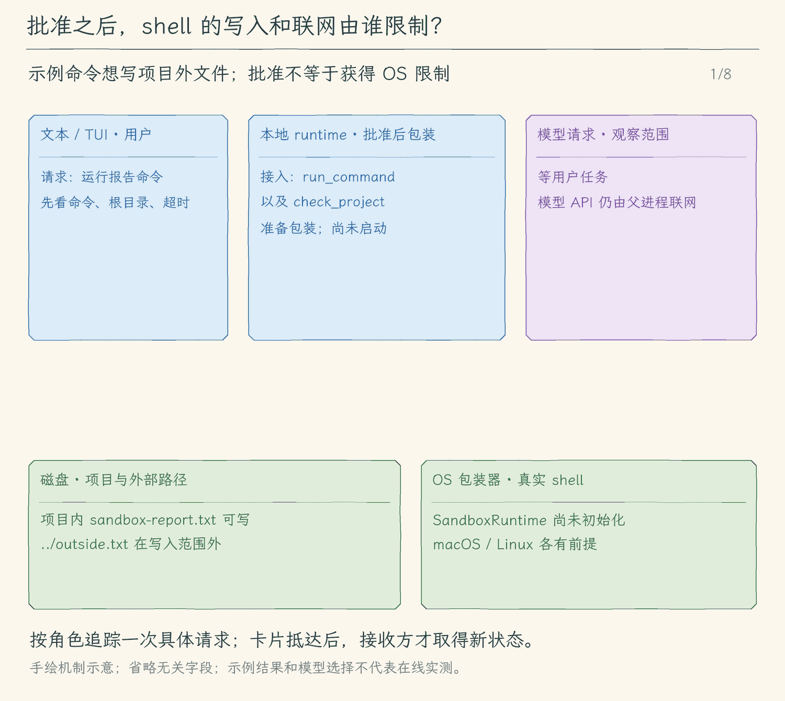

# 33.1 让命令真正进入沙箱

[本章目录](../README.md) · [下一节：连接后台任务](../02-connect-execution/README.md)

## 问题：目录检查管不到命令里的路径

上一章的 `check_project` 能执行项目的测试和类型检查。假设 `package.json` 里有一个测试脚本，它先生成报告，再把报告复制到项目外。即使工具的 `cwd` 是项目根，脚本里的绝对路径仍然能指向其他目录。脚本还可以启动另一个 Node.js 进程，由子进程完成这次写入。

第七章的路径检查仍有用途：它避免模型把启动目录直接选到项目外。用户审批也仍有用途：它让用户先看见要执行什么。但这两步没有改变 shell 的系统权限。只要当前用户能写目标文件，普通 shell 通常也能写。

这一节要得到的结果很具体：项目内的普通输出文件可以生成；项目外的写入、受保护文件的读取和命令进程的网络连接被系统规则拒绝。失败结果继续作为工具消息交给模型，模型据此换用项目内路径或说明阻碍。

## 解决方案：在启动之前装上系统限制

我们使用现成的 [Anthropic Sandbox Runtime](https://github.com/anthropics/sandbox-runtime)。它把文件与网络配置转成系统的隔离启动方式。macOS 底层使用 `sandbox-exec`，Linux 使用 bubblewrap 等组件。应用负责选择规则、检查可用性和管理生命周期，不自己解析 shell 语法来猜测每条命令会访问哪里。

本节先接入等待命令退出的 `run_command`。第 32 章的 `check_project` 复用同一个准备与执行入口，所以也会获得隔离。后台 `start_job` 在下一节接入；此时后台尚未受限，验证本节限制要使用前台入口；下一节补齐这条路径。

## 工作原理

### 从“启动目录”到“每次实际访问”

考虑命令 `printf report > ../outside.txt`。目录检查只检查 shell 启动时的 `cwd`；shell 后来打开 `../outside.txt` 时，并不会再次调用我们的 TypeScript 路径检查。

沙箱规则作用在另一个位置。程序先把项目真实根目录放进写入允许列表，再由运行时生成系统启动命令。shell 以及它启动的普通子进程执行文件操作时，操作系统根据这套规则判断是否允许。因此，命令换成 Python、Node.js 或第二层 shell，也不能仅靠换一种命令写法获得项目外写权限。目录身份复查仍然保留，它处理审批期间目录被替换的问题；系统规则处理进程运行中的访问。

### 规则具体允许什么

我们允许读取普通系统文件，以便 shell、Node.js 和依赖可以启动。读限制列出常见凭据目录，以及项目根的 `.env`、`.env.local`、`.env.production`、`.envrc`、`secrets/` 和 Agent 元数据目录。写限制允许项目根，随后拒绝这些受保护位置以及 `.git/`。这些是明确路径规则，不会识别任意文件里的秘密；例如把密钥另存成 `notes.txt`，不会自动变成受保护文件。

读规则和写规则分别生效。允许写项目，并不表示允许覆盖项目的 `.env`；拒绝读取 `.env`，也不应留下可覆盖它的入口。因此敏感路径同时进入读拒绝与写拒绝列表。规则使用字面路径，目录名里的 `[` 或 `*` 不会被当成模式。

运行时还会加入它自己的默认可写位置：标准输出等设备、`/tmp/claude`（macOS 也有 `/private/tmp/claude`）、`~/.npm/_logs` 和 `~/.claude/debug`。所以准确的承诺是“项目及列明的运行时例外可写”。不能把它说成只允许写项目，更不能把整个 `/tmp` 当成已允许。

Linux 的读拒绝会在包装命令时根据当时存在的路径建立挂载限制。尚不存在的拒绝路径后来创建时，不能据此承诺已隐藏；macOS 的规则与这一机制不同。需要保护的新目录，应先创建并重新启动命令，再跑实际访问实验。本章不会把某个平台的实测结果当成所有平台的证明。

### 网络边界围住谁

配置中的域名允许列表为空，也不提供询问后放行的回调。运行时通过系统网络限制与代理共同阻止命令联网；只修改 `HTTP_PROXY` 环境变量不能绕过系统限制。测试还会使用不经过代理的本地 TCP 连接，确认直接连接也被阻止。

Agent 的父进程仍然要向模型供应商发送请求。它没有被这条 shell 规则包住，模型 API 可以联网。这两个进程属于不同的执行通道，所以“模型能回复”和“命令不能联网”可以同时成立。

### 先包装成功，再允许启动

用户批准后，程序先检查平台与依赖，再初始化运行时。初始化会建立代理等进程级资源。随后，程序用本次项目根生成包装后的命令，交给已有的进程执行器。执行器继续负责最小环境变量、输出上限、超时、取消和进程组收尾。

如果平台不支持、依赖缺失或包装失败，工具抛出明确错误，原始命令根本不会交给 `spawn`。这叫失败时关闭执行入口：程序不能为了“尽量完成任务”改跑未经隔离的原命令。运行时的初始化是整个 Agent 进程共享的一次工作；项目路径则每次包装时单独传入，避免切换工作区时沿用上一个项目的写权限。

正常结束仍以进程退出和输出管道关闭为依据。越界访问通常让命令返回非零退出码，工具保留 stderr，让模型看见被拒绝的操作。用户取消或超时会请求停止并等待现有进程清理；已经写入项目的报告不会自动撤销。沙箱限制副作用范围，进程管理确认结束，这两件事都不等于回滚。

<!-- media:lesson:start -->
同一条真实 shell 命令从审批到 OS 拒绝，再以工具结果进入模型；同时明确哪些通道被接入。



[静态流程图](assets/sandbox-shell-boundary-flow-bae626a74c.png) · [静态封面](assets/sandbox-shell-boundary-cover-0d36a3e65f.png) · [查看完整静态分镜](assets/sandbox-shell-boundary-storyboard-77a8e30941.jpg)
<!-- media:lesson:end -->

## 本节改动文件

| 状态 | 文件 | 本节变化 |
| --- | --- | --- |
| NEW | [src/sandbox/policy.ts](src/sandbox/policy.ts) | 生成本次项目的文件与网络规则 |
| NEW | [src/sandbox/runtime.ts](src/sandbox/runtime.ts) | 检查依赖、共享初始化、包装命令与释放资源 |
| CHANGED | [src/tools/run-command.ts](src/tools/run-command.ts) | 批准后包装，向执行函数传递真实项目根 |
| CHANGED | [src/cli.ts](src/cli.ts) | 退出时在任务结束后关闭运行时 |

## 动手构建

以 32.3 的完整代码和已完成练习为起点，保留其他文件；本节目标目录为 `01-sandbox-runtime/`。

先安装运行时与它的声明依赖，Node.js 采用 22.12 或更新版本：

```bash
npm install --save-exact @anthropic-ai/sandbox-runtime@0.0.79
```

```bash
npm install --save-dev --save-exact @types/node-forge@1.3.14
```

新增规则和适配两个文件。然后整体替换命令工具与 CLI：前者保存真实项目根，在批准后包装；后者保留已有任务和连接清理，在最外层最后释放运行时。以下每个折叠块都是对应文件的完整内容，不需要另找插入点。

### 1. 新增 sandbox/policy.ts

目标文件：[src/sandbox/policy.ts](src/sandbox/policy.ts)。将以下完整内容保存到这个文件。

<!-- build-file: src/sandbox/policy.ts -->
<details>
<summary>sandbox/policy.ts 完整文件</summary>

```typescript
/**
 * 33.1 让命令真正进入沙箱 | [NEW] sandbox/policy.ts
 * 学习目标：把真实项目根转成独立的文件规则，网络默认全部拒绝。
 * 输入：已解析的项目绝对路径；输出：SDK 配置，不启动命令。
 * 本文件局部流程（全局主流程见 agent/agent-loop.ts）：项目根 -> 字面路径列表 -> 本次包装配置。
 * 边界：读取默认允许；列出的秘密路径被拒绝，不扫描任意文件内容或所有嵌套 .env。
 * 写入还有 SDK 自带的设备、临时目录和日志目录例外，诊断时原样列出。
 */
import { homedir } from "node:os";
import { join } from "node:path";
import type { FilesystemPathEntry, SandboxRuntimeConfig } from "@anthropic-ai/sandbox-runtime";

// [NEW 33.1] 项目名中的通配字符必须按字面解释，不能扩大允许范围。
/**
 * 将一个绝对路径标为字面值；规则不把路径里的星号或方括号展开。
 */
function literal(path: string): FilesystemPathEntry { return { path, literal: true }; }

/**
 * 为一条命令建立自己的工作区规则，不修改共享运行时的当前工作区。
 * allowWrite 只加入项目根；denyWrite 优先，阻止覆盖凭据和项目控制文件。
 * read 默认允许以启动系统工具；这些精确位置拒绝读写，不能替代秘密识别。
 */
export function sandboxPolicy(root: string): SandboxRuntimeConfig {
  const home = homedir();
  const protectedPaths = [
    ...[".env", ".env.local", ".env.production", ".envrc", "secrets", ".agents", ".codex", ".hello-my-agent"].map(name => join(root, name)),
    ...[".ssh", ".aws", ".gnupg", ".npmrc", ".config/gcloud"].map(name => join(home, name)),
  ].map(literal);
  return {
    network: { allowedDomains: [], deniedDomains: [], strictAllowlist: true,
      allowUnixSockets: [], allowAllUnixSockets: false, allowLocalBinding: false },
    filesystem: { denyRead: protectedPaths, allowWrite: [literal(root)],
      denyWrite: [...protectedPaths, literal(join(root, ".git"))] },
  };
}
```

</details>

### 2. 新增 sandbox/runtime.ts

目标文件：[src/sandbox/runtime.ts](src/sandbox/runtime.ts)。将以下完整内容保存到这个文件。

<!-- build-file: src/sandbox/runtime.ts -->
<details>
<summary>sandbox/runtime.ts 完整文件</summary>

```typescript
/**
 * 33.1 让命令真正进入沙箱 | [NEW] sandbox/runtime.ts
 * 学习目标：应用只使用现成运行时，包装失败时不执行原命令。
 * 输入：原命令、真实项目根和取消信号；输出：带系统限制的启动字符串。
 * 状态：初始化 Promise 在本进程共享；每次包装单独传文件规则，不切换全局工作区。
 * 本文件局部流程（全局主流程见 agent/agent-loop.ts）：依赖检查 -> 初始化 -> 包装 -> 交回进程执行器。
 * 失败：缺依赖、初始化失败或包装无效均抛 ToolError，没有未隔离的降级分支。
 * 清理：CLI 先等待自有后台任务结束，再 reset 共享代理；不撤销已写入文件。
 */
import { realpath } from "node:fs/promises";
import { SandboxManager, getDefaultWritePaths } from "@anthropic-ai/sandbox-runtime";
import { ToolError } from "../errors.js";
import { sandboxPolicy } from "./policy.js";

// [NEW 33.1] 一次初始化服务多个命令；不在每条命令结束时关闭仍被后台任务使用的代理。
export const sandboxRuntimeVersion = "0.0.79";
let initialization: Promise<void> | undefined;

/**
 * 只检查准备条件，不声称已验证系统限制；不支持平台和依赖错误作为明确失败原因。
 * 当前应用仅接 POSIX 通道，即使 SDK 支持其他平台也不会自动改变应用的进程协议。
 */
export async function sandboxAvailability() {
  const supported = ["darwin", "linux"].includes(process.platform) && SandboxManager.isSupportedPlatform();
  const dependencies = supported ? await SandboxManager.checkDependenciesAsync()
    : { errors: ["本章沙箱执行需要 macOS 或 Linux 的受支持隔离环境。"], warnings: [] };
  return { supported, platform: process.platform, runtime: sandboxRuntimeVersion, ...dependencies,
    defaultWritePaths: getDefaultWritePaths(), initialized: Boolean(initialization) && SandboxManager.isSandboxingEnabled() };
}

/**
 * 首次调用建立 SDK 代理；失败清理后抛错，后续请求可以重新诊断但不会执行原命令。
 * 不绑定单次调用的取消信号，避免一个请求取消时关闭其他调用共享的初始化。
 */
async function ensureSandbox(): Promise<void> {
  if (!initialization) {
    initialization = (async () => {
      const status = await sandboxAvailability();
      if (status.errors.length) throw new ToolError(`隔离不可用：${status.errors.join("；")}。未启动命令。`);
      await SandboxManager.initialize({ network: { allowedDomains: [], deniedDomains: [], strictAllowlist: true },
        filesystem: { denyRead: [], allowWrite: [], denyWrite: [] } });
      if (!SandboxManager.isSandboxingEnabled()) throw new ToolError("隔离运行时未启用，拒绝启动命令。");
    })().catch(async error => {
      try { await SandboxManager.reset(); } finally { initialization = undefined; }
      throw error;
    });
  }
  await initialization;
}

/**
 * 只返回真实包装结果，调用方继续使用原有最小环境、超时、输出和进程清理。
 * 包装前后都检查取消；SDK 返回原命令也视为失败，不能默许未隔离执行。
 */
export async function wrapSandboxCommand(command: string, projectRoot: string, signal?: AbortSignal): Promise<string> {
  signal?.throwIfAborted();
  try {
    const root = await realpath(projectRoot);
    await ensureSandbox();
    signal?.throwIfAborted();
    const wrapped = await SandboxManager.wrapWithSandbox(command, "/bin/sh", sandboxPolicy(root), signal);
    signal?.throwIfAborted();
    if (!SandboxManager.isSandboxingEnabled() || !wrapped.trim() || wrapped === command) {
      throw new ToolError("隔离包装未生效，拒绝启动原命令。");
    }
    return wrapped;
  } catch (error) {
    signal?.throwIfAborted();
    if (error instanceof ToolError) throw error;
    throw new ToolError(`隔离启动准备失败：${error instanceof Error ? error.message : String(error)}。未降级执行。`);
  }
}

/**
 * 仅由已等完自有命令的宿主调用；等待初始化收尾再关闭 SDK 资源。
 */
export async function closeSandbox(): Promise<void> {
  if (!initialization) return;
  try { await initialization; } catch { /* 初始化失败已清理；仍统一结束本次生命周期。 */ }
  await SandboxManager.reset();
  initialization = undefined;
}
```

</details>

### 3. 完整替换 tools/run-command.ts

目标文件：[src/tools/run-command.ts](src/tools/run-command.ts)。将以下完整内容保存到这个文件。

<!-- build-file: src/tools/run-command.ts -->
<details>
<summary>tools/run-command.ts 完整文件</summary>

```typescript
/**
 * 33.1 让命令真正进入沙箱 | [CHANGED] tools/run-command.ts
 *
 * 学习目标：校验命令、目录与期限，准备审批预览并返回真实执行结果。
 * 阅读说明：run_command等待进程结束；本节导出的准备函数供start_job复用参数与目录核对，不改变前台工具语义。
 * 输入：command、cwd、可选 timeout_ms；省略时使用 30000 毫秒。
 * 输出：带命令、目录和时间的预览；批准后返回真实进程结果。
 * 状态：准备失败时没有启动命令；执行后失败或取消可能已有副作用，不自动回滚。
 *
 * 本文件局部流程（全局主流程见 agent/agent-loop.ts）：
 *   JSON -> 检查字段 -> timeout_ms 合法？-- 否 -> ToolError
 *                                      +-- 是 -> 保存 timeoutMs -> 预览
 *   批准 -> 复查目录 -> 系统隔离包装 -> runProcess 等退出与输出 -> 返回结果
 *
 * timeout_ms 必须是 100—60000 之间的整数，不把字符串或 null 自动变成数字。
 * 本次等待时间和命令一起保存，审批后不重新采用默认值，也不保存为会话授权。
 * 时间到达只触发停止过程，仍要等同组清理与管道关闭；它不代表回滚；命令隔离另由本节运行时负责。
 * 观察：100 毫秒的常驻命令提前返回 timeout，省略字段时预览显示 30000。
 */

// [KEEP 来自 07.2] spawn 的生命周期交给共享执行器。
import { wrapSandboxCommand } from "../sandbox/runtime.js";
import { runProcess } from "../processes/run-process.js";
import { realpath, stat } from "node:fs/promises";
import { isAbsolute, relative, resolve, sep, win32 } from "node:path";
import { ToolError } from "../errors.js";
import type { PreparedToolCall, ToolExecutionResult } from "./types.js";
import { findProjectRoot } from "./workspace.js";

// [KEEP 来自 07.1] 命令定义、参数检查和目录复查继续沿用。
export const runCommandDefinition = {
  name: "run_command",
  description: "经用户逐次批准，在指定项目目录执行非交互 shell 命令；返回 stdout、stderr 和退出码。",
  inputSchema: {
    type: "object" as const,
    properties: {
      command: { type: "string" as const, description: "完整 shell 命令，例如 node --test；不能包含密钥。" },
      cwd: { type: "string" as const, description: "相对于项目根的执行目录；项目根传入 .。" },
      // [KEEP 来自第 07 章练习] Schema 告诉模型可选字段及范围，本地还会重新校验。
      timeout_ms: {
        type: "integer" as const,
        minimum: 100,
        maximum: 60_000,
        description: "本次命令最多等待多少毫秒；省略时为 30000，范围 100—60000。",
      },
    },
    required: ["command", "cwd"],
    additionalProperties: false,
  },
};

/**
 * 检查模型是否把命令、目录和本次等待时间说清楚。
 *
 * - 输入：未经信任的 JSON 字符串，只接受 command、cwd 与可选 timeout_ms。
 * - 输出：通过检查的 command、cwd 和 timeoutMs；字符串去掉首尾空白后交给后续准备步骤。
 * - 命令检查：原字符串不超过 4000 个字符，去掉空白后仍有内容，并排除 NUL 等指定控制字符。
 * - 目录检查：不超过 500 个字符的项目相对目录，不接受控制字符、绝对路径或 .. 分段。
 * - 时间检查：省略时使用 30000 毫秒，提供时必须是 100—60000 的整数；不自动转换字符串或 null。
 * - 失败方式：无效参数抛出 ToolError；这里只检查参数，真实目录稍后再查。
 */
// [KEEP 来自第 07 章练习] 返回已校验的等待时间，后面的预览和执行共用它。
export function parseCommandArguments(argumentsJson: string): { command: string; cwd: string; timeoutMs: number } {
  let value: unknown;
  try { value = JSON.parse(argumentsJson); }
  catch { throw new ToolError("run_command 参数不是有效的 JSON。"); }
  if (!value || typeof value !== "object" || Array.isArray(value)) {
    throw new ToolError("run_command 参数必须是对象。");
  }
  const input = value as Record<string, unknown>;
  if (Object.keys(input).some((key) => !["command", "cwd", "timeout_ms"].includes(key))) {
    throw new ToolError("run_command 参数只能包含 command、cwd 和可选 timeout_ms。");
  }
  if (typeof input.command !== "string" || !input.command.trim() || input.command.length > 4000
      || /[\x00\x80-\x9f\u202a-\u202e\u2066-\u2069]/.test(input.command)) {
    throw new ToolError("command 必须是 1—4000 个字符的非空命令，不能包含 NUL 或不可见方向控制字符。");
  }
  if (typeof input.cwd !== "string" || !input.cwd.trim() || input.cwd.length > 500
      || /[\x00-\x1f\x7f-\x9f\u202a-\u202e\u2066-\u2069]/.test(input.cwd) || isAbsolute(input.cwd) || win32.isAbsolute(input.cwd)
      || input.cwd.split(/[\\/]/).includes("..")) {
    throw new ToolError("cwd 必须是项目内的相对目录，不能使用绝对路径或 ..。");
  }
  // [KEEP 来自第 07 章练习] 只在字段未提供时用默认值；null、布尔值和数字字符串都不是有效整数。
  const timeoutMs = input.timeout_ms === undefined ? 30_000 : input.timeout_ms;
  if (typeof timeoutMs !== "number" || !Number.isInteger(timeoutMs)
      || timeoutMs < 100 || timeoutMs > 60_000) {
    throw new ToolError("timeout_ms 必须是 100—60000 之间的整数。" );
  }
  return { command: input.command.trim(), cwd: input.cwd.trim(), timeoutMs };
}

/**
 * 把受控进程的状态和输出整理成模型能够继续使用的结果。
 *
 * - 输入：本次批准的命令、真实 cwd、timeoutMs 和取消信号；进程生命周期交给 runProcess。
 * - 输出：保留 stdout、stderr、退出码、信号与停止原因，供模型和界面各自使用。
 * - 结果判断：退出码不是 0，或时间、输出达到上限时，返回 isError=true，仍保留已经收集的日志。
 * - 失败方式：启动失败抛出 ToolError，由主循环反馈给模型；用户取消则向外传播取消原因并结束本轮。
 * - 职责边界：stderr 有字不能单独证明命令失败，本函数也不会撤销命令已经发生的副作用。
 */
// [KEEP 来自 07.2] 命令和 rg 搜索共用同一个进程执行器。
// [KEEP 来自第 07 章练习] timeoutMs 来自本次审批的准备结果，不在执行时重新决定。
async function executeCommand(
  command: string, cwd: string, signal: AbortSignal, timeoutMs: number, projectRoot: string,
): Promise<ToolExecutionResult> {
  // [CHANGED 33.1] 包装失败直接抛错；原命令没有备用启动分支。
  const wrappedCommand = await wrapSandboxCommand(command, projectRoot, signal);
  const result = await runProcess("/bin/sh", ["-c", wrappedCommand], { cwd, signal, timeoutMs });
  const { exitCode, signal: exitSignal, stdout, stderr, stopReason } = result;
  return {
    isError: exitCode !== 0 || Boolean(stopReason),
    metadata: { kind: "run_command", ...result },
    content: `cwd: ${cwd}\n退出码: ${exitCode ?? "无"}\n信号: ${exitSignal ?? "无"}`
      + `\n停止原因: ${stopReason ?? "命令已退出"}`
      + `\nstdout:\n${stdout || "（空）"}\nstderr:\n${stderr || "（空）"}`,
  };
}

/**
 * 先把本次命令和目录展示清楚，把启动进程留到用户批准之后。
 *
 * - 输入：命令参数、项目根目录和可选取消信号；准备阶段不会启动进程。
 * - 输出：preview 展示命令、真实 cwd 与等待时间，execute 闭包保存同一份已经检查的输入。
 * - 关键步骤：解析参数后确认 cwd 检查时位于项目内，并记录目录的 dev/ino 身份。
 * - 执行检查：批准后复查目录身份，发现变化就抛出 ToolError，否则用保存的 timeoutMs 执行命令。
 * - 职责边界：目录复查处理启动位置；默认执行函数另用项目根包装系统沙箱，二者各负其责。
 */
// [KEEP 来自 26.1] 共享准备允许后台工具复用目录身份复查；默认仍等待 run_command 退出。
export async function prepareRunCommand(
  argumentsJson: string,
  projectRoot = findProjectRoot(),
  signal?: AbortSignal,
  execute: typeof executeCommand = executeCommand,
): Promise<PreparedToolCall> {
  signal?.throwIfAborted();
  if (process.platform === "win32") throw new ToolError("本章命令工具需要 macOS 或 Linux 的 /bin/sh；Windows 请在 WSL 中运行。");
  const input = parseCommandArguments(argumentsJson);
  let cwd: string, root: string;
  try {
    root = await realpath(projectRoot);
    cwd = await realpath(resolve(root, input.cwd));
    const path = relative(root, cwd);
    if (path === ".." || path.startsWith(`..${sep}`) || isAbsolute(path)) {
      throw new ToolError("cwd 的真实位置在项目外。");
    }
  } catch (error) {
    if (error instanceof ToolError) throw error;
    throw new ToolError("cwd 目录不存在或无法访问。");
  }
  const before = await stat(cwd).catch(() => null);
  if (!before || !before.isDirectory()) throw new ToolError("cwd 必须是可访问的目录。");
  signal?.throwIfAborted();
  return {
    // [KEEP 来自第 07 章练习] 用户在启动前也能看到本次等待时间。
    preview: `工作目录：${JSON.stringify(cwd)}\n命令：${JSON.stringify(input.command)}\n最长运行时间（毫秒）：${input.timeoutMs}\n${execute === executeCommand ? "隔离：批准后使用真实运行时；项目及运行时例外可写，命令网络禁止。" : "启动方式由调用方执行入口决定。"}\n只批准这一次执行。`,
    async execute(executionSignal) {
      executionSignal.throwIfAborted();
      const current = await stat(cwd).catch(() => null);
      if (!current || current.dev !== before.dev || current.ino !== before.ino) {
        throw new ToolError("工作目录在等待审批期间发生了变化，请重新请求执行。");
      }
      return execute(input.command, cwd, executionSignal, input.timeoutMs, root);
    },
  };
}
```

</details>

### 4. 完整替换 cli.ts

目标文件：[src/cli.ts](src/cli.ts)。将以下完整内容保存到这个文件。

<!-- build-file: src/cli.ts -->
<details>
<summary>cli.ts 完整文件</summary>

```typescript
#!/usr/bin/env node
/**
 * 33.1 让命令真正进入沙箱 | [CHANGED] cli.ts
 *
 * 学习目标：保留原有 CLI 装配与本地管理，所有自有任务结束后释放共享隔离资源。
 * 输入：命令行模型选项、--prompt 与 --output；输出格式默认是 auto。
 * 输出：装配模型后选择一个消费者；入口错误由 stderr 说明并设置 exitCode=1。
 * 状态：入口不持有消息历史或授权；只创建 writer，消费者提供白名单快照。
 *
 * 本文件局部流程（全局主流程见 agent/agent-loop.ts）：
 *   [KEEP 来自 30.1] argv[2]=schedule？-- 是 -> 独立定时管理 -> 结束；否 -> 普通聊天入口
 *   显式网页/搜索选项且非 Plan？-- 是 -> 完整校验本地配置 -> 创建 WebState；否 -> 不启用网页
 *   配置失败 -> 启动错误；配置成功只装配工具，不提前抓取或查询
 *   [KEEP 来自 18.1] --memory -> 检查混用和模式 -> 找真实项目根 -> 本地管理 -> 结束
 *   [KEEP 来自 19.1] 正常启动 -> 同根discoverSkills -> 只把名称/用途交给模型和启动信息
 *   --help / --version -> 显示文字 -> 结束；--doctor -> 显示环境 -> 结束
 *   [KEEP] 输出格式受支持？-- 否 -> 抛出 UserFacingError
 *                            +-- 是 -> 继续检查运行方式
 *   [KEEP] auto？-- 是 -> 无 --prompt 且 stdin/stdout 为 TTY、TERM 非 dumb？
 *                     是 -> tui；否 -> text
 *                +-- 否 -> 保留显式选择
 *   tui？-- 是 -> stdin/stdout 为 TTY、TERM 非 dumb，且没有 --prompt？
 *                否 -> 抛错；是 -> 读取配置、创建模型 -> 动态载入 app -> startTui
 *        +-- 否 -> jsonl 但缺少 --prompt？-- 是 -> 抛错
 *                                          +-- 否 -> 读取配置、创建模型
 *   [KEEP 来自 13.1] text / tui -> 创建新会话文件、显示 ID 和路径 -> 消费者 -> finally close
 *   非 TUI 分支 -> 无 --prompt？-- 是 -> startTerminal
 *                              +-- 否 -> 内容为空？-- 是 -> 抛错
 *                                                  +-- 否 -> jsonl / text 单次消费者
 *   运行抛错 -> explainError -> stderr、exit 1；单次用户取消由消费者设 exit 130
 *
 * auto 在没有 --prompt、stdin/stdout 都是 TTY 且 TERM 不是 dumb 时选择 tui，其余选择 text。
 * TUI 只接受连续输入，单次任务继续用 text 或 jsonl；JSONL 必须同时给 --prompt。
 * 动态 import 只在 tui 分支载入 React / Ink，脚本模式不需要初始化终端界面。
 * --help、--version 和 --doctor 不读取模型配置；界面选择不改变模型、工具或权限协议。
 *
 * [KEEP 来自 12.1] --mode plan|execute 在创建模型前校验，再传给每种消费者。
 * [KEEP 来自 12.2] 非 TUI 入口为当前会话准备共用清单；TUI 在 startTui 内创建自己的清单。
 * 运行观察：直接在交互终端启动会进入 TUI；单次提问、管道和 dumb 终端仍走 text。
 */
// [KEEP 来自 31.3] 无需密钥的管理入口及显式启动、退出收尾。


// [KEEP 来自 18.1] 本地记忆动作在模型配置与会话创建前完成。
// [KEEP 来自 20.1] 项目脚本必须由本次启动显式启用。
// [KEEP 来自 21.1] 显式配置授权启动服务，退出始终关闭本次连接。
// [KEEP 来自 22.1] 网络开关不读取网页或会话里的指令。
import { closeSandbox } from "./sandbox/runtime.js";
import { runCodeCommand } from "./code-command.js";
import { loadWeb } from "./web/client.js";
import { runScheduleCommand } from "./schedules/commands.js";
import { ExtensionManager } from "./extensions/manager.js";
import { extensionCommand } from "./extensions/commands.js";
import { connectMcp, mcpInfo } from "./mcp/client.js";
import { loadHooks } from "./hooks/lifecycle.js";
// [KEEP 来自 19.1] 固定项目目录发现元信息，不加载正文。
import { discoverSkills, skillInfo } from "./skills/catalog.js";
import { createMemoryController, memoryCommand } from "./memory/commands.js";
import { findProjectRoot } from "./project/instructions.js";
import { dirname } from "node:path";
// [KEEP 来自 17.1] 启动时完成项目说明快照，进入模型与界面前只读一次。
import { loadProjectInstructions, projectInstructionInfo } from "./project/instructions.js";
import { createFileCheckpointStore } from "./sessions/file-checkpoints.js";
import { readFileSync } from "node:fs";
// [KEEP 来自 13.3] 使用真实目录比较工作区，符号链接别名不会误判成另一个项目。
import { forkSessionWriter } from "./sessions/fork-session.js";
import { realpath } from "node:fs/promises";
import { Command } from "commander";
import { readConfig, type Options } from "./config/load-config.js";
import { createModel } from "./models/client.js";
import type { ExecutionMode, RunOptions } from "./agent/run-options.js";
// [KEEP 来自 09.3] 机器输出也调用相同的 Agent 事件流。
import { runJsonlPrompt } from "./ui/jsonl.js";
import { runSinglePrompt, startTerminal } from "./ui/terminal.js";
import { UserFacingError, explainError } from "./errors.js";
// [KEEP 来自 13.1] 入口创建并最终关闭 writer，模型配置不进入存储模块。
import { createSessionWriter, resumeSessionWriter } from "./sessions/save-session.js";
// [KEEP 来自 13.4] 本地管理复用读取与写入协议，无需模型配置。
import { listSessions, renameSession, exportSession } from "./sessions/manage-sessions.js";

// [KEEP 第 01 章] 构建产物始终是 dist/cli.js，因此从它的上一级读取 package.json。
const packageJson = JSON.parse(readFileSync(new URL("../package.json", import.meta.url), "utf8"));

// [KEEP 来自第 01 章练习] 环境诊断不读取模型配置，也不会发送模型请求。
/**
 * 显示当前 Node.js 进程的最小诊断信息，不读取模型配置。
 *
 * - 输入：无显式参数；版本、平台、架构和工作目录都来自 Node.js 的 `process`。
 * - 输出：向终端依次打印 Node、Platform 和 Working directory 三行文本。
 * - 关键原因：诊断发生在 `readConfig()` 之前，因此缺少 API Key 时也能运行。
 * - 职责边界：不读取 `.env`，不创建模型客户端，也不发送网络请求。
 */
function printDoctor(): void {
  console.log(`Node: ${process.version}`);
  console.log(`Platform: ${process.platform} ${process.arch}`);
  console.log(`Working directory: ${process.cwd()}`);
}
// [KEEP 来自 09.3] output 只供入口选择消费者，不并入模型连接配置。
// [KEEP 来自 13.1] 会话目录只属于本地持久化，不属于模型配置。
type CliOptions = Options & { extension?: string[]; enableExtension?: string[]; enableProjectHooks?: boolean; mcpConfig?: string; mcpInfo?: boolean; enableWeb?: boolean; webSearchConfig?: string;  memory?: string; projectInfo?: boolean; prompt?: string; doctor?: boolean; output?: string; mode?: string; sessionDir?: string; resume?: string; recover?: boolean; sessions?: boolean; search?: string; rename?: string; name?: string; export?: string; exportTo?: string; fork?: string };
const program = new Command();
program
  // [KEEP 第 01 章] 帮助、版本无需配置模型，也不会发送请求。
  .name("hello-my-agent")
  .description("你好，我的 Agent：从 0 到 npm 发布")
  .version(packageJson.version, "-v, --version", "显示版本号")
  .helpOption("-h, --help", "显示帮助")
  // [KEEP 来自第 01 章练习] --doctor 在读取模型配置前结束，因此没有 API Key 也能使用。
  // [KEEP 来自 20.1] 仅这次启动授权项目生命周期脚本；恢复会话不恢复启用状态。
  // [KEEP 来自 21.1] 不自动读取仓库中的MCP启动命令。
  // [KEEP 来自 22.1] 启用仅注册，真正GET仍逐次审批。
  // [KEEP 来自 22.2] 提供配置也明确启用网页工具；无提供方不注册web_search。
  .option("--web-search-config <path>", "配置JSON GET搜索提供方(endpoint/queryParam/tokenEnv)")
  .option("--enable-web", "明确启用逐次审批的网页抓取工具")
  .option("--extension <command...>", "本地扩展管理：list/install/diagnose/uninstall，无需模型密钥")
  .option("--enable-extension <id...>", "仅本进程明确启用列出的已安装扩展；可能启动脚本和服务")
  .option("--mcp-config <path>", "明确启用指定MCP配置（会启动或连接其中的服务）")
  .option("--mcp-info", "连接、发现并诊断指定MCP配置后退出，无需模型密钥")
  .option("--enable-project-hooks", "明确启用项目 .hello-my-agent/hooks.json 中的脚本")
  .option("--doctor", "显示当前运行环境")
  // [KEEP 来自 17.3] 本地检查在读取模型配置和创建会话之前完成。
  .option("--project-info", "显示项目说明来源、范围、版本和加载预算")
  // [KEEP 来自 18.1] 显式管理命令无需API Key。
  .option("--memory <command>", "本地项目记忆：list、show <id>、add <正文>、edit <id> <正文>、invalidate <id> <理由>、delete <id>")
  // [KEEP 来自 02.1] 允许本次启动覆盖模型和基础地址，不在参数中传密钥。
  .option("--model <id>", "本次使用的模型 ID")
  .option("--base-url <url>", "本次使用的接口基础地址")
  // [KEEP 来自 02.2] 单次提问；02.4 增加连续输入后仍保留此用法。
  .option("--prompt <text>", "提问一次后退出")
  // [KEEP 来自 02.5] 本次启动选择接口协议。
  .option("--provider <type>", "接口协议：openai 或 anthropic")
  // [KEEP 来自 10.4] 默认值改为 auto；显式 text、tui、jsonl 仍由用户选择。
  .option("--output <format>", "输出格式：auto、tui、text 或 jsonl", "auto")
  // [KEEP 来自 12.1] 增加启动模式选项，默认 execute。
  .option("--mode <mode>", "模式：plan 或 execute（新会话默认 execute，恢复沿用已保存模式）")
  // [KEEP 来自 13.1] text / tui 保存新会话；JSONL 机器事件流暂不接入。
  .option("--session-dir <path>", "text / tui 的会话保存目录（默认 ~/.hello-my-agent/sessions）")
  // [KEEP 来自 13.3] 恢复需要明确 ID；恢复中断需再明确 --recover。
  // [KEEP 来自 14.1] fork 创建新身份；resume 继续旧身份。
  .option("--fork <id>", "从指定会话的最后完整状态创建新分支，不重放工具")
  .option("--resume <id>", "恢复指定会话，等待新输入；不重放旧工具")
  .option("--recover", "确认恢复已中断会话或清理已失效的进程锁")
  // [KEEP 来自 13.4] 显式管理动作在读取模型配置前完成。
  .option("--sessions", "列出本地会话，可配合 --search")
  .option("--search <text>", "在会话 ID、名称、工作区和已保存消息中搜索")
  .option("--rename <id>", "给指定会话追加名称，需要 --name")
  .option("--name <text>", "会话名称，1—80 个字符")
  .option("--export <id>", "将指定会话导出为 Markdown，默认输出到 stdout")
  .option("--export-to <path>", "导出到一个尚不存在的文件，需要 --export")
  // [KEEP 来自 09.3] 默认动作先检查输出约定，再装配模型并选择对应消费者。
  .action(async () => {
    const options = program.opts<CliOptions>();
    // [KEEP 来自 18.1] 管理动作拒绝混用提问、会话和连接选项；Plan只可查询。
    if (options.memory !== undefined) {
      if (options.prompt !== undefined || options.projectInfo || options.doctor || options.model !== undefined || options.baseUrl !== undefined
        || options.provider !== undefined || options.output !== "auto" || options.sessionDir !== undefined || options.resume !== undefined || options.recover
        || options.fork !== undefined || options.sessions || options.search !== undefined || options.rename !== undefined || options.name !== undefined
        || options.export !== undefined || options.exportTo !== undefined) throw new UserFacingError("--memory请单独使用，可配合--mode plan查询。");
      if (!["execute", "plan"].includes(options.mode ?? "execute")) throw new UserFacingError("--mode只能是plan或execute。");
      console.log(await memoryCommand(findProjectRoot(), options.memory, options.mode as ExecutionMode | undefined));
      return;
    }
    // [KEEP 来自 17.3] 本地检查是单独动作，拒绝会让用户误以为发送了任务的选项组合。
    if (options.projectInfo) {
      if (options.prompt !== undefined || options.doctor || options.model !== undefined || options.baseUrl !== undefined
        || options.provider !== undefined || options.mode !== undefined || options.output !== "auto"
        || options.sessionDir !== undefined || options.resume !== undefined || options.recover || options.fork !== undefined
        || options.sessions || options.search !== undefined || options.rename !== undefined || options.name !== undefined
        || options.export !== undefined || options.exportTo !== undefined) throw new UserFacingError("--project-info 请单独使用，不与提问、模型、模式、会话或输出选项混用。 ");
      const project = await loadProjectInstructions();
      for (const line of projectInstructionInfo(project)) console.log(line);
      return;
    }
    // [KEEP 来自 13.4] 先排除含糊组合，再执行一个本地动作；没有 API Key 也可以管理。
    const management = Number(Boolean(options.sessions)) + Number(options.rename !== undefined) + Number(options.export !== undefined);
    if (management > 1) throw new UserFacingError("--sessions、--rename、--export 每次只能选择一个。");
    if (options.search !== undefined && !options.sessions) throw new UserFacingError("--search 必须与 --sessions 一起使用。");
    if (options.name !== undefined && options.rename === undefined) throw new UserFacingError("--name 必须与 --rename <id> 一起使用。");
    if (options.exportTo !== undefined && options.export === undefined) throw new UserFacingError("--export-to 必须与 --export <id> 一起使用。");
    if (options.sessionDir !== undefined && !options.sessionDir.trim()) throw new UserFacingError("--session-dir 不能为空。");
    if (management) {
      if (options.fork !== undefined || options.resume !== undefined || options.recover || options.prompt !== undefined || options.doctor
        || options.mode !== undefined || options.model !== undefined || options.provider !== undefined || options.baseUrl !== undefined || options.output !== "auto") {
        throw new UserFacingError("本地会话管理请单独使用，不与恢复、提问、模型或输出模式选项混用。");
      }
      if (options.sessions) {
        const result = await listSessions(options.sessionDir, options.search);
        for (const warning of result.warnings) console.error(`会话提示：${warning}`);
        if (!result.sessions.length) console.log("没有匹配的本地会话。");
        for (const session of result.sessions) console.log(`${session.id}  ${session.name}\n  ${session.updatedAt} · ${session.messages} 条消息 · ${session.pending} 条待交付${session.interrupted ? " · 上次中断" : ""}\n  ${session.cwd}`);
      } else if (options.rename !== undefined) {
        if (options.name === undefined) throw new UserFacingError("--rename <id> 需要 --name <text>。");
        const seq = await renameSession(options.rename, options.name, options.sessionDir);
        console.log(`名称已保存：${options.rename} · 第 ${seq} 条记录。`);
      } else {
        const markdown = await exportSession(options.export!, options.sessionDir, options.exportTo);
        if (options.exportTo === undefined) process.stdout.write(markdown);
        else console.log(`已导出：${options.exportTo}`);
      }
      return;
    }
    // [KEEP 来自 21.1] 本地诊断在readConfig前完成，不需要模型凭据。
    if (options.mcpInfo) {
      if (!options.mcpConfig) throw new UserFacingError("--mcp-info 需要 --mcp-config <path>。");
      const mcp = await connectConfiguredMcp(options.mcpConfig, findProjectRoot());
      try { for (const line of mcpInfo(mcp)) console.log(line); } finally { await mcp?.close(); }
      return;
    }
    // [KEEP 来自 31.1] 本地安装与诊断无需模型凭据，完成后一定关闭管理器。
    if (options.extension) {
      if (options.enableExtension || options.prompt || options.resume || options.fork || options.mcpConfig || options.enableProjectHooks) throw new UserFacingError("--extension 不与运行或其他能力启用参数混用。");
      if (!["plan", "execute"].includes(options.mode ?? "execute")) throw new UserFacingError("--mode 只能是 plan 或 execute。");
      if (options.extension[0] === "enable") throw new UserFacingError("独立管理命令不保留进程；请用 --enable-extension <id...> 启动，或在会话中 /extension enable <id>。");
      const root = findProjectRoot(), manager = new ExtensionManager(root, await discoverSkills(root));
      const controller = new AbortController(), cancel = () => controller.abort(new UserFacingError("扩展操作已取消。"));
      process.once("SIGINT", cancel);
      try { console.log(await extensionCommand(options.extension, manager, options.mode ?? "execute", controller.signal)); }
      finally { process.removeListener("SIGINT", cancel); await manager.close(); }
      return;
    }
    if (options.doctor) {
      printDoctor();
      return;
    }
    // [KEEP 来自 12.1] 创建模型前检查模式，非法值不会启动任务。
    if (!["plan", "execute"].includes(options.mode ?? "execute")) throw new UserFacingError("--mode 只能是 plan 或 execute。");
    let mode: ExecutionMode = options.mode === "plan" ? "plan" : "execute";
    // [KEEP 来自 12.1] 把启动模式传到 text、JSONL 和连续会话入口。
    // [KEEP 来自 12.2] 非 TUI 入口创建共用清单；TUI 在自己的会话内创建。
    const runOptions: RunOptions = { mode, tasks: { items: [] } };
    // [KEEP 来自 10.4] 校验允许 auto，下一步再把它解析成具体消费者。
    if (!["auto", "tui", "text", "jsonl"].includes(options.output ?? "auto")) throw new UserFacingError("--output 只能是 auto、tui、text 或 jsonl。");
    // [KEEP 来自 10.4] 只在真实终端的连续会话中自动选择 TUI；--prompt 和管道默认仍用文本。
    if (options.output === "auto") options.output = options.prompt === undefined
      && process.stdin.isTTY && process.stdout.isTTY && process.env.TERM !== "dumb" ? "tui" : "text";
    // [KEEP 来自 10.1] 只有真实终端才能把按键交给 Ink；单次问题继续使用已有输出模式。
    if (options.output === "tui" && (!process.stdin.isTTY || !process.stdout.isTTY || process.env.TERM === "dumb")) {
      throw new UserFacingError("TUI 需要交互终端，请使用 --output text 或 --output jsonl --prompt 提问。");
    }
    if (options.output === "tui" && options.prompt !== undefined) throw new UserFacingError("TUI 使用连续输入；单次提问请使用 --output text 或 jsonl。");
    if (options.output === "jsonl" && options.prompt === undefined) throw new UserFacingError("JSONL 模式需要 --prompt 提供一次任务。");
    // [KEEP 来自 13.1] 在创建模型和文件前拒绝不支持的组合与空问题。
    if (options.output === "jsonl" && options.sessionDir !== undefined) throw new UserFacingError("--session-dir 只支持 text 或 tui；JSONL 机器输出暂不保存会话。");
    if (options.recover && options.resume === undefined) throw new UserFacingError("--recover 必须与 --resume <id> 一起使用。");
    if (options.resume !== undefined && options.output === "jsonl") throw new UserFacingError("会话恢复只支持 text 或 tui。");
    if (options.sessionDir !== undefined && !options.sessionDir.trim()) throw new UserFacingError("--session-dir 不能为空。");
    if (options.prompt !== undefined && !options.prompt.trim()) throw new UserFacingError("提问内容不能为空。");
    // [KEEP 来自 14.1] 含糊组合在创建模型或新文件之前拒绝。
    if (options.fork !== undefined && (options.resume !== undefined || options.recover || options.output === "jsonl")) throw new UserFacingError("--fork 不与 --resume、--recover 或 JSONL 混用。");
    // [KEEP 来自 17.1] 不改 cwd，不把项目说明当作审批或脚本运行入口。
    if (options.enableExtension?.length && (mode === "plan" || options.resume || options.fork)) throw new UserFacingError("启动启用扩展仅支持新的execute会话；恢复后请在本地明确启用。");
    const project = await loadProjectInstructions();
    const config = readConfig(options);
    // [KEEP 来自 18.1] 初始记忆供界面估算，正式任务开始时会重新加载并冻结。
    const memory = await createMemoryController(project.root);
    const skills = await discoverSkills(project.root);
    // [KEEP 来自 20.1] Plan不读取/运行钩子；执行模式没有显式开关也不读取。
    const hooks = await loadHooks(project.root, Boolean(options.enableProjectHooks) && mode !== "plan");
    // [KEEP 来自 21.1] Plan不启动本地服务；恢复与新启动都必须再次显式选择。
    const mcp = mode === "plan" ? undefined : await connectConfiguredMcp(options.mcpConfig, project.root);
    const extensions = new ExtensionManager(project.root, skills, hooks, mcp);
    let model: ReturnType<typeof createModel> | undefined;
    try {
    // [KEEP 来自 31.2] 启动显式启用也接收Ctrl+C；只在资源收尾后离开初始化阶段。
    const extensionAbort = new AbortController(), cancelExtension = () => extensionAbort.abort(new UserFacingError("扩展初始化已取消。"));
    process.once("SIGINT", cancelExtension);
    try { for (const id of options.enableExtension ?? []) console.error(await extensions.enable(id, mode, extensionAbort.signal)); }
    finally { process.removeListener("SIGINT", cancelExtension); }
    const web = mode === "plan" ? undefined : await loadWeb(Boolean(options.enableWeb), options.webSearchConfig);
    model = createModel(config, project, memory, skills, extensions.hooks, extensions.mcp, web, extensions);
    for (const line of mcpInfo(model.mcp)) console.error(line);
    for (const line of skillInfo(skills)) console.error(line);
    for (const line of projectInstructionInfo(project)) console.error(line);
    // [KEEP 来自 13.1] JSONL 仍只输出机器事件；其余入口共用一次 writer 生命周期。
    if (options.output === "jsonl") {
      await runJsonlPrompt(model, options.prompt!, runOptions);
      return;
    }
    // [KEEP 来自 14.1] 新分支复制来源数据，随后所有检查点只写新文件。
    const writer = options.fork !== undefined
      ? await forkSessionWriter(options.fork, options.sessionDir)
      : options.resume !== undefined
      ? await resumeSessionWriter(options.resume, options.sessionDir, options.recover)
      : await createSessionWriter(options.sessionDir);
    // [KEEP 来自 14.2] 文件恢复数据与会话同属一个身份，分支自动使用新的目录。
    runOptions.fileCheckpoints = createFileCheckpointStore(writer.id, dirname(writer.path));
    console.error(`会话 ID：${writer.id}\n保存文件：${writer.path}`);
    try {
      // [KEEP 来自 13.3] 采用拿锁后重读的快照；任何失败都会走 finally 释放本进程的锁。
      const restored = writer.restored;
      const initial = restored?.state;
      if (restored) {
        const workspace = restored.header.workspace ?? await realpath(restored.header.cwd);
        if (workspace !== await realpath(process.cwd())) throw new UserFacingError(`工作区不同：请先进入 ${restored.header.cwd} 再恢复，当前目录不会执行旧任务。`);
        for (const warning of restored.warnings) console.error(`恢复提示：${warning}`);
        console.error(`已恢复 ${initial?.messages.length ?? 0} 条消息；等待新要求，不重放旧工具；本进程权限需重新确认。`);
        if (initial?.pendingInputs.length) console.error(`保留 ${initial.pendingInputs.length} 条旧补充；不会自动交给新任务，请在 TUI 队列中明确选择发送。`);
      }
      mode = (options.mode ?? initial?.mode ?? "execute") as ExecutionMode;
      runOptions.mode = mode;
      if (options.prompt === undefined) {
        // [KEEP 来自 10.1] 选择 TUI 时才载入 React / Ink，不让脚本模式初始化界面。
        if (options.output === "tui") {
          const { startTui } = await import("./ui/tui/app.js");
          // [KEEP 来自 13.1] 会话 writer 与启动模式一起交给 TUI，授权仍由 TUI 保存在内存。
          await startTui(model, mode, writer, initial, runOptions.fileCheckpoints);
        } else await startTerminal(model, runOptions, writer, initial);
      } else await runSinglePrompt(model, options.prompt, runOptions, writer, initial);
    } finally {
      // [KEEP 来自 13.1] 消费者先等任务和最后检查点；即使保存失败，这里仍关闭句柄。
      await writer.close();
    }
    // [KEEP 来自 26.1] 退出等待自有作业清理；即使close失败也关闭MCP。
    } finally { try { await model?.jobs?.close(); } finally { try { await model?.languageService?.close(); } finally { try { await extensions.close(); } finally { await mcp?.close(); } } } }
  });

// [KEEP 来自 02.2] 请求返回 Promise，parseAsync 会等待默认操作结束。
try {
  // [KEEP 来自 30.3] schedule动作结束后不再进入普通聊天入口。
  if (process.argv[2] === "code") await runCodeCommand(process.argv.slice(3));
  else if (process.argv[2] === "schedule") await runScheduleCommand(process.argv.slice(3));
  else await program.parseAsync();
} catch (error) {
  console.error(`错误：${explainError(error)}`);
  process.exitCode = 1;
} finally {
  // [CHANGED 33.1] parseAsync 已等待各入口和自有作业收尾，最后释放共享隔离资源。
  try { await closeSandbox(); }
  catch (error) { console.error(`隔离清理失败：${explainError(error)}`); process.exitCode = 1; }
}

/**
 * [KEEP 来自 21.1] 让启动时的 Ctrl+C 也能停止正在建立的 MCP 连接。
 * 输入是本地配置路径与已确定的项目根；取消信号交给连接器，等待它关闭已启动的服务。
 * 无论连接成功、失败还是取消，最后都移除本次 SIGINT 监听，避免影响之后的任务。
 */
async function connectConfiguredMcp(path: string | undefined, root: string) {
  const controller = new AbortController();
  const cancel = () => controller.abort(new UserFacingError("MCP初始化已取消。"));
  process.once("SIGINT", cancel);
  try { return await connectMcp(path, root, controller.signal); }
  finally { process.removeListener("SIGINT", cancel); }
}
```

</details>

## 运行验证

在配套仓库根目录选择本节快照，安装依赖、编译并注册命令：

```bash
npm run lesson:33.1
```

构建成功后，另行启动交互：

```bash
hello-my-agent --mode execute
```

先请求“执行 `printf report > sandbox-report.txt`”，查看审批中的命令、目录与最长时间，批准后检查文件确实生成。再请求写入项目外一个自己创建的临时目录，批准后应看到 `Operation not permitted` 或相应拒绝错误，外部文件不存在。不要拿真实凭据做实验；项目 `.env` 只放 `FAKE_SECRET=teaching-only`，请求读取时应失败，模型得到的工具结果不应包含这个值。

项目检查也要实测：给临时项目的测试脚本加入一次向外部临时目录写文件的操作，运行 `check_project` 后核对该文件不存在。只测试 `run_command`，不能证明继承来的检查入口也已接上限制。

## 本节完成后的 Agent

前台 shell 与项目检查现在经过真实运行时。模型仍然提出命令，用户仍然逐次批准；批准后的进程才带着固定规则启动。工具继续返回真实退出状态和输出，拒绝结果进入下一轮模型决策。下一节把同一约束接到后台进程的 pipe 和 PTY 两种传输方式。
