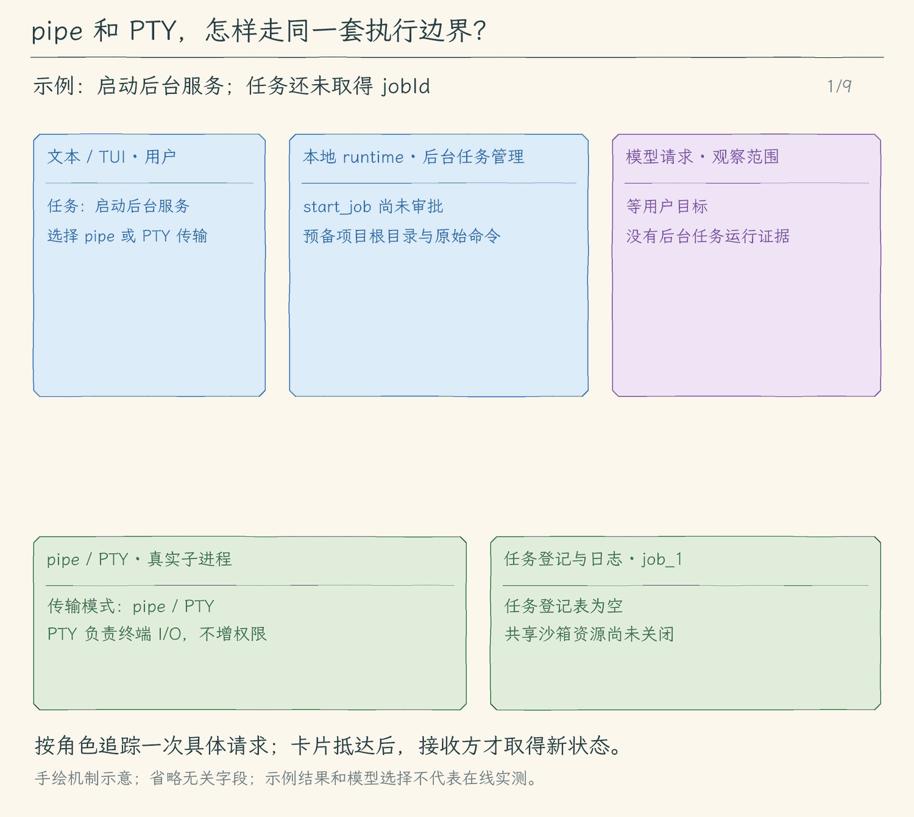

# 33.2 把隔离接到审批、工作区与后台任务

[上一节：让命令进入沙箱](../01-sandbox-runtime/README.md) · [本章目录](../README.md) · [下一节：诊断与边界实验](../03-diagnose-boundaries/README.md)

## 问题：后台进程有另一条启动路径

前台命令已经进入沙箱。不过，第 26 章的 `start_job` 会让任务留在后台，第 27 章还支持 PTY，以便进程看见真实终端。它们最终由后台任务管理器启动，不经过前台命令的输出收集函数。

假设模型请求启动一个开发脚本。用户批准之后，脚本先打印 `READY`，再启动子进程向项目外写文件。如果只修改了 `run_command`，这条后台路径仍然保留普通进程权限。工具名称相似、参数共用，并不表示它们最后启动的是同一个进程入口。

这一节让 pipe 与 PTY 后台命令都在真实隔离中启动，同时保留原来的任务编号、就绪判断、交互输入、日志、超时和停止流程。

## 解决方案：共用准备规则，在真正启动处包装

审批预览继续显示用户能读懂的原始命令。程序把真实项目根随这次准备结果传下去；后台任务管理器使用它生成包装命令，再交给既有传输层。保存到任务记录里的仍然是原始命令，系统包装字符串只负责启动，不出现在模型需要理解的任务说明里。

PTY 改变终端输入输出的传输方式，不授予额外文件或网络权限。它也应启动包装后的 shell。这样，前台、后台管道和后台终端共享隔离规则，而各自保留原来的完成判断。

## 工作原理

### 工作区根和工作目录分别负责什么

工作区根确定本次命令可写的项目范围，`cwd` 决定命令从项目内哪个目录开始。例如当前项目是 `/work/app-a`，命令从 `packages/web` 开始，写入允许范围仍是 `/work/app-a`，而不是所有工作区，也不是上次选择的 `/work/app-b`。

准备阶段把这两个真实路径保存起来。用户批准后，程序复查启动目录身份，再由任务管理器包装本次命令。SDK 的共享初始化不能保存一个不断改写的“当前项目”；否则 A 项目任务仍在运行时，切换到 B 项目可能让后续命令误用另一套目录权限。我们只共享空网络允许列表等进程级资源，每次包装都传入自己的文件规则。

直接调用任务管理器时也必须包装。它没有收到单独项目根时，以自己的真实 `cwd` 为写入根。这种默认值收窄写入范围，不会退回普通 shell。通过 Agent 发起的任务会带上准备阶段已经确认的真实项目根。

### 从批准到任务编号

用户拒绝时，闭包不执行，运行时不会为这次请求启动命令。用户批准后，任务管理器先完成包装，再检查取消信号和容量，最后启动传输层并登记任务。包装失败不能留下一个看似正在运行的任务编号，也不能把原命令交给传输层重试。

包装是异步工作。等待期间可能有另一个任务占满并发槽，或用户已经退出。任务管理器在包装完成后重新检查这些状态，避免根据过时的容量判断继续启动。

前台工具等待整个进程结束才返回。`start_job` 则在任务登记成功后返回任务编号；这只说明任务已开始，不说明命令成功。收到匹配的 `ready_text` 也只改变“服务是否就绪”的字段。最终退出码仍由传输层的退出通知写入任务记录，模型需要读取任务状态和日志才能判断结果。

### PTY 能交互，网络仍被禁止

在 PTY 中运行的程序可以检测到终端，接受后续输入，改变提示符或行缓冲方式。这些变化发生在输入输出通道上。文件打开和 TCP 连接仍由同一套系统限制判断。

验证时不能只看包装字符串中有没有 `sandbox-exec`。我们分别用 pipe 与 PTY 启动真实进程，让它尝试向同一个项目外临时目录写文件；两种方式都应返回非零状态，并且目标文件不存在。再启动一个正常的终端读取程序，输入一行后看到回应，才能同时确认隔离和原有交互能力没有脱节。

### 停止与清理沿用原来的完成依据

后台任务的超时、用户停止和应用退出仍使用原有进程组停止流程：先请求终止，等待退出通知，再更新状态。没有收到退出确认时，不能因为已经发送信号就宣称任务完成。任务在被停止前已经写入的项目文件会保留，后续需要通过 diff 或文件内容核对。

共享沙箱运行时在所有后台任务结束后释放。不能每完成一条前台命令就 `reset()`，因为它可能关闭另一个后台任务仍在使用的代理。运行时资源释放也不会回滚命令执行期间生成的文件。

<!-- media:lesson:start -->
启动和结束使用不同证据：同一包装器覆盖 pipe 与 PTY，模型先收到启动结果，再读真实退出状态。



[静态流程图](assets/sandbox-job-transports-flow-514213df7b.png) · [静态封面](assets/sandbox-job-transports-cover-c348c44634.png) · [查看完整静态分镜](assets/sandbox-job-transports-storyboard-3ef3cdbe7a.jpg)
<!-- media:lesson:end -->

## 本节改动文件

| 状态 | 文件 | 本节变化 |
| --- | --- | --- |
| CHANGED | [src/tools/job-tools.ts](src/tools/job-tools.ts) | 把本次准备结果中的项目根传给任务管理器 |
| CHANGED | [src/processes/jobs.ts](src/processes/jobs.ts) | 启动 pipe 或 PTY 前统一包装，异步等待后重新检查状态 |

## 动手构建

以 33.1 的完整代码和已完成练习为起点，保留其他文件；本节目标目录为 `02-connect-execution/`。

整体替换下面两个已有文件。工具准备层把本次真实项目根传为 `sandboxRoot`；任务管理器在 pipe 与 PTY 的共同启动处完成包装，异步等待后复查取消、关闭与容量。任务快照仍保存原始命令，输出与退出处理保持原有语义。

### 1. 完整替换 tools/job-tools.ts

目标文件：[src/tools/job-tools.ts](src/tools/job-tools.ts)。将以下完整内容保存到这个文件。

<!-- build-file: src/tools/job-tools.ts -->
<details>
<summary>tools/job-tools.ts 完整文件</summary>

```typescript
/**
 * 33.2 把隔离接到审批、工作区与后台任务 | [CHANGED] tools/job-tools.ts
 * 本文件局部流程（全局主流程见 agent/agent-loop.ts）：参数/标记 -> 完整预览 -> 批准后spawn -> 原JobID观察。
 * ready_text只声明输出依据；参数失败不创建进程，终态与就绪分别展示。
 * 模型只能批准启动/停止和只读观察；没有模型 stdin 工具。JobID 来自本会话真实 spawn。
 */
import { ToolError } from "../errors.js";
import { describeJob, type JobManager, type JobSnapshot } from "../processes/jobs.js";
import { prepareRunCommand } from "./run-command.js";
import type { PreparedToolCall, ToolExecutionResult } from "./types.js";

// [KEEP 来自 26.1] start_job 与 run_command 的等待退出语义各自明确。
export const startJobDefinition = {
  name: "start_job", description: "逐次批准后启动后台 pipe 或真实PTY作业，返回真实 JobID；running 不证明服务就绪。作业属于当前CLI会话；用read_job观察、stop_job停止。",
  inputSchema: { type: "object" as const, properties: { command: { type: "string" }, cwd: { type: "string" }, timeout_ms: { type: "integer", minimum: 100, maximum: 60_000 }, ready_text: { type: "string", minLength: 1, maxLength: 200, description: "可选单行字面输出标记；匹配只证明该输出出现，不能代替HTTP健康检查" }, transport: { type: "string", enum: ["pipe", "pty"], description: "省略为非交互pipe；需要人类终端输入时选择真实pty" } }, required: ["command", "cwd"], additionalProperties: false },
};
export const readJobDefinition = {
  name: "read_job", description: "只读本次会话自有JobID的当前状态与有界尾日志；不知道ID时返回列表。旧会话的PID不能恢复。",
  inputSchema: { type: "object" as const, properties: { job_id: { type: "string" } }, additionalProperties: false },
};
export const stopJobDefinition = {
  name: "stop_job", description: "逐次批准后停止本会话自有JobID，等待对应transport收尾（pipe close / PTY onExit与订阅清理）后返回结果。",
  inputSchema: { type: "object" as const, properties: { job_id: { type: "string" } }, required: ["job_id"], additionalProperties: false },
};
/** 参数、ID 与登记表在本地检查；不能靠模型给出的 PID 选中外部程序。 */
function parseId(json: string, required: boolean): string | undefined {
  let value: unknown; try { value = JSON.parse(json); } catch { throw new ToolError("作业参数不是JSON。"); }
  if (!value || typeof value !== "object" || Array.isArray(value)) throw new ToolError("作业参数必须是对象。");
  const input = value as Record<string, unknown>;
  if (Object.keys(input).some(key => key !== "job_id") || (input.job_id !== undefined && (typeof input.job_id !== "string" || !/^[0-9a-f-]{36}$/.test(input.job_id))) || (required && input.job_id === undefined)) throw new ToolError("只接受本次会话的 job_id，不接受PID。");
  return input.job_id as string | undefined;
}
/** 每条观察把同一状态同时送给模型与界面，不把stderr非空直接视为失败。 */
function result(job: JobSnapshot): ToolExecutionResult {
  return { content: describeJob(job), isError: job.state === "failed" || (job.state === "exited" && (job.exitCode !== 0 || Boolean(job.signal) || Boolean(job.stopReason))), metadata: { kind: "job", job } };
}
/** 启动/停止均先保存本次参数；批准前不启动或发信号。 */
export async function prepareJob(name: string, json: string, jobs: JobManager | undefined, signal: AbortSignal): Promise<PreparedToolCall> {
  if (!jobs) throw new ToolError("当前会话未连接作业管理器。");
  if (name === "start_job") {
    // [KEEP 来自 26.2] 先验证transport，再把其余参数交给已有命令/目录验证，禁止未知字段。
    let input: Record<string, unknown>; try { const parsed = JSON.parse(json); if (!parsed || typeof parsed !== "object" || Array.isArray(parsed)) throw new Error(); input = parsed; } catch { throw new ToolError("start_job参数必须是JSON对象。"); }
    // [KEEP 来自 26.3] 标记进入批准预览；其余参数仍由原命令准备层严格校验。
    const { transport = "pipe", ready_text: readyText, ...commandInput } = input;
    if (transport !== "pipe" && transport !== "pty") throw new ToolError("transport只能是pipe或pty。");
    if (readyText !== undefined && (typeof readyText !== "string" || !readyText.trim() || readyText.length > 200 || /[\r\n\x00]/.test(readyText))) throw new ToolError("ready_text必须是1–200字符的单行字面标记。");
    // [CHANGED 33.2] 本次真实项目根跟随批准结果；不依赖全局可变工作区。
    const prepared = await prepareRunCommand(JSON.stringify(commandInput), undefined, signal, async (command, cwd, executionSignal, timeoutMs, sandboxRoot) => result(await jobs.start({ command, cwd, sandboxRoot, timeoutMs, transport, ...(typeof readyText === "string" ? { readyText } : {}) }, executionSignal)));
    return { ...prepared, preview: `启动后台作业（不会等待退出），transport=${transport}\n隔离：批准后使用真实运行时；项目及运行时例外可写，命令网络禁止。\n就绪依据：${readyText === undefined ? "未配置；不推断就绪" : JSON.stringify(readyText) + "（仅输出标记，不验证HTTP健康）"}\n${prepared.preview}\n只管理本会话自有进程组；日志有界，退出Agent会清理作业。` };
  }
  const id = parseId(json, true)!;
  const job = jobs.get(id);
  return { preview: `停止本次会话作业\n${describeJob(job)}\n命令：${JSON.stringify(job.command)}\n目录：${JSON.stringify(job.cwd)}\n只批准这一次停止。`, async execute(executionSignal) { executionSignal.throwIfAborted(); return result(await jobs.stop(id)); } };
}
/** 只读观察无需审批，但只能查询当前登记表，不重连历史PID。 */
export async function readJob(json: string, jobs: JobManager | undefined, signal: AbortSignal): Promise<ToolExecutionResult> {
  signal.throwIfAborted(); if (!jobs) throw new ToolError("当前会话未连接作业管理器。");
  const id = parseId(json, false);
  if (id) return result(jobs.get(id));
  return { content: jobs.list().map(job => `${job.id} ${job.state}`).join("\n") || "本次会话没有作业。", metadata: { kind: "job", job: null } };
}
```

</details>

### 2. 完整替换 processes/jobs.ts

目标文件：[src/processes/jobs.ts](src/processes/jobs.ts)。将以下完整内容保存到这个文件。

<!-- build-file: src/processes/jobs.ts -->
<details>
<summary>processes/jobs.ts 完整文件</summary>

```typescript
/**
 * 33.2 把隔离接到审批、工作区与后台任务 | [CHANGED] processes/jobs.ts
 *
 * 会话内自有进程登记表。start 等真实 spawn；pipe wait 等 close，PTY wait 等原生 onExit。
 * 终态前解除订阅并发完自有进程组停止请求；不宣称能追踪自行脱离进程组的后代。
 * 本文件局部流程（全局主流程见 agent/agent-loop.ts）：
 *   spawn -> running；显式输出标记匹配 -> ready通知；transport收尾 -> 终态通知
 *   未匹配就退出 -> ended_before_ready；退出CLI -> stop自有作业 -> 等真实收尾
 * 观察：PID不证明服务就绪；ready只证明声明的输出已出现，不验证端口或HTTP健康。
 * 只保存有界尾日志；不从历史文件恢复 PID，不接管用户原有服务，隔离由启动前的运行时包装负责，不负责回滚。
 */
import { wrapSandboxCommand } from "../sandbox/runtime.js";
import { EventEmitter } from "node:events";
import { spawnJobTransport, type Transport } from "./job-transport.js";
import { randomUUID } from "node:crypto";
import { ToolError } from "../errors.js";

// [KEEP 来自 26.1] JobID 是本实例的引用，PID 仅供观察，不能作为外部控制入口。
// [KEEP 来自 26.3] 进程状态与输出就绪分别记录；历史证据不会随尾日志淘汰。
export type JobSnapshot = {
  readiness: "not_configured" | "waiting" | "ready" | "ended_before_ready";
  readyText: string | null; readyAt: string | null; evidence: string | null;
  transport: "pipe" | "pty";
  id: string; pid: number | null; command: string; cwd: string;
  state: "starting" | "running" | "stopping" | "exited" | "failed";
  startedAt: string | null; endedAt: string | null;
  exitCode: number | null; signal: string | null;
  stopReason?: "user" | "timeout" | "shutdown" | "start_cancelled";
  log: string; retainedBytes: number; droppedBytes: number;
};
// [KEEP 来自 26.2] 默认pipe仍非交互；pty才有终端输入通道。
export type JobInput = { command: string; cwd: string; sandboxRoot?: string; timeoutMs: number; transport?: "pipe" | "pty"; readyText?: string };
type Entry = { snapshot: JobSnapshot; child: Transport; owner?: symbol; done: Promise<JobSnapshot>;
  stop: (reason: NonNullable<JobSnapshot["stopReason"]>) => void };

// [KEEP 来自 26.3] 通知只供本地显示；不会伪造工具结果或自动触发模型请求。
export type JobNotice = { type: "ready" | "ended"; job: JobSnapshot };

/** 管理一个 CLI 会话创建的 POSIX 进程；已登记后台任务不绑定单轮模型信号。 */
export class JobManager {
  private readonly entries = new Map<string, Entry>();
  private readonly output = new EventEmitter();
  private closed = false;
  private closing?: Promise<void>;
  constructor(readonly limits = { active: 4, history: 32, logBytes: 64 * 1024 }) {
    if (![limits.active, limits.history, limits.logBytes].every(n => Number.isInteger(n) && n > 0)
        || limits.history < limits.active) throw new ToolError("作业限额必须为正整数，历史限额不能小于活跃限额。");
  }

  // [KEEP 来自 26.3] 观察者异常不能妨碍进程清理；解除订阅后不会再收到本会话通知。
  subscribe(listener: (notice: JobNotice) => void): () => void {
    this.output.on("notice", listener); return () => { this.output.off("notice", listener); };
  }
  private notify(type: JobNotice["type"], job: JobSnapshot): void {
    for (const listener of this.output.listeners("notice")) {
      try { listener({ type, job: structuredClone(job) }); } catch { /* 本地观察失败不改变作业状态。 */ }
    }
  }
  /** 只返回脱离内部对象的观察快照，调用者不能修改登记表。 */
  list(): JobSnapshot[] { return [...this.entries.values()].map(entry => structuredClone(entry.snapshot)); }
  /** 不接受 PID；未知、已淘汰或旧会话的 JobID 均拒绝。 */
  get(id: string): JobSnapshot { return structuredClone(this.entry(id).snapshot); }
  /** pipe等close；PTY等原生onExit、订阅解除和本进程组停止请求发完。 */
  wait(id: string): Promise<JobSnapshot> { return this.entry(id).done.then(value => structuredClone(value)); }
  /** 停止只作用于本登记表创建的进程组，重复请求保留第一个原因。 */
  async stop(id: string, reason: NonNullable<JobSnapshot["stopReason"]> = "user"): Promise<JobSnapshot> {
    const entry = this.entry(id); entry.stop(reason); return this.wait(id);
  }
  // [KEEP 来自 26.2] owner只授予本地接管桥，不能被模型调用参数伪造。
  /** 人类独占PTY，返回的句柄不进入模型工具；释放只detach，不kill。 */
  attach(id: string, onData: (data: string) => void): { write(data: string): void; eof(): void; resize(cols: number, rows: number): void; onExit(listener: () => void): () => void; detach(): void } {
    const entry = this.entry(id);
    if (entry.snapshot.transport !== "pty" || !entry.child.write) throw new ToolError("pipe作业为非交互且stdin已EOF；只有PTY作业可接管。");
    if (entry.snapshot.state !== "running") throw new ToolError("只能接管仍在运行的PTY作业。");
    if (entry.owner) throw new ToolError("该PTY已有终端所有者。");
    const owner = Symbol(id); entry.owner = owner;
    const listener = (jobId: string, data: string) => { if (jobId === id) onData(data); };
    this.output.on("data", listener);
    /** 每次写入都复查所有权，detach后的旧闭包不能继续注入stdin。 */
    const check = () => { if (entry.owner !== owner || entry.snapshot.state !== "running") throw new ToolError("PTY接管已结束。"); };
    return {
      write(data) { check(); entry.child.write!(data); },
      // PTY中的Ctrl+D交给终端行规：空行通常交付EOF；raw应用可以自行处理它。
      eof() { check(); entry.child.write!("\x04"); },
      resize(cols, rows) { check(); if (!Number.isInteger(cols) || !Number.isInteger(rows) || cols < 1 || cols > 1000 || rows < 1 || rows > 1000) throw new ToolError("终端尺寸必须是1–1000的整数。"); entry.child.resize!(cols, rows); },
      onExit: handler => { const listener = (jobId: string) => { if (jobId === id) handler(); }; this.output.on("exit", listener); return () => { this.output.off("exit", listener); }; },
      detach: () => { if (entry.owner === owner) entry.owner = undefined; this.output.off("data", listener); },
    };
  }
  /** 会话退出封住新启动，等待所有自有作业；重复关闭共用同一个 Promise。 */
  close(): Promise<void> {
    this.closed = true;
    return this.closing ??= Promise.all([...this.entries.keys()].map(id => this.stop(id, "shutdown"))).then(() => undefined);
  }
  /** 本地记录查找不提供导入、恢复或按任意 PID 发信号的后门。 */
  private entry(id: string): Entry {
    const entry = this.entries.get(id); if (!entry) throw new ToolError("未知 JobID；只能访问本次会话创建且尚未淘汰的作业。");
    return entry;
  }
  /** 验证限额后启动真实 /bin/sh；启动失败不返回 started，启动取消先等清理再抛出。 */
  async start(input: JobInput, signal?: AbortSignal): Promise<JobSnapshot> {
    signal?.throwIfAborted();
    if (process.platform === "win32") throw new ToolError("作业需要 macOS/Linux 的 POSIX 进程组；Windows 请使用 WSL。");
    if (this.closed) throw new ToolError("作业管理器已关闭。");
    if (!input.command.trim() || input.command.length > 4000 || /\x00/.test(input.command)
        || !Number.isInteger(input.timeoutMs) || input.timeoutMs < 100 || input.timeoutMs > 60_000) throw new ToolError("作业命令或运行期限无效。");
    // [KEEP 来自 26.3] 标记在批准时已经声明；只做有界字面匹配，不执行模型提供的正则。
    if (input.readyText !== undefined && (typeof input.readyText !== "string" || !input.readyText.trim() || input.readyText.length > 200 || /[\r\n\x00]/.test(input.readyText))) throw new ToolError("ready_text必须是1–200字符的单行字面标记。");
    if (input.transport !== undefined && input.transport !== "pipe" && input.transport !== "pty") throw new ToolError("transport只能是pipe或pty。");
    // [CHANGED 33.2] 两种传输只接收真实包装结果；等待期间关闭、取消或占满都必须复查。
    const wrappedCommand = await wrapSandboxCommand(input.command, input.sandboxRoot ?? input.cwd, signal);
    signal?.throwIfAborted();
    if (this.closed) throw new ToolError("作业管理器已关闭。");
    const active = [...this.entries.values()].filter(e => !["exited", "failed"].includes(e.snapshot.state));
    if (active.length >= this.limits.active) throw new ToolError(`活跃作业已达上限 ${this.limits.active}，请先停止或等待已有作业。`);
    while (this.entries.size >= this.limits.history) {
      const oldest = [...this.entries.values()].find(e => ["exited", "failed"].includes(e.snapshot.state));
      if (!oldest) throw new ToolError("作业历史已满。"); this.entries.delete(oldest.snapshot.id);
    }
    const id = randomUUID();
    const snapshot: JobSnapshot = { readiness: input.readyText ? "waiting" : "not_configured", readyText: input.readyText ?? null, readyAt: null, evidence: null, transport: input.transport ?? "pipe", id, pid: null, command: input.command, cwd: input.cwd, state: "starting",
      startedAt: null, endedAt: null, exitCode: null, signal: null, log: "", retainedBytes: 0, droppedBytes: 0 };
    const child = spawnJobTransport(wrappedCommand, input.cwd, input.transport ?? "pipe");
    let finish!: (snapshot: JobSnapshot) => void;
    const done = new Promise<JobSnapshot>(resolve => { finish = resolve; });
    let timer: ReturnType<typeof setTimeout> | undefined, hardKill: ReturnType<typeof setTimeout> | undefined;
    let totalBytes = 0;
    // [KEEP 来自 26.3] 跨输出块最多保留标记长度减一的尾部，匹配内存不随日志增长。
    let readyTail = "";
    /** 只向该transport真实创建的进程组发信号。 */
    const kill = (name: NodeJS.Signals) => child.kill(name);
    /** 持续读取transport输出：pipe排空stdout/stderr，PTY读取单通道；只保留合计byte上限的尾部。 */
    const append = (data: string) => {
      totalBytes += Buffer.byteLength(data);
      const bytes = Buffer.from(snapshot.log + data);
      const excess = Math.max(0, bytes.length - this.limits.logBytes);
      // UTF-8 切片可能产生边缘替换符；再次按字节裁去首字符，保证严格内存预算。
      snapshot.log = bytes.subarray(excess).toString("utf8");
      while (Buffer.byteLength(snapshot.log) > this.limits.logBytes) snapshot.log = snapshot.log.slice(1);
      snapshot.retainedBytes = Buffer.byteLength(snapshot.log);
      snapshot.droppedBytes = totalBytes - snapshot.retainedBytes;
      // [KEEP 来自 26.3] 保留精确声明和观察时刻；即使该行后来被尾日志淘汰，也能核对依据。
      if (snapshot.readiness === "waiting" && input.readyText) {
        const text = readyTail + data;
        if (text.includes(input.readyText)) {
          snapshot.readiness = "ready"; snapshot.readyAt = new Date().toISOString(); snapshot.evidence = input.readyText;
          this.notify("ready", snapshot); readyTail = "";
        } else readyTail = text.slice(-(input.readyText.length - 1 || 1));
      }
      this.output.emit("data", id, data);
    };
    /** 第一次停止记录原因，宽限 300ms 后升级；Promise 仍等待对应transport收尾。 */
    const stop = (reason: NonNullable<JobSnapshot["stopReason"]>) => {
      if (["exited", "failed"].includes(snapshot.state) || snapshot.stopReason) return;
      snapshot.stopReason = reason; snapshot.state = "stopping"; kill("SIGTERM");
      hardKill = setTimeout(() => kill("SIGKILL"), 300);
    };
    this.entries.set(id, { snapshot, child, done, stop });
    const unlistenData = child.onData(append);
    const unlistenExit = child.onExit(() => { kill("SIGTERM"); hardKill ??= setTimeout(() => kill("SIGKILL"), 300); });
    void child.finished.then(({ code, signal: exitSignal, error }) => {
      clearTimeout(timer); clearTimeout(hardKill); kill("SIGKILL");
      unlistenData(); unlistenExit();
      snapshot.exitCode = code; snapshot.signal = exitSignal;
      snapshot.endedAt = new Date().toISOString(); snapshot.state = error ? "failed" : "exited";
      // [KEEP 来自 26.3] 只有transport真正收尾才发布终态；未匹配的声明不会变成ready。
      if (snapshot.readiness === "waiting") snapshot.readiness = "ended_before_ready";
      this.notify("ended", snapshot);
      this.output.emit("exit", id);
      finish(structuredClone(snapshot));
    });
    /** 取消仅覆盖启动窗口；登记成功后后台作业归会话，不归某一轮。 */
    const abort = () => stop("start_cancelled");
    signal?.addEventListener("abort", abort, { once: true });
    try {
      await child.started;
      snapshot.pid = child.pid!; snapshot.startedAt = new Date().toISOString();
      if (signal?.aborted || this.closed) {
        stop(this.closed ? "shutdown" : "start_cancelled"); await done;
        signal?.throwIfAborted(); throw new ToolError("会话在启动作业期间关闭。");
      }
      // [KEEP 来自 26.3] 极短进程可能已收尾，不能用spawn回调把终态覆写为running。
      if (!["exited", "failed"].includes(snapshot.state)) {
        snapshot.state = "running"; timer = setTimeout(() => stop("timeout"), input.timeoutMs);
      }
      return structuredClone(snapshot);
    } catch (error) {
      stop("start_cancelled"); await done;
      if (signal?.aborted) throw signal.reason;
      throw new ToolError(`作业启动失败：${error instanceof Error ? error.message : "未知原因"}`);
    } finally { signal?.removeEventListener("abort", abort); }
  }
}

/** 有界状态和日志同时给模型/本地命令；state=running 仅证明进程已启动。 */
// [KEEP 来自 26.3] 展示就绪证据和时间，不从PID或退出码推测服务可用。
export function describeJob(job: JobSnapshot): string {
  return `JobID: ${job.id}\nPID: ${job.pid ?? "无"}\n状态: ${job.state}\n就绪: ${job.readiness}\n声明标记: ${JSON.stringify(job.readyText)}\n就绪时刻: ${job.readyAt ?? "无"}\n输出证据: ${JSON.stringify(job.evidence)}\n退出码: ${job.exitCode ?? "无"}\n信号: ${job.signal ?? "无"}\n停止原因: ${job.stopReason ?? "无"}\n日志尾部 (${job.retainedBytes} bytes，已丢弃 ${job.droppedBytes} bytes):\n${job.log || "（空）"}`;
}

/** 人类本地查询和停止不进入模型上下文；不从聊天文字推导批准。 */
export async function jobCommand(text: string, jobs?: JobManager): Promise<string> {
  if (!jobs) throw new ToolError("当前会话未连接作业管理器。");
  if (text === "/jobs") return jobs.list().map(job => `${job.id} ${job.state} pid=${job.pid ?? "无"}`).join("\n") || "本次会话没有作业。";
  const match = /^\/(job|stop) ([0-9a-f-]{36})$/.exec(text);
  if (!match) throw new ToolError("用法：/jobs；/job <JobID>；/stop <JobID>。");
  return describeJob(match[1] === "stop" ? await jobs.stop(match[2]!) : jobs.get(match[2]!));
}
```

</details>

## 运行验证

在配套仓库根目录选择本节快照，安装依赖、编译并注册命令：

```bash
npm run lesson:33.2
```

构建成功后，另行启动交互：

```bash
hello-my-agent --mode execute
```

请求以 pipe 启动一个向项目外临时目录写文件的后台命令，批准后用 `read_job` 查看退出码和 stderr，并核对目标不存在。再用 `transport: "pty"` 执行相同实验。两次应分别产生真实任务记录，不能用一次前台拒绝结果代替两种后台路径的验证。

再以 PTY 启动 `read line; printf 'received:%s\n' "$line"`，在 `--output tui` 界面用 `/fg <JobID>` 接管终端，输入 `hello` 并回车。应看到 `received:hello` 和正常退出。最后启动先写项目内标记、再长时间等待的任务，调用 `stop_job`：停止完成后标记仍在。这说明停止确认和副作用恢复是不同结果。

切换到另一个临时工作区，批准写入新工作区的普通文件应成功；尝试写旧工作区应失败。工作区切换只影响随后准备的新请求，已经运行的任务继续沿用启动时的目录规则。

## 本节完成后的 Agent

`run_command`、`check_project`、pipe 后台命令和 PTY 后台命令都使用同一个规则生成入口。审批、就绪和退出仍各自表达原来的含义。下一节提供独立诊断命令，用真实实验核实这些承诺，并把未接入 shell 沙箱的工具通道列出来。
