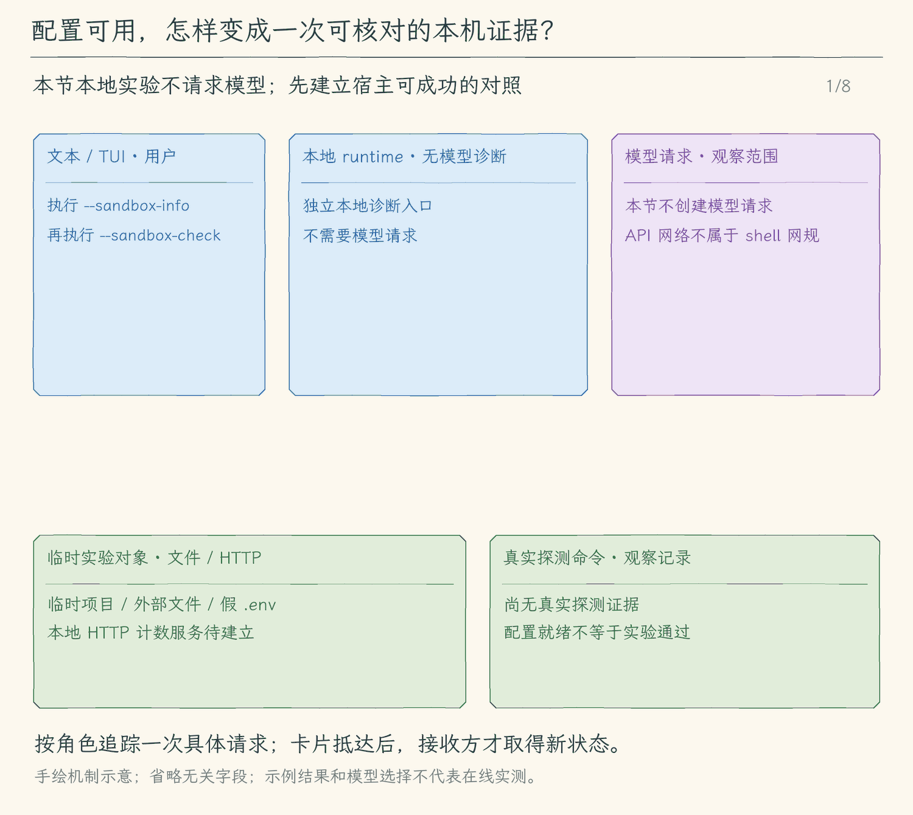

# 33.3 诊断隔离状态并验证不同通道

[上一节：连接后台任务](../02-connect-execution/README.md) · [本章目录](../README.md) · [练习与完整答案](../EXERCISES.md)

## 问题：“依赖存在”还不能证明限制生效

如果屏幕只显示“Sandbox enabled”，我们仍然不知道它确认了什么。可能只是包已安装，也可能只是系统里找到了命令。一个生成了包装字符串却没有实际执行它的程序，也能打印相同文字。

我们需要两种不同产出：先查看当前平台、依赖与规则；再主动执行临时实验，得到本机这次运行的结果。诊断不需要模型 API 密钥，也不读取用户真实秘密。

## 解决方案：先报告配置，再提供真实自检

`--sandbox-info` 报告运行时版本、平台、依赖错误、当前项目规则以及各工具通道的隔离范围。它不启动测试命令，因此只表达“准备条件”。`--sandbox-check` 创建临时项目和临时外部目录，写入假 `.env`，启动一个本地 HTTP 服务，再执行一组受控命令。实验结束后关闭服务、释放运行时并删除临时文件。

自检必须包含宿主对照。宿主进程能写外部目录、读假密钥并访问本地服务，而沙箱命令在同样目标上失败，结果才有解释力。如果服务本来就没启动，连接失败不能证明网络隔离成功。

## 工作原理

### 把断言落到副作用上

文件实验保存三个结果：项目内写入成功；项目外写入命令失败且外部文件不存在；读取假 `.env` 命令失败且输出没有假密钥。运行时返回的错误文本可能随系统和 shell 改变，所以判断不依赖某一句英文报错。

网络实验先让宿主向本地 HTTP 服务发请求，确认服务可达。随后让沙箱命令直接创建 TCP 连接，不经过 HTTP 代理。它应无法完成请求，服务收到的请求数也不能增加。这样可以排除“网络命令只是遵守了一个代理变量”的误判。测试过程中只连接本机临时服务，不需要访问外部网站。

每条命令都用真实的隔离启动路径执行，而不是在测试里另写一个模拟拒绝函数。章节验收还会分别覆盖前台、项目检查、pipe 和 PTY，让边界实验与实际工具入口连接起来。

### 如何解释通过和失败

`--sandbox-info` 找不到依赖时，列出错误并设置失败退出码；它不会启动未经隔离的命令来代替。`--sandbox-check` 只有所有对照与限制都符合预期时才显示通过。某项失败会返回非零退出码，并保留该项的观察结果，方便区分“环境不具备条件”和“访问本应拒绝却成功”。

一次通过只证明当前机器、当前运行时版本和本次规则在这些实验上成立。它不会证明所有系统调用都已经审计，也不会发现被保存成普通文件名的全部秘密。升级 SDK、修改规则或改变执行入口后，需要重新跑相应实验。

### 不同工具通道的边界

| 通道 | 实际在哪里执行 | 本章约束 |
| --- | --- | --- |
| `run_command`、`check_project` | 包装后的 shell 及其普通子进程 | 文件规则、空网络允许列表、原有超时和取消 |
| `start_job` 的 pipe 与 PTY | 包装后的后台 shell | 同一文件与网络规则，任务状态仍由退出通知确认 |
| 内置读取、编辑、搜索与 Git 辅助 | Agent 父进程或其已有辅助进程 | 沿用路径、忽略项与审批规则；未整体纳入 shell 沙箱 |
| 语言服务器 | Agent 启动的语言服务进程 | 沿用第 32 章的根目录、请求与关闭管理；未纳入 shell 沙箱 |
| Hook、MCP、本地扩展代码 | 各自已显式启用的处理器或服务 | 沿用所属机制的信任与授权边界；未纳入本章 shell 沙箱 |
| 模型 API | Agent 父进程 | 使用模型配置联网，不使用 shell 的空网络允许列表 |

语言服务看起来也会读源码，但它和 `run_command` 是两个入口。Hooks 可能运行本地脚本，但它没有自动经过本章新增的包装函数。清楚列出这些差别，才能据此决定下一步需要隔离哪个入口，而不是把局部限制扩写成整个 Agent 的安全承诺。

### 诊断结束也要收尾

自检在 `finally` 中清理临时 HTTP 服务与运行时资源，再删除临时项目。只有命令进程已结束，才能移除它正在使用的目录。清理失败会被报告，不能在仍有资源时显示完整成功。

自检目录本身可以被删除，因此测试副作用被收在这批临时样本内。普通用户任务不是临时实验：命令在项目内产生的修改仍然保留，诊断通过也不会自动恢复这些修改。

<!-- media:lesson:start -->
这是不经过模型的本地实验：先证明宿主可操作，再核对包装后真实对象、输出与 HTTP 计数。



[静态流程图](assets/sandbox-local-proof-flow-8f1ddec02f.png) · [静态封面](assets/sandbox-local-proof-cover-404f28a862.png) · [查看完整静态分镜](assets/sandbox-local-proof-storyboard-84f70f314e.jpg)
<!-- media:lesson:end -->

## 本节改动文件

| 状态 | 文件 | 本节变化 |
| --- | --- | --- |
| NEW | [src/sandbox/diagnostics.ts](src/sandbox/diagnostics.ts) | 配置报告、临时宿主对照与真实隔离实验 |
| CHANGED | [src/cli.ts](src/cli.ts) | 提供无需模型配置的 info 与 check 入口 |

## 动手构建

以 33.2 的完整代码和已完成练习为起点，保留其他文件；本节目标目录为 `03-diagnose-boundaries/`。

新增诊断模块，再整体替换 CLI。规则报告不初始化代理，主动实验创建自己的项目、文件和 HTTP 服务，通过真实执行入口观察结果，并在 `finally` 中收尾。独立管理分支在模型配置与其他服务连接之前处理，不需要模型密钥，也不与普通任务共享清理时机。

### 1. 新增 sandbox/diagnostics.ts

目标文件：[src/sandbox/diagnostics.ts](src/sandbox/diagnostics.ts)。将以下完整内容保存到这个文件。

<!-- build-file: src/sandbox/diagnostics.ts -->
<details>
<summary>sandbox/diagnostics.ts 完整文件</summary>

```typescript
/**
 * 33.3 诊断隔离状态并验证不同通道 | [NEW] sandbox/diagnostics.ts
 * 学习目标：分开报告依赖条件与真实实验，不用“enabled”代替边界证明。
 * 输入：本次项目根或主动自检请求；输出：规则说明与逐项观察。
 * 本文件局部流程（全局主流程见 agent/agent-loop.ts）：临时样本 -> 宿主对照 -> 沙箱实际访问 -> 核对副作用 -> 清理。
 * 结束依据：所有子命令已关闭，HTTP 服务与运行时释放后才返回；失败给非零退出码由 CLI 设置。
 * 边界：仅使用假密钥与临时服务；不读取用户凭据，不宣称其他工具通道已经隔离。
 */
import { mkdtemp, mkdir, writeFile, readFile, access, rm, realpath } from "node:fs/promises";
import { createServer } from "node:http";
import { tmpdir } from "node:os";
import { join } from "node:path";
import { randomUUID } from "node:crypto";
import type { Socket } from "node:net";
import { runProcess } from "../processes/run-process.js";
import { sandboxPolicy } from "./policy.js";
import { sandboxAvailability, wrapSandboxCommand, closeSandbox } from "./runtime.js";

// [NEW 33.3] 准备条件和实验结论采用不同字段，避免把包已安装当成限制已验证。
export type SandboxCheck = { name: string; passed: boolean; detail: string };
export type SandboxReport = { platform: string; runtime: string; passed: boolean; checks: SandboxCheck[] };

/**
 * POSIX shell 的单引号编码只用于宿主生成的 Node 命令，不插入用户提供的 shell 片段。
 */
function quote(value: string): string { return `'${value.replaceAll("'", "'\\''")}'`; }
/**
 * 生成使用本次 Node 可执行文件的命令，脚本与路径不会被 shell 再解释。
 */
function nodeCommand(script: string): string { return `${quote(process.execPath)} -e ${quote(script)}`; }
/**
 * 只核对临时目标是否存在，不通过错误文字推断副作用。
 */
async function exists(path: string): Promise<boolean> { try { await access(path); return true; } catch { return false; } }

/**
 * 显示当前项目规则与依赖，明确没有执行实验；不创建模型或初始化共享代理。
 * 路径不存在时向外报错，避免用不同目录冒充用户请求的项目。
 */
export async function sandboxInfo(projectRoot: string): Promise<{ text: string; available: boolean }> {
  const root = await realpath(projectRoot);
  const status = await sandboxAvailability();
  const policy = sandboxPolicy(root);
  return { available: status.errors.length === 0, text: [
    `Sandbox runtime: @anthropic-ai/sandbox-runtime@${status.runtime}`,
    `平台: ${status.platform}；准备条件: ${status.errors.length ? "不可用" : "依赖检查通过"}`,
    "边界实验: 未执行；使用 --sandbox-check 主动验证。",
    `依赖错误: ${status.errors.join("；") || "无"}`,
    `依赖提醒: ${status.warnings.join("；") || "无"}`,
    `项目规则: ${JSON.stringify(policy.filesystem, null, 2)}`,
    `运行时额外可写位置: ${JSON.stringify(status.defaultWritePaths)}`,
    "命令网络: 空允许列表；禁止直接联网与临时询问放行。",
    "已接入: run_command、check_project、start_job(pipe/PTY)。",
    "独立通道: 模型API、内置文件/搜索/Git辅助、语言服务、Hooks、MCP、扩展处理器。",
    "读规则只保护列出的路径，不扫描其他命名或嵌套秘密；Linux新建路径需重新包装并实测。",
  ].join("\n") };
}

/**
 * 创建可控样本：宿主先证明文件与本地 HTTP 可用，再由真实沙箱拒绝越界访问。
 * 请求停止交给共享执行器，finally 等子命令结束后清理服务、代理与样本。
 * 自检独占 CLI 管理分支；不能在仍有其他沙箱任务时调用 closeSandbox。
 */
export async function runSandboxCheck(): Promise<SandboxReport> {
  const controller = new AbortController();
  const cancel = () => controller.abort(new Error("沙箱自检已取消。"));
  const base = await mkdtemp(join(tmpdir(), "hello-agent-sandbox-check-"));
  process.once("SIGINT", cancel);
  const sockets = new Set<Socket>();
  let requests = 0;
  const token = `FAKE_SECRET_${randomUUID()}`;
  const server = createServer((_request, response) => { requests++; response.end("LOCAL_CONTROL_OK"); });
  server.on("connection", socket => { sockets.add(socket); socket.once("close", () => sockets.delete(socket)); });
  try {
    const status = await sandboxAvailability();
    if (status.errors.length) throw new Error(`隔离不可用：${status.errors.join("；")}。没有启动未隔离命令。`);
    const root = join(base, "project"), outside = join(base, "outside.txt"), inside = join(root, "report.txt");
    await mkdir(root);
    await writeFile(join(root, ".env"), token);
    await writeFile(outside, "HOST_WRITE_OK");
    const hostFiles = await readFile(outside, "utf8") === "HOST_WRITE_OK"
      && await readFile(join(root, ".env"), "utf8") === token;
    await rm(outside);
    await new Promise<void>((resolve, reject) => {
      server.once("error", reject); server.listen(0, "127.0.0.1", resolve);
    });
    const address = server.address();
    if (!address || typeof address === "string") throw new Error("临时 HTTP 服务没有获得端口。");
    const url = `http://127.0.0.1:${address.port}`;
    const hostNetwork = await (await fetch(url, { signal: AbortSignal.any([controller.signal, AbortSignal.timeout(3000)]) })).text() === "LOCAL_CONTROL_OK";
    const requestCount = requests;
    /**
 * 每次都走真实包装入口并等待管道关闭；不是模拟拒绝结果。
 */
    const execute = async (script: string) => {
      const command = await wrapSandboxCommand(nodeCommand(script), root, controller.signal);
      return runProcess("/bin/sh", ["-c", command], { cwd: root, signal: controller.signal, timeoutMs: 4000 });
    };
    const allowed = await execute(`require('node:fs').writeFileSync(${JSON.stringify(inside)},'INSIDE_OK')`);
    const deniedWrite = await execute(`require('node:fs').writeFileSync(${JSON.stringify(outside)},'ESCAPED')`);
    const deniedRead = await execute("process.stdout.write(require('node:fs').readFileSync('.env','utf8'))");
    const deniedNetwork = await execute(`const http=require('node:http');const request=http.get(${JSON.stringify(url)},r=>{r.resume();r.on('end',()=>process.exit(0))});request.on('error',()=>process.exit(71));request.setTimeout(1500,()=>{request.destroy();process.exit(72)})`);
    const checks: SandboxCheck[] = [
      { name: "宿主对照", passed: hostFiles && hostNetwork && requestCount === 1, detail: "宿主可写外部样本、读假.env、访问本地HTTP。" },
      { name: "项目内写入", passed: allowed.exitCode === 0 && await readFile(inside, "utf8") === "INSIDE_OK", detail: `exit=${allowed.exitCode}` },
      { name: "项目外写入拒绝", passed: deniedWrite.exitCode !== 0 && !await exists(outside), detail: `exit=${deniedWrite.exitCode}；外部目标不存在。` },
      { name: "假密钥读取拒绝", passed: deniedRead.exitCode !== 0 && !deniedRead.stdout.includes(token), detail: `exit=${deniedRead.exitCode}；stdout不含假密钥。` },
      { name: "直接网络连接拒绝", passed: deniedNetwork.exitCode !== 0 && requests === requestCount, detail: `exit=${deniedNetwork.exitCode}；HTTP请求数=${requests}，宿主对照后未增加。` },
    ];
    return { platform: status.platform, runtime: status.runtime, passed: checks.every(check => check.passed), checks };
  } finally {
    try {
      for (const socket of sockets) socket.destroy();
      if (server.listening) await new Promise<void>((resolve, reject) => server.close(error => error ? reject(error) : resolve()));
    } finally {
      try { await closeSandbox(); }
      finally { await rm(base, { recursive: true, force: true }); process.removeListener("SIGINT", cancel); }
    }
  }
}

/**
 * 用可读文本呈现观察，只有全部实验通过才给出通过结论。
 */
export function formatSandboxReport(report: SandboxReport): string {
  return [`Sandbox runtime: ${report.runtime}；平台: ${report.platform}`,
    ...report.checks.map(check => `${check.passed ? "PASS" : "FAIL"} ${check.name}：${check.detail}`),
    report.passed ? "本次边界实验通过；范围仅限列出的样本与通道。" : "边界实验失败，请按具体项目排查；没有自动降级。"].join("\n");
}
```

</details>

### 2. 完整替换 cli.ts

目标文件：[src/cli.ts](src/cli.ts)。将以下完整内容保存到这个文件。

<!-- build-file: src/cli.ts -->
<details>
<summary>cli.ts 完整文件</summary>

```typescript
#!/usr/bin/env node
/**
 * 33.3 诊断隔离状态并验证不同通道 | [CHANGED] cli.ts
 *
 * 学习目标：保留原有 CLI 装配与本地管理，所有自有任务结束后释放共享隔离资源。
 * 输入：模型选项与本地管理选项；--sandbox-info/check 在模型配置前独占处理。
 * 输出：装配模型后选择一个消费者；入口错误由 stderr 说明并设置 exitCode=1。
 * 状态：入口不持有消息历史或授权；只创建 writer，消费者提供白名单快照。
 *
 * 本文件局部流程（全局主流程见 agent/agent-loop.ts）：
 *   [KEEP 来自 30.1] argv[2]=schedule？-- 是 -> 独立定时管理 -> 结束；否 -> 普通聊天入口
 *   显式网页/搜索选项且非 Plan？-- 是 -> 完整校验本地配置 -> 创建 WebState；否 -> 不启用网页
 *   配置失败 -> 启动错误；配置成功只装配工具，不提前抓取或查询
 *   [KEEP 来自 18.1] --memory -> 检查混用和模式 -> 找真实项目根 -> 本地管理 -> 结束
 *   [KEEP 来自 19.1] 正常启动 -> 同根discoverSkills -> 只把名称/用途交给模型和启动信息
 *   --help / --version -> 显示文字 -> 结束；--doctor -> 显示环境 -> 结束
 *   [KEEP] 输出格式受支持？-- 否 -> 抛出 UserFacingError
 *                            +-- 是 -> 继续检查运行方式
 *   [KEEP] auto？-- 是 -> 无 --prompt 且 stdin/stdout 为 TTY、TERM 非 dumb？
 *                     是 -> tui；否 -> text
 *                +-- 否 -> 保留显式选择
 *   tui？-- 是 -> stdin/stdout 为 TTY、TERM 非 dumb，且没有 --prompt？
 *                否 -> 抛错；是 -> 读取配置、创建模型 -> 动态载入 app -> startTui
 *        +-- 否 -> jsonl 但缺少 --prompt？-- 是 -> 抛错
 *                                          +-- 否 -> 读取配置、创建模型
 *   [KEEP 来自 13.1] text / tui -> 创建新会话文件、显示 ID 和路径 -> 消费者 -> finally close
 *   非 TUI 分支 -> 无 --prompt？-- 是 -> startTerminal
 *                              +-- 否 -> 内容为空？-- 是 -> 抛错
 *                                                  +-- 否 -> jsonl / text 单次消费者
 *   运行抛错 -> explainError -> stderr、exit 1；单次用户取消由消费者设 exit 130
 *
 * auto 在没有 --prompt、stdin/stdout 都是 TTY 且 TERM 不是 dumb 时选择 tui，其余选择 text。
 * TUI 只接受连续输入，单次任务继续用 text 或 jsonl；JSONL 必须同时给 --prompt。
 * 动态 import 只在 tui 分支载入 React / Ink，脚本模式不需要初始化终端界面。
 * --help、--version 和 --doctor 不读取模型配置；界面选择不改变模型、工具或权限协议。
 *
 * [KEEP 来自 12.1] --mode plan|execute 在创建模型前校验，再传给每种消费者。
 * [KEEP 来自 12.2] 非 TUI 入口为当前会话准备共用清单；TUI 在 startTui 内创建自己的清单。
 * 运行观察：直接在交互终端启动会进入 TUI；单次提问、管道和 dumb 终端仍走 text。
 */
// [KEEP 来自 31.3] 无需密钥的管理入口及显式启动、退出收尾。


// [KEEP 来自 18.1] 本地记忆动作在模型配置与会话创建前完成。
// [KEEP 来自 20.1] 项目脚本必须由本次启动显式启用。
// [KEEP 来自 21.1] 显式配置授权启动服务，退出始终关闭本次连接。
// [KEEP 来自 22.1] 网络开关不读取网页或会话里的指令。
import { closeSandbox } from "./sandbox/runtime.js";
import { sandboxInfo, runSandboxCheck, formatSandboxReport } from "./sandbox/diagnostics.js";
import { runCodeCommand } from "./code-command.js";
import { loadWeb } from "./web/client.js";
import { runScheduleCommand } from "./schedules/commands.js";
import { ExtensionManager } from "./extensions/manager.js";
import { extensionCommand } from "./extensions/commands.js";
import { connectMcp, mcpInfo } from "./mcp/client.js";
import { loadHooks } from "./hooks/lifecycle.js";
// [KEEP 来自 19.1] 固定项目目录发现元信息，不加载正文。
import { discoverSkills, skillInfo } from "./skills/catalog.js";
import { createMemoryController, memoryCommand } from "./memory/commands.js";
import { findProjectRoot } from "./project/instructions.js";
import { dirname } from "node:path";
// [KEEP 来自 17.1] 启动时完成项目说明快照，进入模型与界面前只读一次。
import { loadProjectInstructions, projectInstructionInfo } from "./project/instructions.js";
import { createFileCheckpointStore } from "./sessions/file-checkpoints.js";
import { readFileSync } from "node:fs";
// [KEEP 来自 13.3] 使用真实目录比较工作区，符号链接别名不会误判成另一个项目。
import { forkSessionWriter } from "./sessions/fork-session.js";
import { realpath } from "node:fs/promises";
import { Command } from "commander";
import { readConfig, type Options } from "./config/load-config.js";
import { createModel } from "./models/client.js";
import type { ExecutionMode, RunOptions } from "./agent/run-options.js";
// [KEEP 来自 09.3] 机器输出也调用相同的 Agent 事件流。
import { runJsonlPrompt } from "./ui/jsonl.js";
import { runSinglePrompt, startTerminal } from "./ui/terminal.js";
import { UserFacingError, explainError } from "./errors.js";
// [KEEP 来自 13.1] 入口创建并最终关闭 writer，模型配置不进入存储模块。
import { createSessionWriter, resumeSessionWriter } from "./sessions/save-session.js";
// [KEEP 来自 13.4] 本地管理复用读取与写入协议，无需模型配置。
import { listSessions, renameSession, exportSession } from "./sessions/manage-sessions.js";

// [KEEP 第 01 章] 构建产物始终是 dist/cli.js，因此从它的上一级读取 package.json。
const packageJson = JSON.parse(readFileSync(new URL("../package.json", import.meta.url), "utf8"));

// [KEEP 来自第 01 章练习] 环境诊断不读取模型配置，也不会发送模型请求。
/**
 * 显示当前 Node.js 进程的最小诊断信息，不读取模型配置。
 *
 * - 输入：无显式参数；版本、平台、架构和工作目录都来自 Node.js 的 `process`。
 * - 输出：向终端依次打印 Node、Platform 和 Working directory 三行文本。
 * - 关键原因：诊断发生在 `readConfig()` 之前，因此缺少 API Key 时也能运行。
 * - 职责边界：不读取 `.env`，不创建模型客户端，也不发送网络请求。
 */
function printDoctor(): void {
  console.log(`Node: ${process.version}`);
  console.log(`Platform: ${process.platform} ${process.arch}`);
  console.log(`Working directory: ${process.cwd()}`);
}
// [KEEP 来自 09.3] output 只供入口选择消费者，不并入模型连接配置。
// [KEEP 来自 13.1] 会话目录只属于本地持久化，不属于模型配置。
type CliOptions = Options & { sandboxInfo?: boolean; sandboxCheck?: boolean; extension?: string[]; enableExtension?: string[]; enableProjectHooks?: boolean; mcpConfig?: string; mcpInfo?: boolean; enableWeb?: boolean; webSearchConfig?: string;  memory?: string; projectInfo?: boolean; prompt?: string; doctor?: boolean; output?: string; mode?: string; sessionDir?: string; resume?: string; recover?: boolean; sessions?: boolean; search?: string; rename?: string; name?: string; export?: string; exportTo?: string; fork?: string };
const program = new Command();
program
  // [KEEP 第 01 章] 帮助、版本无需配置模型，也不会发送请求。
  .name("hello-my-agent")
  .description("你好，我的 Agent：从 0 到 npm 发布")
  .version(packageJson.version, "-v, --version", "显示版本号")
  .helpOption("-h, --help", "显示帮助")
  // [KEEP 来自第 01 章练习] --doctor 在读取模型配置前结束，因此没有 API Key 也能使用。
  // [KEEP 来自 20.1] 仅这次启动授权项目生命周期脚本；恢复会话不恢复启用状态。
  // [KEEP 来自 21.1] 不自动读取仓库中的MCP启动命令。
  // [KEEP 来自 22.1] 启用仅注册，真正GET仍逐次审批。
  // [KEEP 来自 22.2] 提供配置也明确启用网页工具；无提供方不注册web_search。
  .option("--web-search-config <path>", "配置JSON GET搜索提供方(endpoint/queryParam/tokenEnv)")
  .option("--enable-web", "明确启用逐次审批的网页抓取工具")
  .option("--extension <command...>", "本地扩展管理：list/install/diagnose/uninstall，无需模型密钥")
  .option("--enable-extension <id...>", "仅本进程明确启用列出的已安装扩展；可能启动脚本和服务")
  .option("--mcp-config <path>", "明确启用指定MCP配置（会启动或连接其中的服务）")
  .option("--mcp-info", "连接、发现并诊断指定MCP配置后退出，无需模型密钥")
  .option("--enable-project-hooks", "明确启用项目 .hello-my-agent/hooks.json 中的脚本")
  .option("--sandbox-info", "显示隔离依赖、规则和实际通道范围，不执行边界实验")
  .option("--sandbox-check", "用临时样本主动验证真实文件与网络限制")
  .option("--doctor", "显示当前运行环境")
  // [KEEP 来自 17.3] 本地检查在读取模型配置和创建会话之前完成。
  .option("--project-info", "显示项目说明来源、范围、版本和加载预算")
  // [KEEP 来自 18.1] 显式管理命令无需API Key。
  .option("--memory <command>", "本地项目记忆：list、show <id>、add <正文>、edit <id> <正文>、invalidate <id> <理由>、delete <id>")
  // [KEEP 来自 02.1] 允许本次启动覆盖模型和基础地址，不在参数中传密钥。
  .option("--model <id>", "本次使用的模型 ID")
  .option("--base-url <url>", "本次使用的接口基础地址")
  // [KEEP 来自 02.2] 单次提问；02.4 增加连续输入后仍保留此用法。
  .option("--prompt <text>", "提问一次后退出")
  // [KEEP 来自 02.5] 本次启动选择接口协议。
  .option("--provider <type>", "接口协议：openai 或 anthropic")
  // [KEEP 来自 10.4] 默认值改为 auto；显式 text、tui、jsonl 仍由用户选择。
  .option("--output <format>", "输出格式：auto、tui、text 或 jsonl", "auto")
  // [KEEP 来自 12.1] 增加启动模式选项，默认 execute。
  .option("--mode <mode>", "模式：plan 或 execute（新会话默认 execute，恢复沿用已保存模式）")
  // [KEEP 来自 13.1] text / tui 保存新会话；JSONL 机器事件流暂不接入。
  .option("--session-dir <path>", "text / tui 的会话保存目录（默认 ~/.hello-my-agent/sessions）")
  // [KEEP 来自 13.3] 恢复需要明确 ID；恢复中断需再明确 --recover。
  // [KEEP 来自 14.1] fork 创建新身份；resume 继续旧身份。
  .option("--fork <id>", "从指定会话的最后完整状态创建新分支，不重放工具")
  .option("--resume <id>", "恢复指定会话，等待新输入；不重放旧工具")
  .option("--recover", "确认恢复已中断会话或清理已失效的进程锁")
  // [KEEP 来自 13.4] 显式管理动作在读取模型配置前完成。
  .option("--sessions", "列出本地会话，可配合 --search")
  .option("--search <text>", "在会话 ID、名称、工作区和已保存消息中搜索")
  .option("--rename <id>", "给指定会话追加名称，需要 --name")
  .option("--name <text>", "会话名称，1—80 个字符")
  .option("--export <id>", "将指定会话导出为 Markdown，默认输出到 stdout")
  .option("--export-to <path>", "导出到一个尚不存在的文件，需要 --export")
  // [KEEP 来自 09.3] 默认动作先检查输出约定，再装配模型并选择对应消费者。
  .action(async () => {
    const options = program.opts<CliOptions>();
    // [CHANGED 33.3] 独占管理分支在模型、扩展和服务连接之前结束；不需要模型凭据。
    if (options.sandboxInfo || options.sandboxCheck) {
      const allowed = new Set(["output", options.sandboxInfo ? "sandboxInfo" : "sandboxCheck"]);
      if (Object.entries(options).some(([key, value]) => value !== undefined && value !== false
          && (!allowed.has(key) || (key === "output" && value !== "auto")))) {
        throw new UserFacingError("--sandbox-info 与 --sandbox-check 请分别单独使用。");
      }
      if (options.sandboxInfo) {
        const info = await sandboxInfo(findProjectRoot()); console.log(info.text);
        if (!info.available) process.exitCode = 1;
      } else {
        const report = await runSandboxCheck(); console.log(formatSandboxReport(report));
        if (!report.passed) process.exitCode = 1;
      }
      return;
    }
    // [KEEP 来自 18.1] 管理动作拒绝混用提问、会话和连接选项；Plan只可查询。
    if (options.memory !== undefined) {
      if (options.prompt !== undefined || options.projectInfo || options.doctor || options.model !== undefined || options.baseUrl !== undefined
        || options.provider !== undefined || options.output !== "auto" || options.sessionDir !== undefined || options.resume !== undefined || options.recover
        || options.fork !== undefined || options.sessions || options.search !== undefined || options.rename !== undefined || options.name !== undefined
        || options.export !== undefined || options.exportTo !== undefined) throw new UserFacingError("--memory请单独使用，可配合--mode plan查询。");
      if (!["execute", "plan"].includes(options.mode ?? "execute")) throw new UserFacingError("--mode只能是plan或execute。");
      console.log(await memoryCommand(findProjectRoot(), options.memory, options.mode as ExecutionMode | undefined));
      return;
    }
    // [KEEP 来自 17.3] 本地检查是单独动作，拒绝会让用户误以为发送了任务的选项组合。
    if (options.projectInfo) {
      if (options.prompt !== undefined || options.doctor || options.model !== undefined || options.baseUrl !== undefined
        || options.provider !== undefined || options.mode !== undefined || options.output !== "auto"
        || options.sessionDir !== undefined || options.resume !== undefined || options.recover || options.fork !== undefined
        || options.sessions || options.search !== undefined || options.rename !== undefined || options.name !== undefined
        || options.export !== undefined || options.exportTo !== undefined) throw new UserFacingError("--project-info 请单独使用，不与提问、模型、模式、会话或输出选项混用。 ");
      const project = await loadProjectInstructions();
      for (const line of projectInstructionInfo(project)) console.log(line);
      return;
    }
    // [KEEP 来自 13.4] 先排除含糊组合，再执行一个本地动作；没有 API Key 也可以管理。
    const management = Number(Boolean(options.sessions)) + Number(options.rename !== undefined) + Number(options.export !== undefined);
    if (management > 1) throw new UserFacingError("--sessions、--rename、--export 每次只能选择一个。");
    if (options.search !== undefined && !options.sessions) throw new UserFacingError("--search 必须与 --sessions 一起使用。");
    if (options.name !== undefined && options.rename === undefined) throw new UserFacingError("--name 必须与 --rename <id> 一起使用。");
    if (options.exportTo !== undefined && options.export === undefined) throw new UserFacingError("--export-to 必须与 --export <id> 一起使用。");
    if (options.sessionDir !== undefined && !options.sessionDir.trim()) throw new UserFacingError("--session-dir 不能为空。");
    if (management) {
      if (options.fork !== undefined || options.resume !== undefined || options.recover || options.prompt !== undefined || options.doctor
        || options.mode !== undefined || options.model !== undefined || options.provider !== undefined || options.baseUrl !== undefined || options.output !== "auto") {
        throw new UserFacingError("本地会话管理请单独使用，不与恢复、提问、模型或输出模式选项混用。");
      }
      if (options.sessions) {
        const result = await listSessions(options.sessionDir, options.search);
        for (const warning of result.warnings) console.error(`会话提示：${warning}`);
        if (!result.sessions.length) console.log("没有匹配的本地会话。");
        for (const session of result.sessions) console.log(`${session.id}  ${session.name}\n  ${session.updatedAt} · ${session.messages} 条消息 · ${session.pending} 条待交付${session.interrupted ? " · 上次中断" : ""}\n  ${session.cwd}`);
      } else if (options.rename !== undefined) {
        if (options.name === undefined) throw new UserFacingError("--rename <id> 需要 --name <text>。");
        const seq = await renameSession(options.rename, options.name, options.sessionDir);
        console.log(`名称已保存：${options.rename} · 第 ${seq} 条记录。`);
      } else {
        const markdown = await exportSession(options.export!, options.sessionDir, options.exportTo);
        if (options.exportTo === undefined) process.stdout.write(markdown);
        else console.log(`已导出：${options.exportTo}`);
      }
      return;
    }
    // [KEEP 来自 21.1] 本地诊断在readConfig前完成，不需要模型凭据。
    if (options.mcpInfo) {
      if (!options.mcpConfig) throw new UserFacingError("--mcp-info 需要 --mcp-config <path>。");
      const mcp = await connectConfiguredMcp(options.mcpConfig, findProjectRoot());
      try { for (const line of mcpInfo(mcp)) console.log(line); } finally { await mcp?.close(); }
      return;
    }
    // [KEEP 来自 31.1] 本地安装与诊断无需模型凭据，完成后一定关闭管理器。
    if (options.extension) {
      if (options.enableExtension || options.prompt || options.resume || options.fork || options.mcpConfig || options.enableProjectHooks) throw new UserFacingError("--extension 不与运行或其他能力启用参数混用。");
      if (!["plan", "execute"].includes(options.mode ?? "execute")) throw new UserFacingError("--mode 只能是 plan 或 execute。");
      if (options.extension[0] === "enable") throw new UserFacingError("独立管理命令不保留进程；请用 --enable-extension <id...> 启动，或在会话中 /extension enable <id>。");
      const root = findProjectRoot(), manager = new ExtensionManager(root, await discoverSkills(root));
      const controller = new AbortController(), cancel = () => controller.abort(new UserFacingError("扩展操作已取消。"));
      process.once("SIGINT", cancel);
      try { console.log(await extensionCommand(options.extension, manager, options.mode ?? "execute", controller.signal)); }
      finally { process.removeListener("SIGINT", cancel); await manager.close(); }
      return;
    }
    if (options.doctor) {
      printDoctor();
      return;
    }
    // [KEEP 来自 12.1] 创建模型前检查模式，非法值不会启动任务。
    if (!["plan", "execute"].includes(options.mode ?? "execute")) throw new UserFacingError("--mode 只能是 plan 或 execute。");
    let mode: ExecutionMode = options.mode === "plan" ? "plan" : "execute";
    // [KEEP 来自 12.1] 把启动模式传到 text、JSONL 和连续会话入口。
    // [KEEP 来自 12.2] 非 TUI 入口创建共用清单；TUI 在自己的会话内创建。
    const runOptions: RunOptions = { mode, tasks: { items: [] } };
    // [KEEP 来自 10.4] 校验允许 auto，下一步再把它解析成具体消费者。
    if (!["auto", "tui", "text", "jsonl"].includes(options.output ?? "auto")) throw new UserFacingError("--output 只能是 auto、tui、text 或 jsonl。");
    // [KEEP 来自 10.4] 只在真实终端的连续会话中自动选择 TUI；--prompt 和管道默认仍用文本。
    if (options.output === "auto") options.output = options.prompt === undefined
      && process.stdin.isTTY && process.stdout.isTTY && process.env.TERM !== "dumb" ? "tui" : "text";
    // [KEEP 来自 10.1] 只有真实终端才能把按键交给 Ink；单次问题继续使用已有输出模式。
    if (options.output === "tui" && (!process.stdin.isTTY || !process.stdout.isTTY || process.env.TERM === "dumb")) {
      throw new UserFacingError("TUI 需要交互终端，请使用 --output text 或 --output jsonl --prompt 提问。");
    }
    if (options.output === "tui" && options.prompt !== undefined) throw new UserFacingError("TUI 使用连续输入；单次提问请使用 --output text 或 jsonl。");
    if (options.output === "jsonl" && options.prompt === undefined) throw new UserFacingError("JSONL 模式需要 --prompt 提供一次任务。");
    // [KEEP 来自 13.1] 在创建模型和文件前拒绝不支持的组合与空问题。
    if (options.output === "jsonl" && options.sessionDir !== undefined) throw new UserFacingError("--session-dir 只支持 text 或 tui；JSONL 机器输出暂不保存会话。");
    if (options.recover && options.resume === undefined) throw new UserFacingError("--recover 必须与 --resume <id> 一起使用。");
    if (options.resume !== undefined && options.output === "jsonl") throw new UserFacingError("会话恢复只支持 text 或 tui。");
    if (options.sessionDir !== undefined && !options.sessionDir.trim()) throw new UserFacingError("--session-dir 不能为空。");
    if (options.prompt !== undefined && !options.prompt.trim()) throw new UserFacingError("提问内容不能为空。");
    // [KEEP 来自 14.1] 含糊组合在创建模型或新文件之前拒绝。
    if (options.fork !== undefined && (options.resume !== undefined || options.recover || options.output === "jsonl")) throw new UserFacingError("--fork 不与 --resume、--recover 或 JSONL 混用。");
    // [KEEP 来自 17.1] 不改 cwd，不把项目说明当作审批或脚本运行入口。
    if (options.enableExtension?.length && (mode === "plan" || options.resume || options.fork)) throw new UserFacingError("启动启用扩展仅支持新的execute会话；恢复后请在本地明确启用。");
    const project = await loadProjectInstructions();
    const config = readConfig(options);
    // [KEEP 来自 18.1] 初始记忆供界面估算，正式任务开始时会重新加载并冻结。
    const memory = await createMemoryController(project.root);
    const skills = await discoverSkills(project.root);
    // [KEEP 来自 20.1] Plan不读取/运行钩子；执行模式没有显式开关也不读取。
    const hooks = await loadHooks(project.root, Boolean(options.enableProjectHooks) && mode !== "plan");
    // [KEEP 来自 21.1] Plan不启动本地服务；恢复与新启动都必须再次显式选择。
    const mcp = mode === "plan" ? undefined : await connectConfiguredMcp(options.mcpConfig, project.root);
    const extensions = new ExtensionManager(project.root, skills, hooks, mcp);
    let model: ReturnType<typeof createModel> | undefined;
    try {
    // [KEEP 来自 31.2] 启动显式启用也接收Ctrl+C；只在资源收尾后离开初始化阶段。
    const extensionAbort = new AbortController(), cancelExtension = () => extensionAbort.abort(new UserFacingError("扩展初始化已取消。"));
    process.once("SIGINT", cancelExtension);
    try { for (const id of options.enableExtension ?? []) console.error(await extensions.enable(id, mode, extensionAbort.signal)); }
    finally { process.removeListener("SIGINT", cancelExtension); }
    const web = mode === "plan" ? undefined : await loadWeb(Boolean(options.enableWeb), options.webSearchConfig);
    model = createModel(config, project, memory, skills, extensions.hooks, extensions.mcp, web, extensions);
    for (const line of mcpInfo(model.mcp)) console.error(line);
    for (const line of skillInfo(skills)) console.error(line);
    for (const line of projectInstructionInfo(project)) console.error(line);
    // [KEEP 来自 13.1] JSONL 仍只输出机器事件；其余入口共用一次 writer 生命周期。
    if (options.output === "jsonl") {
      await runJsonlPrompt(model, options.prompt!, runOptions);
      return;
    }
    // [KEEP 来自 14.1] 新分支复制来源数据，随后所有检查点只写新文件。
    const writer = options.fork !== undefined
      ? await forkSessionWriter(options.fork, options.sessionDir)
      : options.resume !== undefined
      ? await resumeSessionWriter(options.resume, options.sessionDir, options.recover)
      : await createSessionWriter(options.sessionDir);
    // [KEEP 来自 14.2] 文件恢复数据与会话同属一个身份，分支自动使用新的目录。
    runOptions.fileCheckpoints = createFileCheckpointStore(writer.id, dirname(writer.path));
    console.error(`会话 ID：${writer.id}\n保存文件：${writer.path}`);
    try {
      // [KEEP 来自 13.3] 采用拿锁后重读的快照；任何失败都会走 finally 释放本进程的锁。
      const restored = writer.restored;
      const initial = restored?.state;
      if (restored) {
        const workspace = restored.header.workspace ?? await realpath(restored.header.cwd);
        if (workspace !== await realpath(process.cwd())) throw new UserFacingError(`工作区不同：请先进入 ${restored.header.cwd} 再恢复，当前目录不会执行旧任务。`);
        for (const warning of restored.warnings) console.error(`恢复提示：${warning}`);
        console.error(`已恢复 ${initial?.messages.length ?? 0} 条消息；等待新要求，不重放旧工具；本进程权限需重新确认。`);
        if (initial?.pendingInputs.length) console.error(`保留 ${initial.pendingInputs.length} 条旧补充；不会自动交给新任务，请在 TUI 队列中明确选择发送。`);
      }
      mode = (options.mode ?? initial?.mode ?? "execute") as ExecutionMode;
      runOptions.mode = mode;
      if (options.prompt === undefined) {
        // [KEEP 来自 10.1] 选择 TUI 时才载入 React / Ink，不让脚本模式初始化界面。
        if (options.output === "tui") {
          const { startTui } = await import("./ui/tui/app.js");
          // [KEEP 来自 13.1] 会话 writer 与启动模式一起交给 TUI，授权仍由 TUI 保存在内存。
          await startTui(model, mode, writer, initial, runOptions.fileCheckpoints);
        } else await startTerminal(model, runOptions, writer, initial);
      } else await runSinglePrompt(model, options.prompt, runOptions, writer, initial);
    } finally {
      // [KEEP 来自 13.1] 消费者先等任务和最后检查点；即使保存失败，这里仍关闭句柄。
      await writer.close();
    }
    // [KEEP 来自 26.1] 退出等待自有作业清理；即使close失败也关闭MCP。
    } finally { try { await model?.jobs?.close(); } finally { try { await model?.languageService?.close(); } finally { try { await extensions.close(); } finally { await mcp?.close(); } } } }
  });

// [KEEP 来自 02.2] 请求返回 Promise，parseAsync 会等待默认操作结束。
try {
  // [KEEP 来自 30.3] schedule动作结束后不再进入普通聊天入口。
  if (process.argv[2] === "code") await runCodeCommand(process.argv.slice(3));
  else if (process.argv[2] === "schedule") await runScheduleCommand(process.argv.slice(3));
  else await program.parseAsync();
} catch (error) {
  console.error(`错误：${explainError(error)}`);
  process.exitCode = 1;
} finally {
  // [KEEP 来自 33.1] parseAsync 已等待各入口和自有作业收尾，最后释放共享隔离资源。
  try { await closeSandbox(); }
  catch (error) { console.error(`隔离清理失败：${explainError(error)}`); process.exitCode = 1; }
}

/**
 * [KEEP 来自 21.1] 让启动时的 Ctrl+C 也能停止正在建立的 MCP 连接。
 * 输入是本地配置路径与已确定的项目根；取消信号交给连接器，等待它关闭已启动的服务。
 * 无论连接成功、失败还是取消，最后都移除本次 SIGINT 监听，避免影响之后的任务。
 */
async function connectConfiguredMcp(path: string | undefined, root: string) {
  const controller = new AbortController();
  const cancel = () => controller.abort(new UserFacingError("MCP初始化已取消。"));
  process.once("SIGINT", cancel);
  try { return await connectMcp(path, root, controller.signal); }
  finally { process.removeListener("SIGINT", cancel); }
}
```

</details>

## 运行验证

在配套仓库根目录选择本节快照，安装依赖、编译并注册命令：

```bash
npm run lesson:33.3
```

查看本节规则，无需设置模型密钥：

```bash
hello-my-agent --sandbox-info
```

执行真实实验：

```bash
hello-my-agent --sandbox-check
```

应分别看到项目内写入、外部写入拒绝、假密钥读取拒绝和直接网络连接拒绝。输出同时说明宿主对照是否成功、平台和依赖情况。配套仓库还可运行 `npm run check:33`，它会检查三个小节，并从实际工具入口验证 pipe、PTY、项目检查、工作区切换和失败时不降级。

如果 Linux 缺少依赖，先依据 info 报告安装对应系统组件，再重新运行 check。依赖错误期间执行工具应返回明确失败，不能为了得到绿色测试而改成普通 `/bin/sh`。

## 本节完成后的 Agent

我们现在能指出哪些命令受到真实系统限制，也能用当前机器上的实际结果验证主要边界。诊断失败会留下具体项目和退出状态，诊断通过则留下版本、平台与实验范围。下一章将继续处理执行故障：日志怎样帮助定位问题，何时可以安全重试，以及停止后如何区分已结束和仍需人工核对的副作用。
