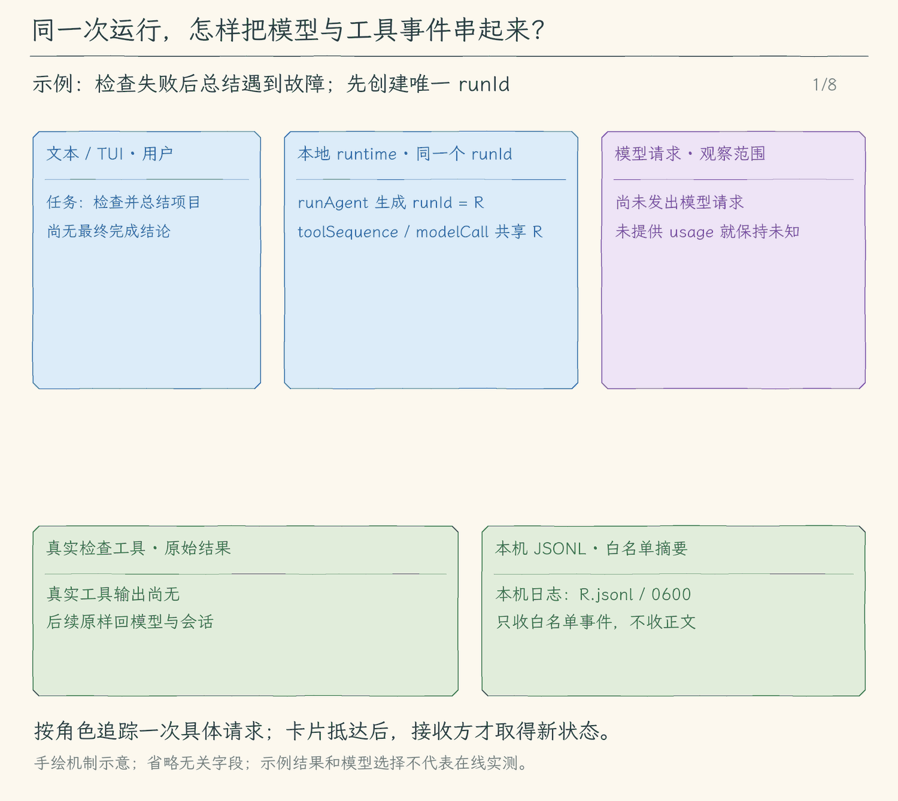

# 34.1 关联一次运行的日志

一次任务先读取文件，再运行测试，最后请求模型总结。如果最后一步断线，终端上的失败说明只能告诉我们“这一轮没完成”，不能说明前面的操作是否成功。我们需要把同一轮中的事实串起来。

本节给一次 `runAgent` 调用分配一个随机的 `runId`。模型请求用 `call` 编号，工具用 `toolSequence` 编号；同一轮无论发生多少次请求，都使用同一个 runId。它与会话 ID 不同：一段会话可以执行多轮任务，一轮任务也可能有自己的子任务。

## 从一条失败说明找到具体阶段

假设第 1 次模型请求返回了读取文件和运行测试的要求。程序执行工具，取得真实结果，把结果作为 `role: "tool"` 消息加入下一次请求。第 2 次模型请求才是总结阶段。日志先记录第 1 次 `model_start`、`model_finish`，再记录各项 `tool_start`、`tool_finish`；工具结果收齐后，记录第 2 次 `model_start`、`model_finish`，最后才记录整轮的 `run_finish`。

每一行都是独立 JSON，包含版本、runId、递增编号、事件类型和从本轮开始经过的毫秒数。模型与工具的开始时间留在内存中，对应完成事件补上 `durationMs`。`model_usage` 记录服务商已经报告的累计 token；拿不到时写 `null`，不能把输入估算冒充账单用量。

于是，“模型第 2 次请求开始后直接结束为 error”与“工具第 2 项返回 error”有不同的证据。前者表示没有取得完整模型响应，后者可能只是测试失败；测试失败的工具正文仍会交回模型，让它决定下一步。诊断记录不参与这些决策，也不能授予执行权限。

## 观察事件不能原样当日志

已有事件里带着用户输入、模型文字、工具参数、diff 和输出。它们用于界面与历史，直接 `JSON.stringify(event)` 会把任务材料一起落盘。仅靠替换 `sk-` 等特征也挡不住任意格式的密码。

因此日志采用白名单投影：只取事件种类、受控状态、数字编号、字符数、耗时和用量；不保存提示词、模型正文、工具参数、远端错误原文、URL、请求头或工具输出。工具正文只有字符数，命令工具额外记录退出码与本地停止类别。我们依照 [OWASP 日志建议](https://cheatsheetseries.owasp.org/cheatsheets/Logging_Cheat_Sheet.html#data-to-exclude)缩小记录范围；这个文件也不保存工作区路径或可重放的调用内容。

日志默认写入 `~/.hello-my-agent/logs/<runId>.jsonl`，新文件权限为 `0600`。单轮最多写 10,000 条普通记录，另外留出最终状态的位置；超额后标记记录不完整。文字增量不逐片落盘，避免长回答把诊断文件挤满。目录或磁盘写入失败时任务仍继续，最终通知明确说明诊断没有完整保存，不把“没有日志”误报成“没有发生操作”。这不是崩溃恢复数据库：进程被强杀或机器掉电时，最后几条记录仍可能缺失。

## runtime 等的还是原任务

日志观察者只看已发生的事件。`runAgent` 仍然等待 Agent Loop，Agent Loop 仍然等待模型完整响应、审批与工具结果。模型请求成功不等于整轮成功：只有最终回答及本地结束钩子收尾后，才会发出 `run_finish`。

事件流在创建时确定 runId，再把同一个 ID 交给 runAgent，JSONL 输出与诊断文件才能对上。诊断写入关闭后，最终事件携带日志路径和是否完整保存；text 界面显示这一位置，JSONL 消费者也能读取它。日志写失败不会覆盖任务的原始结果。

取消和失败仍沿用原有保留规则：完整工具调用及已取得结果进入历史，已执行但结果不确定的操作写明需要核对，未收齐的模型片段不冒充完整回答。text/TUI 消费者随后保存会话；机器 JSONL 模式沿用既有约定，不自动保存会话文件。

<!-- media:lesson:start -->
同一 runId 关联模型调用与工具序号；白名单日志记录过程，完整工具结果继续进入下一模型请求。



[静态流程图](assets/run-log-correlation-flow-46083fb0a2.png) · [静态封面](assets/run-log-correlation-cover-200dcb67a1.png) · [查看完整静态分镜](assets/run-log-correlation-storyboard-9275dad066.jpg)
<!-- media:lesson:end -->

## 本节改动文件

<!-- changes:start -->
| 状态 | 文件 | 本节变化 |
| --- | --- | --- |
| CHANGED | [src/agent/events.ts](src/agent/events.ts) | 最终事件携带 runId 与诊断文件状态。 |
| CHANGED | [src/agent/run-options.ts](src/agent/run-options.ts) | 传递运行标识与可注入诊断目录。 |
| CHANGED | [src/agent/run-stream.ts](src/agent/run-stream.ts) | 事件流与任务使用同一个 runId。 |
| CHANGED | [src/agent/run.ts](src/agent/run.ts) | 为所有运行记录过程，在最终通知前关闭日志。 |
| NEW | [src/diagnostics/logger.ts](src/diagnostics/logger.ts) | 把事件投影为有界白名单日志，关闭后报告保存状态。 |
| CHANGED | [src/ui/teaching-trace.ts](src/ui/teaching-trace.ts) | 显示最终诊断位置及缺失提示。 |
| CHANGED | [src/ui/tui/state.ts](src/ui/tui/state.ts) | 在 TUI 中保留最终诊断位置与日志状态。 |
<!-- changes:end -->

## 动手构建

从 33.3 的完整源码继续。本节把诊断放在整轮运行边界，既覆盖交互任务，也覆盖直接调用 `runAgent` 的任务。下面是新增或修改文件的完整内容；其他文件按累计快照保留。

<!-- source:start -->

<!-- build-file: src/agent/events.ts -->
<details>
<summary>src/agent/events.ts 完整文件</summary>

```typescript
/**
 * 34.1 关联一次运行的日志 | [CHANGED] agent/events.ts
 *
 * 学习目标：分清本地输入估算、服务商用量与费用估计；本文件负责传递已经发生的模型、权限和工具事件。
 * 输入：runAgent 的开始/结束通知，或 Agent Loop 已发生的过程事件。
 * 输出：可选观察者同步收到一份深拷贝；没有观察者或通知失败时直接返回。
 * 状态：复制事件不修改历史；观察者直接抛错被捕获，但耗时和显式取消不由这里隔离。
 *
 * 本文件局部流程（全局主流程见 agent/agent-loop.ts）：
 *   [KEEP] run_start / run_finish 与已有过程事件 -> 有观察者？-- 否 -> 返回
 *                                                                +-- 是 -> structuredClone
 *   复制成功？-- 否 -> 捕获异常 -> 返回
 *             +-- 是 -> 调用观察者 -> 成功 / 抛错 -> 返回
 *
 * run_finish 的 completed 带 Reply，cancelled/error 带说明；model_finish 仍只描述一次模型调用。
 * 观察者只接收事件，审批 handler 才是核心等待的控制入口，事件本身不能授予权限。
 * 深拷贝只保护原对象，不隐藏参数或正文里的敏感信息，也不会把同步回调变成独立线程。
 *
 * [KEEP 来自 12.4] input_applied 表示核心已收取并加入本次请求上下文，不保证远端收到或需求完成。
 * 该事件没有工具 sequence，必须先于通用工具分支处理。
 * 运行观察：一个 run_start 到一个 run_finish 之间，可以包含多次 model_start/model_finish。
 */

// [KEEP 来自 08.2] 事件展示统一结束原因。
// [CHANGED 34.1] 最终通知携带白名单诊断状态，不复制正文到日志。
import type { RunDiagnostics } from "../diagnostics/logger.js";
import type { ContextBudget } from "../context/budget.js";
import type { ModelFinishReason, Reply } from "../models/client.js";
import type { ToolCall } from "../tools/registry.js";
import type { ToolExecutionResult } from "../tools/types.js";
import type { ApprovalResponse, PermissionDecision } from "../permissions/policy.js";

// [KEEP 来自 08.1] 原有观察通道增加文字片段，TUI 与文本界面可消费同一种事件。
// [KEEP 来自 09.1] 整轮任务开始与结束也使用事件通知。
// [KEEP 来自 25.3] 定义子任务身份、角色、状态与说明的观察事件。
export type AgentEvent =
  | { type: "run_start" }
  // [KEEP 来自 25.3] 子会话状态独立于父模型 call 和工具 sequence，不包含子文字增量。
  // [KEEP 来自 29.1] 任务归属由协调者发出，与子会话编号分别显示。
  | { type: "shared_task_state"; taskId: string; workerId: import("../collaboration/coordinator.js").WorkerId; token: number; state: import("../collaboration/coordinator.js").SharedTaskState; detail: string }
  | { type: "child_state"; sessionId: string; parentSessionId: string; role: import("../subagents/runner.js").ChildRole; status: "starting" | "running" | import("../subagents/runner.js").ChildStatus; detail: string }
  // [KEEP 来自 16.3] 摘要准备、候选与实际采用分开；这些事件不能执行工具或修改历史。
  | { type: "compaction_start"; attempt: number }
  | { type: "compaction_candidate"; attempt: number; before: number; after: number; through: number }
  | { type: "compaction_finish"; outcome: "applied"; through: number }
  | { type: "compaction_finish"; outcome: "retained"; message: string }
  // [KEEP 来自 15.1] 估算是下次请求输入的本地预测；usage 是服务商已报告的本轮累计，缺失为 null。
  | { type: "context_budget"; call: number; budget: ContextBudget }
  | { type: "model_usage"; call: number; inputTokens: number | null; outputTokens: number | null; costEstimateUsd: number | null; cachedInputTokens?: number | null; cacheWriteTokens?: number | null }
  | { type: "run_finish"; outcome: "completed"; reply: Reply; diagnostics?: RunDiagnostics }
  | { type: "run_finish"; outcome: "cancelled" | "error"; message: string; diagnostics?: RunDiagnostics }
  | { type: "text_delta"; call: number; text: string }
  // [KEEP 来自 12.4] 核心收取确认带补充 ID、文字和请求次数，不使用工具 sequence。
  | { type: "input_applied"; id: number; text: string; call: number }
  | {
      type: "model_start";
      call: number;
      contextMessages: number;
      trigger: { kind: "user"; content: string } | { kind: "tool_results"; count: number };
    }
  | {
      type: "model_finish";
      call: number;
      // [KEEP 来自 08.2] 停止生成不一定代表回答完成。
      outcome: "tools" | "final" | "empty" | "incomplete";
      finishReason: ModelFinishReason;
      toolRequests: number;
      text: string;
    }
  | { type: "permission_check"; sequence: number; call: ToolCall; decision: PermissionDecision }
  // [KEEP 来自 06.1] 成功事件只额外保存 previewChars，不复制完整预览；原始 call 仍可能包含完整参数。
  // 消费者仍需选择展示字段；不能因为某项只给出字符数，就认为整个事件已经脱敏。
  | {
      type: "tool_prepare";
      sequence: number;
      call: ToolCall;
      outcome: "success";
      previewChars: number;
    }
  | {
      type: "tool_prepare";
      sequence: number;
      call: ToolCall;
      outcome: "error";
      error: string;
    }
  // [KEEP 来自 06.1] 观察者只知道是否有预览；完整文件 diff 或命令预览由审批适配器展示。
  | {
      type: "approval_start";
      sequence: number;
      call: ToolCall;
      scope: string;
      allowSession: boolean;
      hasPreview: boolean;
    }
  | { type: "approval_finish"; sequence: number; call: ToolCall; response: ApprovalResponse }
  // [KEEP 来自 27.1] sequence/callID 从请求顺序固定，不按完成先后重编号。
  // [KEEP 来自 27.3] 屏障发生在所有结果已经按调用顺序提交之后。
  | { type: "tool_batch_finish"; call: number; results: number; interrupted: boolean }
  | { type: "tool_state"; sequence: number; call: ToolCall; state: import("./tool-batch.js").ToolState }
  | { type: "tool_start"; sequence: number; call: ToolCall }
  | {
      type: "tool_finish";
      sequence: number;
      call: ToolCall;
      outcome: "success";
      result: ToolExecutionResult;
    }
  | {
      type: "tool_finish";
      sequence: number;
      call: ToolCall;
      outcome: "error";
      error: string;
    };

export type AgentObserver = (event: AgentEvent) => void;

/**
 * 把已经产生的事件副本交给观察者，捕获观察者直接抛出的异常。
 *
 * - 输入：可选观察者，以及 runAgent 或 Agent Loop 刚刚产生的结构化事件。
 * - 输出：观察者存在时同步收到一份深拷贝；不存在时直接返回。
 * - 关键原因：structuredClone 防止观察者通过事件对象修改原工具请求或结果。
 * - 失败方式：拷贝失败或观察者直接抛错时在这里结束通知，不把该异常继续抛给核心。
 * - 职责边界：拷贝不隐藏敏感信息，也不隔离耗时；观察者显式触发取消信号仍会影响本轮执行。
 */
export function emitAgentEvent(observer: AgentObserver | undefined, event: AgentEvent): void {
  try {
    if (observer) observer(structuredClone(event));
  } catch {
    // 这里只捕获通知过程抛出的异常；观察者触发的取消信号仍由执行链正常处理。
  }
}
```

</details>

<!-- build-file: src/agent/run-options.ts -->
<details>
<summary>src/agent/run-options.ts 完整文件</summary>

```typescript
/**
 * 34.1 关联一次运行的日志 | [CHANGED] agent/run-options.ts
 *
 * 学习目标：传递会话持有的工作区管理器与本地调度选项，模型不能自行选择控制对象。
 * 输入：本地入口选定的模式、会话控制对象、调度限制与本轮交互回调。
 * 输出：RunOptions 描述这一轮允许使用的控制入口；这里只定义类型，不执行任务。
 * 状态：模式由启动入口取快照；清单属于会话，补充的收取回调只绑定当前轮。
 * 本文件数据关系（全局主流程见 agent/agent-loop.ts）：
 *   本地界面 -> 本轮选项 -> 核心 / 工具 / 模型请求
 * 缺少可选入口时采用默认模式或不提供对应交互；类型声明不能代替运行时校验。
 * 运行观察：不同界面传入同样的选项，核心仍使用同一条模型与工具循环。
 */
import type { CompactionState } from "../context/compaction.js";
import type { FileCheckpointStore } from "../sessions/file-checkpoints.js";

// [KEEP 来自 12.1] 模式由本地运行入口选择，默认继续执行。
/**
 * 本地入口可选的两种运行模式。
 * plan 只调查和制定计划；execute 仍需遵守每次工具的权限与审批。
 */
export type ExecutionMode = "plan" | "execute";

// [KEEP 来自 12.2] 容器由会话持有，切换模式和开始新一轮不会丢失任务清单。
/**
 * 清单中的一个步骤和模型报告的进度。
 * ID 用来辨认条目，状态不是测试证明；数量和字段限制由 todo_write 运行时检查。
 */
export type TaskItem = {
  id: string;
  text: string;
  status: "pending" | "in_progress" | "completed";
};
/**
 * 会话持有的可替换清单容器。
 * 工具先校验完整新数组再替换 items，失败时旧数组继续使用。
 */
export type TaskState = { items: TaskItem[] };

// [KEEP 来自 12.3] 答案只交回正在等待的工具调用；null 表示用户未回答。
/**
 * 这次澄清要显示的问题与选项。
 * 选项可为空，用户仍可自由回答；内容约束由 ask_user 检查。
 */
export type UserQuestion = { question: string; choices: string[] };
/**
 * 界面提供的专用问答等待入口。
 * 返回有效答案或表示未回答的 null；取消和显示失败可拒绝 Promise。
 */
export type QuestionHandler = (request: UserQuestion, signal: AbortSignal) => Promise<string | null>;

// [KEEP 来自 12.4] ID 用于界面确认哪条补充已被核心收取。
/**
 * 核心实际收取的一条补充。
 * ID 供界面确认哪条已加入上下文；所属轮由界面回调闭包固定。
 */
export type QueuedInput = { id: number; text: string };

/**
 * 把这一轮使用的模式、会话状态和可用控制入口放在一起。
 * 省略可选项时使用默认模式或缺省交互；回调仅负责本轮，不能把旧轮补充带进新轮。
 */
// [KEEP 来自 14.2] 写入前的持久化入口属于本地运行控制，不交给模型。
// [KEEP 来自 19.3] 工具使用进程内已发现目录，模型不能自行选择根目录。
export type RunOptions = {
  // [CHANGED 34.1] 本地运行标识由事件流生成；日志目录不来自模型参数。
  runId?: string;
  diagnosticDirectory?: string;
  // [KEEP 来自 32.2] 只接受本地绑定的语言服务，不序列化进会话。
  languageService?: import("../language-service/client.js").LanguageService;
  // [KEEP 来自 27.1] 本地入口配置容量；未列入白名单或有 Hooks 的调用仍串行。
  toolConcurrency?: number;
  // [KEEP 来自 27.2] 白名单只读调用从入批开始计排队，从领槽开始计执行；超期后仍等待收尾。
  toolQueueTimeoutMs?: number;
  toolExecutionTimeoutMs?: number;
  // [KEEP 来自 26.1] 作业属于会话，不能从磁盘恢复PID；子任务allowlist仍阻止启动。
  jobs?: import("../processes/jobs.js").JobManager;
  // [KEEP 来自 28.1] 当前CLI持有自有工作区登记，child不继承写入能力。
  worktrees?: import("../workspaces/worktrees.js").WorktreeManager;
  // [KEEP 来自 29.1] 当前会话共享同一登记；回调只由本地Agent Loop绑定。
  sharedTasks?: import("../collaboration/coordinator.js").SharedCoordinator;
  runSharedTasks?: (signal: AbortSignal) => Promise<import("../collaboration/coordinator.js").SharedTask[]>;
  // [KEEP 来自 29.3] worker只能访问本地绑定的任务和租约，模型不能自报身份。
  sharedWorker?: import("../collaboration/coordinator.js").WorkerLease;
  sessionId?: string;
  childSessionDirectory?: string;
  childDepth?: number;
  maxModelCalls?: number;
  allowedTools?: readonly string[];
  delegateTask?: (argumentsJson: string, signal: AbortSignal) => Promise<import("../subagents/runner.js").ChildResult>;
  // [KEEP 来自 21.1] 连接只存内存，不写会话或给模型选择配置路径。
  // [KEEP 来自 22.1] 本地网页启用状态不写会话。
  web?: import("../web/client.js").WebState;
  mcp?: import("../mcp/client.js").McpState;
  skills?: import("../skills/catalog.js").SkillState;
  // [KEEP 来自 18.2] 只由本地记忆控制器提供，候选参数不能改项目范围。
  memoryRoot?: string;
  // [KEEP 来自 16.1] 摘要只改变请求视图；完整消息仍由会话保存。
  context?: CompactionState;
  // [KEEP 来自 15.2] 本机日志目录供写入和受控读取共用；省略时使用用户目录下的固定位置。
  toolResultDirectory?: string;
  fileCheckpoints?: FileCheckpointStore;
  // [KEEP 来自 12.1] 本轮模式由本地入口取快照。
  mode?: ExecutionMode;
  // [KEEP 来自 12.2] 清单容器跨模型请求和工具调用共用。
  tasks?: TaskState;
  // [KEEP 来自 12.3] 问答是被工具等待的控制入口，观察事件不能替代它。
  askUser?: QuestionHandler;
  // [KEEP 来自 12.4] 由核心请求前主动收取，保持当前轮 FIFO 顺序。
  takePendingInputs?: () => QueuedInput[];
  // [KEEP 来自 12.4] 最终回答后只检查是否待处理，不提前移出队列。
  hasPendingInputs?: () => boolean;
};
```

</details>

<!-- build-file: src/agent/run-stream.ts -->
<details>
<summary>src/agent/run-stream.ts 完整文件</summary>

```typescript
/**
 * 34.1 关联一次运行的日志 | [CHANGED] agent/run-stream.ts
 *
 * 学习目标：把会话状态保存到磁盘；本文件沿用已有职责，负责让界面按自己的速度读取同一轮事件。
 * 阅读说明：本节沿用此模块；保存入口接在消费者收尾，不把本文件的配置、显示或控制对象整包存盘。
 * 输入：模型、历史、问题、外部取消信号、审批函数与会话只读授权。
 * 输出：带 version、runId、sequence、event 的异步记录流；任务失败会在已入队记录之后抛出。
 * 状态：队列与序号属于一轮；历史由核心更新，停止消费不撤销已发生的工具操作。
 *
 * 本文件局部流程（全局主流程见 agent/agent-loop.ts）：
 *   [KEEP] 首次拉取 -> 创建队列、runId 和合并信号 -> 启动 runAgent
 *   收到事件 -> run_finish？-- 是 -> 使用预留位置入队
 *                           +-- 否 -> 已发生送达错误？-- 是 -> 不再入队
 *                                                      +-- 否 -> 已有 128 条？-- 是 -> abort(UserFacingError)
 *                                                                           +-- 否 -> 加序号入队
 *   for await -> yield 下一条；runAgent 结束 -> queue.push(null)
 *   队列读完 -> 等 done -> 任务失败？-- 是 -> 抛出原因
 *                                  +-- 否 -> 结束迭代
 *   正常结束 / 消费者提前退出 -> finally -> 请求取消 -> 等 done 清理 -> 销毁队列
 *
 * MAX_BUFFERED_EVENTS 控制普通事件条数，run_finish 可占额外一个位置；这里没有限制单条事件字节数。
 * Readable 的 highWaterMark 不是这里的硬上限；本文件通过 readableLength 主动检查并停止过慢的任务。
 * 失败原因先保存，避免生产者 Promise 无人接收；消费者读到结束记录后仍会得到失败异常。
 *
 * [KEEP 来自 12.1] RunOptions 随同一轮传入核心；本层不重新选择模式或处理工具业务。
 * 运行观察：同一轮 runId 相同、sequence 递增；提前 break 要等待本轮清理后才完成退出。
 */
import { randomUUID } from "node:crypto";
import { Readable } from "node:stream";
import { runAgent } from "./run.js";
import type { AgentEvent } from "./events.js";
import { UserFacingError } from "../errors.js";
import type { Message, Model } from "../models/client.js";
import type { ApprovalHandler } from "../permissions/policy.js";
import type { RunOptions } from "./run-options.js";

// [KEEP 来自 09.2] 本文件以下实现沿用 09.2。
// 外壳描述交付记录；event 仍是原有 AgentEvent，不把模型调用编号或工具步骤号改成全局序号。
export type AgentRecord = { version: 1; runId: string; sequence: number; event: AgentEvent };
// ponytail: 128 条普通事件后取消，不暂停上游网络；这是条数上限，不是总字节内存上限。
// 若需持续支持慢消费者，再增加可等待的生产端，或合并允许合并的文字增量。
const MAX_BUFFERED_EVENTS = 128;

/**
 * 把同步产生的事件暂存起来，让界面用 for await 按顺序接收一次任务。
 *
 * - 输入：模型、会话历史、问题和外部取消信号；审批仍由单独的 requestApproval 处理。
 * - 启动时机：异步生成器首次被拉取时才创建本轮 runId、队列和内部取消信号，并启动 runAgent。
 * - 输出：每次 yield 一条 AgentRecord，version 固定为 1，runId 本轮不变，sequence 从 1 递增。
 * - 容量规则：最多暂存 128 条普通事件，另外给 run_finish 留 1 个位置；限制的是条数，不是总字节数。
 * - 失败方式：队列装满后用 UserFacingError 请求停止，后续普通事件不再入队；结束事件说明 error。
 * - 交付顺序：先送完已入队事件，再抛出任务失败原因；序号只统计入队记录，不是工具步骤号。
 * - 提前退出：消费者 break 或抛错会进入 finally，取消本轮并等待 done，确认模型或工具结束清理。
 * - 职责边界：提前退出的消费者未必能读到结束事件；已经发生的工具操作不会因停止消费而撤销。
 */
export async function* streamAgentRun(
  model: Model, history: Message[], input: string, signal: AbortSignal,
  requestApproval?: ApprovalHandler, sessionGrants: Set<string> = new Set(),
  // [KEEP 来自 12.1] 新增可选运行选项，沿同一轮向核心传递。
  options: RunOptions = {},
): AsyncGenerator<AgentRecord> {
  const controller = new AbortController();
  // 用户取消和队列自己的停止请求都要传给同一次核心执行。
  const combined = AbortSignal.any([signal, controller.signal]);
  const queue = new Readable({ objectMode: true, read() {} });
  const runId = randomUUID();
  let sequence = 0;
  let deliveryError: UserFacingError | undefined;
  let failed = false;
  let failure: unknown;
  const done = runAgent(model, history, input, combined, (event) => {
    if (queue.destroyed) return;
    if (event.type !== "run_finish") {
      if (deliveryError) return;
      if (queue.readableLength >= MAX_BUFFERED_EVENTS) {
        // 超限事件不入队，随后也不再积累普通事件；预留位置仍允许送出结束状态。
        deliveryError = new UserFacingError("事件接收速度跟不上执行速度，已停止本轮。已发生的操作不会撤销。");
        controller.abort(deliveryError);
        return;
      }
    }
    // 结束事件绕过普通事件容量检查，最多成为队列里的第 129 条记录。
    queue.push({ version: 1, runId, sequence: ++sequence, event } satisfies AgentRecord);
  // [CHANGED 34.1] 传给运行层同一runId，机器记录与诊断才能关联。
  }, requestApproval, sessionGrants, { ...options, runId }).catch((error: unknown) => {
    // 立刻接住生产者错误，等消费者取完队列后再向它抛出。
    failed = true;
    failure = error;
  }).finally(() => { if (!queue.destroyed) queue.push(null); });
  try {
    for await (const record of queue) yield record as AgentRecord;
    await done;
    if (failed) throw failure;
  } finally {
    // break 也会执行 finally；先等真实任务结束，不能只把队列销毁后留下后台工具。
    controller.abort();
    await done;
    queue.destroy();
  }
}
```

</details>

<!-- build-file: src/agent/run.ts -->
<details>
<summary>src/agent/run.ts 完整文件</summary>

```typescript
/**
 * 34.1 关联一次运行的日志 | [CHANGED] agent/run.ts
 *
 * 学习目标：等待核心任务与本地 stop 收尾，再统一发出整轮结束事件；本层不再请求模型，也不负责保存会话文件。
 * 职责说明：历史由核心提交，会话文件由消费者保存；本文件只组织整轮调用、结束脚本与通知。
 * 输入：模型、历史、用户问题、取消信号、可选观察者、审批函数和会话只读授权。
 * 输出：run_start 与一次 run_finish 通知；成功返回 Reply，失败继续抛出原因。
 * 状态：核心仍负责成功或中断后的历史提交；外层通知不新增工具副作用，也不负责回滚。
 *
 * 本文件局部流程（全局主流程见 agent/agent-loop.ts）：
 *   [KEEP] run_start -> 调用 agentLoop -> 成功？-- 是 -> 等 stop 或失败说明 -> run_finish/completed -> 返回 Reply
 *                                                   +-- 否 -> 选择取消原因或原错误
 *   信号已取消且原因不是 UserFacingError？-- 是 -> run_finish/cancelled -> 抛出原因
 *                                        +-- 否 -> run_finish/error -> 抛出原因
 *
 * 整轮可能包含多次模型请求；model_finish 只说明一次模型返回，run_finish 才说明整轮结束。
 * 事件发送复用 emitAgentEvent，观察者直接抛错不会成为任务失败；同步观察仍会占用当前线程。
 *
 * [KEEP 来自 12.1] RunOptions 随同一轮传入核心；本层不重新选择模式或处理工具业务。
 * 运行观察：模型最终回答先返回，stop 反馈随后补入本地回答；run_finish 在收尾之后发出，取消不启动新脚本。
 */
// [KEEP 来自 20.3] 结束钩子复用同一个有界进程执行器。
// [CHANGED 34.1] 所有直接/流式运行共用诊断边界。
import { randomUUID } from "node:crypto";
import { openRunLog } from "../diagnostics/logger.js";
import type { AgentEvent } from "./events.js";
import { runHooks } from "../hooks/lifecycle.js";
import { agentLoop } from "./agent-loop.js";
import { emitAgentEvent, type AgentObserver } from "./events.js";
import { explainError, UserFacingError } from "../errors.js";
import type { Message, Model, Reply } from "../models/client.js";
import type { ApprovalHandler } from "../permissions/policy.js";
import type { RunOptions } from "./run-options.js";

// [KEEP 来自 09.1] 本文件以下实现沿用 09.1。
/**
 * 为一次完整任务通知开始和结束，让消费者不用猜最后一次模型响应是否已经结束任务。
 *
 * - 输入：沿用核心所需的模型、历史、问题、取消信号，以及观察者、审批函数和会话只读授权。
 * - 输出：先发 run_start；核心返回后发 completed 结束事件，再原样返回 Reply。
 * - 失败方式：核心抛错时优先采用已取消信号的 reason，发结束事件后继续抛出同一原因。
 * - 状态区分：信号已取消且原因不是 UserFacingError 时记为 cancelled；其余失败记为 error。
 * - 职责边界：本函数不重新实现模型与工具循环；历史提交、审批和资源清理由原有核心及工具负责。
 * - 观察限制：观察者抛错会被事件函数捕获；同步回调仍占用当前线程，并不代表显示可以无限耗时。
 */
export async function runAgent(
  model: Model, history: Message[], input: string, signal: AbortSignal,
  observer?: AgentObserver, requestApproval?: ApprovalHandler,
  sessionGrants: Set<string> = new Set(),
  // [KEEP 来自 12.1] 新增可选运行选项，沿同一轮向核心传递。
  options: RunOptions = {},
): Promise<Reply> {
  // [CHANGED 34.1] UUID只由本地生成；注入值也先校验，不能成为任意文件路径。
  const runId = options.runId && /^[0-9a-f-]{36}$/i.test(options.runId) ? options.runId : randomUUID();
  const log = openRunLog(runId, options.diagnosticDirectory);
  /** 诊断先关闭再送出最终事件；日志故障不替换任务的原始成功或失败。 */
  const notify = (event: AgentEvent): void => {
    if (event.type === "run_finish") emitAgentEvent(observer, { ...event, diagnostics: log.finish(event) });
    else { log.record(event); emitAgentEvent(observer, event); }
  };
  // 先通知开始，即使传入的信号已经取消，外层仍能说明这次任务的结束状态。
  notify({ type: "run_start" });
  try {
    let reply = await agentLoop(model, history, input, signal, notify, requestApproval, sessionGrants, options);
    // [KEEP 来自 20.3] 完成后只收尾一次，反馈明确来自本地，不再调用模型。
    if (options.mode !== "plan" && model.hooks?.hooks.stop?.length) {
      let feedback: string;
      try { feedback = (await runHooks(model.hooks, "stop", { outcome: "completed" }, signal)).messages.join("\n"); }
      catch (error) { signal.throwIfAborted(); feedback = `结束钩子失败：${explainError(error)}`; }
      if (feedback) {
        const content = `[本地结束钩子反馈；不是模型回答或权限]\n${feedback}`;
        history.push({ role: "assistant", content });
        reply = { ...reply, text: `${reply.text}\n\n${content}` };
      }
    }
    notify({ type: "run_finish", outcome: "completed", reply });
    return reply;
  } catch (error) {
    // 内部停止也可能使用取消信号；UserFacingError 表示需要报告的失败，不能全算用户取消。
    // [KEEP 来自 20.3] 错误也可收尾；取消不再启动新脚本。收尾失败保持原错误。
    if (!signal.aborted && options.mode !== "plan" && model.hooks?.hooks.stop?.length) {
      try {
        const stop = await runHooks(model.hooks, "stop", { outcome: "error" }, signal);
        if (stop.messages.length) history.push({ role: "assistant", content: `[本地结束钩子反馈] ${stop.messages.join("\n")}` });
      } catch (stopError) {
        history.push({ role: "assistant", content: `[本地结束钩子失败] ${explainError(stopError)}` });
      }
    }
    const reason = signal.aborted ? signal.reason : error;
    const cancelled = signal.aborted && !(reason instanceof UserFacingError);
    notify({ type: "run_finish", outcome: cancelled ? "cancelled" : "error",
      message: cancelled ? "本轮任务已取消。" : explainError(reason) });
    throw reason;
  }
}
```

</details>

<!-- build-file: src/diagnostics/logger.ts -->
<details>
<summary>src/diagnostics/logger.ts 完整文件</summary>

```typescript
/**
 * 34.1 关联一次运行的日志 | [NEW] diagnostics/logger.ts
 *
 * 学习目标：从富事件中只提取诊断需要的编号、状态、耗时和数量。
 * 输入：本轮本地 UUID、事件，以及可选日志目录；输出：JSONL 与最终保存状态。
 * 状态：计时和计数只属于本轮；任何磁盘错误只降低 complete，不改变任务结果。
 * 本文件局部流程：创建独占文件 -> 白名单投影 -> 有界追加 -> 最终记录 -> 关闭。
 * 分支：增量不落盘；普通记录超限停止追加；失败不抛出或复制原始错误。
 * 观察：日志没有提示词、工具参数、正文、路径或远端错误；失败仍保留原任务成果。
 */
// [NEW 34.1] 不序列化原始事件，文件只接收本地生成的白名单对象。
import { closeSync, mkdirSync, openSync, writeSync } from "node:fs";
import { homedir } from "node:os";
import { join } from "node:path";
import type { AgentEvent } from "../agent/events.js";

export type RunDiagnostics = { runId: string; path?: string; complete: boolean };
type Fields = Record<string, string | number | boolean | null>;
const MAX_RECORDS = 10_000;

/**
 * 提取数字和封闭枚举；不保留远端文本、工具名或原始调用 ID。
 * 未列出的事件只记录种类；text_delta 连种类也不逐片记录，避免长输出膨胀。
 */
function project(event: AgentEvent): Fields {
  const data: Fields = { event: event.type };
  if ("call" in event && typeof event.call === "number") data.call = event.call;
  if ("sequence" in event) data.toolSequence = event.sequence;
  if ("outcome" in event) data.outcome = event.outcome;
  if (event.type === "model_start") data.contextMessages = event.contextMessages;
  if (event.type === "model_finish") {
    data.finishReason = event.finishReason;
    data.toolRequests = event.toolRequests;
    data.textChars = event.text.length;
  }
  if (event.type === "model_usage") {
    data.inputTokens = event.inputTokens; data.outputTokens = event.outputTokens;
    data.cachedInputTokens = event.cachedInputTokens ?? null;
    data.cacheWriteTokens = event.cacheWriteTokens ?? null;
  }
  if (event.type === "tool_finish" && event.outcome === "success") {
    data.contentChars = event.result.content.length;
    data.isError = Boolean(event.result.isError);
    if (event.result.metadata.kind === "run_command") {
      data.exitCode = event.result.metadata.exitCode;
      if (event.result.metadata.stopReason) data.stopReason = event.result.metadata.stopReason;
    }
  }
  if (event.type === "tool_batch_finish") {
    data.results = event.results; data.interrupted = event.interrupted;
  }
  return data;
}

/**
 * 打开本轮诊断文件并返回同步的小记录写入器，创建失败也返回可用的空写入器。
 * runId 由运行层生成 UUID；文件独占创建且权限0600，日志目录可供隔离测试注入。
 * 普通记录上限10,000，结束记录另有一个位置；finish等待本地写入关闭后报告状态。
 * 同步记录不等于事务或fsync；崩溃掉电仍可能缺少尾部，日志也不恢复任务执行权。
 */
export function openRunLog(runId: string, directory = join(homedir(), ".hello-my-agent", "logs")) {
  const start = performance.now(), starts = new Map<string, number>();
  let fd: number | undefined, path: string | undefined, complete = true, sequence = 0, finished = false;
  try {
    mkdirSync(directory, { recursive: true, mode: 0o700 });
    path = join(directory, `${runId}.jsonl`);
    fd = openSync(path, "wx", 0o600);
  } catch { path = undefined; complete = false; }

  /** 追加投影后的单行，写盘错误只标记诊断不完整，绝不抛给任务。 */
  function record(event: AgentEvent): void {
    if (finished || event.type === "text_delta") return;
    const elapsedMs = Math.round(performance.now() - start);
    const key = event.type.startsWith("model_") && "call" in event ? `model:${event.call}`
      : "sequence" in event ? `tool:${event.sequence}` : undefined;
    if (key && (event.type === "model_start" || event.type === "tool_start")) starts.set(key, elapsedMs);
    const fields = project(event);
    if (key && (event.type === "model_finish" || event.type === "tool_finish") && starts.has(key)) {
      fields.durationMs = elapsedMs - starts.get(key)!; starts.delete(key);
    }
    if (event.type !== "run_finish" && sequence >= MAX_RECORDS) { complete = false; return; }
    if (event.type === "run_finish") fields.logComplete = complete;
    const line = JSON.stringify({ version: 1, runId, sequence: ++sequence, elapsedMs, ...fields }) + "\n";
    if (fd !== undefined) {
      try {
        const bytes = Buffer.from(line);
        let offset = 0;
        while (offset < bytes.length) {
          const written = writeSync(fd, bytes, offset, bytes.length - offset);
          if (!written) throw new Error("日志写入没有推进");
          offset += written;
        }
      } catch { complete = false; }
    }
  }

  /** 结束记录落盘后关闭句柄，返回真实保存状态；重复finish不重复写入。 */
  function finish(event: Extract<AgentEvent, { type: "run_finish" }>): RunDiagnostics {
    if (!finished) {
      record(event); finished = true;
      if (fd !== undefined) { try { closeSync(fd); } catch { complete = false; } }
    }
    return { runId, ...(path ? { path } : {}), complete };
  }
  return { record, finish };
}
```

</details>

<!-- build-file: src/ui/teaching-trace.ts -->
<details>
<summary>src/ui/teaching-trace.ts 完整文件</summary>

```typescript
/**
 * 34.1 关联一次运行的日志 | [CHANGED] ui/teaching-trace.ts
 *
 * 学习目标：展示工作区比较双方的固定版本与当前评审有效性，使过期批准可见。
 * 输入：runAgent 与 Agent Loop 的结构化事件；输出：供终端打印的纯文本行数组。
 * 状态：本文件只生成显示字符串，不改变原事件、历史或审批决定。
 *
 * 本文件局部流程（全局主流程见 agent/agent-loop.ts）：
 *   [KEEP] 事件 -> run_start / run_finish？-- 是 -> 空数组，结果由调用方处理
 *                                             +-- 否 -> text_delta？-- 是 -> 空数组，正文由 renderer 追加
 *                                                                   +-- 否 -> 按事件类型选择字段
 *   字段 -> 控制字符清理、常见凭据特征隐藏与长度限制 -> 返回文本行
 *
 * run_finish 只提供整轮结果，不需要再打印一次最终正文；model_finish 仍解释单次决策的结果。
 * 工具状态来自元数据，命令退出码非零是失败，stderr 有字不能单独证明失败。
 * stdout/stderr 摘要各保留前 240 个清理后字符，超出再加省略号，不改变交给模型的工具正文。
 * 常见凭据检测不等于完整脱敏；原始事件仍可能包含敏感内容，不能直接作为公开日志。
 *
 * [KEEP 来自 12.4] input_applied 表示核心已收取并加入本次请求上下文，不保证远端收到或需求完成。
 * 该事件没有工具 sequence，必须先于通用工具分支处理。
 * 运行观察：工具状态与整批事件决定轨迹行；摘要不改变原工具结果或下一次模型输入。
 */

import type { AgentEvent } from "../agent/events.js";
import { toolDefinitions, type ToolCall } from "../tools/registry.js";
import type { ToolResultMetadata } from "../tools/types.js";

const MAX_TRACE_VALUE_CHARS = 60;

/**
 * 把不可信文字转换成可以放进单行终端记录的短文本。
 *
 * - 输入：用户问题、工具参数或路径，以及本次允许的最大字符数。
 * - 输出：移除控制字符、合并空白、隐藏常见凭据特征并按长度截断的字符串。
 * - 职责边界：只处理界面副本，不修改 Agent Event 中的原始值。
 */
function toTraceText(value: string, maxChars = MAX_TRACE_VALUE_CHARS): string {
  // [KEEP 来自 07.1] 只整理显示副本，不改变原始命令或工具结果。
  const oneLine = value.replace(/[\u0000-\u001f\u007f-\u009f\u202a-\u202e\u2066-\u2069]/g, " ").replace(/\s+/g, " ").trim();
  if (/secret|api[\s_-]?key|token|password|authorization/i.test(oneLine)) return "[已隐藏]";
  return oneLine.length <= maxChars ? oneLine : `${oneLine.slice(0, maxChars)}…`;
}

/**
 * 根据本地工具 Schema 生成名称和参数摘要。
 *
 * - 输入：事件中的原始 ToolCall。
 * - 输出：已注册工具只显示 Schema 声明的字段；未知工具使用固定名称且不展示参数。
 * - 显示边界：解析失败和超长参数不展开；控制字符及常见凭据特征会被处理，不保证识别所有敏感信息。
 */
function describeToolCall(call: ToolCall): { name: string; input: string } {
  const definition = toolDefinitions.find((tool) => tool.name === call.name);
  // [KEEP 来自 21.1] 扩展参数仅在审批面板完整显示，过程记录不猜测外部Schema。
  if (!definition) return { name: call.name.startsWith("mcp__") || call.name.startsWith("web_") ? toTraceText(call.name) : "未知工具", input: "参数见本次审批" };
  if (call.arguments.length > 1000) return { name: definition.name, input: "参数无法解析" };

  let input: Record<string, unknown>;
  try {
    const value: unknown = JSON.parse(call.arguments);
    if (typeof value !== "object" || value === null || Array.isArray(value)) {
      return { name: definition.name, input: "参数无法解析" };
    }
    input = value as Record<string, unknown>;
  } catch {
    return { name: definition.name, input: "参数无法解析" };
  }

  const fields = Object.keys(definition.inputSchema.properties).map((key) => {
    const value = input[key];
    // [KEEP 来自 06.1] 这里只投影终端摘要；原始 AgentEvent.call.arguments 仍保留完整参数。
    // 文件正文改为字符数，其他文字还会经过控制字符清理、限长和凭据隐藏。
    if (["content", "old_text", "new_text"].includes(key) && typeof value === "string") {
      return `${key}=<${value.length} 字符>`;
    }
    if (typeof value === "string") return `${key}=${JSON.stringify(toTraceText(value))}`;
    if (typeof value === "number" || typeof value === "boolean") return `${key}=${value}`;
    return `${key}=<无效>`;
  });
  return { name: definition.name, input: fields.join("，") };
}

/**
 * 把工具自己的元数据变成终端摘要，不从模型回答反推执行情况。
 *
 * 文件工具提供路径、位置和数量；命令还提供退出码、信号、停止原因及两条输出。
 * 返回值只给终端显示，输出会清理、限长并隐藏常见凭据特征；不改工具 content。
 * 命令是否失败由结果的 isError 交给外层决定，这里不会因为 stderr 有文字就改判结果。
 */
function describeToolResult(metadata: ToolResultMetadata): string {
  // [KEEP 来自 29.1] 只显示结构化归属，不从模型文字推断成功。
  if (metadata.kind === "shared_tasks") return metadata.tasks.map(task => `${toTraceText(task.id, 60)}：${task.state} · ${task.owner ?? "未认领"} · token ${task.token}`).join("；");
  // [KEEP 来自 29.3] ack只代表收件人确认。
  if (metadata.kind === "agent_messages") return metadata.messages.map(item => `${item.id} · ${item.from}→${item.to} · ack=${item.acknowledged}`).join("；") || "本轮没有未确认消息";

  // [KEEP 来自 12.3] 回答是工具结果，不当作文件内容。
  // [KEEP 来自 12.3] 澄清结果显示已答或未答，不当作文件结果。
  // [KEEP 来自 18.2] 保存结果只报告已落盘编号，不声称本次请求已加载。
  // [KEEP 来自 19.3] 来源与版本直接来自结构化结果；资源正文仍回原工具消息。
  // [KEEP 来自 21.1] 来源取真实映射，正文仍显示在工具详情。
  // [KEEP 来自 22.1] 界面来源来自结构化真实响应，不从网页正文猜测。
  // [KEEP 来自 28.1] 直接显示结构化Git身份；控制字符仍只影响显示副本。
  // [KEEP 来自 28.2] 比较目标、当前HEAD与被审SHA，明确旧批准是否仍有效。
  if (metadata.kind === "worktree") {
    const item = metadata.worktree;
    return item ? `WorktreeID ${toTraceText(item.id, 36)}；${item.state}；目录 ${toTraceText(item.path, 200)}；分支 ${toTraceText(item.branch, 100)}；base ${item.baseSha}；HEAD ${item.headSha ?? "未知"}；目标 ${toTraceText(item.currentTargetBranch, 100)}@${item.targetSha ?? "未知"}；dirty ${item.dirty} / 目标dirty ${item.targetDirty}；被审SHA ${item.review?.reviewedSha ?? "无"}；批准有效 ${item.reviewValid}` : "当前CLI工作区登记列表";
  }
  if (metadata.kind === "subagent") return `子任务 ${metadata.result.role}：${metadata.result.status}；会话 ${metadata.result.sessionId}`;
  if (metadata.kind === "web") return `网页 ${metadata.sources.length} 个来源 · ${metadata.bytes} 字节${metadata.truncated ? " · 文本截断" : ""}`;
  if (metadata.kind === "mcp") return `MCP ${toTraceText(metadata.server)}/${toTraceText(metadata.tool)}`;
  if (metadata.kind === "load_skill" || metadata.kind === "read_skill_resource") return `${metadata.kind === "load_skill" ? "已加载正文" : "已读取资源"} ${toTraceText(metadata.name)}；来源 ${toTraceText(metadata.path, 160)}；${metadata.bytes} 字节；SHA256 ${toTraceText(metadata.sha256, 64)}`;
  if (metadata.kind === "memory") return `记忆已保存 ${metadata.id}；下一项用户任务加载`;
  if (metadata.kind === "ask_user") return metadata.answer === null ? "用户未回答本次澄清" : `已收到回答：${toTraceText(metadata.answer, 120)}`;
  // [KEEP 来自 12.2] 内存任务没有文件行数。
  // [KEEP 来自 12.2] 显示清单报告的数量，不把 completed 解释为测试通过。
  if (metadata.kind === "todo_write") return `任务清单：${metadata.items.length} 项，${metadata.items.filter((item) => item.status === "completed").length} 项已完成`;
  // [KEEP 来自 06.3] 只在工具成功事件中显示经过结构化元数据传来的备份路径；
  // 内容过期检测或备份失败走错误分支，不伪装成成功结果。
  // [KEEP 来自 07.1] 用退出码判断命令状态，stdout/stderr 分开显示。
  if (metadata.kind === "run_command") {
    return `退出码 ${metadata.exitCode ?? "无"}${metadata.signal ? `；信号 ${metadata.signal}` : ""}`
      + `${metadata.stopReason ? `；${metadata.stopReason === "timeout" ? "运行超时" : "输出超过上限"}` : ""}`
      + `\n  stdout：${metadata.stdout ? toTraceText(metadata.stdout, 240) : "（空）"}`
      + `\n  stderr：${metadata.stderr ? toTraceText(metadata.stderr, 240) : "（空）"}`;
  }
  if (metadata.kind === "edit_file") {
    return `已精确修改 ${toTraceText(metadata.path)}（${metadata.bytes} 字节）；备份：${toTraceText(metadata.backupPath, 120)}`;
  }
  if (metadata.kind === "write_file") {
    return `已创建 ${toTraceText(metadata.path)}（${metadata.bytes} 字节）`;
  }
  if (metadata.kind === "glob") {
    const examples = metadata.paths.slice(0, 2).map((path) => toTraceText(path)).join("，");
    return `${metadata.count} 个路径${metadata.truncated ? "（已截断）" : ""}`
      + `${examples ? `；示例：${examples}` : ""}`;
  }
  if (metadata.kind === "grep") {
    const examples = metadata.locations.slice(0, 2)
      .map(({ path, line, column }) => `${toTraceText(path)}:${line}:${column}`)
      .join("，");
    return `${metadata.count} 个匹配位置${metadata.truncated ? "（已截断）" : ""}`
      + `${examples ? `；示例：${examples}` : ""}`;
  }

  if (metadata.kind !== "read_file" || metadata.lineCount === 0 || !("startLine" in metadata)) return "0 行文件内容";
  return `${metadata.lineCount} 行源码（第 ${metadata.startLine}—${metadata.endLine} 行）`;
}

/**
 * 把一个结构化事件整理成终端能逐行显示的简短说明。
 *
 * - 输入：来自 runAgent 或 Agent Loop 的 AgentEvent。
 * - 输出：模型、权限和工具步骤返回纯文本行；run_start、run_finish 和 text_delta 返回空数组。
 * - 关键原因：整轮结果由调用方处理，文字片段由 renderer 追加，重复排版会把同一回答打印两次。
 * - 显示规则：工具状态来自元数据，参数与摘要经过字段筛选、控制字符处理和长度限制。
 * - 职责边界：常见凭据特征的隐藏不等于完整脱敏；这里只整理显示副本，不改变审批、执行或历史。
 */
// [KEEP 来自 25.3] 把子状态转换成可读过程说明。
export function formatTeachingTrace(event: AgentEvent): string[] {
  // [KEEP 来自 29.1] 与工具sequence无关，安全处理任务ID显示。
  if (event.type === "shared_task_state") return [`共享任务 ${toTraceText(event.taskId, 60)}：${event.state} · ${event.workerId} · token ${event.token} · ${toTraceText(event.detail, 160)}`];
  if (event.type === "child_state") return [`子任务 ${event.role} ${event.sessionId}：${event.status} · ${toTraceText(event.detail, 160)}`];
  // [KEEP 来自 16.3] 只在 applied 时说已采用，生成候选不等于请求已经发出。
  if (event.type === "compaction_start") return [`正在压缩旧记录：本项任务第 ${event.attempt}/2 次摘要准备，完整记录保留。`];
  if (event.type === "compaction_candidate") return [`摘要候选：输入估算 ${event.before} → ${event.after}，覆盖前 ${event.through} 条；尚未采用。`];
  if (event.type === "compaction_finish") return [event.outcome === "applied"
    ? `压缩已采用：摘要覆盖前 ${event.through} 条，请求预算已通过；完整记录仍保留。`
    : `压缩未采用：${toTraceText(event.message, 160)}`];
  // [KEEP 来自 15.1] 估算和已报告用量使用不同标签；它们没有工具 sequence。
  if (event.type === "context_budget") {
    const b = event.budget;
    return [`第 ${event.call} 次请求 · 本地估算：输入约 ${b.inputEstimate} + 输出预留 ${b.outputReserve} / 窗口 ${b.windowTokens} token；余量约 ${b.remainingEstimate}（可能与服务商不同）`];
  }
  if (event.type === "model_usage") return [`服务商报告本轮累计：输入 ${event.inputTokens ?? "未知"} / 输出 ${event.outputTokens ?? "未知"} token；`
    + `缓存读取 ${event.cachedInputTokens ?? "未知"} / 写入 ${event.cacheWriteTokens ?? "未知"} token；`
    + (event.costEstimateUsd === null ? "费用未估计（用量或本地单价缺失）" : `费用估计 $${event.costEstimateUsd.toFixed(6)}（按本地单价，非账单）`)];
  // [KEEP 来自 09.1] 整轮事件供界面判断任务状态，不重复打印最终正文。
  // [CHANGED 34.1] 不重复回答正文，只显示本轮诊断关联与真实保存状态。
  if (event.type === "run_finish") return event.diagnostics
    ? [`诊断 ${event.diagnostics.runId}：${toTraceText(event.diagnostics.path ?? "未创建文件", 1000)}${event.diagnostics.complete ? "" : "（未完整保存）"}`] : [];
  if (event.type === "run_start") return [];
  // [KEEP 来自 08.1] 连续文字由终端追加，不能每段都包装成一行日志。
  if (event.type === "text_delta") return [];
  // [KEEP 来自 12.4] 在通用工具分支前处理补充确认。
  // [KEEP 来自 12.4] 在工具分支前显示核心收取确认，不声称远端收到。
  if (event.type === "input_applied") return [`补充 #${event.id} 已加入第 ${event.call} 次请求的上下文：${toTraceText(event.text, 120)}`];
  if (event.type === "model_start") {
    const received = event.trigger.kind === "user"
      ? `新增用户问题「${toTraceText(event.trigger.content, 100)}」`
      : `新增 ${event.trigger.count} 条工具结果`;
    return [
      `模型 > 第 ${event.call} 次决策`,
      `  收到：${received}；Agent Loop 消息链共 ${event.contextMessages} 条。`,
    ];
  }

  if (event.type === "model_finish") {
    const result = event.outcome === "tools"
      ? `${event.toolRequests} 个工具请求。`
      // [KEEP 来自 08.2] 已经看到文字，也可能仍是未完成的响应。
      : event.outcome === "incomplete"
        ? `响应未完成（${event.finishReason}），本次响应中的工具不会执行。`
      : event.outcome === "final"
        ? "最终回答，交给终端显示。"
        : "空结果，本轮将停止并报告错误。";
    return [`模型 < 第 ${event.call} 次决策`, `  返回：${result}`];
  }

  // [KEEP 来自 27.3] 单项完成事件可乱序，整批收齐后才继续模型。
  if (event.type === "tool_batch_finish") return [`[工具批 ${event.call}] ${event.results} 项观察已收齐${event.interrupted ? "；本轮中断" : "，交回模型"}`];
  if (event.type === "permission_check") {
    const tool = describeToolCall(event.call);
    const decision = event.decision.action === "allow"
      ? "允许执行"
      : event.decision.action === "ask"
        ? "需要用户确认"
        : "拒绝执行";
    return [
      `权限 < 第 ${event.sequence} 步：${tool.name}`,
      `  判断：${decision}；原因：${toTraceText(event.decision.reason, 100)}。`,
      ...(event.decision.action === "ask"
        ? [`  请求：${toTraceText(event.decision.resource)}；可批准范围：${toTraceText(event.decision.scope)}。`]
        : []),
    ];
  }

  // [KEEP 来自 07.1] 预览不再只代表文件修改，命令也走这个事件。
  if (event.type === "tool_prepare") {
    const tool = describeToolCall(event.call);
    return event.outcome === "success"
      ? [
          `准备 < 第 ${event.sequence} 步：${tool.name} 已生成操作预览`,
          `  结果：完整预览共 ${event.previewChars} 个字符；此时尚未执行。`,
        ]
      : [
          `准备 < 第 ${event.sequence} 步：${tool.name} 无法生成操作预览`,
          `  原因：${toTraceText(event.error, 100)}；错误将交回模型重新决策。`,
        ];
  }

  // [KEEP 来自 07.1] 当前预览可能是命令，也可能是文件 diff。
  if (event.type === "approval_start") {
    return [
      `审批 > 第 ${event.sequence} 步：等待用户决定`,
      event.hasPreview
        ? "  范围：只批准随后显示的这一次完整操作，不保存为会话权限。"
        : `  范围：${toTraceText(event.scope)}${event.allowSession ? "，可选择本次会话复用" : ""}。`,
    ];
  }

  if (event.type === "approval_finish") {
    const result = event.response.decision === "allow_once"
      ? "允许一次"
      // [KEEP 来自 05.3] 终端明确区分单次允许和会话允许。
      : event.response.decision === "allow_session"
        ? "允许本次会话"
        : "拒绝";
    return [
      `审批 < 第 ${event.sequence} 步：${result}`,
    ];
  }

  // [KEEP 来自 27.1] 排队/运行/终态属于同一调用，结果正文仍由 tool_finish 展示。
  if (event.type === "tool_state") return [`[工具 #${event.sequence} ${event.call.id}] ${event.call.name}: ${event.state}`];
  const tool = describeToolCall(event.call);
  if (event.type === "tool_start") {
    return [
      `工具 > 第 ${event.sequence} 步：${tool.name}`,
      `  执行：${tool.input}。`,
    ];
  }

  // [KEEP 来自 07.1] 测试失败有完整结果，不等于执行器自身抛出异常。
  const failed = event.outcome === "error";
  const commandFailed = !failed && event.result.isError;
  return [
    `工具 < 第 ${event.sequence} 步：${tool.name}${failed || commandFailed ? " 失败" : " 完成"}`,
    `  返回：${failed ? "执行失败" : describeToolResult(event.result.metadata)}。`,
    `  去向：${failed || commandFailed ? "错误与输出" : "结果"}已加入当前回合，下一次模型决策会收到。`,
  ];
}
```

</details>

<!-- build-file: src/ui/tui/state.ts -->
<details>
<summary>src/ui/tui/state.ts 完整文件</summary>

```typescript
/**
 * 34.1 关联一次运行的日志 | [CHANGED] ui/tui/state.ts
 *
 * 学习目标：把同一轮事件累积成显示状态；结束时采用包含本地 stop 反馈的完整回答，避免只留下较早的模型片段。
 * 输入：上一份 RunView 与下一条 AgentEvent；事件按 streamAgentRun 的顺序送达。
 * 输出：新的显示状态，或本轮结束后留在终端的文字记录；本文件没有终端写入和执行副作用。
 * 状态：更新时返回新对象，不修改传入状态或模型历史；失败与取消只改变显示中的结束状态。
 *
 * 本文件局部流程（全局主流程见 agent/agent-loop.ts）：
 *   事件 -> run_start？-- 是 -> 空白本轮状态
 *                      +-- 否 -> 模型事件？-- 是 -> 按 call 更新文字与阶段
 *                                         +-- 否 -> run_finish？-- 是 -> 采用完整 Reply、写结束状态与用量
 *                                                              |       非 completed 时标记未结束工具为已中断
 *                                                              +-- 否 -> 按 sequence 新建或替换工具行
 *   工具完成 -> 保存完整结果的显示副本 -> 历史区折叠或展开；本轮结束 -> 留存记录
 *
 * 模型的 call 和工具的 sequence 各有用途；都不能替代事件外壳中的送达序号。
 * answers 保存本轮已经收到的文字，画面只显示末尾是 app.tsx 的选择，不在这里丢弃文字。
 * 工具完成前 detail 保存过程摘要，完成后保存完整结果的显示副本，供历史区按需展开。
 * 显示副本经过控制字符处理；模型历史仍由核心保存，不能用 RunView 替代。
 *
 * [KEEP 来自 12.4] input_applied 表示核心已收取并加入本次请求上下文，不保证远端收到或需求完成。
 * 该事件没有工具 sequence，必须先于通用工具分支处理。
 * 运行观察：整轮完成后能看到模型回答及本地结束反馈；错误或取消保留已收到的内容，并收束未结束的工具状态。
 */
import type { AgentEvent } from "../../agent/events.js";
import { formatTeachingTrace } from "../teaching-trace.js";

// [KEEP 来自 10.2] RunView 继续保存显示数据，不替代模型历史。
// [KEEP 来自 25.3] 按子会话编号保存最新显示状态。
export type RunView = {
  status: string;
  answers: { call: number; text: string }[];
  // [KEEP 来自 29.1] 按任务ID保存本地最新归属，不复用模型todo状态。
  sharedTasks: Extract<AgentEvent, { type: "shared_task_state" }>[];
  children: Extract<AgentEvent, { type: "child_state" }>[];
  tools: { sequence: number; name: string; status: string; detail: string }[];
  usage: string;
  budget: string;
};

/**
 * 为新一轮任务建立独立的显示状态。
 *
 * - 输入：无参数；调用方在开始任务或收到 run_start 时使用。
 * - 输出：状态为“执行中”，文字、工具和用量均为空的全新对象。
 * - 关键原因：每轮模型调用号和工具步骤号会重新计数，旧数组不能带进下一轮。
 */
export function emptyRunView(): RunView {
  return { status: "执行中", answers: [], sharedTasks: [], children: [], tools: [], usage: "", budget: "" };
}

/**
 * 把终端控制字符显示成可见文字，同时保留正文的换行。
 *
 * - 输入：模型、工具或用户提供的显示文本；这些内容不能直接取得终端控制能力。
 * - 输出：被处理的控制字符写成可见的反斜杠 u 加四位十六进制，制表符显示为四个空格。
 * - 关键原因：直接删除字符会让预览看不出原文含有什么；可见转义保留了这项信息。
 * - 职责边界：只生成显示副本，不改模型历史、待写入正文或审批请求，也不做凭据脱敏。
 */
export function screenText(value: string): string {
  return value.replace(/[\x00-\x08\x0b-\x1f\x7f-\x9f\u202a-\u202e\u2066-\u2069]/g, (character) => `\\u${character.charCodeAt(0).toString(16).padStart(4, "0")}`).replace(/\t/g, "    ");
}

/**
 * 根据一条已发生的事件，返回下一份画面数据。
 *
 * - 输入：上一份 RunView 和有序送达的事件；model_start 必须先于该次文字增量。
 * - 输出：保留旧内容并更新相关字段的新对象，调用方再把它交给 React 显示。
 * - 文字处理：按模型 call 追加片段；没有收到片段时，用 model_finish 的完整文字补齐。
 * - 工具处理：按工具 sequence 更新状态；完成前显示摘要，tool_finish 后保存完整结果的显示副本，不从正文猜测成功或失败。
 * - 结束处理：只有 completed 记录用量；错误或取消把尚未结束的工具标为“已中断”。
 * - 职责边界：这里只处理显示副本，不发起网络请求、不执行工具，也不替用户作出审批决定。
 */
export function updateRunView(view: RunView, event: AgentEvent): RunView {
  // [KEEP 来自 27.3] 整批结束不冒充整轮结束，保留每项结果。
  if (event.type === "tool_batch_finish") return { ...view, status: formatTeachingTrace(event).join(" ") };
  if (event.type === "run_start") return emptyRunView();
  // [KEEP 来自 29.1] 在通用工具sequence分支之前处理无sequence的调度状态。
  if (event.type === "shared_task_state") {
    const task = { ...event, taskId: screenText(event.taskId), detail: screenText(event.detail) };
    return { ...view, status: formatTeachingTrace(event).join(" "), sharedTasks: view.sharedTasks.some(item => item.taskId === task.taskId)
      ? view.sharedTasks.map(item => item.taskId === task.taskId ? task : item) : [...view.sharedTasks, task] };
  }
  if (event.type === "child_state") {
    const child = { ...event, detail: screenText(event.detail) };
    return { ...view, status: formatTeachingTrace(event).join(" "), children: view.children.some(item => item.sessionId === child.sessionId)
      ? view.children.map(item => item.sessionId === child.sessionId ? child : item) : [...view.children, child] };
  }
  // [KEEP 来自 16.3] 压缩状态独立于模型正文和工具 sequence，取消由原本 run_finish 收尾。
  if (event.type === "compaction_start" || event.type === "compaction_candidate" || event.type === "compaction_finish") {
    return { ...view, status: formatTeachingTrace(event).join(" ") };
  }
  // [KEEP 来自 15.1] 预算与 usage 独立保存；错误或取消不会抹掉已经取得的服务商用量。
  if (event.type === "context_budget") return { ...view, budget: formatTeachingTrace(event).join(" ") };
  if (event.type === "model_usage") return { ...view, usage: formatTeachingTrace(event).join(" ") };
  // [KEEP 来自 12.4] 用户补充没有工具 sequence。
  // [KEEP 来自 12.4] 补充确认先独立处理，它没有工具 sequence。
  if (event.type === "input_applied") return { ...view, status: `补充 #${event.id} 已加入第 ${event.call} 次请求的上下文` };
  if (event.type === "model_start") return { ...view, status: `模型第 ${event.call} 次决策`, answers: [...view.answers, { call: event.call, text: "" }] };
  if (event.type === "text_delta") return { ...view, answers: view.answers.map((answer) => answer.call === event.call ? { ...answer, text: answer.text + screenText(event.text) } : answer) };
  // 有的 Model 实现不发送文字回调；只在尚无片段时补完整文字，避免重复一遍回答。
  if (event.type === "model_finish") return { ...view,
    status: event.outcome === "tools" ? `收到 ${event.toolRequests} 个工具请求` : "模型已返回，等待本轮结束",
    answers: view.answers.map((answer) => answer.call === event.call && !answer.text ? { ...answer, text: screenText(event.text) } : answer),
  };
  // run_finish 才结束整轮；异常结束后保留已完成的结果，只收束仍在等待或执行的状态。
  // [KEEP 来自 20.3] 运行结果含本地收尾反馈，替换最后回答，避免只保留较早的模型片段。
  if (event.type === "run_finish") return { ...view,
    answers: event.outcome === "completed" ? view.answers.map((answer, index) => index === view.answers.length - 1 ? { ...answer, text: screenText(event.reply.text) } : answer) : view.answers,
    tools: event.outcome === "completed" ? view.tools : view.tools.map((tool) =>
      ["完成", "失败", "准备失败", "已拒绝", "排队超时", "执行超时", "已中断"].includes(tool.status) ? tool : { ...tool, status: "已中断" }),
    // [CHANGED 34.1] 诊断定位随最终状态保留在 TUI 历史。
    status: [event.outcome === "completed" ? "已完成" : event.outcome === "cancelled" ? "已取消本轮" : `运行失败：${screenText(event.message)}`, ...formatTeachingTrace(event)].join(" · "),
    usage: view.usage || (event.outcome === "completed" ? `服务商报告本轮累计：输入 ${event.reply.inputTokens ?? "未知"} / 输出 ${event.reply.outputTokens ?? "未知"} token` : ""),
  };
  // 前面的分支已经处理整轮与模型事件；剩下的事件都有工具 sequence，可更新同一行。
  const old = view.tools.find((tool) => tool.sequence === event.sequence);
  // [KEEP 来自 27.1] 调度状态按固定 sequence 更新；终态不覆盖此前收到的完整结果。
  // [KEEP 来自 27.2] 分开展示排队与执行超时，整轮结束保留这些已确认终态。
  const status = event.type === "tool_state" ? ({ queued: "排队中", running: "执行中", succeeded: "完成", failed: "失败", cancelled: "已中断", queue_timeout: "排队超时", execution_timeout: "执行超时" }[event.state])
    : event.type === "permission_check" ? ({ allow: "允许", ask: "等待确认", deny: "已拒绝" }[event.decision.action])
    : event.type === "tool_prepare" ? event.outcome === "success" ? "预览已准备" : "准备失败"
    : event.type === "approval_start" ? "等待批准"
    : event.type === "approval_finish" ? event.response.decision === "deny" ? "已拒绝" : "已批准"
    : event.type === "tool_start" ? "执行中"
    : event.outcome === "error" || event.result.isError ? "失败" : "完成";
  // [KEEP 来自 11.3] 完成时保留完整工具正文的显示副本，折叠由历史区决定，不能在这里截成摘要。
  // [KEEP 来自 28.1] 身份摘要来自同一元数据；工具全文仍保留在展开详情。
  const identity = event.type === "tool_finish" && event.outcome === "success" && event.result.metadata.kind === "worktree"
    ? `${formatTeachingTrace(event).join("\n")}\n` : "";
  const tool = { sequence: event.sequence, name: screenText(event.call.name), status,
    detail: event.type === "tool_finish" ? identity + screenText(event.outcome === "success" ? event.result.content : event.error) : old?.detail ?? formatTeachingTrace(event).join("\n") };
  return { ...view, status: `${tool.name}：${status}`, tools: old
    ? view.tools.map((item) => item.sequence === event.sequence ? tool : item)
    : [...view.tools, tool] };
}

/**
 * 把本轮显示数据整理成一条可留在终端滚动记录中的消息。
 *
 * - 输入：事件消费结束后的 RunView，包括各次模型文字、每个工具的当前详情和结束状态。
 * - 输出：用空行分隔的文字；没有正文的模型调用会跳过，结束状态始终保留。
 * - 关键原因：运行中的区域只显示少量末尾内容，结束后仍需保留本轮已收到的文字供回看。
 * - 职责边界：生成的文字不写入模型历史，也不是完整事件日志；当前界面通过 transcript.tsx 把同一份状态拆成可选择的消息。
 */
export function runTranscript(view: RunView): string {
  return [...view.answers.filter((answer) => answer.text).map((answer) => answer.text),
    ...view.sharedTasks.map(task => `共享任务 ${task.taskId}：${task.state} · ${task.workerId} · token ${task.token}\n${task.detail}`),
    ...view.children.map(child => `子任务 ${child.role} ${child.sessionId}：${child.status}\n${child.detail}`),
    ...view.tools.map((tool) => `工具 #${tool.sequence} ${tool.name}：${tool.status}\n${tool.detail}`),
    `状态：${view.status}${view.usage ? ` · ${view.usage}` : ""}`].join("\n\n");
}
```

</details>

<!-- source:end -->

## 运行验证

在仓库根目录构建并安装当前小节：

```bash
npm run lesson:34.1
```

再执行一个单次任务：

```bash
hello-my-agent --output text --prompt "先读取 package.json，再说明项目的构建命令"
```

回答之后会显示诊断 runId 与文件位置。打开该 JSONL，核对 `model_start` 的 call、工具的 toolSequence 以及最终 outcome；搜索刚才的提问正文，应当找不到。若服务商未报告 usage，对应值应当为 null。

故障时先看最终状态，再向前找最近一项开始与结束。`tool_finish` 说明取得了工具结果，不能据此推导整个任务完成；缺少结束记录也不能反过来证明操作没发生。

[下一节：只重试可以安全重发的请求](../02-safe-retries/README.md) · [练习](../EXERCISES.md)
