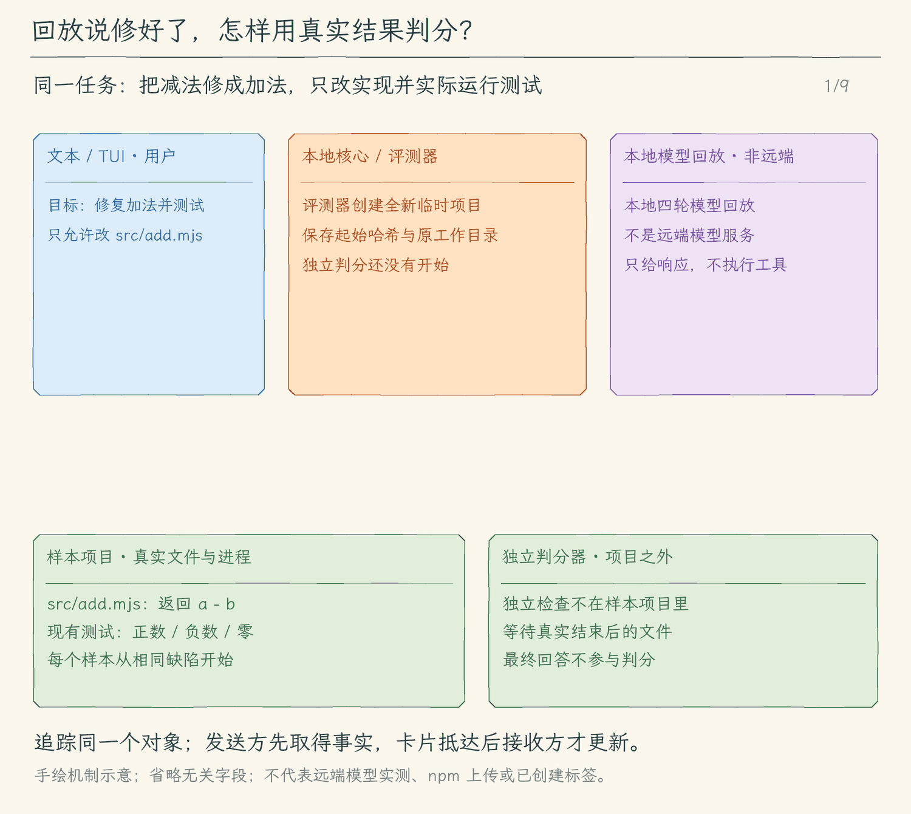

# 35.1 固定任务与离线回放

[本章首页](../README.md) · [下一节：故障与终端回归](../02-failure-and-terminal/README.md)

## 问题：一句“已修好”能证明什么

我们给 Agent 一个小项目：`add(a, b)` 错把加法写成减法。要求是“修复加法，只修改实现，保留现有测试，并运行测试”。如果模型最后回答“修复完成，测试通过”，我们仍需要到磁盘上看：实现变了吗？负数计算对吗？测试是否真的运行过？它有没有顺手删掉断言？

这四个问题分别由文件、计算、进程退出和改动清单回答。最终文字只保留给人阅读，不参与成功判分。这样，即使模型很有把握地说错，评测器也能把任务记为失败。

## 固定任务要先固定哪几件事

本节每次创建一个全新的临时项目。初始实现始终返回 `a - b`，测试固定覆盖正数、两个负数和零加零；任务文字也固定。允许改动的路径只有 `src/add.mjs`。这里的 `.mjs` 是被修复的极小样本项目，Agent、评测器和所有教学实现仍使用 TypeScript。

我们把这些内容与版本号一起放在评测器里。开始时将文件写入新目录，记录它们的哈希；结束后再读取一遍，列出新增、删除与内容改变的路径。允许清单以外有任何改动，就算算出了正确答案也不能算这个任务成功。下一次评测重新创建项目，前一次留下的正确实现不会帮下一次得分。

评测还有一份独立计算检查。检查规则由评测器持有，不写进模型可以编辑的样本目录。每个检查启动一个新的受控 Node 进程，在里面加载实际的加法模块，分别检查 `2 + 3 = 5`、`-2 + -3 = -5`、`0 + 0 = 0`。这避免了“把项目测试改空，然后拿零退出码报喜”。不过它仍只是三个已声明样本，并不证明任意输入都正确。

## 为什么先固定模型的回复

如果今天接入真实模型改好了，明天却读错路径，我们很难立即知道是本地程序退步，还是模型这次选了另一条路。本节先让一个本地回放对象按顺序提供四次完整响应：读取实现与测试、请求精确替换、请求运行项目测试、给出最终回答。

回放对象只替换模型服务的回答来源。它不直接读文件，不调用编辑器，也不伪造测试通过。核心收到工具请求后，仍先检查权限、准备预览、取得本地评测策略的批准，再执行真实文件工具或测试进程。真实结果写入消息以后，核心才再次调用回放对象。

回放还会检查上一步的工具编号是否已经出现在消息里。比如它已经给出 `read-source` 和 `read-tests` 两个读取请求，下一次被调用时必须同时看到这两个编号的结果。少一个就报错。这样，“回放按固定顺序返回”不会掩盖核心漏交一个工具结果的问题。

这里得到的结论很具体：给定这组模型决定，当前核心能够把真实读取结果送回、按批准修改文件、运行测试并收尾。它还不能说明真实模型自己会选出这组决定。35.3 再验证后一部分。

## 一次评测怎样开始、收尾和判分

评测器先保存当前工作目录，再切换到新建的样本目录。已有工具从当前项目根解析相对路径，所以 `src/add.mjs` 会指向样本，普通工程不会成为实验对象。评测串行进行：工作目录是进程共享状态，同一个进程里不能同时切换到两个样本。无论运行成功还是抛错，最后都恢复原目录。

然后，评测器用空消息历史调用原来的 `runAgent`。允许的工具只有读取、精确编辑和运行已固定的项目测试。自动批准也只覆盖样本实现文件的编辑以及这个固定测试；这份策略不装进普通聊天，不给任意 shell 命令授权。模型要求别的工具时，核心在每次执行前按这次任务的工具清单拒绝。我们把清单单独传给核心：它同时筛选模型看到的工具定义、参与输入预算估算，并在本地逐项检查调用。即使模型仍返回被隐藏的工具名，也不能跳过检查。这里不复用子 Agent 的只读限制，因为这个实验确实需要批准后写文件；正常聊天没有提供清单时继续使用原有规则。

评测器同时收集已有事件中的事实：请求次数、工具完成状态、拒绝次数和测试进程退出码。它不把原始工具参数和最终回答整段复制进报告。诊断与完整工具结果放在样本目录旁边的输出目录里，避免评测器自己写日志被误算为模型改文件。

等 `runAgent` 返回或抛错，评测器才开始最终检查。这次等待覆盖本轮模型和工具的收尾，而不是等待屏幕安静。判分需要三个条件同时成立：独立计算检查通过，受保护文件未被改动，而且 Agent 确实通过 `check_project` 获得了成功的测试进程结果。最后回答再漂亮，也不能补上缺少的条件。

| 观察到的事实 | 本节如何判定 | 原因 |
| --- | --- | --- |
| 正确修改实现、真实测试成功，其余文件没变 | 任务通过 | 计算、执行与改动范围都有证据 |
| 最终说成功，但实现还是减法 | 任务失败 | 最终文字没有改变磁盘内容 |
| 实现正确，但没有请求运行测试 | 任务失败 | “完成并测试”的后半部分没有证据 |
| 测试退出为零，但模型改了测试文件 | 任务失败 | 已越过本任务允许的修改范围 |
| 读取失败后仍给出回答 | 保留错误，按实际结果判分 | 正常返回最终回答不等于完成要求 |

<!-- media:lesson:start -->
从同一起点出发，本地回放只提出决定，真实工具完成读改测；最后用独立计算、文件对比和测试事实判分。



[静态流程图](assets/fixed-task-real-grading-flow-c5996e607f.png) · [静态封面](assets/fixed-task-real-grading-cover-3feea78b22.png) · [查看完整静态分镜](assets/fixed-task-real-grading-storyboard-6ff50e0435.jpg)
<!-- media:lesson:end -->

## 本节改动文件

<!-- changes:start -->
| 状态 | 文件 | 本节变化 |
| --- | --- | --- |
| 修改 | [src/agent/run-options.ts](src/agent/run-options.ts) | 为本地任务单独接收工具范围，不改变子任务只读语义 |
| 修改 | [src/agent/agent-loop.ts](src/agent/agent-loop.ts) | 把同一范围用于请求工具定义、预算与逐项执行前的本地权限检查 |
| 新增 | [src/evaluation/fixtures.ts](src/evaluation/fixtures.ts) | 固定有缺陷项目、任务要求、工具范围与任务版本 |
| 新增 | [src/evaluation/replay.ts](src/evaluation/replay.ts) | 按完整响应给出模型决定，并核对上一批调用结果编号 |
| 新增 | [src/evaluation/checks.ts](src/evaluation/checks.ts) | 在受控子进程中逐项检查真实加法实现 |
| 新增 | [src/evaluation/runner.ts](src/evaluation/runner.ts) | 串行创建项目、等待真实核心收尾，再独立判分并保存报告 |
| 新增 | [src/evaluation/command.ts](src/evaluation/command.ts) | 校验独占选项，运行所选实验，显示结果并等待资源收尾 |
| 修改 | [src/cli.ts](src/cli.ts) | 在普通聊天配置前接通独占评测入口，保留其他动作的原有路径 |
<!-- changes:end -->

## 动手构建

从 34.3 的完整源码继续，在本节目录 `src/` 按下面顺序新增或替换完整文件。其他文件保留上一节内容；配套仓库已经提供本节的独立完整快照。

<!-- source:start -->

<!-- build-file: src/agent/run-options.ts -->
<details>
<summary>src/agent/run-options.ts 完整文件</summary>

```typescript
/**
 * 35.1 固定任务与离线回放 | [CHANGED] agent/run-options.ts
 *
 * 学习目标：传递会话持有的工作区管理器与本地调度选项，模型不能自行选择控制对象。
 * 输入：本地入口选定的模式、会话控制对象、调度限制与本轮交互回调。
 * 输出：RunOptions 描述这一轮允许使用的控制入口；这里只定义类型，不执行任务。
 * 状态：模式由启动入口取快照；清单属于会话，补充的收取回调只绑定当前轮。
 * 本文件数据关系（全局主流程见 agent/agent-loop.ts）：
 *   本地界面 -> 本轮选项 -> 核心 / 工具 / 模型请求
 * 缺少可选入口时采用默认模式或不提供对应交互；类型声明不能代替运行时校验。
 * 运行观察：不同界面传入同样的选项，核心仍使用同一条模型与工具循环。
 */
import type { CompactionState } from "../context/compaction.js";
import type { FileCheckpointStore } from "../sessions/file-checkpoints.js";

// [KEEP 来自 12.1] 模式由本地运行入口选择，默认继续执行。
/**
 * 本地入口可选的两种运行模式。
 * plan 只调查和制定计划；execute 仍需遵守每次工具的权限与审批。
 */
export type ExecutionMode = "plan" | "execute";

// [KEEP 来自 12.2] 容器由会话持有，切换模式和开始新一轮不会丢失任务清单。
/**
 * 清单中的一个步骤和模型报告的进度。
 * ID 用来辨认条目，状态不是测试证明；数量和字段限制由 todo_write 运行时检查。
 */
export type TaskItem = {
  id: string;
  text: string;
  status: "pending" | "in_progress" | "completed";
};
/**
 * 会话持有的可替换清单容器。
 * 工具先校验完整新数组再替换 items，失败时旧数组继续使用。
 */
export type TaskState = { items: TaskItem[] };

// [KEEP 来自 12.3] 答案只交回正在等待的工具调用；null 表示用户未回答。
/**
 * 这次澄清要显示的问题与选项。
 * 选项可为空，用户仍可自由回答；内容约束由 ask_user 检查。
 */
export type UserQuestion = { question: string; choices: string[] };
/**
 * 界面提供的专用问答等待入口。
 * 返回有效答案或表示未回答的 null；取消和显示失败可拒绝 Promise。
 */
export type QuestionHandler = (request: UserQuestion, signal: AbortSignal) => Promise<string | null>;

// [KEEP 来自 12.4] ID 用于界面确认哪条补充已被核心收取。
/**
 * 核心实际收取的一条补充。
 * ID 供界面确认哪条已加入上下文；所属轮由界面回调闭包固定。
 */
export type QueuedInput = { id: number; text: string };

/**
 * 把这一轮使用的模式、会话状态和可用控制入口放在一起。
 * 省略可选项时使用默认模式或缺省交互；回调仅负责本轮，不能把旧轮补充带进新轮。
 */
// [KEEP 来自 14.2] 写入前的持久化入口属于本地运行控制，不交给模型。
// [KEEP 来自 19.3] 工具使用进程内已发现目录，模型不能自行选择根目录。
export type RunOptions = {
  // [KEEP 来自 34.3] 本地沉默上限和文本表现不进入模型工具参数或会话权限。
  noProgressTimeoutMs?: number;
  quiet?: boolean;
  // [KEEP 来自 34.1] 本地运行标识由事件流生成；日志目录不来自模型参数。
  runId?: string;
  diagnosticDirectory?: string;
  // [KEEP 来自 32.2] 只接受本地绑定的语言服务，不序列化进会话。
  languageService?: import("../language-service/client.js").LanguageService;
  // [KEEP 来自 27.1] 本地入口配置容量；未列入白名单或有 Hooks 的调用仍串行。
  toolConcurrency?: number;
  // [KEEP 来自 27.2] 白名单只读调用从入批开始计排队，从领槽开始计执行；超期后仍等待收尾。
  toolQueueTimeoutMs?: number;
  toolExecutionTimeoutMs?: number;
  // [KEEP 来自 26.1] 作业属于会话，不能从磁盘恢复PID；子任务allowlist仍阻止启动。
  jobs?: import("../processes/jobs.js").JobManager;
  // [KEEP 来自 28.1] 当前CLI持有自有工作区登记，child不继承写入能力。
  worktrees?: import("../workspaces/worktrees.js").WorktreeManager;
  // [KEEP 来自 29.1] 当前会话共享同一登记；回调只由本地Agent Loop绑定。
  sharedTasks?: import("../collaboration/coordinator.js").SharedCoordinator;
  runSharedTasks?: (signal: AbortSignal) => Promise<import("../collaboration/coordinator.js").SharedTask[]>;
  // [KEEP 来自 29.3] worker只能访问本地绑定的任务和租约，模型不能自报身份。
  sharedWorker?: import("../collaboration/coordinator.js").WorkerLease;
  sessionId?: string;
  childSessionDirectory?: string;
  childDepth?: number;
  maxModelCalls?: number;
  allowedTools?: readonly string[];
  // [CHANGED 35.1] 本地任务工具范围不赋予只读子任务语义；写入仍经过原有审批。
  toolAllowlist?: readonly string[];
  delegateTask?: (argumentsJson: string, signal: AbortSignal) => Promise<import("../subagents/runner.js").ChildResult>;
  // [KEEP 来自 21.1] 连接只存内存，不写会话或给模型选择配置路径。
  // [KEEP 来自 22.1] 本地网页启用状态不写会话。
  web?: import("../web/client.js").WebState;
  mcp?: import("../mcp/client.js").McpState;
  skills?: import("../skills/catalog.js").SkillState;
  // [KEEP 来自 18.2] 只由本地记忆控制器提供，候选参数不能改项目范围。
  memoryRoot?: string;
  // [KEEP 来自 16.1] 摘要只改变请求视图；完整消息仍由会话保存。
  context?: CompactionState;
  // [KEEP 来自 15.2] 本机日志目录供写入和受控读取共用；省略时使用用户目录下的固定位置。
  toolResultDirectory?: string;
  fileCheckpoints?: FileCheckpointStore;
  // [KEEP 来自 12.1] 本轮模式由本地入口取快照。
  mode?: ExecutionMode;
  // [KEEP 来自 12.2] 清单容器跨模型请求和工具调用共用。
  tasks?: TaskState;
  // [KEEP 来自 12.3] 问答是被工具等待的控制入口，观察事件不能替代它。
  askUser?: QuestionHandler;
  // [KEEP 来自 12.4] 由核心请求前主动收取，保持当前轮 FIFO 顺序。
  takePendingInputs?: () => QueuedInput[];
  // [KEEP 来自 12.4] 最终回答后只检查是否待处理，不提前移出队列。
  hasPendingInputs?: () => boolean;
};
```
</details>

<!-- build-file: src/agent/agent-loop.ts -->
<details>
<summary>src/agent/agent-loop.ts 完整文件</summary>

```typescript
/**
 * 35.1 固定任务与离线回放 | [CHANGED] agent/agent-loop.ts
 *
 * [KEEP 来自 27.1] 工具批 -> 相邻只读段(最多 N 项) -> 串行屏障 -> 本批完成 -> 下一次模型决策。
 * [KEEP 来自 27.2] 排队期限 / 领槽后的执行期限 -> 发停止请求 -> await底层收尾 -> 归还槽。
 * [KEEP 来自 27.3] 每项独立缓冲 -> 同伴全部收尾 -> 按原callID顺序提交整批观察 -> 下一次模型。
 * 学习目标：每项单独保存观察，同伴收尾后按原调用身份提交整批结果，再请求模型。
 * 输入：问题、历史、取消信号、事件消费者和审批入口；模型提供实际输入估算，选项连接队列、文件检查点与工具日志。
 * 输出：回答和服务商累计用量；过程另发本地预算和费用估计，失败补齐工具状态、保留历史后抛错。
 * 状态：进入前已取消就不新增历史；清单由会话持有，已经发生的工具操作不会随取消撤销。
 *
 * 全局主流程（从这里进入各模块）：
 *   [CHANGED 35.1] local toolAllowlist -> request definitions + local permission -> existing prepare/approve/execute
 *   [KEEP 来自 29.1–29.3] 父generate -> create/run共享任务工具 -> 固定worker认领 -> 只读子循环
 *       -> 保存关闭 -> 任务快照tool消息 -> 父下一次generate；消息send/read/ack只传线索，不替代任务完成
 *   [KEEP 来自 30.1] CLI schedule create/list -> 本地锁/校验/快照 -> 结束，不加载模型配置
 *   [KEEP 来自 30.2] schedule serve -> 到期且无active？-- 否 -> 等下一tick；是 -> 预算预留落盘 -> 只读runSubagent
 *       -> 工具观察回到子模型 -> runner settle -> 终态写盘 -> 释放active -> 下一tick
 *   [KEEP 来自 30.3] stop -> stopped落盘 -> abort -> await真实settle；显式恢复 -> interrupted/paused，不重放
 *   [KEEP 来自 19.1] 启动discoverSkills -> 名称/用途目录常驻参考，不读正文
 *   [KEEP 来自 19.2] 空闲 /skill review -> 完整读取接纳 -> loaded Map -> 后续system正文
 *   CLI -> 帮助 / 版本 / 诊断？-- 是 -> 显示后结束
 *                            +-- 否 -> 检查输出方式和模式 -- 无效 -> 错误结束
 *                                                         +-- 有效 -> 配置、模型、消费者
 *   [KEEP 来自 13.3] text / TUI -> 新建 ID 或锁定、校验并恢复指定会话；jsonl 仍只输出事件
 *   [KEEP 来自 18.1] --memory / 空闲 /memory -> 本地读写项目记忆，不请求模型
 *   [KEEP 来自 13.4] --sessions / --search / --rename / --export -> 本地管理记录，不请求模型
 *   [KEEP 来自 14.1] --fork ID -> 复制可信状态到新 ID；保留来源记录，不继承旧轮占用或授权
 *   [KEEP 来自 14.3] 空闲 /changes、/restore ID -> 查看差异或按当前内容核验后恢复；不执行旧工具
 *   [KEEP 来自 10.4] auto：交互连续输入 -> TUI；单次问题或管道 -> text
 *   输入界面 -> 草稿 / 历史浏览 / 外部编辑 -> 等用户提交
 *   [KEEP 来自 12.1] 空闲 /mode plan|execute -> 保存会话模式；新一轮取启动快照
 *   [KEEP 来自 12.4] TUI Enter -> 正在运行？-- 是 -> 校验补充 -> 记入当前轮 FIFO 队列
 *                                           +-- 否 -> 本地命令或新一轮问题
 *   [KEEP 来自 12.4] Ctrl+S -> 先保存新要求、锁住提交 -> abort 旧轮 -> 等旧 done
 *                   -> 已退出？-- 是 -> 结束；否 -> 新控制器、新一轮（旧队列留存）
 *   [KEEP 来自 12.5] Ctrl+O -> 草稿 / 历史 / 队列；队列 e 编辑、x 撤回、空闲 Enter 发送
 *                  -> 每次按固定 ID 查找；已收取？-- 是 -> 保留编辑稿、可 Ctrl+B 复制
 *                                                   +-- 否 -> 校验后保存原条目
 *   普通问题 -> streamAgentRun -> runAgent -> run_start -> 事件消费者
 *                                       +-> agentLoop -> 进入前已取消？-- 是 -> 抛错结束
 *                                                                   +-- 否 -> 建立本轮消息
 *   [KEEP 来自 18.1] 首次估算前 await memory.refresh -> 失败走X；成功固定本项任务prompt
 *   [KEEP 来自 12.1] 固定本轮模式 -> A
 *   [KEEP 来自 12.2] 本轮共用会话清单（未提供时创建本轮容器）
 *   A: [KEEP 来自 12.4] 取出当前轮全部补充，保持入队顺序 -> 加入本轮 user 消息
 *       -> input_applied 确认核心收取并加入上下文 -> 再查取消 -> 准备完整输入
 *      [KEEP 来自 12.1] models/client 按模式提示、筛选工具；本地策略仍负责真正禁止
 *      [KEEP 来自 15.1] 同一系统提示 + 实际工具定义 + 历史 / 本轮消息 -> UTF-8 启发式估算 -> context_budget
 *      [KEEP 来自 16.3] 输入估算 + 输出预留 <= 本地窗口？-- 否 -> 完整组候选 -> 独立摘要请求（整项用户任务最多两次）
 *           -> 候选仍超限 / 失败 / 取消？-- 是 -> X（原视图与完整记录保留）
 *                                       +-- 否 -> 提交摘要游标，再请求模型
 *                                                      +-- 是 -> 请求模型
 *      [KEEP 来自 15.1] 请求带输出上限；完整响应的服务商 usage -> 累计已知数 / 未知，另算非账单费用
 *      文字片段 -> 事件消费者；完整结果 -> 结束原因和工具数量一致？-- 否 -> X
 *                                                                        +-- 是 -> B
 *   B: 有工具请求？-- 否 -> 回答非空且未取消？-- 否 -> X
 *                  |                         +-- 是 -> 保存 assistant 回答
 *                  |  [KEEP 来自 12.4] 仍有补充且未到第 8 次？-- 是 -> A（继续决策）
 *                  |                                              +-- 否 -> 提交历史、返回回答
 *                  |  次数已用完时不取走剩余补充，界面队列仍保留
 *                  +-- 是 -> 已到第 8 次？-- 是 -> X（不执行这批工具）
 *                                       +-- 否 -> 保存 assistant 调用 -> S
 *   [KEEP 来自 22.3] 已完整取得来源 -> 台账/模型来源提示 -> 最终引用ID检查 -> 本地核验反馈；不自动重试
 *   [KEEP 来自 22.2] 固定搜索endpoint -> 本次查询审批 -> 有界JSON响应 -> 真正返回的URL/摘要 -> 模型
 *   [KEEP 来自 22.1] 明确启用 -> URL/本次审批 -> 单一期限/逐块限额/逐跳校验 -> 真实来源与正文 -> 模型
 *   [KEEP 来自 21.3] close/断线/定义变化 -> 撤下可调用定义；取消先关闭本地传输，远端副作用仍需核实
 *   [KEEP 来自 21.2] HTTP配置 -> HTTPS/loopback校验 -> 固定Bearer环境变量 -> 官方StreamableHTTP
 *   [KEEP 来自 21.1] 显式MCP配置 -> SDK握手 -> 分页发现/命名 -> 模型定义 -> 逐次审批 -> SDK调用/原调用结果
 *   [KEEP 来自 20.1] 审批通过 -> before_tool JSON -> 阻止/失败？-- 是 -> 原调用错误结果；否 -> 工具
 *   S: [KEEP 来自 27.1] 固定 sequence/callID -> 相邻白名单只读段最多 N 项；其他调用为串行屏障
 *       -> 每项分别进入 C；Hooks 启用时整批串行；当前段全部收尾后才进入下一段
 *       -> 全部段收尾 -> 本批观察齐全 -> A
 *   [KEEP 来自 28.1] create/read/run_worktree_command -> 会话自有ID/base/path -> 同一gate -> 实际状态回D
 *   C: 单项调用 -> [KEEP 来自 12.1] 权限策略 -> Plan 的写入 / 编辑 / 命令？-- 是 -> 拒绝结果 -> D
 *                                                             +-- 否 -> 原有 deny / ask / allow
 *      deny -> 拒绝结果 -> D；ask -> 准备预览 -- 失败 -> 错误结果 -> D
 *                                        +-- 成功 -> 等本次审批 -- 拒绝 -> 拒绝结果 -> D
 *                                                             +-- 批准 -> 执行 -> D
 *      [KEEP 来自 18.2] propose_memory -> 完整正文/依据预览 -> allow_once -> 锁内保存
 *                     拒绝/取消不执行闭包；已保存结果回原调用，下一任务才刷新记忆
 *      [KEEP 来自 19.3] load_skill -> 完整接纳Map -> 成功摘要回D -> 下一请求system加入正文
 *      [KEEP 来自 19.3] read_skill_resource -> 已加载技能内有界读取 -> 文字/来源回D
 *                     资源随原toolCallId结果进下一请求；失败同样有结果，取消走X
 *      allow -> 注册表找到工具 -> 执行 -> D
 *        [KEEP 来自 14.2] write_file / edit_file -> 先保存前后内容检查点，成功才实际写入
 *        [KEEP 来自 12.2] todo_write -> 全部条目校验成功？-- 否 -> ToolError、旧清单不变
 *                                                     +-- 是 -> 一次替换内存清单 -> D
 *        [KEEP 来自 12.3] ask_user -> 校验问题 -> 专用 handler 等回答
 *                            -> 回答有效且未取消？-- 是 -> 原调用的 tool result -> D
 *                                                +-- 否 -> ToolError 或取消 -> D / X
 *                            TUI 面板独占输入；旧请求结束后旧回调失效
 *   [KEEP 来自 20.2] 工具真实结果 -> after_tool -> 追加反馈或失败说明 -> D；取消保留已知结果
 *   D: 单项工具已返回 -> [KEEP 来自 15.2] 正文超过 8000 字符？-- 否 -> 保留正文
 *                                                        +-- 是 -> 写完整本地日志、sync、关闭
 *                                                          -> 成功 -> 6000 头 + 2000 尾 + 省略提示和日志 ID
 *                                                          -> 失败 / 取消 -> 保存已知工具状态与无引用头尾 -> X
 *      [KEEP 来自 15.2] read_tool_result -> 仅按日志 ID、行和列受控续读；错误仍有对应结果
 *      [KEEP 来自 27.1] 保存本项正文 / 裁剪正文、原调用 ID 与错误标记 -> 本项过程事件 -> 返回 S
 *      一批调用全部有结果后才回到下一次模型请求
 *      清单的 completed 是模型报告的进度；测试是否通过仍要看实际命令结果
 *   X: 错误 / 取消 / 次数耗尽 -> 补齐缺少的工具结果 -> 保存历史与本地说明 -> 抛错
 *   [KEEP 来自 20.3] runAgent -> 非取消的完成/错误 -> stop一次 -> 本地反馈；取消不启动stop
 *   runAgent -> run_finish completed / cancelled / error -> 同一事件流
 *   事件流 -> text：正文 stdout、过程 stderr；jsonl：逐条 JSON、等写入回调
 *          +-> TUI：RunView -> 完整显示条目 -> 历史视口
 *   [KEEP 来自 13.1] text / TUI 流清理完 -> Message[] 已提交 -> 白名单检查点 -> 串行 append、sync
 *                  -> 成功 / 保存失败反馈（模型结果另行显示）；TUI done 此后才解除占用
 *   [KEEP 来自 13.1] reset / 有效 mode / 队列编辑撤回 -> 白名单检查点；Enter 入队仍只改内存
 *   [KEEP] 审批：交互 text 或 TUI 等明确决定；jsonl / 非交互环境拒绝待确认请求
 *   [KEEP] Ctrl+C：忙碌取消当前轮并等清理；空闲退出；退出先封住提交再等任务清理
 *   [KEEP] 事件队列超限 / 提前停止消费 -> 取消同一轮、等待模型与工具清理
 *   [KEEP 来自 13.1] 退出 -> 封住提交、取消并等清理 -> 最终检查点 -> close -> TUI 卸载 / text 返回
 *
 * 图中带当前编号的是本节增量；KEEP 表示已经建立的能力。
 * 普通事件最多暂存 128 条，结束事件另有位置；这是事件条数限制，不是总字节内存上限。
 * 模型取得有省略提示的工具正文，完整正文保存在受控日志中；聊天、问答或模式选择不能产生批准。
 * 运行观察：读取按调用身份显示进度；串行屏障等待当前读取段收尾，本批观察齐全后模型才继续。
 */

// [KEEP 来自 20.1] 钩子在原审批完成后运行，不能创造批准。
// [KEEP 来自 21.1] 每次调用重新检查当前定义是否可用。
// [KEEP 来自 22.1] 网页也使用同一条审批与原调用结果通道。
import { randomUUID } from "node:crypto";
import { ChildBudgetError, runSubagent } from "../subagents/runner.js";
import { webDefinitions, citationFeedback } from "../web/client.js";
import { mcpDefinitions } from "../mcp/client.js";
import { runHooks } from "../hooks/lifecycle.js";
import { emptyCompaction, prepareCompaction, requestMessages } from "../context/compaction.js";
import { explainError, ToolError, UserFacingError } from "../errors.js";
import { boundToolResult, clippedToolText } from "../context/tool-results.js";
import { requestFailedBeforeSending, type Message, type Model, type ModelResult, type Reply } from "../models/client.js";
import { decideToolPermission, type ApprovalHandler } from "../permissions/policy.js";
// [KEEP 来自 29.1] 共享调度仍用同一权限/工具/模型返回链路。
import { runSharedTasks } from "../collaboration/runner.js";
import { executePreparedTool, executeTool, prepareTool } from "../tools/registry.js";
import type { PreparedToolCall } from "../tools/types.js";
import { emitAgentEvent, type AgentObserver } from "./events.js";
import type { RunOptions } from "./run-options.js";
// [KEEP 来自 27.1] 原单项权限链由调度器调用，相邻白名单读取才共用有限容量。
import { runToolBatch, validateBatch } from "./tool-batch.js";

const MAX_MODEL_CALLS = 8;

/**
 * 把新一次模型调用的 token 数累加到本轮总量。
 *
 * - 输入：当前累计值和本次调用值；任一值都可能是表示未知的 `null`。
 * - 输出：两项都已知时返回和；任一项未知时返回 `null`。
 * - 关键原因：部分缺失的数据不能计算出真实总量，继续显示数字会造成误导。
 */
function addUsage(total: number | null, value: number | null): number | null {
  return total === null || value === null ? null : total + value;
}

/**
 * 让模型读到问题和真实工具结果，继续决策直到本轮完成或中断。
 * 进入前先检查取消；本轮模式在入口固定，模型提示与权限策略都使用它。
 * 清单容器在这轮工具之间共用；工具完整校验后更新内存，核心不从回答文字推断进度。
 * 每次模型请求前取出当前轮 FIFO 补充，加入本轮消息；上一批工具先全部产生结果。
 * 最终回答后还有补充且未用尽 8 次请求时继续；用尽次数不收取剩余补充。
 * 每个工具先过权限，写入与命令先准备再审批；拒绝和 ToolError 也回给原调用。
 * ask_user 通过注册表等待专用 handler，答案仍是该次工具结果。
 * 成功提交完整本轮消息并返回回答；开始后中断则补齐工具结果、保存说明，再抛出原因。
 * 本函数不会撤销已执行的操作，也不会把聊天、问答或模型承诺当成批准。
 */
// [KEEP 来自 08.3] 本轮中断后保存完整工具状态，下一轮使用新的取消信号继续。
// [KEEP 来自 25.3] 只把子状态转发给父观察者，子文字留在子历史。
export async function agentLoop(
  model: Model,
  history: Message[],
  input: string,
  signal: AbortSignal,
  observer?: AgentObserver,
  requestApproval?: ApprovalHandler,
  // [KEEP 来自 05.3] Set 由终端持有，Agent Loop 在用户输入 s 后写入批准记录。
  sessionGrants: Set<string> = new Set(),
  // [KEEP 来自 12.1] 增加本轮控制选项；调用方把模式快照传到核心。
  options: RunOptions = {},
): Promise<Reply> {
  signal.throwIfAborted();
  const releaseRun = model.beginRun?.();
  // [KEEP 来自 24.1] 验证失败尚未提交 user 消息，也不取走 pending；结束时释放切换锁。
  try { await model.attachments?.preflight(signal, model.profile?.capabilities.images === true); }
  catch (error) { releaseRun?.(); throw error; }
  // [KEEP 来自 12.1] 本轮模式在循环前固定，后面的请求和策略共用它。
  const mode = options.mode ?? "execute";
  const maxModelCalls = Math.min(MAX_MODEL_CALLS, Math.max(1, Math.floor(options.maxModelCalls ?? MAX_MODEL_CALLS)));
  const parentSessionId = options.sessionId ?? randomUUID();
  let childCount = 0;
  // [KEEP 来自 16.1] 会话可复用摘要游标，离线调用者未提供时只在本轮持有。
  const context = options.context ?? emptyCompaction();
  // [KEEP 来自 12.2] 未提供会话容器时，本轮仍能使用同一份任务清单。
  // [KEEP 来自 12.2] 所有清单工具共用同一份容器，未传入时在本轮创建。
  // [KEEP 来自 19.3] 两个只读技能工具共享本模型的已加载集合；审批与Plan仍走原策略。
  // [KEEP 来自 28.1] 本轮采用CLI对象持有的自有工作区登记；不把Git身份写进会话恢复状态。
  const toolOptions: RunOptions = { ...options, jobs: model.jobs ?? options.jobs, worktrees: model.worktrees ?? options.worktrees, sharedTasks: model.sharedTasks ?? options.sharedTasks, languageService: model.languageService ?? options.languageService, mcp: model.mcp, web: model.web, skills: model.skills, memoryRoot: model.memory?.root, tasks: options.tasks ?? { items: [] } };
  toolOptions.delegateTask = async (argumentsJson, childSignal) => {
    if (options.childDepth || ++childCount > 3) throw new ToolError("每轮最多三个只读子任务，子任务不能继续委派。");
    return runSubagent(model, argumentsJson, childSignal, { parentSessionId, sessionDirectory: options.childSessionDirectory, requestApproval, depth: options.childDepth ?? 0,
      // [KEEP 来自 25.3] 子增量和模型编号不混入父流；结构化状态与最终工具结果分别转交。
      observer: event => { if (event.type === "child_state") emitAgentEvent(observer, event); },
    });
  };
  // [KEEP 来自 27.1] 多个只读调用可能请求敏感文件审批；同一界面一次只显示一个批准请求。
  let approvalTail = Promise.resolve();
  const orderedApproval: ApprovalHandler = async (request, approvalSignal) => {
    const previous = approvalTail;
    let release!: () => void;
    approvalTail = new Promise<void>(resolve => { release = resolve; });
    await previous;
    try { approvalSignal.throwIfAborted(); return await requestApproval!(request, approvalSignal); }
    finally { release(); }
  };
  // [KEEP 来自 29.1] 等所有worker子会话收尾后返回，结果继续成为tool消息进入下一次generate。
  toolOptions.runSharedTasks = childSignal => {
    if (options.childDepth || mode === "plan" || !toolOptions.sharedTasks) throw new ToolError("当前模式或子层不能启动共享worker。");
    return runSharedTasks(model, toolOptions.sharedTasks, childSignal, { parentSessionId, sessionDirectory: options.childSessionDirectory,
      requestApproval: requestApproval ? orderedApproval : undefined, observer });
  };
  const attachments = model.attachments?.take();
  const turn: Message[] = [{ role: "user", content: input, ...(attachments?.length ? { attachments } : {}) }];
  let inputTokens: number | null = 0;
  let outputTokens: number | null = 0;
  let truncated = false;
  let cachedInputTokens: number | null = 0, cacheWriteTokens: number | null = 0;
  // [KEEP 来自 23.3] 已发送但未收齐结果时，累计值不能继续冒充整轮总量；未发送的预检拒绝保留旧值。
  const incompleteUsage = (call: number, error: unknown) => {
    if (requestFailedBeforeSending(error)) return;
    inputTokens = outputTokens = cachedInputTokens = cacheWriteTokens = null;
    emitAgentEvent(observer, { type: "model_usage", call, inputTokens, outputTokens,
      costEstimateUsd: null, cachedInputTokens, cacheWriteTokens });
  };
  let toolSequence = 0;
  let pendingToolResults = 0;
  // [KEEP 来自 16.3] 整项用户任务至多两次摘要请求，独立于八次普通决策；候选不原地修改会话。
  let compactionAttempts = 0;

  // [KEEP 来自 08.3] 中断时区分“已开始但没结果”和“尚未开始”的调用。
  // [KEEP 来自 27.1] 并发时可能同时有多个尚未返回结果的调用。
  const executingCallIds = new Set<string>();
  try {
    // [KEEP 来自 18.1] 首次估算前刷新；本项任务后续请求继续共用这份记忆快照。
    await model.memory?.refresh(signal);
    for (let modelCall = 1; modelCall <= maxModelCalls; modelCall += 1) {
      // 每次请求都由核心主动检查取消，不能依赖具体 Model 实现自行处理 signal。
      signal.throwIfAborted();

      // [KEEP 来自 12.4] 每次请求前收取当前轮 FIFO 补充；上一批调用已有完整工具结果。
      for (const queued of options.takePendingInputs?.() ?? []) {
        turn.push({ role: "user", content: queued.text });
        // [KEEP 来自 12.4] 此事件只确认核心已收取并加入本次上下文，不保证远端收到。
        emitAgentEvent(observer, { type: "input_applied", ...queued, call: modelCall });
      }
      signal.throwIfAborted();
      // [KEEP 来自 15.1] 补充已经加入，工具已完成；估算的正是即将发出的整份输入。
      let messages = requestMessages([...history, ...turn], context, toolOptions.tasks?.items);
      // [CHANGED 35.1] 本地任务范围同时约束工具定义、预算与下面每个调用的权限检查。
      let budget = model.inspectContext?.(messages, mode, { allowedTools: options.toolAllowlist });
      if (budget) emitAgentEvent(observer, { type: "context_budget", call: modelCall, budget });
      // [KEEP 来自 16.3] 摘要先进入候选，只有最终普通请求也适配预算，才一次提交新的请求视图。
      if (budget && !budget.withinBudget) {
        const candidate = { ...context };
        try {
          while (!budget.withinBudget && compactionAttempts < 2) {
            compactionAttempts += 1;
            emitAgentEvent(observer, { type: "compaction_start", attempt: compactionAttempts });
            const prepared = await prepareCompaction(model, [...history, ...turn], candidate, signal, mode,
              toolOptions.tasks?.items, result => {
                inputTokens = addUsage(inputTokens, result.inputTokens);
                outputTokens = addUsage(outputTokens, result.outputTokens);
                cachedInputTokens = addUsage(cachedInputTokens, result.cachedInputTokens ?? null);
                cacheWriteTokens = addUsage(cacheWriteTokens, result.cacheWriteTokens ?? null);
                emitAgentEvent(observer, { type: "model_usage", call: modelCall, inputTokens, outputTokens,
                  costEstimateUsd: model.estimateCost?.(inputTokens, outputTokens) ?? null, cachedInputTokens, cacheWriteTokens });
              }, error => incompleteUsage(modelCall, error));
            Object.assign(candidate, prepared.state);
            messages = requestMessages([...history, ...turn], candidate, toolOptions.tasks?.items);
            budget = model.inspectContext!(messages, mode, { allowedTools: options.toolAllowlist });
            emitAgentEvent(observer, { type: "compaction_candidate", attempt: compactionAttempts,
              before: prepared.before, after: prepared.after, through: candidate.through });
          }
          signal.throwIfAborted();
          if (!budget.withinBudget) throw new UserFacingError("本项任务的摘要次数已用尽，请求仍超出本地预算；候选未采用，完整记录保留。");
          Object.assign(context, candidate);
          emitAgentEvent(observer, { type: "compaction_finish", outcome: "applied", through: context.through });
          emitAgentEvent(observer, { type: "context_budget", call: modelCall, budget });
        } catch (error) {
          emitAgentEvent(observer, { type: "compaction_finish", outcome: "retained",
            message: signal.aborted ? "压缩已取消，旧请求视图和完整记录保留。" : explainError(error) });
          throw error;
        }
      }
      emitAgentEvent(observer, {
        type: "model_start",
        call: modelCall,
        contextMessages: messages.length,
        trigger: modelCall === 1
          ? { kind: "user", content: input }
          : { kind: "tool_results", count: pendingToolResults },
      });
      pendingToolResults = 0;
      // [KEEP 来自 08.1] 增量成为观察事件，不提前执行工具，也不把半句回答写入历史。
      // [KEEP 来自 12.1] 模型请求也接收本轮模式；工具隐藏只是辅助。
      let result: ModelResult;
      try {
        result = await model.generate(messages, signal, (text) => {
          if (!signal.aborted) emitAgentEvent(observer, { type: "text_delta", call: modelCall, text });
        // [KEEP 来自 34.2] 通知同一次决策内的退避；只有generate完整返回后才准备工具。
        }, { mode, allowedTools: options.toolAllowlist, onRetry: notice => emitAgentEvent(observer, { type: "model_retry", call: modelCall, ...notice }) });
      } catch (error) { incompleteUsage(modelCall, error); throw error; }
      inputTokens = addUsage(inputTokens, result.inputTokens);
      outputTokens = addUsage(outputTokens, result.outputTokens);
      truncated ||= result.truncated;
      cachedInputTokens = addUsage(cachedInputTokens, result.cachedInputTokens ?? null);
      cacheWriteTokens = addUsage(cacheWriteTokens, result.cacheWriteTokens ?? null);
      // [KEEP 来自 15.1] 任一次 usage 缺失后累计值保持未知，不以估算补充；费用只按用户配置计算。
      emitAgentEvent(observer, { type: "model_usage", call: modelCall, inputTokens, outputTokens,
        costEstimateUsd: model.estimateCost?.(inputTokens, outputTokens) ?? null, cachedInputTokens, cacheWriteTokens });
      emitAgentEvent(observer, {
        type: "model_finish",
        call: modelCall,
        // [KEEP 来自 08.2] 长度上限和拒绝不会伪装成成功回答。
        finishReason: result.finishReason,
        outcome: !["stop", "tool_calls"].includes(result.finishReason) ? "incomplete"
          : result.toolCalls.length > 0 ? "tools" : result.text.trim() ? "final" : "empty",
        toolRequests: result.toolCalls.length,
        text: result.text,
      });

      // [KEEP 来自 08.2] 正常结束与工具数量必须一致，完整响应才允许进入权限判断。
      if (result.finishReason === "length") throw new UserFacingError("回答达到输出上限，本次响应未完成；其中的工具请求不会执行。");
      if (result.finishReason === "refusal") throw new UserFacingError("模型拒绝了本次请求，本次响应中的工具请求不会执行。");
      if (result.finishReason !== (result.toolCalls.length ? "tool_calls" : "stop")) {
        throw new UserFacingError("模型结束原因与内容不一致，或当前接口返回了不支持的结束原因。");
      }
      if (result.toolCalls.length === 0) {
        if (!result.text.trim()) throw new UserFacingError("模型没有返回可用的最终回答。");
        signal.throwIfAborted();
        // [KEEP 来自 22.3] 不编造修复后的引用；本地核验反馈随最终结果显示并保存。
        const feedback = citationFeedback(model.web, result.text);
        const finalText = result.text + (feedback ? `\n\n${feedback}` : "");
        turn.push({ role: "assistant", content: finalText });

        // [KEEP 来自 12.4] 最终回答后仍有补充且有请求预算就继续；第 8 次后的剩余条目保留。
        if (modelCall < maxModelCalls && options.takePendingInputs && options.hasPendingInputs?.()) continue;
        history.push(...turn);
        return { text: finalText, inputTokens, outputTokens, truncated, cachedInputTokens, cacheWriteTokens };
      }

      // 最后一次模型机会仍要求工具时，结果已不可能再反馈给模型，因此不执行无用操作。
      if (modelCall === maxModelCalls) break;

      // [KEEP 来自 27.1] 先固定编号，后续完成乱序不会改变调用身份；副作用与依赖工具是屏障。
      const items = result.toolCalls.map((call, index) => ({ call, sequence: toolSequence + index + 1 }));
      // [KEEP 来自 27.3] 无法配对的响应尚未进入历史，也没有工具开始。
      validateBatch(items);
      turn.push({ role: "assistant", content: result.text, toolCalls: result.toolCalls });
      toolSequence += items.length;
      const observations = new Map(items.map(item => [item.call.id, [] as Message[]]));
      let batchFailed = false, batchError: unknown;
      try {
      await runToolBatch(items, signal, async ({ call, sequence }, callSignal) => {
        // [KEEP 来自 27.3] 同伴不会写进本项数组；完成顺序仅影响即时事件。
        const callMessages = observations.get(call.id)!;
        callSignal.throwIfAborted();
        // [KEEP 来自 12.1] 每次请求仍经过本地模式检查，不能靠模型工具列表保证禁止。
        const permission = (options.allowedTools && !options.allowedTools.includes(call.name))
          || (options.toolAllowlist && !options.toolAllowlist.includes(call.name))
          ? { action: "deny" as const, reason: `当前任务不允许工具：${call.name}` }
          : await decideToolPermission(call, sessionGrants, undefined, mode, new Set([...mcpDefinitions(model.mcp), ...webDefinitions(model.web)].map(tool => tool.name)));
        emitAgentEvent(observer, {
          type: "permission_check",
          sequence,
          call,
          decision: permission,
        });
        let rejection: string | null = null;
        let prepared: PreparedToolCall | null = null;
        // [KEEP 来自 08.3] 权限检查期间也可能收到取消。
        callSignal.throwIfAborted();
        if (permission.action === "deny") rejection = `权限拒绝：${permission.reason}`;
        if (permission.action === "ask") {
          try {
            // [KEEP 来自 06.1] prepareTool 只检查并准备预览，不写文件，也不启动命令。
            // [KEEP 来自 14.2] 把本地文件检查点入口传到写入准备层。
            prepared = await prepareTool(call, callSignal, toolOptions);
          } catch (error) {
            if (!(error instanceof ToolError)) throw error;
            callMessages.push({
              role: "tool",
              toolCallId: call.id,
              content: `工具准备失败：${error.message}`,
              isError: true,
            });
            pendingToolResults += 1;
            emitAgentEvent(observer, {
              type: "tool_prepare",
              sequence,
              call,
              outcome: "error",
              error: error.message,
            });
            return false;
          }
          if (prepared) {
            emitAgentEvent(observer, {
              type: "tool_prepare",
              sequence,
              call,
              outcome: "success",
              previewChars: prepared.preview.length,
            });
          }
          emitAgentEvent(observer, {
            type: "approval_start",
            sequence,
            call,
            scope: permission.scope,
            allowSession: permission.remember,
            hasPreview: prepared !== null,
          });
          const response = requestApproval
            ? await orderedApproval({
                call,
                reason: permission.reason,
                resource: permission.resource,
                scope: permission.scope,
                allowSession: permission.remember,
                ...(prepared ? { preview: prepared.preview } : {}),
              }, callSignal)
            : { decision: "deny" as const, reason: "当前运行方式无法请求用户批准" };
          // [KEEP 来自 08.3] 用户取消不保存刚刚返回的会话授权。
          callSignal.throwIfAborted();
          emitAgentEvent(observer, {
            type: "approval_finish",
            sequence,
            call,
            response,
          });
          // [KEEP 来自 06.1] 写入和命令批准都不能保存；只有可复用的读取范围进入 Set。
          if (response.decision === "allow_session") {
            if (permission.remember) sessionGrants.add(permission.scope);
            // [KEEP 来自 07.1] 写入与命令都只能批准当前操作。
            else rejection = "当前批准只适用于这一次操作预览";
          }
          if (response.decision === "deny") rejection = `用户未批准工具执行：${response.reason}`;
        }
        if (rejection) {
          callMessages.push({ role: "tool", toolCallId: call.id, content: rejection, isError: true });
          pendingToolResults += 1;
          return false;
        }
        // [KEEP 来自 08.3] 审批后的取消必须在真实工具启动之前生效。
        callSignal.throwIfAborted();
        executingCallIds.add(call.id);
        emitAgentEvent(observer, { type: "tool_start", sequence, call });
        try {
          // [KEEP 来自 04.1] 同一个取消信号继续穿过注册表，文件遍历和读取才能响应取消。
          // [KEEP 来自 06.1] 已准备的 execute 保存了用户刚刚审查的文件修改或命令。
          // [KEEP 来自 12.2] 直接工具收到本轮共用选项，清单更新使用同一个容器。
          // [KEEP 来自 20.1] 取消或before失败时尚未启动工具。
          if (mode !== "plan") {
            const before = await runHooks(model.hooks, "before_tool", { call }, callSignal);
            if (before.blocked) throw new ToolError(`执行前钩子阻止工具：${before.messages.join("\n") || "脚本拒绝"}`);
          }
          let result = prepared
            ? await executePreparedTool(prepared, callSignal, toolOptions)
            : await executeTool(call, callSignal, toolOptions);
          if (result.metadata.kind === "subagent") {
            const childUsage = result.metadata.result.usage;
            inputTokens = addUsage(inputTokens, childUsage.inputTokens); outputTokens = addUsage(outputTokens, childUsage.outputTokens);
            cachedInputTokens = addUsage(cachedInputTokens, childUsage.cachedInputTokens); cacheWriteTokens = addUsage(cacheWriteTokens, childUsage.cacheWriteTokens);
            emitAgentEvent(observer, { type: "model_usage", call: modelCall, inputTokens, outputTokens, cachedInputTokens, cacheWriteTokens, costEstimateUsd: model.estimateCost?.(inputTokens, outputTokens) ?? null });
          }
          if (result.metadata.kind === "subagent" && callSignal.aborted) {
            callMessages.push({ role: "tool", toolCallId: call.id, content: result.content, isError: true });
            executingCallIds.delete(call.id);
            emitAgentEvent(observer, { type: "tool_finish", sequence, call, outcome: "success", result });
            callSignal.throwIfAborted();
          }
          // [KEEP 来自 20.2] 保存真实结果后才运行后置钩子；失败只追加说明，绝不把已执行改成未执行。
          if (mode !== "plan") {
            try {
              const after = await runHooks(model.hooks, "after_tool", { call, result: result.content.slice(0, 8000), outcome: result.isError ? "error" : "success" }, callSignal);
              if (after.messages.length) result = { ...result, content: `${result.content}\n\n[本地执行后钩子反馈；不是权限]\n${after.messages.join("\n")}` };
            } catch (error) {
              if (!(error instanceof ToolError)) {
                callMessages.push({ role: "tool", toolCallId: call.id, content: result.content + "\n[本地状态] 后置钩子中断；工具已返回，副作用未撤销。", isError: result.isError ?? false });
                executingCallIds.delete(call.id);
                throw error;
              }
              result = { ...result, content: `${result.content}\n[本地执行后钩子失败] ${error.message}` };
            }
          }
          // [KEEP 来自 15.2] 工具已返回，执行状态已知；日志保存失败也不能把它改写成“未执行”。
          executingCallIds.delete(call.id);
          let modelContent: string;
          try { modelContent = (await boundToolResult(result.content, callSignal, options.toolResultDirectory)).content; }
          catch (error) {
            // 原工具的错误标记保持不变；给本次调用留下明确摘要，不声明不存在的日志引用。
            const content = `[本地状态：工具已返回，但完整日志未保存；本轮停止，以下仅为头尾，不能找回被省略部分]\n${clippedToolText(result.content)}`;
            callMessages.push({ role: "tool", toolCallId: call.id, content, isError: result.isError ?? false });
            emitAgentEvent(observer, { type: "tool_finish", sequence, call, outcome: "success", result: { ...result, content } });
            throw error;
          }
          // [KEEP 来自 07.1] 非零退出码仍是错误；裁剪不改变原调用编号或成功/失败。
          callMessages.push({ role: "tool", toolCallId: call.id, content: modelContent, isError: result.isError ?? false });
          pendingToolResults += 1;
          emitAgentEvent(observer, {
            type: "tool_finish",
            sequence,
            call,
            outcome: "success",
            result: { ...result, content: modelContent },
          });
          // [KEEP 来自 27.1] 工具返回的错误标记也决定调度终态，避免 succeeded 覆盖界面失败状态。
          return !result.isError;
        } catch (error) {
          // [KEEP 来自 03.3] 预期内的工具错误回到循环；编程错误、系统异常仍交给外层处理。
          if (!(error instanceof ToolError)) throw error;
          callMessages.push({
            role: "tool",
            toolCallId: call.id,
            content: `工具执行失败：${error.message}`,
            isError: true,
          });
          // [KEEP 来自 08.3] 已经返回的工具结果保留；取消不会撤销真实副作用。
          executingCallIds.delete(call.id);
          pendingToolResults += 1;
          emitAgentEvent(observer, {
            type: "tool_finish",
            sequence,
            call,
            outcome: "error",
            error: error.message,
          });
          return false;
        }
      }, (item, state) => emitAgentEvent(observer, { type: "tool_state", ...item, state }),
      // [KEEP 来自 27.2] 超时与取消交代原调用身份；已返回的真实结果保留并补充本地状态。
      { concurrency: options.toolConcurrency, serial: Boolean(model.hooks),
        queueTimeoutMs: options.toolQueueTimeoutMs, executionTimeoutMs: options.toolExecutionTimeoutMs,
        onFailure: ({ call, sequence }, failure) => {
          // [KEEP 来自 27.3] 超时/取消也填入同一项；真实结果已返回时追加状态，不重复一份消息。
          const callMessages = observations.get(call.id)!;
          const last = callMessages[callMessages.length - 1];
          if (last?.role === "tool") { last.content += `\n[本地状态] ${failure.message}`; last.isError = true; }
          else { callMessages.push({ role: "tool", toolCallId: call.id, content: failure.message, isError: true }); pendingToolResults += 1; }
          executingCallIds.delete(call.id);
          emitAgentEvent(observer, { type: "tool_finish", sequence, call, outcome: "error", error: last?.role === "tool" ? last.content : failure.message });
        },
      });
      } catch (error) { batchFailed = true; batchError = error; }
      finally {
        // [KEEP 来自 27.3] 即使父取消或同伴异常，也先提交已取得的真实结果及未启动交代。
        for (const { call } of items) turn.push(...observations.get(call.id)!);
        pendingToolResults = items.length;
        emitAgentEvent(observer, { type: "tool_batch_finish", call: modelCall,
          results: items.length, interrupted: batchFailed });
      }
      if (batchFailed) throw batchError;

    }

    if (options.childDepth) throw new ChildBudgetError("子任务已用尽模型决策次数，尚未得到完整最终回答。");
    throw new UserFacingError(`Agent 连续请求模型 ${maxModelCalls} 次仍未得到最终回答，已停止本轮。`);
  } catch (error) {
    // [KEEP 来自 08.3] 保存完整调用及其状态；未收齐的模型输出从未进入 turn。
    // 每个批次单独配对：后续模型请求即使复用同一个 ID，也不能借用前一批的完成记录。
    const lastBatch = turn.map((message) => message.role === "assistant" && Boolean(message.toolCalls?.length)).lastIndexOf(true);
    const completed = new Set(turn.slice(lastBatch + 1).filter((message) => message.role === "tool").map((message) => message.toolCallId));
    for (const message of lastBatch < 0 ? [] : [turn[lastBatch]]) {
      if (message.role !== "assistant") continue;
      for (const call of message.toolCalls ?? []) {
        if (completed.has(call.id)) continue;
        turn.push({ role: "tool", toolCallId: call.id, isError: true,
          content: executingCallIds.has(call.id)
            ? "操作已开始，但本轮中断前没有取得完整结果。可能已发生部分修改，请先核实当前文件或进程状态，不要直接重试。"
            : "本轮在该工具启动前中断，这个调用未执行。" });
        completed.add(call.id);
      }
    }
    // 这条状态由本地程序生成，明确标注来源，不把它冒充模型完成的回答。
    // [KEEP 来自 09.2] 按取消原因写入本地状态；队列或输出故障是错误，普通取消才记为取消。
    const cancelled = signal.aborted && !(signal.reason instanceof UserFacingError);
    turn.push({ role: "assistant", content: cancelled
      ? "[本地状态] 本轮已取消。已执行的操作不会自动撤销；继续前先核实工具结果。"
      : "[本地状态] 本轮因错误中断。已执行的操作不会自动撤销；继续前先核实工具结果。" });
    history.push(...turn);
    throw error;
  } finally { releaseRun?.(); }
}
```
</details>

<!-- build-file: src/evaluation/fixtures.ts -->
<details>
<summary>src/evaluation/fixtures.ts 完整文件</summary>

```typescript
/**
 * 35.1 固定任务与离线回放 | [NEW] evaluation/fixtures.ts
 * 学习目标：固定起点、要求、版本和允许改动，使每次比较面对相同实验
 * 输入：明确选择的固定样本；输出：结构化事实，不以最终文字判成功。
 * 本文件局部流程（全局主流程见 agent/agent-loop.ts）：版本化定义 -> 全新项目 -> 独立检查。
 * 状态：只操作评测器自建样本；异常保留文件供核对，调用者等待收尾。
 */
// [NEW 35.1] 评测专用入口，不向普通聊天注册新工具或自动批准。
export const TASK_VERSION = "add-v1";
export const TASK_INPUT = "修复 add 的加法错误。只修改 src/add.mjs，保留其他文件，运行已有 test 脚本确认。";
export const ALLOWED_TOOLS = ["read_file", "edit_file", "check_project"] as const;
export const FIXTURE_FILES: Readonly<Record<string, string>> = {
  "package.json": JSON.stringify({ name: "agent-evaluation-fixture", private: true, type: "module", scripts: { test: "node --test test/add.test.mjs" } }, null, 2) + "\n",
  "src/add.mjs": "export function add(a, b) { return a - b; }\n",
  "test/add.test.mjs": 'import { test } from "node:test";\nimport assert from "node:assert/strict";\nimport { add } from "../src/add.mjs";\ntest("positive", () => assert.equal(add(2, 3), 5));\ntest("negative", () => assert.equal(add(-2, -3), -5));\ntest("zero", () => assert.equal(add(0, 0), 0));\n',
};
```
</details>

<!-- build-file: src/evaluation/replay.ts -->
<details>
<summary>src/evaluation/replay.ts 完整文件</summary>

```typescript
/**
 * 35.1 固定任务与离线回放 | [NEW] evaluation/replay.ts
 * 学习目标：把固定响应交给真实核心，并要求上一批工具结果已经进入消息
 * 输入：明确选择的固定样本；输出：结构化事实，不以最终文字判成功。
 * 本文件局部流程（全局主流程见 agent/agent-loop.ts）：响应清单 -> 核对调用ID -> 完整ModelResult。
 * 状态：只操作评测器自建样本；异常保留文件供核对，调用者等待收尾。
 */
// [NEW 35.1] 评测专用入口，不向普通聊天注册新工具或自动批准。
import type { Message, Model, ModelResult } from "../models/client.js";
import type { ToolCall } from "../tools/registry.js";

export type Scenario = "repair";

/** 只建立模型请求的数据，不直接读取、编辑或测试样本。 */
function call(id: string, name: string, input: Record<string, unknown>): ToolCall {
  return { id, name, arguments: JSON.stringify(input) };
}

/** 固定响应不伪造远端用量，空值不表示一次免费在线请求。 */
function result(toolCalls: ToolCall[] = [], text = ""): ModelResult {
  return { text, toolCalls, finishReason: toolCalls.length ? "tool_calls" : "stop",
    inputTokens: null, outputTokens: null, truncated: false };
}

/**
 * 逐次给出读、改、测决定；下一次调用先核对上一批结果，而不是绕开Agent Loop。
 * 每个实例独占游标；缺失结果或额外调用抛错，暴露漏回传与终止分支回归。
 */
export function createReplay(_scenario: Scenario = "repair"): Model {
  const frames = [
    result([call("read-source", "read_file", { path: "src/add.mjs", offset: 1, limit: 40 }),
      call("read-tests", "read_file", { path: "test/add.test.mjs", offset: 1, limit: 40 })]),
    result([call("fix-add", "edit_file", { path: "src/add.mjs", old_text: "return a - b;", new_text: "return a + b;" })]),
    result([call("test-add", "check_project", { script: "test" })]),
    result([], "加法已修复，测试通过。"),
  ];
  let index = 0;
  return {
    async generate(messages: Message[], signal: AbortSignal) {
      signal.throwIfAborted();
      const previous = frames[index - 1];
      for (const tool of previous?.toolCalls ?? []) {
        if (!messages.some(message => message.role === "tool" && message.toolCallId === tool.id)) {
          throw new Error("回放没有收到上一批全部工具结果。");
        }
      }
      const frame = frames[index++];
      if (!frame) throw new Error("回放响应已耗尽。");
      return structuredClone(frame);
    },
  };
}
```
</details>

<!-- build-file: src/evaluation/checks.ts -->
<details>
<summary>src/evaluation/checks.ts 完整文件</summary>

```typescript
/**
 * 35.1 固定任务与离线回放 | [NEW] evaluation/checks.ts
 * 学习目标：用评测器持有的计算断言检查真实实现，不信任项目测试被改写后的结论
 * 输入：明确选择的固定样本；输出：结构化事实，不以最终文字判成功。
 * 本文件局部流程（全局主流程见 agent/agent-loop.ts）：固定断言 -> 已有隔离命令执行器 -> 独立结果。
 * 状态：只操作评测器自建样本；异常保留文件供核对，调用者等待收尾。
 */
// [NEW 35.1] 评测专用入口，不向普通聊天注册新工具或自动批准。
import { prepareRunCommand } from "../tools/run-command.js";

export type CalculationCheck = { name: string; passed: boolean };
export const CALCULATION_VERSION = "integer-v1";
const CASES = [
  { name: "positive", a: 2, b: 3, expected: 5 },
  { name: "negative", a: -2, b: -3, expected: -5 },
  { name: "zero", a: 0, b: 0, expected: 0 },
];

/** shell单引号保护字面参数，路径或代码中的引号不能变成命令。 */
function quote(value: string): string { return "'" + value.replaceAll("'", "'\\''") + "'"; }

/**
 * 每个断言在新的受既有隔离限制的Node进程中运行；不在评测宿主加载模型修改的代码。
 * 不执行模型给出的命令；超时、启动错误或非零退出均给该项明确失败，继续检查其余项。
 */
export async function checkCalculations(root: string): Promise<CalculationCheck[]> {
  const checks: CalculationCheck[] = [];
  for (const item of CASES) {
    try {
      const code = `import assert from "node:assert/strict";import { add } from "./src/add.mjs";assert.equal(add(${item.a},${item.b}),${item.expected});`;
      const prepared = await prepareRunCommand(JSON.stringify({ command: `${quote(process.execPath)} --input-type=module -e ${quote(code)}`, cwd: ".", timeout_ms: 3000 }), root);
      const result = await prepared.execute(new AbortController().signal);
      const metadata = result.metadata;
      checks.push({ name: item.name, passed: !result.isError && metadata?.kind === "run_command" && metadata.exitCode === 0 });
    } catch { checks.push({ name: item.name, passed: false }); }
  }
  return checks;
}
```
</details>

<!-- build-file: src/evaluation/runner.ts -->
<details>
<summary>src/evaluation/runner.ts 完整文件</summary>

```typescript
/**
 * 35.1 固定任务与离线回放 | [NEW] evaluation/runner.ts
 * 学习目标：在真实临时项目运行核心，独立核对计算、改动和测试事实
 * 输入：明确选择的固定样本；输出：结构化事实，不以最终文字判成功。
 * 本文件局部流程（全局主流程见 agent/agent-loop.ts）：新建起点 -> runAgent -> 等待结束 -> 独立判分 -> 报告。
 * 状态：只操作评测器自建样本；异常保留文件供核对，调用者等待收尾。
 */
// [NEW 35.1] 评测专用入口，不向普通聊天注册新工具或自动批准。
import { createHash } from "node:crypto";
import { mkdir, mkdtemp, readdir, readFile, writeFile } from "node:fs/promises";
import { dirname, join, resolve } from "node:path";
import { release } from "node:os";
import { runAgent } from "../agent/run.js";
import type { AgentEvent } from "../agent/events.js";
import type { Model } from "../models/client.js";
import { ALLOWED_TOOLS, FIXTURE_FILES, TASK_INPUT, TASK_VERSION } from "./fixtures.js";
import { CALCULATION_VERSION, checkCalculations } from "./checks.js";
import { createReplay, type Scenario } from "./replay.js";

export type CaseReport = {
  version: 1; taskVersion: string; calculationVersion: string; scenario: Scenario;
  mode: "offline"; workspace: string; reportPath: string;
  platform: { os: string; release: string; arch: string; node: string };
  startHashes: Record<string, string>; changedPaths: string[];
  outcome: "completed" | "cancelled" | "error";
  taskPassed: boolean; expectationPassed: boolean; testSucceeded: boolean;
  checks: { name: string; passed: boolean }[];
  modelCalls: number; toolResults: number; toolErrors: number; refusals: number;
  elapsedMs: number; inputTokens: number | null; outputTokens: number | null; costEstimateUsd: number | null;
};
// process.chdir是进程全局状态；同进程的两个评测不允许交错进入不同项目。
let evaluating = false;

/** 不跟随符号链接；记录类型和字节哈希，新增、删除与普通文件改动都能被发现。 */
async function inventory(root: string, prefix = ""): Promise<Record<string, string>> {
  const output: Record<string, string> = {};
  for (const entry of await readdir(join(root, prefix), { withFileTypes: true })) {
    const name = prefix ? `${prefix}/${entry.name}` : entry.name;
    if (entry.isDirectory()) Object.assign(output, await inventory(root, name));
    else output[name] = entry.isFile() ? createHash("sha256").update(await readFile(join(root, name))).digest("hex") : "not-regular-file";
  }
  return output;
}

/**
 * 运行一个样本，不接触当前项目；只批准固定实现的精确编辑与已知test脚本。
 * 先等核心结束再核对磁盘；文件保留，报告写在样本外面，异常不自动回滚。
 */
export async function evaluateCase(outputDirectory: string, scenario: Scenario = "repair"): Promise<CaseReport> {
  if (evaluating) throw new Error("同一进程中的评测必须串行执行。");
  evaluating = true;
  const previous = process.cwd();
  const started = performance.now();
  try {
    const parent = resolve(outputDirectory);
    await mkdir(parent, { recursive: true, mode: 0o700 });
    const directory = await mkdtemp(join(parent, `${scenario}-`));
    const workspace = join(directory, "workspace");
    for (const [name, content] of Object.entries(FIXTURE_FILES)) {
      await mkdir(dirname(join(workspace, name)), { recursive: true });
      await writeFile(join(workspace, name), content, { flag: "wx" });
    }
    const startHashes = await inventory(workspace);
    const events: AgentEvent[] = [];
    const controller = new AbortController();
    let outcome: CaseReport["outcome"] = "error";
    process.chdir(workspace);
    try {
      await runAgent(createReplay(scenario), [], TASK_INPUT, controller.signal, event => { events.push(event); },
        async request => {
          const input: unknown = JSON.parse(request.call.arguments);
          const args = input as Record<string, unknown>;
          const allowed = (request.call.name === "edit_file" && args.path === "src/add.mjs")
            || (request.call.name === "check_project" && args.script === "test" && Object.keys(args).length === 1);
          return allowed ? { decision: "allow_once" } : { decision: "deny", reason: "固定评测只允许修改实现并运行原测试。" };
        }, new Set(), { toolAllowlist: ALLOWED_TOOLS, maxModelCalls: 8,
          diagnosticDirectory: join(directory, "diagnostics"), toolResultDirectory: join(directory, "tool-results") });
      outcome = "completed";
    } catch { outcome = controller.signal.aborted ? "cancelled" : "error"; }
    const checks = await checkCalculations(workspace);
    const after = await inventory(workspace);
    const changedPaths = [...new Set([...Object.keys(startHashes), ...Object.keys(after)])]
      .filter(name => startHashes[name] !== after[name]).sort();
    const testSucceeded = events.some(event => event.type === "tool_finish" && event.call.name === "check_project"
      && event.outcome === "success" && !event.result.isError && event.result.metadata?.kind === "run_command"
      && event.result.metadata.exitCode === 0);
    const taskPassed = outcome === "completed" && checks.every(item => item.passed) && testSucceeded
      && changedPaths.every(name => name === "src/add.mjs");
    const report: CaseReport = {
      version: 1, taskVersion: TASK_VERSION, calculationVersion: CALCULATION_VERSION, scenario,
      mode: "offline", workspace, reportPath: join(directory, "report.json"),
      platform: { os: process.platform, release: release(), arch: process.arch, node: process.version },
      startHashes, changedPaths, outcome, taskPassed, expectationPassed: taskPassed, testSucceeded, checks,
      modelCalls: events.filter(event => event.type === "model_start").length,
      toolResults: events.filter(event => event.type === "tool_finish").length,
      toolErrors: events.filter(event => (event.type === "tool_finish" || event.type === "tool_prepare") && event.outcome === "error").length,
      refusals: events.filter(event => event.type === "approval_finish" && event.response.decision === "deny").length,
      elapsedMs: Math.round(performance.now() - started), inputTokens: null, outputTokens: null, costEstimateUsd: null,
    };
    await writeFile(report.reportPath, JSON.stringify(report, null, 2) + "\n", { flag: "wx", mode: 0o600 });
    return report;
  } finally { process.chdir(previous); evaluating = false; }
}

/** 串行入口在35.2扩展故障样本；每次返回与磁盘报告相同的事实。 */
export async function runEvaluation(suite: "offline", directory: string) {
  const cases = [await evaluateCase(directory)];
  return { suite, passed: cases.every(item => item.expectationPassed), cases };
}
```
</details>

<!-- build-file: src/evaluation/command.ts -->
<details>
<summary>src/evaluation/command.ts 完整文件</summary>

```typescript
/**
 * 35.1 固定任务与离线回放 | [NEW] evaluation/command.ts
 * 学习目标：在任何模型配置读取之前完成离线实验，拒绝混用其他动作
 * 输入：明确选择的固定样本；输出：结构化事实，不以最终文字判成功。
 * 本文件局部流程（全局主流程见 agent/agent-loop.ts）：校验独占选项 -> 离线评测 -> 报告位置与退出状态。
 * 状态：只操作评测器自建样本；异常保留文件供核对，调用者等待收尾。
 */
// [NEW 35.1] 评测专用入口，不向普通聊天注册新工具或自动批准。
import { resolve } from "node:path";
import { runEvaluation } from "./runner.js";
import { UserFacingError } from "../errors.js";

/** 校验整组选项后才创建样本；不存在的suite不能悄悄变成在线请求。 */
export async function runEvaluationCommand(options: Record<string, unknown>): Promise<void> {
  const allowed = new Set(["evaluate", "evaluationDir", "output"]);
  if (Object.entries(options).some(([key, value]) => value !== undefined && value !== false
    && (!allowed.has(key) || (key === "output" && value !== "auto")))) {
    throw new UserFacingError("--evaluate 请单独使用，可配合 --evaluation-dir。");
  }
  if (options.evaluate !== "offline") throw new UserFacingError("评测类型必须为 offline。");
  const directory = resolve(typeof options.evaluationDir === "string" ? options.evaluationDir : "evaluation-results");
  const report = await runEvaluation(options.evaluate, directory);
  for (const item of report.cases) console.log(`${item.expectationPassed ? "通过" : "失败"} ${item.scenario}；报告：${item.reportPath}`);
  if (!report.passed) process.exitCode = 1;
}
```
</details>

<!-- build-file: src/cli.ts -->
<details>
<summary>src/cli.ts 完整文件</summary>

```typescript
#!/usr/bin/env node
/**
 * 35.1 固定任务与离线回放 | [CHANGED] cli.ts
 *
 * 学习目标：保留原有 CLI 装配与本地管理，所有自有任务结束后释放共享隔离资源。
 * 输入：模型选项与本地管理选项；--sandbox-info/check 在模型配置前独占处理。
 * 输出：装配模型后选择一个消费者；入口错误由 stderr 说明并设置 exitCode=1。
 * 状态：入口不持有消息历史或授权；只创建 writer，消费者提供白名单快照。
 *
 * 本文件局部流程（全局主流程见 agent/agent-loop.ts）：
 *   [KEEP 来自 30.1] argv[2]=schedule？-- 是 -> 独立定时管理 -> 结束；否 -> 普通聊天入口
 *   显式网页/搜索选项且非 Plan？-- 是 -> 完整校验本地配置 -> 创建 WebState；否 -> 不启用网页
 *   配置失败 -> 启动错误；配置成功只装配工具，不提前抓取或查询
 *   [KEEP 来自 18.1] --memory -> 检查混用和模式 -> 找真实项目根 -> 本地管理 -> 结束
 *   [KEEP 来自 19.1] 正常启动 -> 同根discoverSkills -> 只把名称/用途交给模型和启动信息
 *   --help / --version -> 显示文字 -> 结束；--doctor -> 显示环境 -> 结束
 *   [KEEP] 输出格式受支持？-- 否 -> 抛出 UserFacingError
 *                            +-- 是 -> 继续检查运行方式
 *   [KEEP] auto？-- 是 -> 无 --prompt 且 stdin/stdout 为 TTY、TERM 非 dumb？
 *                     是 -> tui；否 -> text
 *                +-- 否 -> 保留显式选择
 *   tui？-- 是 -> stdin/stdout 为 TTY、TERM 非 dumb，且没有 --prompt？
 *                否 -> 抛错；是 -> 读取配置、创建模型 -> 动态载入 app -> startTui
 *        +-- 否 -> jsonl 但缺少 --prompt？-- 是 -> 抛错
 *                                          +-- 否 -> 读取配置、创建模型
 *   [KEEP 来自 13.1] text / tui -> 创建新会话文件、显示 ID 和路径 -> 消费者 -> finally close
 *   非 TUI 分支 -> 无 --prompt？-- 是 -> startTerminal
 *                              +-- 否 -> 内容为空？-- 是 -> 抛错
 *                                                  +-- 否 -> jsonl / text 单次消费者
 *   运行抛错 -> explainError -> stderr、exit 1；单次用户取消由消费者设 exit 130
 *
 * auto 在没有 --prompt、stdin/stdout 都是 TTY 且 TERM 不是 dumb 时选择 tui，其余选择 text。
 * TUI 只接受连续输入，单次任务继续用 text 或 jsonl；JSONL 必须同时给 --prompt。
 * 动态 import 只在 tui 分支载入 React / Ink，脚本模式不需要初始化终端界面。
 * --help、--version 不读取模型配置；--doctor 只做本地校验，不创建SDK或联网。
 *
 * [KEEP 来自 12.1] --mode plan|execute 在创建模型前校验，再传给每种消费者。
 * [KEEP 来自 12.2] 非 TUI 入口为当前会话准备共用清单；TUI 在 startTui 内创建自己的清单。
 * 运行观察：直接在交互终端启动会进入 TUI；单次提问、管道和 dumb 终端仍走 text。
 */
// [KEEP 来自 31.3] 无需密钥的管理入口及显式启动、退出收尾。


// [KEEP 来自 18.1] 本地记忆动作在模型配置与会话创建前完成。
// [KEEP 来自 20.1] 项目脚本必须由本次启动显式启用。
// [KEEP 来自 21.1] 显式配置授权启动服务，退出始终关闭本次连接。
// [KEEP 来自 22.1] 网络开关不读取网页或会话里的指令。
import { closeSandbox } from "./sandbox/runtime.js";
import { sandboxInfo, runSandboxCheck, formatSandboxReport } from "./sandbox/diagnostics.js";
import { runCodeCommand } from "./code-command.js";
import { loadWeb } from "./web/client.js";
import { runScheduleCommand } from "./schedules/commands.js";
import { ExtensionManager } from "./extensions/manager.js";
import { extensionCommand } from "./extensions/commands.js";
import { connectMcp, mcpInfo } from "./mcp/client.js";
import { loadHooks } from "./hooks/lifecycle.js";
// [KEEP 来自 19.1] 固定项目目录发现元信息，不加载正文。
import { discoverSkills, skillInfo } from "./skills/catalog.js";
import { createMemoryController, memoryCommand } from "./memory/commands.js";
import { findProjectRoot } from "./project/instructions.js";
import { dirname } from "node:path";
// [KEEP 来自 17.1] 启动时完成项目说明快照，进入模型与界面前只读一次。
import { loadProjectInstructions, projectInstructionInfo } from "./project/instructions.js";
import { createFileCheckpointStore } from "./sessions/file-checkpoints.js";
import { readFileSync } from "node:fs";
// [KEEP 来自 13.3] 使用真实目录比较工作区，符号链接别名不会误判成另一个项目。
import { forkSessionWriter } from "./sessions/fork-session.js";
import { realpath } from "node:fs/promises";
import { Command } from "commander";
// [CHANGED 35.1] 评测先于普通模型配置，只在自建样本中执行。
import { runEvaluationCommand } from "./evaluation/command.js";
// [KEEP 来自 34.3] doctor只复用本地校验，不创建SDK或任何执行资源。
import { diagnoseConfiguration } from "./diagnostics/config.js";
import { readConfig, type Options } from "./config/load-config.js";
import { createModel } from "./models/client.js";
import type { ExecutionMode, RunOptions } from "./agent/run-options.js";
// [KEEP 来自 09.3] 机器输出也调用相同的 Agent 事件流。
import { runJsonlPrompt } from "./ui/jsonl.js";
import { runSinglePrompt, startTerminal } from "./ui/terminal.js";
import { UserFacingError, explainError } from "./errors.js";
// [KEEP 来自 13.1] 入口创建并最终关闭 writer，模型配置不进入存储模块。
import { createSessionWriter, resumeSessionWriter } from "./sessions/save-session.js";
// [KEEP 来自 13.4] 本地管理复用读取与写入协议，无需模型配置。
import { listSessions, renameSession, exportSession } from "./sessions/manage-sessions.js";

// [KEEP 第 01 章] 构建产物始终是 dist/cli.js，因此从它的上一级读取 package.json。
const packageJson = JSON.parse(readFileSync(new URL("../package.json", import.meta.url), "utf8"));

// [KEEP 来自 34.3] 保留环境三项检查，并追加本地配置校验。
/**
 * 显示运行环境并校验本地模型配置；不发网络请求。
 *
 * - 输入：本次启动的模型选项；版本、平台、架构和工作目录来自 Node.js 的 `process`。
 * - 输出：向终端打印环境与安全配置状态，不打印配置值。
 * - 关键原因：诊断捕获缺项，只给本地说明；缺少 API Key 时也能运行。
 * - 职责边界：读取并校验 `.env`；不创建模型客户端，也不发送网络请求。
 */
function printDoctor(options: Options): void {
  // [KEEP 来自 34.3] 只返回白名单结果，绝不打印配置对象。
  for (const line of diagnoseConfiguration(options)) console.log(line);
}
// [KEEP 来自 09.3] output 只供入口选择消费者，不并入模型连接配置。
// [KEEP 来自 13.1] 会话目录只属于本地持久化，不属于模型配置。
type CliOptions = Options & { evaluate?: string; evaluationDir?: string; quiet?: boolean; idleTimeout?: string; sandboxInfo?: boolean; sandboxCheck?: boolean; extension?: string[]; enableExtension?: string[]; enableProjectHooks?: boolean; mcpConfig?: string; mcpInfo?: boolean; enableWeb?: boolean; webSearchConfig?: string;  memory?: string; projectInfo?: boolean; prompt?: string; doctor?: boolean; output?: string; mode?: string; sessionDir?: string; resume?: string; recover?: boolean; sessions?: boolean; search?: string; rename?: string; name?: string; export?: string; exportTo?: string; fork?: string };
const program = new Command();
program
  // [KEEP 第 01 章] 帮助、版本无需配置模型，也不会发送请求。
  .name("hello-my-agent")
  .description("你好，我的 Agent：从 0 到 npm 发布")
  .version(packageJson.version, "-v, --version", "显示版本号")
  .helpOption("-h, --help", "显示帮助")
  // [KEEP 来自 34.3] --doctor 捕获配置缺项后直接结束，没有 API Key 也能使用。
  // [KEEP 来自 20.1] 仅这次启动授权项目生命周期脚本；恢复会话不恢复启用状态。
  // [KEEP 来自 21.1] 不自动读取仓库中的MCP启动命令。
  // [KEEP 来自 22.1] 启用仅注册，真正GET仍逐次审批。
  // [KEEP 来自 22.2] 提供配置也明确启用网页工具；无提供方不注册web_search。
  .option("--web-search-config <path>", "配置JSON GET搜索提供方(endpoint/queryParam/tokenEnv)")
  .option("--enable-web", "明确启用逐次审批的网页抓取工具")
  .option("--extension <command...>", "本地扩展管理：list/install/diagnose/uninstall，无需模型密钥")
  .option("--enable-extension <id...>", "仅本进程明确启用列出的已安装扩展；可能启动脚本和服务")
  .option("--mcp-config <path>", "明确启用指定MCP配置（会启动或连接其中的服务）")
  .option("--mcp-info", "连接、发现并诊断指定MCP配置后退出，无需模型密钥")
  .option("--enable-project-hooks", "明确启用项目 .hello-my-agent/hooks.json 中的脚本")
  // [CHANGED 35.1] 离线入口不加载模型凭据。
  .option("--evaluate <suite>", "固定任务评测：offline")
  .option("--evaluation-dir <path>", "固定任务与报告保存目录")
  .option("--sandbox-info", "显示隔离依赖、规则和实际通道范围，不执行边界实验")
  .option("--sandbox-check", "用临时样本主动验证真实文件与网络限制")
  // [KEEP 来自 34.3] 简洁只改变text呈现；沉默上限传给共同runtime。
  .option("--quiet", "text只显示正文、审批、失败与诊断位置")
  .option("--idle-timeout <seconds>", "无进展上限秒数（1—3600，默认90）")
  .option("--doctor", "显示环境并静态检查模型配置，不联网")
  // [KEEP 来自 17.3] 本地检查在读取模型配置和创建会话之前完成。
  .option("--project-info", "显示项目说明来源、范围、版本和加载预算")
  // [KEEP 来自 18.1] 显式管理命令无需API Key。
  .option("--memory <command>", "本地项目记忆：list、show <id>、add <正文>、edit <id> <正文>、invalidate <id> <理由>、delete <id>")
  // [KEEP 来自 02.1] 允许本次启动覆盖模型和基础地址，不在参数中传密钥。
  .option("--model <id>", "本次使用的模型 ID")
  .option("--base-url <url>", "本次使用的接口基础地址")
  // [KEEP 来自 02.2] 单次提问；02.4 增加连续输入后仍保留此用法。
  .option("--prompt <text>", "提问一次后退出")
  // [KEEP 来自 02.5] 本次启动选择接口协议。
  .option("--provider <type>", "接口协议：openai 或 anthropic")
  // [KEEP 来自 10.4] 默认值改为 auto；显式 text、tui、jsonl 仍由用户选择。
  .option("--output <format>", "输出格式：auto、tui、text 或 jsonl", "auto")
  // [KEEP 来自 12.1] 增加启动模式选项，默认 execute。
  .option("--mode <mode>", "模式：plan 或 execute（新会话默认 execute，恢复沿用已保存模式）")
  // [KEEP 来自 13.1] text / tui 保存新会话；JSONL 机器事件流暂不接入。
  .option("--session-dir <path>", "text / tui 的会话保存目录（默认 ~/.hello-my-agent/sessions）")
  // [KEEP 来自 13.3] 恢复需要明确 ID；恢复中断需再明确 --recover。
  // [KEEP 来自 14.1] fork 创建新身份；resume 继续旧身份。
  .option("--fork <id>", "从指定会话的最后完整状态创建新分支，不重放工具")
  .option("--resume <id>", "恢复指定会话，等待新输入；不重放旧工具")
  .option("--recover", "确认恢复已中断会话或清理已失效的进程锁")
  // [KEEP 来自 13.4] 显式管理动作在读取模型配置前完成。
  .option("--sessions", "列出本地会话，可配合 --search")
  .option("--search <text>", "在会话 ID、名称、工作区和已保存消息中搜索")
  .option("--rename <id>", "给指定会话追加名称，需要 --name")
  .option("--name <text>", "会话名称，1—80 个字符")
  .option("--export <id>", "将指定会话导出为 Markdown，默认输出到 stdout")
  .option("--export-to <path>", "导出到一个尚不存在的文件，需要 --export")
  // [KEEP 来自 09.3] 默认动作先检查输出约定，再装配模型并选择对应消费者。
  .action(async () => {
    const options = program.opts<CliOptions>();
    // [CHANGED 35.1] 独占分支在任何模型、扩展、服务创建之前结束。
    if (options.evaluate !== undefined) { await runEvaluationCommand(options); return; }
    if (options.evaluationDir !== undefined) throw new UserFacingError("--evaluation-dir 需要 --evaluate。");
    // [KEEP 来自 33.3] 独占管理分支在模型、扩展和服务连接之前结束；不需要模型凭据。
    if (options.sandboxInfo || options.sandboxCheck) {
      const allowed = new Set(["output", options.sandboxInfo ? "sandboxInfo" : "sandboxCheck"]);
      if (Object.entries(options).some(([key, value]) => value !== undefined && value !== false
          && (!allowed.has(key) || (key === "output" && value !== "auto")))) {
        throw new UserFacingError("--sandbox-info 与 --sandbox-check 请分别单独使用。");
      }
      if (options.sandboxInfo) {
        const info = await sandboxInfo(findProjectRoot()); console.log(info.text);
        if (!info.available) process.exitCode = 1;
      } else {
        const report = await runSandboxCheck(); console.log(formatSandboxReport(report));
        if (!report.passed) process.exitCode = 1;
      }
      return;
    }
    // [KEEP 来自 18.1] 管理动作拒绝混用提问、会话和连接选项；Plan只可查询。
    if (options.memory !== undefined) {
      if (options.prompt !== undefined || options.projectInfo || options.doctor || options.model !== undefined || options.baseUrl !== undefined
        || options.provider !== undefined || options.output !== "auto" || options.sessionDir !== undefined || options.resume !== undefined || options.recover
        || options.fork !== undefined || options.sessions || options.search !== undefined || options.rename !== undefined || options.name !== undefined
        || options.export !== undefined || options.exportTo !== undefined) throw new UserFacingError("--memory请单独使用，可配合--mode plan查询。");
      if (!["execute", "plan"].includes(options.mode ?? "execute")) throw new UserFacingError("--mode只能是plan或execute。");
      console.log(await memoryCommand(findProjectRoot(), options.memory, options.mode as ExecutionMode | undefined));
      return;
    }
    // [KEEP 来自 17.3] 本地检查是单独动作，拒绝会让用户误以为发送了任务的选项组合。
    if (options.projectInfo) {
      if (options.prompt !== undefined || options.doctor || options.model !== undefined || options.baseUrl !== undefined
        || options.provider !== undefined || options.mode !== undefined || options.output !== "auto"
        || options.sessionDir !== undefined || options.resume !== undefined || options.recover || options.fork !== undefined
        || options.sessions || options.search !== undefined || options.rename !== undefined || options.name !== undefined
        || options.export !== undefined || options.exportTo !== undefined) throw new UserFacingError("--project-info 请单独使用，不与提问、模型、模式、会话或输出选项混用。 ");
      const project = await loadProjectInstructions();
      for (const line of projectInstructionInfo(project)) console.log(line);
      return;
    }
    // [KEEP 来自 13.4] 先排除含糊组合，再执行一个本地动作；没有 API Key 也可以管理。
    const management = Number(Boolean(options.sessions)) + Number(options.rename !== undefined) + Number(options.export !== undefined);
    if (management > 1) throw new UserFacingError("--sessions、--rename、--export 每次只能选择一个。");
    if (options.search !== undefined && !options.sessions) throw new UserFacingError("--search 必须与 --sessions 一起使用。");
    if (options.name !== undefined && options.rename === undefined) throw new UserFacingError("--name 必须与 --rename <id> 一起使用。");
    if (options.exportTo !== undefined && options.export === undefined) throw new UserFacingError("--export-to 必须与 --export <id> 一起使用。");
    if (options.sessionDir !== undefined && !options.sessionDir.trim()) throw new UserFacingError("--session-dir 不能为空。");
    if (management) {
      if (options.fork !== undefined || options.resume !== undefined || options.recover || options.prompt !== undefined || options.doctor
        || options.mode !== undefined || options.model !== undefined || options.provider !== undefined || options.baseUrl !== undefined || options.output !== "auto") {
        throw new UserFacingError("本地会话管理请单独使用，不与恢复、提问、模型或输出模式选项混用。");
      }
      if (options.sessions) {
        const result = await listSessions(options.sessionDir, options.search);
        for (const warning of result.warnings) console.error(`会话提示：${warning}`);
        if (!result.sessions.length) console.log("没有匹配的本地会话。");
        for (const session of result.sessions) console.log(`${session.id}  ${session.name}\n  ${session.updatedAt} · ${session.messages} 条消息 · ${session.pending} 条待交付${session.interrupted ? " · 上次中断" : ""}\n  ${session.cwd}`);
      } else if (options.rename !== undefined) {
        if (options.name === undefined) throw new UserFacingError("--rename <id> 需要 --name <text>。");
        const seq = await renameSession(options.rename, options.name, options.sessionDir);
        console.log(`名称已保存：${options.rename} · 第 ${seq} 条记录。`);
      } else {
        const markdown = await exportSession(options.export!, options.sessionDir, options.exportTo);
        if (options.exportTo === undefined) process.stdout.write(markdown);
        else console.log(`已导出：${options.exportTo}`);
      }
      return;
    }
    // [KEEP 来自 21.1] 本地诊断在readConfig前完成，不需要模型凭据。
    if (options.mcpInfo) {
      if (!options.mcpConfig) throw new UserFacingError("--mcp-info 需要 --mcp-config <path>。");
      const mcp = await connectConfiguredMcp(options.mcpConfig, findProjectRoot());
      try { for (const line of mcpInfo(mcp)) console.log(line); } finally { await mcp?.close(); }
      return;
    }
    // [KEEP 来自 31.1] 本地安装与诊断无需模型凭据，完成后一定关闭管理器。
    if (options.extension) {
      if (options.enableExtension || options.prompt || options.resume || options.fork || options.mcpConfig || options.enableProjectHooks) throw new UserFacingError("--extension 不与运行或其他能力启用参数混用。");
      if (!["plan", "execute"].includes(options.mode ?? "execute")) throw new UserFacingError("--mode 只能是 plan 或 execute。");
      if (options.extension[0] === "enable") throw new UserFacingError("独立管理命令不保留进程；请用 --enable-extension <id...> 启动，或在会话中 /extension enable <id>。");
      const root = findProjectRoot(), manager = new ExtensionManager(root, await discoverSkills(root));
      const controller = new AbortController(), cancel = () => controller.abort(new UserFacingError("扩展操作已取消。"));
      process.once("SIGINT", cancel);
      try { console.log(await extensionCommand(options.extension, manager, options.mode ?? "execute", controller.signal)); }
      finally { process.removeListener("SIGINT", cancel); await manager.close(); }
      return;
    }
    if (options.doctor) {
      printDoctor(options);
      return;
    }
    // [KEEP 来自 12.1] 创建模型前检查模式，非法值不会启动任务。
    if (!["plan", "execute"].includes(options.mode ?? "execute")) throw new UserFacingError("--mode 只能是 plan 或 execute。");
    let mode: ExecutionMode = options.mode === "plan" ? "plan" : "execute";
    // [KEEP 来自 12.1] 把启动模式传到 text、JSONL 和连续会话入口。
    // [KEEP 来自 12.2] 非 TUI 入口创建共用清单；TUI 在自己的会话内创建。
    // [KEEP 来自 34.3] 严格秒数校验发生在模型与会话创建前。
    const idleTimeout = options.idleTimeout ?? "90";
    if (!/^[1-9]\d*$/.test(idleTimeout) || Number(idleTimeout) > 3600) throw new UserFacingError("--idle-timeout 必须为 1 至 3600 的整数秒。");
    if (options.quiet && options.output !== "auto" && options.output !== "text") throw new UserFacingError("--quiet 只支持 text 输出。");
    if (options.quiet) options.output = "text";
    const runOptions: RunOptions = { mode, tasks: { items: [] }, quiet: options.quiet, noProgressTimeoutMs: Number(idleTimeout) * 1000 };
    // [KEEP 来自 10.4] 校验允许 auto，下一步再把它解析成具体消费者。
    if (!["auto", "tui", "text", "jsonl"].includes(options.output ?? "auto")) throw new UserFacingError("--output 只能是 auto、tui、text 或 jsonl。");
    // [KEEP 来自 10.4] 只在真实终端的连续会话中自动选择 TUI；--prompt 和管道默认仍用文本。
    if (options.output === "auto") options.output = options.prompt === undefined
      && process.stdin.isTTY && process.stdout.isTTY && process.env.TERM !== "dumb" ? "tui" : "text";
    // [KEEP 来自 10.1] 只有真实终端才能把按键交给 Ink；单次问题继续使用已有输出模式。
    if (options.output === "tui" && (!process.stdin.isTTY || !process.stdout.isTTY || process.env.TERM === "dumb")) {
      throw new UserFacingError("TUI 需要交互终端，请使用 --output text 或 --output jsonl --prompt 提问。");
    }
    if (options.output === "tui" && options.prompt !== undefined) throw new UserFacingError("TUI 使用连续输入；单次提问请使用 --output text 或 jsonl。");
    if (options.output === "jsonl" && options.prompt === undefined) throw new UserFacingError("JSONL 模式需要 --prompt 提供一次任务。");
    // [KEEP 来自 13.1] 在创建模型和文件前拒绝不支持的组合与空问题。
    if (options.output === "jsonl" && options.sessionDir !== undefined) throw new UserFacingError("--session-dir 只支持 text 或 tui；JSONL 机器输出暂不保存会话。");
    if (options.recover && options.resume === undefined) throw new UserFacingError("--recover 必须与 --resume <id> 一起使用。");
    if (options.resume !== undefined && options.output === "jsonl") throw new UserFacingError("会话恢复只支持 text 或 tui。");
    if (options.sessionDir !== undefined && !options.sessionDir.trim()) throw new UserFacingError("--session-dir 不能为空。");
    if (options.prompt !== undefined && !options.prompt.trim()) throw new UserFacingError("提问内容不能为空。");
    // [KEEP 来自 14.1] 含糊组合在创建模型或新文件之前拒绝。
    if (options.fork !== undefined && (options.resume !== undefined || options.recover || options.output === "jsonl")) throw new UserFacingError("--fork 不与 --resume、--recover 或 JSONL 混用。");
    // [KEEP 来自 17.1] 不改 cwd，不把项目说明当作审批或脚本运行入口。
    if (options.enableExtension?.length && (mode === "plan" || options.resume || options.fork)) throw new UserFacingError("启动启用扩展仅支持新的execute会话；恢复后请在本地明确启用。");
    const project = await loadProjectInstructions();
    const config = readConfig(options);
    // [KEEP 来自 18.1] 初始记忆供界面估算，正式任务开始时会重新加载并冻结。
    const memory = await createMemoryController(project.root);
    const skills = await discoverSkills(project.root);
    // [KEEP 来自 20.1] Plan不读取/运行钩子；执行模式没有显式开关也不读取。
    const hooks = await loadHooks(project.root, Boolean(options.enableProjectHooks) && mode !== "plan");
    // [KEEP 来自 21.1] Plan不启动本地服务；恢复与新启动都必须再次显式选择。
    const mcp = mode === "plan" ? undefined : await connectConfiguredMcp(options.mcpConfig, project.root);
    const extensions = new ExtensionManager(project.root, skills, hooks, mcp);
    let model: ReturnType<typeof createModel> | undefined;
    try {
    // [KEEP 来自 31.2] 启动显式启用也接收Ctrl+C；只在资源收尾后离开初始化阶段。
    const extensionAbort = new AbortController(), cancelExtension = () => extensionAbort.abort(new UserFacingError("扩展初始化已取消。"));
    process.once("SIGINT", cancelExtension);
    try { for (const id of options.enableExtension ?? []) console.error(await extensions.enable(id, mode, extensionAbort.signal)); }
    finally { process.removeListener("SIGINT", cancelExtension); }
    const web = mode === "plan" ? undefined : await loadWeb(Boolean(options.enableWeb), options.webSearchConfig);
    model = createModel(config, project, memory, skills, extensions.hooks, extensions.mcp, web, extensions);
    for (const line of mcpInfo(model.mcp)) console.error(line);
    for (const line of skillInfo(skills)) console.error(line);
    for (const line of projectInstructionInfo(project)) console.error(line);
    // [KEEP 来自 13.1] JSONL 仍只输出机器事件；其余入口共用一次 writer 生命周期。
    if (options.output === "jsonl") {
      await runJsonlPrompt(model, options.prompt!, runOptions);
      return;
    }
    // [KEEP 来自 14.1] 新分支复制来源数据，随后所有检查点只写新文件。
    const writer = options.fork !== undefined
      ? await forkSessionWriter(options.fork, options.sessionDir)
      : options.resume !== undefined
      ? await resumeSessionWriter(options.resume, options.sessionDir, options.recover)
      : await createSessionWriter(options.sessionDir);
    // [KEEP 来自 14.2] 文件恢复数据与会话同属一个身份，分支自动使用新的目录。
    runOptions.fileCheckpoints = createFileCheckpointStore(writer.id, dirname(writer.path));
    console.error(`会话 ID：${writer.id}\n保存文件：${writer.path}`);
    try {
      // [KEEP 来自 13.3] 采用拿锁后重读的快照；任何失败都会走 finally 释放本进程的锁。
      const restored = writer.restored;
      const initial = restored?.state;
      if (restored) {
        const workspace = restored.header.workspace ?? await realpath(restored.header.cwd);
        if (workspace !== await realpath(process.cwd())) throw new UserFacingError(`工作区不同：请先进入 ${restored.header.cwd} 再恢复，当前目录不会执行旧任务。`);
        for (const warning of restored.warnings) console.error(`恢复提示：${warning}`);
        console.error(`已恢复 ${initial?.messages.length ?? 0} 条消息；等待新要求，不重放旧工具；本进程权限需重新确认。`);
        if (initial?.pendingInputs.length) console.error(`保留 ${initial.pendingInputs.length} 条旧补充；不会自动交给新任务，请在 TUI 队列中明确选择发送。`);
      }
      mode = (options.mode ?? initial?.mode ?? "execute") as ExecutionMode;
      runOptions.mode = mode;
      if (options.prompt === undefined) {
        // [KEEP 来自 10.1] 选择 TUI 时才载入 React / Ink，不让脚本模式初始化界面。
        if (options.output === "tui") {
          const { startTui } = await import("./ui/tui/app.js");
          // [KEEP 来自 13.1] 会话 writer 与启动模式一起交给 TUI，授权仍由 TUI 保存在内存。
          // [KEEP 来自 34.3] TUI也接受同一个本地超时选项，不依赖默认值碰巧一致。
          await startTui(model, mode, writer, initial, runOptions.fileCheckpoints, runOptions.noProgressTimeoutMs);
        } else await startTerminal(model, runOptions, writer, initial);
      } else await runSinglePrompt(model, options.prompt, runOptions, writer, initial);
    } finally {
      // [KEEP 来自 13.1] 消费者先等任务和最后检查点；即使保存失败，这里仍关闭句柄。
      await writer.close();
    }
    // [KEEP 来自 26.1] 退出等待自有作业清理；即使close失败也关闭MCP。
    } finally { try { await model?.jobs?.close(); } finally { try { await model?.languageService?.close(); } finally { try { await extensions.close(); } finally { await mcp?.close(); } } } }
  });

// [KEEP 来自 02.2] 请求返回 Promise，parseAsync 会等待默认操作结束。
try {
  // [KEEP 来自 30.3] schedule动作结束后不再进入普通聊天入口。
  if (process.argv[2] === "code") await runCodeCommand(process.argv.slice(3));
  else if (process.argv[2] === "schedule") await runScheduleCommand(process.argv.slice(3));
  else await program.parseAsync();
} catch (error) {
  console.error(`错误：${explainError(error)}`);
  process.exitCode = 1;
} finally {
  // [KEEP 来自 33.1] parseAsync 已等待各入口和自有作业收尾，最后释放共享隔离资源。
  try { await closeSandbox(); }
  catch (error) { console.error(`隔离清理失败：${explainError(error)}`); process.exitCode = 1; }
}

/**
 * [KEEP 来自 21.1] 让启动时的 Ctrl+C 也能停止正在建立的 MCP 连接。
 * 输入是本地配置路径与已确定的项目根；取消信号交给连接器，等待它关闭已启动的服务。
 * 无论连接成功、失败还是取消，最后都移除本次 SIGINT 监听，避免影响之后的任务。
 */
async function connectConfiguredMcp(path: string | undefined, root: string) {
  const controller = new AbortController();
  const cancel = () => controller.abort(new UserFacingError("MCP初始化已取消。"));
  process.once("SIGINT", cancel);
  try { return await connectMcp(path, root, controller.signal); }
  finally { process.removeListener("SIGINT", cancel); }
}
```
</details>

<!-- source:end -->

## 运行验证

在仓库根目录构建本节，然后运行离线评测：

```bash
npm run lesson:35.1
node dist/cli.js --evaluate offline --evaluation-dir ./evaluation-results
```

这条命令不需要模型密钥。它会在指定目录下面创建一个独立的运行目录，保存报告、样本项目与诊断；终端打印报告位置。检查报告中的 `taskPassed`、`changedPaths`、`testSucceeded` 和 `checks`，再打开样本的实现文件，确认它们对应同一次运行。输出目录可能保留失败后的文件，手动删除它才会释放空间。

配套仓库的测试入口 `node tests/verify-chapter-35.mjs`（从空目录跟写时不要求此时已经拥有它） 还会直接调用相同评测函数，核对确有 `read_file`、`edit_file`、`check_project` 的结果，以及下一次模型输入确实带着这些结果。执行失败时命令以非零状态退出，方便下一章接入发布检查。

本节报告的离线 Token 与费用均为 `null`：本地回放没有调用远端服务，“未知/不适用”不写成免费服务的零用量。耗时是本机完成这次实验的墙钟时间，包含真实工具运行，不是模型推理速度。
