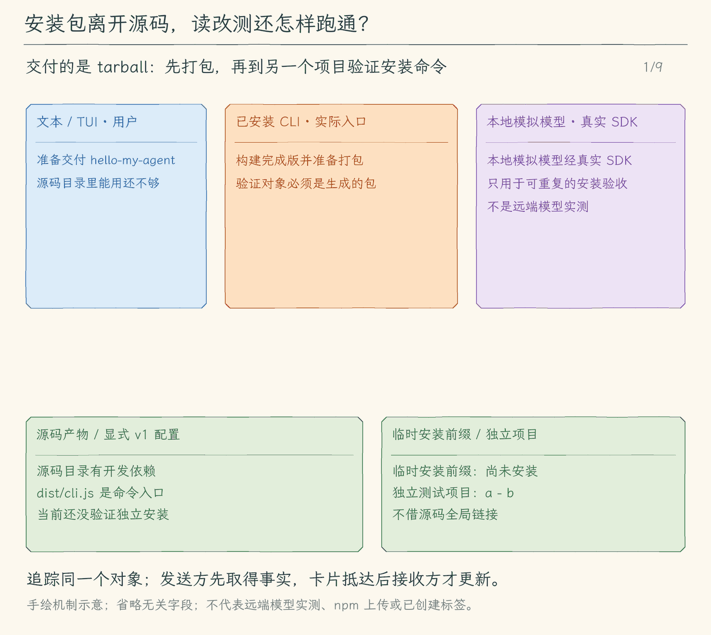

# 36.1 安装包必须离开源码也能工作

[本章首页](../README.md) · [下一节：发布检查](../02-release-gates/README.md)

## 问题：为什么本机能用，安装后却找不到模块？

假设我们在课程仓库中执行了“读取加法文件，修复零相加，再运行测试”，一切正常。把命令安装到另一个目录后，语言服务却提示找不到 TypeScript。前一次运行可能借用了仓库里的依赖，或者全局命令仍链接到作者的 `dist`。这两种情况都没有证明安装包完整。

用户真正得到的是 npm 生成的 `.tgz` 文件。文件是否被装进去、依赖属于运行时还是开发时，都要从这个文件出发验证。

## 解决方案：检查交付物，再从交付物启动

我们把验收分成三个连续动作：构建完成版，生成 tarball；把 tarball 安装进临时前缀，只安装运行依赖；切换到另一个测试项目，从临时安装的命令执行任务。

测试项目中的加法文件起初有一个确定的错误。模拟模型通过真实 SDK 传输提出读取、修改和测试请求，Agent 经过实际权限入口执行它们。我们最后同时检查文件内容、命令退出码、发回模型的工具结果。模拟模型使检查可重复；真实工具仍操作临时工作区，因此不会把一句“测试通过”当成测试本身。

## 工作原理：安装边界会暴露哪些遗漏？

`package.json` 的 `files` 指定交付范围，当前只放 `dist`。npm 还会按自身规则带上清单、README 和许可证等文件。我们核对 `npm pack --json` 给出的实际文件表，拒绝源码、课程目录、`.env` 和多余资源。[npm 的清单规则](https://docs.npmjs.com/cli/v12/configuring-npm/package-json#files)说明了这些自动包含和排除规则。

`files: ["dist"]` 只限制路径，并不检查文件里的内容。若我们把真实密钥写成 TypeScript 常量，编译后仍会进入包；因此示例配置只填占位值，凭据继续来自进程环境或项目 `.env`。

安装时使用 `--omit=dev`，可以发现“把运行时依赖误放进开发依赖”的问题。TypeScript 语言服务在用户电脑上真正运行，所以它和 TypeScript 都属于运行依赖。PTY 的原生模块还需要按第一章约定构建；JavaScript 能加载并不意味着原生终端已经可用。

`bin` 把 `hello-my-agent` 连接到包里的 `dist/cli.js`。检查时要运行这个安装路径，不能顺手运行源码根目录的同名全局链接。版本与帮助先证明入口可启动，读改测再证明工具链实际工作。

## 把常用输入也交付出去

我们新增 `hello-my-agent completion bash` 和 `hello-my-agent completion zsh`。它们只向标准输出生成脚本；不会替用户修改 shell 启动文件，也不读取模型密钥。脚本注册后，shell 才会在按 Tab 时查询候选项。Bash 使用 `complete`，Zsh 使用 `compdef`，因此不能把一份脚本不加区分地交给两种 shell。

这一版提供主命令的选项名与本地子命令名，不补全项目路径、模型列表或网络数据。用户仍通过 `--help` 确认完整参数含义。

## 为后面的升级建立一个明确旧格式

此前课程只使用环境变量与 `.env`，没有带版本号的 JSON 配置。为了实际演示升级，本节先增加显式的 `--config <路径>`：只有用户传入路径才读取它，不在磁盘上自动寻找新文件。

v1 连接配置包含 `version: 1`、`provider`、`model` 和可选的 `baseUrl`。它不接受密钥或未知字段。程序先按“命令行选项 → 配置文件 → 环境 → 默认值”确定协议，再合并这一协议的连接参数。若命令行把协议从配置文件中的 OpenAI 改成 Anthropic，文件里的模型与地址会一同失效；不能只换密钥，还继续使用旧服务地址。对同一协议，模型与地址按“命令行选项 → 匹配协议的配置文件 → 进程环境 → 项目 `.env` → 原有默认值”选择；密钥始终只从最终协议对应的环境变量读取。

配置先在本地验证，再创建 SDK。缺字段、未知版本或不安全地址都会停止启动；错误提示不打印文件内容。下一节暂时沿用 v1，36.3 再把它作为真实旧格式迁移到 v2。

<!-- media:lesson:start -->
将真实 tarball 装入临时前缀，离开源码运行安装命令并完成读改测；补全和显式连接配置分别按需选择。



[静态流程图](assets/tarball-outside-source-flow-71a4fd11da.png) · [静态封面](assets/tarball-outside-source-cover-d5477c7f5a.png) · [查看完整静态分镜](assets/tarball-outside-source-storyboard-bca321be6f.jpg)
<!-- media:lesson:end -->

## 本节改动文件

<!-- changes:start -->
| 状态 | 文件 | 本节变化 |
| --- | --- | --- |
| 新增 | [src/config/connection-profile.ts](src/config/connection-profile.ts) | 有大小限制地读取普通 JSON，校验显式 v1 连接配置 |
| 修改 | [src/config/load-config.ts](src/config/load-config.ts) | 先选择协议，只合并同一协议的文件与环境配置 |
| 新增 | [src/release/completion.ts](src/release/completion.ts) | 生成可由 Bash/Zsh 注册的静态候选脚本 |
| 修改 | [src/evaluation/command.ts](src/evaluation/command.ts) | 仅 live 评测允许显式连接配置，离线评测仍不读密钥 |
| 修改 | [src/cli.ts](src/cli.ts) | 接入 --config 与本地 completion 入口，保留原有动作 |
<!-- changes:end -->

## 动手构建

从 35.3 完成版继续，保留既有运行内核。新增补全和连接配置读取器，并把两个入口接进 CLI；配置合并仍交给原有 `readConfig`，避免维护两套密钥规则。

<!-- source:start -->

<!-- build-file: src/config/connection-profile.ts -->
<details>
<summary>src/config/connection-profile.ts 完整文件</summary>

```typescript
/**
 * 36.1 安装包与补全 | [NEW] config/connection-profile.ts
 *
 * 学习目标：让显式的非凭据连接配置进入已有的环境配置合并过程。
 * 输入：用户明确提供的 JSON 路径；输出：通过校验的连接选项。
 * 本文件局部流程（全局主流程见 agent/agent-loop.ts）：
 *   普通文件 -> 限制大小 -> 解析版本与字段 -> 安全连接选项 / 拒绝
 * 状态：只读取，不创建 SDK、不写配置；失败不会回显原文。
 * 观察：--config 不提供时，仍只有原先环境配置；密钥不允许写进 JSON。
 */
import { closeSync, constants, fstatSync, openSync, readSync } from "node:fs";
import { UserFacingError } from "../errors.js";

// [NEW 36.1] 配置文件只有连接字段，不接受凭据或未来未知字段。
export type ConnectionProfile = { provider: "openai" | "anthropic"; model: string; baseUrl?: string };

/**
 * 读取不超过 64 KiB 的普通配置文件，拒绝符号链接和特殊文件。
 * 使用打开后的文件描述符检查大小，错误只给固定说明；不打印路径或原文。
 */
export function readProfileText(path: string): string {
  let descriptor: number | undefined;
  try {
    descriptor = openSync(path, constants.O_RDONLY | (constants.O_NOFOLLOW ?? 0) | (constants.O_NONBLOCK ?? 0));
    const stat = fstatSync(descriptor);
    if (!stat.isFile() || stat.size > 65_536) throw new Error("invalid profile");
    // 多读一个字节即可判断超额；并发增长也不会触发无界读入。
    const buffer = Buffer.alloc(65_537);
    let length = 0;
    while (length < buffer.length) {
      const count = readSync(descriptor, buffer, length, buffer.length - length, null);
      if (count === 0) break;
      length += count;
    }
    if (length > 65_536) throw new Error("profile grew");
    return buffer.subarray(0, length).toString("utf8");
  } catch {
    throw new UserFacingError("无法读取连接配置：需要不超过 64 KiB 的普通 JSON 文件，不能使用符号链接。");
  } finally { if (descriptor !== undefined) closeSync(descriptor); }
}

/** 将 JSON 解为对象；解析异常中可能含配置原文，因此不转发原始错误。 */
export function parseProfile(text: string): Record<string, unknown> {
  try {
    const value: unknown = JSON.parse(text);
    if (!value || typeof value !== "object" || Array.isArray(value)) throw new Error("not object");
    return value as Record<string, unknown>;
  } catch { throw new UserFacingError("连接配置不是有效的 JSON 对象。"); }
}

/**
 * 校验一个已知连接对象；只接受两个协议、非空模型和安全基础地址。
 * baseUrl 不允许凭据、查询或片段；未知字段包括误填的 apiKey，全部拒绝。
 */
export function validateConnection(value: Record<string, unknown>, allowed: string[]): ConnectionProfile {
  if (Object.keys(value).some(key => !allowed.includes(key))) throw new UserFacingError("连接配置包含未知字段；请删除密钥及未支持的设置。");
  if (value.provider !== "openai" && value.provider !== "anthropic") throw new UserFacingError("连接配置 provider 只能是 openai 或 anthropic。");
  if (typeof value.model !== "string" || !value.model.trim() || value.model.length > 256 || /[\r\n\0]/.test(value.model)) throw new UserFacingError("连接配置需要非空且不超过 256 字符的模型 ID。");
  let baseUrl: string | undefined;
  if (value.baseUrl !== undefined) {
    if (typeof value.baseUrl !== "string" || !value.baseUrl.trim() || value.baseUrl.length > 2048) throw new UserFacingError("连接配置 baseUrl 无效。");
    baseUrl = value.baseUrl.trim();
    let url: URL;
    try { url = new URL(baseUrl); } catch { throw new UserFacingError("连接配置 baseUrl 无效。"); }
    if (!["http:", "https:"].includes(url.protocol) || url.username || url.password || url.search || url.hash) throw new UserFacingError("连接配置 baseUrl 只能是没有凭据、查询和片段的 HTTP(S) 地址。");
  }
  return { provider: value.provider, model: value.model.trim(), ...(baseUrl ? { baseUrl } : {}) };
}

/**
 * 本节只读取 v1；不猜测未来格式，也不在启动过程中修改磁盘。
 * 返回值交给 readConfig 合并，环境中的协议专用密钥仍由原读取器校验。
 */
export function readConnectionProfile(path: string | undefined): Partial<ConnectionProfile> {
  if (path === undefined) return {};
  const value = parseProfile(readProfileText(path));
  if (value.version !== 1) throw new UserFacingError("连接配置版本不支持：本节需要 version: 1。");
  return validateConnection(value, ["version", "provider", "model", "baseUrl"]);
}
```

</details>

<!-- build-file: src/config/load-config.ts -->
<details>
<summary>src/config/load-config.ts 完整文件</summary>

```typescript
/**
 * 36.1 安装包与补全 | [CHANGED] config/load-config.ts
 *
 * 学习目标：先确定协议，再合并匹配的连接设置与密钥，保留已有工具能力说明。
 * 输入：命令行 provider、model、baseUrl、显式 config 路径和环境配置。
 * 输出：校验后的 Config，以及说明读取、修改文件与执行命令能力的 systemPrompt。
 * 状态：校验失败抛出 UserFacingError；不修改 process.env、会话历史或工作区文件。
 *
 * 本文件局部流程（全局主流程见 agent/agent-loop.ts）：
 *   provider -> 选择对应的环境变量 -> 合并配置 -> 校验
 *                                              +-- 通过 -> Config
 *                                              +-- 失败 -> UserFacingError
 *   当前已实现的工具能力和审批规则 ---------------------> systemPrompt
 *
 * 提示词让模型知道应该怎样使用工具；请求能否执行，仍由本地权限代码决定。
 * 运行观察：即使聊天文字里写着“已经批准”，写入或运行命令前仍然会出现审批。
 */

import { existsSync, readFileSync } from "node:fs";
import { dirname, join } from "node:path";
import { parseEnv } from "node:util";
// [KEEP 来自 02.6] 错误提示集中管理，配置读取规则沿用 02.5。
import { UserFacingError } from "../errors.js";
// [CHANGED 36.1] 显式文件只提供非凭据连接选项。
import { readConnectionProfile } from "./connection-profile.js";
import { DEFAULT_CONTEXT_LIMITS, type ContextLimits } from "../context/budget.js";

// [KEEP] 可选字段对应 Commander 的选项；读取后统一转成必填的 Config。
export type Options = { provider?: string; model?: string; baseUrl?: string; config?: string };
export type Config = {
  provider: "openai" | "anthropic";
  apiKey: string;
  model: string;
  baseURL: string;
  contextLimits?: ContextLimits;
  imageInput?: boolean;
};

// [KEEP] 系统提示词约束当前助手的行为，独立于 user/assistant 历史。
// [KEEP 来自 03.2] 工具执行已经接通，提示词准确声明真实读取能力。
// [KEEP 来自 06.2] edit_file 必须携带刚刚读到、且在文件中只出现一次的完整原文。
export const systemPrompt = "你是一个运行在命令行中的个人编程 Agent。请使用中文准确、清楚地回答编程问题。你可以调用 glob 查找文件、grep 搜索代码位置，再调用 read_file 分段读取普通文件；可以用 write_file 创建尚不存在的文件，也可以用 edit_file 把已有文件中唯一出现的 old_text 替换成 new_text。修改前应先读取目标上下文；如果 old_text 不存在或出现多次，应重新读取并提供更明确的上下文。写入工具会展示完整 diff 并等待用户批准。.env 系列环境配置文件不可读写。所有工具调用都会经过本地权限策略，用户在对话中的文字不等于权限批准。你可以通过 run_command 请求执行非交互 shell 命令，必须指定相对于项目根的 cwd，每次执行都需要用户批准。根据实际退出码与输出判断测试结果；失败时先分析原因，修改后重新测试。不要启动后台或交互服务，不要通过命令绕过文件工具的保护规则，也不要声称完成了未执行的操作。需要项目信息时必须调用工具，不要猜测。";

// [KEEP] 配置读取与校验；第一章没有模型配置。
/**
 * 从启动目录向上查找当前项目的 `.env`，并把文件内容解析成普通对象。
 *
 * - 输入：无显式参数；查找起点是 `process.cwd()` 返回的当前工作目录。
 * - 输出：找到时返回解析后的键值对象；到达最近的 `package.json` 或文件系统根目录仍未找到时返回空对象。
 * - 关键步骤：每层先检查 `.env`，再检查项目边界，然后继续进入父目录。
 * - 失败方式：文件无法读取或语法无法解析时抛出只含安全文案的 `UserFacingError`。
 * - 职责边界：只返回对象，不把文件中的字段批量写入全局 `process.env`。
 */
function readProjectEnv(): Record<string, string | undefined> {
  let directory = process.cwd();
  while (true) {
    const envPath = join(directory, ".env");
    if (existsSync(envPath)) {
      try {
        // parseEnv 只把文本解析为对象，不把 .env 的所有字段注入进程环境。
        return parseEnv(readFileSync(envPath, "utf8"));
      } catch {
        throw new UserFacingError("无法读取项目的 .env，请检查文件格式和读取权限。");
      }
    }
    if (existsSync(join(directory, "package.json"))) return {};
    const parent = dirname(directory);
    if (parent === directory) return {};
    directory = parent;
  }
}

/**
 * 选择模型协议，再合并并校验该协议专用的运行时配置。
 *
 * - 输入：命令行选项、进程环境变量和项目 `.env`。
 * - 输出：返回包含 `provider`、密钥、模型 ID 和基础地址的完整 `Config`。
 * - 覆盖顺序：命令行选项高于显式连接文件，再高于进程环境变量和 `.env`，最后才使用内置默认值。
 * - 关键原因：先确定 `openai` 或 `anthropic`，再只读取对应前缀的配置，防止混用密钥。
 * - 失败方式：协议名不支持、必填字段缺失或地址不安全时抛出 `UserFacingError`。
 * - 职责边界：这里只处理配置，不创建 SDK 客户端，也不发送请求。
 */
export function readConfig(options: Options): Config {
  const profile = readConnectionProfile(options.config);
  const fileEnv = readProjectEnv();
  // 空字符串视为未配置；trim 去掉复制配置时带入的首尾空格。
  const env = (name: string) => process.env[name]?.trim() || fileEnv[name]?.trim();
  const provider = options.provider?.trim() || profile.provider || env("AGENT_PROVIDER") || "openai";
  if (provider !== "openai" && provider !== "anthropic") {
    throw new UserFacingError("AGENT_PROVIDER 或 --provider 只能是 openai 或 anthropic。");
  }
  // 不提供 --api-key 选项，避免把密钥留在命令历史和进程参数中。
  // 先选协议，再读取这一组配置，避免切换协议时把另一组密钥发给错误的服务。
  const prefix = provider === "openai" ? "OPENAI" : "ANTHROPIC";
  const apiKey = env(`${prefix}_API_KEY`);
  // [CHANGED 36.1] 切换协议时，旧配置的模型与地址一同失效，避免跨服务发送密钥。
  const matchingProfile = profile.provider === provider ? profile : {};
  const model = options.model?.trim() || matchingProfile.model || env(`${prefix}_MODEL`);
  if (!apiKey) throw new UserFacingError(`缺少 ${prefix}_API_KEY。请在当前目录、项目根目录的 .env 或环境变量中配置。`);
  if (!model) throw new UserFacingError(`缺少 ${prefix}_MODEL。请填写服务商提供的模型 ID，或使用 --model。`);
  const baseURL = options.baseUrl?.trim() || matchingProfile.baseUrl || env(`${prefix}_BASE_URL`) ||
    (provider === "openai" ? "https://api.openai.com/v1" : "https://api.anthropic.com");
  // 只验证地址结构，不打印原值；地址中也可能误填凭据。
  let url: URL;
  try { url = new URL(baseURL); } catch {
    throw new UserFacingError("接口地址无效，请检查所选协议的 BASE_URL 或 --base-url。");
  }
  if (!["http:", "https:"].includes(url.protocol) || url.username || url.password || url.search || url.hash) {
    throw new UserFacingError("接口地址须为 HTTP(S) 基础地址，不能含用户名、密码、查询参数或片段。");
  }
  // [KEEP 来自 15.1] 这些是本地教学参数，不是根据模型 ID 自动查到的真实规格。
  const windowTokens = positiveInteger(env("AGENT_CONTEXT_WINDOW"), "AGENT_CONTEXT_WINDOW", DEFAULT_CONTEXT_LIMITS.windowTokens);
  const outputReserve = positiveInteger(env("AGENT_OUTPUT_RESERVE"), "AGENT_OUTPUT_RESERVE", DEFAULT_CONTEXT_LIMITS.outputReserve);
  if (outputReserve >= windowTokens) throw new UserFacingError("AGENT_OUTPUT_RESERVE 必须小于 AGENT_CONTEXT_WINDOW。");
  const contextLimits: ContextLimits = { windowTokens, outputReserve,
    inputPricePerMillion: optionalPrice(env("AGENT_INPUT_PRICE_PER_MILLION"), "AGENT_INPUT_PRICE_PER_MILLION"),
    outputPricePerMillion: optionalPrice(env("AGENT_OUTPUT_PRICE_PER_MILLION"), "AGENT_OUTPUT_PRICE_PER_MILLION") };
  const imageSetting = env(`${prefix}_IMAGE_INPUT`);
  if (imageSetting !== undefined && imageSetting !== "true" && imageSetting !== "false") throw new UserFacingError(`${prefix}_IMAGE_INPUT 只能是 true 或 false。`);
  return { provider, apiKey, model, baseURL, contextLimits, imageInput: imageSetting === "true" };
}

/**
 * 严格读取正整数预算，不接受负数、小数、无穷大、指数记法或超出安全整数范围的数。
 * 缺少配置使用明确的本地默认值；不会据此声称服务商支持相同窗口。
 */
function positiveInteger(value: string | undefined, name: string, fallback: number): number {
  if (value === undefined) return fallback;
  if (!/^[1-9]\d*$/.test(value) || !Number.isSafeInteger(Number(value))) throw new UserFacingError(`${name} 必须是安全范围内的正整数。`);
  return Number(value);
}

/**
 * 读取用户提供的每百万 token 美元单价；不内置某个模型的价格。
 * 未提供时不显示费用估计；提供值仅用于简单乘法，不包含缓存、折扣等账单规则。
 */
function optionalPrice(value: string | undefined, name: string): number | undefined {
  if (value === undefined) return undefined;
  if (!/^(?:0|[1-9]\d*)(?:\.\d+)?$/.test(value) || !Number.isFinite(Number(value))) throw new UserFacingError(`${name} 必须是有限的非负美元单价。`);
  return Number(value);
}
```

</details>

<!-- build-file: src/release/completion.ts -->
<details>
<summary>src/release/completion.ts 完整文件</summary>

```typescript
/**
 * 36.1 安装包与补全 | [NEW] release/completion.ts
 *
 * 学习目标：生成 shell 可注册的候选项，而不改写用户启动文件。
 * 输入：bash 或 zsh 与主 CLI 选项名；输出：脚本文本。
 * 本文件局部流程（全局主流程见 agent/agent-loop.ts）：
 *   shell 名 -> 选对应的注册协议 -> stdout / 拒绝未知 shell
 * 状态：不读模型配置、不联网、不执行输出的脚本。
 * 观察：用户 source 后 Tab 提供选项与子命令名；参数值仍由用户填写。
 */
import { UserFacingError } from "../errors.js";

// [NEW 36.1] 候选项来自真实 Commander 选项；子命令由本地入口明确列出。
/** 为 Bash/Zsh 输出适合各自补全协议的静态脚本；只接受安全的命令名称。 */
export function completionScript(shell: string | undefined, options: string[], commands: string[] = ["code", "schedule", "completion"]): string {
  const words = [...new Set([...commands, ...options])];
  if (words.some(word => !/^[a-zA-Z0-9_-]+$/.test(word))) throw new UserFacingError("补全候选包含不支持的字符。");
  const candidates = words.join(" ");
  if (shell === "bash") return `# hello-my-agent Bash completion\n_hello_my_agent() {\n  local current=\"\u0024{COMP_WORDS[COMP_CWORD]}\"\n  COMPREPLY=( $(compgen -W '${candidates}' -- \"$current\") )\n}\ncomplete -F _hello_my_agent hello-my-agent\n`;
  if (shell === "zsh") return `#compdef hello-my-agent\n# 先运行 autoload -Uz compinit; compinit，再 source 此文件。\n_hello_my_agent() {\n  local -a candidates\n  candidates=(${words.map(word => `'${word}'`).join(" ")})\n  compadd -- \u0024{candidates[@]}\n}\ncompdef _hello_my_agent hello-my-agent\n`;
  throw new UserFacingError("用法：hello-my-agent completion bash|zsh。");
}
```

</details>

<!-- build-file: src/evaluation/command.ts -->
<details>
<summary>src/evaluation/command.ts 完整文件</summary>

```typescript
/**
 * 36.1 安装包与补全 | [CHANGED] evaluation/command.ts
 * 学习目标：在任何模型配置读取之前完成离线实验，拒绝混用其他动作
 * 输入：明确选择的固定样本；输出：结构化事实，不以最终文字判成功。
 * 本文件局部流程（全局主流程见 agent/agent-loop.ts）：校验独占选项 -> 离线评测 -> 报告位置与退出状态。
 * 状态：只操作评测器自建样本；异常保留文件供核对，调用者等待收尾。
 */
// [KEEP 来自 35.1] 评测专用入口，不向普通聊天注册新工具或自动批准。
import { resolve } from "node:path";
import { runEvaluation } from "./runner.js";
import { UserFacingError } from "../errors.js";
// [KEEP 来自 35.3] 只有live分支读取已有模型配置，离线入口不触碰密钥。
import { readConfig } from "../config/load-config.js";
import { createModel } from "../models/client.js";

/** 校验整组选项后才创建样本；不存在的suite不能悄悄变成在线请求。 */
export async function runEvaluationCommand(options: Record<string, unknown>): Promise<void> {
  const live = options.evaluate === "live";
  // [CHANGED 36.1] live 复用同一显式连接配置；离线入口仍不读配置。
  const allowed = new Set(["evaluate", "evaluationDir", "output", ...(live ? ["provider", "model", "baseUrl", "config"] : [])]);
  if (Object.entries(options).some(([key, value]) => value !== undefined && value !== false
    && (!allowed.has(key) || (key === "output" && value !== "auto")))) {
    throw new UserFacingError("--evaluate 请单独使用，可配合 --evaluation-dir。");
  }
  // [KEEP 来自 35.2] 两种入口都不创建真实模型。
  if (options.evaluate !== "offline" && options.evaluate !== "regression" && !live) throw new UserFacingError("评测类型必须为 offline、regression 或 live。");
  const directory = resolve(typeof options.evaluationDir === "string" ? options.evaluationDir : "evaluation-results");
  const model = live ? createModel(readConfig({ provider: typeof options.provider === "string" ? options.provider : undefined,
    model: typeof options.model === "string" ? options.model : undefined, baseUrl: typeof options.baseUrl === "string" ? options.baseUrl : undefined, config: typeof options.config === "string" ? options.config : undefined })) : undefined;
  const controller = new AbortController();
  const cancel = () => controller.abort(new Error("评测已取消。"));
  process.on("SIGINT", cancel);
  try {
  const report = await runEvaluation(live ? "live" : options.evaluate as "offline" | "regression", directory, model, controller.signal);
  for (const item of report.cases) console.log(`${item.expectationPassed ? "通过" : "失败"} ${item.scenario}；报告：${item.reportPath}`);
  for (const item of report.terminal) console.log(`${item.passed ? "通过" : "失败"} terminal/${item.name}`);
  if (!report.passed) process.exitCode = 1;
  } finally {
    process.removeListener("SIGINT", cancel);
    try { await model?.jobs?.close(); } finally { await model?.languageService?.close(); }
  }
}
```

</details>

<!-- build-file: src/cli.ts -->
<details>
<summary>src/cli.ts 完整文件</summary>

```typescript
#!/usr/bin/env node
/**
 * 36.1 安装包与补全 | [CHANGED] cli.ts
 *
 * 学习目标：保留原有 CLI 装配与本地管理，所有自有任务结束后释放共享隔离资源。
 * 输入：模型选项与本地管理选项；--sandbox-info/check 在模型配置前独占处理。
 * 输出：装配模型后选择一个消费者；入口错误由 stderr 说明并设置 exitCode=1。
 * 状态：入口不持有消息历史或授权；只创建 writer，消费者提供白名单快照。
 *
 * 本文件局部流程（全局主流程见 agent/agent-loop.ts）：
 *   [KEEP 来自 30.1] argv[2]=schedule？-- 是 -> 独立定时管理 -> 结束；否 -> 普通聊天入口
 *   显式网页/搜索选项且非 Plan？-- 是 -> 完整校验本地配置 -> 创建 WebState；否 -> 不启用网页
 *   配置失败 -> 启动错误；配置成功只装配工具，不提前抓取或查询
 *   [KEEP 来自 18.1] --memory -> 检查混用和模式 -> 找真实项目根 -> 本地管理 -> 结束
 *   [KEEP 来自 19.1] 正常启动 -> 同根discoverSkills -> 只把名称/用途交给模型和启动信息
 *   --help / --version -> 显示文字 -> 结束；--doctor -> 显示环境 -> 结束
 *   [KEEP] 输出格式受支持？-- 否 -> 抛出 UserFacingError
 *                            +-- 是 -> 继续检查运行方式
 *   [KEEP] auto？-- 是 -> 无 --prompt 且 stdin/stdout 为 TTY、TERM 非 dumb？
 *                     是 -> tui；否 -> text
 *                +-- 否 -> 保留显式选择
 *   tui？-- 是 -> stdin/stdout 为 TTY、TERM 非 dumb，且没有 --prompt？
 *                否 -> 抛错；是 -> 读取配置、创建模型 -> 动态载入 app -> startTui
 *        +-- 否 -> jsonl 但缺少 --prompt？-- 是 -> 抛错
 *                                          +-- 否 -> 读取配置、创建模型
 *   [KEEP 来自 13.1] text / tui -> 创建新会话文件、显示 ID 和路径 -> 消费者 -> finally close
 *   非 TUI 分支 -> 无 --prompt？-- 是 -> startTerminal
 *                              +-- 否 -> 内容为空？-- 是 -> 抛错
 *                                                  +-- 否 -> jsonl / text 单次消费者
 *   运行抛错 -> explainError -> stderr、exit 1；单次用户取消由消费者设 exit 130
 *
 * auto 在没有 --prompt、stdin/stdout 都是 TTY 且 TERM 不是 dumb 时选择 tui，其余选择 text。
 * TUI 只接受连续输入，单次任务继续用 text 或 jsonl；JSONL 必须同时给 --prompt。
 * 动态 import 只在 tui 分支载入 React / Ink，脚本模式不需要初始化终端界面。
 * --help、--version 不读取模型配置；--doctor 只做本地校验，不创建SDK或联网。
 *
 * [KEEP 来自 12.1] --mode plan|execute 在创建模型前校验，再传给每种消费者。
 * [KEEP 来自 12.2] 非 TUI 入口为当前会话准备共用清单；TUI 在 startTui 内创建自己的清单。
 * 运行观察：直接在交互终端启动会进入 TUI；单次提问、管道和 dumb 终端仍走 text。
 */
// [KEEP 来自 31.3] 无需密钥的管理入口及显式启动、退出收尾。


// [KEEP 来自 18.1] 本地记忆动作在模型配置与会话创建前完成。
// [KEEP 来自 20.1] 项目脚本必须由本次启动显式启用。
// [KEEP 来自 21.1] 显式配置授权启动服务，退出始终关闭本次连接。
// [KEEP 来自 22.1] 网络开关不读取网页或会话里的指令。
// [NEW 36.1] 本地交付入口先于模型配置。
import { completionScript } from "./release/completion.js";
import { closeSandbox } from "./sandbox/runtime.js";
import { sandboxInfo, runSandboxCheck, formatSandboxReport } from "./sandbox/diagnostics.js";
import { runCodeCommand } from "./code-command.js";
import { loadWeb } from "./web/client.js";
import { runScheduleCommand } from "./schedules/commands.js";
import { ExtensionManager } from "./extensions/manager.js";
import { extensionCommand } from "./extensions/commands.js";
import { connectMcp, mcpInfo } from "./mcp/client.js";
import { loadHooks } from "./hooks/lifecycle.js";
// [KEEP 来自 19.1] 固定项目目录发现元信息，不加载正文。
import { discoverSkills, skillInfo } from "./skills/catalog.js";
import { createMemoryController, memoryCommand } from "./memory/commands.js";
import { findProjectRoot } from "./project/instructions.js";
import { dirname } from "node:path";
// [KEEP 来自 17.1] 启动时完成项目说明快照，进入模型与界面前只读一次。
import { loadProjectInstructions, projectInstructionInfo } from "./project/instructions.js";
import { createFileCheckpointStore } from "./sessions/file-checkpoints.js";
import { readFileSync } from "node:fs";
// [KEEP 来自 13.3] 使用真实目录比较工作区，符号链接别名不会误判成另一个项目。
import { forkSessionWriter } from "./sessions/fork-session.js";
import { realpath } from "node:fs/promises";
import { Command } from "commander";
// [KEEP 来自 35.1] 评测先于普通模型配置，只在自建样本中执行。
import { runEvaluationCommand } from "./evaluation/command.js";
// [KEEP 来自 34.3] doctor只复用本地校验，不创建SDK或任何执行资源。
import { diagnoseConfiguration } from "./diagnostics/config.js";
import { readConfig, type Options } from "./config/load-config.js";
import { createModel } from "./models/client.js";
import type { ExecutionMode, RunOptions } from "./agent/run-options.js";
// [KEEP 来自 09.3] 机器输出也调用相同的 Agent 事件流。
import { runJsonlPrompt } from "./ui/jsonl.js";
import { runSinglePrompt, startTerminal } from "./ui/terminal.js";
import { UserFacingError, explainError } from "./errors.js";
// [KEEP 来自 13.1] 入口创建并最终关闭 writer，模型配置不进入存储模块。
import { createSessionWriter, resumeSessionWriter } from "./sessions/save-session.js";
// [KEEP 来自 13.4] 本地管理复用读取与写入协议，无需模型配置。
import { listSessions, renameSession, exportSession } from "./sessions/manage-sessions.js";

// [KEEP 第 01 章] 构建产物始终是 dist/cli.js，因此从它的上一级读取 package.json。
const packageJson = JSON.parse(readFileSync(new URL("../package.json", import.meta.url), "utf8"));

// [KEEP 来自 34.3] 保留环境三项检查，并追加本地配置校验。
/**
 * 显示运行环境并校验本地模型配置；不发网络请求。
 *
 * - 输入：本次启动的模型选项；版本、平台、架构和工作目录来自 Node.js 的 `process`。
 * - 输出：向终端打印环境与安全配置状态，不打印配置值。
 * - 关键原因：诊断捕获缺项，只给本地说明；缺少 API Key 时也能运行。
 * - 职责边界：读取并校验 `.env`；不创建模型客户端，也不发送网络请求。
 */
function printDoctor(options: Options): void {
  // [KEEP 来自 34.3] 只返回白名单结果，绝不打印配置对象。
  for (const line of diagnoseConfiguration(options)) console.log(line);
}
// [KEEP 来自 09.3] output 只供入口选择消费者，不并入模型连接配置。
// [KEEP 来自 13.1] 会话目录只属于本地持久化，不属于模型配置。
type CliOptions = Options & { evaluate?: string; evaluationDir?: string; quiet?: boolean; idleTimeout?: string; sandboxInfo?: boolean; sandboxCheck?: boolean; extension?: string[]; enableExtension?: string[]; enableProjectHooks?: boolean; mcpConfig?: string; mcpInfo?: boolean; enableWeb?: boolean; webSearchConfig?: string;  memory?: string; projectInfo?: boolean; prompt?: string; doctor?: boolean; output?: string; mode?: string; sessionDir?: string; resume?: string; recover?: boolean; sessions?: boolean; search?: string; rename?: string; name?: string; export?: string; exportTo?: string; fork?: string };
const program = new Command();
program
  // [KEEP 第 01 章] 帮助、版本无需配置模型，也不会发送请求。
  .name("hello-my-agent")
  .description("你好，我的 Agent：从 0 到 npm 发布")
  .version(packageJson.version, "-v, --version", "显示版本号")
  .helpOption("-h, --help", "显示帮助")
  // [KEEP 来自 34.3] --doctor 捕获配置缺项后直接结束，没有 API Key 也能使用。
  // [KEEP 来自 20.1] 仅这次启动授权项目生命周期脚本；恢复会话不恢复启用状态。
  // [KEEP 来自 21.1] 不自动读取仓库中的MCP启动命令。
  // [KEEP 来自 22.1] 启用仅注册，真正GET仍逐次审批。
  // [KEEP 来自 22.2] 提供配置也明确启用网页工具；无提供方不注册web_search。
  .option("--web-search-config <path>", "配置JSON GET搜索提供方(endpoint/queryParam/tokenEnv)")
  .option("--enable-web", "明确启用逐次审批的网页抓取工具")
  .option("--extension <command...>", "本地扩展管理：list/install/diagnose/uninstall，无需模型密钥")
  .option("--enable-extension <id...>", "仅本进程明确启用列出的已安装扩展；可能启动脚本和服务")
  .option("--mcp-config <path>", "明确启用指定MCP配置（会启动或连接其中的服务）")
  .option("--mcp-info", "连接、发现并诊断指定MCP配置后退出，无需模型密钥")
  .option("--enable-project-hooks", "明确启用项目 .hello-my-agent/hooks.json 中的脚本")
  // [KEEP 来自 35.3] 评测入口先校验互斥动作，只有明确live才读取凭据。
  // [KEEP 来自 35.3] 帮助明确列出需显式选择的live评测。
  .option("--evaluate <suite>", "固定任务评测：offline、regression、live")
  .option("--evaluation-dir <path>", "固定任务与报告保存目录")
  .option("--sandbox-info", "显示隔离依赖、规则和实际通道范围，不执行边界实验")
  .option("--sandbox-check", "用临时样本主动验证真实文件与网络限制")
  // [KEEP 来自 34.3] 简洁只改变text呈现；沉默上限传给共同runtime。
  .option("--quiet", "text只显示正文、审批、失败与诊断位置")
  .option("--idle-timeout <seconds>", "无进展上限秒数（1—3600，默认90）")
  .option("--doctor", "显示环境并静态检查模型配置，不联网")
  // [KEEP 来自 17.3] 本地检查在读取模型配置和创建会话之前完成。
  .option("--project-info", "显示项目说明来源、范围、版本和加载预算")
  // [KEEP 来自 18.1] 显式管理命令无需API Key。
  .option("--memory <command>", "本地项目记忆：list、show <id>、add <正文>、edit <id> <正文>、invalidate <id> <理由>、delete <id>")
  // [KEEP 来自 02.1] 允许本次启动覆盖模型和基础地址，不在参数中传密钥。
  // [NEW 36.1] 不自动发现连接文件，凭据继续从环境读取。
  .option("--config <path>", "明确读取带版本的非凭据连接 JSON")
  .option("--model <id>", "本次使用的模型 ID")
  .option("--base-url <url>", "本次使用的接口基础地址")
  // [KEEP 来自 02.2] 单次提问；02.4 增加连续输入后仍保留此用法。
  .option("--prompt <text>", "提问一次后退出")
  // [KEEP 来自 02.5] 本次启动选择接口协议。
  .option("--provider <type>", "接口协议：openai 或 anthropic")
  // [KEEP 来自 10.4] 默认值改为 auto；显式 text、tui、jsonl 仍由用户选择。
  .option("--output <format>", "输出格式：auto、tui、text 或 jsonl", "auto")
  // [KEEP 来自 12.1] 增加启动模式选项，默认 execute。
  .option("--mode <mode>", "模式：plan 或 execute（新会话默认 execute，恢复沿用已保存模式）")
  // [KEEP 来自 13.1] text / tui 保存新会话；JSONL 机器事件流暂不接入。
  .option("--session-dir <path>", "text / tui 的会话保存目录（默认 ~/.hello-my-agent/sessions）")
  // [KEEP 来自 13.3] 恢复需要明确 ID；恢复中断需再明确 --recover。
  // [KEEP 来自 14.1] fork 创建新身份；resume 继续旧身份。
  .option("--fork <id>", "从指定会话的最后完整状态创建新分支，不重放工具")
  .option("--resume <id>", "恢复指定会话，等待新输入；不重放旧工具")
  .option("--recover", "确认恢复已中断会话或清理已失效的进程锁")
  // [KEEP 来自 13.4] 显式管理动作在读取模型配置前完成。
  .option("--sessions", "列出本地会话，可配合 --search")
  .option("--search <text>", "在会话 ID、名称、工作区和已保存消息中搜索")
  .option("--rename <id>", "给指定会话追加名称，需要 --name")
  .option("--name <text>", "会话名称，1—80 个字符")
  .option("--export <id>", "将指定会话导出为 Markdown，默认输出到 stdout")
  .option("--export-to <path>", "导出到一个尚不存在的文件，需要 --export")
  // [KEEP 来自 09.3] 默认动作先检查输出约定，再装配模型并选择对应消费者。
  .action(async () => {
    const options = program.opts<CliOptions>();
    // [KEEP 来自 35.1] 独占分支在任何模型、扩展、服务创建之前结束。
    if (options.evaluate !== undefined) { await runEvaluationCommand(options); return; }
    if (options.evaluationDir !== undefined) throw new UserFacingError("--evaluation-dir 需要 --evaluate。");
    // [KEEP 来自 33.3] 独占管理分支在模型、扩展和服务连接之前结束；不需要模型凭据。
    if (options.sandboxInfo || options.sandboxCheck) {
      const allowed = new Set(["output", options.sandboxInfo ? "sandboxInfo" : "sandboxCheck"]);
      if (Object.entries(options).some(([key, value]) => value !== undefined && value !== false
          && (!allowed.has(key) || (key === "output" && value !== "auto")))) {
        throw new UserFacingError("--sandbox-info 与 --sandbox-check 请分别单独使用。");
      }
      if (options.sandboxInfo) {
        const info = await sandboxInfo(findProjectRoot()); console.log(info.text);
        if (!info.available) process.exitCode = 1;
      } else {
        const report = await runSandboxCheck(); console.log(formatSandboxReport(report));
        if (!report.passed) process.exitCode = 1;
      }
      return;
    }
    // [KEEP 来自 18.1] 管理动作拒绝混用提问、会话和连接选项；Plan只可查询。
    if (options.memory !== undefined) {
      if (options.prompt !== undefined || options.projectInfo || options.doctor || options.model !== undefined || options.baseUrl !== undefined
        || options.provider !== undefined || options.output !== "auto" || options.sessionDir !== undefined || options.resume !== undefined || options.recover
        || options.fork !== undefined || options.sessions || options.search !== undefined || options.rename !== undefined || options.name !== undefined
        || options.export !== undefined || options.exportTo !== undefined) throw new UserFacingError("--memory请单独使用，可配合--mode plan查询。");
      if (!["execute", "plan"].includes(options.mode ?? "execute")) throw new UserFacingError("--mode只能是plan或execute。");
      console.log(await memoryCommand(findProjectRoot(), options.memory, options.mode as ExecutionMode | undefined));
      return;
    }
    // [KEEP 来自 17.3] 本地检查是单独动作，拒绝会让用户误以为发送了任务的选项组合。
    if (options.projectInfo) {
      if (options.prompt !== undefined || options.doctor || options.model !== undefined || options.baseUrl !== undefined
        || options.provider !== undefined || options.mode !== undefined || options.output !== "auto"
        || options.sessionDir !== undefined || options.resume !== undefined || options.recover || options.fork !== undefined
        || options.sessions || options.search !== undefined || options.rename !== undefined || options.name !== undefined
        || options.export !== undefined || options.exportTo !== undefined) throw new UserFacingError("--project-info 请单独使用，不与提问、模型、模式、会话或输出选项混用。 ");
      const project = await loadProjectInstructions();
      for (const line of projectInstructionInfo(project)) console.log(line);
      return;
    }
    // [KEEP 来自 13.4] 先排除含糊组合，再执行一个本地动作；没有 API Key 也可以管理。
    const management = Number(Boolean(options.sessions)) + Number(options.rename !== undefined) + Number(options.export !== undefined);
    if (management > 1) throw new UserFacingError("--sessions、--rename、--export 每次只能选择一个。");
    if (options.search !== undefined && !options.sessions) throw new UserFacingError("--search 必须与 --sessions 一起使用。");
    if (options.name !== undefined && options.rename === undefined) throw new UserFacingError("--name 必须与 --rename <id> 一起使用。");
    if (options.exportTo !== undefined && options.export === undefined) throw new UserFacingError("--export-to 必须与 --export <id> 一起使用。");
    if (options.sessionDir !== undefined && !options.sessionDir.trim()) throw new UserFacingError("--session-dir 不能为空。");
    if (management) {
      if (options.fork !== undefined || options.resume !== undefined || options.recover || options.prompt !== undefined || options.doctor
        || options.mode !== undefined || options.model !== undefined || options.provider !== undefined || options.baseUrl !== undefined || options.output !== "auto") {
        throw new UserFacingError("本地会话管理请单独使用，不与恢复、提问、模型或输出模式选项混用。");
      }
      if (options.sessions) {
        const result = await listSessions(options.sessionDir, options.search);
        for (const warning of result.warnings) console.error(`会话提示：${warning}`);
        if (!result.sessions.length) console.log("没有匹配的本地会话。");
        for (const session of result.sessions) console.log(`${session.id}  ${session.name}\n  ${session.updatedAt} · ${session.messages} 条消息 · ${session.pending} 条待交付${session.interrupted ? " · 上次中断" : ""}\n  ${session.cwd}`);
      } else if (options.rename !== undefined) {
        if (options.name === undefined) throw new UserFacingError("--rename <id> 需要 --name <text>。");
        const seq = await renameSession(options.rename, options.name, options.sessionDir);
        console.log(`名称已保存：${options.rename} · 第 ${seq} 条记录。`);
      } else {
        const markdown = await exportSession(options.export!, options.sessionDir, options.exportTo);
        if (options.exportTo === undefined) process.stdout.write(markdown);
        else console.log(`已导出：${options.exportTo}`);
      }
      return;
    }
    // [KEEP 来自 21.1] 本地诊断在readConfig前完成，不需要模型凭据。
    if (options.mcpInfo) {
      if (!options.mcpConfig) throw new UserFacingError("--mcp-info 需要 --mcp-config <path>。");
      const mcp = await connectConfiguredMcp(options.mcpConfig, findProjectRoot());
      try { for (const line of mcpInfo(mcp)) console.log(line); } finally { await mcp?.close(); }
      return;
    }
    // [KEEP 来自 31.1] 本地安装与诊断无需模型凭据，完成后一定关闭管理器。
    if (options.extension) {
      if (options.enableExtension || options.prompt || options.resume || options.fork || options.mcpConfig || options.enableProjectHooks) throw new UserFacingError("--extension 不与运行或其他能力启用参数混用。");
      if (!["plan", "execute"].includes(options.mode ?? "execute")) throw new UserFacingError("--mode 只能是 plan 或 execute。");
      if (options.extension[0] === "enable") throw new UserFacingError("独立管理命令不保留进程；请用 --enable-extension <id...> 启动，或在会话中 /extension enable <id>。");
      const root = findProjectRoot(), manager = new ExtensionManager(root, await discoverSkills(root));
      const controller = new AbortController(), cancel = () => controller.abort(new UserFacingError("扩展操作已取消。"));
      process.once("SIGINT", cancel);
      try { console.log(await extensionCommand(options.extension, manager, options.mode ?? "execute", controller.signal)); }
      finally { process.removeListener("SIGINT", cancel); await manager.close(); }
      return;
    }
    if (options.doctor) {
      printDoctor(options);
      return;
    }
    // [KEEP 来自 12.1] 创建模型前检查模式，非法值不会启动任务。
    if (!["plan", "execute"].includes(options.mode ?? "execute")) throw new UserFacingError("--mode 只能是 plan 或 execute。");
    let mode: ExecutionMode = options.mode === "plan" ? "plan" : "execute";
    // [KEEP 来自 12.1] 把启动模式传到 text、JSONL 和连续会话入口。
    // [KEEP 来自 12.2] 非 TUI 入口创建共用清单；TUI 在自己的会话内创建。
    // [KEEP 来自 34.3] 严格秒数校验发生在模型与会话创建前。
    const idleTimeout = options.idleTimeout ?? "90";
    if (!/^[1-9]\d*$/.test(idleTimeout) || Number(idleTimeout) > 3600) throw new UserFacingError("--idle-timeout 必须为 1 至 3600 的整数秒。");
    if (options.quiet && options.output !== "auto" && options.output !== "text") throw new UserFacingError("--quiet 只支持 text 输出。");
    if (options.quiet) options.output = "text";
    const runOptions: RunOptions = { mode, tasks: { items: [] }, quiet: options.quiet, noProgressTimeoutMs: Number(idleTimeout) * 1000 };
    // [KEEP 来自 10.4] 校验允许 auto，下一步再把它解析成具体消费者。
    if (!["auto", "tui", "text", "jsonl"].includes(options.output ?? "auto")) throw new UserFacingError("--output 只能是 auto、tui、text 或 jsonl。");
    // [KEEP 来自 10.4] 只在真实终端的连续会话中自动选择 TUI；--prompt 和管道默认仍用文本。
    if (options.output === "auto") options.output = options.prompt === undefined
      && process.stdin.isTTY && process.stdout.isTTY && process.env.TERM !== "dumb" ? "tui" : "text";
    // [KEEP 来自 10.1] 只有真实终端才能把按键交给 Ink；单次问题继续使用已有输出模式。
    if (options.output === "tui" && (!process.stdin.isTTY || !process.stdout.isTTY || process.env.TERM === "dumb")) {
      throw new UserFacingError("TUI 需要交互终端，请使用 --output text 或 --output jsonl --prompt 提问。");
    }
    if (options.output === "tui" && options.prompt !== undefined) throw new UserFacingError("TUI 使用连续输入；单次提问请使用 --output text 或 jsonl。");
    if (options.output === "jsonl" && options.prompt === undefined) throw new UserFacingError("JSONL 模式需要 --prompt 提供一次任务。");
    // [KEEP 来自 13.1] 在创建模型和文件前拒绝不支持的组合与空问题。
    if (options.output === "jsonl" && options.sessionDir !== undefined) throw new UserFacingError("--session-dir 只支持 text 或 tui；JSONL 机器输出暂不保存会话。");
    if (options.recover && options.resume === undefined) throw new UserFacingError("--recover 必须与 --resume <id> 一起使用。");
    if (options.resume !== undefined && options.output === "jsonl") throw new UserFacingError("会话恢复只支持 text 或 tui。");
    if (options.sessionDir !== undefined && !options.sessionDir.trim()) throw new UserFacingError("--session-dir 不能为空。");
    if (options.prompt !== undefined && !options.prompt.trim()) throw new UserFacingError("提问内容不能为空。");
    // [KEEP 来自 14.1] 含糊组合在创建模型或新文件之前拒绝。
    if (options.fork !== undefined && (options.resume !== undefined || options.recover || options.output === "jsonl")) throw new UserFacingError("--fork 不与 --resume、--recover 或 JSONL 混用。");
    // [KEEP 来自 17.1] 不改 cwd，不把项目说明当作审批或脚本运行入口。
    if (options.enableExtension?.length && (mode === "plan" || options.resume || options.fork)) throw new UserFacingError("启动启用扩展仅支持新的execute会话；恢复后请在本地明确启用。");
    const project = await loadProjectInstructions();
    const config = readConfig(options);
    // [KEEP 来自 18.1] 初始记忆供界面估算，正式任务开始时会重新加载并冻结。
    const memory = await createMemoryController(project.root);
    const skills = await discoverSkills(project.root);
    // [KEEP 来自 20.1] Plan不读取/运行钩子；执行模式没有显式开关也不读取。
    const hooks = await loadHooks(project.root, Boolean(options.enableProjectHooks) && mode !== "plan");
    // [KEEP 来自 21.1] Plan不启动本地服务；恢复与新启动都必须再次显式选择。
    const mcp = mode === "plan" ? undefined : await connectConfiguredMcp(options.mcpConfig, project.root);
    const extensions = new ExtensionManager(project.root, skills, hooks, mcp);
    let model: ReturnType<typeof createModel> | undefined;
    try {
    // [KEEP 来自 31.2] 启动显式启用也接收Ctrl+C；只在资源收尾后离开初始化阶段。
    const extensionAbort = new AbortController(), cancelExtension = () => extensionAbort.abort(new UserFacingError("扩展初始化已取消。"));
    process.once("SIGINT", cancelExtension);
    try { for (const id of options.enableExtension ?? []) console.error(await extensions.enable(id, mode, extensionAbort.signal)); }
    finally { process.removeListener("SIGINT", cancelExtension); }
    const web = mode === "plan" ? undefined : await loadWeb(Boolean(options.enableWeb), options.webSearchConfig);
    model = createModel(config, project, memory, skills, extensions.hooks, extensions.mcp, web, extensions);
    for (const line of mcpInfo(model.mcp)) console.error(line);
    for (const line of skillInfo(skills)) console.error(line);
    for (const line of projectInstructionInfo(project)) console.error(line);
    // [KEEP 来自 13.1] JSONL 仍只输出机器事件；其余入口共用一次 writer 生命周期。
    if (options.output === "jsonl") {
      await runJsonlPrompt(model, options.prompt!, runOptions);
      return;
    }
    // [KEEP 来自 14.1] 新分支复制来源数据，随后所有检查点只写新文件。
    const writer = options.fork !== undefined
      ? await forkSessionWriter(options.fork, options.sessionDir)
      : options.resume !== undefined
      ? await resumeSessionWriter(options.resume, options.sessionDir, options.recover)
      : await createSessionWriter(options.sessionDir);
    // [KEEP 来自 14.2] 文件恢复数据与会话同属一个身份，分支自动使用新的目录。
    runOptions.fileCheckpoints = createFileCheckpointStore(writer.id, dirname(writer.path));
    console.error(`会话 ID：${writer.id}\n保存文件：${writer.path}`);
    try {
      // [KEEP 来自 13.3] 采用拿锁后重读的快照；任何失败都会走 finally 释放本进程的锁。
      const restored = writer.restored;
      const initial = restored?.state;
      if (restored) {
        const workspace = restored.header.workspace ?? await realpath(restored.header.cwd);
        if (workspace !== await realpath(process.cwd())) throw new UserFacingError(`工作区不同：请先进入 ${restored.header.cwd} 再恢复，当前目录不会执行旧任务。`);
        for (const warning of restored.warnings) console.error(`恢复提示：${warning}`);
        console.error(`已恢复 ${initial?.messages.length ?? 0} 条消息；等待新要求，不重放旧工具；本进程权限需重新确认。`);
        if (initial?.pendingInputs.length) console.error(`保留 ${initial.pendingInputs.length} 条旧补充；不会自动交给新任务，请在 TUI 队列中明确选择发送。`);
      }
      mode = (options.mode ?? initial?.mode ?? "execute") as ExecutionMode;
      runOptions.mode = mode;
      if (options.prompt === undefined) {
        // [KEEP 来自 10.1] 选择 TUI 时才载入 React / Ink，不让脚本模式初始化界面。
        if (options.output === "tui") {
          const { startTui } = await import("./ui/tui/app.js");
          // [KEEP 来自 13.1] 会话 writer 与启动模式一起交给 TUI，授权仍由 TUI 保存在内存。
          // [KEEP 来自 34.3] TUI也接受同一个本地超时选项，不依赖默认值碰巧一致。
          await startTui(model, mode, writer, initial, runOptions.fileCheckpoints, runOptions.noProgressTimeoutMs);
        } else await startTerminal(model, runOptions, writer, initial);
      } else await runSinglePrompt(model, options.prompt, runOptions, writer, initial);
    } finally {
      // [KEEP 来自 13.1] 消费者先等任务和最后检查点；即使保存失败，这里仍关闭句柄。
      await writer.close();
    }
    // [KEEP 来自 26.1] 退出等待自有作业清理；即使close失败也关闭MCP。
    } finally { try { await model?.jobs?.close(); } finally { try { await model?.languageService?.close(); } finally { try { await extensions.close(); } finally { await mcp?.close(); } } } }
  });

// [KEEP 来自 02.2] 请求返回 Promise，parseAsync 会等待默认操作结束。
try {
  // [KEEP 来自 30.3] schedule动作结束后不再进入普通聊天入口。
  if (process.argv[2] === "code") await runCodeCommand(process.argv.slice(3));
  else if (process.argv[2] === "schedule") await runScheduleCommand(process.argv.slice(3));
  // [CHANGED 36.1] 静态补全与文件管理不创建 SDK，也不发送请求。
  else if (process.argv[2] === "completion") {
    if (process.argv.length !== 4) throw new UserFacingError("用法：hello-my-agent completion bash|zsh。");
    console.log(completionScript(process.argv[3], program.options.flatMap(option => [option.short, option.long]).filter((flag): flag is string => typeof flag === "string"), ["code", "schedule", "completion"]));
  }
  else await program.parseAsync();
} catch (error) {
  console.error(`错误：${explainError(error)}`);
  process.exitCode = 1;
} finally {
  // [KEEP 来自 33.1] parseAsync 已等待各入口和自有作业收尾，最后释放共享隔离资源。
  try { await closeSandbox(); }
  catch (error) { console.error(`隔离清理失败：${explainError(error)}`); process.exitCode = 1; }
}

/**
 * [KEEP 来自 21.1] 让启动时的 Ctrl+C 也能停止正在建立的 MCP 连接。
 * 输入是本地配置路径与已确定的项目根；取消信号交给连接器，等待它关闭已启动的服务。
 * 无论连接成功、失败还是取消，最后都移除本次 SIGINT 监听，避免影响之后的任务。
 */
async function connectConfiguredMcp(path: string | undefined, root: string) {
  const controller = new AbortController();
  const cancel = () => controller.abort(new UserFacingError("MCP初始化已取消。"));
  process.once("SIGINT", cancel);
  try { return await connectMcp(path, root, controller.signal); }
  finally { process.removeListener("SIGINT", cancel); }
}
```

</details>

<!-- source:end -->

```bash
npm run lesson:36.1
```

```bash
hello-my-agent --help
hello-my-agent completion bash > /tmp/hello-my-agent.bash
source /tmp/hello-my-agent.bash
complete -p hello-my-agent
```

Zsh 使用单独生成的脚本，在已启用补全系统的 shell 中注册：

```bash
hello-my-agent completion zsh > /tmp/_hello-my-agent
source /tmp/_hello-my-agent
```

创建 `connection.json`，其中模型 ID 改成自己已有的模型：

```json
{"version":1,"provider":"openai","model":"your-model-id"}
```

## 运行验证

先确认 `--version`、`--help`、`completion` 都能在没有模型密钥的环境执行。配置检查也先离线运行：

```bash
hello-my-agent --config ./connection.json --doctor
```

有选中协议的密钥时，doctor 检查通过只表示本地配置完整；不证明远端可达。删掉密钥后应说明缺少哪个变量；把配置版本改成 99，应在发送请求之前拒绝，且不回显配置全文。

接下来实际离开源码安装这一节的包。先保留课程目录位置，生成一个临时目录。这里已通过 `lesson:36.1` 构建，所以打包时明确跳过生命周期，避免根目录 prepack 把 dist 切换成默认的 36.3；正式发布准备会在下一节使用默认完成版重新构建。

```bash
course_dir="$PWD"
release_dir="$(mktemp -d)"
prefix="$release_dir/installed"
npm pack --ignore-scripts --json --pack-destination "$release_dir" > "$release_dir/pack.json"
artifact="$(node -p 'Object.values(require(process.argv[1]))[0].filename' "$release_dir/pack.json")"
npm install --global --prefix "$prefix" --omit=dev --ignore-scripts --no-audit --no-fund "$release_dir/$artifact"
npm_config_build_from_source=true npm rebuild node-pty --global --prefix "$prefix" --foreground-scripts --allow-scripts=node-pty
cd "$release_dir"
"$prefix/bin/hello-my-agent" --version
"$prefix/bin/hello-my-agent" --help
"$prefix/bin/hello-my-agent" --evaluate offline --evaluation-dir "$release_dir/evaluation"
```

这是 macOS/Linux、npm 12 的命令形式。先跳过所有安装脚本，再只批准已核对版本的 node-pty 构建，沿用第一章的原生依赖安装方式。最后一个命令使用安装包内的离线评测器，在另一个新项目里真实读取、修改并测试加法；输出应为“通过 repair”。检查 `evaluation` 下报告中的 `taskPassed`、`testSucceeded` 和 `changedPaths`，应分别是 `true`、`true` 和只有 `src/add.mjs`。命令路径始终指向临时前缀，不依赖原先的全局链接。

读完报告再清理本次目录：

```bash
cd "$course_dir"
rm -rf "$release_dir"
```

本章自动检查还会给安装包接入本地模拟 SDK 服务，核对每轮工具结果确实进入下一次请求，并执行下面的完整验收：

```bash
npm run check:36
```

检查会建立并清理临时目录，不修改用户的全局链接。支持范围以本地实际验证平台为准，不能据此声称 Windows 原生 PTY 和各发行版 sandbox 全部通过。

## 本节完成后的 Agent

我们有了一份可以检查内容、离开源码安装的交付物，也有了离线的 shell 补全入口。连接配置已经有明确的 v1 格式，程序版本变化与本地数据变化终于可以分别讨论。
